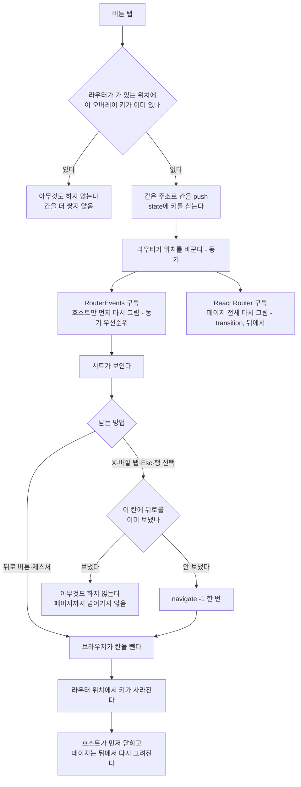
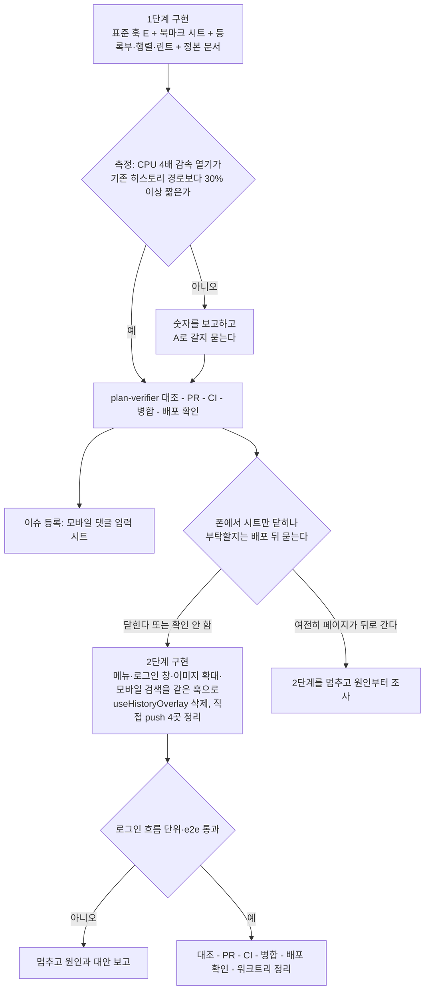

# 뒤로가기로 닫히는 화면 요소를 한 방식으로 맞춘다 — 북마크 시트부터

<!-- plan-result:start — 이 블록만 병합 뒤에도 고칠 수 있다(CLAUDE.md §11). 아래는 승인된 계획 원문 -->

## 구현 결과

> #592 · 2026-11-10 대조 · 이탈 4 · 미구현 1 — 판정 근거(파일:줄)는 PR 본문 "계획 대비 구현"

- 범위: 1단계(PR 1)만 대조했다. 2단계는 그 PR에서 덧붙인다
- 이탈(구현 중 발견): 닫기 가드가 뒤로를 보낸 칸을 `location.key`가 아니라 위치 객체로 기억한다. key로 기억하면 닫은 뒤 앞으로 가기로 돌아온 같은 칸을 다시 닫을 수 없다
- 미구현(위 이탈로 필요 없어짐): `resetBackClosableOverlay()`와 `src/test/setup.ts`의 `afterEach` 호출을 두지 않았다. 테스트마다 라우터를 새로 만들어 앞 테스트가 남긴 위치 객체와 같은 객체가 나올 수 없다. 대조 때는 이유가 적혀 있지 않아 `docs/BACK-NAVIGATION.md` 10장에 적었다
- 이탈(계획 서술이 틀림): 열기 전용 훅을 쓰는 버튼도 위치가 바뀌면 다시 그려진다(`useNavigate`가 읽는 값이 위치마다 바뀐다). 빠지는 것은 창을 먼저 그리는 렌더뿐이고 단위 테스트도 그것만 본다
- 이탈(테스트 준비 코드와 충돌): 금지 린트 3개를 공통 목록이 아니라 운영 코드 전용 목록에 뒀다. 테스트·목 파일에는 걸리지 않는다(테스트가 jsdom 주소를 `replaceState`로 맞춘다)
- 이탈 → 보완함: `docs/BACK-NAVIGATION.md` 정본 표에 "계층" 열이 없었다. 대조 뒤 넣었다
- 계획에 없던 변경: `useNewFolderInput`의 `onCancel` 인자 제거(호출부·테스트 포함), e2e 행렬 네 번째 검사와 단위 테스트 추가 사례(닫은 뒤 앞으로 가기 등), popstate 린트가 `onpopstate` 대입도 잡음, `router-events.ts` 주석
- 문서 동기화: 2026-09-30 계획의 구현 결과 블록에 되돌림 한 줄, TESTING.md의 `renderWithDataRouter` 안내와 스펙 표 행, BOOKMARK.md의 입력 접기 서술, CHANGELOG "창이 먼저 뜸" 항목
- 측정 분기(이탈 아님): 같은 조건으로 두 번 쟀고 4배 감속 열기 단축이 32.4%·28.4%(합쳐서 30.6%)로 30% 선 근처였다. 숫자를 보고했고 사용자가 E 유지를 골랐다(2026-11-10)

<!-- plan-result:end -->

> Android에서 북마크 저장 시트를 연 채 뒤로가기를 누르면 이전 페이지로 가는 문제를 고친다. 고치는 김에 뒤로가기로
> 닫히는 화면 요소 전체를 "모든 기기에서 히스토리 칸 하나 + 실제 뒤로가기 e2e"로 맞추고, 벗어나면 type-check·lint·e2e가
> 잡게 한다. 계획 하나, PR 2개(1단계 북마크 시트와 표준·검사, 2단계 나머지 화면 요소).

## Context

### 무엇이 문제인가

| 사실                                                                                                                                                 | 근거                                                                                                           | 확인 수준                  |
| ---------------------------------------------------------------------------------------------------------------------------------------------------- | -------------------------------------------------------------------------------------------------------------- | -------------------------- |
| Android 폰 Chrome에서 북마크 저장 시트, 글 등록 폼의 폴더 선택 시트, 북마크 페이지의 새 폴더 입력을 연 채 하단 뒤로 버튼을 누르면 이전 페이지로 간다 | 2026-11-10 사용자                                                                                              | 사용자가 기기에서 확인     |
| 같은 폰에서 왼쪽 메뉴는 뒤로 버튼에 메뉴만 닫힌다                                                                                                    | 2026-11-10 사용자                                                                                              | 사용자가 기기에서 확인     |
| 고장 난 세 군데는 모두 `CloseWatcher`로 뒤로가기를 받고, 메뉴는 히스토리 칸으로 받는다                                                               | `src/shared/hooks/useBackClosableOverlay.ts:42-46, :63, :147`, `src/widgets/layout/sidebar/ui/Sidebar.tsx:158` | 직접 읽음                  |
| `CloseWatcher`가 그 폰에서 뒤로 버튼을 못 받는 원인                                                                                                  | 2026-11-03에는 실기기에서 됐다(`docs/DECISIONS.md:423`)                                                        | 못 찾음                    |
| e2e는 Android 뒤로 버튼을 보낼 수 없어 `CloseWatcher` 경로를 흉내 낸 Esc로만 본다                                                                    | `e2e/mocks/close-request.ts`                                                                                   | 직접 읽음                  |
| 데스크톱 평소 화면에서도 재현되는가                                                                                                                  | 사용자는 재현된다고 했고, 운영에서 직접 해 본 클릭 → 뒤로는 창만 닫혔다                                        | 불일치(아래 "뒤집힌 전제") |

### 지금 뒤로가기를 받는 방식이 셋이다

| 방식             | 원리                                                                | 쓰는 곳                                                                                                      | 실제 뒤로가기로 검사하나 |
| ---------------- | ------------------------------------------------------------------- | ------------------------------------------------------------------------------------------------------------ | ------------------------ |
| ① 히스토리 칸    | 열 때 같은 주소에 `state`를 실어 칸을 넣고, 뒤로가기가 그 칸을 뺀다 | 왼쪽 메뉴·로그인 창·이미지 확대 창(`useHistoryOverlay`), 모바일 검색창(별도 구현), 북마크 시트(데스크톱·iOS) | 한다(`page.goBack()`)    |
| ② 이동 차단      | `useBlocker`가 이동을 막는다                                        | 확인창, 작성 중 이탈 확인(`useUnsavedChangesGuard`)                                                          | 한다                     |
| ③ `CloseWatcher` | 히스토리를 안 쓰고 브라우저가 넘겨 주는 "닫기 요청"을 받는다        | 북마크 시트(Android), 새 폴더·이름 바꾸기 입력 4곳(Android)                                                  | 못 한다(Esc로 흉내)      |

깨지기 쉬운 이유는 세 가지다.

- 같은 시트가 기기에 따라 ①과 ③으로 갈리고, ③은 자동 검사가 실제 버튼을 누르지 못한다.
- ①도 훅을 거치지 않고 칸을 넣는 곳이 네 군데(`auth.util.ts:244, :265`, `MarkdownContent.tsx:103`, `ProtectedRoute.tsx:126`)이고
  모바일 검색창은 연타·중복 닫기 가드가 없는 별도 구현이다(`useMobileSearchPanel.ts:24-37`).
- "어떤 화면 요소가 뒤로가기에 어떻게 반응해야 하는가"를 한 곳에 적은 문서가 없다(7개 문서에 흩어져 있다 — 에이전트 보고).

### 업계 기준과 우리 자리

| 상황                                                 | 업계가 다루는 방식                                       | 지금                  | 이 계획 뒤                                  |
| ---------------------------------------------------- | -------------------------------------------------------- | --------------------- | ------------------------------------------- |
| 주소를 공유할 내용(상세 화면 등)                     | 실제 URL                                                 | 실제 URL              | 그대로                                      |
| 화면을 덮는 UI 상태(시트·메뉴·로그인 창·이미지 확대) | 뒤로가기로 닫힌다. 수단은 히스토리 칸이나 `CloseWatcher` | 요소·기기마다 ①③ 혼용 | ① 하나                                      |
| 순간적인 것(드롭다운·툴팁)                           | 히스토리에 넣지 않는다                                   | 안 넣는다             | 그대로                                      |
| 닫으면 입력이 사라지는 것                            | 닫기 전에 확인                                           | 이탈 확인·확인창(②)   | 그대로(모바일 댓글 입력 시트는 이슈로 남김) |
| 오버레이 겹치기                                      | 피한다                                                   | 피한다                | 그대로                                      |

근거는 `docs/DECISIONS.md` 2026-08-07 항목(T0/T1/T2 분류와 금지 사항)과 2026-11-03 항목(Baymard·NN/g·WHATWG·WICG 인용)에
있고 여기 다시 옮기지 않는다. WICG는 `CloseWatcher`를 이 용도의 API로 제안하면서, 히스토리 API가 UI 상태에 잘 맞지 않고
히스토리 이동은 취소할 수 없다는 점을 이유로 든다(요약, [WICG close-watcher](https://github.com/WICG/close-watcher/blob/main/README.md)).
그런데도 ①로 모으는 이유는 "판단이 필요했던 항목" 1번에 적었다.

### 히스토리 칸이 느렸던 이유와 이번 방식(E)

- `navigate()`로 칸을 넣으면 라우터가 그 자리에서 위치를 바꾸고 구독자를 부른다 — `@remix-run/router` 1.23.2
  `dist/router.cjs.js:2147`(push) → `:2184`(상태 갱신) → `:2077`(구독자 호출). loader가 없는 앱이라 `:2649`까지 동기다
  (설치 소스 확인).
- React Router는 그 갱신을 transition으로 넘긴다 — `react-router-dom` 6.30.3 개발 빌드 `:471-498`,
  `src/app/providers/RouterProvider.tsx:27`의 `v7_startTransition`(설치 소스 확인).
- 지금 시트의 열림은 `useLocation()`에서 나온다(`useHistoryOverlay.ts:18`). 그래서 페이지 전체를 다시 그리는 transition이
  끝나야 시트가 뜬다. 2026-11-03 직접 측정: CPU 4배 감속에서 열기 158ms, 컴포넌트 1,116개(`docs/DECISIONS.md:353-361`).
- **E**: 칸은 그대로 넣고, 열림만 React가 커밋한 위치가 아니라 **라우터가 이미 가 있는 위치**(`RouterEvents`)에서 읽는다.
  호스트만 먼저 그려지고 페이지 전체는 뒤에서 transition으로 그려진다. react-dom 18.3.1 개발 빌드로 확인한 근거:
  - 외부 스토어 갱신은 항상 동기 우선순위다(`react-dom.development.js:16154-16159`).
  - `click`·`popstate`는 discrete 이벤트다(`:6573, :6626`).
  - 동기 렌더는 진행 중이던 transition 렌더를 버리고 새로 시작한다(`:26439-26464`).
  - 실행으로 확인하지 않은 것: 이 앱에서 실제로 몇 ms가 되는지. 1단계의 측정이 맡는다.

## 판단이 필요했던 항목

| #   | 항목                                                                          | 결정                                                                                                                                       | 근거·기각한 대안                                                                                                                                                                                                                                                                                                                                                                                                                                                                                                 |
| --- | ----------------------------------------------------------------------------- | ------------------------------------------------------------------------------------------------------------------------------------------ | ---------------------------------------------------------------------------------------------------------------------------------------------------------------------------------------------------------------------------------------------------------------------------------------------------------------------------------------------------------------------------------------------------------------------------------------------------------------------------------------------------------------- |
| 1   | 뒤로가기를 받는 수단                                                          | 모든 기기에서 히스토리 칸(E)                                                                                                               | 사용자 "진행하자"(2026-11-10). 기각 B(`CloseWatcher` 유지 + 폰 디버깅): 원인을 못 찾았고 e2e가 실제 버튼을 못 눌러 다시 조용히 깨질 수 있다. 기각 C(실패를 감지한 기기만 ①로): 경로가 셋으로 는다. `CloseWatcher`는 Safari·iOS에 없어 ①은 어차피 남는다                                                                                                                                                                                                                                                          |
| 2   | 열림을 어디서 읽나                                                            | 라우터가 가 있는 위치의 `state`에 키가 있는가. `useSyncExternalStore(RouterEvents.onNavigate, …)`                                          | 열림 값을 따로 두면(지금의 zustand `openKey`) 칸과 어긋날 수 있다. A(`useLocation`)는 페이지 전체 렌더 뒤에야 뜬다 — 측정이 못 미치면 물러날 자리(11번). `useState`+effect 구독은 렌더와 구독 사이 변경을 따로 맞춰야 한다                                                                                                                                                                                                                                                                                       |
| 3   | `usePostList.ts:141-148`은 라우터 위치를 `useSyncExternalStore`로 읽지 않는데 | 여기서는 쓴다                                                                                                                              | 그 선례의 스냅샷은 위치 전체라 이동마다 바뀐다. 여기 스냅샷은 키 하나의 참·거짓이라 그 오버레이를 여닫을 때만 바뀌고, 호스트는 늘 마운트돼 구독 중이다. React 문서의 주의는 _"스토어가 논블로킹 Transition 갱신 도중 바뀌면 React는 그 갱신을 블로킹으로 다시 수행한다"_ (번역, 이 세션에서 받은 발췌, [useSyncExternalStore](https://react.dev/reference/react/useSyncExternalStore#caveats)) — 구독 중인 컴포넌트는 동기 갱신이 먼저 그 transition 렌더를 버린다(위 소스 확인). 위험 4번의 e2e로 실행 확인한다 |
| 4   | 훅의 이름·모양                                                                | `useBackClosableOverlay`·`useBackClosableOverlayOpen` 이름과 반환형 유지, 안만 교체. 2단계에서 `useHistoryOverlay`를 흡수                  | 호출부 3곳의 코드가 그대로다. 새 이름을 만들면 훅이 셋이 된다                                                                                                                                                                                                                                                                                                                                                                                                                                                    |
| 5   | 연타·중복 닫기 가드                                                           | 열기는 라우터가 가 있는 위치로 판정, 닫기는 "뒤로를 보낸 칸의 `location.key`"를 모듈 변수 하나로 기억                                      | 커밋된 위치로 보면 transition이 끝나기 전 두 번째 탭이 통과한다. 지금의 인스턴스별 ref는 같은 키를 두 곳이 닫을 때 못 막는다(`Sidebar.tsx:22, :158`)                                                                                                                                                                                                                                                                                                                                                             |
| 6   | 새 폴더·이름 바꾸기 입력을 뒤로가기로 접기                                    | 없앤다                                                                                                                                     | 사용자 선택(2026-11-10). 히스토리 칸으로 다시 만들면 칸이 겹쳐 쌓인다                                                                                                                                                                                                                                                                                                                                                                                                                                            |
| 7   | 모바일 댓글 입력 시트                                                         | 이번 계획에서 빼고 이슈로 남긴다                                                                                                           | 사용자 선택. 지금은 글을 쓰던 중이면 이탈 확인이 지킨다(`useCreateComment.ts:126-130`)                                                                                                                                                                                                                                                                                                                                                                                                                           |
| 8   | 정본 문서                                                                     | 새 문서 `docs/BACK-NAVIGATION.md`                                                                                                          | 사용자 선택. 선례 `docs/UNSAVED-CHANGES-GUARD.md`                                                                                                                                                                                                                                                                                                                                                                                                                                                                |
| 9   | 등록부                                                                        | `src/shared/config/back-closable-overlay.ts`에 키 유니온, 훅 인자를 그 타입으로                                                            | e2e가 `@/shared/config/*`를 이미 import하고(`e2e/sidebar-drawer-back.mobile.spec.ts:9-10`) `tsconfig.e2e.json`이 `pnpm type-check` 대상이라, 행렬에 사례가 없는 키는 컴파일 오류가 된다                                                                                                                                                                                                                                                                                                                          |
| 10  | 우회 금지 린트                                                                | `eslint.config.js:24`의 `RESTRICTED_SYNTAX_COMMON`에 `CloseWatcher` 사용, `pushState`·`replaceState` 호출, `popstate` 리스너 금지를 더한다 | 2026-08-07 금지 사항이 문서에만 있었다. 지금 `src`에 위반은 없다(직접 grep). 세 블록이 함께 펼쳐 쓰는 상수라 한 곳만 고친다                                                                                                                                                                                                                                                                                                                                                                                      |
| 11  | E를 유지하는 기준                                                             | CPU 4배 감속 열기 중앙값이 같은 날 잰 기존 히스토리 경로보다 30% 이상 짧으면 유지. 아니면 숫자를 보고하고 A로 갈지 묻는다                  | 30%는 내가 정한 선이다(외부 기준 아님). 11-03 값이면 158ms → 110ms 이하. A로 가도 등록부·행렬·린트·문서는 그대로이고 읽는 한 줄만 `useLocation`으로 바뀐다                                                                                                                                                                                                                                                                                                                                                       |
| 12  | 측정 스크립트                                                                 | `scripts/back-overlay-measure/`에 커밋                                                                                                     | 11-03 스크립트는 1회용이라 남지 않았다. 선례 `scripts/barrel-experiment/`                                                                                                                                                                                                                                                                                                                                                                                                                                        |
| 13  | 테스트의 라우터                                                               | `src/test/utils.tsx`에 데이터 라우터 도우미를 더하고 기존 `renderWithProviders`는 그대로                                                   | 실제 라우터 구독이 있어야 열림을 읽는다. 훅에 "구독이 없으면 `useLocation`" 분기를 넣으면 테스트만 타는 경로가 생긴다. 같은 구성을 이미 11개 테스트 파일이 직접 만든다                                                                                                                                                                                                                                                                                                                                           |
| 14  | 계획·PR 단위                                                                  | 계획 하나, PR 2개                                                                                                                          | 사용자 승인 범위(2026-11-10)                                                                                                                                                                                                                                                                                                                                                                                                                                                                                     |

### 뒤집힌 전제

| 발견                                                                                                                                    | 그래서 바뀐 것                                                                                                                                                                                                                        |
| --------------------------------------------------------------------------------------------------------------------------------------- | ------------------------------------------------------------------------------------------------------------------------------------------------------------------------------------------------------------------------------------- |
| 11-03에 실기기에서 확인한 `CloseWatcher` 경로가 11-10에는 같은 종류의 폰에서 동작하지 않는다. 그 사이 watcher를 건드린 커밋은 못 찾았다 | 실제 버튼으로 검사할 수 없는 경로를 없앤다. 11-03 D안을 뒤집는다                                                                                                                                                                      |
| 11-03에 B안(히스토리 유지 + 구독 줄이기)을 "비공개 `router.subscribe`에 기대야 한다"는 이유로 기각했다                                  | 그 구독은 `RouterEvents`로 이미 6곳이 쓴다(직접 grep). 새 의존이 아니라 기존 의존을 한 곳 더 쓰는 것이고, 실제 라우터로 도는 단위 테스트를 새로 둔다                                                                                  |
| "e2e는 Android 뒤로가기를 못 보낸다"                                                                                                    | `CloseWatcher` 경로에만 해당한다. 히스토리 칸은 `page.goBack()`이 같은 일(칸 빼기)을 한다. 폰에서 메뉴가 닫히는 것이 그 근거다                                                                                                        |
| 사용자는 데스크톱 평소 화면에서도 재현된다고 했는데 내 확인은 반대였다                                                                  | 풀지 못했다. 가설: 개발자 도구 기기 모드로 띄운 탭은 새로고침 전까지 ③ 경로로 남는다(`useBackClosableOverlay.ts:93-94`, 실행 확인 안 함). 경로가 하나가 되면 이 차이는 없어진다. 1단계 뒤에도 재현되면 다른 버그로 보고 따로 조사한다 |
| 입력 접기는 11-03·11-04에 사용자가 고른 기능이다(#517)                                                                                  | ③ 위에서만 되는 기능이라 함께 없앤다(사용자 선택). Esc와 취소 버튼은 남는다                                                                                                                                                           |

### 위험 관리

| #   | 위험                                                                                             | 막는 방법                                                                                                                                 | 자동 검사                                                                               |
| --- | ------------------------------------------------------------------------------------------------ | ----------------------------------------------------------------------------------------------------------------------------------------- | --------------------------------------------------------------------------------------- |
| 1   | 비공개 `router.subscribe`에 기댄다 — 라우터를 올리면 깨질 수 있다                                | 접점은 `router-events.ts` 한 파일                                                                                                         | 실제 `createMemoryRouter`로 도는 `router-events.test.ts`(신규)                          |
| 2   | 연타로 칸이 둘 쌓여 닫기를 두 번 눌러야 한다                                                     | 판단 5                                                                                                                                    | 단위 테스트 "두 번 열어도 한 칸"                                                        |
| 3   | 닫기가 두 번 불려 페이지까지 뒤로 간다                                                           | 판단 5                                                                                                                                    | 단위 테스트 "두 번 닫아도 뒤로 한 번", e2e 행렬 "UI로 닫으면 칸이 빠지고 주소는 그대로" |
| 4   | 새 목록을 기다리는 동안(칩을 누른 직후) 시트를 열면 이전 목록이 스켈레톤으로 바뀐다              | 판단 3                                                                                                                                    | e2e "목록 응답을 붙잡아 둔 채 시트를 열어도 이전 카드가 남는다"                         |
| 5   | 동기 우선순위로 열린 호스트가 suspend하면 가까운 Suspense fallback이 화면을 가린다               | 카드 시트 호스트와 로그인 창은 자체 `Suspense fallback={null}` 안이다(`RootLayout.tsx:55-60`, 직접 읽음). 글 등록 폼 시트는 lazy가 아니다 | 2단계에서 옮기는 호스트마다 같은 점검                                                   |
| 6   | 측정이 기대에 못 미친다                                                                          | 판단 11                                                                                                                                   | 측정 스크립트                                                                           |
| 7   | `MemoryRouter` 테스트에서는 열림이 늘 닫힘으로 읽힌다                                            | 판단 13                                                                                                                                   | `pnpm test` 전체                                                                        |
| 8   | 새 오버레이가 표준을 거치지 않는다                                                               | 등록부 타입, e2e 행렬 `satisfies`, 린트                                                                                                   | `pnpm type-check`, `pnpm lint`, e2e                                                     |
| 9   | (2단계) 로그인 창은 커밋된 위치로 판정하는 코드와 얽혀 있다(`ProtectedRoute.tsx:49-51, :92-111`) | 그리는 쪽(`useLoginDialog`)만 옮기고 `ProtectedRoute`의 판정은 그대로 둔다. 로그인 흐름 테스트가 깨지면 멈추고 보고한다                   | 기존 단위 11개 파일, e2e `login`·`guest-guard`·`session-expired`·`protected-nav`        |
| 10  | 실제 폰의 뒤로 버튼이 히스토리 칸을 빼지 않는다                                                  | 같은 폰에서 메뉴(히스토리 칸)가 닫힌다는 사용자 확인                                                                                      | 자동 검사 불가 — 배포 뒤 폰 확인을 부탁할지 그때 묻는다                                 |

## 세부 계획

### Phase 1 — 표준 훅, 북마크 시트, 검사, 정본 문서 (PR 1)

**코드**

| 위치                                                                                                                                                                                                                                                                            | 변경 내용                                                                                                                                                                                                                                                                                                                                                                                                                                                                                                                                                                                                     |
| ------------------------------------------------------------------------------------------------------------------------------------------------------------------------------------------------------------------------------------------------------------------------------- | ------------------------------------------------------------------------------------------------------------------------------------------------------------------------------------------------------------------------------------------------------------------------------------------------------------------------------------------------------------------------------------------------------------------------------------------------------------------------------------------------------------------------------------------------------------------------------------------------------------- |
| `src/shared/config/back-closable-overlay.ts` (신규)                                                                                                                                                                                                                             | 뒤로가기로 닫히는 오버레이 키 목록과 `BackClosableOverlayKey` 유니온. 1단계 키는 `bookmarkFolderDialogOpen`, `postCreateBookmarkFolderOpen`                                                                                                                                                                                                                                                                                                                                                                                                                                                                   |
| `src/shared/hooks/useBackClosableOverlay.ts`                                                                                                                                                                                                                                    | 전체 교체. `useBackClosableOverlay(key)` → `{ isOpen, open, close }`: `isOpen`은 `useSyncExternalStore(RouterEvents.onNavigate, 키 유무)`, `open`은 `RouterEvents.getLocation()`에 키가 없을 때만 `pathname+search`로 push(`state: {[key]: true}`, `preventScrollReset`, 해시는 지금처럼 싣지 않음), `close`는 키가 있고 그 칸에 뒤로를 안 보냈을 때만 `navigate(-1)`. `useBackClosableOverlayOpen(key)` → `open`만, 구독 없음. zustand `openKey` 스토어·`CloseWatcher`·`useBackCloseRequest`·기기 판정 삭제. `resetBackClosableOverlay()`는 래치 초기화로 남김. 주석에 react.dev `useSyncExternalStore` 링크 |
| `src/types/close-watcher.d.ts`                                                                                                                                                                                                                                                  | 삭제(`git rm`)                                                                                                                                                                                                                                                                                                                                                                                                                                                                                                                                                                                                |
| `src/features/bookmark/select/hooks/useNewFolderInput.ts:34-40`, `src/features/bookmark/rename/hooks/useRenameBookmarkFolder.ts:83-89`, `src/widgets/bookmark/folder-nav/hooks/useMobileFolderList.ts:31-37`, `src/widgets/bookmark/folder-nav/hooks/useFolderSidebar.ts:82-88` | `useBackCloseRequest` 호출과 import 제거. Esc·취소 버튼 경로는 건드리지 않는다                                                                                                                                                                                                                                                                                                                                                                                                                                                                                                                                |
| `src/features/post/create/hooks/usePostCreateBookmarkFolderField.ts:32-35`, `src/features/bookmark/toggle/hooks/useGlobalPostBookmarkFolderDialog.ts:9-13`, `src/features/bookmark/toggle/hooks/useBookmarkPostButton.ts`                                                       | 기기별 경로를 설명하는 주석만 고친다. 호출 코드는 그대로                                                                                                                                                                                                                                                                                                                                                                                                                                                                                                                                                      |
| `src/test/setup.ts:21` 옆                                                                                                                                                                                                                                                       | `afterEach`에 `resetBackClosableOverlay()` 추가                                                                                                                                                                                                                                                                                                                                                                                                                                                                                                                                                               |

**단위 테스트**

| 위치                                                                                                                                            | 변경 내용                                                                                                                                                                                                                                                                                                                                                                                           |
| ----------------------------------------------------------------------------------------------------------------------------------------------- | --------------------------------------------------------------------------------------------------------------------------------------------------------------------------------------------------------------------------------------------------------------------------------------------------------------------------------------------------------------------------------------------------- |
| `src/test/utils.tsx`                                                                                                                            | `renderWithDataRouter(ui, { initialEntries })` 추가 — `createMemoryRouter` + `RouterEvents.setSource(router)` + `RouterProvider`(`v7_startTransition`) + QueryClient, `router`를 돌려준다. 형태는 `src/app/routes/ProtectedRoute.test.tsx:237-264`                                                                                                                                                  |
| `src/shared/lib/router/router-events.test.ts` (신규)                                                                                            | 실제 라우터로: push·replace·pop마다 `onNavigate`가 불리고 `getLocation()`이 `state`까지 최신이다, 위치가 안 바뀌면 안 불린다, `onPop`은 pop에만                                                                                                                                                                                                                                                     |
| `src/shared/hooks/useBackClosableOverlay.test.tsx`                                                                                              | 다시 쓴다(`navigate` 모킹 대신 실제 라우터 상태를 본다). 사례: 열면 같은 주소에 칸이 하나 생긴다 / 두 번 열어도 한 칸 / 닫으면 뒤로 한 번, 두 번 닫아도 한 번 / 닫혀 있으면 닫기는 아무것도 안 한다 / 라우터에서 뒤로 가면 `isOpen`이 false / 페이지 쪽 transition이 suspend해 끝나지 않아도 `isOpen`이 먼저 true / 열기 전용 훅은 위치가 바뀌어도 다시 렌더되지 않는다. `CloseWatcher` 사례는 삭제 |
| `src/features/bookmark/toggle/ui/GlobalPostBookmarkFolderDialog.test.tsx`, `src/features/post/create/ui/PostCreateBookmarkFolderField.test.tsx` | 새 도우미로 옮긴다. `pnpm test` 전체에서 `MemoryRouter` 아래 시트를 여는 다른 테스트가 나오면 같은 방식으로 옮긴다                                                                                                                                                                                                                                                                                  |

**e2e**

| 위치                                                                                   | 변경 내용                                                                                                                                                                                                                                                                                                                                                                     |
| -------------------------------------------------------------------------------------- | ----------------------------------------------------------------------------------------------------------------------------------------------------------------------------------------------------------------------------------------------------------------------------------------------------------------------------------------------------------------------------- |
| `e2e/back-closable-overlay.cases.ts` (신규)                                            | 키마다 "어느 화면에서 무엇을 눌러 여는가, 무엇이 보이는가, UI로 어떻게 닫는가"를 적은 표. `satisfies Record<BackClosableOverlayKey, …>`. 공통 테스트 3개를 만드는 함수도 여기: ① 열면 `history.state.usr[키]`가 true이고 `idx`가 1 는다 ② `page.goBack()` → 오버레이가 사라지고 주소 그대로, `history.state`에 키 없음 ③ UI로 닫으면 `idx`가 열기 전으로 돌아가고 주소 그대로 |
| `e2e/back-closable-overlay.spec.ts`, `e2e/back-closable-overlay.mobile.spec.ts` (신규) | 위 함수를 데스크톱(`chromium`)·Pixel 5(`mobile-chrome`)에서 각각 부른다                                                                                                                                                                                                                                                                                                       |
| `e2e/bookmark-folder-dialog.mobile.spec.ts`                                            | `CloseWatcher` 전제(`:29-41`), "히스토리가 안 쌓인다" 단언(`:45-68`), `sendCloseRequest` 사례(`:103, :152, :162, :202`)를 히스토리 칸 기준으로 다시 쓰거나 지운다. 새 폴더 입력 중 Esc 사례(`:110`)는 "입력만 접힌다"만 남긴다                                                                                                                                                |
| `e2e/bookmark-folder-dialog.spec.ts`                                                   | "목록 응답을 붙잡아 둔 채 시트를 열어도 이전 카드가 남고 시트가 뜬다" 추가(위험 4)                                                                                                                                                                                                                                                                                            |
| `e2e/bookmark-folder-host.mobile.spec.ts:14-15`                                        | 주석의 "히스토리 없이 열리는 경로" 설명 정정                                                                                                                                                                                                                                                                                                                                  |
| `e2e/bookmark-inline-input-back.mobile.spec.ts`, `e2e/mocks/close-request.ts`          | 삭제(`git rm`)                                                                                                                                                                                                                                                                                                                                                                |

**린트**

| 위치                                             | 변경 내용                                                                                                                                                      |
| ------------------------------------------------ | -------------------------------------------------------------------------------------------------------------------------------------------------------------- |
| `eslint.config.js:24` `RESTRICTED_SYNTAX_COMMON` | selector 3개 추가: `CloseWatcher` 생성·참조, `pushState`·`replaceState` 호출, `addEventListener('popstate', …)`. 메시지는 `docs/BACK-NAVIGATION.md`를 가리킨다 |

**문서**

| 위치                                                                                                                 | 변경 내용                                                                                                                                                                                                      |
| -------------------------------------------------------------------------------------------------------------------- | -------------------------------------------------------------------------------------------------------------------------------------------------------------------------------------------------------------- |
| `docs/BACK-NAVIGATION.md` (신규)                                                                                     | 독립 기능 문서 순서(CLAUDE.md)대로. 핵심은 화면 요소별 정본 표(요소, 계층, 뒤로가기에 일어나는 일, 수단, 검사 파일)와 "새 오버레이를 더하는 절차". 모바일 댓글 입력 시트는 "기준과 다름(이슈 링크)"으로 적는다 |
| `README.md` `## 문서`, `docs/ONBOARDING.md` 기능 지도                                                                | 새 문서 등록                                                                                                                                                                                                   |
| `docs/BOOKMARK.md`                                                                                                   | `:206-283`(기기별 경로·입력 접기), `:1088`, `:2234-2249`(용어), 9장 검증, 11장 남은 것을 현재 동작으로 고치고 정본 표를 가리킨다                                                                               |
| `docs/TESTING.md:972, :1083, :1085, :1088`                                                                           | 지운 파일·바뀐 스펙 설명                                                                                                                                                                                       |
| `docs/DECISIONS.md`                                                                                                  | 새 항목(2026-11-10): 11-03 D안을 뒤집고 E를 고른 비교표, 측정값                                                                                                                                                |
| `docs/plans/2026-11-03-bookmark-dialog-close-watcher.md`, `docs/plans/2026-11-03-bookmark-new-folder-back-cancel.md` | 구현 결과 블록에 `대체됨:` 한 줄씩                                                                                                                                                                             |
| `docs/plans/2026-11-10-back-navigation-standard.md` (신규)                                                           | 이 계획의 스냅샷 + 구현 결과 블록                                                                                                                                                                              |
| `CHANGELOG.md` `[Unreleased]`                                                                                        | 고친 것(Android 뒤로가기), 바뀐 것(입력 접기 제거). 형식은 `changelog-release` skill                                                                                                                           |

**측정**

| 위치                                              | 변경 내용                                                                                                                                                                                                                                                                                                                                           |
| ------------------------------------------------- | --------------------------------------------------------------------------------------------------------------------------------------------------------------------------------------------------------------------------------------------------------------------------------------------------------------------------------------------------- |
| `scripts/back-overlay-measure/measure.mjs` (신규) | 11-03과 같은 조건(로컬 운영 빌드, 카드 12장·폴더 25개, 클릭부터 시트 상태가 바뀐 다음 프레임까지 30회 중앙값, CPU 1배·4배, 커밋 훅으로 센 렌더 컴포넌트 수). 추가 지표: 닫기, 열자마자 닫기, 시트가 뜨는 동안 가장 긴 프레임 간격. `origin/main` 빌드(마우스 = 기존 히스토리 경로, 터치 = 기존 `CloseWatcher` 경로)와 이 브랜치 빌드를 같은 날 잰다 |
| `scripts/back-overlay-measure/results/`           | 결과 JSON. 요약 표는 `docs/BACK-NAVIGATION.md` 9장과 `docs/DECISIONS.md` 새 항목에                                                                                                                                                                                                                                                                  |

### Phase 2 — 나머지 화면 요소를 같은 훅으로 (PR 2)

1단계가 병합·배포된 뒤 새 워크트리에서 시작한다. 시작할 때 로그인 창 호출부(`useLoginDialog.ts`, `useAuthGuard.ts`,
`useProtectedNavigate.ts`, `ProtectedRoute.tsx`, `auth.util.ts`)를 다시 읽고, 아래와 달라지는 판단이 생기면 그때 알린다.

| 위치                                                                                                                                                                                                                                              | 변경 내용                                                                                                                             |
| ------------------------------------------------------------------------------------------------------------------------------------------------------------------------------------------------------------------------------------------------- | ------------------------------------------------------------------------------------------------------------------------------------- |
| `src/shared/config/back-closable-overlay.ts`                                                                                                                                                                                                      | 키 4개 추가(`sidebarOpen`, `loginDialogOpen`, `imageViewerOpen`, `mobileSearchOpen`)와, 훅 밖에서 칸을 넣을 때 쓰는 `state` 생성 함수 |
| `src/shared/hooks/useBackClosableOverlay.ts`                                                                                                                                                                                                      | `openReplacingCurrent` 추가(지금 `useHistoryOverlay.ts:37-43`과 같은 동작)                                                            |
| `Sidebar.tsx:22, :158`, `Navbar.tsx:37, :39`, `useLoginDialog.ts:20`, `useAuthGuard.ts:33`, `useProtectedNavigate.ts:16`, `imageViewer.store.ts:51`, `ImageViewer.tsx:31`, `AppLayout.tsx:34`, `CreatePostForm.tsx:47`, `MobileCommentBar.tsx:33` | `useHistoryOverlay` → `useBackClosableOverlay`(열기만 쓰는 곳은 `useBackClosableOverlayOpen`)                                         |
| `src/widgets/layout/navbar/hooks/useMobileSearchPanel.ts`                                                                                                                                                                                         | 열림·열기·닫기를 같은 훅으로(연타 가드와 닫기 래치가 생긴다). 검색 제출의 `replace`는 그대로                                          |
| `auth.util.ts:235-248, :257-270`, `MarkdownContent.tsx:97-107`, `ProtectedRoute.tsx:123-129`                                                                                                                                                      | 리터럴 `state` 대신 등록부의 생성 함수를 쓴다. `ProtectedRoute`가 커밋된 위치로 판정하는 부분(`:49-51`)은 그대로                      |
| `src/shared/hooks/useHistoryOverlay.ts`, `useHistoryOverlay.test.tsx`                                                                                                                                                                             | 삭제. 사례는 `useBackClosableOverlay.test.tsx`로 옮긴다                                                                               |
| `eslint.config.js`                                                                                                                                                                                                                                | 등록부 밖에서 `state`에 `…Open` 리터럴을 싣는 것 금지(객체 속성·JSX 속성 selector 2개)                                                |
| 단위 테스트 11개 파일(`ProtectedRoute`, `useAuthEpochSync`, `useAuthGuard`, `useProtectedNavigate`, `MobileCommentBar`, `client`, `auth.util`, `useLoginDialog`, `LoginDialog`, `Sidebar`, `useCreatePost.guard`)                                 | 깨지는 것만 데이터 라우터 도우미로 옮긴다                                                                                             |
| `e2e/back-closable-overlay.cases.ts`                                                                                                                                                                                                              | 키 4개의 사례 추가(추가하지 않으면 type-check가 실패한다)                                                                             |
| `docs/BACK-NAVIGATION.md`, `docs/SEARCH.md` §11, `docs/FE-ARCHITECTURE.md` §25, `docs/AUTH.md`·`docs/COMMENT.md`·`docs/UNSAVED-CHANGES-GUARD.md`의 해당 문장, `CHANGELOG.md`                                                                      | 정본 표 갱신, 흩어진 설명은 정본 표를 가리키게 고친다(줄 번호는 에이전트 보고라 그때 직접 확인)                                       |
| `scripts/back-overlay-measure/`                                                                                                                                                                                                                   | 메뉴·로그인 창 열기를 전후로 잰다                                                                                                     |

### 이슈 (PR 아님)

| 위치                  | 변경 내용                                                                                                                                                                                                                   |
| --------------------- | --------------------------------------------------------------------------------------------------------------------------------------------------------------------------------------------------------------------------- |
| FE 저장소 GitHub 이슈 | "모바일 댓글 입력 시트: 뒤로가기로 접기와 접을 때 쓰던 글 처리" — 지금 동작(`MobileCommentBar.tsx:88-89`, `useCreateComment.ts:126-130`)과 정해야 할 것. 1단계 PR을 열 때 만들고 `docs/BACK-NAVIGATION.md` 남은 것에서 링크 |

### 작업 순서에서 지킬 것

- `EnterWorktree`(로컬 `main`에 미푸시 커밋 없음 — 2026-11-10 확인) → `.env` 복사·`pnpm install` → `node -v`가 v24인지 확인.
- 훅을 고치기 전에 `pnpm graph:focus "src/shared/hooks/useBackClosableOverlay.ts" --text`로 사용처를 다시 뽑는다.
- 커밋은 경로를 직접 나열한다. 새 파일은 `git add -- <새 파일>`, 삭제는 `git rm`.
- PR 본문은 `## 계획 대비 구현`(plan-verifier 대조, 계획 파일 링크)을 넣고 `pnpm check:pr-body`로 검사한다.
- 병합은 `gh pr merge --squash`. 병합 뒤 배포 워크플로가 그 커밋으로 성공한 것을 확인하고 워크트리를 지운다.

## 영향 범위

**히스토리 칸(브라우저 상태)의 넣기·읽기·빼기·바꾸기** — 서버 데이터·API·쿼리 캐시는 바뀌지 않는다.

- 넣기(열기): 연타하면 칸이 둘 → 판단 5. Android에서 시트가 새로 칸을 만든다. 칸이 생길 때 반응하는 기존 코드는
  스크롤 유지(`preventScrollReset`), 상세 화면 "뒤로" 라벨(`src/pages/post/hooks/usePostDetail.ts:45`), 댓글 해시
  (`src/widgets/comment/comment-list/ui/CommentList.tsx:54`), 이탈 확인의 같은 경로 예외(`useUnsavedChangesGuard.ts:28-30`)이고,
  모두 데스크톱·iOS에서 이미 지나던 길이다.
- 읽기(열림): 호스트는 라우터가 가 있는 위치를, 페이지는 커밋된 위치를 본다. 한 컴포넌트 안에서 둘을 섞어 판정하는 곳은
  1단계 범위에 없다(`useGlobalPostBookmarkFolderDialog`는 열림과 zustand 대상만 본다).
- 빼기(닫기): 두 번 빼면 페이지 이탈 → 판단 5. 새로고침 뒤 대상 없이 남은 칸은 지금처럼 호스트가 닫는다
  (`useGlobalPostBookmarkFolderDialog.ts:19-26`).
- 바꾸기(replace): 2단계의 `openReplacingCurrent`만 해당한다.

**달라지는 동작(의도한 것)**

- Android: 시트 안에서 새 폴더 이름을 쓰다 뒤로가기를 누르면 입력만 접히던 것이 시트가 닫힌다. 북마크 페이지에서 새 폴더·
  이름 바꾸기 입력 중 뒤로가기는 페이지가 뒤로 간다. 둘 다 데스크톱·iOS의 지금 동작과 같다.
- Android: 시트가 열린 채 로그인이 만료되면, 다시 로그인한 뒤 시트가 다시 뜬다(지금 데스크톱·iOS와 같다, `docs/DECISIONS.md:428`).
- 모든 기기: 시트가 페이지 다시 그리기보다 먼저 뜬다. 피드 카드의 북마크 버튼은 위치 변경에 다시 렌더되지 않는다.

**깨질 수 있는 기존 것과 소유 파일**

- 훅 사용처(직접 grep): `usePostCreateBookmarkFolderField.ts:40`, `useGlobalPostBookmarkFolderDialog.ts:14`,
  `useBookmarkPostButton.ts:31`, 입력 접기 4곳.
- 옛 계약을 담은 테스트: `useBackClosableOverlay.test.tsx`, `GlobalPostBookmarkFolderDialog.test.tsx`,
  `PostCreateBookmarkFolderField.test.tsx`, e2e 4개 파일(위 표).
- 옛 동작을 적은 문서: 위 문서 표.
- 2단계: 로그인 흐름(위험 9), `useHistoryOverlay`를 쓰는 12곳.

**배포 순서**: FE만 바뀐다. 데이터 계약 변경 없음.

## 검증 방법

**1단계**

1. `pnpm type-check` — 행렬에서 키 하나를 지우면 실패하는 것을 한 번 확인하고 되돌린다.
2. `pnpm test` 전체.
3. `pnpm lint`·`pnpm check:deps` — 세 금지 규칙은 위반 파일을 디스크에 잠깐 만들어 lint-staged와 같은 명령으로 잡히는지 본다.
4. `pnpm check:docs`.
5. e2e — 행렬 2키 × 2프로젝트, 고친 북마크 스펙, 위험 4 사례. 파일 필터는 `e2e/`부터 적는다. 이후 CI 전체.
6. 측정 — `caffeinate -i`로 묶고 포트를 직접 지정해 돌린다. 판단 11의 기준으로 판정하고 숫자를 보고한다.
7. 브라우저 녹화(`browser-verification` skill) — Pixel 5 에뮬레이션에서 피드 시트와 글 등록 폼 시트를 열고 뒤로가기,
   데스크톱에서 같은 장면.
8. plan-verifier 대조 → PR 본문과 구현 결과 블록.
9. 병합 뒤 배포 워크플로 성공 확인 → 운영에서 시트를 열고 뒤로가기(요소를 지정한 클릭, 쓰기 요청 없음).

**2단계**: 1~5, 7~9를 같은 방식으로. 5는 행렬 6키 × 2프로젝트와 로그인 관련 e2e. 6은 메뉴·로그인 창 열기 전후 비교(보고만).

**완료 조건**: 두 PR이 병합·배포되고, e2e 행렬이 등록부의 모든 키를 두 프로젝트에서 통과하며, `src`에 `CloseWatcher`·
`useHistoryOverlay`가 남지 않는다. 바꾸면 안 되는 것 — 확인창·이탈 확인(②)의 동작, 드롭다운류, 시트의 모양과 애니메이션.

## 남은 것

- 실제 폰 확인 — 자동 검사가 대신하지 못하는 마지막 확인이다. 1단계 배포 뒤 이유와 함께 부탁할지 묻는다. 2단계의 시작
  조건은 아니지만, 폰에서 여전히 페이지가 뒤로 가면 2단계를 멈춘다.
- 모바일 댓글 입력 시트 — 이슈로 남긴다(판단 7).
- Android에서 `CloseWatcher`가 뒤로 버튼을 못 받는 원인 — 조사하지 않는다. 그 경로를 없앤다.
- 데스크톱 평소 화면 재현 불일치 — 1단계 뒤에도 재현되면 따로 조사한다.
- 시트 안에서 새 폴더 이름을 쓰다 뒤로가기를 누르면 쓰던 이름이 사라진다 — 지금 데스크톱·iOS와 같은 동작이고 이번에
  바꾸지 않는다. 정본 표에 적어 둔다.
