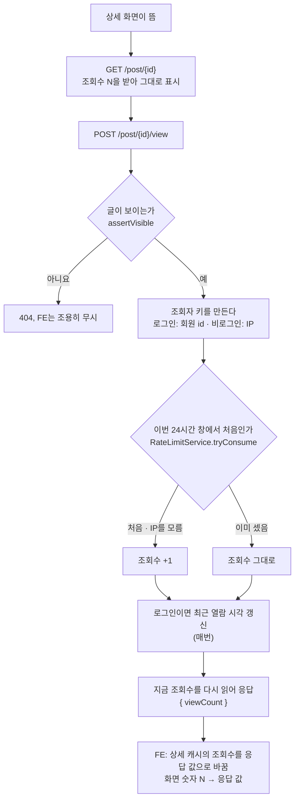
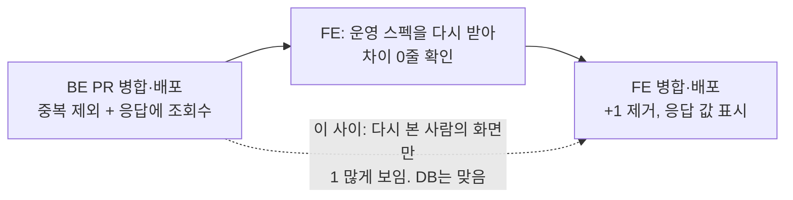
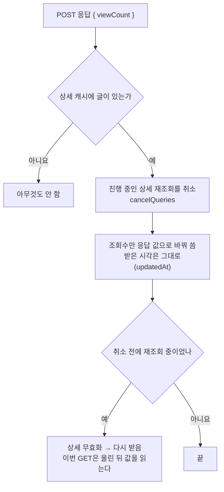

# 같은 사람의 조회는 24시간에 한 번만 센다

<!-- plan-result:start — 이 블록만 병합 뒤에도 고칠 수 있다(CLAUDE.md §11). 아래는 승인된 계획 원문 -->

## 구현 결과

> #596 · 2026-11-11 대조 · 이탈 1 · 미구현 0 — FE PR 범위(BE는 BE #194), 판정 근거(파일:줄)는 PR 본문 "계획 대비 구현"

- 이탈(계획 오류): 생성 파일 `openapi.zod.ts`는 2026-11-07 orval 제거 때 없어진 파일이라 갱신할 대상이 없었다. `openapi.json`과 `openapi.gen.ts`만 다시 만들었다.
- 계획의 예측과 달랐던 것(검증 3번): 캐시 반영에서 취소를 빼고 돌리면 실패하는 것은 "화면이 보는 중" 사례가 아니라 새로 더한 "화면을 떠난 뒤 남은 재조회" 사례였다. 보는 중이면 무효화의 재조회가 진행 중인 요청을 갈아 끼운다. 캐시 반영 순서는 계획대로다.
- 계획에 없던 변경(테스트 보강): 단위 테스트 2건을 더했다. 서버가 세지 않은 조회면 받은 숫자 그대로인 것, 화면을 떠난 뒤 남은 상세 재조회가 기록 전 값으로 덮지 못하는 것.
- 계획에 없던 변경(목 동기화): 배럴 비교 측정 스크립트와 상세 훅 테스트의 조회 기록 목도 `{ viewCount }`를 돌려주게 맞췄다.
- 계획에 없던 변경(문서 동기화): `docs/POST.md` API 표에 조회 기록 행, `docs/VERSION-COMPATIBILITY.md` 머리말 미릴리즈 목록에 BE #194, `CHANGELOG.md` Notes에 BE 의존과 배포 순서를 더했고, `docs/POST.md`·`docs/TESTING.md`의 줄 번호 참조를 맞췄다.
- 검증 4번(개발 서버 가드): 고치기 전 코드에서 상세를 한 번 열면 기록 요청이 2건 나갔고, 고친 뒤에는 0건이었다(요청은 브라우저에서 가로막아 운영에 닿지 않게 했다).

<!-- plan-result:end -->

> `POST /post/{id}/view`가 "이 사람이 이 글을 이번 24시간 창에서 이미 셌는지"를 판단해 처음일 때만 조회수를 올리고, 올린 뒤의 조회수를 돌려준다. 상세 화면은 서버가 준 숫자만 보여 주고 `+ 1`을 하지 않는다.

## Context

지금은 상세 화면이 뜰 때마다 조회수가 1 오른다. 새로고침을 10번 하면 10이 오른다.

- FE `usePostDetail.ts:85-94`의 effect가 화면이 뜰 때 `POST /post/{id}/view`를 보낸다.
- BE `PostService.recordView`(`PostService.kt:320-326`)는 누가 몇 번째로 보는지 확인하지 않고 `incrementViewCount`를 부른다.
- 상세는 "받은 값 + 1"을 보여 준다(`PostCard.tsx:387-392`). GET이 기록보다 먼저 끝나서다.

2026-11-05 계획(`docs/plans/2026-11-05-post-view-record.md`)은 "상세 진입마다 +1"로 정하고 중복 제외는 필요해지면 넣기로 했다. 이번에 그 결정을 뒤집는다.

## 판단이 필요했던 항목

| 항목                | 결정                                                                                       | 근거·기각한 대안                                                                                                                                                                                                                                                                                                                                                                                                          |
| ------------------- | ------------------------------------------------------------------------------------------ | ------------------------------------------------------------------------------------------------------------------------------------------------------------------------------------------------------------------------------------------------------------------------------------------------------------------------------------------------------------------------------------------------------------------------- |
| 다시 세는 간격      | 24시간. 2026-11-11 사용자 결정                                                             | velog·WordPress Post Views Counter의 기본값이다. 8시간(Discourse), 1시간(Zenodo): 링크를 모아 두고 며칠 뒤 다시 보는 서비스라 짧은 간격의 이점이 작다.                                                                                                                                                                                                                                                                    |
| 같은 사람의 기준    | 로그인은 회원 id, 비로그인은 IP. 2026-11-11 사용자 결정                                    | Discourse·velog 방식이다. 서버만으로 판단돼 시크릿 창·저장소 삭제로 안 뚫린다. 브라우저 임의 ID: IP를 저장하지 않지만 저장소를 지우면 다시 세고 FE 변경이 는다. IP를 모르면(헤더 없음) 지금처럼 센다.                                                                                                                                                                                                                     |
| 판단 기록의 저장소  | 기존 요청 제한 표(`auth_rate_limits`) 재사용. 2026-11-11 사용자 결정                       | 표·DDL이 없어 사용자가 할 일이 없다. 창이 시계 기준이라 매일 오전 9시(UTC 0시)가 경계이고, 경계를 넘기면 한 번 더 센다. Discourse도 키에 날짜가 들어가 자정에 같은 일이 생긴다. 전용 표: "마지막으로 센 때부터 24시간"이 되지만 운영 DB에 SQL을 직접 실행해야 한다.                                                                                                                                                       |
| 상세의 숫자 표시    | 기록 응답의 조회수를 쓴다. FE는 계산하지 않는다. 2026-11-11 사용자 결정                    | 세는 규칙이 `recordView` 한 곳에만 있어, 규칙이 바뀌어도 FE를 고치지 않는다. 처음 볼 때 숫자가 한 번 바뀐다. FE가 "안 셌으면 +1": 같은 규칙의 사본이 FE에 생겨 한쪽만 바뀌어도 아무것도 실패하지 않는다(사용자 지적). 받은 값 그대로: 내 조회가 다음 방문에야 보인다. 서버가 +1까지 계산: 규칙이 BE 안 두 군데가 되고 같은 필드가 목록과 상세에서 뜻이 달라진다.                                                          |
| 규칙을 두는 곳      | `PostService.recordView` 안. 컨트롤러는 IP만 꺼내 넘긴다                                   | BE 문서는 Service 안에서 판정이 갈리는 한도를 Service에서 건다고 쓴다(`docs/BE-ARCHITECTURE.md:277-278`). 선례는 `AuthService.signup(request, clientIp)`(`AuthService.kt:60-62`). 컨트롤러 람다(`PostController.kt:100-111`): 키·창은 컨트롤러에, 결과는 서비스에 나뉜다.                                                                                                                                                 |
| 버킷 키             | `post-view:<글 id>:member:<회원 id>`, `post-view:<글 id>:ip:<IP>`                          | 기존 키가 `:member:<id>`·`:ip:<IP>`로 끝난다(`docs/TRAFFIC-MANAGEMENT.md:179-185`). 최대 95자쯤이고 컬럼은 `VARCHAR(200)`이다(`create_auth_rate_limits.sql:8`).                                                                                                                                                                                                                                                           |
| 행 보관 기간        | `RETENTION` 1일 그대로                                                                     | 정리는 `window_start < 지금 − 1일`이라(`AuthRateLimitRepository.kt:45-47`) 진행 중인 24시간 창의 행은 지워지지 않는다. 경계 행을 남기는 테스트가 이미 있다(`RateLimitServicePurgeIntegrationTest.kt:22-33`). 2일로 늘리기: 로그인 제한용 IP 행까지 더 오래 남는다.                                                                                                                                                        |
| 올린 뒤 조회수      | `findViewCountById`로 다시 읽는다                                                          | `incrementViewCount`는 벌크 UPDATE라 읽어 둔 엔티티에 반영되지 않는다. BE #159(8a1e258)에서 지운 쿼리를 같은 모양으로 되살린다.                                                                                                                                                                                                                                                                                           |
| FE 캐시 반영        | 진행 중인 상세 재조회를 취소 → 조회수만 바꿔 씀(받은 시각 유지) → 재조회 중이었으면 무효화 | 아래 "FE 캐시 반영 순서". 캐시에 쓰기만: 늦게 온 재조회가 옛 값으로 덮는다. 무효화만: 진입마다 GET이 하나 는다. 화면 state: 다시 들어올 때 숫자가 바뀐다.                                                                                                                                                                                                                                                                 |
| 응답 값 런타임 검사 | 넣지 않는다                                                                                | FE는 응답을 스펙 타입으로 믿는다. 배포 순서를 지키면 생기지 않는 상황이다(아래 "위험 관리").                                                                                                                                                                                                                                                                                                                              |
| 개발 서버 조회 기록 | 가드를 `MODE === 'localhost'`로 고쳐 이번 FE PR에 넣는다. 2026-11-11 사용자 결정           | 2026-11-05 계획의 의도("개발 서버에서는 보내지 않음")를 되살린다. 모드 이름을 비교하는 선례는 `vite.config.ts:51`. 별도 PR: 결과가 같고 PR만 는다. 가드를 없앰: 중복 제외 뒤에는 하루 한 번만 세지만 2026-11-05 결정을 뒤집고, 개발 중 연 글이 운영 계정의 "최근 열람순"에 섞인다. `import.meta.env.DEV`: e2e(`--mode test`)와 Vitest도 참이라 테스트에서 기록이 나가지 않는다. 발견 경위는 아래 "뒤집힌 전제" 마지막 행. |
| 기존 조회수 값      | 고치지 않는다                                                                              | 개별 조회 기록이 없어 새로고침분을 분리할 수 없다(2026-11-05 결정 유지).                                                                                                                                                                                                                                                                                                                                                  |

### 뒤집힌 전제

| 발견                                                                                                                                                                                                                                                                                                                                                                                                                                                | 그래서 바뀐 것                                                                                                                                                                                                                |
| --------------------------------------------------------------------------------------------------------------------------------------------------------------------------------------------------------------------------------------------------------------------------------------------------------------------------------------------------------------------------------------------------------------------------------------------------- | ----------------------------------------------------------------------------------------------------------------------------------------------------------------------------------------------------------------------------- |
| BE만 고치면 화면은 새로고침 때 여전히 1 올라 보인다(`PostCard.tsx:391`의 `+ 1`)                                                                                                                                                                                                                                                                                                                                                                     | 표시도 같이 바꾼다                                                                                                                                                                                                            |
| 처음엔 "브라우저가 기억", 다음엔 "서버가 알려 주고 FE가 +1"을 추천했다                                                                                                                                                                                                                                                                                                                                                                              | 사용자 지적(규칙이 두 레포에 나뉜다)으로 둘 다 뺐다                                                                                                                                                                           |
| 기존 표의 창은 "마지막으로 센 때부터"가 아니라 시계 기준이다(`RateLimitService.kt:97-100`)                                                                                                                                                                                                                                                                                                                                                          | "24시간"은 정확히는 "UTC 하루에 한 번"이다. 문서와 Swagger에 그렇게 쓴다                                                                                                                                                      |
| BE 운영 경로 비교 검사가 이 API를 "빈 data 응답" 사례로 쓴다(`requests.json:65` `r-view`, origin/main)                                                                                                                                                                                                                                                                                                                                              | 사례 이름을 고친다                                                                                                                                                                                                            |
| `pnpm dev`는 2026-01-18(2aac9891)부터 `vite --mode localhost`라(`package.json:11`) #539가 넣은 `MODE === 'development'` 가드(`usePostDetail.ts:87`)가 걸리지 않는다. vite 6.4.1은 `--mode` 값을 그대로 `MODE`에 넣는다(`dep-D4NMHUTW.js:48738`·`:49035`). 테스트는 `MODE`를 `'development'`로 바꿔서만 검사한다(`usePostDetail.test.tsx:56`·`:206`). StrictMode(`main.tsx:28`)라 진입 한 번에 기록이 두 번 나간다. 추적만 했고 실행해 보지는 않았다 | 2026-11-05 계획 73행의 의도("개발 서버에서는 보내지 않음")가 지켜지지 않았다. 개발 서버의 조회가 그날부터 운영에 기록됐을 것으로 본다. 이번 FE PR에서 가드를 고치고, 고치기 전후를 개발 서버에서 직접 확인한다(검증 방법 4번) |

### 다른 제품의 사례

| 제품                         | 같은 사람의 기준                | 다시 세는 간격                | 근거                                                                                                                                                                                                                                |
| ---------------------------- | ------------------------------- | ----------------------------- | ----------------------------------------------------------------------------------------------------------------------------------------------------------------------------------------------------------------------------------- |
| Discourse                    | 로그인은 회원 id, 비로그인은 IP | 8시간(기본값), 키에 날짜 포함 | [topic_view_item.rb](https://github.com/discourse/discourse/blob/main/app/models/topic_view_item.rb) 12-24행, [site_settings.yml](https://github.com/discourse/discourse/blob/main/config/site_settings.yml) 3942행. 소스 직접 확인 |
| velog                        | IP 해시                         | 24시간                        | [velog-server post.ts](https://github.com/velopert/velog-server/blob/master/src/graphql/post.ts) 749-766행. 소스 직접 확인                                                                                                          |
| WordPress Post Views Counter | 브라우저 쿠키                   | 24시간(기본값)                | [readme](https://plugins.svn.wordpress.org/post-views-counter/trunk/readme.txt)는 _"쿠키를 써서 그 창 안에서 같은 콘텐츠를 다시 본 것을 세지 않는다"_ (번역)고 쓴다                                                                 |
| Zenodo                       | 같은 사용자                     | 1시간                         | [도움말](https://support.zenodo.org/help/en-gb/4-usage-statistics/15-what-is-a-view-download-data-volume)은 _"같은 사용자가 같은 시간 창 안에 여러 번 열면 고유 조회 1회로 본다"_ (번역)고 쓴다                                     |
| GA4 "조회수"                 | 중복을 빼지 않음                | 없음                          | [도움말](https://support.google.com/analytics/answer/12926732)은 _"한 화면이나 페이지를 반복해서 본 것도 센다"_ (번역)고 쓴다                                                                                                       |

숫자 표시는 django-hitcount가 같은 흐름이다. 세고 난 결과로 숫자를 정한다(`if hit_count_response.hit_counted: hits = hits + 1`, [views.py 153-160행](https://github.com/thornomad/django-hitcount/blob/HEAD/hitcount/views.py#L153-L160), 소스 직접 확인). Reddit 글은 원문 사이트를 읽지 못했고 Stack Overflow의 "15분"은 공식 출처를 찾지 못해 근거에서 뺐다.

규칙을 한 곳에 두는 근거는 두 가지다. Robert C. Martin은 [2014년 글](https://blog.cleancoder.com/uncle-bob/2014/05/08/SingleReponsibilityPrinciple.html)에서 _"같은 이유로 바뀌는 것들은 한데 모으고, 다른 이유로 바뀌는 것들은 떼어 놓아라"_ (번역)고 쓰고, The Pragmatic Bookshelf의 [팁 목록](https://pragprog.com/tips/)은 _"모든 지식은 시스템 안에서 단 하나의, 모호하지 않은, 권위 있는 표현을 가져야 한다"_ (번역)고 쓴다.

### 위험 관리

- **BE가 먼저다.** FE를 먼저 올리면 옛 BE의 빈 응답(`"data": {}`)에서 조회수를 못 읽어 상세의 숫자가 0이 된다.
- **되돌릴 때는 FE 먼저.** 같은 이유다.
- **열려 있던 옛 탭**은 새로고침 전까지 `+ 1`을 계속한다. 다시 본 글만 1 많게 보인다.
- **판단 뒤 증가가 실패하면** 그 사람의 조회는 그 창에서 빠진다. `tryConsume`이 별도 트랜잭션(`REQUIRES_NEW`)으로 먼저 커밋되기 때문이다. 조회수 1 차이라 받아들인다.
- **같은 IP를 쓰는 여러 사람**(회사, 통신사 공용 IP)은 글마다 하루 한 명으로 센다.
- **요청 제한 표에 "IP와 글 id"가 같이 남는다.** 정리 잡이 돌 때까지 최대 약 5일이다. 지금까지는 IP와 특정 글을 묶는 행이 없었다.

## 세부 계획

작업 준비: 두 레포 모두 `git log origin/main..main`이 비어 있다(2026-11-11 확인). 로컬 main이 뒤처져 있어 워크트리는 origin/main에서 만든다. BE는 FE 세션에서 `git -C <BE> worktree add`로 만든다. 이 계획은 양쪽 PR에 `docs/plans/2026-11-11-post-view-dedupe.md`로 커밋한다.

### 백엔드 (PR 1, 먼저 병합)

경로 접두 `src/main/kotlin/com/example/linksphere/`.

| 위치                                                                                           | 변경 내용                                                                                                                                                                                                                                                             |
| ---------------------------------------------------------------------------------------------- | --------------------------------------------------------------------------------------------------------------------------------------------------------------------------------------------------------------------------------------------------------------------- |
| `domain/post/PostDTO.kt:41-44` 옆                                                              | `PostViewRecordResponse(val viewCount: Int)` 추가.                                                                                                                                                                                                                    |
| `domain/post/PostRepository.kt:37` 뒤                                                          | `findViewCountById(id): Int` 복원(`SELECT COALESCE(p.viewCount, 0) …`).                                                                                                                                                                                               |
| `domain/post/PostService.kt:29-45`                                                             | 생성자에 `RateLimitService` 추가. companion에 `VIEW_COUNT_LIMIT = 1`, `VIEW_COUNT_WINDOW = Duration.ofHours(24)`, private `viewBucketKey(id, userId, clientIp)`.                                                                                                      |
| `domain/post/PostService.kt:316-326`                                                           | `recordView(id, currentUserId, clientIp): PostViewRecordResponse`. 순서: `findById` → `assertVisible` → `tryConsume(키, 1, 24시간)`이 참이면 `incrementViewCount` → 로그인이면 `upsertView`(매번) → `findViewCountById`로 응답. KDoc에 창이 UTC 하루 기준임을 적는다. |
| `domain/post/PostController.kt:133-146`                                                        | `httpRequest: HttpServletRequest`를 받아 `ClientIpResolver.resolve(httpRequest)`를 넘긴다. 반환 `ApiResponse<PostViewRecordResponse>`. `@Operation` 설명을 "같은 회원·IP는 UTC 하루에 한 번만 세고, 센 뒤 조회수를 돌려준다"로.                                       |
| `global/common/RateLimitService.kt:40-41`                                                      | 주석의 "가장 긴 윈도(1시간)"를 24시간으로 고치고, 보관 기간이 창과 같아도 진행 중인 창이 안 지워지는 이유를 적는다. 값은 그대로.                                                                                                                                      |
| `src/test/.../post/PostServiceTest.kt:47-77`, `178-219`                                        | `@Mock RateLimitService` 추가. 사례: 처음이면 올리고 올린 값을 돌려줌, 이미 셌으면 안 올리지만 `upsertView`는 부름, 비로그인은 `:ip:` 키, IP가 없으면 null 키, 안 보이는 글은 `rateLimitService`를 건드리지 않음. 키·한도·창은 정확한 인자로 단정한다.                |
| `src/test/.../post/PostSecurityTest.kt:278` 이하 조회 기록 사례 3개                            | 3인자 시그니처, 반환값 스텁, `$.data.viewCount` 단정, `CloudFront-Viewer-Address` 헤더가 IP로 전달되는 사례 추가.                                                                                                                                                     |
| `src/test/.../post/PostRepositoryIntegrationTest.kt`                                           | `incrementViewCount` 뒤 같은 트랜잭션에서 `findViewCountById`가 올린 값을 돌려준다.                                                                                                                                                                                   |
| `src/test/.../post/`(신규 통합 테스트)                                                         | 같은 조회자의 두 번째 기록은 조회수를 안 올리고 `viewed_at`은 갱신한다. 다른 조회자는 올린다. 글·회원 id는 매번 새 UUID로 쓴다(별도 트랜잭션 행이 롤백되지 않는다).                                                                                                   |
| `scripts/serving-path-experiment/requests.json:65`                                             | `r-view` 제목을 "조회 기록 응답(조회수)"로. 실행 결과에서 빈 `data` 응답 사례가 다른 요청으로 남는지 확인하고, 없으면 `Unit`을 돌려주는 요청을 하나 더한다.                                                                                                           |
| `docs/BE-ARCHITECTURE.md:541-543`                                                              | 조회 기록 서술에 중복 제외와 응답 값을 적는다.                                                                                                                                                                                                                        |
| `docs/DATA-PROTECTION.md` 키 표·운영 파라미터 표                                               | `post-view` 키 두 행(IP와 글 id가 함께 남음), "가장 긴 창 1시간" → 24시간, `마지막 검토` 갱신.                                                                                                                                                                        |
| `docs/TRAFFIC-MANAGEMENT.md` 키 표·한도 표                                                     | `post-view` 키와 "넘으면 429가 아니라 세지 않음" 행.                                                                                                                                                                                                                  |
| `README.md:216-219` API 표                                                                     | 빠져 있던 `POST /post/{id}/view` 행 추가.                                                                                                                                                                                                                             |
| `CHANGELOG.md` `[Unreleased]`                                                                  | `post` 범위 항목.                                                                                                                                                                                                                                                     |
| `docs/plans/2026-11-11-post-view-dedupe.md`(신규), `docs/plans/2026-11-05-post-view-record.md` | 이 계획 스냅샷과 구현 결과 블록. 옛 계획 블록에 `대체됨:` 한 줄.                                                                                                                                                                                                      |

### 프론트엔드 (PR 2, BE 배포 뒤)

#### FE 캐시 반영 순서

설치본 `@tanstack/query-core` 5.90.16에서 확인한 동작이다.

- `setQueryData`는 진행 중인 요청을 멈추지 않는다(`query.js:342-354`, `manual`이면 `fetchStatus`를 안 건드린다). 그래서 3분 넘은 캐시로 들어와 재조회와 기록이 같이 나가면, 늦게 온 GET이 올리기 전 값으로 덮을 수 있다.
- `cancelQueries`는 진행 중인 요청을 되돌린다(`queryClient.js:142-148`). 무효화는 화면이 보고 있는 쿼리를 다시 받는다(`queryClient.js:149-170`).
- `setQueryData`에 `updatedAt`을 넘기면 받은 시각을 유지한다(`query.js:60-68`). 안 넘기면 지금 시각이 찍혀, 3분마다 다시 들어오는 글은 영영 재조회되지 않는다.
- 취소한 뒤 쓰는 선례는 `interaction.queries.ts`의 낙관적 갱신이다.

| 위치                                                                                                                                                   | 변경 내용                                                                                                                                                                                                       |
| ------------------------------------------------------------------------------------------------------------------------------------------------------ | --------------------------------------------------------------------------------------------------------------------------------------------------------------------------------------------------------------- |
| `src/shared/api/generated/openapi.json`, `openapi.gen.ts`, `openapi.zod.ts`                                                                            | BE 워크트리의 `./gradlew openApiSpec` 결과로 `pnpm codegen`. BE 배포 뒤 `pnpm codegen:fetch`로 차이 0줄을 확인하고 병합한다(#539와 같은 절차).                                                                  |
| `src/entities/post/model/post.dto.ts:16` 옆, `post.schema.ts:41-47`                                                                                    | `PostViewRecord = Schemas['PostViewRecordResponse']` 추가와 재공개.                                                                                                                                             |
| `src/entities/post/api/post.api.ts:76-79`                                                                                                              | `recordPostView`가 `Promise<PostViewRecord>`를 돌려준다. JSDoc 갱신.                                                                                                                                            |
| `src/entities/post/api/post.queries.ts:263-275`                                                                                                        | `recordPostView`가 응답의 `viewCount`를 위 순서로 상세 캐시에 반영한 뒤 기존 `handlePostViewRecordedSuccess`를 부른다. 반영 함수는 같은 파일의 지역 함수로 두고 무효화는 `postInvalidateQueries.detail`을 쓴다. |
| `src/widgets/post/post-card/ui/PostCard.tsx:390-391`                                                                                                   | `+ 1`과 그 주석을 지운다.                                                                                                                                                                                       |
| `src/pages/post/hooks/usePostDetail.ts:82-94`                                                                                                          | 가드 조건을 `import.meta.env.MODE === 'localhost'`로 바꾼다. 주석에 개발 서버의 모드 이름이 `localhost`임(`package.json`의 `dev` 스크립트)과 중복 제외를 적는다.                                                |
| `src/pages/post/hooks/usePostDetail.test.tsx:55-57`, `:205-206`                                                                                        | `vi.stubEnv('MODE', 'localhost')`로 바꾼다.                                                                                                                                                                     |
| `src/mocks/handlers/post.handlers.ts:16-19`, `e2e/mocks/post.mock.ts:98-104`                                                                           | 조회 기록 목이 `{ viewCount }`를 돌려준다. e2e 목은 `viewCount` 인자를 받는다.                                                                                                                                  |
| `src/entities/post/api/post.queries.test.ts:986~`                                                                                                      | 응답 값을 캐시에 씀, 캐시가 없으면 만들지 않음, 진행 중인 GET을 버리고 다시 받음, 실패하면 캐시 그대로, 받은 시각 유지, 진행 중 `isMutating()`이 0.                                                             |
| `e2e/post-view-record.spec.ts:80-88`                                                                                                                   | GET 41·POST 42면 42 표시, GET 41·POST 41이면 41 표시(FE 계산 없음), POST 500이면 41 표시와 토스트 없음.                                                                                                         |
| `docs/POST.md:315-321`, `docs/VERSION-COMPATIBILITY.md`, `docs/TESTING.md`(조회 기록 스펙 행, "자주 발생하는 문제" 14번의 `MODE` 서술), `CHANGELOG.md` | 조회 1회의 뜻, 표시 방식, 개발 서버에서 기록하지 않는 조건, 호환 행(BE 먼저). `[Unreleased]`에 중복 제외와 개발 서버 가드 수정. `마지막 검토` 갱신.                                                             |
| `docs/plans/2026-11-11-post-view-dedupe.md`(신규), `docs/plans/2026-11-05-post-view-record.md`                                                         | BE와 같다. FE 쪽 옛 계획의 `대체됨:` 줄에는 개발 서버 가드가 걸리지 않던 것을 고쳤다는 것도 적는다.                                                                                                             |

## 영향 범위

**CRUD 실패 지점(`posts.view_count`, `post_views`, `auth_rate_limits`)**

- **등록**: 창마다 조회자·글 쌍에 요청 제한 행이 하나 생긴다. 다시 보면 그 행의 횟수만 오른다. 양은 재지 않았다.
- **읽기**: `GET /post/{id}`는 그대로다. 요청 제한 표를 읽지 않는다.
- **수정**: 동시에 온 같은 조회자의 기록 두 건은 행 잠금으로 줄을 서 하나만 센다. 다른 한 건은 앞 건이 커밋되기 전 값을 읽어 1 작은 숫자를 돌려줄 수 있고 다음 조회에 맞는다.
- **삭제**: 글이 지워지면 404라 판단까지 가지 않는다. 요청 제한 행은 글과 묶여 있지 않아 정리 잡이 지운다. 탈퇴한 회원의 행도 같다.
- **가시성**: 판단 전에 `assertVisible`을 거쳐, 볼 수 없는 글로는 행이 생기지 않는다.
- **커넥션**: 기록 한 건이 최대 둘을 쓴다(풀 5, `application.yml:25`). 가입이 이미 같은 구조다.

**기존 기능 회귀**

- 북마크 "최근 열람순": `upsertView`와 폴더별 글 무효화는 매번 그대로 돈다.
- 세션 만료 안내: 기록 함수는 여전히 mutation이 아니다. 단위 테스트가 지킨다.
- `PostCard.tsx`는 피드·북마크·상세가 쓰지만 바꾸는 줄은 `isDetail` 안이다. 푸터 줄바꿈 e2e(`viewCount: 99999`)는 자릿수가 그대로라 영향이 없을 것으로 보고 전체 실행으로 확인한다.
- `post.queries.ts`는 함수 본문만 바뀌고 export는 그대로다. 구현 전에 `pnpm graph:focus --text`로 사용처를 다시 뽑는다.
- CI Lighthouse는 기록 경로를 막고 있어 그대로다.
- 개발 서버(`pnpm dev`): 상세를 열어도 기록 요청이 나가지 않게 된다. 숫자는 GET 값 그대로 보이고, 응답 값으로 바뀌는 동작은 e2e와 운영에서만 보인다. e2e(`--mode test`)와 운영 빌드는 가드에 걸리지 않아 그대로 기록한다.
- BE `api-compat`(oasdiff): 응답에 속성이 추가되는 변경이라 통과할 것으로 본다. 재지 않았다.
- BE `serving-path`: 대상마다 DB를 새로 만들어(`run.sh:110-114`) 두 쪽 응답이 같을 것으로 본다. 재지 않았다.

**데이터 계약**: `POST /post/{id}/view` 응답의 `data`가 빈 객체에서 `{ viewCount }`로 바뀐다. 배포 순서는 "위험 관리".

## 검증 방법

1. BE: `./gradlew test`. 회귀 확인으로 `tryConsume` 결과를 무시하게 고치면 `PostServiceTest`가 실패해야 한다.
2. BE: `docs/CI-CHECK-GATE.md` §4.1의 oasdiff 명령을 push 전에 로컬에서 돌린다. PR에서 `api-compat`·`serving-path` 통과를 확인한다.
3. FE: `pnpm type-check`, `pnpm test`, `pnpm lint`, `pnpm check:deps`, `pnpm check:docs`, `pnpm test:e2e` 전체. 캐시 반영에서 취소를 빼면 "진행 중인 GET" 테스트가 실패해야 한다.
4. FE 개발 서버 가드: 다른 세션의 개발 서버가 없는지 확인하고 워크트리에서 `pnpm dev`를 띄운다. Playwright로 `**/post/*/view` 요청을 가로막아 운영에 닿지 않게 한 채 상세를 열고, 잡힌 기록 요청 수를 센다. 고치기 전 코드에서 2건(추적한 사실의 확인), 고친 뒤 0건이어야 한다.
5. FE: `browser-verification` skill로 녹화한다. e2e와 같은 `--mode test` 서버에서 처음 열 때 숫자가 응답 값으로 바뀌고 새로고침에 그대로인 것을 보인다.
6. BE 배포 성공 확인 뒤 운영(`linksphere-ro`, 요청 사이를 띄운다). 대상은 Lighthouse 측정 글이다.
   - 비로그인으로 두 번 기록 → `view_count`가 1만 오르고, 두 응답의 `viewCount`가 같다.
   - `select count(*) from auth_rate_limits where bucket_key like 'post-view:%'`가 늘었다.
7. FE 배포 성공 확인 뒤 운영: 처음 여는 글은 숫자가 응답 값으로 바뀌고, 새로고침해도 숫자와 `view_count`가 그대로다. 데모 계정으로 다시 들어가면 `post_views.viewed_at`은 갱신된다.
8. PR마다 `plan-verifier`로 계획과 diff를 대조하고 본문에 `## 계획 대비 구현`을 남긴다.

## 남은 것

- **경계 시각**: 오전 9시를 사이에 두고 다시 보면 한 번 더 센다. 사용자가 받아들인 한계다.
- **작성자 본인 조회**: 지금처럼 센다. 이번 요청 범위가 아니다.
- **요청 제한 표의 행 수**: 조회자·글·하루마다 한 행이 는다. 배포 뒤 6번 검증에서 수를 본다.
- **기존 조회수 값**: 고치지 않는다. 새로고침으로 오른 값과 2026-11-05부터 개발 서버가 올린 값이 섞여 있고 가려낼 수 없다.
