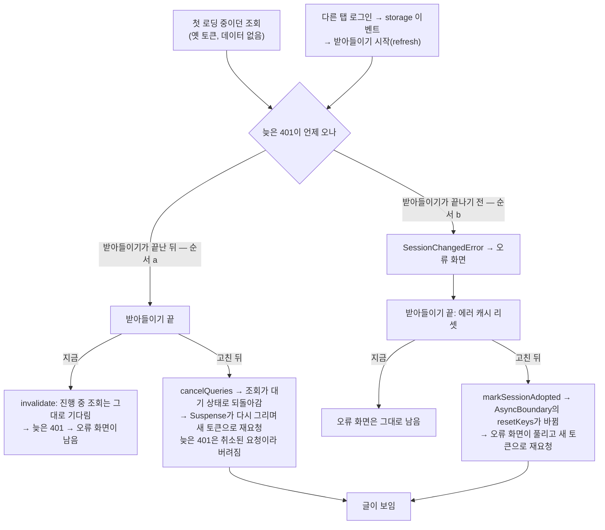

# 다른 탭 로그인을 받아들이는 사이 첫 로딩 중이던 조회가 오류 화면으로 남는 문제

<!-- plan-result:start — 이 블록만 병합 뒤에도 고칠 수 있다(CLAUDE.md §11). 아래는 승인된 계획 원문 -->

## 구현 결과

> #598 · 2026-11-11 대조 · 이탈 3 · 미구현 0 — 판정 근거(파일:줄)는 PR 본문 "계획 대비 구현"

- 이탈(사용자 결정): 횟수를 "받아들이기 성공에서만" 올리지 않고 공개 화면의 다른 탭 로그아웃 반영(쓰는 중 포함)과 이 탭 로그인 성공에서도 올림. 로그아웃 반영은 재현 시도에서 오류 화면이 남아 보완을 골랐고, 이 탭 로그인은 녹화 확인 중 로그인 전부터 떠 있던 404 안내가 남는 것을 찾아 보완을 고름. 보호 화면의 로그아웃 반영은 올리지 않음
- 이탈(위 결정의 결과): 스토어 값·함수 이름을 `sessionAdoptedCount`·`markSessionAdopted` 대신 `authSyncedCount`·`markAuthSynced`로 함. e2e describe와 `docs/AUTH.md` 절 제목도 "인증이 바뀌는 사이 첫 로딩 중이던 조회"로 넓힘
- 이탈(위 결정의 결과): `useAuthEpochSync` 테스트는 "받아들이기가 실패하면 횟수 그대로" 대신 "실패해 로그아웃 처리로 끝나면 공개 화면에서 1 오름"을 단정함 — 뒤따르는 로그아웃 반영이 올림
- 계획에 없던 변경(동작): 로그아웃 반영 함수를 함께 쓰는 경로(받아들이기 실패, 다른 계정 로그인으로 이 탭이 로그아웃되는 경우)도 공개 화면이면 횟수가 오름. 대조에서 찾아 문서와 단위 테스트 1건으로 고정함(브라우저로는 재현하지 않음)
- 계획에 없던 변경(테스트): 로그아웃 반영 재현을 상시 e2e로 남기고 단위 테스트 3건 추가, 404 안내가 뜬 채 로그인하는 e2e 1건과 로그인 성공 때 횟수 단위 테스트 1건 추가, `AsyncBoundary`에 "다시 그려도 실패하면 에러 화면으로 돌아옴" 1건 추가
- 계획에 없던 변경(문서): `docs/AUTH.md` 상태 표·남은 것·용어 사전·관련 문서와 로그아웃 반영 시간 차 직접 측정 기록, `docs/FE-ARCHITECTURE.md`·`docs/POST.md`·`docs/TESTING.md`의 동작·테스트 서술
- 문서 동기화: 밀린 줄 번호 갱신(`docs/AUTH.md`·`docs/BACK-NAVIGATION.md`·`docs/E2E-FLAKY.md`·`docs/UNSAVED-CHANGES-GUARD.md`)

<!-- plan-result:end -->

> 받아들일 때 진행 중인 조회를 취소해 새 토큰으로 다시 부르고, 이미 실패해 떠 있는 오류 화면은 받아들이기가 끝나면 풀리게 한다.

## Context

### 무엇이 문제인가

다른 탭에서 다시 로그인하면 이 탭은 이동 없이 새 세션을 받아들인다(`useAuthEpochSync`의 `adoptSessionFromCookie`).
그 순간 글 상세처럼 **첫 로딩 중이던 조회**가 있으면 "포스트를 불러오는 중 오류가 발생했어요."만 남고, 버튼도 재조회도 없다.
새로고침하거나 다른 화면에 갔다 와야 풀린다.

### 재현 절차 (2026-11-11, 모킹 브라우저 — 운영 BE 아님)

1. 로그인한 탭에서 상세 첫 요청(옛 토큰)을 붙잡아 둔다.
2. 다른 탭 로그인을 흉내 낸다(세션 플래그 + 인증 세대 `in:` 쓰기). 이 탭이 refresh로 받아들인다.
3. 붙잡아 둔 요청을 401 `TOKEN_EXPIRED`로 돌려준다.
4. 결과: 상세 요청 수 1(재요청 없음), refresh 추가 0, 오류 문구가 남는다.

### 근본 원인

| 무엇                                                                                                           | 근거                                                                                                                                                                                   | 확인 수준          |
| -------------------------------------------------------------------------------------------------------------- | -------------------------------------------------------------------------------------------------------------------------------------------------------------------------------------- | ------------------ |
| 받아들일 때의 `invalidateQueries()`는 데이터 없는 진행 중 조회를 다시 부르지 않는다                            | `src/entities/auth/api/auth.keys.ts:25-28`, query-core 5.90.16 `build/modern/query.js:166-177`(데이터가 있을 때만 취소 후 재요청, 없으면 진행 중인 promise를 그대로 돌려줌)            | 재현 + 설치본 소스 |
| 늦은 401은 `SessionChangedError`로 끝나고 상세는 재시도가 없다                                                 | `src/shared/api/client.ts:230`, `src/entities/post/api/post.queries.ts:240`                                                                                                            | 재현               |
| 받아들이기가 끝나기 **전에** 401이 오면, 끝날 때 에러 캐시는 리셋되지만 이미 떠 있는 오류 화면은 풀리지 않는다 | 에러 경계는 `resetKeys`가 바뀔 때만 풀린다 — react-error-boundary 5.0.0 `dist/react-error-boundary.development.esm.js:42-63`. 상세는 `[id]`뿐(`src/pages/post/PostDetailPage.tsx:100`) | 소스 읽기(미재현)  |
| 세대가 바뀐 뒤 받아들이기 전에 새로 나간 요청도 옛 토큰의 세대로 잡혀 같은 에러로 끝난다                       | `src/shared/utils/auth-epoch.util.ts:34-39`                                                                                                                                            | 소스 읽기          |
| 자연스러운 타이밍에서는 "401이 먼저"가 더 흔할 것이다                                                          | 재현한 순서는 상세 응답을 일부러 붙잡아 만들었다                                                                                                                                       | 추론(재지 않음)    |

### 지금과 고친 뒤

## 판단이 필요했던 항목

| 항목                  | 결정                                                                                                                  | 근거·기각한 대안                                                                                                                                                                                                                                                                                                                                                          |
| --------------------- | --------------------------------------------------------------------------------------------------------------------- | ------------------------------------------------------------------------------------------------------------------------------------------------------------------------------------------------------------------------------------------------------------------------------------------------------------------------------------------------------------------------- |
| 고치는 범위           | 취소 + 오류 화면 자동 복구 (2026-11-11 사용자 결정)                                                                   | 취소만: 순서 b가 남는다. 조회 1회 재시도: 재시도 요청도 옛 토큰이라 실패하고, 1초 안에 받아들이기가 끝나야만 풀리며 `docs/plans/2026-10-14-session-changed-guard.md`의 "쿼리 재시도 안 함"을 뒤집는다                                                                                                                                                                     |
| 순서 b에서 보이는 것  | 오류 문구가 받아들이기가 끝날 때까지 잠깐 보였다가 정상 화면 (같은 날 사용자 결정)                                    | 깜빡임을 없애려면 타이머 재시도가 필요하다(위에서 기각)                                                                                                                                                                                                                                                                                                                   |
| 취소 범위             | 필터 없는 `cancelQueries()`                                                                                           | 선례 `AuthUtil.clearQueries()`(`src/shared/utils/auth.util.ts:51-52`). 데이터가 있는 진행 중 조회는 지금도 invalidate가 취소 후 다시 부르므로 결과가 같다                                                                                                                                                                                                                 |
| 오류 화면을 푸는 신호 | `auth.store`의 `sessionAdoptedCount`를 `AsyncBoundary`가 `resetKeys` 끝에 더한다                                      | 기존 `resetKeys`(글 id·검색 조건)와 같은 방식이다. 기각 — `accessToken`을 키로: 조용한 토큰 갱신 때마다 모든 에러 경계가 다시 그려지고 전역 경계(`App.tsx`)까지 풀린다. 호출부마다 키 전달: 5곳에 흩어지고 새 경계가 빠뜨린다. `SessionChangedError` 전용 대기 화면: 동기화가 오지 않는 경로에서 스피너가 끝나지 않는다. 다시 시도 버튼: 자동 복구가 아니고 화면이 바뀐다 |
| 카운터를 올리는 시점  | 캐시 처리(`handleSessionAdoptedSuccess`) 뒤, 받아들이기 성공에서만                                                    | 먼저 올리면 에러 캐시가 남은 채 다시 그려져 같은 에러를 또 던진다. 로그인·로그아웃 반영에서는 재현된 문제가 없어 올리지 않는다                                                                                                                                                                                                                                            |
| 같은 탭 로그인        | 재현 테스트를 먼저 쓰고, 재현되면 같은 PR에서 취소를 넣는다. 재현되지 않으면 고치지 않고 알린다 (같은 날 사용자 결정) | `src/entities/auth/api/auth.queries.ts:61-68`이 같은 캐시 처리(취소 없음)를 쓴다 — 소스 읽기만 했다                                                                                                                                                                                                                                                                       |

## 세부 계획

순서: 워크트리 → 재현 테스트(실패 확인) → 수정 → 테스트 통과 → 문서 → 녹화·사용자 승인 → 커밋 → plan-verifier → PR.
워크트리는 `git fetch` 뒤 `origin/main` 기준으로 만들고(`git log origin/main..main` 비어 있음 확인), 줄 번호는 그 안에서 다시 확인한다.

### 1. 재현 테스트 (수정 전에 실패하는 것을 먼저 본다)

| 위치                                                   | 변경 내용                                                                                                                                                                                                                                                                                                                              |
| ------------------------------------------------------ | -------------------------------------------------------------------------------------------------------------------------------------------------------------------------------------------------------------------------------------------------------------------------------------------------------------------------------------- |
| `e2e/auth-tab-sync.spec.ts`                            | 새 describe "다른 탭 로그인을 받아들이는 사이 첫 로딩 중이던 조회". 같은 파일의 `installMocks`와 87줄 테스트의 "다른 탭 로그인" 흉내를 쓴다. 응답을 붙잡는 게이트는 `.claude/browser-artifacts/verify-session-changed.spec.ts`의 `createGate`·7번 시나리오를 옮긴다. 받아들이기 refresh는 새 토큰 값을 돌려줘 재요청의 헤더로 구분한다 |
| ↳ 순서 a                                               | 상세 첫 요청을 붙잡음 → 다른 탭 로그인 → 받아들이기 끝 → 401로 풂. 단정: 상세 요청 2회(두 번째는 새 토큰), 글 제목 보임, 오류 문구 없음, refresh 추가 0                                                                                                                                                                                |
| ↳ 순서 b                                               | 받아들이기 refresh도 붙잡음 → 상세를 401로 먼저 풂 → 오류 문구 보임(순서가 만들어졌다는 표식) → refresh를 풂. 단정: 오류 문구 사라짐, 글 제목 보임, 상세 요청 2회                                                                                                                                                                      |
| ↳ 같은 탭 로그인                                       | 비로그인으로 상세 첫 요청을 붙잡음 → 내비게이션 로그인 창에서 로그인 → 붙잡은 응답(좋아요 안 함)을 풂. 단정: 토큰을 실은 상세 요청이 새로 나가고 화면은 그 응답(좋아요 함)을 그린다                                                                                                                                                    |
| ↳ 로그아웃 반영 가장자리                               | 재현 시도만 한다: 같은 탭에서 세대 값을 직접 바꿔(자기 탭에는 storage 이벤트가 오지 않는다) 401을 먼저 받게 한 뒤 storage 이벤트를 보내 로그아웃 반영을 돌린다. 오류 화면이 남으면 결과를 알리고 보완할지 묻는다                                                                                                                       |
| `src/entities/auth/hooks/useAuthEpochSync.test.tsx`    | 받아들이기 성공 → 데이터 없이 진행 중이던 조회의 `queryFn`이 다시 불린다. 성공하면 `sessionAdoptedCount`가 1 오르고 실패하면 그대로다                                                                                                                                                                                                  |
| `src/shared/ui/elements/AsyncBoundary.test.tsx` (신규) | 에러 폴백이 떠 있을 때 `markSessionAdopted()` → children을 다시 그린다. 호출부 `resetKeys`도 그대로 동작한다. 에러가 없으면 children을 다시 마운트하지 않는다                                                                                                                                                                          |
| `src/entities/auth/api/auth.queries.test.ts`           | 같은 탭 로그인이 재현될 때만: 로그인 성공 → 진행 중·데이터 없는 조회를 다시 요청한다                                                                                                                                                                                                                                                   |

### 2. 수정

| 위치                                                                     | 변경 내용                                                                                                                                                                                          |
| ------------------------------------------------------------------------ | -------------------------------------------------------------------------------------------------------------------------------------------------------------------------------------------------- |
| `src/entities/auth/api/auth.keys.ts:25-28` `handleSessionAdoptedSuccess` | 맨 앞에 `void queryClient.cancelQueries();`. JSDoc에 이유와 query-core 5.90.16 `query.js:166-177`을 적는다                                                                                         |
| `src/shared/store/auth.store.ts`                                         | `sessionAdoptedCount: number`(0)와 `markSessionAdopted()`(1 올림)를 더한다                                                                                                                         |
| `src/entities/auth/hooks/useAuthEpochSync.ts:43` 다음 줄                 | `handleSessionAdoptedSuccess(queryClient)` 뒤에 `useAuthStore.getState().markSessionAdopted()`                                                                                                     |
| `src/shared/ui/elements/AsyncBoundary.tsx`                               | `useAuthStore`에서 `sessionAdoptedCount`를 읽어 `resetKeys={[...(resetKeys ?? []), sessionAdoptedCount]}`로 넘긴다. `resetKeys` prop 설명(29-33줄)에 "다른 탭 로그인을 받아들이면 풀린다"를 더한다 |
| `src/entities/auth/api/auth.queries.ts:61` 앞                            | 같은 탭 로그인이 재현될 때만: `void queryClient.cancelQueries();`와 주석                                                                                                                           |

### 3. 문서

| 위치                                                                | 변경 내용                                                                                                 |
| ------------------------------------------------------------------- | --------------------------------------------------------------------------------------------------------- |
| `docs/AUTH.md` §8-B(366줄 부근)                                     | "새 인증으로 다시 부르는 건 §8-H 동기화의 몫"에 방법(취소 후 재요청, 오류 화면 풀기)을 한 문장으로 잇는다 |
| `docs/AUTH.md` §8-H(1003줄~)                                        | "받아들이는 사이 첫 로딩 중이던 조회" 항목과 검증 항목을 더한다                                           |
| `docs/AUTH.md` §8-E(636줄~)                                         | 같은 탭 로그인을 고쳤을 때만: 로그인 캐시 처리에 취소를 적는다                                            |
| `docs/AUTH.md` 시행착오 절, 머리말                                  | "후속 — 받아들이는 사이 첫 로딩 중이던 조회 (2026-11-11)"를 더하고 "마지막 검토" 날짜를 바꾼다            |
| `CHANGELOG.md` `[Unreleased]`                                       | Fixed 항목(`changelog-release` skill 형식)                                                                |
| `docs/plans/2026-11-11-session-adopt-first-load-recovery.md` (신규) | 이 계획의 스냅샷. plan-verifier 대조 뒤 `구현 결과` 블록을 붙인다                                         |

`error-toast.ts:90-92`와 `retry-policy.ts:8`의 "조회는 동기화가 새 인증으로 다시 불러온다" 주석은 고친 뒤 사실이 되므로 그대로 둔다.

## 영향 범위

**CRUD 실패 지점** — 조회(읽기)만 건드린다.

- 읽기: 취소해도 HTTP 요청은 끊기지 않는다(queryFn이 `AbortSignal`을 넘기지 않는다, `docs/AUTH.md` §8-E). 받아들이는 순간 진행 중이던 조회마다 요청이 한 번 더 나간다.
- 등록·수정·삭제: mutation 캐시는 `cancelQueries`의 대상이 아니다. 조회 기록(`POST /post/{id}/view`, `src/pages/post/hooks/usePostDetail.ts:86-91`)은 글이 그려질 때 한 번 나가므로 횟수가 그대로다.
- 데이터 계약·배포 순서: 변화 없음(FE만).

**기존 기능의 회귀**

| 깨질 수 있는 것                                                                                                                                                    | 소유 파일                                                                                                                                                                                                                                |
| ------------------------------------------------------------------------------------------------------------------------------------------------------------------ | ---------------------------------------------------------------------------------------------------------------------------------------------------------------------------------------------------------------------------------------- |
| `AsyncBoundary`를 쓰는 5곳이 받아들이기 때 에러 상태면 한 번 풀린다. 이때 `onReset`도 불린다(목록은 실패한 목록 캐시 삭제, 전역은 `QueryErrorResetBoundary.reset`) | `src/app/App.tsx:23`, `src/pages/post/PostDetailPage.tsx:100`, `src/widgets/post/post-list/ui/PostList.tsx:45`, `src/widgets/comment/comment-list/ui/CommentList.tsx:189`, `src/widgets/comment/my-comment-list/ui/MyCommentList.tsx:18` |
| 404 안내("글을 찾을 수 없어요")가 떠 있는 탭도 받아들이기 때 다시 조회한다 — 새 세션으로도 404면 스피너를 거쳐 같은 안내로 돌아온다                                | `src/pages/post/PostDetailPage.tsx`                                                                                                                                                                                                      |
| `shared/ui`가 `shared/store`를 import하는 첫 사례다                                                                                                                | `pnpm lint`·`pnpm check:deps`로 확인                                                                                                                                                                                                     |
| 받아들이기 경로의 기존 e2e(요청 수·refresh 수 단정 포함)                                                                                                           | `e2e/auth-tab-sync.spec.ts`                                                                                                                                                                                                              |
| 로그인 뒤 실패 화면 재진입                                                                                                                                         | `e2e/failed-query-reentry.spec.ts`, `src/entities/auth/api/auth.queries.test.ts`                                                                                                                                                         |
| 미리 받기 실패 정리 — 취소된 조회는 에러 상태가 아니라 지워지지 않는다                                                                                             | `src/shared/lib/react-query/prefetch-quietly.ts:15-32`                                                                                                                                                                                   |
| 테스트 격리 — 스토어 초기화가 새 필드를 덮는지                                                                                                                     | `src/test/setup.ts`                                                                                                                                                                                                                      |
| Storybook — 스토어는 전역이라 Provider 없이 동작한다                                                                                                               | `src/shared/ui/elements/AsyncBoundary.stories.tsx`                                                                                                                                                                                       |
| 반대편 BE 문서가 이 동작을 서술하는지                                                                                                                              | BE `docs/`를 `useAuthEpochSync`·`SessionChangedError`로 검색해 확인                                                                                                                                                                      |

구현 첫 단계에서 `pnpm graph:focus "src/shared/ui/elements/AsyncBoundary.tsx" --text`로 사용처를 다시 뽑아 위 목록과 맞춘다.

## 검증 방법

1. 재현 테스트가 수정 전에 실패하는 출력을 남긴다(순서 a·b, 같은 탭 로그인 각각).
2. `pnpm type-check` → `pnpm test` → `pnpm lint` → `pnpm check:deps` → `pnpm check:docs`.
3. `E2E_SERVER_PORT=$(node scripts/pick-e2e-port.js) npx playwright test e2e/auth-tab-sync.spec.ts e2e/failed-query-reentry.spec.ts` 뒤 `pnpm test:e2e` 전체.
4. 녹화(`browser-verification` skill의 모킹 녹화): 순서 a, 순서 b(오류 문구가 잠깐 보였다 풀리는 모습 포함), 같은 탭 로그인. 마지막 프레임을 직접 확인하고 Cursor로 열어 보여 준 뒤, 승인을 받고 커밋한다.
5. `plan-verifier`에 계획 파일과 `git diff origin/main...HEAD`를 넘겨 대조하고, PR 본문 `## 계획 대비 구현`에 옮긴다. `pnpm check:pr-body`로 본문을 검사한다.
6. 병합 뒤 `gh run list --branch main --workflow "Frontend Deploy (S3 + CloudFront)"`로 그 SHA의 배포 성공을 확인하고, 워크트리를 정리한다.

## 남은 것

- 로그아웃 반영 경로에서 401이 storage 이벤트보다 먼저 처리되는 순서 — 위 재현 시도 결과에 따라 묻는다.
- 순서 b에서는 오류 문구가 잠깐 보이고 `console.error('[AsyncBoundary]', …)`가 1건 남는다.
- 확인은 모두 모킹 브라우저다. 운영 BE로는 재현하지 않는다(다른 탭 로그인 시점을 맞출 수 없다).
- 이번 범위가 아닌 것: 댓글 삭제 실패가 잡히지 않은 에러로 콘솔에 남는 것, `docs/AUTH.md` §8-B의 "이 문구는 사실상 다시 로그인한 경우에만 보입니다"가 로그아웃 반영이 끝난 뒤의 토스트와 어긋나는 것.
