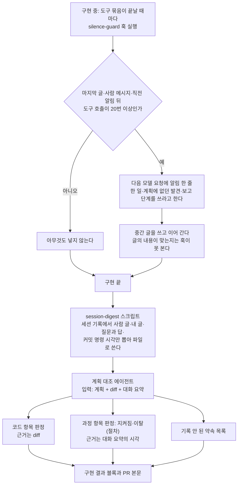

# 침묵 감지 훅과 계획 대조의 대화 요약 입력

<!-- plan-result:start — 이 블록만 병합 뒤에도 고칠 수 있다(CLAUDE.md §11). 아래는 승인된 계획 원문 -->

## 구현 결과

> #599 · 2026-11-12 대조(순서 9 시점, 계획 + 두 저장소 diff + 대화 요약) · 이탈 1 · 미구현 1 — 판정 근거(파일:줄)는 PR 본문 "계획 대비 구현"

- 대조 뒤 한 일(순서 10): claude-base main에 가져온 뒤 사용자 설정에 훅을 등록했고, 새 `claude -p` 세션 둘로 발동을 확인했다(글 없이 Read 22번이면 20번째 뒤에 알림 1개, 글을 쓰며 읽은 세션에는 없음)
- 이탈(절차): 순서 2는 claude-base 작업을 절대경로와 `git -C`로만 하기로 했는데, 훅과 테스트를 쓰던 중 워크트리로 `cd`했다가 돌아왔다. 그 자리에서 대화에 알렸고 이후는 절대경로로만 실행했다
- 미구현 → 보완함: 위험 관리 표가 한계로 적기로 한 "사례 1건에 맞춘 판정 규칙일 수 있다"가 어느 문서에도 없었다. claude-base 결정 기록의 같은 날 항목과 이 블록에 적는다. 과정 판정 규칙은 그날 세션 1건과 그 합성 사본으로만 확인했고, 정량 채점은 "남은 것"에 있다
- 계획 원문 정정: Context의 세 문장이 사실과 다르다. 구현 중에 대화 요약으로 확인했다. ① 계획에 없던 경우 중 T7·C3는 13:23 글에서 실행 전에 알렸고, 끝난 뒤에 알린 것은 C4와 스크립트 옵션·RESEARCH 추가 절이다 ② 그래서 "압축 요약의 '알렸다'가 기록에 없었다"도 맞지 않는다 ③ 글이 없던 구간은 13:23 글 뒤 13:38 문서 커밋까지 도구 46번(약 15분)이고, 다음 글은 압축 뒤 13:41이다
- 계획에 없던 변경(claude-base): 침묵 구간을 나누는 함수와 훅 알림을 읽는 함수도 `lib/transcript.mjs`에 두고 훅과 측정기가 함께 쓴다. 계획은 "글"의 정의만 lib에 두고 세는 일은 훅에 적었다. 발동 조건은 같다
- 계획에 없던 변경(claude-base): 측정기에 `--until`·`--tz-offset`·`--session`을 더했다. 기준선은 등록 전날까지 14일(10-29 ~ 11-11)로 고정했다. 등록일을 넣으면 그날 세션이 이어지는 동안 값이 달라져서다. 이 구간의 유지 기준(40번 이상 구간이 기준선의 절반 이하)은 하루 2.75개이고 등록일을 넣은 구간이면 2.0개다
- 계획에 없던 변경(claude-base): 대화 요약에 도구 묶음의 "수정한 파일" 줄과 `--tz-offset`을 더했고, 따로 적는 명령의 범위를 rebase, 워크트리 추가·삭제, `gh` 워크플로 실행까지 넓혔다. 긴 명령은 앞 300자와 끝 200자를 남긴다. 확인 실행 세 번 모두 커밋의 경로 지정이 잘려 판정하지 못했기 때문이다
- 계획에 없던 변경: 에이전트 정의가 "수정한 파일" 줄로 실행을 확인하고, 출력에 세션 id와 홈 디렉터리 경로를 옮기지 않게 했다. claude-base RESEARCH의 6라운드 항목은 셋이 아니라 넷이다(조치 2 확인 실행이 같은 날 첫 답변의 "다음 후보" 제안도 기록에 없다고 짚었다)
- 계획에 없던 변경(실행): 조치 2 확인은 2건이 아니라 3회 돌렸다. 정상 사본 1차에서 기록 안 된 약속 1건이 나왔는데 합성본에 실제로 남아 있던 문장이었다. 에이전트 정의는 그대로 두고 사본을 고쳐 다시 돌려 0건이었다. 병합 전에는 임시 프로젝트 설정으로 Haiku 세션 3개를 돌려 발동을 미리 확인했다(계획의 비용 추정은 에이전트 3회·Haiku 2회)
- 대조에서 드러난 한계: 도구 호출 사이에 쓴 글이 기록에 줄인 판으로만 남으면 보고의 본문(수치·표)을 확인할 수 없다. 순서 4·5의 보고는 시점만 "지켜짐"이고 본문은 판정 밖이었다. git·gh가 아닌 명령과 에이전트 실행은 요약에 도구 수로만 남아, 테스트 실행과 "어느 에이전트로 돌렸는지"도 판정 밖이었다
- 기록 안 된 약속(대조가 짚음): 기준선을 어느 구간 값으로 판정할지 확인을 부탁했는데 답을 받기 전이었다. 실험 기간(14일)은 따로 여쭙겠다고 하고 질문에 넣지 않은 채 계획 본문에 적어 승인받았다. 둘 다 claude-base main에 가져오는 확인 때 다시 여쭤 답을 받았다(기준선은 등록 전날까지, 기간은 14일)

<!-- plan-result:end -->

> 조치 1: 글 없이 도구 호출이 20번 이어지면 그 자리에서 알리는 훅을 더한다.
> 조치 2: 계획 대조 에이전트가 세션 기록에서 뽑은 대화 요약을 함께 받아, 계획의 순서·보고 단계와 기록 안 된 약속을 판정한다.
> 저장소는 claude-base(훅·스크립트·문서)와 link-sphere FE(에이전트 정의·지침)다. BE는 바꾸지 않는다.

## Context

**무슨 일이 있었나(2026-11-12, 경로 규칙 재측정 작업).**

- 계획 순서 4는 "결과 표를 대화에 보고한 뒤 문서를 고친다"였다. 실제로는 문서 커밋이 먼저였고 결과 표 보고는 그 뒤(13:53)였다.
- 13:23의 중간 글(대조군 결과) 뒤 13:41까지 도구 46번(약 18분) 동안 글이 없었다. 계획에 없던 측정 경우(T7·C3·C4)를
  더한 것도 끝난 뒤에 알렸다.
- 압축 요약은 "발견 즉시 알렸다"고 적었지만 세션 기록에는 그런 글이 없었다.
- 계획 대조 에이전트는 계획과 diff만 받는다(FE `.claude/agents/plan-verifier.md:13-16`). 순서 이탈은 diff에 없어서
  볼 수 없었고, 호출할 때 넘긴 설명도 "순서" 절을 대상에서 뺐다.
- 첫 답변에서 말한 후속 할 일(규칙을 옮기면 FE `scripts/check-docs.js` 검사 대상에 `.claude/rules`를 더한다)은 어느
  문서에도 남지 않았다.

**왜 규칙이 아니라 장치인가.** "계획에 없던 발견은 발견했을 때 알린다"는 전역 지침에 이미 있었고 지켜지지 않았다.
같은 문장을 더 적는 대신 실행 중에 알리는 장치(조치 1)와 끝난 뒤 기록으로 확인하는 장치(조치 2)를 둔다.

**조사로 확인한 사실(2026-11-12 직접 측정, FE 본 폴더에서 시작한 세션 기록).**

- 도구 호출 앞에 쓴 글은 세션 기록에 두 모양으로 남는다. `text` 블록이거나, 빈 `thinking` 뒤에 오는 줄여 쓴 `thinking`
  블록이다. 글을 안 쓴 응답에는 빈 `thinking`만 있다. 화면에는 두 모양 모두 답변처럼 그대로 보인다(사용자에게 화면을
  여쭤 확인).
- "글"을 이 두 모양으로 세면 침묵 구간(글 없이 이어진 도구 호출 수)은 아래와 같다.

  | 모델                           | 세션      | 중앙값 | 상위 10% | 최대 | 20번 이상 구간 | 40번 이상 구간 | 20번마다 알리면 |
  | ------------------------------ | --------- | ------ | -------- | ---- | -------------- | -------------- | --------------- |
  | opus-5-5                       | 52개·16일 | 2      | 6        | 64   | 57             | 4              | 하루 3.9번      |
  | fable-5-2(11-10부터 쓰는 모델) | 6개·3일   | 7      | 34       | 129  | 53             | 12             | 하루 23번       |

- 도구 호출이 든 응답 중 글이 함께 있는 비율은 opus 44%, fable 9%다. 침묵은 지금 모델에서 두드러진다.
- 세션 안에서 `CLAUDE_CODE_SESSION_ID` 값은 세션 기록 파일 이름과 같다(이 세션에서 확인, 공식 문서는 확인하지 않음).
- 선례: `hooks/lang-guard.mjs`가 같은 이벤트(PostToolBatch)에서 세션 기록 끝을 읽고 다음 모델 요청에 한 줄을 넣는다.
  실패하면 아무것도 하지 않는다.
- 평가 workflow는 지적마다 파일 경로를 요구하고(FE `.claude/workflows/plan-verifier-eval.js:24`) "이 두 파일만 읽어"라고
  시킨다(`:50`). 과정 결함은 파일 경로가 없어 지금 채점 형식에 정답을 적을 자리가 없다.

## 판단이 필요했던 항목

| 항목                | 결정                                                                             | 근거·기각한 대안                                                                                                                                                                                                                                           |
| ------------------- | -------------------------------------------------------------------------------- | ---------------------------------------------------------------------------------------------------------------------------------------------------------------------------------------------------------------------------------------------------------- |
| 조치 범위           | 조치 1(훅)과 조치 2(대조 입력) 둘 다                                             | 질문(2026-11-12). 기각: 지침 문장 추가(이미 있었고 안 지켜짐)                                                                                                                                                                                              |
| "글"의 정의         | `text` 블록 또는 내용 있는 `thinking` 블록                                       | 화면에 둘 다 그대로 보인다(질문 2026-11-12). 기각: `text`만 세기. 지금 모델의 중간 글은 대부분 `thinking`으로 남아, 글을 써도 알림이 계속 뜬다                                                                                                             |
| 기준값              | 20번                                                                             | 질문(2026-11-12). 오늘 구간(46번)이면 20·40번째에 알린다. 기각: 30번(하루 9번, 오늘 구간에 한 번), 15번(하루 35번)                                                                                                                                         |
| 알림 반복           | 20번마다 다시 알린다(직전 알림이 새 기준점)                                      | 40번 이상 이어진 구간이 fable 3일에 12개다. 한 번만 알리면 무시된 구간을 못 막는다                                                                                                                                                                         |
| 세는 단위           | 도구 호출 수                                                                     | 분포 자료가 호출 수 기준이다. 기각: 경과 시간. 긴 빌드 한 번에도 걸리고 잰 자료가 없다. 판정 때 다시 본다                                                                                                                                                  |
| 훅이 하는 일        | 알림 한 줄만 넣고 막지 않는다                                                    | lang-guard 선례. 막으면 긴 구현이 중간에 멈춘다                                                                                                                                                                                                            |
| "글" 정의를 두는 곳 | `lib/transcript.mjs` 하나에 두고 새 파일 셋(훅·측정기·요약 스크립트)이 함께 쓴다 | 훅과 측정기의 정의가 다르면 실험이 훅이 한 일을 재지 못한다. 기각: 파일마다 복사(기존 훅 셋의 방식). 기존 훅 셋은 이번에 고치지 않는다                                                                                                                     |
| 대화 요약의 출처    | 세션 기록 파일                                                                   | 오늘 압축 요약의 "알렸다"가 사실과 달랐다. 기각: 구현한 세션이 직접 요약을 써서 넘기기                                                                                                                                                                     |
| 요약 스크립트 위치  | claude-base `scripts/`                                                           | 계획 대조는 FE·BE·claude-base 작업 모두에서 하고, 오늘 일도 claude-base 작업이었다. 기각: FE `.claude/scripts/`                                                                                                                                            |
| 세 번째 입력의 성격 | 선택 입력. 없으면 과정 항목은 "판정 밖(대화 요약 없음)"                          | 평가 workflow와 요약 없이 부르는 기존 호출이 그대로 동작한다                                                                                                                                                                                               |
| BE                  | 이번에 바꾸지 않는다. 6라운드에 대조 에이전트를 공용으로 올릴 때 함께 한다       | BE §8은 대조를 Explore에 맡겨(BE `.claude/CLAUDE.md:157`) 판정 규칙을 실을 정의 파일이 없다. 기각: BE §8에 한 줄만 추가                                                                                                                                    |
| 조치 2 확인 방법    | 오늘 세션(결함)과 순서를 지키게 고친 합성 사본(정상) 2건                         | 기존 8사례 재채점은 하지 않는다. 그 사례는 결함이 쉬워 변별이 없었다는 한계가 적혀 있고(claude-base `docs/METRICS.md:341`), 코드 판정 지시는 근거 문장 하나만 바뀐다. 기각: 채점 체계 확장(스키마·채점·테스트를 모두 바꿔야 하고 옛 PR의 세션 기록이 없다) |
| 보류했던 기록 두 줄 | 이 계획에 넣는다                                                                 | 질문(2026-11-12)                                                                                                                                                                                                                                           |
| 실험 판정 기준      | 아래 "실험" 절. 숫자는 우리가 정한 값이다                                        | claude-base 훅은 실험으로 켜고 기준선·기간·판정 기준을 남긴다(lang-guard·turn-status 선례)                                                                                                                                                                 |

### 위험 관리

| 위험                                                          | 대응                                                                                                                                                  |
| ------------------------------------------------------------- | ----------------------------------------------------------------------------------------------------------------------------------------------------- |
| 기록 모양이 또 바뀌어 글을 썼는데도 알림이 뜬다               | 실패해도 알림 한 줄뿐이다. 실험 지표(준수율)가 급락하면 드러난다                                                                                      |
| `thinking`에 실제 추론이 채워지는 설정에서는 침묵을 글로 센다 | 표본(opus 5건, fable 전부)은 모두 중간 글이었다. 한계로 적는다                                                                                        |
| "한 줄 쓰고 계속"으로 알림만 끄고 보고 단계는 건너뛴다        | 조치 2가 끝난 뒤 대화 요약의 시각으로 잡는다                                                                                                          |
| 대화 요약에 든 대화 내용이 공개 저장소로 나간다               | 요약 파일은 스크래치패드에만 쓰고 커밋하지 않는다. 구현 결과 블록·PR 본문에는 사용자 글을 인용하지 않고 무엇이 달랐는지만 적게 에이전트 정의에 적는다 |
| 사례 1건에 맞춘 판정 규칙일 수 있다                           | 한계로 적고, 정량 채점은 "남은 것"에 둔다                                                                                                             |

## 세부 계획

### claude-base (로컬 저장소, 워크트리 `silence-guard`)

| 위치                                                           | 변경 내용                                                                                                                                                                                                                                                                                                                                                                                                                        |
| -------------------------------------------------------------- | -------------------------------------------------------------------------------------------------------------------------------------------------------------------------------------------------------------------------------------------------------------------------------------------------------------------------------------------------------------------------------------------------------------------------------- |
| `lib/transcript.mjs` (신규)                                    | `parseEvents`, `blocksOf`, `isPrompt`(`hooks/turn-status.mjs:66-80`과 같은 판정), `isShown(block)`("글"의 정의), `findTranscript(sessionId)`(`scripts/instructions-load-probe.mjs:401-415` 형태)                                                                                                                                                                                                                                 |
| `hooks/silence-guard.mjs` (신규)                               | PostToolBatch 훅. `decideSilenceGuard(payload, io)` 형태는 `hooks/lang-guard.mjs:82-102`를 따른다. 세션 기록 끝 2MB를 뒤에서부터 읽어 도구 호출을 세고, 글 블록·사람 메시지·`[silence-guard]`가 든 직전 알림에서 멈춘다. 서브에이전트 기록과 `<synthetic>` 응답은 건너뛴다. 20번 이상이면 `additionalContext`에 `[silence-guard]` 한 줄을 낸다. payload에 `agent_id`가 있거나 기록을 못 읽으면 아무것도 하지 않는다. 항상 exit 0 |
| `hooks/silence-guard.test.mjs` (신규)                          | 20번·19번, `text`와 내용 있는 `thinking`에서 멈춤, 빈 `thinking`은 통과, 사람 메시지에서 멈추고 도구 결과에서는 안 멈춤, 직전 알림 뒤 다시 셈, 서브에이전트 건너뜀, `agent_id`·경로 없음·읽기 실패, `run-node.sh`를 거친 실제 프로세스 1건                                                                                                                                                                                       |
| `scripts/silent-runs.mjs` (신규)                               | 실험 측정기. `--match`·`--days`·`--threshold`·`--json`(인자 형식은 `scripts/token-metrics.mjs:38-62`). 모델별 침묵 구간 분포, 20번·40번 이상 구간 수, `[silence-guard]` 알림 수, 알림 뒤 다음 도구 호출 전에 글이 나온 수를 낸다                                                                                                                                                                                                 |
| `scripts/session-digest.mjs` (신규)                            | `--out <파일> [--session <id>]`. 기본값은 `CLAUDE_CODE_SESSION_ID`. 시각(KST) 순으로 사람 글, 내 글(두 모양), 질문 카드와 답, 계획 승인, 커밋·병합·push·PR 명령, 그 사이 도구 호출 수, 압축 지점을 쓴다. 꼬리표로 시작하는 시스템 블록·서브에이전트 글·도구 결과는 뺀다. 판별은 블록 단위로 한다(첫 메시지가 시스템 블록으로 시작해 메시지 단위로 빼면 원래 요청이 사라진다)                                                     |
| `hooks/session-digest.test.mjs` (신규)                         | 위 항목이 들어가고 빠지는지, 시스템 블록 뒤의 원래 요청이 남는지, 세션을 못 찾으면 exit 2                                                                                                                                                                                                                                                                                                                                        |
| `README.md:73-89`                                              | "적용된 것" 표에 행 추가, "되돌리려면" 문장에 silence-guard 항목 추가                                                                                                                                                                                                                                                                                                                                                            |
| `docs/METRICS.md`                                              | 새 절 "실험: 침묵 감지 훅"(아래), "다음 측정"(`:465`)에 판정일                                                                                                                                                                                                                                                                                                                                                                   |
| `docs/DECISIONS.md`                                            | 새 항목 "2026-11-12 — 침묵 감지 훅과 계획 대조의 대화 요약"(4열 표)                                                                                                                                                                                                                                                                                                                                                              |
| `docs/MAPPING.md:48,:50,:154`                                  | "diff를 파일로 넘기는 방법"에 대화 요약을 더하고, 6라운드 BE 줄에 "대조자에게 대화 요약도 넘긴다"를 더한다                                                                                                                                                                                                                                                                                                                       |
| `docs/RESEARCH.md:104`                                         | "다룰 점은 둘"을 셋으로 고치고 "FE `scripts/check-docs.js` 검사 대상에 `.claude/rules`를 더한다"를 더한다                                                                                                                                                                                                                                                                                                                        |
| `docs/plans/2026-11-12-rules-load-remeasure.md` 구현 결과 블록 | "이탈 1"을 "이탈 2"로 고치고 절차 이탈 한 줄을 더한다(결과 표 보고 전에 문서를 커밋했고, 13:23 중간 글 뒤 도구 46번 동안 글이 없었다)                                                                                                                                                                                                                                                                                            |
| `docs/plans/2026-11-12-silence-guard-session-digest.md` (신규) | 이 계획의 사본. 대조 뒤 구현 결과 블록을 붙인다                                                                                                                                                                                                                                                                                                                                                                                  |

**실험(METRICS에 적을 내용).**

- 기간: 등록한 날부터 14일. 판정은 2026-11-26.
- 기준선: 커밋한 `silent-runs.mjs`로 등록 전 14일을 다시 잰 값. Context의 표는 FE 본 폴더만 본 1회용 계산이다.
- 지표: ① 준수율(알림 뒤 다음 도구 호출 전에 글이 나온 비율) ② 40번 이상 이어진 구간 수(하루 평균).
- 유지: ①이 80% 이상이고 ②가 기준선의 절반 이하. 제거: ①이 50% 미만이거나 사용자가 알림으로 나온 글을 소음으로 판단.
  연장: 그 사이이거나 기간 중 모델이 바뀌어 비교할 수 없을 때.
- 교란 요인: 기준선이 3일·6세션이다. 모델이 11-10에 바뀌었다. `claude -p` 세션에도 훅이 붙는다.

### 사용자 설정

| 위치                              | 변경 내용                                                                                                                             |
| --------------------------------- | ------------------------------------------------------------------------------------------------------------------------------------- |
| 사용자 설정 `hooks.PostToolBatch` | lang-guard 항목 옆에 같은 모양(`run-node.sh silence-guard.mjs`, timeout 10)으로 한 항목을 더한다. claude-base main에 병합한 뒤에 한다 |

### link-sphere FE (PR 1개)

| 위치                                                           | 변경 내용                                                                                                                                                                                                                               |
| -------------------------------------------------------------- | --------------------------------------------------------------------------------------------------------------------------------------------------------------------------------------------------------------------------------------- |
| `.claude/agents/plan-verifier.md:3,:13-16`                     | 입력에 세 번째(선택) "대화 요약 파일"을 더한다. 없으면 과정 항목은 "판정 밖(대화 요약 없음)"                                                                                                                                            |
| `.claude/agents/plan-verifier.md:21-29`                        | 절차 추가. 계획의 과정 항목(순서 절, 보고한다·여쭌다·확인받는다·알린다가 든 단계)을 뽑아 대화 요약의 시각으로 확인한다. 대화에서 "나중에 한다·해야 한다"고 한 것 중 계획·diff·"남은 것" 어디에도 없는 것을 "기록 안 된 약속"으로 모은다 |
| `.claude/agents/plan-verifier.md:37-42`                        | 과정 항목 판정(지켜짐·이탈(절차))을 더한다. 근거 문장을 "코드 항목은 diff만, 과정 항목은 대화 요약에 실제로 있는 글과 시각만. 요약 안의 '보고했다'는 주장은 근거가 아니다"로 고친다                                                     |
| `.claude/agents/plan-verifier.md:44-61`                        | 표에 과정 항목 행(근거 칸은 `대화 HH:MM`), "기록 안 된 약속" 목록, 블록 초안의 `이탈(절차)` 줄. 사용자 글은 인용하지 않는다                                                                                                             |
| `.claude/CLAUDE.md:285`                                        | diff 경로 문장 뒤에 "대화 요약 파일도 함께 넘긴다"와 만드는 명령을 더한다(두 줄 이내)                                                                                                                                                   |
| `.claude/CLAUDE.md:288-289`                                    | 평가 수치 문장에 "대화 요약 입력을 더하기 전 정의 기준"을 붙인다                                                                                                                                                                        |
| `docs/PR-BODY-CHECK.md:221`                                    | 용어 정의 "계획 파일과 diff를 대조한 결과"에 대화 요약(있으면)을 더한다                                                                                                                                                                 |
| `docs/plans/2026-11-12-silence-guard-session-digest.md` (신규) | claude-base와 같은 사본과 구현 결과 블록                                                                                                                                                                                                |

### 메모리 (저장소 밖)

| 위치                                                                                        | 변경 내용                                                                |
| ------------------------------------------------------------------------------------------- | ------------------------------------------------------------------------ |
| `claude-md-split-findings.md`                                                               | "35분 동안 글을 하나도 쓰지 않아"를 정정한다(13:23 중간 글 뒤 도구 46번) |
| `claude-base-common-instructions.md`, `plan-vs-implementation-verification.md`, `MEMORY.md` | 새 훅·스크립트·실험 판정일, 대조 입력이 셋이 된 것, "글"의 두 모양       |

### 순서

굵게 표시한 단계는 그 자리에서 대화에 글로 알리고 다음으로 간다.

1. 메모리의 틀린 문장을 정정한다.
2. claude-base에 워크트리 `silence-guard`를 만든다(절대경로와 `git -C`만 쓴다).
3. `lib/transcript.mjs`, 훅, 테스트를 쓰고 `node --test hooks/*.test.mjs`를 돌린다.
4. `silent-runs.mjs`를 쓰고 기준선을 다시 잰다. **수치를 보고한다**(Context 표와 다르면 이유도).
5. `session-digest.mjs`와 테스트를 쓰고 이 세션의 요약을 만든다. **요약에 들어간 것·빠진 것을 보고한다.**
6. claude-base 문서와 계획 사본을 고치고 커밋한다(새 파일만 `git add -- <파일>`, 커밋은 경로 지정).
7. FE 워크트리를 만들고(부트스트랩 포함) 에이전트 정의·지침·문서·계획 사본을 고친다.
8. 조치 2 확인 2건을 돌린다. **결과를 보고한다.** 못 잡으면 정의를 고쳐 다시 하고(2회까지), 그래도 안 되면 멈추고 여쭌다.
9. 이 계획을 대조한다(계획 + 두 저장소 diff + 이 세션의 대화 요약). 결과 블록을 두 사본에 붙인다. **대조 결과를 보고한다.**
10. claude-base main으로 가져오는 것을 확인받는다(저장소와 들어올 파일을 풀어 설명). 병합 뒤 사용자 설정에 훅을
    등록하고 새 `claude -p` 세션으로 발동을 확인한다. **결과를 보고한다.** 워크트리와 브랜치를 지운다.
11. FE: 검사를 돌리고 커밋·push·PR을 연다. CI가 통과하면 squash 병합하고(claude-base 병합 뒤), 배포 워크플로가 돌면
    성공까지 확인한 뒤 워크트리를 정리한다.
12. 나머지 메모리를 갱신한다.

8·9번은 general-purpose 에이전트가 워크트리의 새 정의 파일을 읽고 돌린다. 이 세션이 불러 둔 plan-verifier는 옛 정의다.

## 영향 범위

- **모든 세션(사용자 범위)**: 등록 뒤 새로 시작한 세션부터 글 없이 도구 20번마다 알림 한 줄이 모델 요청에 붙는다.
  지금 모델 기준 하루 약 23번(1회용 계산)이다. 떠 있던 세션에는 반영되지 않는다(lang-guard 계획 문서 기준, 직접 확인 안 함).
- **기존 훅**: lang-guard와 같은 이벤트에 나란히 등록된다. 기존 훅 파일은 고치지 않는다.
- **claude-base**: `hooks/`·`lib/`·`scripts/`가 바뀌어 커밋 전에 훅 테스트가 돈다. 가드 훅은 건드리지 않는다.
- **FE**: `.claude/`와 `docs/`만 바뀐다. 앱 코드·CHANGELOG는 그대로다. 에이전트 정의는 병합 뒤 새 세션부터 적용된다.
  §11의 평가 수치(8/8)는 옛 정의 기준이 된다.
- **평가 workflow·회귀 테스트**: 프롬프트·스키마·채점을 바꾸지 않는다. `.claude/hooks/plan-eval-cases.test.mjs`는 그대로 통과해야 한다.
- **BE**: 변경 없음. BE에서 시작한 세션의 대조는 과정 항목을 보지 않는다.
- **순서 의존**: FE 지침이 claude-base 스크립트를 가리킨다. claude-base 병합이 FE PR 병합보다 먼저다.
- **비용**: 확인용 에이전트 3회(확인 2건과 이 계획의 대조), `claude -p` Haiku 세션 2회.

## 검증 방법

1. **훅 테스트**: `node --test hooks/*.test.mjs` 통과. 스크래치패드 사본에서 기준값·"글" 정의·경계를 하나씩 깨면 실패하는지 본다.
2. **훅 실제 프로세스**: `run-node.sh`에 가짜 payload와 기록을 넣는다. 20번이면 JSON, 19번이면 출력 없음, 깨진 입력이면 출력 없이 exit 0.
3. **오늘 구간 재현**: 이 세션 기록에 `silent-runs.mjs`를 돌려 13:23~13:41 구간이 46번으로 나오고 알림 지점이 20·40번째인지 본다.
4. **등록 확인**: 새 `claude -p` 세션에서 글 없이 Read를 21번 시키면 기록에 `[silence-guard]` 첨부가 1개 남고, 호출마다 글을 쓰게 한 세션에는 없다.
5. **요약 내용**: 이 세션 요약에 13:23 중간 글, 13:53 결과 보고, 문서 커밋 명령과 시각, 첫 답변의 check-docs 문장, 질문 카드와 답이 있고 시스템 블록·서브에이전트 글은 없다.
6. **조치 2 확인**: 결함 사례(재측정 계획 원문 + 그 커밋 diff + 이 세션 요약)에서 "순서 4 이탈"과 "check-docs 약속"을 짚는다. 정상 사본(보고를 커밋 앞으로 옮기고 그 약속 문장을 뺀 합성본)에서는 과정 이탈과 기록 안 된 약속이 0이다.
7. **FE 검사**: `pnpm check:docs`, `node --test .claude/hooks/*.test.mjs`, `pnpm check:pr-body <본문 파일>`.
8. **이 계획의 대조**: 과정 항목(순서의 굵은 단계)까지 판정이 나온다.

**완료 조건**: 새 세션에서 훅이 발동하는 것을 기록으로 확인했다. 대조 에이전트가 오늘 사례의 두 결함을 짚고 정상 사본에서
지적이 없다. claude-base main과 FE main에 병합됐고 두 워크트리가 정리됐다. METRICS에 기준선과 판정 기준이 있다.

## 남은 것

- 실험 판정(2026-11-26): `silent-runs.mjs`로 다시 재서 유지·제거·연장을 정한다.
- lang-guard는 `text` 블록만 봐서(`hooks/lang-guard.mjs:68`) 줄여 쓴 `thinking`으로 남는 중간 글은 검사 밖이다. 이번에 고치지 않는다.
- 기존 훅 셋에 복사돼 있는 세션 기록 읽기 코드를 `lib/transcript.mjs`로 모으는 일.
- BE 대조자에게 대화 요약을 넘기는 일(6라운드, 대조 에이전트를 공용으로 올릴 때).
- 과정 판정의 정량 채점. 실제 대조 사례가 쌓인 뒤 사례 생성·채점 형식을 넓힌다.
- 여러 세션에 걸친 작업은 세션마다 요약을 만들어 함께 넘겨야 한다. 스크립트는 한 세션만 다룬다.
- FE PR 템플릿의 대조 안내는 원래 옛 문구(general-purpose)다. 이번에 고치지 않는다.
- `CLAUDE_CODE_SESSION_ID`가 없는 환경에서는 `--session`으로 id를 직접 준다.
