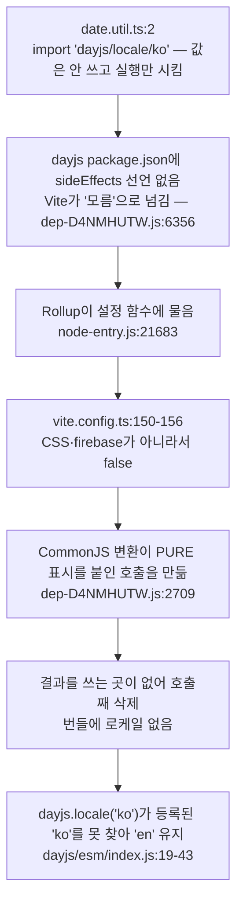
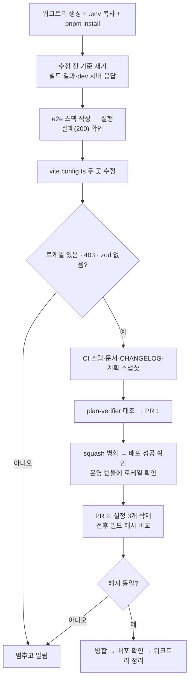

# dev 서버 비밀 파일 노출과 운영 번들의 dayjs 한국어 로케일 누락 수정

<!-- plan-result:start — 이 블록만 병합 뒤에도 고칠 수 있다(CLAUDE.md §11). 아래는 승인된 계획 원문 -->

## 구현 결과

> #600 · 2026-11-12 대조 · 이탈 0 · 미구현 0 — Phase 1(PR 1) 범위, 판정 근거(파일:줄)는 PR 본문 "계획 대비 구현"

- 이탈·미구현·계획에 없던 변경 없음(Phase 1 기준). Phase 2(효과 없는 설정 3개 삭제)는 PR 1 병합·배포 확인 뒤 따로 하고 결과를 이 블록에 더한다.
- 계획 원문 정정: Context의 "둘 다 2026-01-18 첫 커밋부터"에서 ②의 `treeshake.moduleSideEffects` 설정은 2026-01-25 커밋(`50eea61e`)에 들어왔다. 구현 중 `git log -S`로 확인해 CHANGELOG에는 01-25로 적었다. ①의 `fs.deny`는 01-18(`2aac9891`)이 맞다.
- 검증 1~5번(직접 측정, 2026-11-12): 운영 빌드의 `일요일_월요일`이 0건에서 `util-vendor` 청크에 있음으로 바뀌었고, 빌드본을 브라우저에서 불러 보면 `locale('ko')` 뒤 요일이 `Thursday`에서 `목요일`로 바뀌었다. 첫 로딩 JS(gzip)는 216,919 → 217,395바이트(+476)이고 `index.html`에 `zod-vendor`는 없다. dev 서버의 `/.env`·`/.env.test`·`/.env.example`은 200에서 403으로 바뀌었고, 새 e2e 스펙은 고치기 전 2건 실패(200), 고친 뒤 2건 통과였다.

<!-- plan-result:end -->

> `vite.config.ts`의 설정 두 곳이 낸 문제를 고치고(PR 1), 다시 생기면 CI·e2e가 막게 한다. 효과 없는 설정 3개는 뒤이어 따로 정리한다(PR 2).

## Context

번들러 설정을 설명하려고 `vite.config.ts`를 읽다가 두 문제를 찾았다(2026-11-12). 둘 다 2026-01-18 첫 커밋부터 있었고, 운영 번들과 dev 서버 응답을 보는 검사가 없어 드러나지 않았다. 단위 테스트(vitest)는 트리셰이킹을 하지 않고, e2e는 dev 서버(`playwright.config.ts:60`의 `vite --mode test`)를 쓴다.

### 재현 절차 (2026-11-12 직접 측정, main `65197203`)

| 문제 | 방법                                                                           | 결과                                                                                                               |
| ---- | ------------------------------------------------------------------------------ | ------------------------------------------------------------------------------------------------------------------ |
| ①    | `vite --mode test`를 띄우고 `curl -o /dev/null -w '%{http_code}'`(본문은 버림) | `/.env` 200(2,112바이트), `/.env.example` 200, `/.git/config` 200. `server.fs.deny`만 뺀 비교 설정에서는 셋 다 403 |
| ②    | `CI=1 pnpm exec vite build` 결과에서 `일요일` 검색                             | 0건. `treeshake`만 뺀 비교 설정에서는 `util-vendor`에 있음                                                         |

### 근본 원인

**① `server.fs.deny: ['..']`가 Vite 기본 차단 목록을 지운다** (`vite.config.ts:186-188`)

- Vite 6.4.1은 배열 설정을 합치지 않고 통째로 바꾼다(`node_modules/vite/dist/node/chunks/dep-D4NMHUTW.js:7227-7243`, 배열은 `isObject$1`이 아님 `:6697`).
- 그래서 기본값 `[".env", ".env.*", "*.{crt,pem}", "**/.git/**"]`(`:38837`)이 사라진다.
- `'..'`는 `**/..`로 바뀌어(`:49089-49095`) 막는 대상이 사실상 없다. 상위 폴더는 `fs.strict`(기본 true)와 `fs.allow`가 막는다(`:35509-35516`).
- 노출 범위: `host` 설정이 없어 localhost뿐이다. `--host`로 띄우면 같은 네트워크에서 읽힌다.

**② `treeshake.moduleSideEffects`가 dayjs 로케일을 "부작용 없음"으로 본다** (`vite.config.ts:150-156`)

- 지금 화면 영향은 없다. 앱이 쓰는 `DateUtil` 함수 3개(`formatRelativeShort`·`formatKoreanDateTime`·`formatISO`)는 한국어를 직접 조립한다.
- 요일(`dddd`)을 쓰는 함수 3개(`formatKoreanWithDay`·`formatKoreanDateTimeWithDay`·`formatBoard`)는 호출 0건이다. 누가 쓰기 시작하면 운영에서만 영어 요일이 나온다.

## 판단이 필요했던 항목

| 항목             | 결정                                                                   | 근거·기각한 대안                                                                                                                                                                                                                                                                            |
| ---------------- | ---------------------------------------------------------------------- | ------------------------------------------------------------------------------------------------------------------------------------------------------------------------------------------------------------------------------------------------------------------------------------------- |
| ② 고치는 자리    | `moduleSideEffects` 허용 목록에 dayjs 로케일 한 줄 추가                | 틀린 선언을 선언한 자리에서 바로잡는다(CSS·firebase와 같은 형태). 기각: `treeshake` 통째 제거(첫 로딩 gzip 216,919 → 231,917바이트, `ci.yml:157-166` zod 검사 실패). 기각: `date.util.ts`에서 로케일 객체를 import해 넘기기(설정의 틀린 선언이 남고, 문자열 import 형태가 다시 쓰이면 재발) |
| ① 고치는 방법    | `fs` 블록 삭제(기본값 복귀)                                            | 기각: 기본 목록을 손으로 다시 적기(Vite가 목록을 늘려도 따라가지 못함)                                                                                                                                                                                                                      |
| 재발 방지 검사   | CI 빌드 결과 검사(②) + e2e 스펙(①) 둘 다                               | 사용자 결정(2026-11-12). ②는 `ci.yml:157-166` "진입 청크에 zod 없음 확인"이 선례. ①은 응답만 보는 e2e 스펙 선례가 없어 새 형태                                                                                                                                                              |
| ① 검사 대상 파일 | `/.env.test`·`/.env.example`                                           | 둘 다 git 추적 파일이라 CI·워크트리에 있다. `.env`는 CI에 없고, `.git/config`는 워크트리에서 `.git`이 파일이라 없다                                                                                                                                                                         |
| ② 검사 문자열    | `일요일_월요일`                                                        | dayjs 로케일 파일의 요일 목록 형식이다. `일요일`만 보면 화면 문구에 같은 단어가 생길 때 거짓 통과                                                                                                                                                                                           |
| 효과 없는 설정   | 3개만 별도 PR(`proxy.credentials`·`exports: 'named'`·`__DEPLOY_ENV__`) | 사용자 결정(2026-11-12). 기본값과 같은 7개(`target` 등)는 둔다. `eslint.config.js:140` 규칙이 `target` 선언에 기대고, 지우면 Vite를 올릴 때 기본값을 따라간다                                                                                                                               |
| PR 구성          | PR 1 = ①+②+검사, PR 2 = 설정 정리                                      | ①·②는 앞 턴에 한 PR로 제안해 진행 지시를 받음. 정리는 버그 수정과 무관해 squash 커밋을 나눈다                                                                                                                                                                                               |

**뒤집힌 전제**

| 발견                                                              | 그래서 바뀐 것                                                                                                                               |
| ----------------------------------------------------------------- | -------------------------------------------------------------------------------------------------------------------------------------------- |
| 진입 청크에는 export가 있다(지연 청크와 나눠 쓰는 코드)           | `exports: 'named'`가 효과 없는 근거를 "기본값 `auto`도 `named`로 정해진다"(`node-entry.js:18037-18049`)로 바꿈. PR 2는 빌드 해시 비교로 증명 |
| `__BUILD_INFO__.sha`가 진입 청크에 박힌다(`vite.config.ts:32-36`) | PR 2의 전후 빌드는 커밋하기 전 같은 HEAD에서 비교                                                                                            |
| zod가 `index.html`에 오르면 CI가 실패한다(`ci.yml:157-166`)       | `treeshake` 제거안 기각 근거 추가                                                                                                            |

**위험 관리**

- 허용 목록 한 줄로 로케일이 돌아오지 않으면(소스 추적과 다르면) 멈추고 알린다. 대안은 `date.util.ts`에서 로케일 객체를 넘기는 방식이다.
- PR 2에서 빌드 해시가 달라지는 항목은 빼고 알린다.
- dev 서버 실측에서 `.env` 본문은 출력하지 않는다(상태 코드·크기만).
- 운영 확인 요청은 2건으로 끝낸다(WAF 한도).

## 세부 계획

### Phase 1 — PR 1 `fix(build)`

| 위치                                                            | 변경 내용                                                                                                                                         |
| --------------------------------------------------------------- | ------------------------------------------------------------------------------------------------------------------------------------------------- |
| `vite.config.ts:186-188`                                        | `fs: { deny: ['..'] }` 삭제. 덮어쓰면 기본 목록이 사라진다는 주석 한두 줄을 `server` 블록에 남김                                                  |
| `vite.config.ts:150-156`                                        | `moduleSideEffects`에 `/[\\/]dayjs[\\/]locale[\\/]/`이면 `true`를 돌려주는 분기와 이유 주석 추가. 형태는 인접 줄에 맞추고 `pnpm lint` 결과를 따름 |
| `e2e/dev-server-file-access.spec.ts` (신규)                     | `request.get`으로 `/.env.test`·`/.env.example`이 403인지 확인. 설정을 고치기 전에 먼저 돌려 실패를 본다                                           |
| `.github/workflows/ci.yml:166` 뒤                               | "운영 번들에 dayjs 한국어 로케일 있음 확인" 스텝. `dist/assets/js`에 `일요일_월요일`이 없으면 실패                                                |
| `docs/PERFORMANCE.md:319`·`:712`, `docs/OPENAPI-CODEGEN.md:651` | "CSS·firebase 밖은 false" 서술에 dayjs 로케일 예외 반영                                                                                           |
| `docs/TESTING.md` e2e 스펙 표(`:1043` 근처)                     | 새 스펙 행 추가                                                                                                                                   |
| `CHANGELOG.md` `[Unreleased]` → `### Fixed`                     | 항목 2개(`changelog-release` skill 형식)                                                                                                          |
| `docs/plans/2026-11-12-vite-env-deny-dayjs-locale.md` (신규)    | 이 계획의 스냅샷. plan-verifier 대조 뒤 `구현 결과` 블록 추가                                                                                     |

### Phase 2 — PR 2 `chore(build)` (PR 1 병합·배포 확인 뒤, 새 워크트리)

| 위치                                                  | 변경 내용                                                     |
| ----------------------------------------------------- | ------------------------------------------------------------- |
| `vite.config.ts` `server.proxy['/api']`               | `credentials: true` 삭제                                      |
| `vite.config.ts` `rollupOptions.output`               | `// 사용하지 않는 export 제거` 주석과 `exports: 'named'` 삭제 |
| `vite.config.ts` `define`                             | `__DEPLOY_ENV__` 삭제                                         |
| `docs/plans/2026-11-12-vite-env-deny-dayjs-locale.md` | `구현 결과` 블록에 Phase 2 결과 추가(블록만 고침)             |

## 영향 범위

**CRUD 실패 지점**: 해당 없음. 데이터·API 계약을 건드리지 않는다.

**기존 기능의 회귀**

| 깨질 수 있는 것                                              | 소유 파일                                | 점검                                                                                                                                    |
| ------------------------------------------------------------ | ---------------------------------------- | --------------------------------------------------------------------------------------------------------------------------------------- |
| dev 서버가 앱 파일을 못 내줌                                 | `vite.config.ts`                         | 수정 뒤 `/`·`/src/main.tsx` 200, e2e 전체 통과                                                                                          |
| dev에서 `.env*`·`*.crt`·`*.pem`·`.git/**`를 HTTP로 읽던 코드 | 없음(mkcert 인증서는 Node가 파일로 읽음) | grep으로 확인                                                                                                                           |
| 첫 로딩 JS 증가                                              | `util-vendor` 청크                       | `ko.js`는 1,296바이트(gzip 633). 전후 gzip 합계를 재서 PR에 적음                                                                        |
| zod가 첫 로딩에 돌아옴                                       | `ci.yml:157-166`                         | 수정 뒤 `index.html`에 `zod-vendor` 없음                                                                                                |
| 날짜 표시                                                    | `src/shared/utils/date.util.ts`          | 쓰이는 함수 3개는 로케일과 무관. 안 쓰이는 요일 함수 3개가 한국어를 내기 시작함                                                         |
| 모든 PR의 CI                                                 | `.github/workflows/ci.yml`               | 스텝 1개 추가(grep 한 번)                                                                                                               |
| Storybook                                                    | `.storybook/main.ts`                     | 빌더가 `vite.config.ts`를 읽는지는 소스로 확인 안 함. CI의 Storybook 빌드·테스트로 확인                                                 |
| PR 2: dev 프록시 쿠키                                        | `vite.config.ts`                         | http-proxy 옵션에 `credentials`가 없다(`index.d.ts:550` 목록, 전체 검색 6건 모두 프록시와 무관). 로그인 유지는 실기 확인 없이 소스 근거 |

`vitest.config.ts`는 `vitest.unit.ts`의 `sharedViteConfig`만 써서 영향이 없다.

**배포 순서**: `vite.config.ts`가 `deploy.yml:11` 경로 필터에 있어 두 PR 모두 병합하면 배포가 돈다. PR 1 배포 성공을 확인한 뒤 PR 2를 시작한다.

## 검증 방법

**PR 1** (워크트리 안, dev 서버는 `--mode test`로 31151 포트, 끝나면 종료)

1. 수정 전: 빌드 결과 `일요일_월요일` 0건, `index.html`의 JS 목록과 gzip 합계 기록.
2. 수정 전: 새 e2e 스펙 실패(200) 확인 — `pnpm test:e2e e2e/dev-server-file-access.spec.ts`.
3. 수정 후 빌드: `일요일_월요일`이 `util-vendor`에 있음, `zod-vendor`가 `index.html`에 없음, gzip 합계 차이 기록.
4. 수정 후 동작: `pnpm preview`로 빌드본을 띄우고 Playwright MCP로 `util-vendor` 청크를 불러 `locale()`이 `ko`, 오늘 `format('dddd')`가 한국어 요일인지 확인(수정 전 빌드는 `en`·영어).
5. 수정 후 dev 서버: `/.env`·`/.env.test`·`/.env.example` 403, `/`·`/src/main.tsx` 200, 상위 폴더 파일(`/@fs/<상위 경로>`)은 수정 전후 모두 403.
6. `pnpm type-check` → `pnpm test` → `pnpm lint` → `pnpm format:check` → `pnpm check:docs` → `pnpm test:e2e`.
7. plan-verifier로 계획 대비 대조 → PR 본문 `## 계획 대비 구현` → `pnpm check:pr-body`.
8. 병합 뒤: `gh run list --branch main --workflow "Frontend Deploy (S3 + CloudFront)"`로 병합 SHA 성공 확인 → 운영 `index.html`에서 `util-vendor` 파일명을 얻어 `일요일_월요일` 검색(요청 2건) → 워크트리 정리.

**PR 2**

1. 커밋 전 같은 HEAD에서 수정 전·후를 `CI=1 pnpm exec vite build`로 빌드 → `version.json`을 뺀 모든 파일의 이름과 sha256이 같음.
2. `pnpm check`, `pnpm test`.
3. 병합 뒤 배포 성공 확인 → 워크트리 정리.

## 남은 것

- `moduleSideEffects`를 "우리 `src`만 부작용 없음"으로 좁히는 안은 번들 측정이 필요한 더 큰 변경이라 이번에 하지 않는다. 부작용만 쓰는 import를 새로 넣으면 허용 목록에 더해야 한다.
- `optimizeDeps.include`의 효과는 재 보지 않았다.
