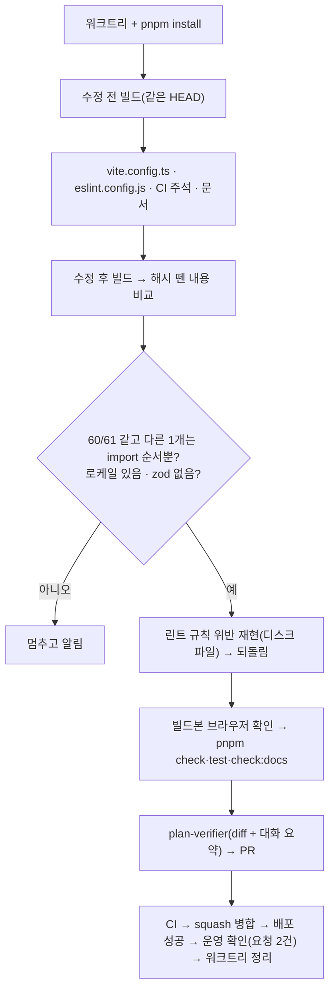

# `moduleSideEffects`를 우리 `src`에만 적용되게 좁히기

<!-- plan-result:start — 이 블록만 병합 뒤에도 고칠 수 있다(CLAUDE.md §11). 아래는 승인된 계획 원문 -->

## 구현 결과

> #619 · 2026-11-13 대조(diff·대화 요약) · 이탈 0 · 미구현 0 — 판정 근거(파일:줄)는 PR 본문 "계획 대비 구현"

- 이탈·미구현 없음.
- 계획에 없던 변경(주석 동기화): `eslint.config.js`의 `date.util.ts` 블록 위 주석이 이 파일에도 남기는 금지 규칙을 나열하는데, 새 규칙을 그 블록에 넣은 것에 맞춰 "실행만 시키는 로컬 import 금지"를 목록에 더했다.
- 계획에 없던 변경(문서 동기화, 대조에서 발견): `CHANGELOG.md` `[Unreleased]`의 #600 항목이 "허용 목록에 dayjs 로케일을 더했다"로 끝나 이 PR 뒤의 설정과 맞지 않았다. 아직 릴리즈되지 않은 항목이라 그 문장을 지금 설정 기준으로 고쳤다. 계획의 "CHANGELOG 넣지 않음"은 새 항목 얘기라 그대로다.
- 검증(직접 측정, 2026-11-13, 같은 HEAD `faf7e60b`): 수정 전후 청크 61개 중 60개가 해시 이름을 뗀 내용이 같고 `query-vendor`는 import 두 줄 순서만 다르다. 첫 로딩 JS gzip 216,775 → 216,764, 전체 331,380 → 331,345바이트, `zod-vendor`는 첫 로딩에 없고 한국어 로케일은 `util-vendor`에 있다. 빌드본에서 dayjs 전역 로케일이 `ko`, 2026-11-13이 `금요일`이었다.
- 순서·보고 단계(2026-11-13 대조): 판정할 수 있었던 단계에서 이탈은 없었다. 대화 요약이 줄여 기록된 구간이 있어 검증 5의 `/post`·`pageerror` 확인과 검증 6의 실행 순서는 대조로 판정하지 못했다.

<!-- plan-result:end -->

> `treeshake.moduleSideEffects`가 패키지까지 "부작용 없음"으로 보던 것을 우리 `src`로 좁힌다. 운영 번들 내용은 그대로이고, 선언 없는 패키지의 실행만 시키는 import가 운영에서만 조용히 빠지는 길이 사라진다. `src`에 남는 같은 위험은 ESLint로 막는다.

## Context

11-12 계획(`docs/plans/2026-11-12-vite-env-deny-dayjs-locale.md`)의 "남은 것"을 11-13에 쟀고(측정만 하는 계획), 결과를 보고 사용자가 B로 바꾸기와 린트 규칙을 같은 PR에 넣기를 골랐다(2026-11-13, 질문 2건).

### 측정 결과 (2026-11-13 직접 측정, `origin/main` `d0eae0f6`, `.env` 없이 `CI=1 pnpm exec vite build`)

| 설정                       | 첫 로딩 JS gzip | 전체 JS gzip | 첫 로딩에 zod |
| -------------------------- | --------------- | ------------ | ------------- |
| A 지금                     | 216,769         | 331,414      | 없음          |
| B `src`만 false(CSS 제외)  | 216,770         | 331,356      | 없음          |
| C `moduleSideEffects` 삭제 | 229,959         | 331,608      | 있음          |

- A를 두 번 빌드하면 164개 파일 sha256이 같다(측정이 결정적).
- A↔B: 청크 61개 중 60개는 해시 이름을 뗀 내용이 같다. `query-vendor`는 길이가 같고 import 두 줄 순서만 바뀐다. 실행 순서는 같다 — `index`가 `react-vendor`를 먼저 import하고 `vendor`도 `react-vendor`를 import한다.
- A↔B 압축 전 길이 차이 308바이트는 CommonJS 모듈 21개의 `/*@__PURE__*/ ` 표시(14자, Vite 6.4.1 `dep-D4NMHUTW.js:2709`)이고 압축에서 사라진다. 지금 설정이 패키지에서 실제로 지우는 코드는 0바이트다.
- B↔C: `src`를 "부작용 있음"으로 보면 `auth.keys.ts:3` → `entities/account/@x/auth.ts:2-5`(안 쓰는 zod 스키마 다시 내보내기) → `account.schema.ts`가 진입 청크로 들어와 zod가 첫 로딩에 붙는다. 줄이는 효과는 전부 `src` 규칙이 낸다.
- `src/shared/lib/firebase/`의 앱 파일 3개는 지금 firebase 예외(`id.includes('firebase')`)에 걸리지만, A와 B의 청크·렌더 길이가 같다.

### 동작 근거 (설치본 소스, Vite 6.4.1 · Rollup 4.55.1)

- Rollup은 resolve가 넘긴 값을 먼저 쓰고 `null`일 때만 설정 함수를 부른다(`node-entry.js:21683`). `\0` 가상 모듈은 함수를 안 거치고, 함수가 `false`일 때만 지운다(`:23130`).
- Vite는 `sideEffects` 선언이 없으면 `null`을 넘긴다(`dep-D4NMHUTW.js:6356`). `src`도 레포 `package.json`에 선언이 없어 같다(`:15775-15782`).

## 판단이 필요했던 항목

| 항목                | 결정                                                                                          | 근거·기각한 대안                                                                                                                                                                                  |
| ------------------- | --------------------------------------------------------------------------------------------- | ------------------------------------------------------------------------------------------------------------------------------------------------------------------------------------------------- |
| 좁히는 방식         | B: CSS면 `true`, `src` 안이면 `false`, 나머지 `true`                                          | 사용자 결정(2026-11-13). 측정한 B와 같은 판정식이다                                                                                                                                               |
| 함수 모양           | `moduleSideEffects: (id) => { ... }`와 들여쓰기를 그대로 둔다                                 | `scripts/barrel-experiment/default-side-effects.mjs:17` 정규식이 이 모양을 찾는다                                                                                                                 |
| `src` 경로          | 모듈 최상단 상수 `SRC_DIR = path.resolve(__dirname, 'src') + path.sep`                        | alias가 같은 경로를 쓴다(`vite.config.ts:180`). 측정 때의 `process.cwd()` 대신 설정 파일 위치 기준이라 실행 위치에 기대지 않는다                                                                  |
| firebase·dayjs 예외 | 지운다                                                                                        | 둘 다 `node_modules`라 기본 처리된다. 측정에서 `firebase-vendor`·`util-vendor` 내용이 같다                                                                                                        |
| CI 로케일 검사      | 유지하고 주석·실패 메시지만 새 설정에 맞춘다                                                  | 설정을 다시 넓히는 회귀를 잡는다                                                                                                                                                                  |
| 린트 규칙           | `src`의 이름 없는 로컬 import(`./`·`../`·`@/`, `.css` 제외)를 `no-restricted-syntax`로 막는다 | 사용자 결정(2026-11-13). 형태는 #608 선례(`RESTRICTED_SYNTAX_NO_RAW_HTML`을 `src/**` 블록과 `date.util.ts` 블록에 함께 넣음, `eslint.config.js:1213-1243`). 지금 위반 0건(`src/main.tsx:3` CSS뿐) |
| 검증 증명           | 해시 동일 대신 "해시 뗀 내용 비교"(`compare-normalized.mjs`)                                  | `query-vendor` import 순서가 바뀌어 해시가 달라진다(측정에서 확인)                                                                                                                                |
| CHANGELOG           | 넣지 않는다                                                                                   | 운영 번들 내용이 같아 동작이 바뀌지 않는다(CLAUDE.md 릴리즈노트 규칙). 린트 규칙 선례 #608도 CHANGELOG 없이 FE-ARCHITECTURE 표만 고쳤다                                                           |
| 커밋 type           | `refactor(build)`                                                                             | 동작 변화 없는 설정 정리 + 같은 위험을 막는 린트                                                                                                                                                  |
| 옛 계획             | 11-12 계획 결과 블록에 `대체됨` 한 줄                                                         | 그 계획의 결정("허용 목록에 dayjs 로케일 한 줄")을 이 PR이 뒤집는다(§11)                                                                                                                          |

**뒤집힌 전제**

| 발견                                                              | 그래서 바뀐 것                                               |
| ----------------------------------------------------------------- | ------------------------------------------------------------ |
| 11-12 계획은 좁히는 안을 "번들 측정이 필요한 더 큰 변경"으로 봤다 | 재 보니 번들 내용이 같다. PR 하나, 동작 변화 없음으로 다룬다 |

**위험 관리**

- 수정 후 비교에서 60/61 동일·`query-vendor` 순서 차이 말고 다른 차이가 나오면 멈추고 알린다.
- 린트 규칙이 지금 코드에 걸리면(0건 예상) 멈추고 알린다.
- 운영 확인 요청은 2건(`index.html`, `util-vendor`)으로 끝낸다(WAF 한도).

## 세부 계획

| 위치                                                                                    | 변경 내용                                                                                                                                                                                                                                                                                                      |
| --------------------------------------------------------------------------------------- | -------------------------------------------------------------------------------------------------------------------------------------------------------------------------------------------------------------------------------------------------------------------------------------------------------------- |
| `vite.config.ts` 최상단(`readLocalGitSha` 앞)                                           | `SRC_DIR` 상수와 한 줄 주석                                                                                                                                                                                                                                                                                    |
| `vite.config.ts:147-158` `moduleSideEffects`                                            | CSS 줄 유지. firebase·dayjs 로케일 분기와 주석 삭제. `return !id.startsWith(SRC_DIR);`와 이유 주석(우리 `src`만 "부작용 없음", 안 쓰는 다시 내보내기가 zod를 첫 로딩에 끌어오지 않게. 패키지는 `sideEffects` 선언을 따름, 11-12까지 dayjs 로케일이 빠졌던 경위). 실행만 시키는 import는 ESLint가 막는다는 안내 |
| `eslint.config.js` `RESTRICTED_SYNTAX_NO_RAW_HTML` 뒤(신규 상수)                        | `RESTRICTED_SYNTAX_NO_LOCAL_SIDE_EFFECT_IMPORT` — `ImportDeclaration[specifiers.length=0]` 중 source가 `./`·`../`·`@/`로 시작하고 `.css`로 끝나지 않는 것. 메시지: 운영 빌드에서 빠지니 값을 import해 쓰거나 `vite.config.ts` 규칙에 예외를 더하라. 위에 이유 주석                                             |
| `eslint.config.js:1219-1223`·`:1236-1240`                                               | 두 블록에 새 상수를 펼쳐 넣는다                                                                                                                                                                                                                                                                                |
| `docs/FE-ARCHITECTURE.md` ESLint 표(#608 행 다음)                                       | 행 추가                                                                                                                                                                                                                                                                                                        |
| `.github/workflows/ci.yml` "운영 번들에 dayjs 한국어 로케일 있음 확인" 주석·실패 메시지 | 새 설정 기준으로(패키지를 `false`로 보게 되돌리면 빠진다)                                                                                                                                                                                                                                                      |
| `docs/PERFORMANCE.md:319`, `docs/OPENAPI-CODEGEN.md:651`                                | "CSS·firebase·dayjs 로케일 밖은 `false`" → "우리 `src`만 `false`(CSS 제외)"                                                                                                                                                                                                                                    |
| `docs/PERFORMANCE.md:712`                                                               | 11-07 측정 당시 설정임을 밝히고, 배럴은 `src` 안이라 지금 설정에서도 같은 이유가 성립한다는 구절                                                                                                                                                                                                               |
| `docs/plans/2026-11-12-vite-env-deny-dayjs-locale.md` 결과 블록                         | `- 대체됨: docs/plans/2026-11-13-module-side-effects-src-only.md(#PR) — dayjs 로케일 예외 대신 우리 src만 false로 좁혀 예외가 필요 없어짐`                                                                                                                                                                     |
| `docs/plans/2026-11-13-module-side-effects-src-only.md`(신규)                           | 이 계획 스냅샷. 대조 뒤 `구현 결과` 블록                                                                                                                                                                                                                                                                       |

## 영향 범위

**CRUD 실패 지점**: 해당 없음. 데이터·API를 건드리지 않는다.

**기존 기능의 회귀**

| 깨질 수 있는 것            | 소유 파일                                               | 점검                                                                        |
| -------------------------- | ------------------------------------------------------- | --------------------------------------------------------------------------- |
| 운영 번들                  | `vite.config.ts`                                        | 수정 전후 해시 뗀 내용 비교(60/61 동일 예상), `query-vendor` 실행 순서 확인 |
| 첫 로딩에 zod              | `ci.yml` "진입 청크에 zod 없음 확인"                    | 수정 후 `index.html`에 `zod-vendor` 없음                                    |
| 한국어 로케일              | `ci.yml` 로케일 검사                                    | 수정 후 `util-vendor`에 `일요일_월요일`                                     |
| FCM                        | `src/shared/lib/firebase/*`                             | 측정에서 A·B 청크·렌더 길이 동일. 수정 후 비교에 포함                       |
| 배럴 실험 스크립트         | `scripts/barrel-experiment/default-side-effects.mjs:17` | 새 `vite.config.ts`에 정규식이 맞는지 읽기만 하는 node 한 줄로 확인         |
| 지금 코드가 새 린트에 걸림 | `eslint.config.js`                                      | `pnpm lint` 통과(위반 0건 예상)                                             |
| Storybook 빌드             | `.storybook/main.ts`                                    | CI의 Storybook 빌드·테스트                                                  |
| dev 서버·단위 테스트·e2e   | —                                                       | 트리셰이킹을 하지 않아 영향 없음. CI e2e로 확인                             |

**배포 순서**: `vite.config.ts`가 `deploy.yml` 경로 필터에 있어 병합하면 배포가 돈다. 올라가는 내용은 `query-vendor` import 순서 말고 같다.

## 검증 방법

1. **수정 전 기준**: 새 워크트리 HEAD에서 `CI=1 pnpm exec vite build --outDir <스크래치패드>/before --emptyOutDir`.
2. **수정 후 비교**: 같은 HEAD에서 수정 후 `--outDir <스크래치패드>/after`로 빌드한다. `compare-normalized.mjs`로 60/61 동일·`query-vendor` import 순서뿐인지 본다. 첫 로딩·전체 gzip, `zod-vendor` 없음, `일요일_월요일`이 `util-vendor`에 있는지, `index`·`vendor`의 import 순서를 기록한다.
3. **린트 규칙 재현**: 디스크 파일에 위반 줄을 잠깐 넣는다(`src/**` 블록 파일 하나에 `import './x';`, `date.util.ts`에 `import '@/x';`). lint-staged와 같은 `pnpm exec eslint <파일>`로 두 건이 걸리는지 보고 Edit로 되돌린다. `src/main.tsx`의 CSS import와 `date.util.ts`의 `import 'dayjs/locale/ko'`는 걸리지 않아야 한다.
4. **실험 스크립트 정규식**: 새 `vite.config.ts`를 읽어 정규식이 맞는지만 확인한다(파일은 쓰지 않음).
5. **빌드본 브라우저 확인**: `pnpm exec vite preview --outDir <after>`로 띄운다(빈 포트 확인 뒤). Playwright MCP로 `/post`를 열어 `#root`가 그려지고 `pageerror`가 없는지 본다. `util-vendor` 청크를 불러 `locale('ko')` 뒤 `format('dddd')`가 한국어 요일인지 확인한다. API는 `.env`가 없어 실패하는 것이 정상이다.
6. `pnpm check`(type-check·lint·format:check·check:deps) → `pnpm test` → `pnpm check:docs`.
7. **계획 대조**: 계획 스냅샷을 커밋 대상에 넣고 `git diff origin/main...HEAD`와 `session-digest.mjs` 대화 요약을 `plan-verifier`에 넘긴다 → `구현 결과` 블록 → PR 본문 `## 계획 대비 구현` → `pnpm check:pr-body`.
8. **병합 뒤**: CI 통과 → squash 병합 → 병합 SHA의 배포 성공 확인. 운영 `index.html`에 `zod-vendor`가 없고 `util-vendor`에 `일요일_월요일`이 있는지 본다(요청 2건). 그다음 워크트리를 정리한다.

## 남은 것

- `optimizeDeps.include` 효과 측정은 이번에 고르지 않았다.
- `src/entities/account/@x/auth.ts`가 zod 스키마를 다시 내보내 첫 로딩이 `src` 규칙에 기대고 있다. 이 구조를 바꾸는 것은 범위 밖이다(지금 첫 로딩에는 영향 없음, CI zod 검사가 지킨다).
