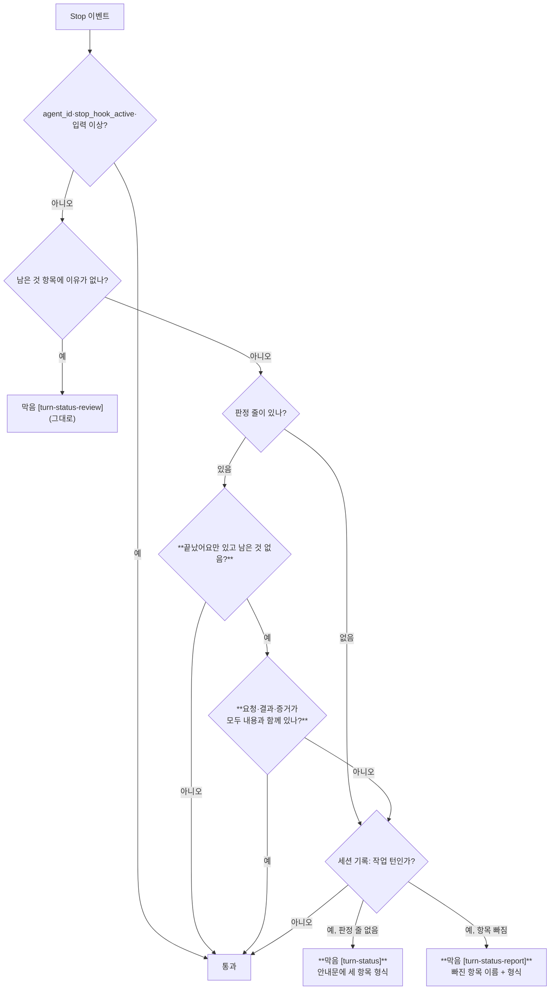

# 완료 보고 항목 검사 — 턴 끝 판정 훅에 요청·결과·증거 목록 검사를 더한다

<!-- plan-result:start — 이 블록만 병합 뒤에도 고칠 수 있다(CLAUDE.md §11). 아래는 승인된 계획 원문 -->

## 구현 결과

> #620 · claude-base `report-items` 브랜치 · 2026-11-13 대조(순서 8 시점, 계획 + 두 저장소 diff + 대화 요약) · 이탈 3 · 미구현 1(보완함) — 판정 근거(파일:줄)는 PR 본문 "계획 대비 구현", 기준선과 판정 기준은 claude-base `docs/METRICS.md` "실험: 완료 보고 항목 검사"

- 대조 뒤 한 일: claude-base main ff 병합을 사용자에게 확인받아 병합했다(`20f2958`). 병합 뒤 프로젝트 설정이 없는 새 `claude -p` 세션에서 사용자 설정의 훅이 `[turn-status-report]`로 한 번 막고, 모델이 세 항목을 다시 써서 끝나는 것을 기록으로 확인했다. 이 PR을 열었다. 이 PR 병합 뒤의 워크트리 정리와 메모리 갱신은 claude-base 사본의 블록에 적는다
- 계획에 없던 순서: claude-base 후속 문서 커밋(병합 뒤 확인 결과)은 이 PR 번호와 병합 결과를 함께 적으려고 이 PR 병합 뒤로 미뤘다. 그 자리에서 알렸다
- 미구현 → 보완함: claude-base DECISIONS 새 항목에 판단 표의 세 행(세션 기록 읽기 코드, FE 문서, MAPPING 줄 참조 밀림)이 없었다. 대조 뒤 더했다
- 이탈(절차): 계획은 순서 1 뒤 claude-base 작업을 절대경로와 `git -C`로만 하기로 했다. 측정기를 돌리던 중 `cd`로 세션 작업 디렉터리가 claude-base 워크트리 안으로 바뀌었다. 그 자리에서 대화에 알렸고 git 명령은 모두 `git -C`로 실행했다. 병합 전 새 세션을 띄울 때도 스크래치패드로 한 번 `cd`했고 그 자리에서 알렸다
- 이탈(절차): 계획은 순서 7에서 FE 워크트리에 `.env`를 복사하기로 했다. 복사가 권한 거부로 막혀 다시 시도하지 않고 건너뛰었다. FE 변경이 문서뿐이라 필요 없다고 그 자리에서 알렸다
- 이탈(절차): 계획은 FE 검사와 커밋을 순서 10(대조 뒤)에 두었다. 대조에 넘길 FE diff를 만들려고 대조 전에 문서 경로 검사와 커밋을 했다. 그 자리에서 알렸고 push·PR은 대조 뒤에 했다
- 계획에 없던 변경: 측정기가 막힌 뒤 채운 턴을 `[turn-status-review]` 뒤 채움까지 세 갈래로 나눈다(계획은 `[turn-status-report]`·`[turn-status]` 두 갈래). 이어 붙인 세션에 복사된 사람 메시지는 한 번만 센다. 둘 다 claude-base METRICS에 적었다
- 계획에 없던 변경(검증): 변이 확인을 계획의 여섯 군데에 새 태그를 더해 일곱 군데로 했다. 깨진 곳마다 테스트가 1개 이상 실패했다(claude-base README "적용된 것")
- 계획에 없던 변경(이 사본): Prettier가 표 정렬과 함께 판단 표 "라벨 문법" 행의 인라인 코드 앞뒤 공백을 지웠다. 화면에 보이는 결과는 원문과 같다

<!-- plan-result:end -->

> 작업한 턴이 `✅ **끝났어요**`만으로 끝나면(`⏳ **남은 것**`이 함께 없으면) 판정 줄 아래 목록에 요청·결과·증거 세 항목이
> 있는지 claude-base `hooks/turn-status.mjs`가 보고, 빠지면 한 번 막아 채우게 한다. 14일 실험 뒤 판정한다.
> 저장소는 claude-base(훅·테스트·측정기·문서)와 link-sphere FE(이 검사를 "보류"로 적은 문서)다. BE는 바꾸지 않는다.

## Context

**왜 하나.** 2026-11-13 턴 끝 판정 훅 판정(유지)에서, 2026-11-01에 미뤄 둔 "대화의 마지막 보고를 턴 끝 훅으로 검사"(FE
`docs/PR-BODY-CHECK.md` §5.2)를 함께 정했다. 사용자는 세 항목 검사를 골랐다(Claude 추천은 "검사하지 않음", 근거와 기각 이유는
claude-base `docs/DECISIONS.md` 2026-11-13). 그 결정 행이 "형식, 대상 턴, 실험 기준은 별도 계획에서 정한다"고 적었고,
이 계획이 그 별도 계획이다. 계기는 FE #472다. 마지막 보고가 직전 변경만 담아 의도대로 됐는지 알 수 없었다.

**확인한 사실(직접 읽음).**

- `hooks/turn-status.mjs:155-179` `decideTurnStatus`는 `남은 것` 이유 검사(:164) 다음에, 판정 줄이 있으면 세션 기록을 읽기
  전에 통과한다(:168-170). 세 항목 검사는 이 자리에 들어간다.
- `stop_hook_active`면 통과(:156)라서 한 턴에 한 번만 막는다. 판정 줄이 없어 `[turn-status]`로 막힌 턴은 덧붙인 답변을
  다시 검사하지 않는다. 그래서 `[turn-status]` 안내문(:30-35)도 세 항목 형식을 알려야 한다.
- 목록 읽기는 `itemsWithoutReason`(:127-148)이 이미 한다(마지막 제목 뒤, 들여쓴 줄은 위 항목에 붙고, 빈 줄은 건너뛰고,
  불릿 아닌 0열 줄에서 끝). 같은 방식으로 `끝났어요` 아래 목록을 읽는다.
- 테스트(`hooks/turn-status.test.mjs`) 13개 중 2개가 `끝났어요 — 근거` 한 줄만 있는 작업 턴을 통과로 단언한다(:42-53의
  메시지 2개, :193 실제 실행). 요구가 바뀌어 이 기대값이 바뀐다.
- 훅 스크립트는 Stop마다 새로 실행된다. claude-base main에 ff 병합하면 떠 있는 세션을 포함해 모든 세션의 다음 Stop부터 바뀐다
  (2026-11-04 이유 검사도 "같은 등록, 코드만 바뀜"이었다).
- 기준선(1회용 계산, 11-13 판정 때 잼, 측정 구간 10-28 04:30 ~ 11-10 UTC): `끝났어요`만 있는 작업 턴 48개, 세 라벨을 모두 쓴
  것 0개, 마지막 답변 길이 p10/p50/p90 333/1,098/2,807자. 그 직후 사람이 보낸 메시지가 12자 이하인 턴 11개.

### 판정 흐름 (굵은 노드가 이번에 바뀌는 곳)

세 항목이 다 있으면 기록을 읽지 않는다. 기록을 읽는 경우는 "판정 줄 없음"(지금과 같다)과 "항목 빠짐"뿐이다.

## 판단이 필요했던 항목

| 항목                     | 결정                                                                                                                         | 근거·기각한 대안                                                                                                                                                                                              |
| ------------------------ | ---------------------------------------------------------------------------------------------------------------------------- | ------------------------------------------------------------------------------------------------------------------------------------------------------------------------------------------------------------- |
| 검사 여부                | 세 항목 모두 검사                                                                                                            | 질문(2026-11-13). Claude 추천은 "검사하지 않음"(DECISIONS 2026-11-13에 기각 이유)                                                                                                                             |
| 형식                     | 판정 줄 아래 목록 `- 요청: …` / `- 결과: …` / `- 증거: …`                                                                    | 질문(2026-11-13 "보고 형식")                                                                                                                                                                                  |
| 대상 답변                | 작업한 턴이고, 마지막 답변에 `끝났어요` 줄이 있고 `남은 것` 제목이 없을 때만                                                 | 질문(2026-11-13 "대상 답변"). `남은 것`이 함께 있거나 작업하지 않은 턴은 보지 않는다                                                                                                                          |
| 실험                     | 14일 실험 뒤 판정. 기준은 아래 "실험"                                                                                        | 질문(2026-11-13 "실험 여부")                                                                                                                                                                                  |
| 라벨 문법                | 줄 첫머리 `-`/`*` 불릿, 라벨은 굵게 감싸도 됨(`**요청**:`·`**요청:**`), 콜론(반각·전각) 뒤 같은 줄이나 들여쓴 다음 줄에 내용 | Claude 판단. 기각: `—` 구분자 허용(`남은 것` 이유 구분자와 섞인다), 라벨만 있으면 통과(빈 항목이 지나간다)                                                                                                    |
| 어느 목록을 보나         | 마지막 `끝났어요` 줄 바로 아래 목록만                                                                                        | Claude 판단. `itemsWithoutReason`이 마지막 `남은 것` 목록만 보는 것과 같다. 본문 위쪽의 같은 라벨은 세지 않는다                                                                                               |
| 막힌 뒤 다시 쓰는 범위   | 판정 줄부터 다시 쓰고 그 아래 세 항목. 앞 본문은 반복하지 않는다                                                             | Claude 판단. 기각: 항목만 덧붙임. 마지막 답변에 판정 줄이 없어져 화면에서 두 답변으로 갈리고 측정기도 대상 턴을 못 찾는다                                                                                     |
| 판정 줄이 없을 때의 안내 | `[turn-status]` 안내문의 "끝났어요 — <근거 한 줄>"을 세 항목 형식으로 바꾼다                                                 | 한 턴에 한 번만 막아서(`stop_hook_active`), 판정 줄만 덧붙이면 세 항목을 볼 기회가 없다                                                                                                                       |
| 태그                     | `[turn-status-report]`. 안내문에 `[turn-status]`를 그대로 넣지 않는다                                                        | 11-13 판정의 `[turn-status]` 발동 수와 섞이지 않게. 11-04 `[turn-status-review]` 선례                                                                                                                         |
| 측정기                   | `scripts/report-items.mjs`를 커밋한다. 대상·항목 판정은 훅의 함수를 그대로 부른다                                            | Claude 판단(`scripts/silent-runs.mjs` 선례). 기각: 판정 때 1회용으로 잼. 11-13 판정에서 10-28 스크립트가 없어 1건 차이의 원인을 못 좁혔다                                                                     |
| 기간 날짜                | 병합 다음 날(KST)부터 14일, 기준선은 병합 전날까지 14일. 병합일은 양쪽에서 뺀다                                              | Claude 판단. 병합일에는 병합 전 턴이 섞인다(11-12 침묵 감지 기준선 선례). 다른 판정(11-15 가드, 11-26 침묵 감지)과 지표가 겹치지 않는다. 이 검사는 턴 끝 글만 바꾸고 도구 호출 수와 가드 거부는 바꾸지 않는다 |
| 세션 기록 읽기 코드      | 훅의 사본(`parseEvents`·`isPrompt`)은 그대로 두고, 측정기만 `lib/transcript.mjs`를 import한다                                | `lib/transcript.mjs`는 침묵 감지 실험(11-26) 범위라 고치지 않는다. 훅의 사본을 lib로 모으는 일은 침묵 감지 계획의 "남은 것"에 이미 있다                                                                       |
| FE 문서                  | FE `docs/PR-BODY-CHECK.md`의 "보류"와 "11-11 무렵 함께 본다"를 "채택·실험 중"으로 고치는 PR 1개                              | 동작을 서술하는 다른 저장소 문서는 같은 변경 안에서 고친다(claude-base `CLAUDE.md:85`)                                                                                                                        |
| MAPPING 줄 참조 밀림     | 이번에 고치지 않는다. 5라운드 2단계 계획에 넣자고 제안한다                                                                   | 이 계획을 쓰다 찾았다(11-10 `91325e3` 뒤로 `CLAUDE.md:NN` 참조가 2줄씩 밀림). 이 계획의 범위 밖이다                                                                                                           |

### 실험 (METRICS에 적을 내용, 기준은 사용자 결정)

- 기간: 병합 다음 날부터 14일. 병합이 11-13(KST)이면 측정 구간 11-14 ~ 11-27, 판정 11-28. 기준선은 10-30 ~ 11-12를 커밋한 측정기로 다시 잰 값이다.
- 지표: ① 처음부터 세 항목을 쓴 비율 = 막히지 않고 세 항목이 있는 `끝났어요`만 작업 턴 ÷ `끝났어요`만으로 끝난 작업 턴.
  ② 사용자 평가(판정 때 "보고가 읽기 좋아졌는가"를 묻는다).
- 유지: ②가 "읽기 좋아졌다"이고 ①이 80% 이상. 제거: 사용자가 소음으로 판단. ①이 80% 미만이면 형식을 고쳐 연장.
- 판정 때 함께 보여 줄 것: `끝났어요` 답변 길이 p10/p50/p90 변화(기준선 중앙값 1,098자), `[turn-status-report]` 발동 수, 막힌 뒤에도 빠진 수.
- 훅이 못 보는 것: 항목의 내용. 특히 "요청"이 이번 턴의 한마디가 아니라 원래 요청인지는 판단하지 못한다.

### 위험 관리

| 위험                                         | 대응                                                                                       |
| -------------------------------------------- | ------------------------------------------------------------------------------------------ |
| 라벨만 형식적으로 채운다(예: "증거: 확인함") | 형식 검사라 못 막는다. 판정 때 사용자 평가로 본다. 한계로 적는다                           |
| 답변이 길어져 오히려 읽기 나빠진다           | 길이 분포를 판정 때 보여 주고, 사용자가 소음으로 보면 제거                                 |
| 정상 답변이 문법 차이로 자주 막힌다          | 굵은 라벨·전각 콜론·다음 줄 내용을 허용하고 테스트로 고정. 발동 수와 "막힌 뒤 채움"을 센다 |
| 훅 오류로 Stop이 막힌다                      | fail-open 유지(예외면 출력 없이 exit 0). 실제 실행 테스트에 깨진 입력 포함                 |
| 병합 즉시 떠 있는 다른 세션에도 적용된다     | ff 병합 확인 질문에 적는다                                                                 |

## 세부 계획

### claude-base (로컬 저장소 `~/project/claude-base`, 워크트리 `report-items`)

| 위치                                                 | 변경 내용                                                                                                                                                                                                                                                                                                                                                                                                                                                                         |
| ---------------------------------------------------- | --------------------------------------------------------------------------------------------------------------------------------------------------------------------------------------------------------------------------------------------------------------------------------------------------------------------------------------------------------------------------------------------------------------------------------------------------------------------------------- |
| `hooks/turn-status.mjs:1-14`                         | 머리말에 2026-11-13 문단(세 항목 검사, 태그, 근거 문서)                                                                                                                                                                                                                                                                                                                                                                                                                           |
| `hooks/turn-status.mjs:19-22`                        | `DONE_HEADING`, 라벨 정규식, 라벨 목록 `['요청','결과','증거']` 추가                                                                                                                                                                                                                                                                                                                                                                                                              |
| `hooks/turn-status.mjs:30-35`                        | `REASON`의 끝났어요 형식을 세 항목 목록으로                                                                                                                                                                                                                                                                                                                                                                                                                                       |
| `hooks/turn-status.mjs` (신규 상수·함수)             | `reportReason(missing)` 안내문(`[turn-status-report]`, 빠진 항목 이름, "판정 줄부터 다시 쓰고 그 아래 세 항목", 원래 요청, 확인하지 않은 단계는 `남은 것`), `export isDoneOnly(message)`, `export missingReportItems(message)`                                                                                                                                                                                                                                                    |
| `hooks/turn-status.mjs:127-148`                      | 목록 읽기를 지역 함수 `listItemsAfter(lines, heading)`로 꺼내 `itemsWithoutReason`과 새 함수가 같이 쓴다(동작 그대로)                                                                                                                                                                                                                                                                                                                                                             |
| `hooks/turn-status.mjs:164-178`                      | 이유 검사 뒤: 판정 줄이 있고 빠진 항목이 없으면 통과 → 기록을 읽어 작업 턴이 아니면 통과 → 빠진 항목이 있으면 `[turn-status-report]`, 없으면 `[turn-status]`                                                                                                                                                                                                                                                                                                                      |
| `hooks/turn-status.test.mjs`                         | 기존 2곳(:45-50 메시지 2개, :193)에 세 항목을 넣어 통과 기대를 유지. 새 테스트: 항목 없음 → 막음(태그·빠진 항목·`[turn-status]` 미포함), 굵은 라벨·`*` 불릿·전각 콜론·다음 줄 내용·빈 줄·판정 줄 뒤 ` — 근거` → 통과, 하나 빠짐·내용 빔·불릿 아닌 라벨·제목 위 라벨·앞쪽 끝났어요 목록만 있음 → 막음, `남은 것` 함께·작업 안 한 턴·계획 파일만 쓴 턴·`stop_hook_active` → 통과, `REASON`에 세 항목 형식, 실제 실행(빠짐 → block JSON `[turn-status-report]`, 다 있음 → 출력 없음) |
| `scripts/report-items.mjs` (신규)                    | 실험 측정기. 인자는 `silent-runs.mjs`와 같은 `--days`·`--until`·`--tz-offset`·`--match`·`--json`. 턴은 `isPrompt`로 끊고 사람 메시지 시각으로 기간에 넣는다. 작업 턴(`didWorkThisTurn`) 중 마지막 답변이 `isDoneOnly`인 턴을 "처음부터 세 항목 / `[turn-status-report]` 뒤 채움 / `[turn-status]` 뒤 채움 / 끝까지 빠짐"으로 나누고, 발동 수와 답변 길이 p10/p50/p90을 낸다. 스크래치패드 세션은 뺀다. 대화 내용은 출력하지 않는다                                                |
| `README.md:84` 아래                                  | "적용된 것"에 행 추가(같은 `hooks.Stop` 등록, 코드만 바뀜, 확인 결과, 되돌리려면 그 커밋을 revert해 ff 병합)                                                                                                                                                                                                                                                                                                                                                                      |
| `CLAUDE.md:81`                                       | "남은 일이 없으면 "끝났어요"와 확인한 근거" → "남은 일이 없으면 "끝났어요"와 그 아래 요청·결과·증거 목록"(같은 줄 안에서, 줄 수 그대로)                                                                                                                                                                                                                                                                                                                                           |
| `docs/METRICS.md`                                    | 새 절 "실험: 완료 보고 항목 검사"(침묵 감지 절 뒤, 위 "실험" 내용 + 측정 명령 + 기준선 표), "다음 측정"에 판정일, 턴 끝 판정 훅 절 :312-313 끝에 새 절을 가리키는 한 줄                                                                                                                                                                                                                                                                                                           |
| `docs/DECISIONS.md`                                  | 새 항목 "2026-11-13 — 완료 보고 항목 검사의 형식·대상·실험"(위 판단 표의 행, 4열 표)                                                                                                                                                                                                                                                                                                                                                                                              |
| `docs/MAPPING.md:382`                                | `turn-status-hook` 행의 메모만: "완료 보고 항목 검사 실험(판정 11-28) 뒤 삭제"                                                                                                                                                                                                                                                                                                                                                                                                    |
| `docs/plans/2026-11-13-report-items-check.md` (신규) | 이 계획의 사본. 대조 뒤 구현 결과 블록을 붙인다                                                                                                                                                                                                                                                                                                                                                                                                                                   |

### link-sphere FE (PR 1개, 문서만)

| 위치                                                 | 변경 내용                                                                                                                                              |
| ---------------------------------------------------- | ------------------------------------------------------------------------------------------------------------------------------------------------------ |
| `docs/PR-BODY-CHECK.md:149`                          | 표 행 "대화의 마지막 보고를 턴 끝 훅으로 검사"의 "보류" → "**채택**(2026-11-13 사용자 결정, 14일 실험)", 근거 칸을 claude-base 검사 내용과 판정 문서로 |
| `docs/PR-BODY-CHECK.md:211-212`                      | "남은 것"의 "11-11 무렵 판정 때 함께 본다" → 11-13부터 형식 검사 중, 내용은 못 본다, 판정 문서                                                         |
| `docs/PR-BODY-CHECK.md:10`                           | 마지막 검토 날짜                                                                                                                                       |
| `docs/plans/2026-11-13-report-items-check.md` (신규) | claude-base와 같은 사본과 구현 결과 블록(사용자 글 인용 없음)                                                                                          |

### 메모리 (저장소 밖)

| 위치                                    | 변경 내용                                                              |
| --------------------------------------- | ---------------------------------------------------------------------- |
| `turn-status-hook.md`, `MEMORY.md` 54줄 | 적용일·측정 구간·판정일·측정 명령. "구현은 계획 승인 뒤" 문장을 지운다 |

### 순서

굵게 표시한 단계는 그 자리에서 대화에 글로 알리고 다음으로 간다.

1. claude-base 워크트리 `report-items`를 만든다(`git -C ~/project/claude-base worktree add .claude/worktrees/report-items -b report-items`, 이후 절대경로와 `git -C`만).
2. 훅과 테스트를 고치고 `node --test hooks/*.test.mjs`를 돌린다.
3. 스크래치패드 사본에서 라벨 판정·내용 확인·`남은 것` 제외·마지막 제목 선택·작업 턴 확인·`REASON` 형식을 하나씩 깨 본다. **깨진 것마다 실패한 테스트 수를 보고한다.**
4. `scripts/report-items.mjs`를 쓰고 기준선(10-30 ~ 11-12)과 1회용 구간 대조(`--until 2026-11-10`)를 잰다. **수치를 보고한다**(1회용 48개와 다르면 이유도).
5. claude-base 문서와 계획 사본을 고치고 커밋한다(새 파일만 `git add -- <파일>`, 경로 지정 커밋, 메시지는 `-F` 파일, 영어).
6. 병합 전 확인: 스크래치패드 새 폴더 둘에 프로젝트 설정(`hooks.Stop` → 워크트리 `run-node.sh turn-status.mjs`)을 두고 `claude -p --model haiku --permission-mode acceptEdits` 세션 2개를 돌린다. **결과를 보고한다.**
7. FE: `git log origin/main..main` 확인 뒤 워크트리를 만들고 부트스트랩(`.env` 복사, `pnpm install`), 문서와 계획 사본을 고친다.
8. `node ~/project/claude-base/scripts/session-digest.mjs --out <스크래치패드 파일>`로 대화 요약을 만들고, plan-verifier에 계획 파일·claude-base diff·FE diff·대화 요약을 넘겨 대조한다. 결과 블록을 두 사본에 붙인다. **대조 결과를 보고한다.**
9. claude-base main ff 병합을 확인받는다(claude-base가 무엇인지, 워크트리에만 있는 파일, 병합하면·안 하면 달라지는 것을 먼저 쓴다). 병합일이 11-13이 아니면 병합 전에 METRICS·DECISIONS의 날짜를 고친다. 병합 뒤 프로젝트 설정 없는 새 폴더에서 `claude -p` 1개로 main 반영을 확인한다. **결과를 보고한다.** 워크트리와 브랜치를 지운다.
10. FE: `pnpm check:docs`, `pnpm check:pr-body <본문 파일>` → 커밋·push·PR → CI 통과 → squash 병합(확인 창) → 배포 워크플로가 돌면 성공 확인, 안 돌면 병합 확인까지 → 워크트리 정리.
11. 메모리를 갱신한다.

## 영향 범위

- **모든 세션(사용자 범위)**: 병합 즉시, 떠 있는 세션을 포함해 다음 Stop부터 적용된다. 작업한 턴이 `끝났어요`만으로 끝나며 세 항목이
  없으면 한 번 막힌다. 기준선대로면 2주 48개 턴이 대상이고, 처음부터 형식을 지키면 막히지 않는다.
- **기존 동작**: `[turn-status-review]`와 판정 줄 없음 → `[turn-status]`의 조건은 그대로다. `[turn-status]` 안내문의 형식 문구만 바뀐다.
  `남은 것`이 있는 답변, 작업하지 않은 턴, 서브에이전트는 지금처럼 통과한다.
- **기존 테스트**: 2곳의 기대값이 요구 변경으로 바뀐다(입력에 세 항목을 넣어 통과 기대 유지). 단언 줄은 줄이지 않는다.
- **진행 중 실험**: 가드 범용화(11-15)의 `lib/shell-parse.mjs`·`lib/repo-policy.mjs`·`hooks/bash-guard.mjs`·`edit-guard.mjs`, 침묵 감지(11-26)의
  `hooks/silence-guard.mjs`·`lib/transcript.mjs`·`scripts/silent-runs.mjs`는 고치지 않는다(측정기는 `lib/transcript.mjs`를 import만). `lib/language.mjs`도 고치지 않는다.
- **11-13 판정 기록**: `[turn-status]` 발동 수 정의(`[turn-status]`가 든 피드백)는 새 태그를 세지 않는다.
- **FE**: `docs/`만 바뀐다. 앱 코드·CHANGELOG·CI 설정은 그대로다.
- **BE**: 변경 없음.
- **순서 의존**: FE 문서가 claude-base METRICS 절을 가리키므로 claude-base 병합이 FE PR 병합보다 먼저다.
- **비용**: plan-verifier 1회, `claude -p` Haiku 세션 3개.

## 검증 방법

1. **훅 테스트**: `node --test hooks/*.test.mjs` 전체 통과(커밋 때 `.githooks/pre-commit`도 같은 명령을 돈다).
2. **변이 확인**: 순서 3의 여섯 군데를 깨면 각각 1개 이상 실패한다.
3. **실제 프로세스**: 테스트의 실제 실행 케이스(`run-node.sh` 경유) — 빠짐은 block JSON에 `[turn-status-report]`, 다 있음은 출력 없음, 깨진 입력은 출력 없이 exit 0.
4. **측정기**: 기준선 수치가 나오고, `--until 2026-11-10` 대조값이 1회용 48개와 같거나 차이를 설명할 수 있다. 출력에 대화 내용이 없다.
5. **병합 전 새 세션**: "마지막 답변을 `✅ **끝났어요** — …` 한 줄로 끝내라"고 시킨 세션은 기록에 `Stop hook feedback`(`[turn-status-report]`)이 1개 남고 마지막 답변에 세 항목이 있다. 세 항목으로 끝내라고 시킨 세션에는 피드백이 없다.
6. **병합 뒤 새 세션**: 프로젝트 설정 없이 5번 첫 세션과 같은 결과.
7. **FE 검사**: `pnpm check:docs`, `pnpm check:pr-body`, PR CI 통과.
8. **대조**: plan-verifier가 코드 항목과 과정 항목(순서의 굵은 단계)을 판정한다.

**완료 조건**: claude-base main에 훅·테스트·측정기·문서가 ff 병합되고 새 세션에서 `[turn-status-report]` 발동을 기록으로 확인했다.
METRICS에 기준선·기간·판정 기준·측정 명령이 있다. FE PR이 병합됐고 두 워크트리가 정리됐다. 진행 중 실험의 파일은 바뀌지 않았다
(`git diff --stat`에 없음).

## 남은 것

- 실험 판정(병합 다음 날부터 14일 뒤): `scripts/report-items.mjs`로 다시 재고 사용자에게 읽기 좋아졌는지 묻는다.
- "요청" 항목이 원래 요청인지, 증거가 다시 확인할 수 있는 것인지는 훅이 판단하지 못한다(한계).
- claude-base `docs/MAPPING.md`의 `CLAUDE.md:NN` 참조가 11-10 `91325e3` 뒤로 2줄씩 밀려 있다. 5라운드 2단계 계획에서 고친다.
- 훅의 세션 기록 읽기 사본을 `lib/transcript.mjs`로 모으는 일(침묵 감지 계획의 남은 것 그대로).
- 자동 압축 뒤 작업 턴을 못 보는 자리(11-13 결정, 고치지 않음). 이 검사도 같은 자리에서는 돌지 않는다.
