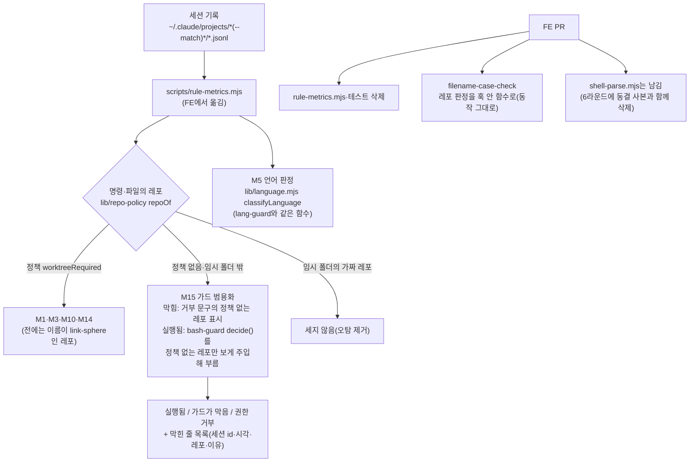

# 5라운드 2단계 — 규칙 위반 측정기를 claude-base로 옮기고 정책 기반으로 바꾼다

<!-- plan-result:start — 이 블록만 병합 뒤에도 고칠 수 있다(CLAUDE.md §11). 아래는 승인된 계획 원문 -->

## 구현 결과

> #621 · claude-base `round5-stage2` 브랜치 · 2026-11-13 대조(순서 7 시점, 계획 + 두 저장소 diff + 대화 요약) · 이탈 2 · 미구현 1(보완함) — 판정 근거(파일:줄)는 PR 본문 "계획 대비 구현", 옛·새 측정기 대조는 claude-base `docs/METRICS.md` "측정기 이전 대조 (2026-11-13)"

- 대조 뒤 한 일: claude-base main ff 병합을 사용자에게 확인받아 병합했다(`b99f788` → `b599cbf`). main 경로에서 테스트 148개가 통과했고, M15(`--match ''`, 11-01 ~ 11-12)가 워크트리 때와 같은 값(실행됨 0·막힘 4·권한 거부 0)을 냈다. 이 PR을 열었다. 이 PR 병합 뒤의 워크트리 정리와 메모리 갱신은 claude-base 사본의 블록에 적는다
- 계획에 없던 변경(질문으로 정함): 대조 중 찾은 main push 확인 창 빈틈을 막았다. 사용자 설정 ask에 `git push *:refs/heads/main`과 `git -C` 형태 4줄을 더하고, 새 `claude -p` 세션에서 가짜 원격으로 보낸 main push 네 형태가 막히고 다른 브랜치 push는 실행되는 것을 확인했다. claude-base 측정기 M14도 11-13부터 이 규칙으로 맞추게 기간과 테스트를 더했다
- 계획에 없던 순서: 계획은 순서 8에서 claude-base 워크트리를 바로 지우기로 했다. FE 병합 결과를 claude-base 사본에 남기고 위 측정기 변경을 함께 넣으려고 이 PR 병합 뒤까지 남기고, 후속 커밋을 한 번 더 ff 병합한다(병합 확인 질문에서 함께 승인받음)
- 미구현 → 보완함: claude-base DECISIONS 새 항목에 판단 표의 두 행("M15 출력", "FE 동결 사본 주석")이 없었다. 대조 뒤 더했다. "정책 레포가 임시 폴더에 있을 때"는 "레포의 정의" 행에 합쳐 적었다
- 이탈(구현 방식): 계획은 측정기 테스트를 위해 레포 판정 함수와 `approvalBypassKinds` 등에 정책 읽기(`read`) 주입 인자를 더하기로 했다. 테스트가 임시 폴더에 진짜 정책 파일을 둔 가짜 레포를 만들어 그 인자가 필요 없었고, 두지 않았다. 대신 측정기 본체와 M15 판정이 임시 폴더 판정(`isTemp`)을 주입받는다. 가짜 레포가 모두 실제 임시 폴더 안이라, 정책 레포가 임시 폴더 판정이 아니라 정책 판정으로 빠지는지 보려면 테스트가 임시 폴더로 볼 레포를 골라야 했다
- 이탈(절차): 계획은 순서 3에서 깨 본 곳마다 실패한 테스트 수를 그 자리에서 대화에 보고하기로 했다. 그때는 생각 기록에만 "일곱 곳을 모두 잡았고 한 곳은 테스트를 보강했다"고 남기고 곳별 수를 화면에 쓰지 않았다. 대조가 짚은 뒤 다시 돌려 곳별 수(정책 레포 판정 4, M15 정책 레포 제외 2, 나머지 다섯 곳 각 1)를 보고했다. 처음에는 "M15 정책 레포 제외"를 깨도 실패가 0이었다. 테스트가 FE 가짜 레포까지 임시 폴더로 보게 주입했기 때문이고, 주입을 좁혀 고쳤다
- 계획에 없던 변경: claude-base 측정기 출력 표의 M1·M3 행 이름을 새 정의에 맞춰 "link-sphere"에서 "워크트리 필수 레포"로 바꿨다
- 계획에 없던 변경: 거부 문구에 정책 없는 레포 표시가 없는 두 가드 문구도 측정기 상수로 내보내고 테스트로 가드 문구와 묶었다(계획은 표시 문자열만 묶기로 했다)
- 계획에 없던 변경: 옛 측정기가 같은 식으로 두 번 계산하던 "막힘"(가드 대상·M14용과 M4용)을 하나로 합쳤다. 대조에서 M4 값이 같았다
- 계획에 없던 변경(대조 중 발견, 그 자리에서 알림): 측정기는 측정할 때의 정책 파일로 과거를 판정한다. claude-base 정책 파일이 생긴 11-01 전의 claude-base 행은 비교 때 빼라고 claude-base METRICS에 적고 DECISIONS에 행을 더했다. 같은 절에 두 가지를 더 적었다. `--match ''`이면 FE 정책 사본을 가진 실험 레포의 편집이 M10에 섞인다. infra의 `HEAD:refs/heads/main` push는 ask 규칙 `git push *:main`에 걸리지 않는다

<!-- plan-result:end -->

> link-sphere FE `.claude/scripts/rule-metrics.mjs`를 claude-base `scripts/`로 옮겨 레포 판정을 정책 파일 기반으로 바꾸고,
> 가드 범용화 판정(11-15)에 쓸 집계(M15)를 넣는다. `classifyLanguage`는 `lib/language.mjs` 하나만 남긴다.
> FE는 측정기를 지우고 filename-case-check의 레포 판정을 훅 안 함수로 바꾼다. FE `shell-parse.mjs` 삭제는 6라운드로 미룬다.
> 저장소는 claude-base(측정기·테스트·문서)와 link-sphere FE(PR 1개)다. BE는 바꾸지 않는다.

## Context

**왜 하나.** 5라운드 1단계(2026-11-01)가 가드 훅을 claude-base로 옮기며 남긴 2단계다(ROADMAP 5행, 1단계 계획
`docs/plans/2026-11-01-round5.md:266`). M14 판정 기록을 기다리던 조건은 2026-11-06에 풀렸다(DECISIONS 2026-11-06).
남은 문제는 셋이다.

- 측정기가 "link-sphere 레포인가"를 이름 패턴으로 가린다. FE `lib/shell-parse.mjs:23` `REPO_PATTERN`과 `:593-601` `repoOf`가
  경로에 `/link-sphere_FE_NEW/`만 있으면 레포로 본다. 스크래치패드에 만든 같은 이름의 가짜 레포도 센다.
- 같은 언어 판정 함수가 두 벌이다. FE `rule-metrics.mjs:204-228`와 claude-base `lib/language.mjs:8-32`는 지금 같다.
  lang-guard는 lib 쪽을 쓴다.
- 가드 범용화 실험(판정 11-15)은 측정 스크립트가 없어 판정 때 1회용으로 세기로 돼 있다(METRICS `:411-412`).

**사용자 결정(2026-11-13, 질문)**: (가) FE `shell-parse.mjs` 삭제는 6라운드로 미룬다. 선택지 문구는 _"2단계는 측정기 이동과
filename-case-check 로컬 함수만 합니다. shell-parse는 동결 사본과 함께 6라운드에 지웁니다."_ 였다. 근거는 동결 사본
bash-guard·edit-guard·deploy-verify·filename-case-check(`.claude/hooks`)·verify-deploy(`.claude/scripts`)가 FE shell-parse를
import하고, FE `ci.yml:127`이 그 테스트를 매 PR 돌린다는 것이다. 이 결정은 아직 ROADMAP·DECISIONS에 없다.

**확인한 사실(직접 읽음).**

- 측정기가 FE shell-parse에서 가져오는 것 중 `REPO_PATTERN`·`repoOf`만 claude-base `lib/shell-parse.mjs`에 없다. 둘은
  `lib/repo-policy.mjs`의 `repoOf`(정책 파일 기반, `:74-78`)와 `isTempPath`(`:98-100`)로 바꾼다. 동결 중인 lib 두 파일은 고치지 않는다.
- 이름 패턴에 기댄 자리는 넷이다: M1·M3(`rule-metrics.mjs:428`, `:459`), M14 push(`:565`), M10(`:775-780`, 세션 쪽은
  `:171` 폴더 이름의 `BE-NEW`).
- bash-guard의 판정 함수 `decide()`(`hooks/bash-guard.mjs:197-314`)는 순수 함수이고 정책 읽기·임시 폴더 판정·git 호출을
  주입받는다. 정책 없는 레포에서는 (i) 광범위 스테이징·`commit -a`·옵션 순서·되돌리기 어려운 명령만 막는다(`:189-191`, `:221`).
- 정책 파일 세 개 모두 `worktreeRequired: true`다(FE `label: "link-sphere FE"`, BE `"link-sphere BE"`, claude-base `"claude-base"`).
- 세션 기록은 120일 보존이다(`~/.claude/settings.json` `cleanupPeriodDays: 120`, 가장 오래된 기록 2026-09-07).
  옛 측정기와 새 측정기를 같은 기간에 나란히 돌릴 수 있다.
- FE에서 측정기를 참조하는 것은 `.claude/` 안뿐이다(`docs/`는 append-only 계획 파일만). 선례 #559·#471은
  `chore(claude):`로 CHANGELOG 없이 바꿨다.
- 정정: 11-13 report-items 계획에서 "MAPPING의 `CLAUDE.md:NN` 참조가 2줄씩 밀려 있다"고 적었다. 그런데 MAPPING 머리말
  `:11-12`가 _"5라운드 커밋 기준이며 이후 바뀔 수 있다"_ 고 이미 밝혀 두었다. 결함이 아니라 기준을 어떻게 적을지의 문제다.
  그 뒤 줄 수는 af966f9 +1, 91325e3 +2로 140 → 143줄이 됐다.

### 바뀐 뒤 흐름

## 판단이 필요했던 항목

| 항목 | 결정 | 경로 | 근거·기각한 대안 |
| --- | --- | --- | --- |
| FE shell-parse 삭제 | 6라운드로 미룬다 | 질문(11-13, (가)) | 기각 (나) 동결 사본 삭제를 2단계로 당김: 가드 사본은 사용자 설정을 옛 경로로 되돌리는 길이라 6라운드 연결 확인 뒤에 지운다(DECISIONS 2026-11-01) |
| FE 측정기 사본 | FE PR에서 지운다(옮김) | 사용자 요청("옮긴다", (가) "측정기 이동") | 기각 동결 사본으로 남김: 가드 사본과 달리 되돌리는 길이 아니고, 두 벌이면 어느 쪽으로 쟀는지 헷갈린다 |
| "link-sphere 레포"의 새 정의 | 정책에 `worktreeRequired`가 있는 레포. M1·M3·M10·M14 push가 같은 함수 하나를 쓴다 | 사용자 요청("정책 파일 기반") | 가드의 (ii) 범위와 같다. 결과로 claude-base도 들어온다(FE 세션이 `git -C ~/project/claude-base`로 한 작업). 이름은 같은데 정책이 없는 임시 폴더 레포는 빠진다 |
| 정책 레포가 임시 폴더에 있을 때 | 센다(가드와 같음) | Claude 판단 | 가드는 정책 레포를 어디서든 막는다(`bash-guard.mjs:189-191`). 세는 범위를 가드와 다르게 두면 "막은 것"과 "센 것"이 어긋난다 |
| M15 "가드가 막음" | bash-guard 거부 문구에 정책 없는 레포 표시(`공통 git 가드 ~/project/claude-base/hooks/bash-guard.mjs`, `bash-guard.mjs:86-88`)가 있으면 센다. 표시가 없는 두 문구(옵션 순서 `:161-163`, `clean -f` 경로 `:176-179`)만 아래 `decide()` 판정으로 보충한다. 표시 문자열은 측정기 상수로 두고, `decide()`가 정책 없는 가짜 레포에서 낸 거부에 그 문자열이 있는지 테스트로 묶는다 | Claude 판단 | 판정은 막힌 거부만 센다. 그 당시 가드가 판단한 결과라 레포가 지워져도 놓치지 않는다. 11-01 카나리 레포(`~/.cache/cb5-canary/`)는 이미 지워졌다(직접 확인). 기각: 디스크로 레포를 다시 찾기(지워진 실험 레포를 못 센다) |
| M15 "실행됨" | `decide()`를 그대로 부르되 정책 레포는 범위 밖, 정책 없는 레포는 임시 폴더 밖만 보도록 `read`·`isTemp`를 주입한다. git 호출은 stub. 막아야 했는데 도구 결과가 막힘이 아닌 것을 센다 | Claude 판단 | "막는 판정과 세는 판정이 같아야 한다"(DECISIONS 2026-10-13 판정 함수 행과 같은 원칙). 기각: shell-parse 함수로 다시 조립(가드와 어긋날 수 있다). 한계: 측정 시점에 디스크에 없는 레포는 못 센다 |
| M15 출력 | 실행됨·가드가 막음·권한 거부 수, 그리고 막힌 줄과 2026-11-01 뒤 실행된 줄의 목록(세션 id, UTC 시각, 메인·서브, 레포 경로, 막은 이유 첫 줄) | Claude 판단 | 판정은 막힌 거부를 하나씩 읽어 "규칙 위반을 막음"과 "정당한 작업이 막힘"으로 나눈다(METRICS `:404`). 대화 본문은 싣지 않는다. 카나리(`~/.cache/cb5-canary/`)와 교체 전 세션은 목록의 경로·시각으로 판정 때 뺀다 |
| 세션 폴더 고르기 | `--match <폴더 이름 일부>`, 기본 `link-sphere`, 이름에 `scratchpad`가 든 폴더는 뺀다. 날짜 인자 `--since`·`--until`(UTC)은 그대로 | Claude 판단(`silent-runs.mjs:87`·`report-items.mjs:137` 선례) | 하드코딩한 접두사(`:37`)를 없앤다. 기본값이면 11-01 카나리 폴더가 새로 들어온다 → 대조에서 따로 잰다. 가드 판정은 모든 프로젝트를 봐야 해 `--match ''`로 돌린다 |
| M10 방향 표시 | `<세션 cwd 레포 label> 세션 → <파일 레포 label> 파일` | Claude 판단 | 폴더 이름의 `BE-NEW`(`:171`) 대신 정책의 `label`을 쓴다 |
| `classifyLanguage` | 측정기가 `lib/language.mjs`를 import한다. lib 머리말의 "두 벌" 문구를 고친다. `stripCode`는 측정기에 남긴다 | 사용자 요청 + Claude 판단 | ROADMAP 5행과 요청은 `classifyLanguage`만 적었다. `stripCode`는 M13 전용이라 lib로 올릴 사용처가 없다(1단계 계획 `:266`의 "등"과 다르다) |
| filename-case-check | `repoOf`·`worktreeRootOf` import를 훅 안 함수 하나로 바꾼다. 판정은 지금과 같다(경로에 `/link-sphere_FE_NEW/`, 워크트리면 그 루트) | (가) 선택지 문구 + Claude 판단 | 리팩터링이라 동작을 바꾸지 않는다. 기각: 정책 기반(FE CI에서 claude-base를 import할 수 없다), 훅 파일 위치 기준(동작이 바뀐다) |
| FE 동결 사본 주석 | `shell-parse.mjs` 머리말과 `run-node.sh` 주석의 측정기 경로만 고친다. bash-guard·edit-guard의 옛 측정 명령 주석은 그대로 둔다 | Claude 판단 | 머리말의 "2단계에 claude-base로 옮긴다"가 (가)와 어긋난다. 나머지는 2026-09-30 실행 기록이고 6라운드에 파일째 지운다 |
| MAPPING 줄 참조 | 다시 매기지 않는다. 머리말에 기준 커밋 해시와 그 뒤 줄 변화(af966f9 +1, 91325e3 +2)를 적는다 | Claude 판단(11-13 "고치자" 제안의 정정) | 80개를 지금 다시 매겨도 `CLAUDE.md`가 바뀔 때마다 또 어긋난다. 6라운드는 `git show <해시>:CLAUDE.md`로 대조하면 된다 |
| 지표 정의가 바뀌는 문제 | 옛 측정기와 새 측정기를 같은 기간에 돌려 차이를 원인별로 METRICS에 적는다. 6라운드 전후 비교의 "전"은 새 측정기로 다시 잰다 | Claude 판단(report-items 대조 선례) | 기록이 120일 남아 다시 잴 수 있다. 기각: 이름 기반 판정을 옵션으로 남김(쓸 일이 없는 분기) |

## 세부 계획

### claude-base (워크트리 `round5-stage2`)

| 위치 | 변경 내용 |
| --- | --- |
| `scripts/rule-metrics.mjs` (신규, FE에서 옮김) | 머리말: FE에서 옮긴 날·이유, 사용법 `node scripts/rule-metrics.mjs [--since] [--until] [--match] [--json]`. import를 `../lib/shell-parse.mjs`·`../lib/repo-policy.mjs`·`../lib/language.mjs`·`../hooks/bash-guard.mjs`(`decide`)로. `PROJECT_DIR_PREFIX`·`sessionRepo` 제거, `--match`·`scratchpad` 제외. 지역 함수 `strictRepoOf(dir, read)`(정책 `worktreeRequired`인 레포 또는 null)를 M1·M3·M14 push·M10이 쓴다. `isGitIgnored(filePath, root)`. `classifyLanguage` 정의 삭제. M15 추가(막힘은 거부 문구의 정책 없는 레포 표시로, 실행됨은 `policylessGuardDeny(command, cwd)` = rm 하위 명령이 없을 때 `decide()`에 정책 없는 레포만 보이게 주입한 결과로 센다. 권한 거부는 따로. 목록 출력). 테스트용으로 `approvalBypassKinds` 등에 `{ read }` 주입 인자를 끝에 더한다 |
| `hooks/rule-metrics.test.mjs` (신규, FE에서 옮김) | 기존 11개를 옮긴다. 경로는 임시 폴더에 `.git`·정책 파일을 둔 가짜 레포로 바꾼다(`hooks/guards.test.mjs:56` 선례). 단언 줄은 줄이지 않는다. 새 테스트: 이름만 link-sphere인 정책 없는 레포는 M1·M3·M14 push에서 빠짐, 정책 레포 워크트리·메인 구분, claude-base 같은 다른 정책 레포도 셈, M15가 정책 없는 임시 폴더 밖 레포의 `add -A`·`commit -am`·`reset --hard`를 잡고 정책 레포·임시 폴더·`rm`이 든 명령·허용 명령은 안 잡음, `decide()`가 정책 없는 가짜 레포에서 낸 거부 문구에 측정기의 표시 상수가 들어 있음(가드 문구가 바뀌면 이 테스트가 깨진다), 기록 조각(거부 tool_result)에서 레포가 없어도 막힘으로 셈, `classifyLanguage`가 lib 함수와 같은 객체 |
| `lib/language.mjs:1-5` | 머리말만: "hooks/lang-guard.mjs(바로잡기)와 scripts/rule-metrics.mjs M5(세기)가 함께 쓴다". 코드는 그대로 |
| `docs/METRICS.md` | 측정 명령 경로(`:153`, `:326`, `:570` 등 FE `.claude/scripts/rule-metrics.mjs` → `scripts/rule-metrics.mjs`, 11-13 전 측정은 FE에서 했다는 한 줄). 가드 범용화 절 `:411-414` "측정 방법"을 M15 명령(`--match '' --since 2026-11-01 --until 2026-11-14`)과 제외 방법으로. 새 소절 "측정기 이전 대조(2026-11-13)": 옛·새 측정기 수치와 차이 원인 |
| `docs/DECISIONS.md` | 새 항목 "2026-11-13 — 5라운드 2단계: 측정기 이전"(위 판단 표의 행, 4열 표) |
| `docs/ROADMAP.md` | 그림의 2단계 노드에 완료 날짜, 5행 완료 조건(2단계 완료, shell-parse는 6라운드로), 6행에 "FE `shell-parse.mjs` 삭제(동결 사본과 함께)", 효과 표 `:45` 측정기 경로와 "전" 구간은 새 측정기로 다시 잰다는 말 |
| `docs/MAPPING.md:9-14` | 마지막 검토 날짜, 줄 번호 기준에 기준 커밋 해시와 그 뒤 줄 변화 |
| `README.md:117` | 문서 목록의 METRICS 설명에 `scripts/rule-metrics.mjs`(규칙 위반) |
| `docs/plans/2026-11-13-round5-stage2.md` (신규) | 이 계획 사본. 대조 뒤 구현 결과 블록 |

바꾸지 않는 것: `lib/shell-parse.mjs`, `lib/repo-policy.mjs`, `hooks/bash-guard.mjs`, `hooks/edit-guard.mjs`(가드 실험, 11-15),
`hooks/silence-guard.mjs`, `lib/transcript.mjs`, `scripts/silent-runs.mjs`(침묵 감지, 11-26), `CLAUDE.md`, 사용자 설정.

### link-sphere FE (PR 1개, `chore(claude):`)

| 위치 | 변경 내용 |
| --- | --- |
| `.claude/scripts/rule-metrics.mjs`, `.claude/hooks/rule-metrics.test.mjs` | `git rm` |
| `.claude/hooks/filename-case-check.mjs` | 머리말 `:1-2`를 "레포 판정은 이 파일 안에서 한다(FE shell-parse는 6라운드에 지운다)"로. `:24` import를 지우고 지역 함수 `feRootOf(absPath)`(FE 메인이면 메인 루트, FE 워크트리면 그 루트, 아니면 null)를 둔다. `decideFilenameCheck` 동작은 그대로 |
| `.claude/lib/shell-parse.mjs:1-7` | 주석만: 동결 사본 가드 3종과 verify-deploy가 쓰고, 6라운드에 그 사본들과 함께 지운다(claude-base DECISIONS 2026-11-13) |
| `.claude/hooks/run-node.sh:9-10`, `:84` | 측정기 경로를 claude-base `scripts/rule-metrics.mjs`로 |
| `docs/plans/2026-11-13-round5-stage2.md` (신규) | 같은 계획 사본과 구현 결과 블록 |

### 메모리 (저장소 밖)

`claude-base-common-instructions.md`(2단계 완료, 다음은 가드 판정·6라운드), `rule-enforcement-rollout-status.md`(측정기 위치),
`MEMORY.md` 해당 두 줄.

### 순서

굵게 표시한 단계는 그 자리에서 대화에 글로 알리고 다음으로 간다.

1. claude-base 워크트리 `round5-stage2`를 만든다. 이후 절대경로와 `git -C`만 쓴다(`cd`하지 않는다).
2. 측정기·테스트를 옮겨 고치고 `node --test hooks/*.test.mjs`를 돌린다(lang-guard 포함 전체).
3. 스크래치패드 사본에서 정책 레포 판정·M15 정책 레포 제외·M15 임시 폴더 제외·M15 rm 제외·M15 거부 문구 표시 판정·
   M10 label·`classifyLanguage` import를 하나씩 깨 본다. **깨진 곳마다 실패한 테스트 수를 보고한다.**
4. 대조: FE 메인 체크아웃의 옛 측정기와 새 측정기(`--match -project-link-sphere-`로 옛 폴더 범위와 맞춤)를 2026-10-01 ~
   11-12에 `--json`으로 돌려 지표마다 비교하고, 기본 `--match`(카나리 폴더 포함)도 돌린다. M15는 `--match ''`로 11-01 ~
   11-12만 돌려 숫자가 나오는지 본다(분류·판정은 하지 않는다). **수치와 차이 원인을 보고한다.**
5. claude-base 문서와 계획 사본을 고치고 커밋한다(새 파일만 `git add -- <파일>`, 경로 지정 커밋, 메시지는 `-F` 파일, 영어).
6. FE: `git log origin/main..main` 확인 뒤 워크트리를 만들고 부트스트랩(`.env` 복사가 막히면 건너뛰고 알림, `pnpm install`).
   위 표대로 고치고 `node --test .claude/hooks/*.test.mjs`, `pnpm check:docs`를 돌린 뒤 커밋한다.
7. `node ~/project/claude-base/scripts/session-digest.mjs --out <스크래치패드 파일>`로 대화 요약을 만들고, plan-verifier에
   계획 파일·claude-base diff·FE diff·대화 요약을 넘긴다. 결과 블록을 두 사본에 붙인다. **대조 결과를 보고한다.**
8. claude-base main ff 병합을 확인받는다(claude-base가 무엇인지, 워크트리에만 있는 파일, 병합하면·안 하면 달라지는 것을
   먼저 쓴다). 11-15 가드 판정 전에 병합해야 판정이 새 측정기를 쓸 수 있다는 점도 적는다. 병합 뒤 main 경로로 측정기를 한 번
   돌려 확인하고 워크트리와 브랜치를 지운다.
9. FE: `pnpm check:pr-body <본문 파일>` → push·PR → CI 통과 → squash 병합(확인 창) → 바뀐 경로가 `.claude/`·`docs/plans/`뿐이라
   배포는 돌지 않을 것이므로 병합 확인까지 → FE 메인 체크아웃이 병합 커밋인지 확인(아니면 알리고 묻는다) → 워크트리 정리.
10. 메모리를 갱신한다.

## 영향 범위

- **떠 있는 훅**: filename-case-check(사용자 설정이 FE 메인 체크아웃 경로로 부른다). 판정 함수만 훅 안으로 옮기고 동작은
  같다. 틀리면 조용히 검사를 건너뛰므로(fail-open) 기존 테스트 4개(`filename-case-check.test.mjs:52`·`:73`·`:85`·`:99`)를 그대로
  통과해야 한다. FE 메인 체크아웃이 병합 커밋으로 올라와야 새 코드가 돈다(그 전에도 옛 코드가 지워지지 않은 shell-parse로 돈다).
- **lang-guard**: `lib/language.mjs`는 주석만 바뀐다. 테스트로 확인한다.
- **진행 중 실험**: 가드 범용화 파일 4개와 침묵 감지 파일 3개는 고치지 않는다. 측정기가 `hooks/bash-guard.mjs`를 import만
  한다. 11-15 판정 뒤 bash-guard를 고치면 M15도 같이 바뀐다(의도한 결합).
- **지표의 뜻**: M1·M3·M10·M14의 "link-sphere 레포"가 "워크트리 필수 정책 레포"로 바뀐다. claude-base 작업이 새로 들어오고
  임시 폴더의 가짜 레포가 빠진다. 기본 `--match`는 11-01 카나리 폴더를 새로 포함한다. 순서 4의 대조가 크기를 잰다.
  ROADMAP 효과 표의 10-13 기준선은 옛 정의 값이라, 6라운드 비교의 "전"은 새 측정기로 다시 잰다.
- **FE CI**: `node --test .claude/hooks/*.test.mjs`에서 측정기 테스트 11개가 빠진다. 측정기 테스트는 claude-base pre-commit에서만
  돈다(가드 테스트와 같은 처지, claude-base에는 CI가 없다).
- **FE 동결 사본**: bash-guard·edit-guard·deploy-verify·verify-deploy는 계속 FE shell-parse를 쓴다. 주석 속 옛 측정 명령은 남는다.
- **BE**: 변경 없음. BE 추적 파일에 측정기 참조가 없다(`git grep` 확인).
- **비용**: plan-verifier 1회. 측정기 실행은 로컬 파일 읽기뿐이다.

## 검증 방법

1. **테스트**: claude-base `node --test hooks/*.test.mjs` 전체(커밋 때 `.githooks/pre-commit`도 같은 명령), FE
   `node --test .claude/hooks/*.test.mjs`.
2. **변이 확인**: 순서 3의 일곱 군데를 깨면 각각 1개 이상 실패한다.
3. **대조**: 옛·새 측정기의 지표 차이가 모두 원인(가짜 레포 제외, claude-base 포함, 카나리 폴더, label 표기)으로 설명된다.
   M2·M4·M5·M12·M13은 같은 폴더 범위에서 같아야 한다. 출력에 대화 본문이 없다.
4. **M15**: `--match ''`로 11-01 ~ 11-12에서 실행됨·가드·권한 거부 수와 목록이 나온다. 2026-11-01 카나리 세션의
   `add -A`·`commit -am`·`reset --hard` 거부(README `:83`)가 레포 폴더가 지워졌는데도 "가드가 막음" 목록에 있으면 문구 표시
   판정이 맞게 붙은 것이다.
5. **FE 검사**: `pnpm check:docs`, `pnpm check:pr-body`, PR CI 통과.
6. **대조(plan-verifier)**: 코드 항목과 과정 항목(순서의 굵은 단계).

**완료 조건**: claude-base main에 측정기·테스트·문서가 ff 병합되고 main 경로로 실행된다. FE PR이 병합돼 측정기 사본이
없고 filename-case-check가 FE shell-parse를 import하지 않는다. 진행 중 실험의 파일은 바뀌지 않았다(`git diff --stat`에 없음).
두 워크트리가 정리됐다.

## 남은 것

- 6라운드: FE `shell-parse.mjs`를 동결 사본(가드 3종·verify-deploy)과 함께 지운다. filename-case-check는 그때 손댈 것이 없다.
- 11-15 가드 범용화 판정은 이 계획 밖이다. 새 M15 명령으로 세면 된다(METRICS에 적는다).
- M15 "실행됨"(가드가 놓친 형태)은 측정 시점에 디스크에 남은 레포만 알아본다. 지워진 레포에서 실행된 명령은 세지 못한다.
  판정 기준인 "막힘"은 거부 문구로 세서 이 한계가 없다(옵션 순서·`clean -f` 경로 두 문구는 예외).
