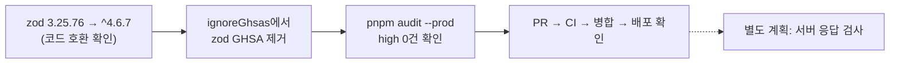

# zod 4 업그레이드와 의존성 무시 목록 정리

<!-- plan-result:start — 이 블록만 병합 뒤에도 고칠 수 있다(CLAUDE.md §11). 아래는 승인된 계획 원문 -->

## 구현 결과

> 2026-11-15 대조 · 이탈 0 · 미구현 1(대체함) — 판정 근거(파일:줄)는 PR 본문 "계획 대비 구현"

- 미구현 → 대체함: 개발 서버로 글 등록 URL 검증을 직접 확인하는 대신, zod 3·4의 `.url()` 판정을 24개 표본으로 비교(차이 없음)하고 폼 e2e 24개를 통과시킴
- 계획에 없던 변경: `docs/DEPLOY.md` 메이저 문장에 코드 수정이 `z.coerce.number<number>()` 두 곳뿐이었다는 설명을 더 적음(문서 동기화)
- 계획에 없던 발견: `zod-vendor` 청크가 53,491 → 87,968바이트(gzip 12,186 → 25,226)로 커짐. 첫 로딩에는 여전히 실리지 않음. 병합 전 사용자 확인 대상
- 후속: 위 청크 크기 때문에 스키마를 `zod/mini`로 전환(`docs/plans/2026-11-15-zod-mini-migration.md`). 전환 뒤 `zod-vendor` gzip 7,453
- 병합 뒤 배포 success와 zod 알림 닫힘 확인은 아직 하지 않음

<!-- plan-result:end -->

> zod 3.25.76 → 4.6.7로 올려 운영 high 알림 2건을 근본에서 닫고, 무시 목록에서 zod를 뺀다. 서버 응답 검사는 이 계획 밖(별도 계획).

## Context

- 2026-11-15 GitHub 취약점 알림 점검에서 운영 알림 6건 중 zod high 2건(GHSA-mrhx-c7xc-m3w5, 고친 버전 4.6.6)이 남은 걸 확인했다. 지금은 `pnpm-workspace.yaml` `auditConfig.ignoreGhsas`로 무시 중이다.
- 무시 사유는 "앱의 zod는 사용자 폼 입력만 검사하고 서버 응답은 검사하지 않는다"이다. 사용자가 서버 응답 검사도 필요하다고 판단했고, 그걸 넣으면 이 사유가 깨진다. 그래서 zod 4 업그레이드가 먼저다.
- 설치본 3.25.76, 최신 4.6.7(`npm view zod`). `@hookform/resolvers` 5.9.2와 `eslint-plugin-react-hooks` 7.1.1은 zod `^3.25.0 || ^4.0.0`을 받는다(`npm view`).
- 같은 점검에서 grpc 무시 주석의 "지울 조건"이 틀린 걸 찾았다. 주석은 "firebase를 올려 1.13.6 이상이 깔리면 지운다"인데, 최신 firebase 13.3.0이 쓰는 `@firebase/firestore` 4.20.0도 `@grpc/grpc-js ~1.9.0`으로 묶여 있어(`npm view`) firebase 업그레이드로는 풀리지 않는다.

## 판단이 필요했던 항목

| 항목 | 결정 | 근거·기각한 대안 |
| --- | --- | --- |
| 서버 응답 검사 시점 | zod 4 먼저, 응답 검사는 별도 계획(사용자 결정 2026-11-15) | 번들(CI "진입 청크에 zod 없음")·스키마 출처·실패 처리 등 사용자 체감 결정이 남아 있고 업그레이드는 작고 되돌리기 쉽다. 한 PR에 섞으면 PR이 커진다 |
| grpc 알림 | 계속 무시, 지울 조건 문구만 고침(사용자 결정 2026-11-15) | 기각: `pnpm.overrides`로 1.14.x 강제 — 앱이 안 쓰는 firestore의 `~1.9.0` 핀을 어겨 호환 위험만 늘고 이득이 없다 |
| deprecated 사용(`.email()`·`.url()`·문자열 `message`) | 그대로 둔다 | zod 4 문서(에이전트 보고, 직접 읽지 않음)가 "여전히 지원, deprecated"라고 한다. 바꾸는 건 요청 범위 밖(§3) |
| react-router 알림 | 건드리지 않음 | 6.x 유지는 사용자가 이미 정한 결정 |

## 세부 계획

| 위치 | 변경 내용 |
| --- | --- |
| `package.json` `zod` | `^3.24.3` → `^4.6.7`(기존 caret 표기 유지), `pnpm install`로 `pnpm-lock.yaml` 갱신 |
| `src/entities/*/model/*.schema.ts`, `useAvailabilityCheck.ts`, `useLogin.ts`, zod를 쓰는 테스트 3개 | 타입·테스트가 깨지는 곳만 최소 수정. 점검 대상: `z.coerce.number()`가 든 `categoryIds`(coerce 입력 타입이 `unknown`으로 바뀜 — 문서, 에이전트 보고), `postUrlSchema`의 `.url()` 판정(문서에 변경 기록이 없어 테스트로 확인) |
| `pnpm-workspace.yaml:11-14` | GHSA-mrhx-c7xc-m3w5 항목과 주석 삭제 |
| `pnpm-workspace.yaml:15-19` | grpc 주석의 지울 조건을 "`@firebase/firestore`가 `@grpc/grpc-js` 핀(`~1.9.0`)을 풀 때"로 고침. 현재 최신 firestore 4.20.0도 `~1.9.0`임을 함께 적음 |
| `docs/DEPLOY.md:197` | "React 19·React Router 7·zod 4 같은 메이저는 … 계획을 세워 따로 한다"에서 zod 4를 빼고 "zod 4는 2026-11-15에 올렸다"를 덧붙임(이 계획이 그 "따로 하는 계획"이다) |
| `docs/CI-CHECK-GATE.md:137` | 운영 의존성 감사 행의 무시 목록 서술에 zod가 있으면 현재 상태(grpc 1건만)로 갱신 |
| `docs/OPENAPI-CODEGEN.md` | 이번엔 응답 검사를 하지 않으므로 §5-2 결정은 그대로. 건드리지 않음 |

## BE 아키텍처 재구성과의 관계 (2026-11-15 확인)

다른 세션이 BE 모듈러 모놀리스 전환 계획(`~/.claude/plans/domain-auth-moonlit-emerson.md`)을 세웠다. 직접 읽고 확인했다.

| 확인한 것 | 결과 |
| --- | --- |
| 구현 시작 여부 | BE 워크트리는 `main` 하나뿐이고 열린 BE PR은 Dependabot 1건뿐이다. 아직 시작 전이다 |
| 1단계(PR 3개: 레이트리밋·account·linkpreview 이동) | _"URL·응답·DB·OpenAPI 스펙 변화 없음"_, 스펙 diff 0을 PR마다 확인하고 `api-compat`가 막는다. 그 계획이 _"API 계약이 같아 FE와 순서를 맞출 필요가 없다"_ 고 적었다 |
| 2·3단계(순환 0개, Modulith) | 목표도 스펙 변화 없음. 아직 각자 계획이 없다 |
| FE가 받는 일 | 1단계 뒤 `docs/ONBOARDING.md` §5 기능 지도에 account·linkpreview를 넣는 FE PR 1개. 이 파일에는 zod·무시 목록 서술이 없다(grep 0건) |

**이 계획에는 영향이 없다.** zod 4는 FE 브라우저에서 사용자 폼 입력만 검사하고, 생성 타입(`openapi.gen.ts`)·API 호출·BE 스펙을 건드리지 않는다. 수정 파일(`package.json`, `pnpm-lock.yaml`, `pnpm-workspace.yaml`, `src/**/schema`, `docs/DEPLOY.md`, `docs/CI-CHECK-GATE.md`)이 BE 계획의 FE 쪽 수정(`docs/ONBOARDING.md`)과 겹치지 않아 병합 순서는 상관없다. 배포 파이프라인도 따로다. 다만 같은 날 BE 배포가 잇따르면 장애 원인 구분이 어려우니, 이 PR 병합 뒤 배포 success와 운영 폼 동작을 확인하는 단계(검증 5)를 지킨다.

**영향이 있는 곳은 "서버 응답 검사" 별도 계획이다.** BE가 재구성되는 동안 FE가 응답을 엄격하게 검사하면, BE 이동 중 실수(스펙에 안 잡힌 필드 변화)가 운영 화면 오류로 바로 드러난다. 그 계획에서 (1) 스키마 출처를 `openapi.json`으로 두려면 BE 1단계의 "스펙 diff 0"이 지켜진 뒤에 시작하고, (2) 검증 실패 처리는 처음엔 "기록만"으로 두는 쪽을 먼저 비교한다. 지금 정하지 않는다.

## 영향 범위 (§5)

- **직접 사용처**: zod import 10개 파일(스키마 5, 훅 2, 테스트 3). 여러 곳이 쓰는 파일이라 수정 전에 `pnpm graph:focus "<경로>" --text`로 사용처를 확인한다.
- **런타임 영향**: 로그인·회원가입·글 등록/수정·댓글·폴더·계정 수정·비밀번호 재설정 폼의 검증이 모두 zod를 거친다. 검증 메시지는 `TEXTS`를 그대로 쓰므로 문구가 바뀌면 안 된다(테스트로 확인).
- **번들**: zod를 쓰는 청크의 크기가 바뀐다. 첫 로딩에 `zod-vendor`가 실리면 CI "진입 청크에 zod 없음 확인"([ci.yml:183](.github/workflows/ci.yml#L183))이 막는다. `vite.config.ts`의 `zod-vendor` 청크 분리 패턴이 zod 4 경로에서도 맞는지 확인한다.
- **의존성**: `eslint-plugin-react-hooks`가 자기 zod 3.25.76 사본을 계속 둘 수 있다(개발 전용). Dependabot은 메이저를 걸러(`allow.update-types`) 이번 올림과 충돌하지 않는다.
- **알림**: 병합 뒤 zod 알림 2건이 닫혀야 한다. 안 닫히면 lockfile에 3.x가 남은 곳을 찾는다.
- **배포 순서**: 데이터 계약(API) 변경 없음. FE만 배포.

## 검증 방법

1. `pnpm type-check` → `pnpm test` → `pnpm lint` → `pnpm check:deps` → `pnpm check:docs`
2. `pnpm audit --prod --audit-level=high`: zod 무시 항목을 지운 상태에서 통과해야 한다(남는 high는 grpc 1건, 무시 목록)
3. `pnpm build` 후 `grep -q zod-vendor dist/index.html`이 실패(없음)해야 한다(CI와 같은 검사)
4. 폼 동작 확인: `pnpm test:e2e`로 로그인·가입·글 등록 폼, 개발 서버로 글 등록 URL 검증(`https://` 외 스킴 거부, 형식 오류 문구)을 직접 확인
5. PR 병합 뒤 `gh run list --branch main --workflow "Frontend Deploy (S3 + CloudFront)"`로 배포 success 확인, `gh api .../dependabot/alerts?state=open`에서 zod 알림이 닫혔는지 확인

## 남은 것

- 서버 응답 검사(별도 계획, BE 모듈러 모놀리스 1단계가 끝난 뒤 시작을 권장 — 위 절): 검증 위치(`specClient` vs 엔티티 api, 첫 로딩 번들 영향), 스키마 출처(orval 제거·`openapi-zod-client` deprecated라 손으로 쓰거나 다른 생성기 조사), 검증 실패 처리(오류 vs 기록만), `docs/OPENAPI-CODEGEN.md` §5-2 "런타임 검증은 하지 않는다" 결정 갱신
- 개발 의존성 알림 28건(undici 등)은 이번 범위 밖
