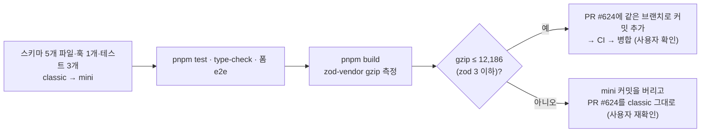

# zod 4 classic → zod/mini 전환 (PR #624 후속)

<!-- plan-result:start — 이 블록만 병합 뒤에도 고칠 수 있다(CLAUDE.md §11). 아래는 승인된 계획 원문 -->

## 구현 결과

> 2026-11-15 대조 · 이탈 1(절차) · 미구현 1 — 판정 근거(파일:줄)는 PR 본문 "계획 대비 구현"

- 채택 기준 충족: `zod-vendor` raw 23,505 / gzip 7,453(기준 12,186 이하), `dist/index.html`에 zod-vendor 없음
- 미구현 → 대체: 개발 서버로 URL 검증·비밀번호 안내를 직접 확인하지 않고 기존 스키마 테스트 2655개와 폼 e2e 51개로 대체
- 이탈(절차): 위 대체를 구현 중에 사용자에게 알리지 않았다. 병합 전 보고에서 밝히고 확인받는다
- 계획에 없던 변경 없음

<!-- plan-result:end -->

> zod 4(classic)로 올리면 `zod-vendor` 청크가 gzip 12,186 → 25,206바이트로 커진다. 스키마 5개 파일을 `zod/mini`로 옮겨 이 청크를 zod 3보다 작게 만든다. 실제 빌드 크기가 zod 3(12,186) 이하일 때만 채택하고, 아니면 PR #624를 그대로 병합한다.

## Context

- PR #624(`worktree-zod4-upgrade` 브랜치, 병합 보류 중)는 zod를 3.25.76 → 4.6.7로 올려 운영 high 알림 2건을 닫는다. CI는 전부 통과했다.
- 병합 전 빌드에서 알게 된 것: `zod-vendor`가 53,491 → 87,968바이트(gzip 12,186 → 25,226)로 커진다. 첫 로딩(`index.html`)에는 실리지 않지만, zod를 쓰는 화면(로그인·가입·글 등록/수정·상세 등)은 처음 로딩(gzip 223,806)의 약 5.8%만큼을 더 받는다.
- 사용자 결정(2026-11-15): "병합 보류, mini로 먼저 시도". 이 계획이 그 시도다.
- 비슷한 스키마를 같은 vite로 쟀더니(앱 실제 청크는 아님) zod 3 15,126, zod 4 classic 29,517, **zod 4 mini 8,430**(gzip)이었다. 공식 문서는 _"번들러는 보통 쓰지 않는 메서드 구현을 번들에서 지우지 못한다"_ 며 mini를 _"tree-shakable"_ 로 소개한다(번역, [zod.dev/packages/mini](https://zod.dev/packages/mini), 에이전트 보고, 직접 읽지 않음). 같은 문서는 엄격한 크기 제약이 없으면 classic을 권하기도 한다.
- 이 앱은 서버 응답 검사를 따로 넣을 계획이라(별도 계획) 스키마가 앞으로 늘어난다. mini가 그 기반으로도 유리하다.

## 판단이 필요했던 항목

| 항목 | 결정 | 근거·기각한 대안 |
| --- | --- | --- |
| 채택 기준 | 빌드한 `zod-vendor` gzip이 zod 3 때(12,186) 이하 | 사용자가 "너무 커지는 거 아니냐"고 물었다. zod 3보다 작아야 이번 업그레이드가 크기 회귀 없이 끝난다. 측정에서 mini는 zod 3의 약 56%(8,430/15,126)였다 |
| 작업 위치 | PR #624 브랜치(`worktree-zod4-upgrade`)에 커밋 추가 | 같은 변경(zod 4 도입)의 마무리라 PR을 새로 열지 않는다. 실패하면 이 커밋만 되돌린다. 기각: 별도 PR — 병합 순서가 꼬이고 classic 상태가 한 번 배포될 수 있다 |
| 테스트 파일의 zod | 테스트 3개도 mini로 | `useAvailabilityCheck`가 받는 스키마 타입이 mini로 바뀌어 classic 스키마를 넘기면 타입이 어긋난다. 폼 테스트 2개도 운영과 같은 방식으로 맞춘다 |
| `zodResolver`(`@hookform/resolvers` 5.9.2) | 그대로 쓴다 | 타입은 `_zod: { input, output }`만 요구하고(`zod.d.ts` 직접 읽음), 런타임은 `"_zod" in schema`로 zod 4 계열을 알아본다(번들 코드 직접 읽음). mini는 둘 다 만족한다. 실제 폼으로 도는지는 구현 단계에서 e2e로 확인 |
| 기본 영어 오류 문구 | `z.config`로 영어 locale을 켜지 않는다 | mini는 기본 locale이 없어 문구 없는 오류가 `Invalid input`으로 나온다(문서, 에이전트 보고). 이 앱 폼은 `TEXTS` 문구를 모든 검증에 단다. 기본 문구가 화면에 나오는 경로가 있으면 구현 단계에서 e2e·테스트로 찾아 `TEXTS`로 채운다. locale을 켜면 번들이 커져 목적에 반한다 |
| 기각한 대안 | classic 유지, 서버 응답 검사 선행 | classic 유지는 사용자가 크기를 문제로 삼았다. 응답 검사는 BE 재구성 1단계 뒤로 이미 미뤘다 |

## 세부 계획

기존 코드가 쓰는 API는 모두 mini에 있다(설치본 `node_modules/zod/v4/mini/*.d.ts`에서 이름·문자열 메시지 인자를 직접 확인: `string`·`email`·`url`·`object`·`array`·`boolean`·`optional`·`nullish`·`enum`·`extend`·`refine`·`check`·`minLength`·`maxLength`·`regex`·`coerce.number<T>`·`infer`, `safeParse` 메서드).

**변환 규칙**(모든 파일에 같은 규칙)

| classic | mini |
| --- | --- |
| `import { z } from 'zod'` | `import * as z from 'zod/mini'` |
| `z.string().min(n, msg)` / `.max(n, msg)` | `z.string().check(z.minLength(n, msg))` / `z.maxLength(n, msg)` |
| `.regex(re, msg)` | `.check(z.regex(re, msg))` (한 `check`에 여러 개를 이어 넣는다) |
| `z.string().email(msg)` / `z.string().url(msg)` | `z.email(msg)` / `z.url(msg)` |
| `.refine(fn, msg)` / `.refine(fn, { message, path })` | `.check(z.refine(fn, msg))` / `.check(z.refine(fn, { message, path }))` |
| `.optional()` / `.nullish()` | `z.optional(x)` / `z.nullish(x)` |
| `schema.extend({ ... })` | `z.extend(schema, { ... })` |
| `z.coerce.number<number>()`(PR #624에서 추가) | 그대로(mini에도 같은 제네릭) |
| `z.infer<typeof s>`, `s.safeParse(x)` | 그대로 |

| 위치 | 변경 내용 |
| --- | --- |
| `src/entities/account/model/account.schema.ts` | `nicknameValidationSchema`(min·max·regex 3개), `emailValidationSchema`, `updateAccountSchema`(`nullish`), `deleteAccountSchema` |
| `src/entities/auth/model/auth.schema.ts` | `passwordValidationSchema`(regex 2·max), 로그인·가입·재설정·변경·이메일 인증 스키마(`min`, 객체 `refine` 3개) |
| `src/entities/post/model/post.schema.ts` | `postUrlSchema`(url+refine), 등록·수정 스키마(`optional`, `array`, `coerce.number<number>()`) |
| `src/entities/comment/model/comment.schema.ts` | 본문 바이트 상한 `refine` |
| `src/entities/bookmark/folder/model/bookmark-folder.schema.ts` | `min(1)`, `enum` |
| `src/features/auth/login/hooks/useLogin.ts` | `loginSchema.extend(...)` → `z.extend(...)`, `z.boolean()` import |
| `src/features/auth/signup/hooks/useAvailabilityCheck.ts` | `schema: z.ZodType<string>` → `z.ZodMiniType<string>`(타입 import), `.safeParse`는 그대로 |
| 테스트 3개 | `useAvailabilityCheck.test.ts`(`z.string().email()` → `z.email()`), `FormInput.test.tsx`·`FormInputPassword.test.tsx`(`z.string().min(1, 'required')` 등) |
| `docs/FE-ARCHITECTURE.md:717-735`, `.claude/commands/add-schema.md:83-99`, `.claude/commands/new-domain.md:49-60` | 예제 코드를 mini 방식으로 갱신하고, "`zod/mini`를 쓰는 이유(번들 크기)" 한 줄을 단다 |
| `docs/DEPLOY.md:197-200` | 수정 범위 서술을 "mini로 옮겼다"로 고침 |
| `docs/plans/2026-11-15-zod-4-upgrade.md` | H1 아래 `구현 결과` 블록에 "후속: 크기 때문에 mini 전환(이 계획)" 한 줄만 덧붙임(원문은 고치지 않음) |
| `docs/plans/2026-11-15-zod-mini-migration.md` (신규) | 이 계획의 스냅샷 |

## 영향 범위 (§5)

- **런타임**: 같은 검증 규칙을 다른 API로 옮기는 것이라 검증 결과가 같아야 한다. 이미 있는 테스트가 그물이다 — `post.schema.test`(URL 스킴 판정), `auth.schema.test`·`auth.contract.test`·`auth.util.test`(비밀번호 규칙, 스펙 대조), `account.schema.test`(닉네임 길이·문자 안내 분리), `bookmark-folder.schema.test`, `comment` 바이트 상한 테스트. 이 테스트들이 `.safeParse`와 오류 문구를 직접 본다.
- **사용처**: 스키마를 import하는 파일이 많아 수정 전에 `pnpm graph:focus "<파일>" --text`로 확인한다. 값(스키마 객체)의 사용처는 폼 훅 몇 개뿐이고, 타입(`z.infer`)은 그대로라 `pnpm type-check`가 잡는다.
- **폼 라이브러리 연결**: `zodResolver`가 mini 스키마를 받는지는 e2e로 확인한다(가입·로그인·글 등록·수정·계정 수정).
- **기본 문구**: mini는 기본 영어 locale이 없어, 문구를 안 단 검증은 `Invalid input`이 된다. 구현할 때 `z.string()`·`z.boolean()`처럼 문구 없는 타입 검증이 화면에 나오는 경로를 찾는다.
- **번들**: `zod-vendor` 청크 크기가 줄어든다. 첫 로딩에 zod가 실리지 않아야 한다(CI "진입 청크에 zod 없음 확인", [ci.yml:183](.github/workflows/ci.yml#L183)).
- **CHANGELOG·API 계약**: 동작이 안 바뀌는 의존성·내부 변경이라 CHANGELOG 없음, API 계약 변경 없음.
- **BE 재구성과의 관계**: 영향 없음(zod는 브라우저 폼 검증, BE 스펙·생성 타입을 안 건드림).

## 검증 방법

1. `pnpm type-check` → `pnpm test`(기존 2655개가 그대로 통과) → `pnpm lint` → `pnpm check:deps` → `pnpm check:docs`
2. 폼 e2e: `login`·`signup`·`post-create`·`auth-form-failure`·`account-update`(PR #624 때 24개) + 글 수정·댓글·폴더 이름 관련 e2e. 브라우저는 이미 내려받아 두었다.
3. **크기 확인(채택 기준)**: `pnpm build` 뒤 `gzip -c dist/assets/js/zod-vendor-*.js | wc -c`가 **12,186 이하**여야 한다. 그 값과 raw 크기를 PR 본문에 남긴다. 이 값이 12,186을 넘으면 mini 커밋을 버리고 사용자에게 다시 묻는다.
4. 첫 로딩 확인: `grep -q zod-vendor dist/index.html`이 실패(없음).
5. `pnpm audit --prod --audit-level=high` exit 0 유지.
6. 개발 서버에서 글 등록 URL 검증(`https://` 외 스킴 거부, 형식 오류 문구)과 가입 비밀번호 안내를 직접 확인한다(PR #624에서 대체했던 항목).
7. 병합(사용자 확인 뒤) → 배포 success 확인 → Dependabot zod 알림 2건 닫힘 확인 → 워크트리·로컬 브랜치 정리.

## 남은 것

- 서버 응답 검사(별도 계획): mini 기반으로 검증 위치·스키마 출처·실패 처리를 정한다. BE 모듈러 모놀리스 1단계 뒤 시작을 권장한다.
- 개발 의존성 알림 28건(undici 등)은 범위 밖.
