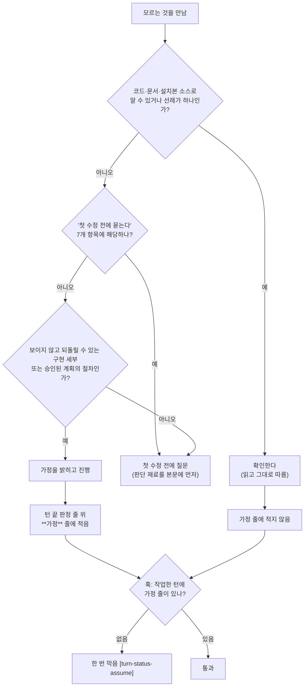
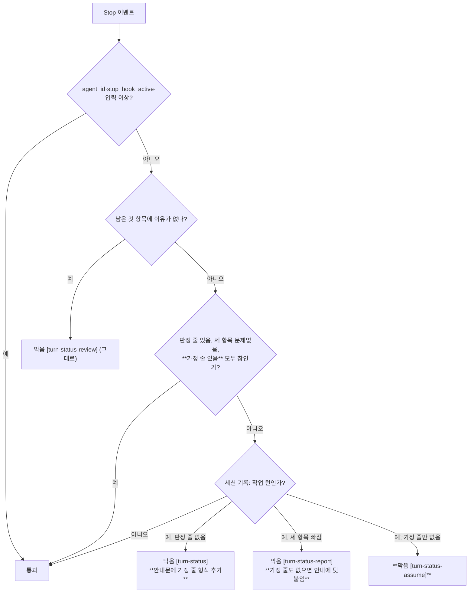

# 묻기와 가정의 경계 — §1을 세 갈래 목록으로 바꾸고 턴 끝 가정 줄을 훅으로 강제한다

<!-- plan-result:start — 이 블록만 병합 뒤에도 고칠 수 있다(CLAUDE.md §11). 아래는 승인된 계획 원문 -->

## 구현 결과

> #629 · 2026-11-16 대조(계획 + 세 저장소 diff + 대화 요약) · 이탈 2(모두 절차) · 미구현 0 — 판정 근거(파일:줄)는 PR 본문 "계획 대비 구현"

- 이탈(절차): 계획은 claude-base 커밋(순서 5) 뒤 병합 전 새 세션 확인(순서 6)이었는데, 확인을 먼저 하고 그 결과를 claude-base README 행에 적은 뒤 커밋했다. 확인 세션은 커밋 전 워크트리 코드로 돌았다
- 이탈(절차): 순서 1은 이후 저장소 작업을 절대경로와 `git -C`로만 하기로 했는데, 훅 수정·테스트 실행 한 번을 워크트리로 `cd`해서 했다. 그 자리에서 알리고 이후 git 명령은 `git -C`로 했다
- 이탈(문구, 사용자 확인): 계획은 BE 문구를 "FE와 같고 절 참조만 BE 번호에 맞춘다"고 했다. BE에는 질문 절(FE §13)이 없어 "§13대로 묻는다"를 "판단 재료(확인한 사실, 선택지마다 바뀌는 것, 추천)를 먼저 준 뒤 묻는다"로 풀어 썼다
- 계획에 없던 변경(claude-base): 완료 보고 항목 검사 기준선을 다시 재면 696·57·0이 아니라 697·58·1이 나온다는 것을 METRICS에 기록했다(측정기를 고치기 전에도 같은 값, 원인은 좁히지 않음)
- 계획에 없던 변경(claude-base): 셸 명령으로 파일을 만든 턴은 작업 턴으로 잡히지 않아 가정 줄 검사도 받지 않는다는 기존 한계를 README에 기록했다
- 계획에 없던 변경(claude-base): 측정기가 훅의 판정 줄 정규식을 그대로 쓰도록 `VERDICT`를 export로 바꿨다. 변이 확인은 다섯 군데가 아니라 일곱 군데를 깼다(4·1·3·1·3·7·2개 실패)
- 미구현 → 보완함(claude-base): DECISIONS 새 항목에 판단 표의 두 행이 없어 대조 뒤 더했다(커밋 639aaf9)
- 순서 차이: claude-base main ff 병합(1ed7018 → 639aaf9)과 병합 뒤 새 세션 확인은 계획대로 이 PR보다 먼저 했다

<!-- plan-result:end -->

> 모르는 것을 만났을 때 "확인한다 / 첫 수정 전에 묻는다 / 가정을 밝히고 진행한다" 세 갈래로 다루도록 link-sphere FE·BE
> `.claude/CLAUDE.md` §1을 목록으로 바꾼다. 작업한 턴은 판정 줄 위에 `**가정**` 줄이 있어야 하고, 없으면 claude-base
> `hooks/turn-status.mjs`가 한 번 막는다. 훅은 14일 실험 뒤 판정한다. 저장소는 claude-base, link-sphere FE, link-sphere BE다.

## Context

**왜 하나.** 2026-11-16 사용자 요청이다. 주니어가 모르는 것을 시니어에게 묻지 않고 짐작으로 일하다 틀리는 상황을 AI
작업에서 막고 싶다. 지금 §1은 "불분명하면 묻는다"뿐이라 불분명한지를 Claude가 스스로 정하고, 지키는지 보는 검사가 없다.

**확인한 사실(직접 읽음).**

- FE·BE `.claude/CLAUDE.md:5`는 "사소한 작업에는 판단력을 발휘한다", `:16-19`는 가정을 밝히고 불분명하면 묻는다는 네 줄이다.
  두 저장소의 이 줄들은 글자가 같다.
- 등록된 훅(`~/.claude/settings.json`) 중 가정·질문을 보는 것은 없다. `hooks/turn-status.mjs`는 턴 끝 판정 줄, `남은 것` 이유,
  `끝났어요` 아래 요청·결과·증거만 본다.
- `turn-status.mjs:209`의 `stop_hook_active` 통과 때문에 한 턴에 한 번만 막는다. 여러 가지가 함께 빠지면 안내를 하나로 합쳐야 한다.
- `남은 것` 목록의 항목은 ` — 이유`가 없으면 막힌다(`turn-status.mjs:164-173`). 가정을 그 목록에 넣을 수 없다.
- `docs/METRICS.md:562` 기준선에서 14일 작업 턴 696개 중 `끝났어요`만으로 끝난 턴은 57개다. 가정 줄은 판정 종류와 무관한
  자리에 있어야 한다.
- 완료 보고 항목 검사 실험이 같은 훅에서 진행 중이다(측정 11-14 ~ 11-27, 판정 11-28, `METRICS.md:567`). 측정기
  `scripts/report-items.mjs:24`는 태그 세 개만 알고, `:107`은 알아본 피드백을 "마지막 답변"의 경계로 쓴다.
- claude-base `CLAUDE.md`는 143줄이고 예산은 150줄이다. `:14`에 같은 취지의 한 줄이 있다. 아직 어떤 세션에도 로드되지 않는다.
- FE `docs/PR-BODY-CHECK.md`가 턴 끝 형식을 서술한다. BE 문서에는 없다.

**조사한 근거(웹 조회 에이전트가 원문을 읽어 옮김, 이 세션은 원문을 직접 열지 않음).** 상세와 링크는 구현 때 claude-base
`docs/RESEARCH.md`에 적는다.

- 가정을 전부 금지하는 공식 문서는 없다. OpenAI Model Spec(2026-10-29판)은 부작용이 심각할 때만 확인을 구하고 그 밖에는
  최선의 추측으로 진행하되 가정을 크게 밝히라고 쓴다. Karpathy 지침 원본도 가정을 명시적으로 밝히라고 쓴다.
- Claude Fable 5.2 프롬프트 가이드는 승인 범위를 넓게 쓰면 일상 요청의 절반가량을 보류했다는 자체 시험을 싣고, 승인이
  필요 없는 단계를 이름으로 적으라고 권한다.
- Claude Code best-practices는 CLAUDE.md 문구를 따를지는 모델의 판단이고, 강조를 더하는 대신 굽힐 수 없는 규칙은 훅으로
  옮기라고 쓴다.

### 세 갈래 흐름



### 훅 판정 흐름 (굵은 노드가 이번에 바뀌는 곳)



## 판단이 필요했던 항목

| 항목 | 결정 | 근거·기각한 대안 |
| --- | --- | --- |
| 적용 범위 | 목록(문구) + 훅 | 질문(2026-11-16 "적용 범위"). 기각: 목록만(강제 없음), 훅만(묻는 기준이 그대로 Claude 판단) |
| 가정 전면 금지 여부 | 금지하지 않는다. 세 갈래로 둔다 | 질문(2026-11-16 "표준대로 갑시다"). 사용자가 "가정을 안 하기로 한 것 아니냐"고 짚어 전면 금지안을 비교했다. 기각: 전면 금지. 조사한 공식 문서 어디에도 없고 과잉 질문 근거가 있다 |
| 목록 내용 | "첫 수정 전에 묻는다" 7개, "가정을 밝히고 진행한다"는 보이지 않는 구현 세부와 승인된 계획 절차뿐 | 질문(2026-11-16 "목록", 수정안 그대로) |
| 확인 관문(첫 수정 때 되묻는 훅) | 넣지 않는다 | Claude 추천, 사용자가 "목록 + 훅"을 고름. 매 작업을 멈춰 과잉 질문 쪽이 된다 |
| 가정 줄 형식 | 판정 줄 위 독립 줄. `**가정**: 없음` 또는 `**가정**` 아래 목록 | 질문(2026-11-16 "가정 줄 형식"). 기각: 판정 줄 아래 항목(`남은 것` 턴에서 이유 검사와 충돌) |
| 시작 시점 | 지금 | 질문(2026-11-16 "시작 시점"). 기각: 11-28 판정 뒤. 진행 중 실험과 섞이는 것은 아래 위험 관리로 다룬다 |
| 판정 기준 | 사용자 평가 + 처음부터 쓴 비율 80% | 질문(2026-11-16 "판정 기준") |
| 강조 문구(IMPORTANT 등) | 더하지 않는다 | Claude Code best-practices가 버리라고 한 습관이다 |
| 가정 줄 문법 | 0열에서 `가정`(굵게 감싸도 됨)으로 시작하는 줄. 콜론(반각·전각) 뒤 같은 줄에 내용이 있거나 바로 아래 목록 항목이 1개 이상 | Claude 판단. `REPORT_ITEM`·`listItemsAfter` 선례. 기각: 불릿 항목 `- 가정:` 허용(고른 형식과 다르고 보고 목록과 섞인다) |
| 가정 줄 위치 검사 | 마지막 답변 안에 있으면 통과. 판정 줄 위인지는 보지 않고 안내문으로만 알린다 | Claude 판단. 위치까지 막으면 문법 차이로 막히는 일이 는다 |
| 대상 턴 | 작업한 턴 전부(`didWorkThisTurn`). 판정 종류와 무관 | Claude 판단. 기준선상 `끝났어요`만 보면 작업 턴의 8%뿐이다 |
| 함께 빠졌을 때 | 판정 줄이 없으면 `[turn-status]`, 세 항목이 빠졌으면 `[turn-status-report]`로 막고 안내문에 가정 줄을 덧붙인다. 가정 줄만 없을 때만 `[turn-status-assume]` | Claude 판단. 한 턴에 한 번만 막는다. 진행 중 실험의 태그별 집계가 그대로 유지된다 |
| 막힌 뒤 다시 쓰는 범위 | 가정 줄부터 판정까지 다시 쓴다. 앞 본문은 반복하지 않는다 | Claude 판단. 11-13 "판정 줄부터 다시 쓴다" 선례. 마지막 답변 하나에 가정 줄과 판정이 함께 있어야 측정기가 읽는다 |
| 진행 중 측정기 | `scripts/report-items.mjs`가 새 태그를 답변 경계로만 알아보고, "처음부터 세 항목" 판정에서는 세지 않는다 | Claude 판단. 고치지 않으면 막히기 전 답변과 다시 쓴 답변이 이어 붙어 길이 지표가 부푼다 |
| 새 측정기 | `scripts/assumption-lines.mjs`를 커밋한다. 대상·판정은 훅의 함수를 부른다 | `scripts/report-items.mjs` 선례 |
| 사소한 작업 단서 | 남기되 "첫 수정 전에 묻는다" 항목에는 적용되지 않는다고 한 문장을 붙인다 | 질문 전 본문에서 제안, 목록과 함께 승인 |
| claude-base `CLAUDE.md` | `:14`와 `:81`을 같은 줄 안에서 고친다(줄 수 그대로) | 예산 150줄 중 143줄 |
| 전역 `~/.claude/CLAUDE.md` | 고치지 않는다 | 형식은 훅 안내문과 메모리로 전한다(턴 끝 판정 형식도 그렇게 했다) |

### 실험 (METRICS에 적을 내용)

- 기간: claude-base 병합 다음 날(KST)부터 14일. 병합이 11-16이면 측정 11-17 ~ 11-30, 판정 12-01. 병합일은 양쪽에서 뺀다.
- 기준선: 병합 전날까지 14일을 커밋한 측정기로 잰다.
- 지표: ① 처음부터 가정 줄을 쓴 비율 = turn-status 계열 피드백 없이 가정 줄이 있는 작업 턴 ÷ 판정 줄로 끝난 작업 턴.
  ② 사용자 평가("가정이 보여서 도움이 됐는가").
- 유지: ②가 "도움이 됐다"이고 ①이 80% 이상. 제거: 사용자가 소음으로 판단. ①이 80% 미만이면 형식을 고쳐 연장.
- 판정 때 함께 보여 줄 것: `없음` 비율, `[turn-status-assume]` 발동 수, 막힌 뒤 채운 수, 가정 줄에 없었는데 나중에 드러난
  가정 사례(사용자가 기억하는 것과 Claude가 메모해 둔 것).
- 훅이 못 보는 것: 내용. `없음`이 사실인지, 적힌 것이 "묻는다" 항목이었는지는 판단하지 못한다.

### 위험 관리

| 위험 | 대응 |
| --- | --- |
| 늘 `없음`만 쓴다 | 형식 검사라 못 막는다. `없음` 비율을 판정 때 보여 준다 |
| "묻는다" 항목을 가정 줄에 적고 진행한다 | 줄에 적히므로 사용자가 그 턴에 본다. 이 장치의 목적이 이것이다 |
| 질문이 늘어 작업이 느려진다 | 목록을 이름으로 좁혔다. 판정 때 사용자 평가로 본다 |
| 진행 중 실험(11-28)과 섞인다 | 태그 분리, 측정기 경계 처리, METRICS 교란 요인에 "11-16부터 답변에 가정 줄이 더해져 길이가 는다"를 적는다 |
| 정상 답변이 문법 차이로 막힌다 | 굵은 표시·전각 콜론·아래 목록을 받아들이고 테스트로 고정한다 |
| 훅 오류로 Stop이 막힌다 | fail-open 유지(예외면 출력 없이 exit 0) |
| 병합 즉시 떠 있는 다른 세션에도 적용된다 | ff 병합 확인 질문에 적는다 |

## 세부 계획

### claude-base (원격 없는 로컬 저장소, 워크트리 `ask-or-assume`)

| 위치 | 변경 내용 |
| --- | --- |
| `hooks/turn-status.mjs:1-19` | 머리말에 2026-11-16 문단(가정 줄 검사, 태그, 근거 문서) |
| `hooks/turn-status.mjs:24-31` | `ASSUME_HEADING` 정규식 추가 |
| `hooks/turn-status.mjs:39-58` | `ASSUME_FORMAT` 문구 상수. `REASON`과 `reportReason`에 가정 줄 형식을 덧붙인다(`reportReason`은 가정 줄이 없을 때만). 새 `ASSUME_REASON`(`[turn-status-assume]`, 가정 줄부터 판정까지 다시 쓴다, 세 갈래 한 줄 요약) |
| `hooks/turn-status.mjs` (신규 함수) | `export hasAssumptionLine(message)`. `listItemsAfter`를 그대로 쓴다 |
| `hooks/turn-status.mjs:217-233` | 이유 검사 뒤: 판정 줄·세 항목·가정 줄이 모두 문제없으면 기록을 읽지 않고 통과 → 작업 턴이 아니면 통과 → 판정 줄 없음 `[turn-status]`, 세 항목 빠짐 `[turn-status-report]`, 가정 줄만 없음 `[turn-status-assume]` |
| `hooks/turn-status.test.mjs` | 통과를 단언하던 작업 턴 입력에 가정 줄을 넣어 기대를 유지한다(요구 변경). 새 테스트: 가정 줄 없음 → 막음(새 태그만), `없음`·아래 목록·굵은 표시 없음·전각 콜론 → 통과, 내용 없는 줄·불릿 항목 `- 가정:`·줄 중간의 "가정" → 막음, 판정 줄 없음과 겹침 → `[turn-status]` 안내에 형식, 세 항목 빠짐과 겹침 → `[turn-status-report]` 안내에 형식, `남은 것` 턴도 대상, 작업 안 한 턴·계획 파일만 쓴 턴·`stop_hook_active` → 통과, 실제 실행 |
| `scripts/assumption-lines.mjs` (신규) | 실험 측정기. 인자와 턴 나누기는 `report-items.mjs`와 같다. 판정 줄로 끝난 작업 턴을 "처음부터 / `[turn-status-assume]` 뒤 채움 / 다른 turn-status 피드백 뒤 채움 / 끝까지 없음"으로 나누고 `없음` 비율과 발동 수를 낸다. 대화 내용은 출력하지 않는다 |
| `scripts/report-items.mjs:24`, `:121-131` | 새 태그를 `feedbackTag`가 알아보게 하고(답변 경계), `outcomeOf`는 새 태그를 뺀 목록으로 판정한다 |
| `README.md` "적용된 것" | 행 추가(같은 `hooks.Stop` 등록, 코드만 바뀜, 확인 결과, 되돌리는 법) |
| `CLAUDE.md:14` | 세 갈래 한 줄로 바꾼다 |
| `CLAUDE.md:81` | "작업한 턴은 판정으로 끝낸다" 문장에 판정 줄 위 가정 줄을 더한다 |
| `docs/METRICS.md` | 새 절 "실험: 가정 줄 검사", "다음 측정"에 판정일, 완료 보고 항목 검사 절 교란 요인에 한 줄 |
| `docs/DECISIONS.md` | 새 항목 "2026-11-16 — 묻기와 가정의 경계"(위 판단 표, 4열) |
| `docs/RESEARCH.md` | 새 절 "10. 묻기와 가정 (2026-11-16)". 출처 링크, 번역 인용, 재인용 표시, 읽지 못한 부분(Model Spec 되묻기 절 본문, 논문 본문) |
| `docs/MAPPING.md:141`·`:249` 근처, `:384` | FE·BE §1 행에 바뀐 불릿을 반영하고, `turn-status-hook` 행 메모에 이 실험 판정일을 더한다. 정확한 행은 구현 때 읽고 정한다 |
| `docs/plans/2026-11-16-ask-or-assume.md` (신규) | 이 계획의 사본. 대조 뒤 구현 결과 블록을 붙인다 |

### link-sphere FE (PR 1개, 문서만)

| 위치 | 변경 내용 |
| --- | --- |
| `.claude/CLAUDE.md:5` | 끝에 한 문장: §1의 "첫 수정 전에 묻는다" 항목은 작업이 사소해도 묻는다 |
| `.claude/CLAUDE.md:16-17`, `:19` | 세 줄을 아래 "§1 새 문구"로 바꾼다. `:18`(더 단순한 접근)은 그대로 둔다 |
| `docs/PR-BODY-CHECK.md` | 턴 끝 형식을 적은 자리에 가정 줄과 실험 판정 문서를 더하고 마지막 검토 날짜를 고친다. 정확한 줄은 구현 때 읽고 정한다 |
| `docs/plans/2026-11-16-ask-or-assume.md` (신규) | 계획 사본과 구현 결과 블록 |

### link-sphere BE (PR 1개, 문서만)

| 위치 | 변경 내용 |
| --- | --- |
| `.claude/CLAUDE.md:5`, `:16-17`, `:19` | FE와 같은 문구. 절 참조만 BE 번호에 맞춘다(§7만 있고 시각 변경·질문 절은 없다) |
| `docs/plans/2026-11-16-ask-or-assume.md` (신규) | 계획 사본과 구현 결과 블록 |

### §1 새 문구 (FE 기준)

```
- 모르는 것은 세 갈래로 다룬다. 조용히 하나를 고르지 않는다.
  - **확인한다**: 코드·문서·설치본 소스로 알 수 있는 것, 선례가 하나인 이름·위치·스타일. 읽고 그대로 따른다.
  - **첫 수정 전에 묻는다**: ① 요청이 둘 이상으로 읽히고 해석에 따라 건드리는 파일·동작이 달라질 때(해석을 모두 내놓는다)
    ② 요청에 없는데 사용자가 체감하는 동작이 바뀔 때(§7) ③ 색·간격·문구 톤처럼 정답이 없는 선택(§9) ④ 요청 범위를 넘어
    내 제안을 얹을 때 ⑤ 데이터 계약, 인증·세션, 운영 데이터, 배포 순서 ⑥ 키처럼 보이는 값 ⑦ 선례가 없거나 둘 이상인데
    사용자에게 보이는 결과(화면·문구·API 응답·문서 구조)가 달라지는 선택. 무엇이 헷갈리는지 밝히고 §13대로 묻는다.
  - **가정을 밝히고 진행한다**: 사용자에게 보이지 않고 그 변경 안에서 되돌릴 수 있는 구현 세부(지역 이름, 내부 함수 분리,
    테스트 케이스 구성)와 승인된 계획 안의 절차뿐이다. 작업한 턴의 판정 줄 위 `**가정**` 줄에 적고, 없으면 "없음"이라 쓴다.
    어느 갈래인지 모르겠으면 묻는다.
```

### 메모리 (저장소 밖)

| 위치 | 변경 내용 |
| --- | --- |
| `turn-status-hook.md`, `MEMORY.md` 해당 줄 | 가정 줄 형식, 적용일, 측정 구간, 판정일, 측정 명령 |

### 순서

굵게 표시한 단계는 그 자리에서 대화에 글로 알리고 다음으로 간다.

1. claude-base 워크트리를 만든다(`git -C ~/project/claude-base worktree add .claude/worktrees/ask-or-assume -b ask-or-assume`).
   이 세션의 작업 디렉터리가 조사 중 `cd`로 claude-base 메인 체크아웃으로 바뀌어 있다. 이후 모든 저장소 작업은 절대경로와 `git -C`로만 한다.
2. 훅과 테스트를 고치고 `node --test hooks/*.test.mjs`를 돌린다.
3. 스크래치패드 사본에서 가정 줄 판정, 내용 확인, 태그 선택 세 갈래, 작업 턴 확인, 안내문 형식을 하나씩 깨 본다.
   **깨진 것마다 실패한 테스트 수를 보고한다.**
4. `scripts/assumption-lines.mjs`를 쓰고 `report-items.mjs`를 고친 뒤 기준선을 잰다. `report-items.mjs`는 고치기 전후로
   `--until 2026-11-12` 값이 같은지 확인한다. **수치를 보고한다.**
5. claude-base 문서와 계획 사본을 고치고 커밋한다(새 파일만 `git add -- <파일>`, 경로 지정 커밋, 메시지는 `-F` 파일, 영어).
6. 병합 전 확인: 스크래치패드 새 폴더 둘에 프로젝트 설정(`hooks.Stop` → 워크트리의 `run-node.sh turn-status.mjs`)을 두고
   `claude -p --model haiku --permission-mode acceptEdits` 세션 2개를 돌린다(가정 줄 없이 끝내게 한 것, 넣게 한 것). **결과를 보고한다.**
7. FE: `git -C <FE> log origin/main..main` 확인 뒤 `git -C <FE> worktree add`로 워크트리를 만들고 `pnpm --dir <워크트리> install`,
   문서와 계획 사본을 고친다. `.env`는 문서 변경이라 복사하지 않는다.
8. BE: 같은 방식으로 워크트리를 만들고 문서와 계획 사본을 고친다. BE에 떠 있는 다른 워크트리 두 개는 건드리지 않는다.
9. `node ~/project/claude-base/scripts/session-digest.mjs --out <스크래치패드 파일>`로 대화 요약을 만들고, plan-verifier에
   계획 파일·세 저장소 diff·대화 요약을 넘겨 대조한다. 결과 블록을 세 사본에 붙인다. **대조 결과를 보고한다.**
10. claude-base main ff 병합을 확인받는다(저장소가 무엇인지, 워크트리에만 있는 파일, 병합하면·안 하면 달라지는 것, 떠 있는
    세션에도 바로 적용된다는 것을 먼저 쓴다). 병합일이 11-16이 아니면 병합 전에 METRICS·DECISIONS의 날짜를 고친다. 병합 뒤
    프로젝트 설정 없는 새 폴더에서 `claude -p` 1개로 반영을 확인한다. **결과를 보고한다.** 워크트리와 브랜치를 지운다.
11. FE: `pnpm check:docs`, `pnpm check:pr-body <본문 파일>` → 커밋·push·PR → CI 통과 → squash 병합(확인 창) → 배포 워크플로가
    돌면 성공 확인, 안 돌면 병합 확인까지 → 워크트리 정리.
12. BE: 커밋·push·PR → CI 통과 → squash 병합(확인 창) → 병합 확인 → 워크트리 정리.
13. 메모리를 갱신한다.

## 영향 범위

- **모든 세션(사용자 범위)**: claude-base 병합 즉시, 떠 있는 세션을 포함해 다음 Stop부터 적용된다. 작업한 턴에 가정 줄이 없으면
  한 번 막힌다. 기준선대로면 14일에 작업 턴 약 700개가 대상이고, 처음부터 쓰면 막히지 않는다. link-sphere가 아닌 저장소
  세션도 막히며, 그 세션들은 §1 목록 없이 훅 안내문만 본다.
- **질문 빈도**: FE·BE 세션에서 "첫 수정 전에 묻는다" 7개 항목에 해당하면 작업이 사소해도 질문이 먼저 나온다. 사용자가 체감하는
  변화이고 2026-11-16에 승인받았다.
- **기존 동작**: `[turn-status-review]`, `[turn-status]`, `[turn-status-report]`의 발동 조건은 그대로다. 두 안내문에 가정 줄 형식이
  더해진다. 조사만 한 턴, 계획 파일만 쓴 턴, 서브에이전트는 지금처럼 통과한다.
- **기존 테스트**: 작업 턴 통과를 단언하는 입력에 가정 줄을 넣는다(요구 변경). 단언 줄은 줄이지 않는다.
- **진행 중 실험**: 완료 보고 항목 검사(11-28)는 주 지표 정의가 그대로이고 답변 길이가 한두 줄 는다(METRICS에 기록).
  침묵 감지(11-26)의 `hooks/silence-guard.mjs`·`lib/transcript.mjs`·`scripts/silent-runs.mjs`는 고치지 않는다.
- **FE·BE**: `.claude/CLAUDE.md`와 `docs/`만 바뀐다. 앱 코드·CHANGELOG·CI 설정은 그대로다. FE CLAUDE.md는 약 6줄 는다.
- **순서 의존**: FE·BE 문서가 가정 줄과 claude-base METRICS 절을 가리키므로 claude-base 병합이 먼저다. FE와 BE 사이에는 순서가 없다.
- **되돌리기**: 훅은 그 커밋을 revert해 ff 병합, 문구는 PR revert.
- **비용**: plan-verifier 1회, `claude -p` Haiku 세션 3개.

## 검증 방법

1. **훅 테스트**: `node --test hooks/*.test.mjs` 전체 통과.
2. **변이 확인**: 순서 3의 다섯 군데를 깨면 각각 1개 이상 실패한다.
3. **실제 프로세스**: `run-node.sh` 경유 실행에서 가정 줄 없음은 block JSON에 `[turn-status-assume]`, 있음은 출력 없음, 깨진 입력은 출력 없이 exit 0.
4. **측정기**: 새 측정기의 기준선 수치가 나오고 출력에 대화 내용이 없다. `report-items.mjs`는 고치기 전후 기준선 값이 같다.
5. **병합 전 새 세션**: 가정 줄 없이 끝내게 한 세션은 기록에 `Stop hook feedback`(`[turn-status-assume]`)이 1개 남고 마지막 답변에 가정 줄과 판정이 있다. 넣게 한 세션에는 피드백이 없다.
6. **병합 뒤 새 세션**: 프로젝트 설정 없이 5번 첫 세션과 같은 결과.
7. **FE·BE 검사**: FE `pnpm check:docs`·`pnpm check:pr-body`, 두 PR의 CI 통과.
8. **대조**: plan-verifier가 코드 항목과 순서의 굵은 단계를 판정한다.

**완료 조건**: claude-base main에 훅·테스트·측정기·문서가 ff 병합되고 새 세션에서 `[turn-status-assume]` 발동을 기록으로 확인했다.
METRICS에 기준선·기간·판정 기준·측정 명령이 있다. FE·BE PR이 병합되고 세 워크트리가 정리됐다. 침묵 감지 실험의 파일은 바뀌지 않았다.

## 남은 것

- 실험 판정(병합 다음 날부터 14일 뒤): `scripts/assumption-lines.mjs`로 재고 사용자에게 도움이 됐는지 묻는다.
- Claude가 모르는 줄 모르고 지나간 가정은 목록으로도 훅으로도 막지 못한다(한계).
- 내장 Explore·Plan 서브에이전트는 CLAUDE.md를 읽지 않아 이 목록을 모른다. 이번 범위 밖이다.
- link-sphere infra와 claude-base 세션에는 §1 목록이 로드되지 않는다. 6라운드(연결)에서 claude-base `CLAUDE.md:14`로 닿는다.
- FE CLAUDE.md가 1,127줄로 공식 권장(파일당 200줄 이하)을 크게 넘는다. 5라운드 축소에서 다룬다.
- OpenAI Model Spec의 되묻기 절 본문과 2026년 논문 두 편의 본문은 읽지 못했다. RESEARCH에 미확인으로 적는다.
