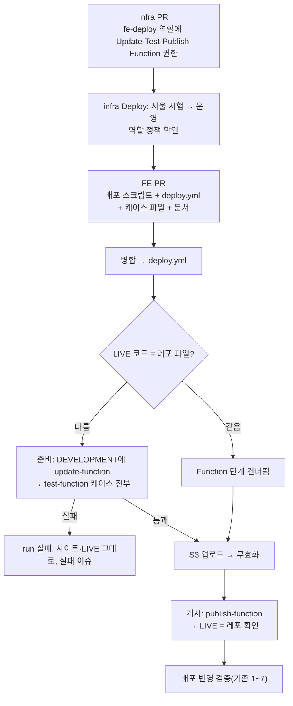

# CloudFront Function 배포를 FE 배포 워크플로로 자동화

<!-- plan-result:start — 이 블록만 병합 뒤에도 고칠 수 있다(CLAUDE.md §11). 아래는 승인된 계획 원문 -->

## 구현 결과

> #632 · 2026-11-16 대조 · 이탈 1 · 미구현 1(보완함) — 판정 근거(파일:줄)는 PR 본문 "계획 대비 구현"

- 이탈: 계획은 Comment·Runtime을 개발 단계의 현재 값으로 넣는다고 했으나 LIVE 값을 넣는다. 스냅샷과 매일 차이 검사가 LIVE를 보기 때문이다(대조에서 지적받아 바꿈)
- 미구현 → 보완함: 옛 절 제목과 수동 배포 안내가 `.claude/commands/new-domain.md`와 `cloudfront-drift-check.yml`의 이슈 문구에 남아 있어 고쳤다
- 계획의 전제 정정: "Function만 바꾼 PR은 같은 내용을 다시 올린다"고 적었으나, 번들에 커밋 sha가 들어가 새 빌드가 된다. 열려 있던 탭은 다른 배포와 같이 새 버전으로 인식한다(`docs/DEPLOY.md`에 적음)
- 계획에 없던 변경: 게시 전에 개발 단계 코드가 레포 파일과 같은지 확인하고 다르면 거부한다. 케이스가 없는 Function은 준비 단계에서 실패하고, vitest도 Function 파일마다 케이스가 있는지 본다
- 계획에 없던 변경: drift 검사 스크립트의 Function 차이 안내 문구, CHANGELOG 항목, infra README의 "나누는 기준" 문단
- 계획에 없던 검증: 로컬 키로는 AWS에 못 돌려, 가짜 `aws` 명령으로 준비 → 게시 → 재실행 건너뜀 → 시험 실패 시 중단을 돌려 봤다. 실제 AWS 첫 실행은 이 PR의 배포다
- 문서 동기화: SYSTEM-ARCHITECTURE·FE-ARCHITECTURE·SERVICE-GLOSSARY의 수동 배포 서술, DEPLOY의 파이프라인 단계·롤백 절·트리거 목록(#630에서 빠진 사전 압축 스크립트 포함)

<!-- plan-result:end -->

> `infra/cloudfront-functions/*.js`를 고친 PR이 병합되면 `deploy.yml`이 Function을 시험하고 게시한다. CloudShell 수동 배포를 없애고, 필요한 권한은 infra 레포 PR로 준다.

## Context

**문제.** CloudFront Function 두 개(`link-sphere-spa-fallback`, `link-sphere-spa-status`)는 코드가 FE 레포에 있지만 배포는 사람이 CloudShell에서 한다(`docs/DEPLOY.md` "CloudFront Function (수동 관리)"). 누가 언제 배포했는지 git·Actions에 남지 않는다. 2026-09 이후 코드가 5번 바뀌었고(#131·#324·#414·#459·#630) 그때마다 수동 배포였다. 로컬 키에는 CloudFront 권한이 없어 매번 사용자가 스크립트를 올려 실행한다.

**관리 원칙(사용자 결정 2026-11-16).** infra 레포가 이미 쓰는 구분을 CloudFront에도 쓴다.

| | 설정(드물게 바뀜) | 코드(앱과 함께 바뀜) |
| --- | --- | --- |
| BE | Lambda 메모리·권한 → infra PR | Lambda jar·버전·별칭 → BE 배포 워크플로 |
| FE | CloudFront 배포 설정·WAF → 아직 수동, infra 이슈 #11(12-03)에서 편입 여부 결정 | **Function 코드 → FE 배포 워크플로(이 계획)** |

**지금 구조(직접 읽음)**

- infra `lib/baseline-stack.ts:299-330` — `link-sphere-fe-deploy` 역할. Function 권한은 `DescribeFunction`·`GetFunction`(읽기)뿐이다.
- FE `.github/workflows/deploy.yml` — 빌드 → 사전 압축 → S3 업로드 → 무효화 → 배포 반영 검증 → 옛 자산 정리. `on.paths`에 `infra/cloudfront-functions/**`가 없다.
- FE `scripts/check-cloudfront-drift.js:84-109` — LIVE 코드를 받아 레포 파일과 비교하는 코드가 이미 있다(`get-function --stage LIVE`). `scripts/lib/cloudfront-snapshot.js:7`의 `FUNCTION_NAME_PREFIX`로 파일 이름과 Function 이름을 잇는다.
- FE `src/app/routes/cloudfront-functions.test.ts` — 같은 Function 파일을 Node에서 실행해 검사한다. `test-function`(실제 런타임 `cloudfront-js-1.0`)용 케이스는 `docs/DEPLOY.md:735-754` 표에만 있다.
- AWS CDK 모범 사례는 인프라 코드와 런타임 코드를 같은 패키지에 두라고 권한다(에이전트가 읽은 내용, <https://docs.aws.amazon.com/cdk/v2/guide/best-practices.html>. DECISIONS에 인용할 때 원문을 직접 연다).

## 판단이 필요했던 항목

| 항목 | 결정 | 근거·기각한 대안 |
| ---- | ---- | ---------------- |
| Function 코드 위치 | FE 레포 유지 | 사용자 결정(원칙 연장). infra 레포로 옮기면 `.br` 업로드와 Function 변경이 PR 두 개로 갈려 순서를 사람이 맞춘다 |
| 실행 위치 | `deploy.yml` 안의 단계 | 별도 워크플로는 같은 PR이 `src/`와 Function을 함께 바꿀 때 두 run의 순서를 보장하지 못한다. 대신 Function만 바꾼 PR도 사이트 배포가 한 번 돈다(같은 내용 재업로드) |
| 단계 나누기 | 준비(업데이트+시험)는 업로드 전, 게시는 업로드·무효화 뒤 | 시험이 실패하면 아무것도 공개되기 전에 멈춘다. DEVELOPMENT 단계는 트래픽을 받지 않는다. 게시를 업로드 뒤에 두는 이유는 Function이 S3 파일을 전제로 하기 때문이다(`.br`, `/404.html`) |
| 되돌리는 변경의 순서 | PR 두 개로 나눈다: 먼저 Function만, 다음에 업로드 | 한 run 안의 고정 순서로는 켜기(업로드 먼저)와 끄기(Function 먼저)를 둘 다 만족할 수 없다. 끄기는 드물다. 문서에 규칙으로 적는다 |
| 시험 케이스 | `infra/cloudfront-functions/test-cases.json` 한 파일을 배포 스크립트와 vitest가 함께 읽는다 | 문서 표에만 두면 자동화가 못 쓴다. 두 곳에 따로 적으면 어긋난다 |
| 바뀐 Function만 배포 | LIVE 코드와 레포 파일이 다를 때만 | 평소 배포에 `get-function` 2회만 더한다. 같은 방식을 drift 검사가 이미 쓴다 |
| Comment·Runtime | DEVELOPMENT의 현재 값을 그대로 다시 넣는다 | 설정은 이 계획 범위가 아니다(snapshot이 감시). `update-function`은 두 값을 필수로 받는다 |
| 권한 | `UpdateFunction`·`TestFunction`·`PublishFunction`을 두 Function ARN에만 | 역할은 FE main의 job만 맡는다. Function을 고칠 수 있는 범위가 "FE main에 병합된 코드"로 넓어진다(지금은 관리자 CloudShell만) |
| 원칙 기록 | FE `docs/DECISIONS.md` 항목 + infra `README.md` 권한 표 | 대안 세 개를 비교했고 되돌리기 번거로운 결정이다 |

### 위험 관리

| 위험 | 막는 방법 |
| ---- | --------- |
| 첫 자동 배포가 운영에서 처음 실행된다(PR CI는 역할을 못 맡음) | FE PR의 Function 변경은 머리말 주석뿐이다. 순수 로직은 단위 테스트, `test-function`이 실제 런타임에서 케이스를 통과해야 게시된다 |
| 준비는 됐는데 업로드가 실패 | DEVELOPMENT만 바뀐 채 남는다. 다음 run이 LIVE ≠ 레포를 보고 다시 준비부터 한다 |
| 게시 실패 | run 실패 → 실패 이슈. 사이트는 새 버전, Function은 이전 코드다. 켜는 변경이면 안전하다(끄는 변경은 PR을 나눈다) |
| 잘못된 Function이 게시됨 | 되돌리는 PR 병합(자동 배포). 급하면 CloudShell로 이전 코드를 게시하고 레포를 맞춘다 |

## 세부 계획

### Phase 1 — infra PR (권한)

| 위치 | 변경 내용 |
| ---- | --------- |
| infra `lib/baseline-stack.ts:321-328` | `FeDeployRole`의 `deploy` 정책에 `cloudfront:UpdateFunction`·`TestFunction`·`PublishFunction` 추가. Resource는 `function/link-sphere-spa-fallback`·`function/link-sphere-spa-status` |
| infra `README.md` 권한 표(:165-171) | "CloudFront Function 코드 → FE 배포 워크플로" 행 추가, "CloudFront·WAF… 변경" 행에서 Function 코드는 뺀다고 명시 |
| infra `test/guards.test.ts` | 기존 테스트가 통과하는지만 본다(고칠 고정값 없음, :153은 로컬 사용자 정책) |

병합 → Deploy(서울 → 운영) 성공 확인 → lookup 역할로 `get-role-policy` 조회.

### Phase 2 — FE PR (자동화)

| 위치 | 변경 내용 |
| ---- | --------- |
| `infra/cloudfront-functions/test-cases.json`(신규) | `docs/DEPLOY.md:735-754`의 케이스 + `spa-status` 케이스(404 상태, COEP, Vary) |
| `scripts/lib/cloudfront-function-deploy.js` + `.d.ts`(신규) | 케이스 → `test-function` 이벤트 객체, 결과 판정 순수 함수. 선례: `scripts/lib/precompress-assets.js` |
| `scripts/deploy-cloudfront-functions.js`(신규) | `--prepare`: LIVE ≠ 레포인 Function만 `describe-function` → `update-function` → `test-function`. `--publish`: 같은 대상에 `publish-function` 뒤 LIVE = 레포 확인. 순서는 `spa-status` → `spa-fallback`. `aws()` 호출 형태는 `scripts/check-cloudfront-drift.js:30` |
| `src/test/scripts/cloudfront-function-deploy.test.ts`(신규) | 이벤트 생성·판정 단위 테스트 |
| `src/app/routes/cloudfront-functions.test.ts` | `test-cases.json`의 모든 케이스를 Node에서도 실행(기존 케이스 유지) |
| `.github/workflows/deploy.yml` | `on.paths`에 `infra/cloudfront-functions/**`·새 스크립트 2개. AWS 자격증명 단계 뒤 "Function 준비", 무효화 뒤 "Function 게시" |
| `infra/cloudfront-functions/spa-fallback.js`·`spa-status.js` 머리말 | "수동 배포된다" 두 줄을 "deploy.yml이 배포한다"로(첫 자동 배포의 실제 변경이 된다) |
| `docs/DEPLOY.md` | "CloudFront Function (수동 관리)" 절을 자동 배포 기준으로 다시 씀(순서도, 끄는 변경은 PR 두 개, 비상 시 CloudShell), 케이스 표는 파일 링크로, IAM 권한 절, 사전 압축 절의 "되돌리는 순서", drift 검사 절의 "배포하라는 알림" 문장 |
| `docs/DECISIONS.md` | 관리 원칙 항목(대안 A·B·C 비교, 출처 링크) |
| `docs/plans/2026-11-16-cloudfront-function-deploy.md` | 이 계획 스냅샷 + 구현 결과 블록(plan-verifier 대조) |
| 그 밖의 문서 | 절 제목을 가리키는 링크는 `pnpm check:docs`로 찾아 고친다 |

병합 뒤: 배포 run의 "Function 준비"·"Function 게시" 로그 확인 → `gh workflow run cloudfront-drift-check.yml --ref main` 성공 확인.

## 영향 범위

- **배포**: 평소 run에 `get-function` 2회가 더해진다. Function 파일만 바꾼 PR도 사이트 배포가 돈다.
- **회귀 가능 지점**: `deploy.yml` 단계 순서(업로드·검증은 그대로), `cloudfront-drift-check.yml`(병합~게시 사이 몇 분만 LIVE ≠ 레포), `cloudfront-functions.test.ts` 기존 케이스.
- **배포 순서**: infra PR이 운영에 적용된 뒤 FE PR을 병합한다. 반대면 "Function 준비"가 `AccessDenied`로 멈추고 사이트는 그대로다.
- **건드리지 않는 것**: CloudFront 배포 설정·Function 연결·WAF·snapshot.json.

## 검증 방법

- infra: `pnpm type-check && pnpm test && pnpm synth`, CI의 "운영과의 차이"에 정책 변경만 보이는지, Deploy 성공, `drift-check.sh` 0.
- FE: `pnpm type-check`, `pnpm test`, `pnpm lint`, `pnpm check:docs`, `pnpm check:pr-body`.
- 운영: 병합 run에서 두 Function이 준비·게시되고 배포 반영 검증 1~7 통과, drift 검사 수동 실행 성공, `curl`로 `/oops` 404·진입 청크 `content-encoding: br`·`vary` 확인.
- 다음 평소 배포에서 Function 단계가 "같음"으로 건너뛰는지 확인.
- PR 전 `plan-verifier`로 계획 대비 구현 대조.

## 남은 것

- `publish-function` 뒤 엣지 전파 시간은 재지 않았다. 게시 직후 검증이 이전 Function을 볼 수 있다(기존 검증 7은 두 경우 모두 통과하게 돼 있다).
- `test-function`이 실패하는 경로는 운영에서 일부러 재현하지 않는다(단위 테스트로 판정 함수만 본다).
- CloudFront 배포 설정·WAF·Route 53 편입은 infra 이슈 #11(12-03)에서 정한다.
