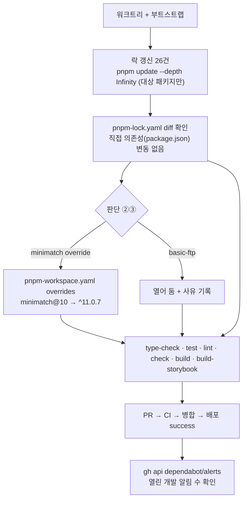

# 개발 의존성 Dependabot 알림 28건 정리

<!-- plan-result:start — 이 블록만 병합 뒤에도 고칠 수 있다(CLAUDE.md §11). 아래는 승인된 계획 원문 -->

## 구현 결과

> 2026-11-16 대조 · 이탈 1 · 미구현 0 — 판정 근거(파일:줄)는 PR 본문 "계획 대비 구현"

- 이탈(절차): 계획은 워크트리 진입 직후 `.env`를 복사하기로 했으나 권한 거부로 복사하지 못했고 `.env` 없이 진행했다. 타입 검사·테스트·린트·빌드·폼 e2e 38개는 `.env` 없이 통과했다.
- 계획에 없던 변경: qs(6.15.1 이하)도 override로 `^6.16.2`에 고정했다. @stryker-mutator/core가 쓰는 typed-rest-client 2.3.1(npm 최신)이 qs를 6.15.1로 정확히 고정해 락 갱신으로는 풀리지 않았다. 락 갱신은 25건, override는 2건(minimatch, qs)이 되어 닫히는 총 27건은 같다.
- 계획에 없던 변경: 문서 — `DEPLOY.md`에 간접 의존성 알림 수동 갱신 절차를 계획의 한 줄보다 자세히(minimatch·qs 사례 포함) 적었다. `pnpm-workspace.yaml`에서 `auditConfig` 머리말 주석의 위치를 overrides와 나눠 정리했다.

<!-- plan-result:end -->

## Context

- 2026-11-15 zod 4 PR(#624)로 운영 zod 알림은 0이 됐다. 열린 알림 32건 중 28건이 **개발 의존성**(전부 간접 의존성, `pnpm-lock.yaml`)이다. 나머지 4건은 운영: `@grpc/grpc-js` 2건(무시 목록, 유지 결정)·`react-router` 2건(고친 버전이 7.18.0뿐이라 6.x 유지 결정과 부딪힘, 이번 범위 밖).
- 개발 의존성은 린트·테스트·Storybook·Lighthouse CI에서만 돌고 사용자 번들에 안 실린다. 그래도 CI·개발 PC에서 실행되므로 고칠 수 있는 건 고친다.
- 원인: Dependabot 버전 업데이트는 직접 의존성만 올리고(`dependabot.yml` `dependency-type: direct`, 간접까지 보면 run이 55분에 끊긴 사고 — DEPLOY.md), 보안 업데이트는 꺼져 있다(`security_and_analysis.dependabot_security_updates: disabled`, 직접 확인). 그래서 락파일의 간접 의존성이 옛 버전에 머문다.

### 알림 28건을 고치는 길 (직접 확인)

| 묶음 | 건수 | 설치본 → 고친 버전 | 길 |
| --- | --- | --- | --- |
| undici | 11 | 7.29.0 → 7.30.1 (7.30.2 존재) | jsdom 28.1.0이 `undici ^7.21.0`(`npm view`) → 락 갱신 |
| js-yaml | 4 | 4.1.1 → 4.3.2 (`@eslint/eslintrc` 경유) | 락 갱신 |
| brace-expansion | 2 | 1.1.12 → 1.1.21 (eslint의 minimatch 3.x 경유) | 락 갱신 |
| qs·flatted·picomatch·browserslist·@babel/core·source-map-js·@humanfs/node·minimatch 3.x | 9 | 각각 락에 더 높은 같은 메이저가 이미 있음 | 락 갱신 |
| **minimatch 10.x (#132)** | 1 | 10.2.6 → 11.0.1 이상 | 부모가 10에 묶음: typescript-estree `^10.2.2`, glob 13 `^10.2.2`, stryker `~10.2.4`(`npm view`). 11.0.5는 이미 락에 있음(glob 14 경유) → **override 필요** |
| **basic-ftp (#133)** | 1 | 5.3.1 → 6.2.4 | get-uri 최신 8.0.1도 `basic-ftp ^5.3.1`, @lhci/cli 최신 0.16.1도 `proxy-agent ^6.5.0` → **부모를 올려도 안 풀림** |

- 위 26건(락 갱신)의 범위는 jsdom·get-uri·typescript-estree·glob·stryker·eslint만 `npm view`로 직접 봤다. js-yaml·qs·flatted 등 나머지 부모의 범위는 직접 안 봤다 — 실행 후 `pnpm audit`와 알림 닫힘으로 확인한다.
- minimatch 11.0.7 릴리스 노트에 _"11.0.0의 회귀: 긴 와일드카드 패턴 컴파일이 이차 시간"_ (번역, GHSA-cf2h-pxjq-68xw)이 있다. 락의 11.0.5가 그 영향권일 수 있어 override는 `^11.0.7` 이상으로 건다.

## 확정된 판단 (2026-11-16 사용자 답변: 세 항목 모두 추천안)

| 항목 | 추천 | 기각한 대안 |
| --- | --- | --- |
| ① 재발 대책 | 이번엔 한 번만 갱신, 보안 업데이트는 계속 꺼 둠 | 보안 업데이트 켜기(알림마다 PR이 열려 소음, 켠 뒤 되돌리기는 쉬움) |
| ② minimatch #132 | `overrides`로 11 계열 고정 + 지울 조건 주석 | 열어 둠(부모가 10에 묶여 곧 안 풀림) |
| ③ basic-ftp #133 | 열어 둠(grpc와 같은 취급) + 사유를 문서에 | override로 6.x 강제(get-uri는 5.x용, 쓰이지도 않는 FTP 경로라 얻는 것 없음) / 알림 닫기 |

## 구현 (확정 후)

1. `EnterWorktree` → `cp ../../../.env .` → `pnpm install`. `git log origin/main..main` 미푸시 확인.
2. `pnpm update --depth Infinity undici js-yaml brace-expansion minimatch qs flatted picomatch browserslist @babel/core source-map-js @humanfs/node` — 락만 바뀌고 `package.json`의 직접 의존성은 안 바뀌는지 diff로 확인. 안 되면 `pnpm dedupe` 등 대안을 이 자리에서 비교.
3. `pnpm-workspace.yaml`에 `overrides`로 minimatch 10 → `^11.0.7`, 지울 조건(부모가 11을 받으면) 주석. 근거: 같은 주석 형식인 `auditConfig` 항목.
4. 문서: `docs/DEPLOY.md` "npm 패키지 업데이트" 절에 "간접 의존성은 직접 올리지 않는다 → 알림이 쌓이면 수동 갱신" 한 줄, 남긴 알림(basic-ftp 등) 사유. `pnpm check:docs`.
5. 계획 스냅샷 `docs/plans/2026-11-16-dev-dependency-alerts.md`, plan-verifier 대조, PR 본문(요약·영향 범위·계획 대비 구현·검증), squash 병합, 배포 확인, 워크트리 정리.

## 영향 범위 (§5)

- 런타임·번들: 없음(개발 의존성만, 직접 의존성 불변). 첫 로딩·`zod-vendor` 크기 변화 없어야 함 — 빌드로 확인.
- 도구 회귀 가능성: jsdom/undici(테스트 2655개), eslint 계열(minimatch 3.x·js-yaml·brace-expansion), typescript-eslint·Storybook·stryker(minimatch 11 override 시), Vite(picomatch·source-map-js·postcss), Lighthouse CI(basic-ftp·qs·express는 그대로).
- 락 갱신 시 `@babel/core 7.28.6 → 7.29.x`이 `@vitejs/plugin-react` 변환에 닿는다 → 빌드·e2e로 확인.
- BE 재구성 계획과 겹치는 파일 없음. API 계약·CHANGELOG 없음(내부 도구).

## 검증

1. `pnpm type-check` → `pnpm test` → `pnpm lint` → `pnpm check:deps` → `pnpm check:docs` → `pnpm check`
2. `pnpm build`(zod-vendor gzip 7,453 유지, `index.html`에 zod-vendor 없음), `pnpm build-storybook`
3. `pnpm audit --audit-level=moderate`(개발 포함)로 줄어든 수 확인, `pnpm audit --prod --audit-level=high` exit 0 유지
4. Playwright e2e 폼 관련(작업 후 51개 기준) + CI의 Lighthouse 잡 통과
5. 병합 후: 배포 success → `gh api repos/BAECHAN/link-sphere_FE_NEW/dependabot/alerts?state=open`에서 개발 알림이 26(+②면 27)건 줄었는지 확인 — Dependabot이 락 재스캔하는 데 시간이 걸리면 그 사실대로 보고

## 남은 것

- 운영 알림 4건(grpc 2·react-router 2)은 기존 결정 그대로. react-router 알림 2건은 고친 버전이 7.18.0뿐이라 6.x 유지와 충돌한다는 사실만 사용자에게 알린다(재제안 아님).
- 서버 응답 검사(별도 계획, BE 1단계 뒤).
