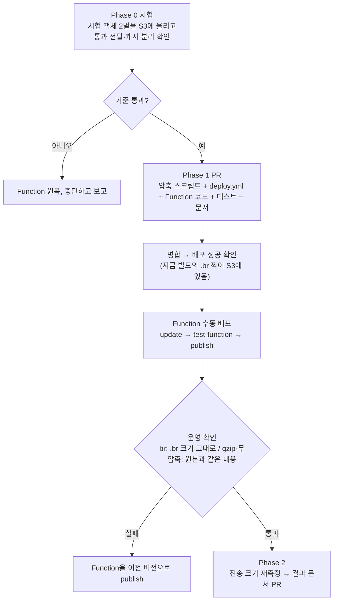

# 해시 자산 사전 brotli 압축 (원본 + `.br` 함께 올리고 CloudFront Function이 골라 주기)

<!-- plan-result:start — 이 블록만 병합 뒤에도 고칠 수 있다(CLAUDE.md §11). 아래는 승인된 계획 원문 -->

## 구현 결과

> #630 · 2026-11-16 대조 · 이탈 2 · 미구현 1(보완함) — 판정 근거(파일:줄)는 PR 본문 "계획 대비 구현"

- 이탈(절차): 계획은 Phase 0 시험 통과 뒤 Phase 1이었으나, 운영 S3 쓰기가 권한에서 거부돼 Phase 1 코드를 워크트리에 먼저 썼다. 커밋·문서·PR은 시험 통과 뒤에 했다
- 이탈(절차): 계획은 S3 업로드 → 확인 1(Function 그대로) → Function 시험 버전 → 확인 2 순서였으나, 사용자가 CloudShell에서 스크립트 한 번으로 Function까지 바꾼 뒤 두 확인을 함께 봤다
- 미구현 → 보완함: `docs/DEPLOY.md` "URL별 에러 응답" 흐름도에 `.br` 분기를 넣었다. 확인 1의 `content-type` 관찰값과 br 판정이 q값 크기를 비교하지 않는다는 점도 문서에 적었다
- 계획에 없던 변경(사용자 결정): `.br` 응답에 `Vary`가 없는 것을 시험에서 보고, 관찰만 기록하려던 것을 `spa-status.js`가 `Vary: Accept-Encoding`을 붙이도록 바꿨다. 수동 배포할 Function이 둘이 됐다
- 계획에 없던 변경: `scripts/lib/precompress-assets.d.ts`(테스트용 타입 선언) 추가, `docs/DEPLOY.md`에 로컬 키로는 Function 절차를 실행할 수 없다는 안내 추가
- 계획에 없던 변경: Phase 2 문서 PR에 두려던 Phase 0 시험 표와 관찰을 이 PR의 `docs/PERFORMANCE.md`에 먼저 적었다
- 계획보다 강화: 배포 검증 5번이 `.br` 응답의 길이 대신 본문 전체를 올린 파일과 비교한다
- 문서 동기화: `spa-fallback.js` 머리말의 옛 경로를 `AppRoutes.tsx`로 고침
- 병합 뒤 한 것(2026-11-16): Function 두 개를 CloudShell에서 배포했고, 운영 첫 로딩 JS+CSS 전송이 203,311B에서 184,101B(−9.4%)가 됐다. 결과 표는 `docs/PERFORMANCE.md` "사전 brotli 압축"
- 미구현: 옛 청크 403 뒤 앱의 새로고침 복구는 운영에서 재현하지 않았다(403 응답까지만 확인). `pnpm check:cloudfront`는 로컬 키 권한이 없어 `cloudfront-drift-check.yml` 수동 실행으로 대신했다

<!-- plan-result:end -->

> 배포 때 `/assets/`의 JS·CSS를 brotli 11로 미리 눌러 원본 옆에 올리고, `spa-fallback` Function이 `Accept-Encoding`에 `br`이 있는 요청만 `.br` 파일로 보낸다. br을 못 받는 클라이언트는 지금과 똑같이 동작한다.

## Context

CloudFront의 실시간 brotli는 최고 단계(11)보다 약 10% 덜 줄인다. 2026-11-16 직접 측정(운영 `bb8d49e0`, 첫 로딩 JS 6개 + CSS):

| 방식 | 전송 크기 |
| ---- | --------- |
| CloudFront gzip | 217,244B |
| CloudFront brotli(지금) | 203,311B |
| 사전 brotli 11(이 계획) | 183,679B (−19.6KB, −9.7%) |

FCP·LCP 효과는 재지 않았다(1.6Mbps 기준 계산으로 0.1~0.17초). 모바일 LCP는 썸네일 다운로드가 지배해 RUM에는 안 보일 수 있다.

**지금 구조(직접 읽음)**

- `.github/workflows/deploy.yml:116` — `dist/assets/`를 지우지 않고 올린다(1년 immutable). `:221-226` — 지금 빌드에 없고 7일 넘은 자산만 지운다(`scripts/lib/prune-assets.js:10`).
- `infra/cloudfront-functions/spa-fallback.js:62-75` — viewer-request. 확장자 있는 요청은 그대로 통과. 수동 배포(`docs/DEPLOY.md` "CloudFront Function (수동 관리)"), LIVE 코드가 레포 파일과 다르면 매일 drift 검사가 이슈를 연다.
- `infra/cloudfront/snapshot.json:80,98` — 기본 비헤이비어 `Compress: true`, `Managed-CachingOptimized`.
- 운영 진입 청크 응답: `content-type: text/javascript`, `content-encoding: br`, `vary: Accept-Encoding`(2026-11-16 1회 조회).
- 청크 로드 실패 → `src/main.tsx:16-22` + `src/shared/utils/chunk-reload.util.ts:26-47`이 경로별 세션당 1회 새로고침.

**업계 형태**: nginx `gzip_static`·`brotli_static`, Caddy `precompressed`가 같은 방식(원본 옆 사전 압축본, 요청별 선택, 못 받으면 원본)이다. AWS 공식 예제에는 없다(web-fetch 에이전트가 읽은 내용, 문서에 인용할 문장은 구현 때 원문을 직접 열어 확인한다).

## 판단이 필요했던 항목

| 항목 | 결정 | 근거·기각한 대안 |
| ---- | ---- | ---------------- |
| 방식 | 원본 + `.br`, Function이 선택(B안) | br만 올리는 A안은 br을 못 푸는 클라이언트에서 JS가 깨진다. 현상 유지는 10% 차이를 남긴다 |
| 옛 자산(`.br` 짝 없음, 최대 7일치) | 바로 전환(사용자 결정 2026-11-16) | 7일 대기·채워 넣기는 기각. **정정해 둘 점**: 옛 탭은 이미 받은 청크만 계속 쓰고, 아직 안 받은 옛 청크가 필요해지면 403 → 새로고침 1회로 새 버전이 된다. 7일 넘은 탭이 지금도 겪는 동작과 같다. 403에서 새로고침이 도는지는 Phase 1 운영 확인에서 본다 |
| 대상 | `/assets/**/*.js`, `*.css`만 | 해시 이름이라 내용이 안 바뀐다. `index.html`(no-cache, 작음)·SW·폰트(woff2는 이미 압축)는 뺀다 |
| gzip 사전 압축 | 안 함(사용자 결정 2026-11-16) | br을 못 받는 요청은 원본을 CloudFront가 지금처럼 실시간 압축한다. 지원 브라우저는 모두 br을 보내고, 이득 크기는 재지 않았다. 필요해지면 같은 구조로 더한다 |
| 압축 위치 | `deploy.yml`의 Build 뒤 단계 | `pnpm build`에 넣으면 로컬 빌드·e2e·Lighthouse CI가 쓰지 않는 파일을 매번 만든다 |
| 압축기 | Node 내장 `zlib.brotliCompressSync`(품질 11) | 의존성 추가 없음. 측정에 쓴 방법과 같다 |
| Function 전환 전 시험 | 운영 배포의 시험 경로(`/assets/_precompress-test/`)에서 먼저 | 잘못된 응답이 실제 자산 주소로 나가면 방문자 브라우저에 1년 저장돼 되돌려도 안 풀린다. 시험 객체는 빌드에 없어 7일 뒤 자동 정리된다 |
| Function 합치기 | `spa-fallback.js`에 분기 추가 | viewer-request에는 Function을 하나만 붙일 수 있다(출처 미확인, 지금도 하나만 붙어 있음) |

### 위험 관리

| 위험 | 막는 방법 |
| ---- | --------- |
| `.br` 없는 빌드가 배포됨 | 압축 스크립트가 짝이 하나라도 없으면 실패. `.br` 업로드가 `index.html`보다 먼저 |
| br 본문이 gzip 전용 요청에 나감 | Phase 0에서 캐시 분리 확인, 배포 검증 단계가 무압축 요청 본문을 로컬 파일과 비교 |
| `deploy.yml`만 되돌림(Function은 그대로) | 문서에 순서 명시: 되돌릴 땐 Function 먼저. `.br` 없는 옛 커밋을 다시 배포하기 전에도 같다 |
| 로컬 AWS 키 권한 부족 | 거부되면 우회하지 않고 같은 명령을 사용자에게 CloudShell용으로 넘긴다 |

## 세부 계획

### Phase 0 — 시험(코드 변경 없음, 운영 S3·Function에 시험 쓰기)

| 위치 | 변경 내용 |
| ---- | --------- |
| 스크래치패드 | 1KB 넘는 시험 JS 2개와 각 `.br`(품질 11) 생성 |
| S3 `assets/_precompress-test/` | 시험 객체 올림. `.br`은 `Content-Encoding: br`, `Content-Type: text/javascript`, 원본과 같은 `Cache-Control` |
| 확인 1(Function 그대로) | `.js.br` 직접 요청: `content-encoding: br`, 길이가 파일 크기와 같음(다시 압축 안 함), `content-type`, `vary` 기록 |
| Function `link-sphere-spa-fallback` | 시험 접두사만 바꾸는 버전을 `update-function` → `test-function` → `publish-function` |
| 확인 2(캐시 분리) | 객체 A: br → gzip → br 순, 객체 B: gzip → br 순, 무압축, `br;q=0, gzip`. br 요청은 항상 `.br` 크기 그대로, 나머지는 원본과 같은 내용이어야 한다 |
| 판정 | 하나라도 어긋나면 Function을 원래 코드로 publish하고 중단·보고 |

### Phase 1 — PR(FE 워크트리)

| 위치 | 변경 내용 |
| ---- | --------- |
| `scripts/lib/precompress-assets.js`(신규) | 대상 선별(`assets/` 아래 `.js`·`.css`)과 짝 검사 순수 함수. 선례: `scripts/lib/prune-assets.js` |
| `scripts/precompress-assets.js`(신규) | `dist/assets`를 돌며 `.br` 생성, 짝 검사 실패 시 exit 1, 파일 수·합계 크기 출력. 선례: `scripts/prune-old-assets.js` |
| `src/test/scripts/precompress-assets.test.ts`(신규) | 선별·짝 검사 단위 테스트. 선례: `prune-assets.test.ts` |
| `.github/workflows/deploy.yml` Build 뒤 | "사전 압축" 단계 추가 |
| `.github/workflows/deploy.yml:116` | 기존 sync에 `--exclude "*.br"`, 이어서 `.js.br`·`.css.br`을 각각 `--content-encoding br`과 원본의 `--content-type`으로 올림. `on.paths`에 새 스크립트 추가 |
| `.github/workflows/deploy.yml` 배포 반영 검증 | 5) 진입 청크 `.br` 직접 요청의 헤더·길이 6) 진입 청크를 무압축으로 받아 로컬 파일과 해시 비교 7) br로 받아 풀어서 로컬 파일과 해시 비교 |
| `infra/cloudfront-functions/spa-fallback.js:62-75` | 확장자 분기 안에 추가: `/assets/`의 `.js`·`.css`이고 `accept-encoding`에 `br`(q=0 아님)이 있으면 `uri += '.br'`. 머리말 주석에 배포 전제(짝 필요) 기록 |
| `src/app/routes/cloudfront-functions.test.ts` | br 있음 → `.br`, 없음·gzip만·`br;q=0`·헤더 없음 → 그대로, `/assets/` 밖과 `.js.br` 직접 요청 → 그대로 |
| `docs/DEPLOY.md` | Function 표·`test-function` 케이스 표·URL 흐름도·업로드 순서, 되돌리는 순서 |
| `docs/PERFORMANCE.md` | "CloudFront 압축과의 차이(반영 안 함)" 문단을 반영한 내용으로 갱신, 업계 근거 인용 |
| `docs/CACHE-STRATEGY.md` | 압축 관련 서술이 있으면 맞춤 |
| `CHANGELOG.md` | `[Unreleased]` perf 항목 |
| `docs/plans/2026-11-16-precompressed-brotli-assets.md` | 이 계획 스냅샷 + plan-verifier 대조 결과 블록 |

병합 뒤: 배포 run 성공 확인 → Function을 병합된 파일로 `update-function` → `test-function`(문서의 케이스 표) → `publish-function` → `pnpm check:cloudfront`.

### Phase 2 — 운영 확인과 결과 기록

| 위치 | 변경 내용 |
| ---- | --------- |
| 운영 | 브라우저형 헤더로 첫 로딩 JS·CSS 전송 크기 재측정, gzip 전용·무압축 요청의 내용 일치, Playwright로 홈·상세 진입 시 콘솔 오류 없음 |
| 운영 | 짝 없는 옛 청크 주소를 br로 요청해 403인지, 앱의 새로고침 복구가 도는지(옛 빌드 청크 주소 하나로 확인) |
| `docs/PERFORMANCE.md`(별도 문서 PR) | 전후 표와 Phase 0 관찰(캐시 분리, `vary`) 기록 |
| 메모리 | `lcp-reduction-progress` 갱신 |

## 영향 범위

- **등록(배포)**: 자산 객체 수가 JS·CSS만큼 늘어난다(약 60개/빌드). 정리 스크립트는 `dist/`에 `.br`이 있어 지금 빌드 것은 남기고 옛 것은 7일 뒤 지운다(`scripts/prune-old-assets.js` 수정 없음).
- **읽기**: br 클라이언트는 `.br` 주소로 캐시되고, 그 외는 원본 주소로 캐시된다. gzip 요청이 먼저 와서 br 브라우저까지 gzip을 받던 현상이 함께 사라진다(Phase 0에서 확인).
- **회귀 가능 지점**: `cloudfront-functions.test.ts`(기존 통과 케이스 유지), 배포 반영 검증 단계, `cloudfront-drift-check.yml`(Phase 0~병합 사이 LIVE와 레포가 달라 이슈가 한 번 열릴 수 있고 일치하면 닫힌다), `useAppVersionCheck`·청크 새로고침(옛 탭).
- **배포 순서**: S3에 `.br`이 있어야 Function을 전환한다. 되돌릴 땐 반대 순서.
- WAF·캐시 정책·배포 설정은 건드리지 않는다.

## 검증 방법

- `pnpm type-check`, `pnpm test`, `pnpm lint`, `pnpm check:docs`, `pnpm check:pr-body`.
- 워크트리에서 `pnpm build` 뒤 압축 스크립트를 돌려 첫 로딩 합이 183,679B 근처인지 확인.
- `aws cloudfront test-function`으로 문서의 케이스 표 전부.
- 배포 run 성공과 새 검증 단계 로그, 운영 curl(브라우저형·gzip 전용·무압축), Playwright 콘솔.
- PR 전 `plan-verifier`로 계획 대비 구현 대조.

## 남은 것

- Function이 캐시 조회 전에 실행되고 바뀐 주소가 캐시 키에 쓰이는지는 문서에서 확인하지 못했다. Phase 0 확인 2가 답한다.
- `.br` 응답에 `vary: Accept-Encoding`이 붙는지 모른다. 붙지 않아도 br을 보낸 요청만 그 주소에 닿아 동작에는 영향이 없다고 보고, 관찰값을 기록한다.
- LCP·FCP 효과는 RUM으로 따로 볼지 Phase 2 보고 때 묻는다.
