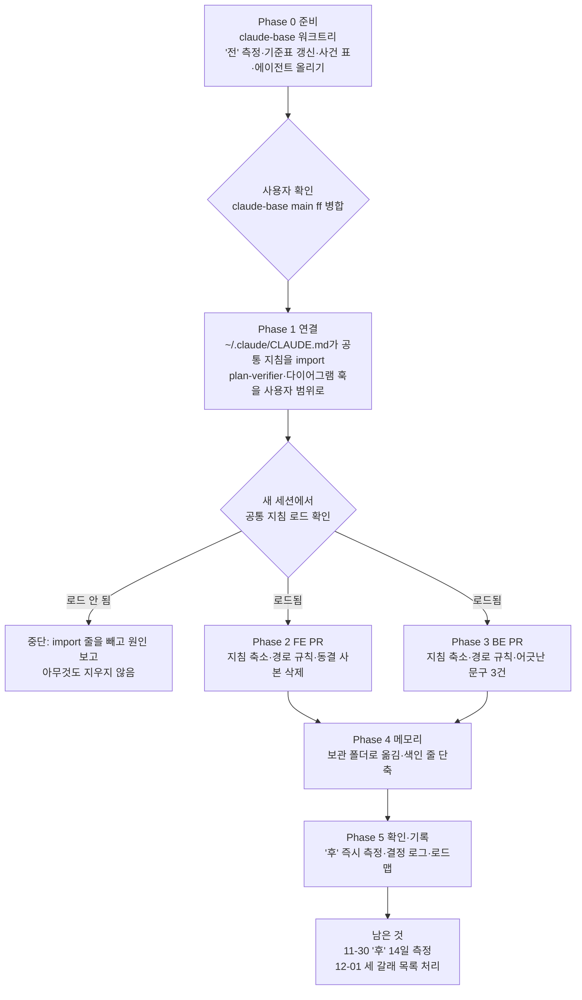

# 6라운드: 공통 지침 연결과 FE·BE 지침·메모리 축소

<!-- plan-result:start — 이 블록만 병합 뒤에도 고칠 수 있다(.claude/CLAUDE.md "계획과 PR 본문"). 아래는 승인된 계획 원문 -->

## 구현 결과

> #633 · 2026-11-16 대조(Phase 2 FE PR) · 이탈 2 · 미구현 0 — 판정 근거(파일:줄)는 PR 본문 "계획 대비 구현"

- 이탈(기준표 한계): FE `.claude/CLAUDE.md`는 350줄 이하가 아니라 635줄이 됐다(전 1,134줄·109KB → 64KB). 기준표가 "남김"으로 둔 절만 약 412줄이라 기준표대로는 350에 닿지 않는다
- 이탈(절차): 계획은 `rulesRef`를 지침 삭제보다 먼저 바꾸라고 했으나, 줄인 지침을 먼저 만들고 `repo-policy.json`을 그 뒤에 고쳤다. 두 변경은 같은 커밋에 들어가 안내문이 지워진 절을 가리킨 커밋은 없다
- 계획에 없던 변경: 기준표 "삭제" 행인 "키처럼 보이는 값"에서 이 레포의 사실(`.env.example` 빈 값, `gh secret set`) 한 줄을 남겼다
- 계획에 없던 변경(문서 동기화): README 문서 분류 링크, `check-docs.js` 주석, CI-CHECK-GATE 9.8 문구, `plan-eval-cases.mjs` 주석, `.prettierignore` 주석, `plan-doc-structure` skill의 접두 없는 절 번호를 새 위치에 맞췄다
- 정정: 계획 원문의 FE 메모리 "106개"는 `MEMORY.md`를 함께 센 값이고 실제는 105개다
- Phase 0·1·3·4·5는 이 PR 범위 밖이다(claude-base, 사용자 설정, BE PR, 메모리)

<!-- plan-result:end -->

> 공통 지침(claude-base `CLAUDE.md`)을 모든 세션에 연결하고, 그와 겹치는 FE·BE 지침과 메모리를 기준표대로 줄인다.
> 세 갈래 목록(가정 줄 실험 대상)만 12-01 판정까지 남긴다.

## Context

2026-11-16에 최근 한 달 AI 사용을 직접 쟀다. 결과물 품질은 좋았지만(머지 후 수정 2/24, fix 테스트 동반 59/60),
매 세션에 실리는 지침이 컸다.

| 항목 | 값(2026-11-16 직접 측정) | 잰 방법 |
| --- | --- | --- |
| FE `.claude/CLAUDE.md` | 1,134줄, 109KB | `wc -lc` |
| BE `.claude/CLAUDE.md` | 516줄 | `wc -l` |
| FE `MEMORY.md` 색인 | 105줄, 30KB, 한 줄 중앙값 256자·최대 698자 | `wc`, `awk` |
| FE 메모리 파일 | 106개(11-02 이후 생기거나 바뀐 것 65개) | `ls`, `find -newermt` |
| BE `MEMORY.md` | 14KB, 49~132줄은 색인이 아닌 본문(옛 구조 서술) | 직접 읽음 |
| 세션 시작 컨텍스트 중앙값 | 96K 토큰 | `token-metrics.mjs --since 2026-10-16 --until 2026-11-16` |
| 메인 호출당 평균 컨텍스트 | 261K 토큰, 자동 압축 113세션에 273회 | 같은 명령 |

이 일은 새로 설계하지 않는다. claude-base가 5라운드(2026-11-01)에 삭제 기준표를 만들어 두었고, 6라운드로
넘긴 일 목록도 있다. 이 계획은 그 6라운드를 실행한다.

- 기준표: claude-base `docs/MAPPING.md`(FE 102행·BE 51행·전역 4행, 메모리 FE 55개·BE 40개). 처리 값은
  삭제 / 일부 삭제 / 남김 / 경로 규칙으로 이동 / 경위 → 문서.
- 넘겨받은 일: claude-base `docs/ROADMAP.md` 6행, `docs/RESEARCH.md` 104~113줄(문서 형식 규칙을 옮길 때 다룰 점 넷).
- 순서 제약: 기준표 머리말이 "연결을 확인하기 전에는 아무것도 지우지 않는다"고 정했다.
- 기준표가 낡았다: 기준 커밋 뒤 FE 지침 +77/−27줄(`1776bd4a..HEAD`), BE +45/−17줄(`bfce654..HEAD`),
  전역 9 → 18줄, FE 메모리 +51개.

## 판단이 필요했던 항목

| 항목 | 결정 | 근거·기각한 대안 |
| --- | --- | --- |
| 진행 시점 | 지금 전부 한다 | 질문(2026-11-16). 기각: 두 단계로 나눔(실험 판정을 온전히 지키지만 2주간 지금 크기 유지), 12-01 뒤 전부 |
| 대상 레포 | FE와 BE 모두 | 질문. 연결은 전역 설정이라 BE도 같이 줄여야 겹치지 않는다 |
| 메모리 처리 | 지우지 않고 `memory/` 밖 보관 폴더로 옮긴다 | 질문. 메모리 폴더는 git 밖이고 `rm`은 전역 차단. 옮기면 되돌릴 수 있다 |
| 세 갈래 목록(FE·BE §1, 묻는 7개 항목) | 12-01 판정까지 FE·BE에 그대로 둔다 | 질문. 지침 글이 곧 가정 줄 실험의 처리라서 지우면 실험이 바뀐다. 기각: 지금 삭제(7개가 4개 묶음으로 줄어듦), 공통으로 올림(공통 예산 150줄 초과) |
| 침묵 감지·완료 보고 항목·가정 줄 실험 | 판정일(11-26·11-28·12-01)은 그대로 두고, 연결한 날을 METRICS에 적어 연결 전·후 구간을 나눠 보고한다 | 사용자가 "지금 전부"를 고르며 받아들인 결과다. 세 실험 모두 훅이 형식을 강제하므로 처리 자체는 유지된다. 유지 여부는 판정 때 다시 묻는다 |
| 새로 생긴 범용 메모리(기준표에 없는 것) | 공통·전역 지침에 같은 문장이 있는 것만 보관으로 옮기고, 없는 것은 메모리에 남긴다 | 공통 `CLAUDE.md`가 143줄(예산 150)이라 새 문장을 더 올릴 자리가 없다. 기각: 전부 공통으로 흡수 |
| 완료 조건의 줄 수 | FE 350줄 이하(ROADMAP 49줄). README의 200줄 목표와의 차이는 결과에 보고만 한다 | 두 문서의 숫자가 다르다. 기준표대로 하면 닿는 값이 350 근처라 이것을 조건으로 삼는다 |
| 절 번호(§1~13) 참조 | 남는 절은 번호를 떼고 이름으로 부른다. 참조하는 파일(FE 15개·BE 1개, 지침 자신 제외)을 같은 PR에서 고친다 | 절 대부분이 사라져 번호가 의미를 잃는다. `docs/DECISIONS.md`와 `docs/plans/`는 append-only라 고치지 않는다 |
| 새 문서의 첫 초안에 경로 규칙이 안 보이는 문제 | 상시 지침에 "새 문서를 만들기 전에 같은 폴더의 문서를 하나 읽는다" 한 줄을 둔다 | 경로 규칙은 도구 결과 뒤에 붙는다(RESEARCH 1.1.1, 2026-11-12 실측). 기각: 문서 형식 규칙을 상시 지침에 그대로 둠(약 150줄) |
| 좁은 경로 규칙 추가 후보(테스트 환경 절·스토리 규칙) | 이번에는 옮기지 않는다 | 2026-11-12 결정(문서 형식 규칙만). 로드를 확인한 뒤 따로 정한다 |

### 위험 관리

| 위험 | 대응 |
| --- | --- |
| 공통 지침이 로드되지 않았는데 프로젝트 층을 지워 규칙이 빈다 | Phase 1 확인을 통과해야 Phase 2~4를 시작한다. 실패하면 import 줄을 빼고 멈춘다 |
| 공통 한 줄이 프로젝트 문장보다 짧아 세부가 사라진다 | Phase 0에서 기준표 "미배정 0건"을 다시 맞춘다. "일부 삭제" 행의 괄호 안 사실은 반드시 남긴다 |
| 가드 훅 안내문이 지워진 절을 가리킨다 | `.claude/repo-policy.json`의 `rulesRef`를 지침 삭제보다 먼저 바꾼다 |
| 이미 열려 있는 세션·옛 워크트리는 옛 지침 사본을 계속 읽는다 | 정상 동작이다. 새 세션부터 반영된다고 보고에 적는다 |
| 공통 지침은 원격이 없는 로컬 저장소라 이 기계 밖(클라우드 세션 등)에서는 로드되지 않는다 | 1라운드 결정(별도 로컬 저장소)의 결과다. FE·BE 지침 머리말에 "행동 원칙은 공통 지침에 있다"와 그 위치를 한 줄로 적는다 |
| 연결과 PR 병합 사이에는 공통·프로젝트 문장이 함께 로드된다 | 토큰만 잠깐 늘고 충돌은 없다(같은 규칙). Phase 2·3을 같은 날 끝낸다 |

### 되돌리는 법

- 연결: `~/.claude/CLAUDE.md`의 import 한 줄을 지운다.
- FE·BE: 해당 PR을 revert한다(지침·문서만 바뀌므로 운영 배포와 무관하다).
- 메모리: 보관 폴더의 파일을 `memory/`로 다시 옮기고 색인 줄을 되살린다(`MEMORY.md`도 옮기기 전 사본을 보관 폴더에 둔다).

## 세부 계획

### Phase 0 — 준비 (claude-base 워크트리, 로드되는 글은 아직 안 바뀜)

| 위치 | 변경 내용 |
| --- | --- |
| claude-base `docs/METRICS.md` | "6라운드 전" 기준선을 적는다. `token-metrics.mjs`(세션 시작 컨텍스트·호출당 목록가·재주입 수), `rule-metrics.mjs`, `quality-metrics.mjs`(FE·BE)를 11-02~11-15 구간으로 돌린 값 |
| claude-base `scripts/token-metrics.mjs` | `claude-fable-5-2`·`claude-haiku-5-5` 단가를 더한다(지금은 "단가 없음"으로 7.7억 토큰이 합계에서 빠진다). 단가는 공식 가격 페이지에서 확인해 출처를 단다 |
| claude-base `docs/MAPPING.md` | 기준 커밋 뒤 바뀐 FE·BE·전역 줄의 행을 더하고, FE 메모리 106개·BE 41개를 다시 분류한다. 세 갈래 목록 행을 "12-01 판정까지 남김"으로 바꾼다. 미배정 0건을 다시 확인한다 |
| claude-base `docs/RESEARCH.md` | "규칙이 생긴 사건" 표를 새로 둔다. 기준표 "문서에 없는 경위" 중 Claude 작업 방식 사건 7건을 옮긴다 |
| claude-base `CLAUDE.md` 3~8줄 | 머리 주석의 "아직 어떤 세션에도 로드되지 않는다"를 연결 날짜로 고친다. 본문은 바꾸지 않는다 |
| claude-base `agents/plan-verifier.md`(신규) | FE `.claude/agents/plan-verifier.md`를 올린다. FE 전용 경로 문구는 레포 중립으로 바꾼다 |
| claude-base `hooks/plan-diagram-reminder.sh`(신규) | FE `.claude/hooks/plan-diagram-reminder.sh`를 올린다 |
| claude-base main | 위 변경을 ff 병합한다. 병합 전에 무엇이 들어오는지 풀어 써서 사용자에게 확인받는다 |

### Phase 1 — 연결 (`~/.claude`, 사용자 범위)

| 위치 | 변경 내용 |
| --- | --- |
| `~/.claude/CLAUDE.md` | `@~/project/claude-base/CLAUDE.md` import 한 줄을 더한다. 공통과 겹치는 "외부 오픈소스" 절을 지운다(기준표 전역:6-9). "Language"와 "넘기기 전에 남은 일 검토"는 남긴다 |
| `~/.claude/agents/plan-verifier.md` | claude-base `agents/plan-verifier.md`로 심링크한다. 심링크가 인식되지 않으면 파일을 복사하고 README에 그 사실을 적는다 |
| `~/.claude/settings.json` `hooks.PostToolUse` | plan-diagram-reminder를 claude-base 경로로 등록한다 |
| 확인 | 새 `claude -p` 세션 셋(FE, BE, 정책 없는 임시 폴더)에서 `InstructionsLoaded` 훅 로그로 공통 파일 로드를 확인한다(`instructions-load-probe.mjs`와 같은 방법). plan-verifier가 BE 세션의 에이전트 목록에 보이는지도 확인한다 |

로드가 확인되지 않으면 import 줄을 빼고 여기서 멈춘다.

### Phase 2 — FE PR (FE 워크트리)

| 위치 | 변경 내용 |
| --- | --- |
| `.claude/repo-policy.json` `rulesRef` | 지침 삭제보다 먼저, 워크트리·스테이징 규칙의 새 위치(공통 지침 "안전·권한")로 바꾼다 |
| `.claude/CLAUDE.md` §1~13 | 기준표대로 지운다. 남기는 것: 세 갈래 목록(12-01까지), 가독성용 지역 함수 추출 허용, `pnpm graph:focus`, 미리보기는 실제 Tailwind 클래스·토큰으로, 설치본 버전 확인 한 줄, 계획 파일 경로·PR 섹션 이름·plan-verifier 전달 방법·CI 스텝 이름 |
| `.claude/CLAUDE.md` Critical Rules | "일부 삭제" 행은 규칙과 예외만 남기고 사고 경위를 뺀다. 훅·린트가 막는 규칙(워크트리 편집·스테이징)은 지운다. 프로젝트 사실(부트스트랩, `pnpm dev`, path 재진입, ignore `**/`, 임시 병합)은 남긴다 |
| `.claude/CLAUDE.md` "문서 파일 위치" 절 전체 | `.claude/rules/docs-format.md`(신규, `paths`에 `docs/**/*.md`·`README.md`·`CHANGELOG.md`)로 옮긴다. §10의 BAD/GOOD 인용 예시도 여기로. 출처 링크 없는 인용 3곳은 원문을 찾아 링크하고, 못 찾으면 "출처 미상"으로 쓴다 |
| `.claude/CLAUDE.md` 머리말 | 행동 원칙이 공통 지침에 있다는 것과 그 위치, "새 문서 전에 같은 폴더 문서 하나 읽기" 한 줄 |
| `docs/FCM-PUSH-NOTIFICATION.md`, `docs/DESIGN-SYSTEM.md`, `docs/FE-ARCHITECTURE.md`(lint 표 비고), `docs/CI-CHECK-GATE.md` | 기준표 "경위 → 제안" 6건을 옮긴다(키 노출 #301·#302, `fcm.ts` 이동, 팔레트 감사, `dayjs` 미검출, React API 52건, squash 카운터). FCM 문서가 지침을 가리키던 링크를 고친다 |
| `scripts/check-docs.js` `TARGET_FILES` | `.claude/rules`를 검사 대상에 더한다 |
| `.claude/hooks/`의 bash-guard·edit-guard·deploy-verify(테스트 포함)·`guards.test.mjs`, `.claude/lib/shell-parse.mjs`, `.claude/scripts/verify-deploy.mjs` | 동결 사본을 `git rm`으로 지운다. `run-node.sh` 머리말 등 이 파일들을 가리키는 참조를 고친다 |
| `.claude/agents/plan-verifier.md`, `.claude/hooks/plan-diagram-reminder.sh`, `.claude/settings.json`의 그 훅 등록 | 사용자 범위로 옮겨진 것을 Phase 1에서 확인했으면 지운다. `.claude/workflows/plan-verifier-eval.js`가 여전히 그 에이전트를 찾는지 확인한다 |
| 절 번호 참조 15개 파일(`.claude/skills`·`commands`·`workflows`, `docs/PR-BODY-CHECK.md`·`DESIGN-SYSTEM.md`·`DEPLOY.md`·`TESTING.md`·`BUILD-VERSION.md`·`FE-ARCHITECTURE.md`, `scripts/dep-graph.js`·`scripts/lib/pr-body.js`, `.github/pull_request_template.md`) | `CLAUDE.md §N`을 규칙 이름과 새 위치로 바꾼다 |
| `docs/plans/2026-11-16-round6-connect.md`(신규) | 이 계획의 사본. 비공개 이름·값이 없는지 확인하고 넣는다 |

### Phase 3 — BE PR (BE 워크트리, Phase 2와 같은 형태)

| 위치 | 변경 내용 |
| --- | --- |
| `.claude/repo-policy.json` `rulesRef` | FE와 같다 |
| `.claude/CLAUDE.md` §1~절 끝 | 기준표 BE 표대로 지운다. 세 갈래 목록은 남긴다. `./gradlew dependencies`·`sources.jar` 확인 방법, 계획 파일 경로·PR 섹션 이름은 남긴다 |
| `.claude/CLAUDE.md` 계획 대조 문장(어긋난 1번) | "Explore 타입"을 지우고 plan-verifier와 diff·대화 요약 전달 방법을 적는다 |
| `.claude/CLAUDE.md` ignore `**/` 문장(어긋난 3번) | 확인하지 못한 ESLint·Prettier 서술을 지우고 "새 검사 도구를 들일 때 중첩 워크트리 경로에서 실제로 걸러지는지 확인한다"로 바꾼다 |
| `.claude/CLAUDE.md` 문서 형식 절 | `.claude/rules/docs-format.md`(신규)로 옮기고 인용 형식(어긋난 4번)을 고친다 |
| `.claude/CLAUDE.md`의 "FE 레포" 가드 위치 문구 | 지운다 |
| `.github/pull_request_template.md` | 절 번호 참조를 고친다 |
| `docs/plans/2026-11-16-round6-connect.md`(신규) | 계획 사본 |

### Phase 4 — 메모리 (FE·BE, git 밖)

보관 폴더는 `~/.claude/projects/<프로젝트>/memory-archive/2026-11-16/`이다. 옮기기 전 `MEMORY.md` 사본도 함께 둔다.
옮기기 직전에 대상 파일을 하나씩 읽어 확정 목록을 대화에 보고한 뒤 옮긴다(되돌릴 수 있어 다시 승인받지는 않는다).

| 위치 | 변경 내용 |
| --- | --- |
| FE 메모리 중 범용(공통 지침이 같은 문장을 가진 것) | 보관으로 옮긴다. 기준표의 "삭제" 19개(`ask-before-asking`, `never-run-rm`, `concise-scannable-formatting`, `explain-with-diagrams` 등)와, 새로 생긴 것 중 공통·전역에 문장이 있는 것(`verify-subagent-report-before-relaying`, `explain-why-when-handing-off-commands`, `ask-before-adding-user-items` 등) |
| FE 메모리 중 끝난 작업(현재 지시·남은 일이 없는 것) | 보관으로 옮긴다. 후보: `codegen-fetch-403-after-oac`, `dialog-naming-refactor-proposal`, `cursor-pagination-progress`, `global-outcome-unknown-progress`, `back-navigation-standard-progress`, `safety-net-top3-progress`, `e2e-flaky-remeasure`, `hover-view-count-followup`. 운영 사실(되돌릴 때 순서 등)이 문서에 없으면 남긴다 |
| FE 메모리 중 남기는 것 | "다시 제안하지 않는다" 결정, 남은 일이 있는 진행 기록, 환경 사실, 실험 중인 훅(`turn-status-hook`, `silence-guard-hook`), `review-remaining-before-handoff`, `avoid-strikethrough-formatting` |
| FE 메모리 낡은 문구 | 기준표 "낡은 메모리 문구"와 재분류에서 찾은 것을 고친다. `claude-base-common-instructions`·`rule-enforcement-rollout-status`·`token-reduction-plan`·`claude-md-split-findings`는 6라운드 결과로 줄인다 |
| FE `MEMORY.md` | 한 줄을 제목과 150자 안팎의 요지로 줄인다. 진행 경위는 각 파일에만 둔다 |
| BE 메모리 | 기준표 BE 표대로 삭제 대상을 보관으로 옮기고 낡은 문구를 고친다. "끝남" 중 근거 문서 확인이 필요한 것은 확인 뒤 옮긴다 |
| BE `MEMORY.md` 49~132줄 | 색인이 아닌 본문(옛 배포 구조·FE 구조·테스트 환경·FCM 서술)을 지운다. 정본은 FE·BE 문서다. 색인 누락 2개를 더한다 |

### Phase 5 — 확인과 기록

| 위치 | 변경 내용 |
| --- | --- |
| 새 세션 측정 | FE·BE 새 `claude -p` 세션의 `/context`로 메모리 파일 토큰을 Phase 0 값과 비교한다. 문서 파일을 Read했을 때 `docs-format.md`가 붙는지 훅 로그로 확인한다. 워크트리에서 CLAUDE.md 사본이 중복으로 붙는지도 같이 잰다 |
| claude-base `docs/DECISIONS.md` | 2026-11-16 "6라운드" 항목(이 계획의 판단 표) |
| claude-base `docs/ROADMAP.md`, `README.md` | 6행 완료 표시, "아직 실행하지 않은 것"을 "적용된 것"으로, 가드 사본 되돌리기 안내를 고친다(FE 사본이 사라졌으므로) |
| claude-base `docs/METRICS.md` | 연결 날짜, 세 실험의 연결 전·후 구간 표기, "후" 측정 일정 |
| claude-base `docs/plans/2026-11-16-round6-connect.md` | 계획 원본과 구현 결과 블록 |

## 영향 범위

**깨질 수 있는 기존 동작**

| 대상 | 소유 파일 | 확인 |
| --- | --- | --- |
| 가드 훅 안내문의 규칙 위치 | 각 레포 `.claude/repo-policy.json`, claude-base `hooks/bash-guard.mjs`·`edit-guard.mjs` | 막히는 명령을 한 번 실행해 안내문을 본다 |
| 문서 경로·줄 번호 검사 | FE `scripts/check-docs.js`, pre-push 훅 | `pnpm check:docs` |
| PR 본문 검사와 템플릿의 절 이름 | FE `scripts/lib/pr-body.js`, `.github/pull_request_template.md`, `pr-body.yml` | `pnpm check:pr-body`와 그 테스트 |
| 계획 대조 에이전트 평가 워크플로 | FE `.claude/workflows/plan-verifier-eval.js`, `.claude/scripts/plan-eval-cases.mjs` | 에이전트 이름이 사용자 범위에서 풀리는지 확인 |
| FE 훅 테스트 묶음 | `.claude/hooks/*.test.mjs` | 동결 사본을 지운 뒤 남은 테스트(`filename-case-check`, `mutation-loop`, `plan-eval-cases`)가 통과하는지 |
| 지침을 근거로 가리키는 문서 | FE `docs/FCM-PUSH-NOTIFICATION.md` 등 16개, BE 2개 | grep으로 `CLAUDE.md §`가 `docs/DECISIONS.md`·`docs/plans/` 밖에 0건인지 |

**데이터·배포**: 앱 코드, API, DB는 바뀌지 않는다. FE·BE PR은 지침·문서·스크립트만 건드린다. 배포 워크플로가
도는지는 병합 뒤 확인하고, 돌지 않으면 병합 확인까지로 끝낸다.

**사용자가 체감하는 변화**: 새 세션부터 Claude가 읽는 규칙 문장이 짧아진다. 문서 형식 규칙은 문서를 열 때만
보인다. 메모리에서 빠진 완료 기록은 Claude가 먼저 떠올리지 못하므로 필요하면 문서나 보관 폴더에서 찾는다.

## 검증 방법

1. **연결**: 새 세션 셋의 훅 로그에 claude-base `CLAUDE.md`가 있다. 없으면 중단한다.
2. **규칙 누락 없음**: 갱신한 기준표에서 미배정 0건. "일부 삭제" 행마다 괄호 안 사실이 줄인 지침에 남았는지 한 줄씩 대조한다.
3. **줄 수**: FE `.claude/CLAUDE.md` 350줄 이하. BE는 기준표대로 처리한 결과 줄 수를 보고한다.
4. **레포 검사**: FE `pnpm type-check`, `pnpm test`, `pnpm lint`, `pnpm check:docs`, `pnpm check:pr-body <본문>`. BE는 `.claude/CLAUDE.md`에 적힌 검사 명령과 CI.
5. **경로 규칙 로드**: FE·BE 새 세션에서 `docs/*.md`를 Read하면 `docs-format.md`가 붙고, 소스 파일만 다루면 붙지 않는다.
6. **가드**: 메인 체크아웃 편집과 `git add -A`가 여전히 막히고, 안내문이 새 위치를 가리킨다.
7. **계획 대조**: FE·BE PR마다 plan-verifier에 계획 파일, diff 파일, 대화 요약을 넘긴다. claude-base는 원격이 없으므로 대조 표를 결과 블록 커밋 메시지에 남긴다(2026-11-15 선례).
8. **메모리**: 보관으로 옮긴 파일 수와 남은 파일 수, `MEMORY.md` 바이트를 전후로 보고한다. 색인이 남은 파일을 모두 가리키는지 확인한다.
9. **전후 비교(즉시)**: 새 세션 `/context`의 메모리 파일 토큰, 세션 시작 컨텍스트.
10. **병합 뒤**: FE·BE PR의 CI와 (돌면) 배포 워크플로 성공을 확인하고, 워크트리와 로컬 브랜치를 정리한다.

## 남은 것

- (제가) "후" 14일 측정 — 연결 뒤 같은 길이의 구간이 지나야 잴 수 있다(2026-11-30 무렵). `token-metrics.mjs`·`rule-metrics.mjs`·`quality-metrics.mjs`를 같은 명령으로 돌려 METRICS에 적는다.
- (제가) 세 갈래 목록 처리 — 가정 줄 실험 판정(2026-12-01) 결과에 따라 지우거나 공통으로 올리는 후속 PR.
- (제가) 침묵 감지(11-26)·완료 보고 항목(11-28) 판정 — 연결 전·후 구간을 나눠 보고한다.
- (제가) 좁은 경로 규칙 후보(테스트 환경 절·스토리 규칙) — 문서 형식 규칙의 로드를 2주 본 뒤 제안한다.
- 4라운드(리뷰 기준)는 이 계획 범위 밖이다.
