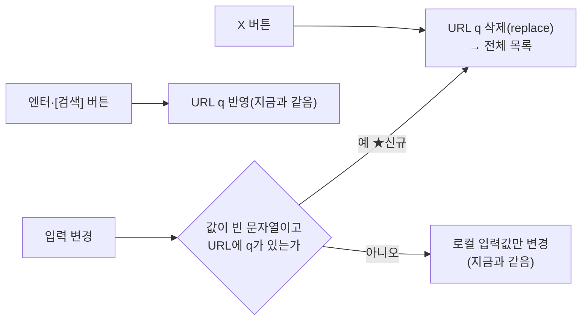

# 북마크 내 검색: 입력을 다 지우면 엔터 없이 전체 목록 복원

<!-- plan-result:start — 이 블록만 병합 뒤에도 고칠 수 있다(.claude/CLAUDE.md "계획과 PR 본문"). 아래는 승인된 계획 원문 -->

## 구현 결과

> #635 · 2026-11-17 대조 · 이탈 1 · 미구현 0 — 판정 근거(파일:줄)는 PR 본문 "계획 대비 구현"

- 이탈(문서 구조): `docs/BOOKMARK.md`의 검색 동작 서술을 §1 흐름이 아니라 §5의 새 소절 "폴더 내 검색"에 넣음. §1에는 검색창이 언제 보이는지만 있고 검색 동작 서술이 원래 없었다. 코드 지도와 마지막 검토 날짜는 계획대로 반영
- 계획에 없던 변경: 다 지운 직후 친 글자가 사라지는 문제를 CPU 감속 녹화에서 찾아 함께 고침 — 라우터 갱신이 입력보다 늦게 도착해 URL→입력 동기화가 새 글자를 빈 값으로 덮었고, 입력을 지워서 뺀 `q`는 입력창에 되비추지 않게 함
- 계획에 없던 변경: 위 경우를 잡는 e2e `bookmark-search-clear.spec.ts` 추가, 단위 테스트 3건 추가(한 글자씩 지워 빈 칸이 되는 순간, 공백만 남은 입력, 해제 뒤 뒤로가기 동기화)
- 계획에 없던 변경: `docs/BOOKMARK.md` §9·§10·§11에 검증 결과·시행착오·남은 것(실제 한글 자판 미확인, X 버튼의 같은 구조) 기록
- 문서 동기화: `docs/TESTING.md` e2e 목록에 새 스펙 등록

<!-- plan-result:end -->

> 북마크 내 검색에서 검색어를 백스페이스로 모두 지우면, X 버튼을 눌렀을 때처럼 바로 전체 목록으로 돌아가게 한다.

## Context

북마크 내 검색에서 검색한 뒤 입력값을 모두 지워도 목록은 검색 결과 그대로이고, 엔터(모바일은 [검색] 버튼)를 눌러야
전체 목록이 돌아온다.

- 원인: 입력 중에는 로컬 값만 바뀌고 목록이 따르는 URL `q`는 제출 때만 바뀐다
  (`src/widgets/bookmark/bookmark-search/hooks/useBookmarkSearch.ts:11`, `ui/BookmarkSearch.tsx:22`).
- X 버튼은 이미 `q`를 바로 지운다(`useBookmarkSearch.ts:40-43`). 같은 "비우기"인데 X는 즉시, 백스페이스는 엔터가 필요하다.
- 백스페이스로 다 지우면 X도 사라진다. 데스크톱에는 [검색] 버튼이 없어(`BookmarkSearch.tsx:25`의 `md:hidden`) 엔터 말고는
  방법이 없다.
- 북마크 검색은 항상 `replace`로 URL을 바꾼다(`useBookmarkSearch.ts:31`). 뒤로가기 기록은 늘지 않는다.

## 판단이 필요했던 항목

| 항목 | 결정 | 근거·기각한 대안 |
| --- | --- | --- |
| 다 지웠을 때 동작 | 비우면 바로 복원. 입력 중 검색은 계속 엔터 | 사용자 선택(2026-11-17 질문). 기각: 입력 중 실시간 검색(글자마다 요청, 한글 조합·모바일 [검색] 버튼까지 바꿔야 함), 지금 그대로. 외부 선례는 갈린다 — 손으로 지워도 X와 같이 되돌림([FOLIO STSMACOM-234](https://folio-org.atlassian.net/browse/STSMACOM-234)), 지우고 엔터([GitLab 220828](https://gitlab.com/gitlab-org/gitlab/-/issues/220828)), X도 입력만 비움([Wikimedia T298190](https://phabricator.wikimedia.org/T298190)). 셋 다 검색 결과 요약으로 본 재인용이다 |
| 범위 | 북마크 검색만 | 사용자 선택(같은 질문). 헤더 검색은 "타이핑·ESC로 비워도 주소는 안 바뀐다"(`docs/SEARCH.md` §1)와 비우면 최근 검색어가 열리는 설계라 건드리지 않는다 |
| 받아들이는 비용 | 검색어를 바꾸려고 다 지우면 전체 목록 요청 1회 | X 버튼에서 2026-09-21에 이미 받아들인 것과 같다(`docs/plans/2026-09-21-search-clear-focus.md` "트레이드오프") |
| "빈 값" 기준 | 정확히 `''`일 때만. 공백만 남은 값은 복원하지 않는다 | X 버튼이 보이는 조건(`input.tsx`의 `Boolean(props.value)`)과 맞춘다 — X가 사라지는 순간이 곧 복원되는 순간 |
| 한글 조합 중 | `isComposing`으로 거르지 않는다 | 마지막 자모를 지워 빈 값이 되는 입력이 조합 중에 오므로, 거르면 한글 검색어에서 복원이 안 된다 |

## 세부 계획

| 위치 | 변경 내용 |
| --- | --- |
| `src/widgets/bookmark/bookmark-search/ui/BookmarkSearch.test.tsx` | 실패하는 테스트를 먼저 추가하고 실패 출력을 남긴다. ① `/bookmark?q=리액트`에서 입력을 다 지우면 엔터 없이 URL `q`가 사라진다 ② 다른 글자를 입력하는 동안은 URL `q`가 그대로다 ③ 다 지운 직후 바로 입력한 글자가 입력창에 남는다 ④ `folder`·`sort` 파라미터는 남는다. URL 확인은 `PostListFilter.test.tsx:19`의 `LocationSearchProbe` 방식을 따른다. 기존 단언은 바꾸지 않는다 |
| `src/widgets/bookmark/bookmark-search/hooks/useBookmarkSearch.ts` | `handleInputChange(value)` 추가: `setSearchInput(value)` 뒤, `value === ''`이고 `searchQuery !== ''`이면 `applySearch('')`. `q`가 없을 때는 URL을 건드리지 않는다(같은 주소로의 이동과 스크롤 초기화 방지). 반환값의 `setSearchInput`은 다른 사용처가 없으면 뺀다 |
| `src/widgets/bookmark/bookmark-search/ui/BookmarkSearch.tsx:22` | `onChange`를 `handleInputChange(e.target.value)`로 바꾼다 |
| `docs/BOOKMARK.md` | 검색 동작 서술(§1 흐름·코드 지도)에 "다 지우면 바로 복원"을 반영하고 마지막 검토 날짜를 고친다 |
| `CHANGELOG.md` | `[Unreleased]`에 항목 추가(`changelog-release` skill) |
| `docs/plans/2026-11-17-bookmark-search-restore-on-empty.md` (신규) | 이 계획의 스냅샷 |

## 영향 범위

- `useBookmarkSearch` 사용처는 `BookmarkSearch.tsx` 하나다(`useSearchParamsDraft.test.tsx`·`useNavbarSearch.ts`는 이름만
  언급 — 구현 때 `pnpm graph:focus`로 다시 확인).
- 서버 데이터 쓰기 없음. 조회 요청이 "다 지운 순간" 1회 생긴다(쿼리 키 `search`가 `''`로 바뀜, 캐시가 있으면 캐시).
- 복원 순간 URL이 바뀌므로 전역 스크롤 규칙(FE-ARCHITECTURE §25)에 따라 맨 위로 간다. X 버튼과 같다.
- 깨질 수 있는 것: 다 지운 직후 빠르게 입력한 글자가 URL→입력 동기화(`useBookmarkSearch.ts:16-19`)에 덮이는 경우 —
  테스트 ③과 브라우저 CPU 감속으로 확인한다.
- 헤더 검색, X 버튼, 엔터 제출, `SearchInput`·`Input`은 바꾸지 않는다.

## 검증 방법

완료 조건: `/bookmark?q=…`에서 입력을 다 지우면 엔터 없이 URL `q`가 사라지고 전체 목록이 보인다. 입력 중에는 검색되지 않는다.

1. `pnpm type-check` → `pnpm test` → `pnpm lint` · `pnpm check:deps` → `pnpm check:docs`
2. 새 테스트는 구현 전 실패 출력, 구현 후 통과, 구현을 일부러 깨서 다시 실패하는지 확인
3. 브라우저 녹화(`browser-verification` skill, 데스크톱·모바일 폭): 검색 → 백스페이스로 다 지움 → 전체 목록, 뒤로가기
   기록이 늘지 않음, 다 지운 직후 바로 입력(CPU 감속 포함), 헤더 검색은 그대로
4. PR 전에 `plan-verifier` 대조, PR CI와 병합 뒤 배포 워크플로 확인

## 남은 것

- 실제 한글 입력기(IME) 조합은 자동 브라우저로 재현하지 못한다. 녹화에서는 영문·붙여 넣은 한글로 확인하고, 실제 한글
  자판 확인이 필요한지는 구현 보고 때 묻는다.
- 발견만 기록(범위 밖): `BookmarkSearch.test.tsx:42` 테스트는 이름과 달리 URL `q`를 확인하지 않는다.
  `docs/BOOKMARK.md:927`의 "피드와 같이 쓰는 입력(`SearchInput`)"은 코드와 다르다(헤더는 `SearchInput`을 쓰지 않는다).
