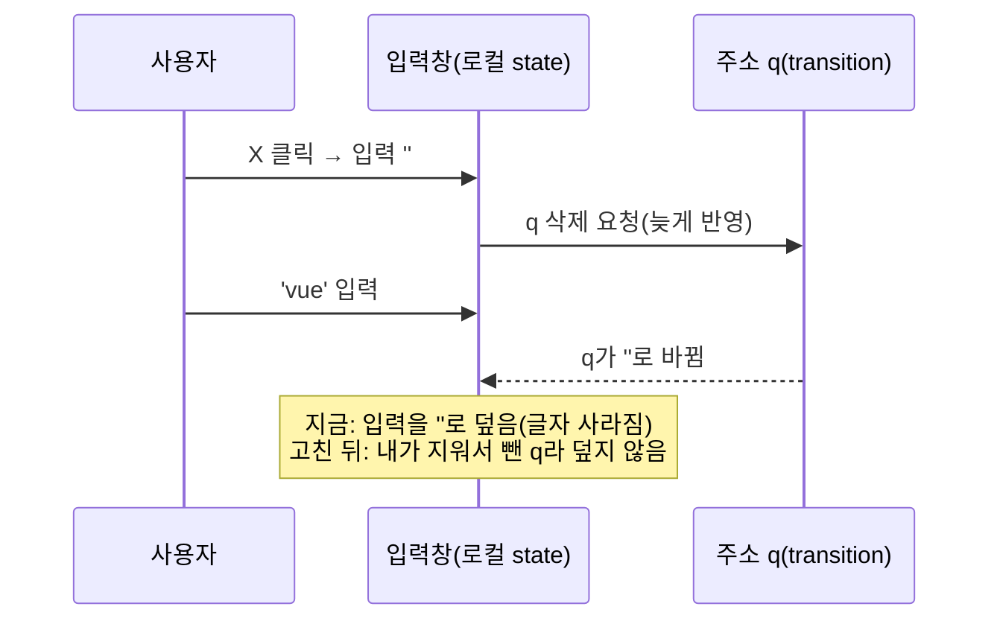

# 검색 X 버튼: 누른 직후 친 글자가 사라지지 않게

<!-- plan-result:start — 이 블록만 병합 뒤에도 고칠 수 있다(.claude/CLAUDE.md "계획과 PR 본문"). 아래는 승인된 계획 원문 -->

## 구현 결과

> #637 · 2026-11-18 대조 · 이탈 3 · 미구현 1 — 판정 근거(파일:줄)는 PR 본문 "계획 대비 구현"

- 이탈(사용자 결정): 모바일 검색 화면의 X는 계획("데스크톱과 같은 훅으로 친 글자 보존")과 달리 입력만 비우고 `q`를 둔다. 구현 중 모바일 X가 검색 화면을 닫는 기존 문제(#187 이후)를 찾았고, 화면을 유지하게 고쳐 보니 닫을 때 지운 검색이 되살아나 사용자가 "입력만 비움"을 골랐다(2026-11-18). 이에 따라 모바일 e2e는 별도 파일에서 바뀐 동작을 확인하고, `MobileNavbarSearch.test.tsx`의 기존 X 단언 1건을 "`q` 삭제"에서 "`q` 그대로"로 바꿨으며, "주소 기록은 바뀌지 않는다"는 모바일 X에 한해 맞지 않게 됐다
- 이탈: "주소에 `q`가 있을 때만 표식을 세운다" 조건을 두 훅 모두에서 뺐다. `q`가 없을 때 세워도 다음 주소 변경은 값이 있는 `q`라 결과가 같다
- 이탈(절차): 헤더가 더 쉽게 걸리는 이유를 구현 첫 단계에서 설치본 react-router·React로 확인하기로 했으나, 수정 뒤에 저장소 주석(`useSearchParamsDraft.ts`)으로만 확인했고 설치본은 따라가지 않았다
- 미구현 → 보완함: "`q`가 없을 때 X를 눌러도 다음 주소 변경을 따라간다" 가드 테스트를 대조 뒤 두 테스트 파일에 넣었다
- 계획에 없던 변경: `MobileNavbarSearch.tsx` 수정과 `e2e/navbar-search-clear.mobile.spec.ts` 신규(위 모바일 결정), 가드 테스트 "X 뒤 다시 검색했다가 뒤로가기로 `q`가 없어지면 입력창도 비워진다", 문서 동기화(`docs/SEARCH.md` §8 표 서식 재정렬, 모바일 X 경위 기록)

<!-- plan-result:end -->

> 북마크 내 검색과 헤더 검색에서 X 버튼을 누른 뒤 바로 친 글자가, 늦게 도착한 주소 변경에 덮여 사라지는 문제를 고친다.

## Context

#635에서 "입력을 다 지워 `q`를 뺀 직후 친 글자가 사라지는" 문제를 북마크 검색의 백스페이스 경로에서만 고쳤다. X 버튼은
같은 구조인데 범위 밖으로 남겼다(`docs/BOOKMARK.md` §10 "그대로 둔 것", §11).

### 근본 원인

- 두 훅 모두 "주소의 `q`가 바뀌면 입력창을 그 값으로 맞춘다"(`useBookmarkSearch.ts:19-26`, `useNavbarSearch.ts:27-30`).
- X는 입력을 비우고 `q`를 뺀다(`useBookmarkSearch.ts:47-50`, `useNavbarSearch.ts:35-48`). 주소 반영은 transition이라
  (`RouterProvider.tsx:27`의 `v7_startTransition`) 입력보다 늦게 도착하고, 그 사이 친 글자를 빈 값으로 덮는다.
- 북마크는 백스페이스 경로에만 "내가 지워서 뺀 `q`는 되비추지 않는다" 표식(`isClearedByInput`)이 있다. X 경로와 헤더에는 없다.

### 재현 결과 (2026-11-17, 모킹한 로컬 브라우저. 운영에서는 재지 않음)

| 검색창 | 조건 | 결과 |
| --- | --- | --- |
| 북마크 X | 0ms 뒤 입력 + CPU 6배 감속 | 글자 사라짐 |
| 북마크 X | 0.2초 뒤 입력, 또는 목록 응답 1.5초 지연 | 정상 |
| 헤더 X | 0ms 뒤 입력(감속 없음) | 글자 사라짐 |
| 헤더 X | **0.4초 뒤 입력 + 목록 응답 1.5초 지연(감속 없음)** | **글자 사라짐** |

헤더가 더 쉽게 걸리는 이유는 추정이다: 피드 목록은 suspense 쿼리(`post.queries.ts:179`)라 새 목록 응답이 올 때까지
transition이 끝나지 않고, 북마크 목록은 일반 쿼리(`bookmark-folder.queries.ts:111`)라 바로 끝난다. 구현 첫 단계에서
설치본 react-router·React 동작으로 확인하고, 다르면 보고한다.

## 판단이 필요했던 항목

| 항목 | 결정 | 근거·기각한 대안 |
| --- | --- | --- |
| 범위 | 북마크 X + 헤더 X(데스크톱·모바일 공용 훅)를 PR 하나로 | 사용자 지시("X 버튼은 별도 PR로", 2026-11-17). 원인과 해법이 같다 |
| 해법 | #635의 표식을 X 경로에도 건다. 훅마다 state 한 개 | 기각: 공용 훅으로 추출(헤더는 `/post`에서만 비추는 조건이 달라 묶으면 분기가 늘고, 엔티티 계약 밖 추상화가 된다). 기각: 라우터 transition 끄기(전역 동작이 바뀐다) |
| 표식을 세우는 조건 | 주소에 `q`가 있을 때만 | `q`가 없으면 주소가 안 바뀌어 표식이 내려갈 기회가 없다(`handleInputChange`와 같은 조건) |
| ESC 2단계·최근 검색어 선택 | 건드리지 않는다 | 주소를 안 바꾸거나(ESC) 입력을 직접 채운다(`NavbarSearch.tsx:66`). 표식과 무관 |

## 세부 계획

| 위치 | 변경 내용 |
| --- | --- |
| `e2e/bookmark-search-clear.spec.ts` | 실패하는 테스트 먼저: X 클릭 직후 입력(CPU 6배) → 글자가 남고 URL `q`는 빠진다 |
| `e2e/navbar-search-clear.spec.ts` (신규) | 실패하는 테스트 먼저: `/post?q=react`에서 목록 응답을 1.5초 늦추고 X → 0.4초 뒤 입력 → 응답이 온 뒤에도 글자가 남는다. 모바일 검색 화면(`MobileNavbarSearch`)도 같은 훅이라 한 건 더 둔다(본뜬 파일: `e2e/bookmark-search-clear.spec.ts`, 모바일은 `e2e/post-detail-search-overlay.mobile.spec.ts`) |
| `src/widgets/bookmark/bookmark-search/hooks/useBookmarkSearch.ts` | 표식 이름을 `isClearedByUser`로 바꾸고, `handleClear`에서도 `searchQuery !== ''`일 때 세운다. 주석 갱신 |
| `src/widgets/layout/navbar/hooks/useNavbarSearch.ts` | 같은 표식 추가: 동기화 블록에서 "표식이 서 있고 새 값이 `''`"이면 입력을 덮지 않고, `handleClear`가 `/post`이고 `q`가 있을 때 세운다. 반환값·시그니처는 그대로 |
| `BookmarkSearch.test.tsx`·`NavbarSearch.test.tsx`·`MobileNavbarSearch.test.tsx` | 가드 추가: X 뒤에도 뒤로가기·칩으로 바뀐 `q`를 입력창이 따라간다, `q`가 없을 때 X를 눌러도 다음 주소 변경을 따라간다. 기존 단언은 바꾸지 않는다 |
| `docs/BOOKMARK.md` §9·§10·§11, `docs/SEARCH.md` §1·§8·§9·§10 | 동작·시행착오 기록, 남은 것에서 X 항목 삭제, 마지막 검토 날짜 |
| `docs/TESTING.md`, `CHANGELOG.md` | e2e 목록에 새 스펙, `[Unreleased]` `Fixed` 항목 |
| `docs/plans/2026-11-17-search-clear-typing-race.md` (신규) | 이 계획의 스냅샷 |

## 영향 범위

- `useNavbarSearch` 사용처: `NavbarSearch.tsx`, `MobileNavbarSearch.tsx`. `useBookmarkSearch` 사용처: `BookmarkSearch.tsx`
  (구현 때 `pnpm graph:focus`로 다시 확인).
- 서버 요청·주소 기록(push/replace)은 바뀌지 않는다. 바뀌는 것은 "X로 뺀 `q`가 도착했을 때 입력창을 덮느냐" 하나다.
- 깨질 수 있는 것: 뒤로가기·카테고리 칩·페이지 이동으로 바뀐 `q`를 입력창이 따라가는 동기화, X 뒤 Enter 재검색,
  최근 검색어 드롭다운 열림(X 뒤 포커스). 가드 단위 테스트와 기존 e2e(`post-list.spec.ts` 등)로 확인한다.
- 바꾸지 않는 것: ESC 동작, 제출, 최근 검색어, `Input`·`SearchInput`.

## 검증 방법

완료 조건: 위 재현표의 "글자 사라짐" 세 조건에서 친 글자가 남고 URL `q`는 빠진다. 기존 동기화는 그대로다.

1. 새 e2e 세 건이 고치기 전 실패하는 출력을 남기고, 고친 뒤 5회 반복 통과
2. `pnpm type-check` → `pnpm test` → `pnpm lint`·`pnpm check:deps` → `pnpm check:docs`·`pnpm format:check`
3. 가드 단위 테스트는 표식 조건을 일부러 깨서 실패하는지 확인
4. 모킹 녹화(`browser-verification` skill): 헤더 X(응답 지연)·북마크 X(CPU 감속)·모바일 헤더 X → 사용자 확인 뒤 커밋
5. `plan-verifier` 대조 → PR CI → 병합 승인 → 배포 워크플로 확인

## 남은 것

- 운영에서 실제로 얼마나 자주 생기는지는 재지 않았다(모킹 재현만). 고친 뒤에도 재지 않는다.
- 실제 한글 자판(IME) 확인은 #635의 남은 것 그대로다(이 변경과 무관).
