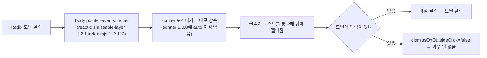

# 모달이 떠 있을 때 토스트 버튼이 눌리지 않는 문제

<!-- plan-result:start — 이 블록만 병합 뒤에도 고칠 수 있다(.claude/CLAUDE.md "계획과 PR 본문"). 아래는 승인된 계획 원문 -->

## 구현 결과

> #636 · 2026-11-17 대조 · 이탈 2 · 미구현 1 — 판정 근거(파일:줄)는 PR 본문 "계획 대비 구현"

- 이탈(구현 세부): 로그인 창이 닫힐 때 "비로그인이면 다시 띄운다"는 조건을 넣지 않았다. 만료 안내 뒤 로그인 상태가 되는 두 경로(로그인, 다른 탭의 로그인 반영)가 안내의 대기를 비우는 것으로 대신한다
- 이탈(절차): 만료 안내 숨김 단위 테스트는 "실패 테스트 먼저"였으나 구현 뒤에 썼다. 고치기 전 실패 출력은 없고, 구독을 일부러 빼서 실패하는 것으로 확인했다(e2e는 계획대로 먼저 쓰고 실패를 확인했다)
- 미구현: 데스크톱·모바일 브라우저 녹화 — 워크트리에 `.env`를 복사하는 명령이 권한에서 거부돼 dev 서버를 띄우지 못했다. 같은 동작은 e2e(데스크톱·모바일)로 확인했다
- 계획에 없던 변경(사용자 결정): 기존 단위 테스트 "로그인 창이 이미 열려 있으면 버튼을 눌러도 엔트리를 더 쌓지 않는다"의 준비 순서를 바꿨다(안내를 먼저 띄운 뒤 창이 열린 상태로 만든다). 단언은 그대로다
- 계획에 없던 변경: 단위 테스트 2건 추가(숨기느라 닫은 토스트의 닫힘 콜백이 늦게 와도 다시 띄움, 로그인 창과 무관한 이동에는 다시 띄우지 않음)와 그 가드
- 문서 동기화: AUTH.md·FE-ARCHITECTURE.md의 마지막 검토 날짜, AUTH.md의 줄 번호와 테스트 표, DECISIONS.md의 Radix 소스 링크를 폴더 주소로 적음

<!-- plan-result:end -->

> 모달·확인창·메뉴가 열린 동안에도 토스트의 버튼과 X가 눌리게 하고, 로그인 모달이 열린 동안에는 "로그인이 만료됐어요" 토스트를 숨겼다가 로그인 없이 닫으면 다시 보여 준다.

## Context

사용자 보고: 로그인 모달과 "로그인이 만료됐어요" 토스트가 함께 떠 있을 때 토스트의 [로그인]을 눌러도 닫히지도 이동하지도 않는다.

### 가설

1. 이 토스트만의 문제 2. 로그인 토스트 + 로그인 모달 조합의 문제 3. 모달이 뜨면 모든 토스트가 그렇다 → **3이 맞다.**

### 재현 절차 (2026-11-17, 운영 `linksphere.click/post`, Playwright)

로컬 저장소에 세션 표시(`linksphere:auth:has-session`)만 넣고 새로고침 → 만료 토스트 → 내비게이션 바 [로그인]으로 모달 열기.

| 상황 | 토스트 [로그인]·X 마우스 클릭 결과 |
| --- | --- |
| 모달 없음 | 정상 (`pointer-events: auto`) |
| 모달 열림, 입력 없음 | 모달이 닫힘, 토스트는 그대로 |
| 모달 열림, 이메일 직접 입력 | 아무 일도 없음 (보고된 증상) |
| 모달 안 Tab 이동 | 포커스가 모달 안에서만 돈다 |

모달이 열리면 `body` 인라인 `pointer-events: none`, 토스터·토스트·버튼의 계산된 값도 `none`, 버튼 좌표의 `elementFromPoint`는 딤(`fixed inset-0 z-modal bg-scrim/80`)이었다.

### 근본 원인

- 같은 장치를 쓰는 곳: Dialog(`react-dialog:173`), AlertDialog, 드롭다운 메뉴(`react-menu:154`), Select(`react-select:507`) — 이 셋은 코드 추적만 했고 재현은 하지 않았다.
- 액션 버튼이 있는 토스트 8곳(`auth.util.ts:233`, 북마크 2, 글 등록·수정 실패 2, 가입 2, FCM 1)과 모든 토스트의 X가 해당한다.

### 업계 조사 (조회 에이전트가 원문을 읽어 온 재인용)

- 라이브러리 관행: Radix 자체 Toast는 영역을 `DismissableLayer.Branch`로 감싼다([toast.tsx](https://raw.githubusercontent.com/radix-ui/primitives/main/packages/react/toast/src/toast.tsx)). Radix 토론 답변은 다른 라이브러리 토스트에 `pointer-events: auto`를 권한다([#1720](https://github.com/radix-ui/primitives/discussions/1720)). sonner 이슈는 `pointer-events-auto`만 주면 토스트 클릭이 바깥 클릭으로 잡혀 Dialog가 닫힌다고 보고한다([#357](https://github.com/emilkowalski/sonner/issues/357), [#667](https://github.com/emilkowalski/sonner/issues/667)).
- 접근성 지침: 모달이 열린 동안에는 토스트를 띄우지 말고 닫힐 때까지 보류하라고 한다([Chrome 지침](https://developer.chrome.com/docs/modern-web-guidance/guides/ui-components/persistent-toast-notifications.md.txt), [HTMHell](https://htmhell.dev/adventcalendar/2025/1)). 모달 밖은 비활성이다([W3C APG](https://www.w3.org/WAI/ARIA/apg/patterns/dialog-modal/)).
- sonner·shadcn 공식 문서에는 이 상황에 대한 안내가 없다.

## 판단이 필요했던 항목

| 항목 | 결정 | 근거·기각한 대안 |
| --- | --- | --- |
| 전체 방향 | sonner 유지 + Radix Branch 보정 (2026-11-17 질문으로 사용자 결정) | Radix Toast로 교체: 문제는 기본으로 풀리지만 호출 73곳·래퍼·스타일·스택을 다시 만들고 React 밖 호출처 7개 파일용 저장소가 필요해 기각. 모든 토스트 보류: sonner에 없는 대기열을 만들어야 하고 모달 안 동작의 결과 토스트가 늦게 보여 기각. 만료 토스트만: 북마크 [되돌리기] 등이 계속 안 눌려 기각 |
| 바깥 클릭 처리 방법 | Radix `Branch` 등록 | 공용 Dialog의 `onPointerDownOutside`에 토스트 판별 가드를 직접 넣는 안: Dialog·AlertDialog·메뉴마다 넣어야 하고 포커스 이탈 판정은 못 막아 기각. Branch는 Radix 자체 Toast와 같은 장치이고 한 곳으로 끝난다(설치본 `index.mjs:70-73, 84-85`) |
| 로그인 모달이 열린 동안의 만료 토스트 | 숨겼다가 로그인 없이 닫으면 다시 표시 (2026-11-17 질문으로 사용자 결정) | 그대로 두기: 모달이 있으면 [로그인]이 중복이고 키보드로는 못 누름. 닫기만: 로그인 없이 닫으면 만료 안내가 사라져 AUTH.md §8-I "닫을 때까지 남는다"와 어긋남 |
| 숨김·복원을 어디서 하나 | `AuthUtil`이 `RouterEvents.onNavigate`를 구독 | `useLoginDialog`에 effect 추가: 로그인 모달 열림의 원천이 history state라 React 밖에서 같은 값을 읽을 수 있고, 토스트를 띄우는 코드와 한 파일에 모인다 |
| 키보드로 모달 안에서 토스트에 가기 | 이번 범위 밖 | 모달의 포커스 가두기는 정상 동작이고, Radix Toast로 바꿔도 풀린다는 근거를 찾지 못했다. 남은 것에 적는다 |

## 세부 계획

| 위치 | 변경 내용 |
| --- | --- |
| `package.json`, `pnpm-lock.yaml` | `@radix-ui/react-dismissable-layer` `1.2.1`을 직접 의존성으로 선언(지금은 간접 설치). `pnpm why`로 `react-dialog`가 쓰는 것과 같은 인스턴스 하나인지 확인 |
| `src/shared/ui/atoms/sonner.tsx` | `<Sonner>`를 `DismissableLayer.Branch`로 감싸고 `className`에 `pointer-events-auto` 추가. 이유 주석 한 줄 |
| `src/shared/ui/atoms/sonner.stories.tsx` | 모달 위 토스트 스토리 추가(모달을 연 채 액션 토스트를 띄우는 예) |
| `src/shared/utils/auth.util.ts` (`showSessionExpiredToast`, `dismissSessionExpiredToast` 주변) | 만료 안내 대기 상태(로그인 콜백)를 모듈 변수로 둔다. 띄울 때 `RouterEvents.onNavigate` 구독: 위치 state가 `loginDialogOpen`이면 토스트를 닫고(대기는 유지), 아니고 비로그인이면 다시 띄운다. 띄우는 시점에 이미 로그인 모달이 열려 있으면 대기만 걸고 띄우지 않는다. 다시 로그인(`dismissSessionExpiredToast`)하거나 사용자가 X로 닫으면(`onDismiss`, 숨김 중 표시로 구분) 대기와 구독을 푼다 |
| `src/shared/utils/auth.util.test.ts` | 실패 테스트 먼저: 모달 열림 → 토스트 닫힘, 로그인 없이 닫힘 → 다시 뜸, 로그인 뒤 → 안 뜸, X로 닫은 뒤 모달 여닫기 → 안 뜸, 모달이 열린 채 만료 → 닫힌 뒤에 뜸 |
| `e2e/toast-over-modal.spec.ts` (신규, `e2e/dialog-outside-click.spec.ts`·`session-expired.spec.ts`를 본뜸) | 실패 테스트 먼저: 입력이 있는 로그인 모달 위에서 다른 토스트의 X가 눌려 닫히고 모달은 남는다. 입력 없는 모달 위 토스트 클릭이 모달을 닫지 않는다. 확인창(AlertDialog)·드롭다운 메뉴 위에서도 같은지. 만료 토스트가 로그인 모달 동안 숨고 닫으면 돌아온다 |
| `docs/AUTH.md` §8-I·§8-C, `docs/FE-ARCHITECTURE.md` §14(토스트) | 숨김·복원 동작과 "토스터는 Radix Branch" 사실을 적는다 |
| `docs/DECISIONS.md` | 새 항목: 위 결정 표와 기각한 대안, 업계 조사 링크 |
| `CHANGELOG.md` `[Unreleased]` | fix 항목 |
| `docs/plans/2026-11-17-toast-over-modal.md` | 이 계획 사본 |

재사용: `RouterEvents.onNavigate`/`getLocation`(`src/shared/lib/router/router-events.ts`), `LoginDialogLocationState`(`loginDialog.store.ts`), 기존 `SESSION_EXPIRED_TOAST_ID`.

## 영향 범위

- **모든 토스트**: 모달·확인창·메뉴·Select가 열린 동안 호버 멈춤·스와이프·버튼이 살아난다. 모달이 없을 때는 지금도 `auto`라 달라지지 않는다.
- **모달 닫힘 동작**: 토스트 안 클릭·포커스가 "바깥"에서 빠진다. 딤 클릭, ESC, 뒤로가기는 그대로다. 드롭다운 메뉴는 토스트를 눌러도 닫히지 않게 된다.
- **깨질 수 있는 것**: ① 직접 의존성이 다른 인스턴스로 깔리면 Branch가 모달과 연결되지 않는다(`pnpm why`와 e2e로 확인). ② 모달의 포커스 가두기가 토스트 버튼 클릭을 삼킬 수 있다(e2e로 확인, 삼키면 구현 전에 보고). ③ 열림 직후 클릭 가드(`useOpenClickGuard`)는 모달 안 클릭만 막으므로 토스트 클릭에는 걸리지 않는다. ④ `session-expired.spec.ts`의 "토스트 [로그인] → 만료 문구 모달" 흐름은 모달이 열리며 토스트가 사라지는 지금과 결과가 같아야 한다.
- **기존 테스트 기대값**: 바꾸지 않는다. 바꿔야 하는 것이 나오면 멈추고 보고한다.

## 검증 방법

- 완료 조건: 모달·확인창·메뉴 위에서 토스트 버튼·X가 눌리고 모달이 따라 닫히지 않는다. 로그인 모달이 열린 동안 만료 토스트가 없고, 로그인 없이 닫으면 다시 보이며, 로그인하면 보이지 않는다. 모달이 없을 때 토스트 동작은 그대로다.
- 새 단위·e2e 테스트는 고치기 전 실패 출력을 남기고, 구현을 일부러 되돌려 실패하는지 한 번 확인한다.
- `pnpm type-check` → `pnpm test` → `pnpm lint` → `pnpm check:deps` → `pnpm check:docs` → `pnpm test:e2e e2e/toast-over-modal e2e/session-expired e2e/dialog-outside-click e2e/back-closable-overlay`
- `browser-verification` skill로 데스크톱·모바일 녹화: 입력 있는 로그인 모달 + 토스트, 북마크 폴더 창 + [되돌리기].
- 병합·배포 뒤 운영에서 Context의 재현 절차를 다시 돌려 `pointer-events`가 `auto`인지 확인한다(요청 수를 적고, 요소 지정 클릭만 쓴다).

## 남은 것

- 키보드·화면 읽기 프로그램 사용자는 모달이 열린 동안 토스트에 닿지 못한다(지금도 같다). 접근성 지침의 "보류" 방식이 답이지만 이번 범위 밖이다. 다룰지는 사용자 결정.
