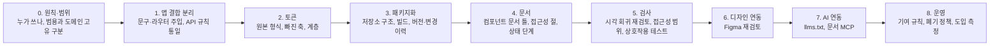

# 디자인 시스템 로드맵 문서 만들기

<!-- plan-result:start — 이 블록만 병합 뒤에도 고칠 수 있다(.claude/CLAUDE.md "계획과 PR 본문"). 아래는 승인된 계획 원문 -->

## 구현 결과

> #647 · 2026-11-18 대조 · 이탈 2 · 미구현 0 — 판정 근거(파일:줄)는 PR 본문 "계획 대비 구현"

- 이탈(절차): 계획은 워크트리 진입 직후 `.env` 복사 → `pnpm install`. 실제로는 `.env` 복사가 권한에서 거부돼 건너뛰고 `pnpm install`만 함(문서 작업에는 필요 없다고 그 자리에서 알림)
- 이탈 → 보완함: 차이 표에 "확인 날짜" 열이 빠져 있던 것을 대조 뒤 넣음
- 이탈(사용자 요청): 계획은 Figma 연동·시각 회귀를 "로드맵 단계에 넣어 다시 비교"였다. 계획 승인 뒤 같은 날 사용자가 Figma는 하지 않음, 시각 회귀는 배제(지금 필요 없음)로 정해 로드맵 §2·§5와 결정 기록에 그렇게 적음
- 계획에 없던 변경: 로드맵 문서에 "방향 결정" 절, "읽는 법", "순서의 이유"(빠진 부품은 단계로 두지 않음)를 더함
- 계획에 없던 변경(문서 동기화): 결정 색인 생성을 위해 `scripts/lib/decision-topics.json`에 주제 분류 한 줄 추가
- 참고: `DESIGN-SYSTEM.md` 마지막 검토 날짜는 이미 2026-11-18이라 바꾸지 않음. 결정 기록은 `DECISIONS.md`에 2026-09-13 레지스트리 항목이 없어 그 결정이 적힌 `DESIGN-SYSTEM.md` §5·§11을 가리킴

<!-- plan-result:end -->

> 다른 프로젝트에서도 같은 컴포넌트 구성을 쓰기 위해, 디자인 시스템 준비 요소·현재와의 차이·단계 순서를 `docs/DESIGN-SYSTEM-ROADMAP.md` 한 문서로 정리한다. 코드는 바꾸지 않는다.

## Context

- **요청**: "회사에 입사해 디자인 시스템을 구축한다면 무엇을 준비해야 하는가"를 하나씩 짚어 전체 계획을 세우고, 지금 프로젝트가 업계 표준에 비해 부족한 점을 확인한다. 기준 사례는 SEED Design(https://seed-design.io/react)이다.
- **지금 상황**(2026-11-18 조사)
  - `src/shared/ui` 컴포넌트 파일 55개, 스토리 56개(직접 `find`). 그중 17개 파일이 앱 문구(`TEXTS`)·라우터·인증 스토어를 import한다(직접 `grep`).
  - 토큰 원본은 `src/app/globals.css` 하나다. 변환 도구·패키지 버전 도구·시각 회귀 도구는 `package.json`에 없다(직접 확인). Chromatic 애드온은 설치만 돼 있고 워크플로에서 쓰지 않는다(직접 `grep`).
  - 재사용 인프라는 "범위 밖"으로 결정돼 있었다(`docs/DESIGN-SYSTEM.md:121-129`, `:644-645`). Figma 연동은 무료 플랜 제약으로 보류, 시각 회귀는 기각 상태다(`docs/DECISIONS.md:2803-2823`).
  - 간격·그림자·모션 토큰 없음, 컴포넌트 토큰 층 없음, 사용 가이드 문서(mdx) 0개, `play` 상호작용 테스트 1개 파일, `eslint-plugin-jsx-a11y`·e2e axe 없음, 빠진 컴포넌트(Tabs·Accordion·Radio·Popover 등), prop 이름·ref 전달·className 병합 순서 불일치 — 이 줄은 서브에이전트 보고이고 구현 때 다시 확인한다.
- **업계 선례**(서브에이전트가 읽은 요약. 구현 때 원문을 직접 열어 확인한 뒤 인용한다)
  - SEED: 토큰 원본(YAML) → 스타일 레시피 → CSS → 헤드리스 + React 패키지의 빌드 사슬, 팔레트 → 의미 → 컴포넌트 스펙 3단 토큰, 엄격한 SemVer, CLI·codemod·문서 MCP·`llms.txt`
  - Primer: 컴포넌트 상태 단계(Experimental/Ready/Deprecated), UI·시나리오 패턴, 기여 절차
  - 표준: W3C DTCG 2025.10(토큰 교환 형식), WAI-ARIA APG, WCAG 2.2, Changesets, Style Dictionary
  - Design System Checklist: Design Language / Foundations / Components / Maintenance 4묶음

## 판단이 필요했던 항목

| 항목 | 결정 | 근거·기각한 대안 |
| --- | --- | --- |
| 이번 계획의 범위 | 로드맵 문서만. 각 단계 구현은 그때 별도 계획으로 승인받는다 | 사용자 답(2026-11-18 질문). 기각: 1단계 구현까지 포함, 문서 없이 대화만 |
| 재사용 방식 | npm 패키지 | 사용자 답. SEED·Primer가 쓰는 방식이고 버전 정책·변경 이력·호환 범위를 다루게 된다. 기각: shadcn 레지스트리(복사 뒤 프로젝트마다 갈라짐), 혼합(두 경로 유지). 2026-09-13 "레지스트리 범위 밖" 결정을 바꾸므로 `DECISIONS.md`에 새 항목을 쓴다 |
| Figma 연동·시각 회귀 | 둘 다 로드맵 단계에 넣어 다시 비교한다 | 사용자 답. 이 계획은 "다시 검토한다"까지만 정한다. 도입 여부는 해당 단계 계획에서 대안을 비교해 정하고, 기존 결정은 그때까지 유효하다 |
| 문서 위치 | 새 레퍼런스 문서 `docs/DESIGN-SYSTEM-ROADMAP.md` | 사용자 답. 단계마다 진행 상태를 고칠 수 있다. 기각: `DESIGN-SYSTEM.md` 확장(현재 동작 설명과 섞임), `docs/plans`만(커밋 뒤 못 고침) |
| 단계 순서 | 위 그림의 0→8 | 제 판단. 패키지로 내보내려면 앱 결합 분리가 먼저여야 하고, 토큰 이름이 정해져야 컴포넌트 문서·Figma 변수를 맞출 수 있다. 사용자가 순서를 바꾸면 문서 표만 고치면 된다 |
| 저장소 구조(모노레포/별도 저장소), 토큰 원본 형식(DTCG/CSS 유지) | 이번에 정하지 않는다 | 로드맵 3단계·2단계에 "정할 것"으로 적고 그 단계 계획에서 비교한다 |

## 세부 계획

| 위치 | 변경 내용 |
| --- | --- |
| `docs/DESIGN-SYSTEM-ROADMAP.md` (신규) | 아래 "로드맵 문서 구성"대로 작성. 쓰기 전에 같은 분류의 `docs/VERSION-COMPATIBILITY.md` 또는 `SYSTEM-ARCHITECTURE.md`를 읽어 형식을 맞춘다 |
| `README.md` `## 문서` → 레퍼런스 묶음 | 새 문서 한 줄 등록 |
| `docs/DESIGN-SYSTEM.md` §11 "shadcn 커스텀 레지스트리" 항목(`:644-645`)과 §5 재사용성 문단(`:121-129`) | 로드맵 문서 링크와 "2026-11-18 npm 패키지로 방향 결정" 한 줄 추가, 마지막 검토 날짜 갱신 |
| `docs/DECISIONS.md` | 새 항목: 재사용 방식을 npm 패키지로 정함(기각한 대안, 정해진 경로 = 질문), 2026-09-13 항목을 가리킴 |
| `docs/DECISIONS-INDEX.md`, `docs/PLANS-INDEX.md` | 색인 갱신 방식(수동/자동)을 파일 머리말에서 확인하고 그에 따라 반영 |
| `docs/plans/2026-11-18-design-system-roadmap.md` (신규) | 이 계획 스냅샷 |

### 로드맵 문서 구성

1. **머리말** — 문서 성격(레퍼런스), 대상 독자, 읽고 나면 할 수 있는 것, 마지막 검토 날짜
2. **한눈에 보기** — 업계 구조·현재·개선 후를 나란히 둔 Mermaid 그림, 새 용어(토큰, 헤드리스, peerDependencies, SemVer 등) 정의
3. **준비 요소 11개 영역** — 원칙·거버넌스 / 토큰 / 컴포넌트 / 패턴 / 문서 / 도구·자동화 / 배포·버전 / 접근성 / 디자인 연동 / AI 연동 / 도입·측정. 영역마다 "무엇인가·왜 필요한가·선례(링크)"
4. **현재와의 차이 표** — 영역 | 업계 기준 | 지금 | 근거(`파일:줄`) | 확인 날짜. 이미 갖춘 것(lint 강제, 스토리 100%, a11y 게이트, 공개 Storybook)도 같은 표에 적는다
5. **단계 표(0~8)** — 단계 | 목표 | 정할 것 | 끝났다고 볼 증거 | 상태(미착수/진행/완료, 해당 계획·PR 링크). 과거 결정을 다시 보는 단계(5 시각 회귀, 6 Figma)는 기존 결정 링크와 "다시 보는 이유"를 적는다
6. **단계별 요청 틀** — 목표·기준·제약·이번 산출물·완료 조건 5줄 프롬프트 틀과 에이전트 역할 나눔(조사 = Explore, 구현 = general-purpose, 대조 = plan-verifier)
7. **관련 문서** — `DESIGN-SYSTEM.md`, `FE-ARCHITECTURE.md` §18, design-tokens skill, 관련 `DECISIONS.md` 항목

작성 규칙: 외부 주장은 원문 URL을 직접 열어 확인한 것만 인용 형식으로 싣고, 못 연 것은 "재인용" 또는 "확인 못 함"으로 적는다. 내부 수치는 측정 명령을 함께 적는다. `DESIGN-SYSTEM.md`에 이미 있는 사실은 옮겨 적지 않고 링크한다. 비공개 이름·키 값은 넣지 않는다.

## 영향 범위

- 문서만 바뀐다. `src/`, 설정, 워크플로는 건드리지 않는다. `deploy.yml` 경로 필터에 걸리지 않아 배포가 돌지 않는다.
- 깨질 수 있는 것: `pnpm check:docs`(경로·줄 번호 참조), `DESIGN-SYSTEM.md`를 줄 번호로 가리키는 다른 문서(줄을 추가하면 밀린다 — 추가 전 `grep`으로 참조를 찾는다), docs/plans 불변성 CI(새 파일만 추가하므로 해당 없음).
- 기존 결정의 효력: Figma 보류·시각 회귀 기각은 이 PR로 바뀌지 않는다.

## 검증 방법

- 워크트리에서 작업(`git log origin/main..main` 확인 → `EnterWorktree` → `.env` 복사·`pnpm install`).
- `pnpm check:docs` 통과 출력.
- 로드맵 표의 `파일:줄` 근거를 하나씩 다시 열어 맞는지 확인하고, 서브에이전트 보고에만 기댄 줄(빠진 컴포넌트, API 불일치, 토큰 축)을 직접 `grep`으로 재확인한 명령을 PR 본문에 남긴다.
- 외부 링크는 직접 열어 인용문과 대조한다.
- PR 전 `plan-verifier` 대조, `pnpm check:pr-body`, PR CI 통과 확인. 병합은 사용자 승인 뒤 squash.
- 완료 조건: 로드맵 문서가 `main`에 있고 README에서 링크되며, 11개 영역·차이 표·단계 표가 모두 근거와 함께 채워져 있다.

## 남은 것

- 단계 0~8 각각의 구현 계획(이번 범위 밖, 단계마다 별도 승인).
- 저장소 구조와 토큰 원본 형식 결정(3단계·2단계 계획에서).
