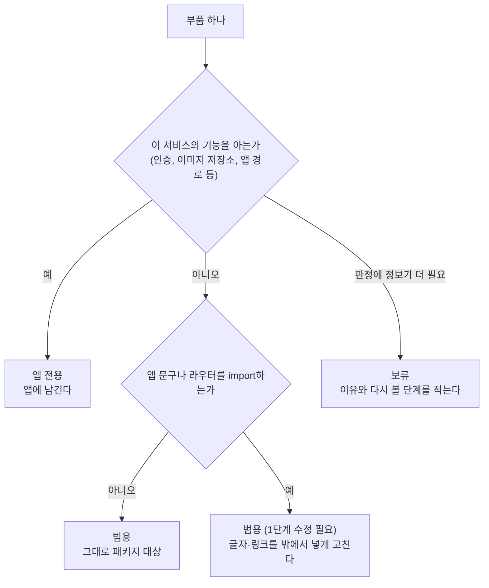

# 디자인 시스템 0단계: 원칙과 부품 분류표

<!-- plan-result:start — 이 블록만 병합 뒤에도 고칠 수 있다(.claude/CLAUDE.md "계획과 PR 본문"). 아래는 승인된 계획 원문 -->

## 구현 결과

> #648 · 2026-11-18 대조 · 이탈 1 · 미구현 0 — 판정 근거(파일:줄)는 PR 본문 "계획 대비 구현"

- 이탈 → 보완함: 분류표 `MarkdownContent` 줄의 "묶인 것"에 코드 블록 분리 모듈(`codeBlock`)이 빠져 있었다. 대조 뒤 넣었고 분류(앱 전용)는 그대로다
- 계획에 없던 변경: "보조 모듈" 묶음과 세부 판정 규칙 네 개를 더했다. 그 결과 계획 Context가 "속까지 묶임" 예로 든 `LinkThumbnail`·`TooltipWrapper`가 범용이 됐고, 어림값(약 37 / 약 10 / 5~8)이 39 / 12 / 3 / 보류 1이 됐다
- 계획에 없던 변경: 함께 옮길 보조 모듈 12개 표, "읽는 법", "받는 쪽은 토큰 CSS도 가져간다" 항목
- 문서 동기화: 계획 스냅샷의 로드맵 링크를 저장소 기준 경로로 바꿨다(원문은 계획 파일 위치 기준 경로라 저장소에서 깨진다)
- 참고: 줄별 분류는 초안이고, 사용자가 PR에서 표를 보고 고칠 수 있다고 안내했다

<!-- plan-result:end -->

> 로드맵 0단계(원칙·범위)의 결과를 새 레퍼런스 문서 `docs/DESIGN-SYSTEM-PRINCIPLES.md`에 담는다. 누가 쓰는지, 범용과 앱 전용의 경계, 상태 단계 이름을 적고 부품 55개를 분류한다. 코드는 바꾸지 않는다.

## Context

- **요청**: "0단계 계획 세워줘". 로드맵 [`docs/DESIGN-SYSTEM-ROADMAP.md`](../DESIGN-SYSTEM-ROADMAP.md) §5의 0단계는 "정할 것"이 누가 쓰는가, 범용 부품과 이 앱 전용 부품의 경계, 부품 상태 단계 이름이고, 끝 증거가 "부품 55개가 범용 / 앱 전용 / 보류로 분류된 표"다.
- **왜 먼저 하나**: 1단계(앱 결합 분리)의 일감이 이 분류에서 나온다. 범용으로 분류한 부품만 문구·라우터를 떼어 낸다.
- **지금 상황**(2026-11-18 직접 확인, `main` 5031c021)
  - 부품 파일 55개: `find src/shared/ui -name "*.tsx" -not -name "*.stories.tsx" -not -name "*.test.tsx"`. 같은 폴더에 스토어 2개(`alertDialog.store.ts`, `imageViewer.store.ts`)가 더 있다.
  - import를 뽑아 보면 묶인 정도가 셋으로 나뉜다(어림값, 줄별 판정은 구현 때 파일을 열어 정한다).
    - 안 묶임 약 37개: `cn()`과 작은 훅(`useClickGuard`, `useMergedRef` 등)만 쓴다. 예: `button`, `card`, `checkbox`, 폼 부품
    - 겉만 묶임 약 10개: 앱 문구 파일(`TEXTS`)이나 라우터 링크만 쓴다. 예: `dialog`, `alert-dialog`, `spinner`, `input`, `PasswordInput`, `ErrorLayout`
    - 속까지 묶임 5~8개: 인증 스토어, 청크 재로딩, Supabase 이미지 변환, 실패 이미지 캐시, 토스트, 앱 경로를 쓴다. 예: `AsyncBoundary`, `AppErrorFallback`, `MarkdownContent`, `link-thumbnail`, `TooltipWrapper`
  - 뒤로가기 오버레이 훅(`ImageViewer`, `imageViewer.store.ts`)이 라우터에 기대는지는 아직 열어 보지 않았다.
- **선례**(직접 받아 확인)
  - [Primer component status](https://primer.style/product/getting-started/component-status/): `Experimental`, `Ready`, `Deprecated` 세 단계.
  - Tailwind 공식 문서 [Detecting classes in source files](https://tailwindcss.com/docs/detecting-classes-in-source-files): `@source "../node_modules/@acmecorp/ui-lib"`로 Tailwind로 만든 외부 라이브러리를 스캔한다(설치본 4.3.5).

## 판단이 필요했던 항목

| 항목 | 결정 | 근거·기각한 대안 |
| --- | --- | --- |
| 누가 쓰는가 | React + Tailwind v4를 쓰는 본인의 다음 프로젝트. Tailwind를 안 쓰는 곳에 줄지는 3단계(패키지화)에서 정한다 | 사용자 답(2026-11-18). 미리 만든 CSS 파일을 함께 내는 길은 부품을 고치지 않고 나중에 더할 수 있다(제 판단, 실험하지 않음). 기각: 처음부터 Tailwind 무관(쓸 곳 없는 빌드를 먼저 만든다), 공개 오픈소스(영어 문서·외부 문의 대응) |
| 경계 기준 | 겉만 묶인 것까지 범용. 이 서비스의 기능을 아는 부품만 앱 전용 | 사용자 답. 기각: 좁게(조합 부품을 다음 프로젝트에서 다시 만든다), 넓게(인증·이미지 저장소까지 주입 구조로 바꿔야 한다) |
| 상태 단계 이름 | Primer 이름 그대로 `Experimental` / `Ready` / `Deprecated`, 문서에 한국어 뜻을 함께 적는다 | 사용자 답. 기각: 한국어 이름, 8단계로 미룸 |
| 문서 위치 | 새 레퍼런스 문서 `docs/DESIGN-SYSTEM-PRINCIPLES.md` | 사용자 답. 기각: 로드맵에 절 추가(계획·상태 문서에 55줄 표가 섞인다), `DESIGN-SYSTEM.md`에 절 추가(줄 번호 참조가 밀린다) |
| 부품별 상태를 지금 붙일지 | 붙이지 않는다. 0단계는 이름·뜻·`Ready`가 되는 조건만 정하고, 부품별 상태는 패키지에 들어가는 3단계에서 붙인다 | 제 판단. Primer는 Experimental을 "개념 증명이거나 작업 중"으로 쓰는데, 지금 55개는 운영에서 쓰는 부품이라 어느 이름도 맞지 않는다. 승인 때 다르게 정해 주시면 표에 열을 더한다 |
| `Ready` 조건 | 앱 코드를 import하지 않음, 스토리 있음, 접근성 검사 통과, 부품 문서 있음(4단계) | 제 판단. 앞의 셋은 이미 있는 검사·1단계 결과이고 넷째는 4단계 산출물이다. 승인 때 고칠 수 있다 |
| `DECISIONS.md`에 적을지 | 적지 않는다. 결정과 기각한 대안은 새 문서의 "정한 것" 절에 둔다 | 제 판단. 세 결정 모두 문서만 고치면 되돌릴 수 있어 "되돌리기 어려운 결정" 기준에 들지 않는다. 재사용 방식(npm 패키지)은 이미 `DECISIONS.md` 2026-11-18 항목에 있다 |
| 분류를 코드가 읽을 수 있게 둘지(JSON 등) | 이번에 하지 않는다 | 1단계에서 린트가 범용 목록을 읽어야 할 때 그 계획에서 정한다 |

## 세부 계획

| 위치 | 변경 내용 |
| --- | --- |
| `docs/DESIGN-SYSTEM-PRINCIPLES.md` (신규) | 아래 "문서 구성"대로 작성. 쓰기 전에 같은 분류의 `docs/DESIGN-SYSTEM-ROADMAP.md`를 읽어 머리말·인용 형식을 맞춘다 |
| `docs/DESIGN-SYSTEM-ROADMAP.md` §5 0단계 행 | 상태를 `완료`로 바꾸고 이 계획 파일과 PR을 링크 |
| `docs/DESIGN-SYSTEM-ROADMAP.md` §4 "거버넌스"·"앱과 분리" 행 | "상태 단계 없음"을 새 문서 링크로 고치고, 앱 결합 수치를 분류표 결과와 맞춘다. 확인 날짜 갱신 |
| `docs/DESIGN-SYSTEM-ROADMAP.md` §7, 머리말 "마지막 검토" | 새 문서 링크 한 줄, 날짜 갱신 |
| `README.md` `## 문서` 레퍼런스 묶음 | 새 문서 한 줄 등록 |
| `docs/PLANS-INDEX.md` | `pnpm docs:index`로 재생성 |
| `docs/plans/2026-11-18-design-system-stage0-principles.md` (신규) | 이 계획 스냅샷과 구현 결과 블록 |

### 문서 구성 (`DESIGN-SYSTEM-PRINCIPLES.md`)

1. **머리말** — 문서 성격(레퍼런스), 대상 독자, 읽고 나면, 마지막 검토
2. **정한 것** — 사용 대상, 경계 기준, 상태 단계. 항목마다 결정·기각한 대안·정해진 경로(사용자 답 / 계획 승인)
3. **사용 대상과 전제** — React + Tailwind v4. 받는 쪽이 `@source`로 패키지를 스캔하는 방식(Tailwind 문서 인용)과, Tailwind를 안 쓰는 곳은 3단계에서 정한다는 것
4. **경계 기준** — 위 그림과 세 묶음의 정의, 판정 질문 두 개, 예시 부품
5. **상태 단계** — 세 이름의 뜻(Primer 인용 + 한국어), `Ready` 조건, 부품별 상태는 3단계에서 붙인다는 것
6. **부품 분류표** — 55줄 + 스토어 2줄. 열: 부품 | 경로 | 분류(범용 / 범용·1단계 수정 / 앱 전용 / 보류) | 묶인 것(import한 앱 모듈) | 1단계에서 할 일. 보류에는 이유와 다시 볼 단계를 적는다. 표 아래에 분류별 개수
7. **측정 명령** — 표를 다시 만들 때 쓰는 `find`·`grep` 명령과 결과 수
8. **관련 문서**

작성 규칙: 분류의 "묶인 것" 칸은 그 파일의 import를 직접 읽고 적는다(훅을 거쳐 라우터에 닿는 경우는 훅 파일까지 연다). 외부 인용은 직접 받은 원문만 쓴다. `DESIGN-SYSTEM.md`·로드맵에 있는 사실은 옮겨 적지 않고 링크한다.

## 영향 범위

- 문서만 바뀐다. `src/`, 설정, 워크플로는 건드리지 않아 배포가 돌지 않는다.
- 깨질 수 있는 것: `pnpm check:docs`(경로·줄 번호 참조), 로드맵 문서를 줄 번호로 가리키는 곳(고치기 전에 `grep`으로 찾는다), `docs/plans` 불변성 검사(새 파일만 더하므로 해당 없음).
- 분류표는 부품이 추가·이동되면 낡는다. 측정 명령과 확인 날짜를 문서에 두는 것으로 대신하고, 자동 검사는 1단계 린트에서 다룬다.

## 검증 방법

- 워크트리에서 작업한다(`git log origin/main..main` 확인 → `EnterWorktree` → `.env` 복사·`pnpm install`). `.env` 복사가 지난번처럼 권한에서 거부되면 우회하지 않고 진행한다(문서 작업이라 필요하지 않다).
- 분류표 줄 수가 `find` 결과 55와 같고, 분류별 개수의 합이 55인지 센다.
- "묶인 것" 칸을 `grep -rnE "from '@/(shared/(config|store|lib|hooks|utils|api)|app|entities|features|widgets|pages)[^']*'|from 'react-router-dom'" src/shared/ui` 결과와 줄별로 대조한다.
- `pnpm check:docs`, `prettier --check`, `pnpm docs:index` 뒤 변경 없음 확인.
- PR 전 `plan-verifier` 대조, `pnpm check:pr-body`, PR CI 통과. 병합은 사용자 승인 뒤 squash.
- 완료 조건: 새 문서가 `main`에 있고 README·로드맵에서 링크되며, 로드맵 0단계 상태가 `완료`이고, 55개가 모두 분류돼 있다.

## 남은 것

- 부품별 상태 붙이기(3단계), 분류를 코드가 읽는 형식으로 두기(1단계).
- Tailwind를 안 쓰는 프로젝트용 CSS 파일(3단계에서 정함).
- 1단계 계획: 이 분류표의 "범용·1단계 수정" 줄이 일감이 된다.
