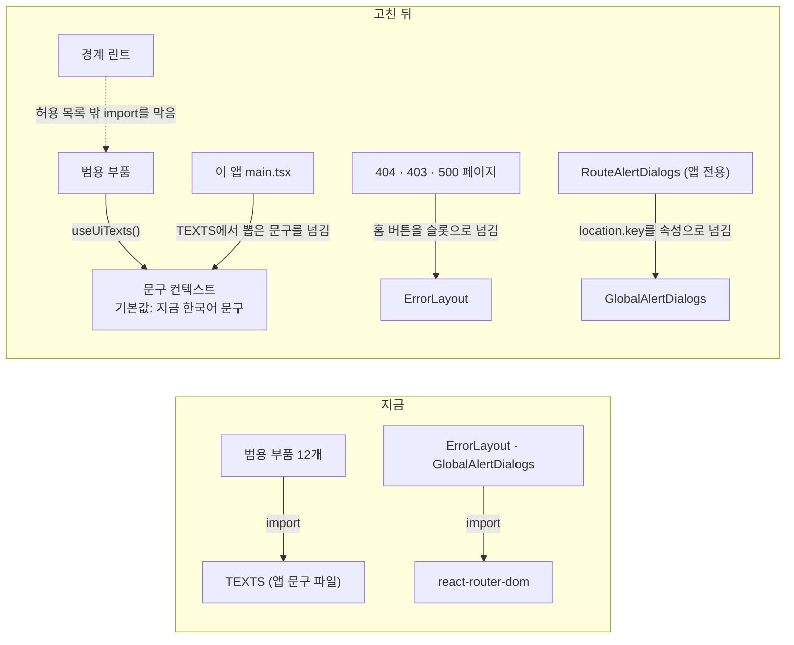
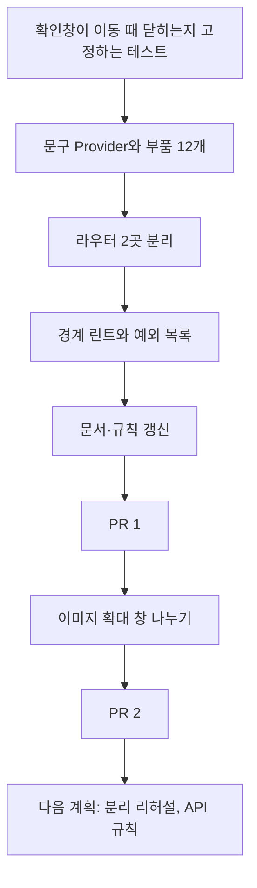

# 디자인 시스템 1단계: 앱 문구·라우터 결합 분리와 경계 린트

<!-- plan-result:start — 이 블록만 병합 뒤에도 고칠 수 있다(.claude/CLAUDE.md "계획과 PR 본문"). 아래는 승인된 계획 원문 -->

## 구현 결과

> #649 · 2026-11-19 대조 · 이탈 5 · 미구현 0 — 판정 근거(파일:줄)는 PR 본문 "계획 대비 구현"

- 범위: 이 대조는 Phase 1(PR 1)만 본다. Phase 2(이미지 확대 창 나누기)는 다음 PR에서 대조해 덧붙인다
- 이탈(사용자 결정, 구현 중): 문구를 넘기지 않으면 패키지 기본 문구가 나오는 대신 오류를 낸다. 컨텍스트 기본값이 없고 `useUiTexts()`는 Provider 밖에서 던진다. 넘기지 않은 글자가 화면에 나오면 누구 것인지 코드로 알 수 없다는 이유다
- 이탈(사용자 결정, 구현 중): `DEFAULT_UI_TEXTS`를 두지 않았다. `ui-texts.ts`에는 타입만 있고, 한국어 문구는 `ko-ui-texts.ts`의 `KO_UI_TEXTS`로 내보내되 자동으로 쓰이지 않는다. 일치 테스트와 한글 문구 검사 예외의 대상도 이 파일이다
- 이탈(사용자 결정, 구현 중): 문구 키를 한 층 21개 대신 부품별 묶음으로 나눴다(둘 이상이 쓰면 `common`). 개수는 21개 그대로다
- 이탈(계획의 전제가 틀림): 계획은 규칙 테스트 선례가 없다고 보고 테스트 파일을 만들지 않기로 했지만 선례가 있어 `ui-boundary-rule.test.ts`를 더했다. 디스크에서 깨 보는 확인도 했다
- 이탈(절차): 계획은 대조 → PR 본문 검사 → PR 순서였는데, 대조 에이전트가 응답 없이 멈춰 PR을 먼저 열고 대조는 병합 전에 했다
- 계획에 없던 변경: Provider가 필수가 되면서 테스트 도우미(`src/test/utils.tsx`의 `render` 등)와 Storybook 데코레이터가 이 앱의 문구 Provider로 감싼다. 범용 부품을 그리는 기존 테스트 7개는 `render`를 가져오는 곳만, `AppErrorFallback.test.tsx`는 감싸는 방식만 바꿨고 단언은 그대로다
- 계획에 없던 변경: 경계 규칙이 다시 내보내기와 동적 import도 막는다. `GlobalAlertDialogs.stories.tsx`의 라우터 데코레이터를 뺐다
- 계획에 없던 변경(문서): `TESTING.md` "패턴 D", `DESIGN-SYSTEM.md` 코드 지도 2행, 원칙 문서의 Polaris 선례·react.dev 반대쪽 근거, `.claude/CLAUDE.md` 테스트 환경 표
- 기록 안 된 약속 → 보완함: 문구를 읽는 부품 파일에 `'use client'`를 적는 일을 로드맵 3단계 행에 적었다. 구현 중 대화에서 이번 PR에 적겠다고 한 것이 빠져 있었다
- 대조 뒤 더함(사용자 요청): 원칙 문서 §1.3 "글자를 Provider로 받기로 한 이유"에 요구, 비교한 방식, 치르는 값, 다시 볼 조건, 결정까지의 순서, 선례를 적었다. §1.1의 선례 표와 §1.2의 Next.js 메모는 이 절로 옮겼다
- 문서 동기화: 밀린 줄 번호 참조와 표 서식

<!-- plan-result:end -->

> 범용으로 분류한 공용 UI 부품이 앱 문구 파일과 라우터를 import하지 않게 고치고, 다시 묶이지 않게 린트로 막는다. PR 둘로 낸다. 화면에 보이는 문구와 동작은 바뀌지 않는다. **API 규칙(속성 이름·ref·클래스 병합)은 이 계획에 없고 다음 계획으로 남긴다.**

## Context

- **요청**: "1단계 계획 세워줘". [로드맵](../DESIGN-SYSTEM-ROADMAP.md) §5의 1단계 끝 증거는 "범용으로 분류한 부품이 앱 문구·라우터를 import하지 않음을 린트가 막는다"이다.
- **왜**: 부품이 앱 문구 파일(`TEXTS`)과 `react-router-dom`을 import하면, 패키지로 내든 파일을 복사해 가든 다른 프로젝트에서 쓸 수 없다.
- **지금 상황** (2026-11-18 직접 확인, `main` d3990f27)
  - [분류표](../DESIGN-SYSTEM-PRINCIPLES.md#5-부품-분류표)의 범용(1단계 수정) 12개가 `TEXTS` 키 22개를 쓴다. 그중 5개(닫기, 입력값 지우기, 다시 시도, 확인, 취소)는 공용 UI 밖의 앱 코드도 쓴다.
  - e2e 파일 83개가 `TEXTS`를 import한다. "닫기" 문구로 요소를 찾는 테스트·스토리·e2e가 13개 파일, "입력값 지우기"가 7개 파일이다.
  - 라우터를 직접 import하는 범용 부품은 둘이다. `src/shared/ui/layouts/ErrorLayout.tsx:50`(홈 링크), `src/shared/ui/elements/dialog/alert-dialog/GlobalAlertDialogs.tsx:95-102`(열린 위치를 벗어나면 닫기).
  - 이미지 확대 창은 열림·닫힘을 `useBackClosableOverlay('imageViewerOpen')`로 읽는다(`src/shared/ui/elements/dialog/image-viewer/ImageViewer.tsx:31`). 이 훅은 라우터와 이 앱의 오버레이 등록부를 쓴다.
  - 확인창을 앱처럼 그리는 테스트가 5개 있고 app·features·shared 레이어에 흩어져 있다(`ProtectedRoute.test.tsx`, `useUpdatePost.guard.test.tsx`, `useCreatePost.guard.test.tsx`, `useSignUp.guard.test.tsx`, `useUnsavedChangesGuard.test.tsx`).
  - "열린 위치를 벗어나면 확인창이 닫힌다"를 직접 단언하는 테스트는 찾지 못했다.
  - `src/shared/**`에는 이미 `no-restricted-imports`가 걸려 있어(`eslint.config.js:1714`) 같은 규칙을 다시 선언하면 덮어쓴다. 선례는 고유 이름의 커스텀 규칙이다(`eslint.config.js:1412-1425`).
  - 보조 모듈 12개 중 세 파일은 앱 것과 섞여 있다. `utils/common.util.ts`(583줄 중 `CommonUtil.commaizeNumber`만), `config/const.ts`(export 9개 중 상수 2개), `types/common.type.ts`(export 11개 중 `SelectOptionType`만).
- **선례** (원문을 직접 받아 대조)

  | 방식 | 쓰는 곳 | 출처 |
  | --- | --- | --- |
  | 기본 문구 내장 + 맨 위 Provider | MUI, Ant Design, React Aria | [MUI Localization](https://mui.com/material-ui/guides/localization/), [Ant Design i18n](https://ant.design/docs/react/i18n), [React Aria](https://react-aria.adobe.com/quality) |
  | 부품 속성으로 | Mantine, Radix | [Mantine Modal](https://mantine.dev/core/modal/), [Radix Dialog](https://www.radix-ui.com/primitives/docs/components/dialog) |
  | 코드에 직접 적음 | shadcn, SEED | [shadcn dialog.tsx](https://raw.githubusercontent.com/shadcn-ui/ui/main/apps/v4/registry/new-york-v4/ui/dialog.tsx), [SEED bottom-sheet.tsx](https://github.com/daangn/seed-design/blob/dev/docs/registry/react/ui/bottom-sheet.tsx) |
  | 라우터는 쓰는 쪽이 넣음 | Radix `asChild`, MUI `component`, React Aria `render` | [Radix Composition](https://www.radix-ui.com/primitives/docs/guides/composition), [MUI Routing](https://mui.com/material-ui/integrations/routing/), [React Aria Link](https://react-aria.adobe.com/Link) |

- **사용자 우려**: 이 앱과 잘 분리돼도 다른 프로젝트에서 합치기 어려울 수 있고, 이 앱이 분리 뒤에도 동작한다는 확인이 없다. 1단계가 끊는 것은 import 결합뿐이라, 1단계 바로 뒤에 "분리 리허설" 단계를 끼워 일찍 확인하기로 했다(별도 계획).

## 판단이 필요했던 항목

| 항목 | 결정 | 근거·기각한 대안 |
| --- | --- | --- |
| 문구 주입 방법 | 패키지에 기본 문구를 두고 맨 위 Provider로 바꾼다 | 사용자 답. 기각: 부품 속성으로만(다음 프로젝트가 자리마다 넘김), 기본 문구 없이 속성 필수(이 앱에서 넘길 곳이 부품별 사용 파일 합계 38곳) |
| 기본 문구와 이 앱의 문구 원천 | 기본 문구는 지금 한국어 그대로. 이 앱은 `TEXTS`에서 뽑아 Provider에 넘기고, 문구를 고치는 곳은 지금처럼 `texts.ts`다 | 질문 본문에서 안내한 내용으로 답을 받았다. 기각: 영어 기본값(Provider 없이 그리는 테스트·스토리가 한국어 라벨로 요소를 못 찾는다), `TEXTS`에서 키를 지우고 기본값만 쓰기(e2e 83개 파일에 닿고 Provider가 운영에서 한 번도 안 쓰인다) |
| Provider가 받는 값 | 부분 객체가 아니라 전체 `UiTexts` 객체 | 제 판단. 앱이 키를 빠뜨리면 컴파일 오류가 난다. 병합 계산과 메모이제이션이 필요 없다. 다른 프로젝트는 `{ ...DEFAULT_UI_TEXTS, close: '…' }`로 넘긴다 |
| 기본 문구와 앱 문구의 일치 | 둘이 같음을 단언하는 테스트를 넣는다 | 제 판단. 같은 문구가 두 곳에 생기므로 어긋나면 Provider 없이 그리는 곳만 다른 글자가 된다. 일부러 다르게 둘 때 이 테스트를 지운다 |
| 라우터 결합 | 쓰는 쪽이 넣는다. `ErrorLayout`은 `homeTo`·`onHomeClick` 대신 `homeAction` 슬롯을 받고, `GlobalAlertDialogs`는 `dismissKey` 속성을 받는다 | 사용자 답(속성 모양 변경 포함). 기각: 맨 위 Provider로 등록(링크를 그리는 범용 부품이 1개뿐), 두 부품을 범용에서 빼기 |
| 라우터와 잇는 부품의 자리 | `RouteAlertDialogs.tsx`를 `GlobalAlertDialogs.tsx` 옆에 앱 전용으로 둔다 | 제 판단. 확인창을 앱처럼 그리는 테스트 5개가 shared·features에도 있어 app 레이어 파일을 import할 수 없다. 기각: app 레이어에 두기, 테스트 유틸에서 따로 잇기(운영과 다른 배선을 테스트하게 된다) |
| 이미지 확대 창 | 그리는 부품(범용)과 앱 배선(앱 전용)으로 나눈다 | 사용자 답. 기각: 통째로 앱 전용, 뒤로가기 규약까지 패키지에 |
| 앱 전용 부품의 자리 | 옮기지 않고 린트 예외 목록에 적는다 | 사용자 답. 기각: 지금 새 폴더로 옮기기(3단계에서 범용 쪽이 한 번 더 옮겨진다) |
| 린트 모양 | 허용 목록 방식의 커스텀 규칙. 범용 부품과 보조 모듈 파일이 대상이고, 섞인 세 파일은 이름·멤버 단위로만 허용한다 | 이름 단위 허용은 사용자 답. 허용 목록 방식과 보조 모듈 포함은 제 판단(문구·라우터만 막으면 인증 스토어 같은 새 결합을 못 잡고, 보조 모듈을 거쳐 묶이는 길이 남는다) |
| 0단계 분류의 열린 줄 | `LinkThumbnail`·`TooltipWrapper` 범용, 보조 모듈 "함께 옮길 것"을 임시로 두고 분리 리허설 뒤에 정한다 | 사용자 답 |
| 확인 시점 | 1단계 뒤에 분리 리허설을 끼운다. 계획은 따로 세우고 이 계획에서는 로드맵에 행만 더한다 | 사용자 답. 기각: 3단계 끝 증거만 강화, 지금 순서 그대로 |
| API 규칙 | 다음 계획으로 나눈다. 계획·PR·마지막 보고마다 남았다고 적는다 | 사용자 답("잊지 않도록 명시") |
| PR 나누기 | PR 1은 문구·라우터·린트·문서, PR 2는 확대 창 | 제 판단. 확대 창은 섬세한 코드라 따로 되돌릴 수 있게 한다. PR 1에서는 확대 창을 예외 목록에 두고 PR 2에서 뺀다 |
| 규칙 자체의 검증 | 테스트 파일을 만들지 않고 디스크에서 일부러 깨서 확인한다 | `scripts/lib`의 기존 규칙에 테스트 선례가 없다 |
| 스토리·테스트의 앱 의존 | 이번 규칙의 대상에서 뺀다 | 범용 부품의 스토리 6개·테스트 8개 파일이 `TEXTS`나 라우터를 쓴다. 분리 리허설에서 다룬다 |
| 기록 위치 | `DECISIONS.md`에 적지 않고 원칙 문서 §1에 적는다. `CHANGELOG.md` 항목도 없다 | 부품 12개를 고치면 되돌릴 수 있고, 화면 동작이 바뀌지 않는다 |

### 뒤집힌 전제

| 발견 | 그래서 바뀐 것 |
| --- | --- |
| 보조 모듈 세 파일이 앱 것과 섞여 있다 | 파일 단위 허용 목록 대신 이름·멤버 단위로 허용한다 |
| 확인창 테스트 5개가 app 레이어 밖에 있다 | 라우터와 잇는 부품을 app 레이어가 아닌 공용 UI 안(앱 전용)에 둔다 |
| 로드맵의 확인 시점이 3단계이고 증거가 "버튼 하나"다 | 분리 리허설 단계를 더한다 |
| 홈 버튼 문구는 쓰는 쪽이 넘기게 된다 | 패키지 문구 키는 22개가 아니라 PR 1에서 21개, PR 2에서 확대 창 4개를 더해 25개다 |

### 위험 관리

- **문구가 달라지는 사고**: 일치 테스트와, 문구로 요소를 찾는 기존 테스트·e2e가 잡는다. `texts.ts`와 e2e 파일은 고치지 않는다.
- **확인창 닫힘 회귀**: 고치기 전에 지금 동작을 고정하는 테스트를 먼저 넣고, 효과를 지웠을 때 실패하는지 확인한다.
- **확대 창 회귀**: e2e `back-closable-overlay*.spec.ts`와 브라우저 확인으로 본다.
- **배포**: `src/`가 바뀌므로 병합마다 배포 워크플로가 돈다. 그 커밋 SHA가 success인지 확인한 뒤 보고한다.

## 세부 계획

### Phase 1 (PR 1) — 문구 Provider, 라우터 분리, 경계 린트

| 위치 | 변경 내용 |
| --- | --- |
| `src/shared/ui/elements/dialog/alert-dialog/RouteAlertDialogs.test.tsx` (신규) | 먼저 `GlobalAlertDialogs`를 대상으로 "열린 뒤 위치가 바뀌면 취소로 닫힌다", "같은 위치에서는 열려 있다"를 쓴다. 지금 코드에서 통과하고 효과를 지우면 실패함을 확인한 뒤, 리팩터링 후 그리는 대상만 `RouteAlertDialogs`로 바꾼다 |
| `src/shared/ui/texts/ui-texts.ts` (신규) | `UiTexts` 타입과 `DEFAULT_UI_TEXTS` 21개. 키: `close`, `inputClear`, `loading`, `backToTop`, `dropHere`, `attachImage`, `attachHint`, `removeImageAt`, `attachmentImageAt`, `retry`, `loadMoreFailed`, `showPassword`, `hidePassword`, `confirm`, `cancel`, `alertDialogFallbackTitle`, `authLayout`, `authContent`, `errorLayout`, `errorContent`, `errorDetail` |
| `src/shared/ui/texts/UiTextsProvider.tsx` (신규) | 컨텍스트(기본값 `DEFAULT_UI_TEXTS`), `UiTextsProvider({ texts, children })`, `useUiTexts()` |
| `src/shared/ui/texts/UiTextsProvider.test.tsx` (신규) | Provider 없이 기본 문구, Provider로 넘긴 문구가 부품에 보인다 |
| 범용 부품 12개 | `TEXTS.x`를 `useUiTexts().x`로 바꾸고 `TEXTS` import를 지운다. 대상: `atoms/alert-dialog.tsx`, `atoms/dialog.tsx`, `atoms/input.tsx`, `atoms/spinner.tsx`, `elements/BackToTopButton.tsx`, `elements/DropTargetOverlay.tsx`, `elements/ImageAttachmentField.tsx`, `elements/LoadMoreError.tsx`, `elements/PasswordInput.tsx`, `elements/dialog/alert-dialog/GlobalAlertDialogs.tsx`, `layouts/AuthLayout.tsx`, `layouts/ErrorLayout.tsx` |
| `src/app/providers/UiTextsProvider.tsx` (신규) | `APP_UI_TEXTS: UiTexts`(`TEXTS`에서 뽑은 값)와 그것을 넘기는 래퍼. 본뜬 파일: `src/app/providers/ThemeProvider.tsx` |
| `src/app/providers/UiTextsProvider.test.tsx` (신규) | `APP_UI_TEXTS`와 `DEFAULT_UI_TEXTS`가 같다(함수형 키는 결과 비교) |
| `src/main.tsx` | `<App />`을 앱 래퍼로 감싼다. 맨 위 오류 화면까지 Provider 안에 든다 |
| `src/shared/ui/layouts/ErrorLayout.tsx` | `homeTo`·`onHomeClick`을 `homeAction?: ReactNode`로 바꾸고 `Link`와 홈 버튼 문구를 지운다 |
| `src/pages/404/NotFoundPage.tsx`, `src/pages/403/ForbiddenPage.tsx`, `src/pages/500/ServerErrorPage.tsx`, `src/shared/ui/elements/AppErrorFallback.tsx` | 홈 버튼을 `homeAction`으로 넘긴다. 페이지는 `Button asChild` 안의 `Link`, `AppErrorFallback`은 `onClick` 버튼 |
| `src/shared/ui/layouts/ErrorLayout.test.tsx`, `ErrorLayout.stories.tsx` | 속성이 바뀌어 다시 쓴다(요구 변경). 스토리의 `MemoryRouter`를 뺀다. 페이지의 홈 링크를 단언하는 테스트가 없으면 페이지 쪽에 더한다 |
| `src/shared/ui/elements/dialog/alert-dialog/GlobalAlertDialogs.tsx` | `useLocation`을 지우고 `dismissKey?: string`을 받는다. 닫는 조건과 효과 구조는 그대로 둔다 |
| `src/shared/ui/elements/dialog/alert-dialog/RouteAlertDialogs.tsx` (신규, 앱 전용) | `useLocation().key`를 `GlobalAlertDialogs`의 `dismissKey`로 넘긴다 |
| `src/app/routes/layouts/RootLayout.tsx`, 확인창 테스트 5개 | `GlobalAlertDialogs` 대신 `RouteAlertDialogs`를 그린다. 테스트의 단언은 바꾸지 않는다 |
| `GlobalAlertDialogs` 테스트 (신규) | `dismissKey`가 바뀌면 닫히고, 넘기지 않으면 열려 있다 |
| `scripts/lib/ui-boundary-rule.js`, `.d.ts` (신규) | 규칙 `custom-design-system/no-app-import-in-generic-ui`. `@/` import는 `@/shared/ui/**`와 허용 목록만, 외부 패키지는 `react-router-dom`·`react-router`를 막는다. 타입 import도 본다. 본뜬 파일: `scripts/lib/no-literal-a11y-name-rule.js` |
| `eslint.config.js` | 규칙 블록을 더한다. 대상은 `src/shared/ui/**`와 보조 모듈 13개 파일, 제외는 스토리·테스트와 예외 목록. 한글 문구 검사 예외에 `ui-texts.ts`를 더한다 |

**허용 목록**: `lib/tailwind/utils`, `hooks/useClickGuard`, `hooks/useOpenClickGuard`, `hooks/useMergedRef`, `hooks/useDelayedLoading`, `hooks/useKeydown`, `lib/toast/toast`, `lib/toast/toast-layout`, `lib/image/failedImageCache`, `utils/scroll.util`은 통째로. `config/const`는 `LOADING_INDICATOR_DELAY_MS`·`DOUBLE_CLICK_GUARD_MS`만, `types/common.type`은 `SelectOptionType`만, `utils/common.util`은 `CommonUtil.commaizeNumber`만.

**예외 목록(앱 전용)**: `elements/AppErrorFallback.tsx`, `elements/AsyncBoundary.tsx`, `elements/MarkdownContent.tsx`, `elements/dialog/alert-dialog/RouteAlertDialogs.tsx`, `elements/dialog/image-viewer/imageViewer.store.ts`, 그리고 PR 2 전까지 `elements/dialog/image-viewer/ImageViewer.tsx`.

**문서·규칙 (PR 1)**

| 위치 | 변경 내용 |
| --- | --- |
| `docs/DESIGN-SYSTEM-PRINCIPLES.md` | §1에 이번 결정(문구, 라우터, 앱 전용 자리, 확인 시점)을 더한다. §5에서 12줄을 범용으로 바꾸고 `RouteAlertDialogs`를 앱 전용으로 더한다. `TooltipWrapper`에 "패키지의 토스트를 함께 쓴다" 조건, §5.5에 이름 단위 허용과 "분리 리허설 뒤 다시 본다"를 적는다. §6 측정 명령과 결과를 갱신한다 |
| `docs/DESIGN-SYSTEM-ROADMAP.md` | §4 "앱과 분리" 행 갱신. §5의 1단계를 "진행 중 — 결합 분리 끝, API 규칙 남음"으로, 분리 리허설 행을 1단계 뒤에 더한다 |
| `.claude/CLAUDE.md` | Critical Rules에 "범용 공용 UI 부품에서 앱 문구·라우터를 import하지 않는다(`useUiTexts()`, 규칙 이름)"를 더하고 `TEXTS` 규칙에 예외 한 줄을 붙인다 |
| `.claude/skills/texts-conventions/SKILL.md` | 부품이 스스로 보여 주는 글자를 더할 때의 순서(`ui-texts.ts` → `APP_UI_TEXTS`)를 적는다 |
| `docs/FE-ARCHITECTURE.md` 등 | `homeTo`·`GlobalAlertDialogs` 장착을 설명하는 자리를 `grep`으로 찾아 맞춘다. `pnpm check:docs`가 가리키는 줄 번호를 고친다 |
| `docs/plans/2026-11-18-design-system-stage1-decoupling.md` (신규), `docs/PLANS-INDEX.md` | 계획 스냅샷과 구현 결과 블록, 색인 재생성 |

### Phase 2 (PR 2) — 이미지 확대 창 나누기

| 위치 | 변경 내용 |
| --- | --- |
| `src/shared/ui/elements/dialog/image-viewer/ImageViewer.tsx` | 그리는 부품 `ImageViewer`로 바꾼다. 속성: `open`, `onClose`, `images`, `currentIndex`, `onNext`, `onPrev`. 키보드 이동과 Chromium 커서 보정 효과는 이 부품에 남는다. 문구는 `useUiTexts()` |
| `src/shared/ui/elements/dialog/image-viewer/GlobalImageViewer.tsx` (신규, 앱 전용) | 스토어와 `useBackClosableOverlay('imageViewerOpen')`를 `ImageViewer`에 잇는다 |
| `src/shared/ui/texts/ui-texts.ts`, `src/app/providers/UiTextsProvider.tsx` | 키 4개(`imageViewer`, `imageViewerDescription`, `imageViewerPrev`, `imageViewerNext`)를 더한다 |
| `src/app/routes/layouts/RootLayout.tsx` | import 경로만 바꾼다 |
| `ImageViewer.stories.tsx`, `ImageViewer.test.tsx` (신규) | 속성으로 여닫는 스토리, 닫기·이전·다음 콜백과 라벨 테스트 |
| `eslint.config.js` | 예외 목록에서 `ImageViewer.tsx`를 빼고 `GlobalImageViewer.tsx`를 넣는다 |
| `docs/DESIGN-SYSTEM-PRINCIPLES.md`, `docs/BACK-NAVIGATION.md:297`, 계획 결과 블록 | 보류를 범용·앱 전용으로 풀고, 파일·줄 참조를 고친다 |

## 영향 범위

- **공유 코드 사용처**: `Dialog` 4개, `Input` 9개, `Spinner` 7개 파일 등 호출부는 고치지 않는다(속성이 그대로다). 호출부가 바뀌는 것은 `ErrorLayout` 4곳과 `RootLayout`, 확인창 테스트 5개다.
- **속성 모양이 바뀌는 부품**: `ErrorLayout`(`homeTo`·`onHomeClick` → `homeAction`), `GlobalAlertDialogs`(`dismissKey` 추가), `GlobalImageViewer`(파일 이동).
- **이전 동작을 단정하는 테스트**: `ErrorLayout.test.tsx`만 기대값이 바뀐다(속성 변경). 나머지 기존 테스트는 단언을 바꾸지 않는다.
- **문서**: `pnpm check:docs`가 보는 줄 번호 참조(`BACK-NAVIGATION.md`, `motion-ux` skill, 원칙 문서)가 밀릴 수 있다.
- **데이터 계약·API**: 바뀌지 않는다. 배포 순서 제약이 없다.

## 검증 방법

- **작업 환경**: `git log origin/main..main` 확인 → 워크트리 → `.env` 복사, `pnpm install --frozen-lockfile`. `.env` 복사가 거부되면 우회하지 않고, 화면 확인은 요청을 모킹하는 e2e 실행으로 한다.
- **React API**: 컨텍스트를 새로 쓰므로 구현 전에 react.dev의 `createContext`·`useContext` 문서를 확인하고 PR에 링크한다.
- **검사 묶음**: `pnpm type-check`, `pnpm test`, `pnpm test:storybook`, `pnpm lint`, `pnpm check:deps`, `pnpm format:check`, `pnpm check:docs`.
- **e2e**: `e2e/unsaved-changes.spec.ts`, `e2e/signup-unsaved-changes.spec.ts`, `e2e/comment-delete.spec.ts`, `e2e/post-detail-not-found.spec.ts`, `e2e/back-closable-overlay.spec.ts`, `e2e/back-closable-overlay.mobile.spec.ts`. PR CI에서 전체가 돈다.
- **규칙이 실제로 막는지**: 범용 부품에 `TEXTS` import, `react-router-dom` import, `config/const`의 다른 상수, `CommonUtil`의 다른 멤버를 디스크에서 잠깐 넣어 `eslint`가 네 경우 모두 오류를 내는 출력을 남기고 되돌린다.
- **화면**: 404 페이지의 홈 링크, 뒤로가기 때 확인창 닫힘, 확대 창 열기·이전·다음·뒤로가기 닫힘을 `browser-verification` skill로 확인해 보여 준다.
- **PR마다**: `plan-verifier` 대조, `pnpm check:pr-body`, PR CI 통과, 사용자 승인 뒤 squash 병합, 배포 워크플로 success 확인, 워크트리 정리.
- **완료 조건**
  - 예외 목록 밖의 공용 UI 파일(스토리·테스트 제외)에서 `@/shared/config/texts`와 `react-router-dom` import가 0건이다(`grep`).
  - `pnpm lint`가 통과하고, 일부러 넣은 import 네 종류가 각각 오류로 잡힌다.
  - `texts.ts`의 문구 값과 e2e 파일이 바뀌지 않았다(`git diff --stat`).
  - 두 PR의 병합 커밋이 배포 워크플로에서 success다.
- **바꾸면 안 되는 것**: 화면 문구와 동작, `texts.ts`의 값, e2e 파일, 기존 테스트의 단언(`ErrorLayout.test.tsx` 제외), `docs/plans`의 기존 파일, `DECISIONS.md`의 과거 항목.

## 남은 것

- **API 규칙 계획(속성 이름 `variant`·`tone`, ref 전달, 클래스 병합 위치)** — 이 계획에 넣지 않았다. 로드맵 1단계는 이것이 끝나야 "완료"가 된다. 두 PR의 본문과 마지막 보고에 다시 적는다.
- **분리 리허설 계획** — 부품 몇 개를 저장소 안 패키지로 떼어 빈 예제 앱과 이 앱이 그 패키지로 화면을 그리는지 확인한다. 방법은 그 계획에서 공식 문서로 확인한다.
- **0단계 분류의 열린 줄** — `LinkThumbnail`·`TooltipWrapper`, 보조 모듈의 자리(특히 섞인 세 파일과 앱도 함께 쓰는 `cn()`·토스트 래퍼)를 분리 리허설 뒤에 정한다.
- **범용 부품의 스토리·테스트가 앱 문구·라우터를 쓰는 것**(스토리 6개, 테스트 8개 파일) — 분리 리허설에서 다룬다.
- 전역 스타일(`globals.css`의 토큰과 기본 규칙)은 2단계, 맨 위에 장착할 것들의 안내는 4단계에서 다룬다.
