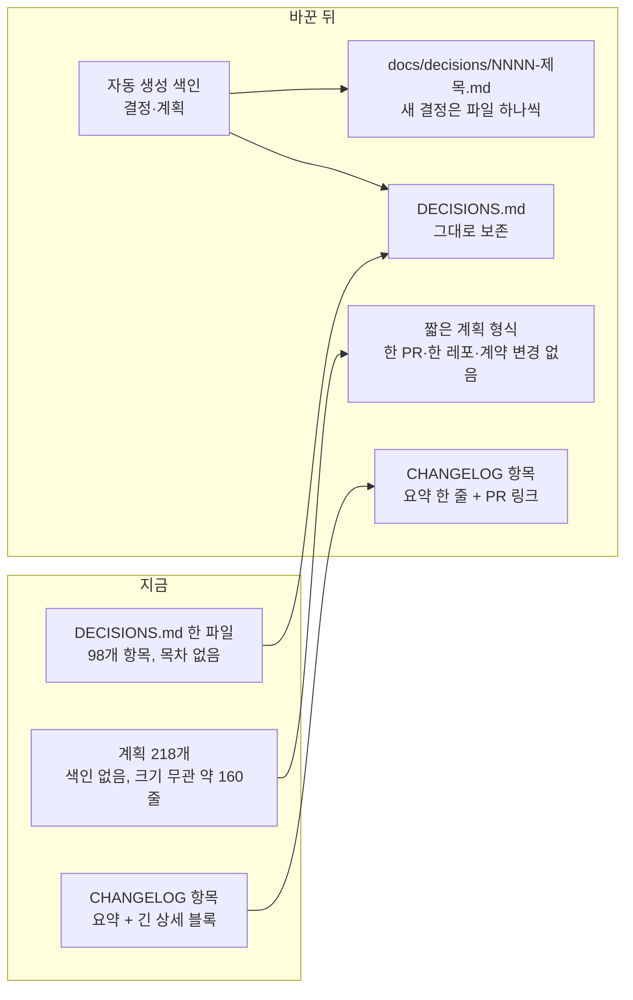

# 문서 찾기 구조와 계획·변경 이력 무게 줄이기

<!-- plan-result:start — 이 블록만 병합 뒤에도 고칠 수 있다(.claude/CLAUDE.md "계획과 PR 본문"). 아래는 승인된 계획 원문 -->

## 구현 결과

> #639 · 2026-11-18 대조 · 1단계 · 이탈 1 · 미구현 1 — 판정 근거(파일:줄)는 PR 본문 "계획 대비 구현"

- 이탈: 주제 이름이 계획의 목록과 다르다. 결정 98개를 실제로 나눠 보니 기능 문서 이름만으로는 묶이지 않는 항목이 많아, 기능 문서가 없는 주제(오버레이·대화상자, 버튼·폼 규칙, 화면 배치·디자인, API 계약·데이터)를 더하고 "작업 방식"을 "문서·작업 방식"으로 넓혔다. 주제는 14개다
- 이탈 → 보완함: 결정 색인의 "날짜순" 표가 `DECISIONS.md`의 원본 순서를 따라 2026-09-22 항목이 2026-09-21 항목 사이에 끼었다. 대조에서 찾아 날짜로 정렬하게 고쳤다
- 미구현: 생성기가 `docs/decisions/*.md`를 읽지 않는다. ADR 파일의 형식(제목·상태를 어디서 읽을지)이 2단계에서 정해지므로, 형식과 함께 2단계에서 넣는다
- 계획에 없던 변경: 판정 규칙을 `scripts/lib/doc-index.js`로 떼고 타입 선언 파일을 더함(단위 테스트를 위해), 생성물을 prettier로 포맷한 뒤 비교함(lint-staged와 맞추기 위해), 상태 열을 첫 구절 20자로 자름, "대체됨(일부)"를 따로 표기함
- 문서 동기화: 이 계획 파일이 계획 색인에 들어가 219행이다
- 2단계와 적용 30일 뒤 측정은 이 PR 범위 밖이다(12-01 판정 뒤)

<!-- plan-result:end -->

> 결정 기록에 색인과 ADR 파일을 들이고, 작은 변경의 계획과 CHANGELOG 항목을 짧게 쓴다. 기록과 계획 대조는 그대로 둔다.

## Context

2026-11-16 "AI를 잘 쓰고 있나" 점검의 개선점 4번(문서량)과 5번(검증 무게)의 후속이다. 사용자 목표는 학습·포트폴리오이고,
문서는 나중에 다른 곳에서 구조를 잡을 때 참고할 자료다. 독자는 사용자 본인, 다음 세션의 AI, 외부 독자 셋이다
(2026-11-18 질문). 그래서 기록의 양을 줄이는 것이 아니라 찾기 쉽게 만들고, 같은 내용을 여러 곳에 길게 쓰는 일을 줄인다.

### 다시 잰 값 (2026-11-18, 구간 2026-10-19 ~ 11-18)

| 항목 | 값 | 재는 방법 |
| --- | --- | --- |
| FE 병합 PR / feat | 208 / 25 | `git log origin/main` 제목 유형 |
| FE 한 달 변경 줄(코드 / 문서 / 그중 계획) | 51,421 / 40,119 / 13,971 | PR별 `git show --numstat`, 문서·잠금·생성 파일 구분 |
| FE `DECISIONS.md` | 5,662줄, 항목 98개, 목차 없음, 같은 날짜에 항목이 겹치는 날 18개 | `wc -l`, 헤딩 grep |
| FE `CHANGELOG.md` | 4,120줄, 한 달 +807줄, 항목 360개 중 `
` 355개 | `wc -l`, numstat |
| FE 계획 파일 | 218개 39,182줄, 길이 중앙값 162줄, 밖에서 참조되지 않는 것 80개 | `ls`, `wc -l`, `git grep` |
| 계획이 붙은 PR | 208개 중 99개. 코드 0줄 PR 53개 중 24개(계획 길이 중앙값 162줄), 301줄 이상 52개 중 40개(151줄) | 위 numstat 스크립트 |
| plan-verifier | 123회, $266(전체 $4,599의 5.8%) | claude-base `scripts/token-metrics.mjs --tz-offset 9` |
| 계획 대조 지적 | 결과 블록이 있는 FE 계획 52개 중 37개에 이탈·미구현 1건 이상. 코드 20줄 이하 PR의 계획 9개 중 8개 | 결과 블록 요약 줄 grep, PR 크기와 대조 |
| 검사받는 파일:줄 참조 | 약 3,600곳 중 241곳. 3,183곳은 검사 대상이 아닌 `docs/plans/` | `scripts/check-docs.js`의 대상 목록(`docs/` 바로 아래만 읽음) |

읽어 낸 것은 셋이다.

- **문서의 유지 검사 부담은 작고, 문제는 찾기다.** 결정 98개와 계획 218개에 색인이 없다.
- **계획 대조는 작은 변경에서도 지적을 낸다.** 표본은 작지만 대조를 빼자는 근거가 나오지 않았다. 비용도 5.8%다.
- **무게는 글의 양에 있다.** 계획은 변경 크기와 상관없이 약 160줄이고, CHANGELOG 상세는 PR 본문·계획과 겹친다.

### 지금과 바꾼 뒤

### 일정 제약

11-30 무렵까지 새 규칙·훅을 더하지 않는다(사용자 결정, 침묵 감지 11-26·완료 보고 항목 11-28·가정 줄 12-01 판정과
6라운드 "후" 14일 측정을 흐리지 않기 위해서다). 그래서 지침·skill·검사가 바뀌는 일은 모두 2단계로 미룬다.

## 판단이 필요했던 항목

| 항목 | 결정 | 근거·기각한 대안 | 정해진 경로 |
| --- | --- | --- | --- |
| 결정 기록 구조 | 새 결정만 `docs/decisions/NNNN-제목.md`. 기존 `DECISIONS.md`는 그대로 두고 색인으로 묶는다 | 업계 표준은 결정 하나에 파일 하나다. Nygard *"ADR은 프로젝트 저장소의 doc/arch/adr-NNN.md에 둔다"*, *"결정이 뒤집히면 옛 것을 남겨 두되 대체됨으로 표시한다"* (번역, [Documenting Architecture Decisions](https://cognitect.com/blog/2011/11/15/documenting-architecture-decisions), 재인용). 폴더와 이름은 [MADR](https://adr.github.io/madr/)의 `docs/decisions/NNNN-title-with-dashes.md`(재인용). **한 파일 유지 + 색인만**: 파일이 계속 길어지고 표준 형태가 아니다. **98개 모두 분할**: 과거 항목을 옮기지 않는다는 2026-09-14 결정을 뒤집고, 계획 파일 안 참조 241줄은 CI가 수정을 막아 고칠 수 없다 | 질문(2026-11-18) |
| 계획 무게 | 계획 문턱은 그대로 두고 짧은 계획 형식을 더한다. 대조는 유지한다 | 대조 지적이 작은 변경에서도 나왔다(위 표). **문턱도 좁히기**: 계획과 대조 기록이 함께 사라진다. **측정만**: 근거가 이미 있다. 비교한 선례: Rust RFC는 의미가 바뀌지 않는 변경과 사용자에게 보이지 않는 추가를 일반 PR로 한다([rust-lang/rfcs README](https://github.com/rust-lang/rfcs/blob/master/README.md), 재인용). 우리는 문턱 대신 문서 길이만 나눈다 | 질문(2026-11-18) |
| CHANGELOG 상세 | 새 항목은 요약 한 줄과 PR 링크만 쓴다. 과거 항목은 그대로 둔다 | 상세가 PR 본문·계획과 겹친다. **유지**: 한 달 약 800줄씩 는다. **3줄 제한**: 겹침이 남는다 | 질문(2026-11-18) |
| 적용 시점 | 지침·skill·검사 변경은 12-01 판정 뒤 | 사용자가 요청에서 정한 제약 | 요청 원문 |
| CHANGELOG·계획 파일 분할·보관 | 하지 않는다 | `release.yml`이 루트 `CHANGELOG.md`의 첫 버전 섹션을 읽고, FE CI가 계획 파일의 삭제·이름 바꾸기를 막는다. 얻는 것(파일 길이)보다 깨지는 참조(계획 참조 475건)가 크다 | 이 계획 승인 |

## 세부 계획

### 1단계 — 지금 (FE PR 1개, 지침·skill·CI 무변경)

| 위치 | 변경 내용 |
| --- | --- |
| `scripts/generate-doc-index.js` (새 파일, `scripts/check-docs.js`의 파일 읽기·출력 방식을 본뜬다) | `docs/DECISIONS.md`의 `## YYYY-MM-DD — 제목` 헤딩과 `docs/decisions/*.md`(아직 없음), `docs/plans/*.md`를 읽어 색인 두 개를 만든다. `--check`는 디스크의 색인이 생성 결과와 같은지만 본다(2단계에서 쓴다) |
| `scripts/lib/decision-topics.json` (새 파일) | 기존 98개 항목의 주제 분류표(키: 날짜 + 제목). `DECISIONS.md` 본문은 건드리지 않는다. 주제 이름은 `docs/`의 기능 문서 이름(인증, 북마크, 검색 등)과 "구조·컨벤션", "배포·인프라", "작업 방식"을 쓴다 |
| `docs/DECISIONS-INDEX.md` (생성물) | 주제별 표와 날짜순 표. 열은 날짜, 제목(해당 헤딩으로 가는 링크), 상태. 맨 위에 "자동 생성, 직접 고치지 않음" 한 줄 |
| `docs/PLANS-INDEX.md` (생성물) | 월별 표. 열은 날짜, 제목(H1), PR 번호와 이탈·미구현 수(결과 블록이 있을 때), 대체됨 여부. `docs/plans/` 안에 두지 않는 이유는 CI가 그 폴더의 수정을 막아서다 |
| `README.md` `## 문서` | 두 색인을 등록한다(`check:docs`가 `docs/` 바로 아래 새 파일의 등록을 요구한다) |
| `package.json` | `"docs:index": "node scripts/generate-doc-index.js"` |
| `src/test/scripts/` | 생성기 단위 테스트: 같은 날짜 항목 여러 개, `(정정)` 제목, 결과 블록 없는 계획, 분류표에 없는 항목(실패해야 함) |

1단계에서 색인은 손으로 `pnpm docs:index`를 돌려 갱신한다. 2단계의 최신 검사 전까지 새 항목 몇 개가 빠질 수 있다.

### 2단계 — 12-01 판정 뒤 (FE PR 1개, BE PR 1개)

시작 전에 세 판정(11-26, 11-28, 12-01)과 11-30 측정이 끝났는지 claude-base `docs/METRICS.md` "다음 측정"에서 확인한다.

**FE**

| 위치 | 변경 내용 |
| --- | --- |
| `docs/decisions/0001-record-decisions-as-adr.md` (새 파일) | 첫 ADR. 이 계획의 "결정 기록 구조" 결정을 MADR 형식으로 적는다. 절은 Context, Considered Options, Decision Outcome, 상태(제안·채택·대체됨)다 |
| `docs/decisions/adr-template.md` | 위 절만 있는 템플릿 |
| `docs/DECISIONS.md` 머리말 | "2026-12 이후의 결정은 `docs/decisions/`에 쓴다, 아래 항목은 보존한다" 한 문단. 항목 본문은 고치지 않는다 |
| `.claude/rules/docs-format.md` "설계 결정 기록" | 위치와 형식을 ADR 파일로 바꾸고 색인을 가리킨다. 들어갈 기준(대안 비교 + 되돌리기 어려움)은 그대로다 |
| `scripts/check-docs.js` | 대상에 `docs/decisions/` 재귀를 더하고, `src/` 없는 경로 면제 목록에 그 폴더를 넣는다. `generate-doc-index.js --check`를 함께 돌려 색인이 낡으면 실패시킨다 |
| `.claude/skills/plan-doc-structure/SKILL.md` "Full vs Minimal" | Minimal을 짧은 형식으로 다시 정의한다. 조건은 지금과 같다(PR 1개, 레포 1개, 데이터 계약 변경 없음). 절은 요약, 바꿀 곳(위치·변경 표 하나), 완료 조건, 검증 방법이다. 판단이 있었을 때만 "판단이 필요했던 항목"을 넣고, 그림은 선택이다. 목표 길이 40줄 안팎(강제하지 않음) |
| `.claude/skills/changelog-release/SKILL.md` 항목 형식 | `` `스코프` `` + 72자 요약 + PR 링크. `
` 블록은 쓰지 않는다. 배경은 PR 본문에 둔다 |
| `.claude/CLAUDE.md` | "문서 형식"과 "릴리즈노트" 절에서 위 두 skill·규칙을 가리키는 문장만 맞춘다. 계획 문턱과 plan-verifier 문장은 건드리지 않는다 |
| `CHANGELOG.md` `[Unreleased]` | 문서 구조 변경이라 항목 대상이 아니다(기록하지 않는 변경) |

**BE**

| 위치 | 변경 내용 |
| --- | --- |
| `.claude/CLAUDE.md` "계획과 PR 본문", CHANGELOG 절 | 짧은 계획 형식과 CHANGELOG 항목 형식을 FE와 같은 문장으로 적는다(BE에는 skill 폴더가 없다) |
| `.claude/settings.json`의 CHANGELOG 알림 훅 문구 | 형식 안내가 들어 있으면 새 형식으로 맞춘다(구현 때 읽어 확인한다) |

**claude-base**: 공통 `CLAUDE.md`와 `agents/plan-verifier.md`는 고치지 않는다. 2단계를 적용한 날짜와 아래 측정값만
`docs/METRICS.md`에 덧붙인다.

## 영향 범위

- **깨질 수 있는 것**
  - README `## 문서`와 `docs/*.md` 목록이 어긋나면 `check:docs`가 실패한다. 색인 두 개를 같은 PR에서 등록한다.
  - 색인의 헤딩 링크는 GitHub가 헤딩에서 만드는 앵커에 기댄다. 같은 날짜·비슷한 제목, 괄호가 든 제목에서 값이 달라질 수 있어 생성 뒤 링크를 실제로 눌러 확인한다.
  - 짧은 계획은 항목 수가 적다. plan-verifier가 "판정할 항목 없음"으로 끝나지 않는지 확인이 필요하다.
  - `release.yml`은 버전 섹션 본문을 릴리즈 노트로 쓴다. 새 형식 뒤에는 릴리즈 노트가 요약 목록이 된다(사용자에게 보이는 변화).
- **바꾸지 않는 것**: `DECISIONS.md` 항목 본문과 파일 경로(참조 557줄 유지), 커밋된 계획 파일, 릴리즈된 CHANGELOG 섹션, 계획 문턱, plan-verifier 호출 규칙, PR 본문 필수 절, 실험 중인 훅과 "세 갈래" 목록.
- **배포**: 두 단계 모두 `src/`를 건드리지 않는다. 1단계는 `scripts/`와 `package.json`이 바뀌어 배포 워크플로가 돌 수 있으니 병합 뒤 결과를 확인한다.

## 검증 방법

**1단계 완료 조건**

- `pnpm docs:index` 뒤 `docs/DECISIONS-INDEX.md`의 항목 수가 `grep -c '^## 20' docs/DECISIONS.md`(98)와 같고, `docs/PLANS-INDEX.md`의 행 수가 `ls docs/plans | wc -l`과 같다.
- `node scripts/generate-doc-index.js --check`가 0으로 끝나고, 색인 한 줄을 지우면 1로 끝난다(일부러 깨서 확인).
- 푸시한 브랜치의 GitHub 화면에서 색인 링크를 주제마다 하나씩, 같은 날짜 항목이 9개인 2026-09-21은 전부 눌러 맞는 항목으로 가는지 본다. 화면을 사용자에게 보여 준다.
- `pnpm type-check`, `pnpm test`, `pnpm lint`, `pnpm check:docs` 통과, PR CI 통과.
- `git diff origin/main --stat`에 `.claude/`, `.github/`, `docs/DECISIONS.md`, `docs/plans/`의 기존 파일이 없다.

**2단계 완료 조건**

- `docs/decisions/`에 없는 경로를 적은 ADR을 잠깐 만들어 `pnpm check:docs`가 실패하는지 본다.
- 짧은 형식으로 쓴 계획 하나를 plan-verifier에 넘겨 항목별 판정이 나오는지 본다. 기존 평가 사례(`.claude/workflows/plan-verifier-eval.js`)에 짧은 계획 사례를 하나 더해 결함 검출을 확인한다.
- FE·BE CI 통과, FE는 `pnpm check:pr-body` 통과.

**적용 30일 뒤 측정** (같은 스크립트, claude-base `docs/METRICS.md`에 기록)

| 지표 | 지금 | 기대 방향(우리가 정한 기준) |
| --- | --- | --- |
| 짧은 형식 대상 계획의 길이 중앙값 | 약 160줄 | 60줄 이하 |
| FE `CHANGELOG.md` 월 증가 | 807줄 | 300줄 이하 |
| 계획 대조 지적이 있는 계획 비율 | 71%(37/52) | 관찰만 한다. 크게 떨어지면 짧은 형식이 대조할 항목을 지웠는지 본다 |
| 새 결정의 위치 | `DECISIONS.md` | 전부 `docs/decisions/` |

## 남은 것

- BE는 결정 기록 파일이 없고 FE `DECISIONS.md`를 링크한다. BE에도 `docs/decisions/`를 둘지는 이 계획 범위 밖이다.
- 색인의 "상태" 열은 기존 항목의 `**상태**` 문단(98개 중 57개에만 있음)에서 읽는다. 없는 항목은 빈칸으로 둔다.
- 개선점 3번(작업 비중)과 6번(실험 겹침)은 다루지 않는다. 6번은 판정일이 지나면 풀린다.
- 제안(수락 전에는 하지 않음): 외부 독자용으로 README에 "대표 결정 5개" 절을 두는 것. 비용은 없다.
