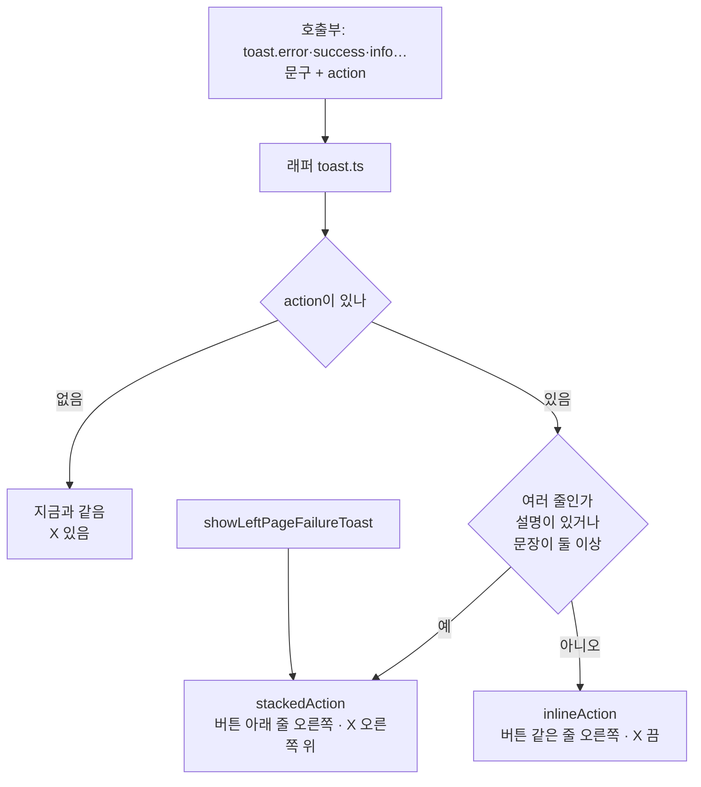

# 토스트 버튼 배치를 래퍼가 정하게 — 여러 줄이면 아래 줄 오른쪽(stackedAction)

<!-- plan-result:start — 이 블록만 병합 뒤에도 고칠 수 있다(.claude/CLAUDE.md "계획과 PR 본문"). 아래는 승인된 계획 원문 -->

## 구현 결과

> #641 · 2026-11-18 대조(Phase 1) · 이탈 1 · 미구현 1 — 판정 근거(파일:줄)는 PR 본문 "계획 대비 구현"

- 이탈(구현 중 발견): 떠난 뒤 실패 토스트는 sonner를 직접 부르지 않고 래퍼를 계속 거친다. 래퍼에 `shared/lib/toast/` 전용 통로 `UNSAFE_classNames`를 두고, 폴더 밖 사용은 ESLint `custom-import/no-toast-unsafe-class-names`가 막는다 — 기존 훅 테스트가 래퍼의 `toast.error`를 본다
- 미구현: 15자 폴더 이름 저장 토스트의 375px 줄 수 e2e. 스토리 `InlineAction`의 "15자 폴더 + 보기" 견본을 폭을 바꿔 가며 재는 것으로 대신했다(375px 한 줄, 360px 두 줄)
- 계획에 없던 변경: 변수·스프레드로 넘어온 모양 옵션은 타입이 막지 못해 래퍼가 실행 중에 버린다. 그래서 완료 조건 "넘기면 컴파일 실패"는 객체 리터럴에만 성립한다
- 계획에 없던 변경: 래퍼 테스트 3건(문자열 아닌 문구, 변수로 넘긴 옵션 버리기, `UNSAFE_classNames` 합치기)과 스토리 견본 3개(15자 폴더, 삭제 되돌리기, 푸시 알림 모양)
- 계획에 없던 변경(문서 동기화): 호출부 주석, `FE-ARCHITECTURE.md` "에러 토스트 유지 시간"의 닫기 X 서술
- Phase 2(#638을 이 PR 위로)는 이 PR의 범위 밖

<!-- plan-result:end -->

> 버튼(action)이 달린 토스트의 배치를 호출부가 아니라 래퍼 `toast.ts`가 정한다. 문구가 여러 줄이면 버튼은 아래 줄 오른쪽·X는 오른쪽 위, 한 줄이면 지금처럼 같은 줄 오른쪽. 호출부는 배치 옵션을 넘길 수 없다.

## Context

### 왜 필요한가

- FE #638(북마크 저장 한도 안내)에 "북마크 보기" 버튼을 달자, 두 문장 문구 옆 세로 가운데에 버튼이 끼고 문구가 3~4줄로 눌렸다(사용자 지적, 2026-11-18).
- 이 모양은 2026-11-02에 이미 버린 안이다. `docs/UNSAVED-CHANGES-GUARD.md` §5 선택 표가 "설명 옆 가운데(sonner 기본 — 여러 줄 토스트에서 어색했다)"를 기각으로 적고 "설명 아래 오른쪽, 닫기 X는 오른쪽 위"를 골랐다.
- 그 결정이 `src/shared/lib/toast/LeftPageFailureToast.tsx`의 `CLASS_NAMES` 한 곳에만 들어 있어, 다른 호출부가 `action`을 넘기면 sonner 기본 배치가 그대로 나온다. 래퍼 `src/shared/lib/toast/toast.ts`는 옵션을 그대로 통과시킨다.
- 스토리북 `Default` 스토리가 영문 예시로 그 기본 배치를 견본처럼 보여 준다.

### 지금 버튼 달린 토스트 (직접 읽어 확인)

| 토스트 | 위치 | 문구 | 지금 배치 | X |
| --- | --- | --- | --- | --- |
| 떠난 뒤 실패(가입·글 등록·수정) | `LeftPageFailureToast.tsx` | 제목 + 설명 | 아래 줄 오른쪽 | 있음 |
| 로그인 만료 "로그인" | `shared/utils/auth.util.ts` | 두 문장 | 가운데 행 | 있음 |
| 푸시 알림 "보러가기" | `shared/lib/firebase/useFcmForegroundMessage.ts` | 제목 + 본문 | 가운데 행 | 끔 |
| 북마크 저장 "보기" | `usePostCardBookmarkFolderDialog.ts` `viewSavedOptions` | 한 줄 | 같은 줄 오른쪽 | 끔 |
| 북마크 삭제 "되돌리기" | 같은 파일 `undoOptions` | 한 줄, 마지막 폴더일 때만 설명 한 줄 | 가운데 행(설명 있을 때) | 끔 |
| 북마크 한도 "북마크 보기"(#638) | 같은 파일 `toastSaveFailure` | 두 문장 | 가운데 행 | 저장 실패는 끔 |

### 업계 조사 (2026-11-18, 조사 에이전트가 원문을 읽음 — 이 문서에서는 재인용)

- **이름**: 버튼이 아래 줄이면 `stacked`, 같은 줄이면 `inline`이 가장 많이 쓰인다 — [MDC Web](https://github.com/material-components/material-components-web/blob/master/packages/mdc-snackbar/README.md) `mdc-snackbar--stacked`, [Primer Banner](https://github.com/primer/react/blob/main/packages/react/src/Banner/Banner.docs.json) `actionsLayout: 'inline' | 'stacked'`, [Android Snackbar](https://developer.android.com/reference/com/google/android/material/snackbar/Snackbar) `setMaxInlineActionWidth`. "stacked"는 토스트 여러 개가 쌓이는 뜻으로도 쓰여 이름에 `action`을 붙인다.
- **언제 아래로 내리나**: 시스템마다 다르다. 항상 아래([Atlassian Flag](https://atlassian.design/components/flag/examples)), 문구가 줄바꿈되기 전에 버튼부터 내림([Adobe Spectrum](https://web.archive.org/web/20260218082344/https://spectrum.adobe.com/page/toast/)), 버튼 글자가 길 때(Material).
- **스토리북에 없는 모양을 막는 방식**: 컴포넌트 API를 좁히고([React Spectrum](https://react-spectrum.adobe.com/react-spectrum/styling.html)은 `className`·`style`을 받지 않는다), lint로 원본 라이브러리와 스타일 덮어쓰기를 막고([Atlassian eslint 플러그인](https://www.npmjs.com/package/@atlaskit/eslint-plugin-design-system)), 스토리 시각 회귀를 건다([Chromatic](https://www.chromatic.com/docs/visual)). 시각 회귀는 스토리에 없는 사용을 못 잡는다. 이 레포는 lint(`custom-import/no-sonner-toast-direct-import`)는 있고 API 좁히기가 비어 있었다.

### 바뀐 뒤의 흐름

## 판단이 필요했던 항목

| 항목 | 결정 | 근거·기각한 대안 |
| --- | --- | --- |
| 한 줄 토스트의 버튼 자리 | 여러 줄일 때만 아래 줄, 한 줄은 같은 줄 오른쪽 그대로 | 사용자 결정(질문, 2026-11-18). 기각: 항상 아래 줄(한 줄 저장 성공 토스트가 두 줄 높이가 되고 X가 생김) |
| "여러 줄" 판정 | `description`이 있거나, 문자열 문구가 래퍼의 문장 줄바꿈(`breakSentences`) 뒤 줄이 둘 이상이면 여러 줄. 문구가 문자열이 아니면 여러 줄로 본다 | 화면 폭을 재지 않고 호출 시점에 정해져 테스트할 수 있다. 기각: 렌더 뒤 높이를 재서 바꾸기(깜빡임, 테스트 어려움) |
| X(닫기) | 아래 줄 배치는 X를 오른쪽 위에 항상 둔다. 같은 줄 배치는 지금처럼 끈다 | 아래 줄 배치는 승인된 모양 그대로(2026-11-02). 같은 줄은 "액션과 닫기가 자리를 다툰다"는 기존 규칙(`viewSavedOptions` 주석) 유지 |
| 막는 방법 | 래퍼가 배치를 정하고, 공개 옵션 타입에서 `classNames`·`className`·`style`·`closeButton`·`unstyled`를 뺀다 | 업계의 "API 좁히기". lint로는 옵션 조합을 못 막는다. 기각: 문서 규칙만(이번 사고가 문서로 못 막은 사례), 호출부마다 배치 상수를 import(빠뜨리면 다시 가운데 행) |
| 이름 | 배치는 `stackedAction` / `inlineAction`. `showLeftPageFailureToast`·파일 이름은 유지 | 사용자 결정. 함수 이름은 "언제 쓰는가"(화면을 떠난 뒤 실패)를 뜻하고, 배치 코드만 래퍼로 옮긴다 |
| `Default` 스토리 | 지우고 `Kinds`(종류별)·`StackedAction`·`InlineAction` 견본으로 교체, 문구는 `TEXTS` 값 | 사용자 결정. 운영에 없는 모양이 견본으로 남지 않게 한다 |
| 다른 공용 컴포넌트 | 이번 계획은 토스트만. 조사는 새 세션에서 따로 | 사용자 결정 |
| PR 나누기 | 공용 래퍼 변경(PR-A)을 먼저 올리고, #638은 그 위로 올려 호출부만 맞춘다 | 래퍼는 앱 전체가 쓴다. #638에 섞으면 북마크 한도 PR이 로그인 만료·푸시 알림 토스트 모양까지 바꾼다 |

### 위험 관리

- **한 줄 토스트가 좁은 화면에서 접히면 가운데 행이 다시 나온다.** 가장 긴 한 줄 버튼 토스트("{15자 폴더 이름}에 저장했어요." + [보기])를 375px에서 실제로 띄워 줄 수를 잰다. 접히면 구현을 멈추고 선택지(그 문구도 아래 줄로, 또는 CSS로 접히기 전에 버튼을 내림)를 사진과 함께 묻는다.
- **기존 토스트 4종의 모양이 바뀐다**(로그인 만료, 푸시 알림, 마지막 폴더 삭제 되돌리기는 아래 줄 배치가 되고 뒤 두 개는 X가 생긴다). PR-A에서 전·후 화면을 나란히 찍어 보고한다.
- **기존 테스트 단언이 바뀐다.** `usePostCardBookmarkFolderDialog.test.ts`의 `closeButton` 단언(`toBe(false)` 3곳)은 호출부가 더 이상 그 옵션을 넘기지 않아 지운다. 같은 사실(한 줄 버튼 토스트는 X를 끈다)은 래퍼 테스트 `toast.test.ts`가 단언한다. 요구가 바뀐 변경이라 보고에 따로 적는다.

## 세부 계획

### Phase 1 — PR-A: 래퍼가 배치를 정한다 (FE, 새 워크트리)

| 위치 | 변경 내용 |
| --- | --- |
| `src/shared/lib/toast/toast-layout.ts` (신규) | `STACKED_ACTION_CLASS_NAMES`(지금 `LeftPageFailureToast.tsx` `CLASS_NAMES` 중 `toast`·`icon`·`content`·`actionButton`·`closeButton`), `resolveActionLayout(message, options)` → `'none' \| 'inline' \| 'stacked'` |
| `src/shared/lib/toast/toast.ts` | 공개 옵션 타입 `ToastOptions = Omit<ExternalToast, 'classNames' \| 'className' \| 'style' \| 'closeButton' \| 'unstyled'>`. `at()`에서 배치를 입힌다 — stacked면 `classNames: STACKED_ACTION_CLASS_NAMES`, inline이면 `closeButton: false` |
| `src/shared/lib/toast/LeftPageFailureToast.tsx` | 배치 클래스는 `toast-layout.ts`에서 가져오고 제목·설명 글자 모양(`title`·`description`)만 자기 것으로 둔다. 버튼이 없어도 같은 틀(X 오른쪽 위)을 유지하려고 `sonner`를 직접 부른다(`/shared/lib/toast/` 안이라 lint 허용) |
| `src/shared/lib/firebase/useFcmForegroundMessage.ts`, `usePostCardBookmarkFolderDialog.ts`(`viewSavedOptions`·`undoOptions`) | 호출부의 `closeButton: false` 제거(타입에서 빠져 컴파일로 강제) |
| `src/shared/lib/toast/toast.test.ts` | 버튼 없음 → 옵션 그대로 / 버튼 + 한 줄 → `closeButton: false`, 배치 클래스 없음 / 버튼 + 두 문장 → stacked 클래스 / 버튼 + `description` → stacked / 호출부가 `classNames`를 넘기면 타입 오류(`@ts-expect-error`) |
| `usePostCardBookmarkFolderDialog.test.ts`, FCM 테스트 | `closeButton` 단언 제거(위험 관리 참고), 나머지 단언 그대로 |
| `src/shared/ui/atoms/sonner.stories.tsx` | `Default` 삭제. `Kinds`(성공·안내·오류·경고), `InlineAction`(한 줄 + 보기), `StackedAction`(두 문장 + 버튼, 제목 + 설명 + 버튼) 추가. `LeftPageFailure`·`OverModal`·`SentenceLineBreak` 유지 |
| e2e | 로그인 만료 토스트의 버튼이 문구 아래 줄에 있는지(버튼 위쪽 좌표 ≥ 문구 아래쪽 좌표) 1건, 15자 폴더 이름 저장 토스트의 375px 줄 수 측정 1건 |
| 문서 | `docs/FE-ARCHITECTURE.md` §14(배치 규칙·옵션 타입), `docs/UNSAVED-CHANGES-GUARD.md` §5(`CLASS_NAMES` 위치), `docs/FCM-PUSH-NOTIFICATION.md`(`closeButton: false` 서술), `docs/DESIGN-SYSTEM.md`(공용 래퍼가 모양을 정한다는 한 단락), `docs/DECISIONS.md`(2026-11-18 항목), `CHANGELOG.md`(`shared` Changed), 계획 사본 `docs/plans/2026-11-18-toast-stacked-action.md` |

### Phase 2 — #638을 PR-A 위로 (PR-A 병합 뒤)

| 위치 | 변경 내용 |
| --- | --- |
| `usePostCardBookmarkFolderDialog.ts` `toastSaveFailure` | `persistent ? { ...persistent, action } : { action }` — `closeButton: false` 제거. 한도 문구가 두 문장이라 래퍼가 아래 줄 배치를 입힌다 |
| `usePostCardBookmarkFolderDialog.test.ts` | 한도 테스트 3개의 `closeButton` 단언 제거 |
| `e2e/bookmark-folder-dialog.spec.ts` | 한도 토스트의 버튼이 문구 아래 줄에 있는지 단언 추가, 저장 실패 토스트에도 닫기 버튼이 보이는지 |
| `docs/BOOKMARK.md` §5, `CHANGELOG.md`, PR 본문 | "닫기 버튼도 남긴다" 서술을 배치 규칙 링크로 정리, 화면 다시 첨부 |

## 영향 범위

- **사용자 체감**: 버튼 달린 여러 줄 토스트 4종(로그인 만료, 푸시 알림, 마지막 폴더 삭제 되돌리기, 북마크 한도)의 버튼이 아래 줄 오른쪽으로 가고 X가 오른쪽 위에 온다. 한 줄 토스트와 버튼 없는 토스트는 그대로다.
- **코드**: `toast` 래퍼의 사용처 전체가 타입 검사를 다시 받는다. `classNames`·`closeButton`을 넘기는 곳은 위 표가 전부다(조사 결과, 구현 때 `pnpm type-check`로 다시 확인).
- **API·데이터 계약**: 없음. 배포 순서 제약 없음.
- **깨질 수 있는 것**: 토스트 좌표·X 유무에 기대는 e2e(`toast-over-modal`, `session-expired`, `bookmark*`), 모달 위 토스트 클릭(#636).

## 검증 방법

- `pnpm type-check` · `pnpm test` · `pnpm lint` · `pnpm check:deps` · `pnpm check:docs` · `pnpm format:check`, `pnpm test:storybook`(스토리 a11y).
- 새 단위 테스트는 배치 판정을 일부러 깨서 실패를 확인한다.
- `pnpm test:e2e`로 `e2e/toast-over-modal` `e2e/session-expired` `e2e/bookmark` `e2e/post-create` `e2e/signup-unsaved-changes`(chromium + mobile-chrome).
- 화면: 바뀌는 4종과 그대로인 한 줄 토스트를 데스크톱·375px에서 전·후로 찍어 보고에 싣는다.
- PR마다 CI 통과 → 병합은 사용자 승인 → 배포 워크플로 success 확인.

### 완료 조건

- 버튼 달린 토스트가 여러 줄이면 버튼이 문구 아래 줄 오른쪽·X가 오른쪽 위에 있고, 호출부가 `classNames`·`closeButton`을 넘기면 컴파일이 실패한다.
- 스토리북에 가운데 행 버튼 견본이 없다.
- 바꾸면 안 되는 것: 버튼 없는 토스트의 모양, 한 줄 버튼 토스트의 모양, 떠난 뒤 실패 토스트의 모양, 토스트 위치 정책(성공 하단·오류 상단), 모달 위 토스트 클릭.

## 남은 것

- 한 줄 버튼 토스트가 375px에서 접히는지 — PR-A에서 재고, 접히면 묻는다.
- 다른 공용 컴포넌트의 "스토리북에 없는 모양" 조사 — 새 세션에서(사용자 결정).
- 앞선 계획(북마크 저장 한도·좋아요 필터)의 BE-2·FE-2는 #638 병합 뒤 이어 간다. BE-2 PR에서 그 계획의 `구현 결과` 블록에 FE-1 결과를 덧붙인다.
