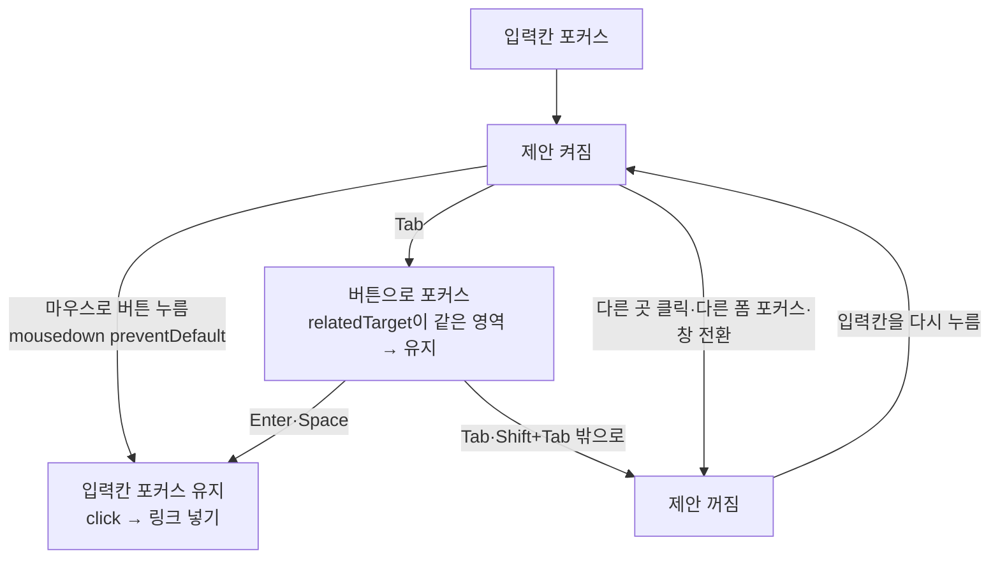

# 링크 넣기 제안: 입력칸 밖으로 포커스가 나가면 내리기

<!-- plan-result:start — 이 블록만 병합 뒤에도 고칠 수 있다(.claude/CLAUDE.md "계획과 PR 본문"). 아래는 승인된 계획 원문 -->

## 구현 결과

> #663 · 2026-11-20 대조 · 이탈 0 · 미구현 0 — 판정 근거(파일:줄)는 PR 본문 "계획 대비 구현"

- 계획에 없던 변경: 문서 동기화 — `docs/COMMENT.md` §5 흐름도에 "포커스가 입력칸·버튼 밖으로 나가면 버튼 숨김" 화살표를 더함
- 계획에 없던 변경: #662 위로 리베이스하며 생성 색인 `docs/PLANS-INDEX.md`를 다시 만듦

<!-- plan-result:end -->

> 댓글 입력칸의 "링크 넣기" 버튼을, 포커스가 그 입력칸과 버튼 밖으로 나가면 내린다. 버튼을 마우스로 누르는 동안에는
> 입력칸이 포커스를 잃지 않게 해서 클릭이 버튼에 닿게 한다. 맨 위 폼과 답글 폼에 버튼이 함께 보이던 문제를 없앤다.

## Context

### 요청

#659(복사한 글 링크 넣기) 병합 전에 찾은 한계를 고치는 보완안을 별도 PR로 진행해 달라는 요청이다(2026-11-19).

### 지금 동작

- 제안은 입력칸에 포커스하면 켜지고(`handleContentFocus`), 글자를 입력하면 꺼진다(`handleContentInput`).
  포커스를 잃을 때는 끄지 않는다(`src/features/comment/create/hooks/useCopiedPostLinkSuggestion.ts:23-24` 주석). 버튼을
  누르면 입력칸이 먼저 포커스를 잃는데, 그때 끄면 클릭이 닿기 전에 버튼이 사라지기 때문이다(#659 계획의 결정,
  `docs/COMMENT.md:736`).
- 그래서 맨 위 폼을 누른 뒤 답글 폼을 열면 두 폼에 버튼이 함께 보인다. 한쪽에서 넣으면 기억이 지워져 둘 다 사라진다
  (#659 녹화 7번).

### 이 레포의 선례

- 최근 검색어 드롭다운(`src/widgets/layout/navbar/ui/RecentSearchDropdown.tsx:58-60`)이 같은 문제를 이렇게 푼다.
  드롭다운의 `onMouseDown`에서 `preventDefault()`로 입력창 포커스가 빠지지 않게 하고, 입력창의 `onBlur`에서 닫는다
  (`NavbarSearch.tsx:129-132`). 폴더 이름 바꾸기의 취소 버튼(`BookmarkFolderTitle.tsx:85-87`)도 같은 `onMouseDown`을 쓴다.
- 다른 점: 검색 드롭다운은 화살표 키로 고르고 포커스는 입력창에 남지만, 링크 넣기 버튼은 Tab으로 가는 버튼이다(#659 계획의
  "화면 읽기 프로그램" 결정). 입력칸의 `onBlur`에서 무조건 끄면 Tab으로 버튼에 가는 순간 버튼이 사라진다.

### 흐름

## 판단이 필요했던 항목

| 항목                  | 결정                                                                                                  | 근거·기각한 대안                                                                                                                                                                                                                                                                                                              |
| --------------------- | ----------------------------------------------------------------------------------------------------- | ----------------------------------------------------------------------------------------------------------------------------------------------------------------------------------------------------------------------------------------------------------------------------------------------------------------------------- |
| 언제 내리나           | 포커스가 입력칸과 버튼을 감싼 영역 밖으로 나가면 내린다. 다시 입력칸에 포커스하면 돌아온다(지금처럼) | 사용자가 #659 병합 보고의 보완안을 진행하라고 했다. 창을 바꿨다 돌아오면 브라우저가 입력칸에 포커스를 돌려줘 다시 켜진다                                                                                                                                                                                                       |
| 영역 밖인지 판정      | 감싼 `div`의 `onBlur`에서 `event.relatedTarget`이 그 `div` 안이면 유지한다                            | React의 `onBlur`는 브라우저 `blur`와 달리 버블링해, 부모에서 자식의 포커스 이동을 받을 수 있다. react.dev 공통 컴포넌트 문서의 포커스 이벤트 절을 구현 때 열어 인용·링크한다. 기각: 입력칸 `onBlur`에서 무조건 끄기(Tab으로 버튼에 가면 사라짐), 타이머로 늦게 끄기(시간에 기대고 느린 기기에서 어긋남)                       |
| 마우스로 누를 때      | 버튼 `onMouseDown`에서 `preventDefault()`                                                             | 이 레포 선례 두 곳과 같다. [MDN `<button>` "Clicking and focus"](https://developer.mozilla.org/en-US/docs/Web/HTML/Reference/Elements/button#clicking_and_focus)는 _"대부분의 브라우저는 클릭한 버튼에 포커스를 주지만, Safari는 설계상 그렇지 않다"_ (번역, 요약 에이전트를 거쳐 받은 원문)고 쓴다. 그러면 Safari에서는 `relatedTarget`이 `null`이 돼 판정만으로는 클릭 전에 버튼이 사라진다. 입력칸이 포커스를 잃지 않으면 이 차이에 기대지 않는다                                     |
| 판정 코드 위치        | 새 훅의 반환값에 `handleSuggestionAreaBlur(event)`를 더하고, `CommentForm.tsx`는 연결만 한다          | 레포 규칙 "UI 파일은 훅 호출 + 렌더링만". `useCopiedPostLinkSuggestion`은 #659에서 만든 훅이고, 반환값에 하나를 더하는 것은 이번 요청이 요구하는 변경이다. `useCreateComment`는 건드리지 않는다                                                                                                                                 |
| 넣은 뒤 포커스 되돌리기 | 그대로 둔다(`handleInsertSuggestedLink`의 `focus`)                                                   | 키보드로 버튼에 간 뒤 Enter를 누르면 포커스가 버튼에 있다. 마우스 경로에서는 이미 입력칸에 있어 아무 일도 하지 않는다                                                                                                                                                                                                           |
| 기록 위치             | `docs/COMMENT.md`의 해당 절을 고치고, #659 계획의 구현 결과 블록에 "대체됨(일부)"를 덧붙인다           | 뒤집는 것은 #659 계획의 "포커스를 잃을 때" 결정 하나뿐이다. 되돌리는 비용이 작아 `docs/DECISIONS.md`에는 적지 않는다                                                                                                                                                                                                           |

## 세부 계획

| 순서 | 위치                                                                       | 변경 내용                                                                                                                                                                                                                                                         |
| ---- | -------------------------------------------------------------------------- | ----------------------------------------------------------------------------------------------------------------------------------------------------------------------------------------------------------------------------------------------------------------- |
| 0    | (워크트리)                                                                 | `git log origin/main..main` 확인 → `EnterWorktree` → `test -s .env`·`pnpm install`                                                                                                                                                                                |
| 1    | `src/features/comment/create/ui/CommentForm.test.tsx` ("복사한 글 링크 넣기 제안" describe) | 아래 "테스트"를 먼저 쓰고, 고치기 전 실패 출력을 남긴다                                                                                                                                                                                              |
| 2    | `src/features/comment/create/hooks/useCopiedPostLinkSuggestion.ts`         | `handleSuggestionAreaBlur(event: React.FocusEvent<HTMLElement>)` 추가: `relatedTarget`이 `event.currentTarget` 안이면 그대로, 아니면 `setIsOffering(false)`. 23-24줄 주석을 새 동작으로 고친다                                                                       |
| 3    | `src/features/comment/create/ui/CommentForm.tsx`(`CommentFormView`)        | 입력칸·버튼을 감싼 `relative` `div`에 `onBlur={handleSuggestionAreaBlur}`, 버튼에 `onMouseDown={(e) => e.preventDefault()}`(이유 주석)                                                                                                                              |
| 4    | `e2e/comment-copied-link.spec.ts`                                          | 버튼이 보인 뒤 페이지의 다른 곳을 누르면 사라지고, 입력칸을 다시 누르면 돌아오는 단계를 넣는다. 15줄 주석(blur → click 순서)을 고친다                                                                                                                                 |
| 5    | `docs/COMMENT.md`                                                          | §5 "포커스를 잃어도 내리지 않는다" 불릿을 새 동작으로, §8 "링크 넣기 제안 조건 변경" 행, §9 검증 결과에 이번 실행 문단, §11 "포커스를 잃는 순서" 불릿을 고친다. 마지막 검토 날짜                                                                                      |
| 6    | `CHANGELOG.md` `[Unreleased]`                                              | #659 항목은 아직 릴리즈 전이라 그 항목의 설명을 새 동작으로 고치고 PR 링크를 더한다(`changelog-release` skill을 먼저 읽고, 같은 기능의 후속 수정을 어떻게 적는지 따른다)                                                                                           |
| 7    | `docs/plans/2026-11-19-comment-copied-link-chip.md` 구현 결과 블록         | `- 대체됨(일부): docs/plans/2026-11-19-comment-copied-link-blur-dismiss.md(#PR) — 포커스를 잃으면 내린다`                                                                                                                                                         |
| 8    | `docs/plans/2026-11-19-comment-copied-link-blur-dismiss.md` (신규)         | 이 계획의 스냅샷, 뒤에 `pnpm docs:index`로 `docs/PLANS-INDEX.md` 재생성                                                                                                                                                                                            |

### 테스트

- 바꾸는 기존 테스트 1개(요구가 바뀐 것, 보고에 따로 적는다): "입력칸이 포커스를 잃어도 제안이 남는다" →
  "입력칸 밖으로 포커스가 나가면 제안이 사라진다".
- 새 테스트
  - 맨 위 폼과 답글 폼을 함께 그리고, 맨 위 폼을 누른 뒤 답글 폼을 누르면 맨 위 폼의 제안은 사라지고 답글 폼에만 보인다.
  - 마우스 버튼을 제안 위에서 누른 채로 있어도 입력칸이 포커스를 유지하고 제안이 남는다(`user.pointer`로 누르기만).
  - Tab으로 제안에 간 뒤 다시 Tab으로 나가면 제안이 사라진다(기존 "Tab을 누르면 제안으로 간다"는 그대로 둔다).
- 그대로 통과해야 하는 기존 테스트: 다시 포커스하면 돌아옴, Tab으로 감, 누르면 넣고 포커스 복귀, Enter 줄바꿈, 직접 써서
  등록한 뒤 안 돌아옴.
- 구현을 일부러 깨서 확인: `onMouseDown`을 빼면 누르기 테스트, `relatedTarget` 판정을 빼고 무조건 끄면 Tab 테스트,
  `onBlur` 연결을 빼면 두 폼 테스트와 밖으로 나가기 테스트가 실패해야 한다.

## 영향 범위

- `CommentFormView`를 그리는 곳(최상위 작성 칸 `CommentComposer.tsx`, 답글 `CommentForm`)이 함께 바뀐다. 구현 때
  `pnpm graph:focus "src/features/comment/create/ui/CommentForm.tsx" --text`로 다시 뽑는다.
- 사용자 체감 변화: 입력칸 밖을 누르거나 다른 폼으로 가면 링크 넣기 버튼이 사라진다. 입력칸을 다시 누르면 돌아온다.
- 깨질 수 있는 것
  - 감싼 `div` 안의 이미지 끌어 놓기 영역(`DropTargetOverlay`)은 포커스를 받지 않아 영향이 없다고 본다(구현 때 확인).
  - 좁은 화면 하단 시트(`CommentComposer`)를 펼치면 입력칸에 포커스를 주므로 제안이 그대로 켜진다. 시트의 "취소"는 세션을
    새로 시작해 상태가 비워진다(#658). 동작이 바뀌지 않는지 e2e 묶음으로 본다.
  - 터치 기기에서 `mousedown`의 `preventDefault()`가 포커스 이동을 막는지는 브라우저마다 다를 수 있다. 다만 휴대폰은 공유
    버튼이 공유 시트를 열어 링크를 기억하지 않아 이 버튼이 뜨지 않는다. iPad처럼 데스크톱 UA로 복사하는 경우는 확인하지
    못한다(실기기 없음, 아래 "남은 것").
- API·데이터 계약·BE 변경은 없다.

## 검증 방법

### 완료 조건

- 끝 상태: 맨 위 폼을 누른 뒤 답글 폼을 누르면 맨 위 폼의 링크 넣기 버튼이 사라진다. 입력칸 밖을 누르면 사라지고 다시
  누르면 돌아온다. 버튼을 마우스로 누르면 링크가 들어가고 포커스가 입력칸에 남는다. Tab으로 버튼에 가면 버튼이 남아 있다.
- 바꾸면 안 되는 것: 제안이 켜지는 조건(빈 칸·다른 글·입력 전), 글자를 입력하면 내리는 동작, Enter 줄바꿈, ⌘/Ctrl+Enter
  등록, `useCreateComment`의 인자·반환, 폭이 바뀌어도 쓰던 글이 남는 #658 동작.

### 명령과 관찰

1. 테스트를 먼저 쓰고 고치기 전 실패 출력 저장 → 구현 → 통과 → 구현을 깨서 확인
2. `pnpm check`(type-check·lint·format·deps), `pnpm check:docs`, `pnpm test`
3. `caffeinate -dims pnpm test:e2e e2e/comment e2e/guest-guard e2e/post-detail-search-overlay`
4. 브라우저 녹화(`browser-verification` skill의 모킹 녹화, #659와 같은 방식): 두 폼 사이를 오갈 때, 밖을 눌렀다 다시 누를 때,
   버튼 클릭, Tab으로 갔다 나갈 때. 새 코드 표식으로 "답글 폼을 누르면 맨 위 폼의 버튼이 사라진다"를 단언한다. 영상은
   `open -a Cursor`로 연다.

### 절차

- PR 전에 `plan-verifier`로 대조하고 PR 본문 `## 계획 대비 구현`·이 계획의 구현 결과 블록에 옮긴다. `pnpm check:pr-body`.
- CI를 확인한 뒤 녹화와 함께 머지 승인을 요청한다. 병합 뒤 배포 성공을 확인하고 워크트리를 지운다.

## 남은 것

- iPad처럼 데스크톱 UA로 복사한 경우의 터치 탭과 Safari·Firefox는 확인하지 못한다(실기기·다른 브라우저 없음).
