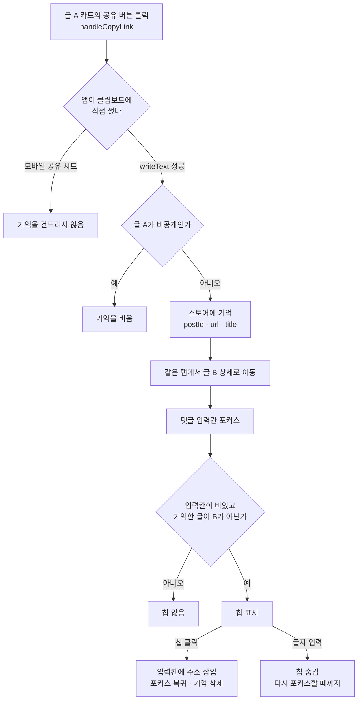

# 댓글 입력칸에 "방금 복사한 글 링크 넣기" 칩 추가

<!-- plan-result:start — 이 블록만 병합 뒤에도 고칠 수 있다(.claude/CLAUDE.md "계획과 PR 본문"). 아래는 승인된 계획 원문 -->

## 구현 결과

> #659 · 2026-11-19 대조 · 이탈 5 · 미구현 0 — 판정 근거(파일:줄)는 PR 본문 "계획 대비 구현"

- 이탈(사용자 결정): 제안의 모양은 계획의 `ActionChip`(기본색·낮춘 보조색) 대신 파란 테두리·파란 글자에 링크 아이콘을 얹은 테두리 버튼(`Button`)이다. 시안의 색 안이 누를 수 있는 것으로 보이지 않는다는 의견으로 시안을 두 번 더 만들어 골랐고, `ActionChip`은 글자만 받아 아이콘을 넣을 수 없었다. 자리(입력칸 안 왼쪽 아래)와 문구(`링크 넣기 · <제목>`)는 계획의 후보 안에서 골랐다
- 이탈(린트 규칙): 공유 버튼 쪽은 `useCopiedPostLinkStore.getState()` 대신 액션만 고르는 selector 훅으로 스토어에 쓴다. 훅 안의 `getState()`를 ESLint가 막는다(계획이 든 선례는 훅 밖 함수였다)
- 이탈(환경 제약): 시안은 dev 서버에서 `CommentForm.tsx`를 임시로 고치는 대신 실제 부품으로 만든 Storybook 임시 스토리로 찍었다. 다른 세션이 dev 서버를 띄우고 같은 파일을 고치고 있었고 `.env` 복사가 거부됐다. 뒤쪽 시안은 스크래치패드가 아니라 `.claude/browser-artifacts/`에 저장했다
- 이탈(방법): 브라우저 검증 녹화는 Playwright MCP 대신 모킹한 녹화 전용 Playwright 스펙(7장면)으로 찍었다(`browser-verification` skill의 "모킹 녹화" 방식). 다른 세션이 dev 서버를 쓰고 있었고(dev 서버는 한 번에 한 워크트리에서만 띄운다) 이 워크트리에는 `.env`가 없어 API에 붙는 화면을 띄울 수 없었다
- 이탈(절차): 계획은 워크트리 진입 직후 `.env`를 복사하기로 했으나, 복사가 권한 규칙에 거부돼 우회하지 않고 `.env` 없이 되는 작업부터 진행했다. 단위 테스트·타입·린트·e2e·녹화는 `.env` 없이 돌았다
- 계획에 없던 변경: 테스트 2개 추가(다른 글을 복사하면 기억이 그 글로 바뀜, 제목이 빈 글의 문구), e2e 스펙에 `clipboard-write` 권한(헤드리스 Chromium은 권한 없이 `writeText`가 실패)
- 계획에 없던 변경(문서 동기화): `docs/PLANS-INDEX.md` 색인, `docs/TESTING.md`의 e2e 스펙 표, `docs/COMMENT.md`의 읽고 나면·§3·§6·§9·§11
- 계획의 테스트 확인 중 "기억 호출 제거"는 단위 테스트에서는 호출을 잘못된 자리(복사 전·공유 시트·원본 링크 복사)에 두는 것으로 바꿔 봤고, 제거는 e2e에서 봤다
- 계획 승인 뒤 병합된 #653이 `CommentForm.tsx`·`CommentForm.test.tsx`·`docs/COMMENT.md`를 바꿔 그 위로 리베이스했다. 아래 원문의 `파일:줄` 번호는 승인 시점 것이다
- 대조 뒤 병합된 #658이 `CommentForm`을 상태 없는 화면(`CommentFormView`)과 상태를 갖는 답글 폼으로 나누고 하단 시트를 `CommentComposer`로 옮겨, 그 위로 다시 리베이스했다. 제안 훅은 화면 쪽에서 부르고, 지금 글을 알 수 있게 `CommentFormView`에 `postId` 속성을 더해 `CommentForm`·`CommentComposer`가 넘긴다(`useCreateComment`의 반환 형태는 그대로다)

<!-- plan-result:end -->

> 데스크톱에서 글 카드의 공유 버튼으로 복사한 LinkSphere 글 링크를 앱이 이 탭 안에서 기억했다가, 다른 글의 댓글
> 입력칸에 포커스하면 한 번 눌러 넣을 수 있는 칩으로 제안한다. 클립보드는 읽지 않는다.

## Context

### 요청

LinkSphere 링크를 클립보드에 들고 있을 때 댓글 입력칸에 포커스하면 붙여넣기 버튼이 보이거나, Enter만 눌러도 들어가게
하는 식으로 링크를 댓글에 넣는 과정을 줄일 방법을 찾아 달라는 요청이다(2026-11-19).

### 사전 조사 — 웹 페이지는 클립보드에 링크가 있는지 미리 알 수 없다

웹 페이지가 클립보드 내용을 아는 방법은 `read()`·`readText()`로 읽는 것뿐이고, 읽는 순간 브라우저가 확인 절차를 띄운다.

| 브라우저                      | 포커스 때 읽으면                                               | 확인 수준                    |
| ----------------------------- | -------------------------------------------------------------- | ---------------------------- |
| Chrome·Edge(데스크톱·Android) | 처음 한 번 `clipboard-read` 권한 창, 허용 뒤에는 조용히 읽힌다 | MDN 원문 읽음, 실기기 미확인 |
| Safari(iPhone·Mac)            | 읽을 때마다 "붙여넣기" 말풍선. 같은 출처가 쓴 내용이면 생략    | WebKit 블로그·MDN 원문 읽음  |
| Firefox(125부터)              | Safari와 같다                                                  | MDN 릴리스 노트 원문 읽음    |

- [MDN Clipboard API](https://developer.mozilla.org/en-US/docs/Web/API/Clipboard_API#security_considerations)는
  Firefox·Safari에 대해 _"붙여넣기 확인은 같은 출처의 클립보드 내용을 읽을 때는 생략되지만, 다른 출처의 내용에는 생략되지
  않는다"_ (번역)고 적는다.
- WebKit은 다음과 같이 설명한다.

  > 시스템 클립보드의 내용을 같은 보안 출처의 페이지가 썼다면 프로그램에 의한 클립보드 접근도 자동으로 허용된다. 둘 다
  > 아니면 WebKit은 사용자가 붙여넣기를 진행할 수 있는 플랫폼 전용 UI를 보여 준다. iOS에서는 붙여넣기 항목 하나만 있는
  > 말풍선 막대다. (번역)
  >
  > — WebKit 블로그 "Async Clipboard API", https://webkit.org/blog/10855/async-clipboard-api/

- 네이티브 앱은 내용을 읽지 않고 있는지만 확인할 수 있다.
  [Chromium 주소창 소스](https://chromium.googlesource.com/chromium/src/+/HEAD/components/omnibox/browser/clipboard_provider.cc)
  161~164줄 주석이 그 방식을 설명한다. 웹에는 같은 방법이 없다.
- 운영 응답(`/`, `/api/health`)에 클립보드를 막는 정책 헤더는 없다(2026-11-19 `curl -I`로 확인).

### 지금 동작

- 글 카드의 공유 버튼(`Share2` 아이콘, 화면 읽기 이름 `TEXTS.post.card.share`)은 `handleCopyLink`를 부른다
  (`src/widgets/post/post-card/hooks/usePostCard.ts:110-129`). 데스크톱은 `navigator.clipboard.writeText`로 직접 복사하고,
  모바일은 `navigator.share`로 OS 공유 시트를 연다.
- 댓글 입력칸은 `CommentForm`의 `Textarea`다(`src/features/comment/create/ui/CommentForm.tsx:116-138`). Enter는 줄바꿈이고
  ⌘/Ctrl+Enter만 등록한다(129-137줄). 붙여넣기 처리(`onPaste`)는 이미지만 가로챈다
  (`src/shared/hooks/useImageAttachments.ts:167-192`).
- 앱에 클립보드를 읽는 코드와 복사 사실을 기억하는 코드는 없다(탐색 에이전트 보고, 전수 검색은 직접 하지 않음).

### 사용자가 정한 것 (2026-11-19 질문 답)

1. 방향은 "앱이 건넨 링크를 기억"이다. 클립보드를 읽지 않는다.
2. Enter는 가로채지 않고 칩만 둔다.
3. 불편을 겪는 곳은 데스크톱이다.
4. 모바일 공유 시트로 건넨 링크는 기억하지 않는다.
5. 이 탭 안에서만 기억한다. 브라우저 저장소를 쓰지 않는다.
6. 비공개 글의 링크는 기억하지 않는다.
7. 칩을 쓰지 않고 글자를 입력하면 칩을 내리고, 다시 포커스할 때까지 보이지 않는다.

### 흐름

## 판단이 필요했던 항목

| 항목               | 결정                                                                                                               | 근거·기각한 대안                                                                                                                                                                                                                                                                    |
| ------------------ | ------------------------------------------------------------------------------------------------------------------ | ----------------------------------------------------------------------------------------------------------------------------------------------------------------------------------------------------------------------------------------------------------------------------------- |
| 클립보드 읽기      | 읽지 않는다                                                                                                        | 사용자 결정(질문). 기각 ① 포커스 때 자동 감지: Safari·Firefox는 링크가 아니어도 매번 말풍선이 떠 조건부 표시가 안 된다. ② 붙여넣기 버튼 상시 표시: LinkSphere 링크일 때만 보여줄 수 없다. ③ `#` 입력 시 글 목록(GitHub 방식): 이미 복사해 둔 링크를 넣는 요청과 다른 필요를 푼다 |
| Enter              | 가로채지 않는다                                                                                                    | 사용자 결정(질문). 이 입력칸의 Enter는 줄바꿈이다. [W3C APG 콤보박스](https://www.w3.org/WAI/ARIA/apg/patterns/combobox/)는 Enter 수락을 _"자동완성 제안이 팝업에서 선택된 상태"_ (번역)로 한정한다                                                                                 |
| 기억하는 대상      | 앱이 `writeText`로 직접 복사한 공개 글의 링크만                                                                    | 사용자 결정(질문). 모바일 공유 시트는 [반환값이 `undefined`](https://developer.mozilla.org/en-US/docs/Web/API/Navigator/share#return_value)라 "복사"를 골랐는지 알 수 없다. 원본 링크 복사(`handleCopyOriginalUrl`)는 외부 주소라 대상이 아니다                                     |
| 비공개 글          | 기억하지 않는다. 비공개 글을 복사하면 그 전에 기억한 링크도 비운다                                                 | 사용자 결정(질문). 비공개 글은 작성자 말고는 404로 보인다(BE `PostVisibility.kt:15-19`). 그 전 기억을 비우는 이유는 "방금 복사한 링크"가 이미 다른 글로 바뀌었기 때문이다. 기각: 공개 글처럼 기억하고 로그아웃 때 지우기                                                            |
| 기억하는 범위      | 이 탭의 메모리. 시간 제한 없음(새로고침·탭 닫기·칩 사용·다른 글 복사 때 사라진다)                                  | 사용자 결정(질문). 기각: 모든 탭에서 1시간, 모든 탭에서 10분(`localStorage`)                                                                                                                                                                                                        |
| 기억하는 자리      | `src/shared/store/`의 zustand 스토어                                                                               | 쓰는 쪽은 위젯, 읽는 쪽은 기능이라 둘 다 가져올 수 있는 층은 entities·shared뿐이다. 탭 안 상태를 여러 층이 나눠 쓰는 선례가 이 폴더에 6개 있다(`loginDialog.store.ts` 등). 기각: `entities/post/utils`(엔티티 util은 순수 함수만 둔다)                                              |
| 칩이 보이는 조건   | 입력칸에 포커스한 뒤 아직 글자를 입력하지 않았고, 입력칸이 비었고, 기억한 링크가 있고, 그 글이 지금 글이 아닐 때   | 요청이 "포커스되면"이다. 지금 글 자신의 링크는 그 글 댓글에 넣을 이유가 없다                                                                                                                                                                                                        |
| 글자를 입력한 뒤   | 칩을 내리고, 입력칸을 벗어났다 다시 포커스해야 돌아온다. 등록해 빈 칸이 돼도 바로 다시 보이지 않는다               | 사용자 결정(질문). 한 번 지나친 제안을 등록 직후 다시 내밀지 않는다. 기각: 빈 칸이면 언제든 다시 보이기                                                                                                                                                                             |
| 포커스를 잃을 때   | 칩을 숨기지 않는다                                                                                                 | 칩을 누르면 입력칸이 먼저 포커스를 잃는다. 그때 숨기면 클릭이 닿기 전에 칩이 사라진다                                                                                                                                                                                               |
| 넣는 값            | `주소 + 공백 한 칸`                                                                                                | 링크 인식이 공백 전까지를 주소로 본다(`MarkdownContent.tsx:16`). 공백이 없으면 이어 쓴 글자가 링크에 붙는다                                                                                                                                                                         |
| 칩을 내리는 방법   | 입력칸의 `onInput` 이벤트에서 내린다                                                                               | 이벤트 핸들러로 끝나 effect나 렌더 중 상태 변경이 필요 없다. 칩으로 넣을 때는 넣는 함수가 직접 내린다                                                                                                                                                                               |
| 기존 훅            | `useCreateComment`·`usePostCard`의 인자·반환 형태를 바꾸지 않고 새 훅을 만든다                                     | 레포 규칙 "변경 범위 원칙"                                                                                                                                                                                                                                                          |
| 화면 읽기 프로그램 | 알림 영역(live region)을 두지 않는다. 칩은 입력칸 바로 다음 탭 순서의 버튼이다                                     | 글자 수 표시가 같은 이유로 역할을 주지 않았다(`CharacterCount.tsx:21-23`)                                                                                                                                                                                                           |
| e2e                | 데스크톱 스펙 1개를 더한다                                                                                         | 위젯 → 스토어 → 기능으로 이어지는 연결과 실제 브라우저의 blur·click 순서는 jsdom 단위 테스트로 볼 수 없다                                                                                                                                                                           |
| 기록 위치          | `docs/COMMENT.md`에 남기고 `docs/DECISIONS.md`에는 적지 않는다                                                     | 되돌리는 비용이 칩 제거 PR 하나다. 결정 로그는 되돌리기 어려운 결정만 담는다                                                                                                                                                                                                        |

### 시안 후보 (반영 전 승인)

칩의 자리·문구·색은 취향이 갈려 구현 첫 단계에서 실제 스타일 화면을 나란히 보여 주고 고른 뒤 반영한다.

- 자리
  - P1: 글자 수 줄 왼쪽(`CommentForm.tsx:141-154`). 줄을 새로 만들지 않는다. 칩이 글자 수보다 높아 줄이 몇 px 커질 수
    있다(추정, 시안에서 잰다).
  - P2: 입력칸 안 왼쪽 아래(`relative` 래퍼, 101-106줄).
  - P3: 입력칸과 글자 수 줄 사이의 별도 줄.
- 문구
  - W1: `'<글 제목>' 링크 넣기`
  - W2: `링크 넣기 · <글 제목>` (긴 제목이 잘려도 동사가 남는다)
  - W3: `복사한 글 링크 넣기` (제목 없음)
- 색: `ActionChip` 기본(`bg-primary`)과 `labelClassName`으로 낮춘 보조색.
- 만드는 법: 워크트리에서 `CommentForm.tsx`를 임시로 고쳐 dev 서버 화면을 찍는다. 라이트·다크, 긴 제목, 모바일 시트 폭을
  함께 찍고 파일은 스크래치패드에 둔다. 고른 뒤 나머지 변형은 Edit로 되돌린다.
- 제목이 비어 있으면 W3 문구를 쓴다(`title`은 스펙상 문자열이지만 빈 값일 수 있다, `openapi.gen.ts:1190`).

## 세부 계획

| 순서 | 위치                                                                          | 변경 내용                                                                                                                                                                                                                             |
| ---- | ----------------------------------------------------------------------------- | ------------------------------------------------------------------------------------------------------------------------------------------------------------------------------------------------------------------------------------- |
| 0    | (시안)                                                                        | 위 시안 후보를 만들어 보여 주고 자리·문구·색을 고른다                                                                                                                                                                                 |
| 1    | `src/shared/store/copiedPostLink.store.ts` (신규)                             | `useCopiedPostLinkStore`: `copiedPostLink: { postId, url, title } \| null`, `rememberCopiedPostLink(link)`, `clearCopiedPostLink()`. `persist` 없이 만든다(`loginDialog.store.ts` 형태)                                               |
| 2    | `src/widgets/post/post-card/hooks/usePostCard.test.ts` ("링크 복사" describe) | 새 케이스: 데스크톱 복사 성공이면 기억한다 / `writeText` 실패면 기억하지 않는다 / 모바일 공유 시트면 기억을 건드리지 않는다 / 비공개 글이면 기억하지 않고 그 전 기억을 비운다 / 원본 링크 복사는 기억을 건드리지 않는다. 기존 단언은 그대로 |
| 3    | `src/widgets/post/post-card/hooks/usePostCard.ts:117`                         | `writeText` 성공 뒤 `useCopiedPostLinkStore.getState()`로 공개 글이면 기억하고 비공개 글이면 비운다(훅 밖 접근 선례: `MarkdownContent.tsx:103`)                                                                                       |
| 4    | `src/shared/config/texts.ts` `TEXTS.comment.form` (350줄~)                    | 고른 문구의 키 추가: 제목을 받는 함수형 키와 제목 없는 키. 해요체, `texts-conventions` skill을 먼저 읽는다                                                                                                                            |
| 5    | `src/features/comment/create/ui/CommentForm.test.tsx`                         | 새 케이스(아래 "테스트")                                                                                                                                                                                                              |
| 6    | `src/features/comment/create/hooks/useCopiedPostLinkSuggestion.ts` (신규)     | `useCopiedPostLinkSuggestion({ postId, form, contentValue })` → `{ suggestedLink, handleContentFocus, handleContentInput, insertSuggestedLink }`. 삽입은 `form.setValue('content', …, { shouldDirty: true })` 뒤 기억 삭제            |
| 7    | `src/features/comment/create/ui/CommentForm.tsx:59, 116-138, 141-154`         | 새 훅 호출, `Textarea`에 `onFocus`·`onInput`, 고른 자리에 `ActionChip`. 칩 클릭은 삽입 뒤 `textareaRef.current?.focus({ preventScroll: true })`                                                                                       |
| 8    | `e2e/comment-copied-link.spec.ts` (신규)                                      | 피드에서 글 A 공유 버튼 → 글 B 상세 → 입력칸 포커스 → 칩 클릭 → 입력칸 값·포커스 확인. `page.route()` 모킹, chromium 프로젝트                                                                                                         |
| 9    | `docs/COMMENT.md`                                                             | §5에 소절 추가(동작, 조건, 기각한 대안과 출처), §8 코드 지도·수정 레시피, §12 용어, 마지막 검토 날짜. `usePostCard.ts:149`를 가리키는 줄(483줄)은 번호가 밀리면 고친다                                                                |
| 10   | `CHANGELOG.md` `[Unreleased]`                                                 | Added 항목. `changelog-release` skill 형식                                                                                                                                                                                            |
| 11   | `docs/plans/2026-11-19-comment-copied-link-chip.md` (신규)                    | 이 계획의 스냅샷                                                                                                                                                                                                                      |

### 테스트

- `CommentForm.test.tsx`
  - 기억한 링크가 없으면 포커스해도 칩이 없다.
  - 다른 글의 링크를 기억하고 있으면 포커스 전에는 없고 포커스하면 보인다.
  - 지금 글의 링크면 포커스해도 없다.
  - 글자를 입력하면 칩이 사라지고, 모두 지워도 돌아오지 않는다.
  - 입력칸을 벗어났다 다시 포커스하면 칩이 돌아온다.
  - 입력칸에서 Tab을 누르면 칩으로 간다.
  - 칩을 누르면 입력칸 값이 `주소 + 공백`이 되고, 포커스가 입력칸에 있고, 칩이 사라지고, 등록 버튼이 켜진다.
  - 입력칸이 포커스를 잃어도 칩이 남는다.
  - Enter는 줄바꿈으로 남는다(칩이 보이는 상태에서 값이 주소로 바뀌지 않는다).
  - 직접 써서 등록한 뒤 빈 칸이 돼도 칩이 없다(`useCreateComment.test.tsx`의 제출 준비를 재사용할 수 있으면 넣고, 안 되면
    e2e에서 본다).
- 스토어는 테스트 사이에 남으므로 각 파일에서 `useCopiedPostLinkStore.setState({ copiedPostLink: null })`로 비운다
  (선례: `ProtectedRoute.test.tsx:328-329`).
- 새 테스트는 구현을 일부러 깨서 실패하는지 확인한다: 같은 글 검사 제거, 삽입 뒤 기억 삭제 제거, 3번의 기억 호출 제거,
  `onInput`에서 내리는 줄 제거.

## 영향 범위

- `usePostCard`는 `PostCard`(피드·상세)가 쓴다. 반환 형태는 그대로다.
- `CommentForm`은 데스크톱 인라인 폼, 답글 폼, 모바일 시트(`MobileCommentBar.tsx:86-91`)가 함께 쓴다(앞 둘은 탐색 보고,
  구현 때 `pnpm graph:focus "src/features/comment/create/ui/CommentForm.tsx" --text`로 확인). 수정 폼
  (`CommentEditForm`)은 빈 칸으로 시작하지 않아 대상이 아니다.
- 좁은 창의 데스크톱은 모바일 시트를 쓰므로 시트 안에서도 칩이 보일 수 있다. 시트 높이 변화는 `ResizeObserver`가
  따라간다(`MobileCommentBar.tsx:64-65`).
- 깨질 수 있는 것
  - 기존 테스트: 스토어 값이 다른 테스트로 새면 `CommentForm`·`MobileCommentBar` 테스트에 칩이 나타난다.
  - 글자 수 줄 높이: P1을 고르면 줄이 커질 수 있다. 시안에서 재고 넘치면 P2·P3로 간다.
  - 문서의 `파일:줄` 참조: `usePostCard.ts`에 줄이 늘어난다. `pnpm check:docs`가 잡는다.
- API·데이터 계약·BE 변경은 없다. 배포 순서 영향도 없다.
- 로그아웃해도 기억은 탭에 남는다. 기억하는 것은 공개 글의 주소와 제목뿐이라 누구에게나 보이는 정보다.

## 검증 방법

### 완료 조건

- 끝 상태: 데스크톱에서 공개 글 A의 공유 버튼을 누르고 같은 탭에서 글 B 상세로 가 댓글 입력칸을 누르면 칩이 보인다.
  칩을 누르면 입력칸에 글 A 주소가 들어가고 포커스가 입력칸에 남으며 칩이 사라진다.
- 바꾸면 안 되는 것: Enter 줄바꿈, ⌘/Ctrl+Enter 등록, 이미지 붙여넣기, 모바일 공유 시트 동작, 복사 안내 토스트 문구,
  `useCreateComment`·`usePostCard`의 인자와 반환 형태, 댓글 수정 폼.

### 명령과 관찰

1. `pnpm type-check`
2. `pnpm test`
3. `pnpm lint`, `pnpm check:deps`
4. `pnpm check:docs`
5. `pnpm test:e2e e2e/comment-copied-link.spec.ts` (긴 실행은 `caffeinate -dims`로 묶는다)
6. 머지 게이트와 같은 묶음으로 `pnpm check`를 한 번 더 돌린다.
7. 브라우저 검증 녹화(`browser-verification` skill): 끝 상태의 흐름을 Playwright MCP로 녹화해 바로 보이게 연다. 다른
   세션의 dev 서버를 재사용하지 않았는지 새 코드 표식(칩 문구)으로 단언한다.

### 절차

- 워크트리에서 작업한다. 만들기 전에 `git log origin/main..main`으로 미푸시 커밋을 확인하고, 진입 뒤 `.env` 복사와
  `pnpm install`을 한다.
- PR 전에 `plan-verifier`로 계획과 diff를 대조하고, 결과를 PR 본문 `## 계획 대비 구현`과 계획 파일의 구현 결과 블록에
  옮긴다. `pnpm check:pr-body`를 통과시킨다.
- CI 결과를 확인한 뒤 머지 승인을 요청한다. 병합 뒤 배포 워크플로 성공을 확인하고 워크트리를 지운다.

## 남은 것

- 주소창이나 다른 앱에서 복사한 LinkSphere 링크는 지금처럼 직접 붙여넣는다(붙여넣기 버튼 안은 선택하지 않았다).
- 새 탭으로 연 글과 새로고침 뒤에는 칩이 없다(사용자 결정).
- 댓글 속 LinkSphere 링크는 데스크톱에서 새 탭, 모바일에서 전체 새로고침으로 열린다(`MarkdownContent.tsx:146-155`).
  앱 안 이동으로 바꾸는 것은 이 계획 범위 밖이다.
