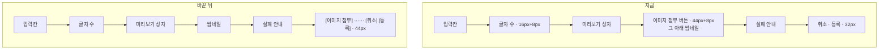

# 댓글 폼: 이미지 첨부와 취소·등록 버튼을 한 줄로

<!-- plan-result:start — 이 블록만 병합 뒤에도 고칠 수 있다(.claude/CLAUDE.md "계획과 PR 본문"). 아래는 승인된 계획 원문 -->

## 구현 결과

> #664 · 2026-11-20 대조 · 이탈 3 · 미구현 0 — 판정 근거(파일:줄)는 PR 본문 "계획 대비 구현"

- 이탈(구현 중 판단): `ImageAttachmentButton`은 `forwardRef`·나머지 속성 없이 만들고 계약 표에 옛 `ImageAttachmentField`처럼 셋 다 받지 않는 부품으로 적음. 버튼과 숨은 파일 입력 두 요소를 그려 "DOM 요소 하나를 감싼" 저수준 부품이 아니라 조립 부품이고, 조립 부품의 규칙은 계약 표에 적는 것이라서다
- 이탈: `DESIGN-SYSTEM-PRINCIPLES.md` "확인 방법" 7번 `grep` 명령의 옛 부품 이름은 바꾸지 않음. 2026-11-19 날짜가 붙은 측정 기록이라서다
- 이탈(절차): 전·후 비교 화면은 360px가 아니라 393px(기존 시트 높이 e2e와 같은 크기)에서 찍어 확인받음. 대조 뒤 바꾼 화면만 360px에서 다시 찍어 도구 줄이 한 줄에 들어가는 것을 확인함
- 계획에 없던 변경(문서 동기화): 조립 부품 수(34→35, 받지 않는 부품 12→13), `DESIGN-SYSTEM.md` 옛 기록의 지운 파일 경로에 지금 위치 덧붙임, 디자인 토큰 skill의 `bg-scrim` 사용처 파일 이름, `COMMENT.md` 검토일·코드 지도 행
- 계획에 없던 발견(이 PR에서 고치지 않음): 360px 화면에서 내 댓글의 "삭제" 버튼이 든 동작 줄이 화면 밖으로 21px 넘쳐 페이지가 가로로 넓어짐. 이번 변경 전부터 있던 문제라 따로 다룸

<!-- plan-result:end -->

> 댓글 작성·답글·수정 폼에서 "이미지 첨부" 줄과 "취소·등록" 버튼 줄을 한 줄로 합쳐 폼 높이를 줄인다(약 40px, 클래스 계산값).

## Context

글 상세의 댓글 입력 영역은 입력칸 아래로 글자 수, 이미지 첨부, 취소·등록 버튼이 한 줄에 하나씩 놓인다
(`CommentForm.tsx:211-288`, `CommentEditForm.tsx`도 같은 모양). 그래서 폼이 높고, 모바일 하단 시트에서는 입력칸에 쓸 수 있는
높이가 그만큼 줄어든다. 사용자는 높이를 줄일 방법과, 성격이 다른 요소를 한 줄에 둬도 되는지 물었다.

## 판단이 필요했던 항목

| 항목 | 결정 | 근거·기각한 대안 |
| --- | --- | --- |
| 무엇을 한 줄로 | **첨부 버튼(왼쪽) + 취소·등록(오른쪽)** (사용자 선택 A) | 왼쪽은 내용을 바꾸는 도구, 오른쪽은 마무리 동작으로 나뉘는 도구 모음 배치. 첨부는 ghost, 등록은 primary라 모양이 다르고 양 끝에 떨어져 있어 잘못 누를 일이 적다. 기각: B(글자 수까지 한 줄, 약 64px 감소) — 2026-11-04 결정에서 글자 수를 버튼 줄에 두는 안을 "입력칸과 멀다"로 기각했다. C(글자 수 + 첨부 한 줄, 약 24px) — 줄어드는 폭이 작고 미리보기 상자 위치를 바꿔야 한다 |
| 글자 수 자리 | 입력칸 바로 아래 오른쪽 그대로 | 2026-11-04 결정(`docs/DECISIONS.md` "길이 상한이 있는 입력에 글자 수를 늘 보인다") 유지 |
| 썸네일·실패 안내 자리 | 도구 줄 **위**. 순서는 썸네일 → 실패 안내 → 도구 줄 | 썸네일을 첨부 버튼 아래(왼쪽 칸 안)에 두면 360px에서 버튼 폭만큼 좁아져 세로로 쌓인다. 실패 안내는 지금처럼 "썸네일과 버튼 사이"(`docs/COMMENT.md` 실패 안내 절)를 지킨다 |
| 수정 폼 | 같은 배치로 함께 바꾼다 (사용자 선택) | 작성·답글·수정이 같은 모양을 유지한다 |
| 공용 부품 나누기 | `ImageAttachmentField`(버튼 + 썸네일)를 `ImageAttachmentButton`·`ImageAttachmentPreviews` 두 부품으로 나누고 옛 부품은 지운다 | 버튼과 썸네일이 서로 다른 줄로 가야 한다. 사용처는 두 폼뿐이고 둘 다 바뀐다. 기각: `actions` 속성 추가 — 실패 안내까지 중간에 끼워야 해 속성이 둘로 늘고 부품이 폼 구조를 알게 된다 |

### 시안 후보 (반영 전 승인)

ASCII로 A를 골랐다. 구현한 뒤 커밋하기 전에 실제 화면 스크린샷을 지금/바꾼 뒤로 나란히 보여 주고 확인받는다.
조합: 360px 모바일 시트·데스크톱 인라인 · 라이트·다크 · 빈 입력 / 글 + 썸네일 2장 / 실패 안내.

## 세부 계획

| 위치 | 변경 내용 |
| --- | --- |
| `src/shared/ui/elements/ImageAttachmentButton.tsx` (신규) | 기존 첨부 버튼 + 숨은 파일 입력을 그대로 옮긴다(문구·`h-11`·비활성 조건 동일). `forwardRef`·나머지 속성 규칙은 elements 계약을 따른다 |
| `src/shared/ui/elements/ImageAttachmentPreviews.tsx` (신규) | 기존 썸네일 목록 + 지우기 버튼을 옮긴다. 없으면 아무것도 그리지 않는다. 위쪽 여백(`mt-2`)은 쓰는 쪽 간격에 맡긴다 |
| `src/shared/ui/elements/ImageAttachmentField.tsx`·`.stories.tsx`·`.test.tsx` | 삭제. 스토리·테스트는 새 두 부품 쪽으로 옮긴다(기존 단언은 그대로 옮기고 바꾸지 않는다) |
| `src/shared/ui/ApiContract.test.tsx:369` | `ImageAttachmentField` 행을 새 두 부품 행으로 바꾼다 |
| `src/features/comment/create/ui/CommentForm.tsx:245-288` | 썸네일 → 실패 안내 → `flex items-center justify-between` 한 줄(왼쪽 첨부 버튼, 오른쪽 취소·등록) |
| `src/features/comment/update/ui/CommentEditForm.tsx` 버튼 영역 | 같은 배치 |
| 문구 | `imageAttachmentField.*` 키 이름은 그대로 둔다(`ui-texts.ts`·`ko-ui-texts.ts`·`UiTextsProvider.tsx` 변경 없음) |
| `docs/COMMENT.md` | 폼 배치 설명과 시트 절의 "입력칸 아래 줄(글자 수·미리보기 접힘·이미지 첨부·버튼)" 문장을 새 배치로 고친다 |
| `docs/DESIGN-SYSTEM-PRINCIPLES.md` §5 분류표·`grep` 명령(723줄) | 부품 이름을 새 두 부품으로 바꾼다 |
| `CHANGELOG.md` `[Unreleased]` | Changed 항목 1개 |
| `docs/plans/2026-11-19-comment-form-toolbar-row.md` (신규) | 이 계획 사본 + `pnpm docs:index` 색인 재생성 |

## 영향 범위

- `CommentFormView`를 쓰는 곳 전부: 글 상세 넓은 화면 인라인 폼, 모바일 하단 시트(`CommentComposer`), 답글 폼(`CommentForm`).
  `pnpm graph:focus`로 두 부품과 두 폼의 실제 사용처를 다시 뽑는다.
- 시트 높이 상한(`CommentComposer.tsx`의 70dvh·입력칸 40dvh)은 그대로 둔다. 줄이 줄어드니 40dvh 근거("아래 줄이 다 보이도록")는
  더 넉넉해질 뿐이다.
- 바꾸면 안 되는 것: 글자 수 자리·문구, 등록 버튼 비활성 조건과 툴팁, 첨부 장수 표시(`0/5`), 첨부 버튼 터치 높이 44px,
  드래그앤드롭·붙여넣기 첨부, 실패 안내 문구.

## 검증 방법

- `pnpm type-check` · `pnpm test` · `pnpm lint` · `pnpm check:deps` · `pnpm check:docs` (머지 게이트와 같은 묶음)
- 댓글 관련 e2e(작성·삭제, 시트 높이, 실패 뒤 첨부, 결과 모름) `pnpm test:e2e e2e/<파일>`
- 높이 측정: 같은 조건(393×727 시트, 1280 데스크톱, 빈 입력)에서 바꾸기 전·뒤 폼 `getBoundingClientRect().height`를 재서 줄어든 값을 적는다
- `browser-verification` skill로 위 시안 조합 스크린샷·녹화를 열어 보여 주고 확인받은 뒤 커밋
- 완료 조건: 위 검사 통과, 측정으로 높이 감소 확인, 사용자가 실제 화면을 보고 확인, PR CI 통과

## 남은 것

없음
