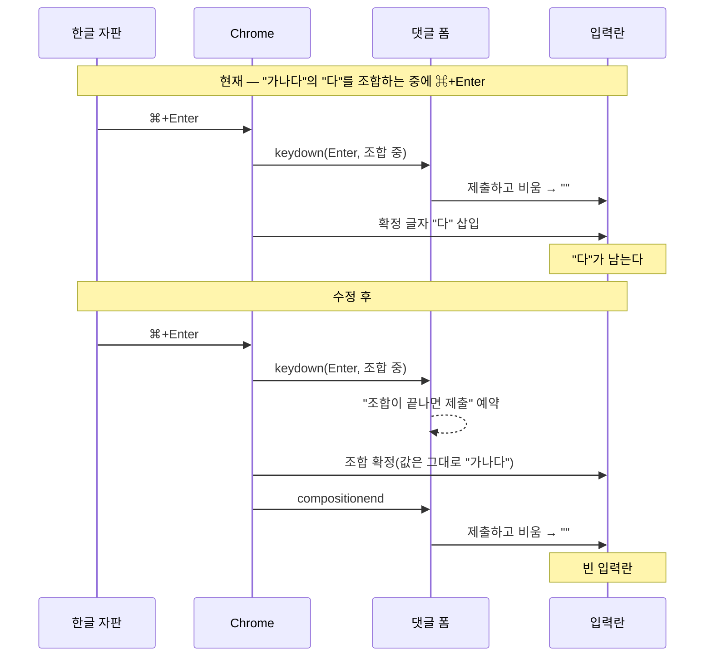

# 댓글 등록 단축키 — 한글 조합 중 마지막 글자가 입력란에 남는 문제

<!-- plan-result:start — 이 블록만 병합 뒤에도 고칠 수 있다(.claude/CLAUDE.md "계획과 PR 본문"). 아래는 승인된 계획 원문 -->

## 구현 결과

> #653 · 2026-11-19 대조 · 이탈 2 · 미구현 1 — 판정 근거(파일:줄)는 PR 본문 "계획 대비 구현"

- 이탈(절차): 계획은 실제 자판 확인(검증 3번) 뒤에 대조·PR(4번)이었는데, 대조와 PR을 먼저 했다. 로컬 화면에 필요한 `.env` 복사가 권한 확인에서 거부돼 사용자의 복사를 기다리는 동안 진행했다. 자판 확인은 PR을 연 뒤 병합 전에 했고, 사용자가 최상위 댓글과 답글의 ⌘+Enter를 확인했다
- 미구현: 검증 3번의 Ctrl+Enter 확인은 할 수 없었다. macOS의 Chrome에서 Ctrl+Enter를 누르면 Enter 키가 페이지에 오지 않는다(2026-11-19 측정, 조합 중이든 아니든 같다). 아래 "남은 것"이 macOS의 Ctrl+Enter를 검증 3번에서 보기로 한 것도 같은 이유로 하지 못했다. 측정과 추정한 원인(운영체제의 Control+Return 단축키)은 `docs/COMMENT.md` §11에 적었다
- 이탈(절차): 계획은 워크트리 진입 → `.env` 복사 → `pnpm install`이었는데, `.env` 복사가 거부돼 건너뛰었다. 단위 테스트·타입·린트·e2e는 `.env` 없이 돌았고, 대조 뒤 사용자가 직접 복사해 로컬 화면을 띄웠다
- 대조에서 찾아 고침: `docs/COMMENT.md` §10이 테스트의 이벤트 순서를 모두 측정에서 옮겼다고 적었는데, ③의 순서는 잰 적이 없어 나눠 적었다. 조합 중 `keydown`을 거르는 선례 "다섯 곳"은 입력란 핸들러만 센 것임을 밝혔다
- 정정: 측정한 곳은 "빈 페이지"가 아니라 `https://example.com` 탭에 입력칸을 넣은 것이다. 아래 원문은 그대로 두고 `docs/COMMENT.md` §10에는 바르게 적었다
- 계획은 고치기 전에 ①이 실패한다고 봤는데 ③도 실패했다(조합 중 `keydown`에서 바로 제출해 입력란을 비웠다)
- 계획에 없던 변경: `docs/COMMENT.md` §12 용어 사전에 "조합·IME"를 더했고, §11에 수정 폼은 조합 중 단축키를 따로 다루지 않는다는 점을 남겼다
- 계획에 없던 변경: 테스트에서 게시글 id 리터럴을 상수로 뽑았고(기존 단언은 그대로), "요청이 없다"는 20ms 고정 대기 뒤에 확인한다
- 계획에 없던 변경: 계획 파일이 늘어 `docs/PLANS-INDEX.md`를 `pnpm docs:index`로 다시 만들었다
- 문서 동기화: `docs/COMMENT.md` "마지막 검토" 날짜

<!-- plan-result:end -->

> 한글 조합 중에 ⌘/Ctrl+Enter가 오면 바로 제출하지 않고, 조합이 끝난 직후(`compositionend`)에 제출한다.
> 바꾸는 소스는 `CommentForm.tsx` 한 파일이고, 테스트와 문서가 따라간다.

## Context

### 증상

댓글 입력란에 한글을 치고 등록 단축키(⌘+Enter)를 누르면 댓글은 전체가 한 번 등록되는데, 조합 중이던 마지막 글자가
입력란에 다시 남는다(2026-11-19 사용자 보고). 남은 글자 때문에 글자 수·미리보기가 뜨고, 등록이 실패했을 때 원래 글을
되돌리는 복원(`useCreateComment.ts:186-188`, 입력란이 비어 있을 때만 복원)도 건너뛴다.

용어: **조합**은 한글 입력기(IME)가 글자를 만드는 중인 상태다. `keydown`은 키를 누를 때, `compositionend`는 조합이 끝나
글자가 확정될 때 브라우저가 페이지에 보내는 이벤트다.

### 가설

단축키 `keydown`이 조합 중에 오고, 폼이 그 자리에서 입력란을 비운 뒤에 브라우저가 확정 글자를 넣는다.

- 단축키 처리(`CommentForm.tsx:129-137`)는 조합 중인지 보지 않고 바로 `onSubmit`을 부른다.
- 제출은 서버 응답을 기다리지 않고 `reset()`으로 입력란을 비운다(`useCreateComment.ts:229-231`). 인자 없는 `reset()`은
  브라우저의 `form.reset()`을 부른다(react-hook-form 7.91.0 `dist/index.esm.mjs:3564-3578`).
- Chrome(macOS)은 조합 중 `keydown`을 keyCode 229로 먼저 보내고 조합 결과를 그 뒤에 보낸다. 두 번째 `keydown`은 입력기가
  편집 명령을 냈을 때만 보낸다(Chromium `content/app_shim_remote_cocoa/render_widget_host_view_cocoa.mm` 1765-1775,
  1783-1784, 1803, 2970-2971 — main, 2026-11-19 조회).

### 재현 절차 (2026-11-19 측정)

Chrome 157, macOS, 사용자의 실제 한글 자판. 빈 페이지에 `<textarea>` 세 개와 이벤트 기록 코드를 넣고, 칸마다 `가나다`를
친 뒤 ⌘+Enter를 한 번 눌렀다. 기록은 페이지에서 읽었다.

| 칸  | 단축키 `keydown`에서 한 일                              | 기록된 순서                                                                                                                         | 끝 값    |
| --- | ------------------------------------------------------- | ----------------------------------------------------------------------------------------------------------------------------------- | -------- |
| ①   | 없음                                                    | `keydown`(Enter, keyCode 229, 조합 중) → 2ms → `input`(insertCompositionText) → `compositionend`("다") → `keyup`                    | `가나다` |
| ②   | `preventDefault`                                        | ①과 같음(1ms)                                                                                                                       | `가나다` |
| ③   | `preventDefault` + 마이크로태스크 뒤 `form.reset()`(앱) | `keydown`(Enter, 229, 조합 중) → 비움(`""`) → `input`(insertText "다", 조합 아님) → `keyup`. `compositionend`는 오지 않음           | `다`     |

세 칸 모두 ⌘+Enter `keydown`은 한 번만 왔다.

### 근본 원인

칸 ③에서 증상이 재현됐다. 조합 중에 입력란을 비우면, 브라우저가 뒤이어 보내는 확정 글자가 빈 입력란에 새 글자로 들어간다.
입력란을 건드리지 않으면(칸 ①·②) 같은 글자가 제자리에서 확정되고 `compositionend`가 온다.

## 판단이 필요했던 항목

| 항목                    | 결정                                                         | 근거·기각한 대안                                                                                                                                                                                                                                                                                                                                             |
| ----------------------- | ------------------------------------------------------------ | ------------------------------------------------------------------------------------------------------------------------------------------------------------------------------------------------------------------------------------------------------------------------------------------------------------------------------------------------------------ |
| 조합 중 단축키 처리     | 제출을 예약하고 `compositionend`에서 제출한다                | 기각 — 조합 중 `keydown` 무시 한 줄(MDN [keydown event](https://developer.mozilla.org/en-US/docs/Web/API/Element/keydown_event)의 권장 방식, 이 레포 5곳의 관용구): 측정상 `keydown`이 한 번뿐이라 ⌘+Enter를 두 번 눌러야 등록된다. 기각 — 비우기를 타이머로 늦추기: 확정 글자가 타이머보다 먼저 온다는 보장이 없다. 기각 — 조합을 강제로 끝내고 제출: 칸 ③처럼 브라우저가 이미 보낸 확정 글자는 막지 못한다 |
| 조합 중 판정            | `e.nativeEvent.isComposing`만 본다(keyCode 229는 보지 않는다) | 229까지 보면, 조합이 먼저 끝난 뒤 `keydown`이 오는 브라우저(MDN 같은 문서의 Note)에서 예약만 걸리고 `compositionend`가 다시 오지 않아 등록되지 않는다. 그 순서는 `isComposing`이 false라 지금처럼 바로 제출하면 된다. 레포 5곳 선례도 `isComposing`만 본다(`useRenameBookmarkFolder.ts:81` 등)                                                                          |
| 예약이 남는 경우        | 다음 `keydown`이 오면 예약을 푼다                            | 측정한 환경에서는 `compositionend`가 1~2ms 뒤에 와 예약이 바로 쓰인다. 측정하지 못한 환경(Windows·다른 입력기)에서 조합이 이어지면, 남은 예약이 나중의 글자 확정에서 쓰다 만 댓글을 등록할 수 있어 한 줄로 막는다. 마우스로 다른 곳을 눌러 조합이 끝나는 경우는 막지 않는다                                                                                          |
| 코드 위치               | `CommentForm.tsx` 안에 둔다                                  | 단축키 처리와 `highlightEmptyForm`이 이미 이 파일에 있다. `useCreateComment`의 반환값을 바꾸지 않는다(변경 범위 원칙). 훅 분리는 다른 폼에서도 필요해질 때 한다                                                                                                                                                                                              |
| 댓글 수정 폼            | 범위 밖                                                      | 같은 단축키(`CommentEditForm.tsx:92-100`)지만 제출 때 입력란을 비우지 않아(`useUpdateComment.ts`에 `reset(` 호출 없음) 이 증상 경로가 없다                                                                                                                                                                                                                   |
| 테스트 수준             | 컴포넌트 단위 테스트 + 사용자의 실제 자판 확인               | 자동 브라우저는 한글 조합 입력을 만들지 못한다(`docs/BOOKMARK.md:1787`). jsdom 테스트는 "조합이 끝날 때까지 입력란을 비우지 않는다"와 "끝나면 한 번 등록한다"를 본다                                                                                                                                                                                         |

## 세부 계획

작업은 워크트리에서 한다(`EnterWorktree` → `cp ../../../.env .` → `pnpm install`, Node 24).

| 위치                                                                | 변경 내용                                                                                                                                                                                                                                                                                                                                                                                                                                                                                                                                               |
| ------------------------------------------------------------------- | ------------------------------------------------------------------------------------------------------------------------------------------------------------------------------------------------------------------------------------------------------------------------------------------------------------------------------------------------------------------------------------------------------------------------------------------------------------------------------------------------------------------------------------------------------- |
| `src/features/comment/create/ui/CommentForm.test.tsx`               | **먼저** 테스트 4건을 더한다. 로그인 상태와 등록 요청 가로채기는 `useCreateComment.test.tsx`의 `renderLoggedIn`·`server.use` 방식을 본뜬다. ① 조합 중 ⌘+Enter(`fireEvent.keyDown(…, { key: 'Enter', metaKey: true, isComposing: true })`) 직후에는 요청이 없고 입력란이 그대로이며, `fireEvent.compositionEnd` 뒤 요청 1건·빈 입력란 ② 조합 중이 아니면 ⌘+Enter로 바로 등록 ③ 조합 중 ⌘+Enter 뒤 다른 키를 누르면 조합이 끝나도 등록하지 않음 ④ 단축키 없이 조합만 끝나면 등록하지 않음. ①의 고치기 전 실패 출력을 남긴다 |
| `src/features/comment/create/ui/CommentForm.tsx` (컴포넌트 본문)    | `submitAfterCompositionRef = useRef(false)`와 지역 함수 `submitByShortcut()`(빈 폼이면 `highlightEmptyForm()`, 그리고 `onSubmit()`)을 더한다                                                                                                                                                                                                                                                                                                                                                                                                            |
| `src/features/comment/create/ui/CommentForm.tsx:129-137` `onKeyDown` | 맨 앞에서 예약을 푼다. ⌘/Ctrl+Enter면 `preventDefault` 뒤, `e.nativeEvent.isComposing`이면 예약하고 끝내고, 아니면 `submitByShortcut()`                                                                                                                                                                                                                                                                                                                                                                                                                 |
| `src/features/comment/create/ui/CommentForm.tsx` `<Textarea>`       | `onCompositionEnd`를 더한다: 예약이 있으면 풀고 `submitByShortcut()`                                                                                                                                                                                                                                                                                                                                                                                                                                                                                    |
| `docs/COMMENT.md` §5 "작성", §8, §9, §10, §11                       | §5에 조합 중 단축키 동작, §10에 시행착오(위 측정 표·기각한 방법), §9에 검증 결과, §11에 확인하지 못한 환경                                                                                                                                                                                                                                                                                                                                                                                                                                              |
| `CHANGELOG.md` `[Unreleased]`                                       | `fix` 항목(`changelog-release` skill 형식)                                                                                                                                                                                                                                                                                                                                                                                                                                                                                                              |
| `docs/plans/2026-11-19-comment-shortcut-ime-leftover.md` (신규)     | 이 계획 사본. 대조 뒤 구현 결과 블록을 붙인다                                                                                                                                                                                                                                                                                                                                                                                                                                                                                                           |

`onCompositionEnd`는 브라우저가 `CompositionEvent`를 지원하면 네이티브 `compositionend`에서 불린다(react-dom 18.3.1
`cjs/react-dom.development.js:7334`, `7376-7382`, `7465-7470`). 예약 값은 화면에 그리지 않으므로 ref로 둔다
([useRef](https://react.dev/reference/react/useRef) — 구현 때 문서를 직접 열어 주석·PR에 링크를 남긴다).

## 영향 범위

- `CommentForm`을 쓰는 세 곳이 함께 바뀐다: 최상위 작성(`CommentList.tsx:145`), 답글(`CommentItem.tsx:157`), 모바일 댓글 바
  (`MobileCommentBar.tsx:86`). 구현 때 `pnpm graph:focus "src/features/comment/create/ui/CommentForm.tsx" --text`로 다시 뽑는다.
- 바뀌는 동작은 "조합 중에 온 ⌘/Ctrl+Enter" 하나다. 조합 중이 아닌 단축키(빈 폼 강조 포함), 등록 버튼 클릭, 평범한 Enter
  줄바꿈은 그대로다.
- 이전 동작을 단정하는 테스트: `CommentForm.test.tsx`의 "빈 폼에서 Ctrl+Enter" — 조합 중이 아닌 경로라 기대값을 바꾸지 않는다.
- 데이터 계약·API·배포 순서 변화 없음.

## 검증 방법

완료 조건: Chrome(macOS)에서 한글 조합 중 ⌘+Enter 한 번에 댓글이 1개 등록되고 입력란이 빈다. 조합 중이 아닌 단축키와
수정 폼, `useCreateComment`의 반환값은 바뀌지 않는다.

1. 테스트 ①을 고치기 전 코드에서 돌려 실패 출력을 남긴다 → 구현 → 4건 통과. ②~④는 구현을 일부러 깨서 실패하는지 한 번씩 본다.
2. `pnpm type-check` → `pnpm test` → `pnpm check`(lint·deps) → `pnpm check:docs` → `pnpm test:e2e e2e/comment.spec.ts`.
3. 실제 자판 확인(사용자, 병합 전 — 2026-11-19 질문으로 정함): 워크트리에서 `pnpm dev`를 띄운 로컬 화면에서 한글을 치고 ⌘+Enter. 최상위 작성과 답글에서
   한 번씩, Ctrl+Enter도 한 번. 댓글이 한 번만 등록되고 입력란이 비며 "댓글을 입력해 주세요" 안내가 뜨지 않으면 된다.
   로컬 화면은 운영 API에 연결돼 있어 시험 댓글이 실제로 등록되므로 확인 뒤 지운다.
4. `plan-verifier` 대조 → PR(`## 계획 대비 구현`, `pnpm check:pr-body`) → CI 확인. 병합은 따로 승인받는다.

## 남은 것

- 측정하지 못한 환경: Windows의 Ctrl+Enter, macOS의 Ctrl+Enter, Safari·Firefox. 코드상 조합 중이 아닌 `keydown`은 지금과 똑같이
  처리되고, 조합 중 `keydown` 뒤에 `keydown`이 한 번 더 오는 환경이 있다면 등록 뒤 빈 입력 안내가 뜰 수 있다(지금은 그 환경에서
  남은 글자가 두 번째 댓글로 등록된다). macOS의 Ctrl+Enter는 검증 3번에서 함께 본다.
