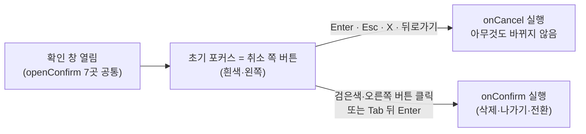

# 확인 창 기본 규칙: 취소는 흰색·왼쪽·초기 포커스, 행동은 검은색·오른쪽 (`emphasis` 옵션 삭제)

<!-- plan-result:start — 이 블록만 병합 뒤에도 고칠 수 있다(.claude/CLAUDE.md "계획과 PR 본문"). 아래는 승인된 계획 원문 -->

## 구현 결과

> #651 · 2026-11-19 대조 · 이탈 4 · 미구현 0 — 판정 근거(파일:줄)는 PR 본문 "계획 대비 구현"

- 이탈(절차): 워크트리를 만들 때 `.env`를 복사한 뒤 설치하기로 했는데, 복사가 권한에서 거부돼 하지 않고 진행했다. 이번 검증에는 `.env`가 필요하지 않았다(e2e는 `.env.test`, 단위·스토리는 MSW)
- 이탈(절차): 검증 묶음 → 화면 확인받기 → 문서 순서로 정했는데, 화면을 먼저 띄우고 답을 기다리는 동안 검증 묶음과 문서·기록 변경을 진행했다. 커밋은 사용자가 화면을 확인한 뒤에 했다
- 이탈(절차): 브라우저 확인을 browser-verification 절차의 녹화로 하기로 했는데, 기존 e2e 스펙에 임시 스크린샷 줄을 넣어 변경 전·후 정지 화면을 찍고 비교 이미지로 보여 줬다. 6종 × 2폭 가운데 "작성 중 이탈"의 모바일 변경 전 1장은 폭을 바꾸면 창이 닫혀 빠졌다(변경 후는 처음부터 모바일로 도는 스펙에서 찍었다)
- 이탈(절차) → 보완함: 구현 전에 `pnpm graph:focus`로 사용처를 뽑지 않았다. 코드 변경 뒤에 돌렸고 결과는 조사 때와 같다(스토어를 쓰는 훅 7개와 부품)
- 계획에 없던 변경: 스토리 `play`의 색 단언을 "두 버튼 색이 다름"에서 "채움 색은 행동 버튼에만"으로 강화했다(색을 맞바꿔도 통과하던 빈틈)
- 계획에 없던 변경: 새 결정 항목의 주제 등록(`decision-topics.json`), FE-ARCHITECTURE §10에 이름 규칙 예시 표와 클릭 가드와의 관계 문단 추가(공개 설정 토글 예시 코드는 문장으로 대체)
- 계획에 없던 변경(문서 동기화): motion-ux skill·COMMENT·POST의 줄 번호, `DECISIONS-INDEX.md` 재생성, FE-ARCHITECTURE 마지막 검토 날짜
- 계획에 없던 발견(이 PR에 넣지 않음): 데스크톱 폭에서 댓글을 쓰다가 화면 폭이 768px 아래로 줄면 쓰던 댓글이 사라진다. 변경 전 코드에서도 같았다

<!-- plan-result:end -->

> 이탈 확인 창에서 흰색 "나가기"를 취소로 알고 눌러 화면을 떠난 실수를 계기로, 모든 확인 창(Confirm)의 색·자리·초기 포커스를
> 한 규칙으로 고정하고 테스트로 지킨다. 저장 위치: `docs/plans/2026-11-19-confirm-dialog-base-rule.md`.

## Context

**무엇이 문제였나.** 링크 공유 화면을 벗어날 때 뜨는 이탈 확인 창에서 "나가기"가 흰색·왼쪽이었다. 사용자가 "흰색 = 취소"로
읽고 머무르려고 눌렀는데 화면을 떠났다(2026-11-19 사용자 보고, 1건).

**왜 그렇게 읽혔나(코드로 확인).** `openConfirm` 호출 7곳이 같은 부품(`GlobalAlertDialogs.tsx`)을 쓰는데, `emphasis` 옵션이
색·자리·초기 포커스를 한꺼번에 뒤집는다.

| 호출부 | `emphasis` | 흰색·왼쪽 버튼 |
| --- | --- | --- |
| 게시글·댓글·폴더 삭제, 회원 탈퇴, 공개 설정(5곳) | `'confirm'` | 취소 |
| 이탈 확인, 작성 중 로그아웃(2곳) | 기본값 `'cancel'` | 나가기·로그아웃(내용이 사라지는 쪽) |

같은 창에서 흰색·왼쪽 버튼의 뜻이 5곳과 2곳에서 반대다. 2026-09-29 결정은 "취소 = 채움"을 전체 규칙으로 시작했다가 같은 날
5곳을 뒤집어, 이탈 창만 소수로 남았다(`docs/DECISIONS.md` 2026-09-29 항목 4개).

**끝 상태.**

```
모든 확인 창   [ 취소 쪽 ○ ]◀초기 포커스     [ 창이 묻는 행동 ● ]
               흰색(outline)·왼쪽            검은색(default)·오른쪽
Enter(열린 직후 포커스 그대로) · Esc · X · 뒤로가기 = 취소
```



**사전 조사(이번 대화에서 원문을 열어 확인).**

- 취소 버튼의 모양: [Apple HIG](https://developer.apple.com/design/human-interface-guidelines/alerts)는 취소 버튼을 앞쪽(왼쪽)에
  두고 _"취소 버튼을 기본 버튼으로 만들지 않는다"_ (번역)고 쓴다. [NN/g](https://www.nngroup.com/articles/ok-cancel-or-cancel-ok/)는
  _"사용자 기대를 따르는 일관된 디자인이 (...) 비일관성을 들이는 방식보다 시간을 훨씬 많이(실수도 훨씬 많이) 줄여 준다"_ (번역)고 쓴다.
- 위험한 동작의 초기 포커스: 취소에 두라는 쪽이 [IBM Carbon](https://carbondesignsystem.com/components/modal/accessibility/),
  [GitHub Primer 소스](https://github.com/primer/react/blob/main/packages/react/src/ConfirmationDialog/ConfirmationDialog.tsx),
  [Microsoft](https://learn.microsoft.com/en-us/windows/win32/uxguide/ctrl-command-buttons),
  [W3C APG](https://www.w3.org/WAI/ARIA/apg/patterns/dialog-modal/)(가져오기 도구로 읽음, 직접 내려받기는 403),
  [NN/g](https://www.nngroup.com/articles/confirmation-dialog/), 설치된 Radix 1.2.1의 기본값
  (`node_modules/@radix-ui/react-alert-dialog/dist/index.mjs:58-60`)이다. 확인에 두라는 쪽은 Apple HIG(일부러 고른 동작) 하나다.
- 취소 버튼의 이름: [Microsoft 대화상자 지침](https://learn.microsoft.com/en-us/windows/win32/uxguide/win-dialog-box)은 부정 쪽
  버튼에 '취소'를 쓰되 _"'취소'가 모호하면 구체적인 응답을 쓴다"_ (번역)고 한다.
- 이미 있는 안전장치: 확인 창은 열린 직후 가드 시간(`DOUBLE_CLICK_GUARD_MS`) 안의 클릭을 삼킨다
  (`src/shared/ui/atoms/alert-dialog.tsx:53-74`, `src/shared/hooks/useOpenClickGuard.ts`). 이 계획은 가드를 건드리지 않는다.
- 버튼 2개 푸터(`DialogFooter` 등)를 직접 그리는 곳은 `GlobalAlertDialogs.tsx` 하나뿐이다(grep). 이 부품만 고정하면 된다.

## 판단이 필요했던 항목

| 항목 | 결정 | 근거·기각한 대안 |
| --- | --- | --- |
| 색·자리 | 취소 쪽 = 흰색·왼쪽, 행동 = 검은색·오른쪽으로 7곳 고정. **결정(사용자, 11-19)** | 기각: 나가기를 빨강으로(09-29에 사용자가 원하지 않음), 둘 다 흰색(다른 창과 모양이 달라짐), 현행 유지(이번 실수가 남음). 알고 받아들인 약점: 가장 눈에 띄는 버튼이 "나가기"라 마우스·터치로 반사적으로 누르면 나가진다 |
| 취소 쪽 이름 | 작성 중 이탈·작성 중 로그아웃 2곳은 "취소". 회원가입 이탈("계속 가입하기")·요청 중 이탈("결과 기다리기")은 유지. **결정(사용자, 11-19)** | 회원가입("그만둘까요?")과 요청 중("등록은 취소되지 않아요")은 "무엇을 취소?"가 두 가지로 읽힌다(Claude 판단). 기각: 4곳 모두 "취소", 4곳 모두 현행 문구 |
| 초기 포커스 | 7곳 모두 취소 쪽. `emphasis` 옵션 삭제. **결정(사용자, 11-19 질문)** | 기각: 삭제 4곳만 취소(옵션이 남고 "위험하지 않은가"를 테스트로 못 잡음), 5곳 현행 유지. 받아들인 비용: 키보드로 삭제·공개 전환을 확정하려면 Tab 뒤 Enter |
| 규칙을 지키게 하는 방법 | 부품의 고정 동작 + 테스트. 문서에는 기계로 못 잡는 판단(이름이 모호한가)만. **결정(사용자, 11-19)** | 기각: 문서 문장만 두기 |
| 테스트를 둘 곳 | 순서·포커스·Enter·Esc·X·기본 이름은 단위 테스트, 실제 색·좌표는 스토리 `play`(실제 브라우저), 창별 포커스는 기존 e2e 단언. **결정(Claude 제안)** | jsdom은 계산된 색을 못 본다. e2e에는 새 시나리오를 더하지 않는다(하위 단계로 검증되는 것) |
| 문구 키 | `unsavedChanges.cancel`·`unsavedChanges.logout.cancel` 키는 두고 값만 `COMMON_TEXT.cancel`로. **결정(Claude 제안)** | 가드가 5개 문구 묶음에서 같은 키(`cancel`)를 읽고, 테스트가 키로 버튼을 찾는다 |
| 스토리 | `Confirm`에서 `emphasis`를 빼고 `play`를 단다. `ConfirmDefaultEmphasis`는 삭제. **결정(Claude 제안)** | 강조 방향이라는 구분이 없어진다 |
| 과거 기록 | `DECISIONS.md` 09-29 항목과 기능 문서 "시행착오"의 과거 서술은 고치지 않고, 새 항목이 가리킨다. **결정(Claude 제안)** | 기록은 덧붙인다(공통 지침 "기록") |

### 시안 후보

채택안은 위 Context의 끝 상태 그림이다. 실제 화면은 구현 뒤 커밋 전에 변경 전·후를 나란히 보여 주고 확인받는다(진행 순서 6).

```
작성 중 이탈      [ 취소 ○ ]◀포커스           [ 나가기 ● ]
작성 중 로그아웃   [ 취소 ○ ]◀포커스           [ 로그아웃 ● ]
회원가입 이탈     [ 계속 가입하기 ○ ]◀포커스    [ 나가기 ● ]
요청 중 이탈      [ 결과 기다리기 ○ ]◀포커스    [ 나가기 ● ]
삭제 4곳         [ 취소 ○ ]◀포커스           [ 삭제·회원 탈퇴 ● ]
공개 설정        [ 취소 ○ ]◀포커스           [ 나만 보기로 전환 ● ]
```

## 세부 계획

### 코드

| 위치 | 변경 내용 |
| --- | --- |
| `src/shared/ui/elements/dialog/alert-dialog/alertDialog.store.ts:15-28` | `AlertDialogData`와 `OpenConfirmOptions`에서 `emphasis` 삭제 |
| `src/shared/ui/elements/dialog/alert-dialog/GlobalAlertDialogs.tsx:34-38, 48, 67-90, 119-122, 142-162` | 취소 버튼은 항상 `outline`·먼저 렌더, 확인 버튼은 항상 `default`·나중 렌더. 열릴 때 포커스는 confirm 종류면 취소 버튼, alert 종류(버튼 1개)면 확인 버튼. 주석을 새 결정 기록으로 교체 |
| `usePostDelete.ts:14-18`, `useDeleteComment.ts:17-19`, `useDeleteAccount.ts:27-30`, `useFolderActions.ts:71-73`, `usePostCard.ts:97-101` | `emphasis: 'confirm'`과 그 주석 삭제 |
| `src/widgets/layout/navbar/hooks/useDelayedLogout.ts:42` | 주석을 새 규칙에 맞게 수정 |
| `src/shared/config/texts.ts:716, 749` | `unsavedChanges.cancel`, `unsavedChanges.logout.cancel` 값을 `COMMON_TEXT.cancel`("취소")로 |
| `useUnsavedChangesGuard.ts:66, 131`, `useLeaveOnMemberChange.ts:16`, `ProtectedRoute.tsx:108` | 버튼 이름 "계속 작성"을 인용한 주석을 새 이름으로 |
| `.claude/commands/new-feature.md:107-110` | 삭제 확인 템플릿에서 `emphasis`와 그 주석 삭제 |

### 테스트

| 위치 | 변경 내용 |
| --- | --- |
| `GlobalAlertDialogs.test.tsx` (추가) | `describe('GlobalAlertDialogs 기본 규칙')`: ① 취소 버튼이 확인 버튼보다 DOM에서 앞 ② 열리면 취소 버튼에 포커스 ③ 가드 시간이 지난 뒤 Enter → `onCancel`만 호출 ④ Esc → `onCancel` ⑤ X → `onCancel` ⑥ `cancelText`를 안 넘기면 "취소", 넘기면 그 문구 ⑦ alert(버튼 1개)는 확인 버튼에 포커스 |
| `GlobalAlertDialogs.stories.tsx:50-106` | `Confirm`에서 `emphasis` 삭제, `play` 추가(취소 버튼의 왼쪽 좌표 < 확인 버튼, 두 버튼의 계산된 배경색이 다름, 포커스 = 취소). `ConfirmDefaultEmphasis` 삭제 |
| `e2e/post-delete.spec.ts:69-71`, `comment-delete.spec.ts:79`, `bookmark-folder-delete.spec.ts:86`, `post-visibility.spec.ts:74-80` | **기대값 변경(요구 변경)**: 열리자마자 포커스가 삭제·전환 버튼 → 취소 버튼. 주석도 수정 |
| `usePostCard.test.ts:280`, `useDelayedLogout.test.tsx:78-79` | **단언 삭제(요구 변경)**: `emphasis` 필드가 없어진다 |
| `e2e/unsaved-changes.spec.ts:48, 58-59`, `e2e/logout.spec.ts:100`, `e2e/auth-tab-sync.spec.ts:424`, `ProtectedRoute.test.tsx:396`, `useCreatePost.guard.test.tsx:302`, `useDelayedLogout.test.tsx:62` | 테스트 제목·주석의 "계속 작성"을 새 이름으로(단언은 키로 찾아 그대로) |

### 문서·기록

| 위치 | 변경 내용 |
| --- | --- |
| `docs/FE-ARCHITECTURE.md:774-818` (§10) | 예시 코드에서 `emphasis` 삭제. `emphasis` 표를 기본 규칙 3줄(모양 고정 / Enter·Esc·X·뒤로가기 = 취소 / 이름은 "취소"가 기본, 모호할 때만 구체 문구)과 "테스트가 지킨다" 안내로 교체 |
| `docs/UNSAVED-CHANGES-GUARD.md:234-242` 외 | "버튼 강조" 문단을 새 배치로 다시 쓰고, 현재 동작을 말하는 곳(`:130, 171, 175, 182, 525, 581, 757`)의 버튼 이름 수정. "시행착오"에 2026-11-19 항목 추가(과거 항목은 그대로). 마지막 검토 날짜 갱신 |
| `docs/AUTH.md:1185, 1190, 1258, 1360, 1363`, `docs/TESTING.md:1059, 1066` | 확인 창 버튼 표기를 `[취소] [로그아웃]` 등 새 이름·순서로 |
| `docs/COMMENT.md:342`, `docs/POST.md:505`, `docs/BOOKMARK.md:1304` | `emphasis: 'confirm'` 서술 삭제 |
| `docs/DECISIONS.md` (맨 위에 새 항목) | 2026-11-19 항목: 배경(실수 1건), 검토한 근거(위 출처), 결정 3가지, 기각한 대안, 뒤집는 09-29 항목 4개 링크 |
| `docs/plans/2026-11-19-confirm-dialog-base-rule.md` (신규) | 이 계획 원문 |
| `docs/plans/2026-09-29-confirm-dialog-emphasis.md` | 구현 결과 블록에 `대체됨` 한 줄 |
| `docs/PLANS-INDEX.md` | `pnpm docs:index`로 다시 생성 |
| `CHANGELOG.md` `[Unreleased]` → `### Changed` | 확인 창 버튼 배치·초기 포커스·이름 변경 한 항목(`changelog-release` skill 형식) |

### 진행 순서

1. 워크트리 생성(미푸시 커밋 확인 → `.env` 복사 → `pnpm install`)
2. 실패하는 테스트 먼저: 단위 ①(순서)과 `e2e/post-delete.spec.ts`의 바꾼 포커스 기대값을 현재 코드에서 돌려 실패 출력을 남긴다
3. 코드 변경(스토어 → 부품 → 호출부 → 문구)
4. 나머지 테스트·스토리 변경
5. 검증 묶음 실행(아래)
6. 브라우저로 변경 전·후 화면을 찍어 사용자에게 보여 주고 확인받는다(커밋 전)
7. 문서·기록 변경, 계획 파일 복사, `pnpm docs:index`
8. plan-verifier 대조 → 구현 결과 블록 → PR(`pnpm check:pr-body`) → CI 확인 → 사용자 병합 승인 → 병합·배포 확인 → 워크트리 정리

## 영향 범위

- **사용자가 체감하는 변화**: 이탈 창 4곳의 색·자리가 뒤바뀌고 2곳의 버튼 이름이 "취소"가 된다. 삭제 4곳과 공개 설정은
  모양은 그대로이고, 열린 직후 Enter가 삭제·전환이 아니라 취소가 된다.
- **깨질 수 있는 것**
  - `emphasis`를 넘기는 5곳·스토리가 타입 에러로 드러난다(의도한 길잡이).
  - 포커스·`emphasis`를 단언하는 테스트 6개(e2e 4, 단위 2)의 기대값이 바뀐다. 보고에 따로 적는다.
  - 버튼 순서(첫 번째 버튼 등)에 기대는 테스트가 더 있으면 `pnpm test`·e2e에서 드러난다. 드러나면 이름으로 찾게 고친다.
- **공유 코드 사용처**: 구현 전에 `pnpm graph:focus "src/shared/ui/elements/dialog/alert-dialog/GlobalAlertDialogs.tsx" --text`로 확인한다.
- **데이터 계약·배포 순서**: 없음(FE만 바뀐다).
- **바꾸지 않는 것**: 버튼 1개짜리 알림(`openAlert`), 열린 직후 클릭 가드, Esc·X·뒤로가기 = 취소, 회원가입·요청 중 문구,
  삭제·전환 버튼 문구, 색 토큰(빨강 미사용), 인라인 폼의 버튼 배치(§10-A), `DECISIONS.md` 과거 항목.

## 검증 방법

**완료 조건**

- `grep -rn "emphasis" src e2e .claude/commands`가 확인 창 관련 결과를 내지 않는다.
- 단위 테스트 ①~⑦과 스토리 `play`가 통과하고, 부품에서 버튼 순서를 일부러 뒤집으면 ①과 `play`가 실패한다(한 번 확인).
- 화면: 확인 창 6종(이탈 3, 로그아웃, 삭제, 공개 설정)을 데스크톱·모바일 폭에서 찍은 변경 전·후 스크린샷.

**실행할 검사**(머지 게이트와 같은 묶음)

```bash
pnpm type-check
pnpm test
pnpm lint && pnpm check:deps
pnpm check:docs
pnpm test:storybook
caffeinate -dims pnpm test:e2e e2e/unsaved-changes.spec.ts e2e/signup-unsaved-changes.spec.ts \
  e2e/post-delete.spec.ts e2e/comment-delete.spec.ts e2e/bookmark-folder-delete.spec.ts \
  e2e/post-visibility.spec.ts e2e/logout.spec.ts e2e/auth-tab-sync.spec.ts
```

- 브라우저 확인은 `browser-verification` skill 절차로 녹화하고, 새 코드가 찍혔는지 버튼 순서로 단언한다.
- PR의 CI(단위·스토리·e2e 전체) 결과와 병합 뒤 배포 워크플로 성공을 확인한 뒤 보고한다.

## 남은 것

- 실제 사용자들이 어느 버튼을 잘못 누르는지 재는 수단은 없다. 근거는 사용자 보고 1건과 위 지침들이다.
- 가드 시간이 지난 뒤 검은색 "나가기"를 반사적으로 누르는 경우는 막지 않는다(판단 표의 받아들인 약점).
