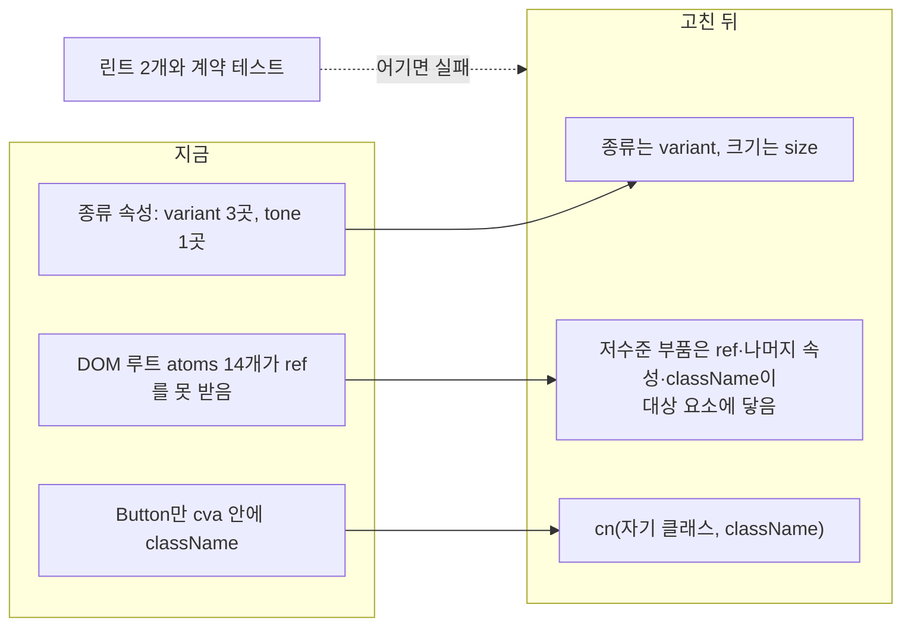
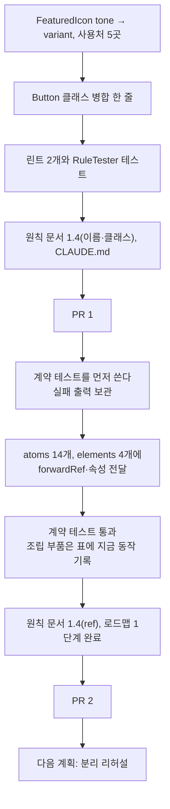

# 디자인 시스템 1단계: 공용 UI 부품 API 규칙(속성 이름·ref·클래스 병합)

<!-- plan-result:start — 이 블록만 병합 뒤에도 고칠 수 있다(.claude/CLAUDE.md "계획과 PR 본문"). 아래는 승인된 계획 원문 -->

## 구현 결과

> #652 · 2026-11-19 대조 · 이탈 0 · 미구현 0 — Phase 1(PR 1). 판정 근거(파일:줄)는 PR 본문 "계획 대비 구현"

- 범위: 이 대조는 Phase 1(PR 1, 속성 이름·클래스 병합·린트)만 본다. Phase 2(ref·나머지 속성 전달, 계약 테스트)는 아래 #657 줄에서 대조했다
- 이탈·미구현 없음. `FeaturedIcon`의 `tone`은 `variant`가 됐고(사용처 5곳과 스토리), `Button`은 `cn(buttonVariants(…), className)`으로 합친다. 린트 2개는 계획대로 허용 목록 방식이고 규칙 테스트는 통과 19개, 위반 10개 사례다
- 계획에 없던 변경(문서): 원칙 문서 §1.4에 "규칙을 쓰는 모습", "린트가 보는 것과 못 보는 것", "이 규칙으로 생기는 제약" 절과 다시 볼 조건 하나(허용 목록에 없는 축이 필요해질 때)를 더했다. §6에는 계획의 cva 키 세기 말고도 린트가 실제 파일에서 막는지, 전후 `class` 문자열 비교, 부분 클래스 속성 세기를 적었다
- 계획에 없던 변경(문서): `FE-ARCHITECTURE.md` 린트 규칙 표에 새 규칙 두 줄을 더했다. 로드맵 §5의 1단계 상태 칸은 계획에서 Phase 2 때 "완료"로 바꾸기로 한 줄인데, 이번에 "속성 이름·클래스 병합은 끝남, ref·속성 전달이 남음"으로 먼저 고쳤다
- 계획과 달라진 서술(구현 중 원문 대조): shadcn 원본도 `className`을 cva 안팎 두 꼴로 섞어 쓴다는 것을 확인해 제약 항목으로 적었다. SEED의 알림 상자는 `tone` 축 하나만 둔다(계획 Context는 배지와 묶어 "따로 둔다"고 적었다). 계획이 `<부분>ClassName`이라 본 5개 가운데 `FilterChip`의 `activeClassName`은 부분이 아니라 상태 클래스다. 계획 Context의 MUI·Ant Design·Mantine은 구현 날 원문을 직접 대조하지 않아 원칙 문서 선례 표에 싣지 않았다
- 계획과 달라진 확인 방법: 린트 확인은 `pnpm lint` 전체 대신 위반을 넣은 파일에 `pnpm exec eslint`를 돌렸다. 전후 비교는 `FeaturedIcon` 값 4개 대신 넘기지 않은 경우를 더한 5가지에 `className` 유무를 곱해 `Button`과 합쳐 122개 조합으로 했다
- 대조 뒤 보완: 원칙 문서 "린트가 못 보는 것" 표에 빠져 있던 경우(변수로 넘긴 cva 설정, `cn()`이 아닌 함수로 합친 경우 등)를 더했다. 로드맵 "API 규칙" 행에서 세는 방법이 문서에 없던 "14개"를 뺐다(세는 명령은 Phase 2에서 더한다)
- 기록 안 된 약속 → 보완함: 전후 비교에 쓴 임시 테스트 파일은 사용자가 지웠고 이 PR의 커밋에 들어가지 않았다
- 문서 동기화: 원칙 문서 머리말과 관련 문서 링크, `FE-ARCHITECTURE.md` 마지막 검토 날짜, 로드맵 §5 표 서식, 계획 색인

> #657 · 2026-11-19 대조 · 이탈 1 · 미구현 0 — Phase 2(PR 2). 판정 근거(파일:줄)는 PR 본문 "계획 대비 구현"

- 범위: 이 대조는 Phase 2(PR 2, ref·나머지 속성 전달과 계약 테스트)만 본다. 이 PR로 로드맵 1단계가 "완료"가 됐다
- 이탈(범위, 구현 중 판단): 계획은 Radix 부품을 그대로 내보낸 16개를 모두 계약 대상에서 빼기로 했으나, 계약 테스트는 그 가운데 자기 DOM 요소가 있는 7개(`DialogTrigger`·`DialogClose`·`AlertDialogTrigger`·`TooltipTrigger`·`DropdownMenuGroup`·`DropdownMenuRadioGroup`·`SelectGroup`)를 그려 검사한다. 계획의 다른 결정("내보낸 부품을 모두 그린다")을 따른 것이다. 계약 밖은 수는 16개로 같지만 구성이 다르다: 자기 DOM 요소가 없는 10개, jsdom에서 Radix가 그리지 않는 3개, `SelectValue`, `LinkThumbnail`, `Toaster`
- 계획에 없던 발견: Radix의 `SelectValue`는 `className`을 받지 않아 계약 밖에 뒀다(코드는 고치지 않았다). 하이픈이 든 속성(`aria-label` 등)은 타입에서 빼도 JSX에서 타입 오류가 나지 않는다. 그래서 버튼을 감싼 4개는 나머지 속성을 먼저 펼치고 부품이 정하는 속성을 그 뒤에 적으며, 이 순서를 테스트로 고정했다
- 계획에 없던 변경(코드): `EditButton`은 `aria-label`·`title`, `FilterChip`은 `aria-pressed`도 타입에서 뺐다(계획은 `type`·모양·`children`). `RequiredMark`도 `children`을 받지 않고, 나머지 속성을 열면서 `aria-hidden`을 쓰는 쪽이 바꿀 수 있게 됐다. `FilterChipProps`를 내보낸다
- 계획에 없던 변경(코드, 공개 Storybook에 드러남): `ActionChip`의 `aria-label`, `FilterChip`의 `id`·`name`을 따로 적은 속성에서 나머지 속성으로 옮겼다. 쓰는 쪽 코드는 그대로지만 Storybook 자동 속성 표에서 이 세 줄이 빠진다(표는 인터페이스에 직접 적은 속성만 보여 준다). `Badge`의 표는 그대로이고, `FilterChip`의 `className`은 인터페이스에 직접 적어 표에 나온다
- 계획에 없던 변경(테스트): 버튼을 감싼 4개가 스스로 정한 속성을 넘겨받은 값으로 바꾸지 않는지 보는 검사 4건, 조립 표의 셋째 값 "받지만 다른 요소로 간다"(`FormInput`·`FormInputPassword`의 나머지 속성, `KebabMenu`의 `className`), 표에 적은 atoms 이름이 실제로 있는지 보는 검사를 더했다. 테스트 파일 이름은 `.tsx` 파일 이름 규칙(PascalCase)에 맞춰 `ApiContract.test.tsx`가 됐다
- 계획에 없던 변경(문서): 원칙 문서 §1.4에 "계약 테스트가 보는 것과 못 보는 것" 소절, 코드 예시와 펼치는 순서 설명, 제약 3개, 선례 3줄(SEED·shadcn·Polaris의 `ref` 처리), 다시 볼 조건 하나(`LinkThumbnail` 분류)를 더했다. §6에는 측정 명령 말고도 일부러 깬 확인, 타입 확인, Storybook 속성 표 확인을 적었다. `.claude/CLAUDE.md`는 Phase 1 줄에 덧붙이지 않고 바로 아래 새 항목으로 적었다
- 계획과 달라진 서술: 타입이 `ref`를 받는다고 적혀 있던 부품은 넷이 아니라 `Spinner`를 더한 다섯이다. 고치기 전부터 맞았던 elements는 `SheetDialogContent`를 더한 넷이고, 대상 요소 정의에 "창을 그리는 부품은 창 패널"이 더해졌다. 계획 Context의 SEED `package.json`(`react >=18.0.0`)과 Radix Composition 인용은 구현 날 원문을 다시 대조하지 않아 원칙 문서에 싣지 않았다
- 대조 뒤 보완: 조립 표에서 한 줄을 지워 표 검사가 실패하는 출력을 다시 남겼다. Storybook 속성 표의 "세 줄이 빠진다"는 공개 Storybook(고치기 전)과 고친 뒤 표를 직접 읽어 확인했다. 원칙 문서에 `RequiredMark`의 `aria-hidden`, 두 "16개"가 다른 묶음이라는 설명, "DOM 요소가 없는 atoms는 계약 밖 표에 적는다"를 더했다. 마지막 수정 뒤 `pnpm test`·`pnpm test:storybook`을 다시 돌렸다
- 문서 동기화: 원칙 문서 머리말과 읽는 법, 로드맵 "API 규칙" 행의 줄 번호, 1단계 행의 PR 링크와 표 서식, 계획 색인

<!-- plan-result:end -->

> 공용 UI 부품의 종류 속성 이름을 `variant` 하나로 맞추고, 저수준 부품이 `ref`·나머지 속성·`className`을 대상 요소로 넘기게 고친 뒤, 린트 2개와 계약 테스트로 다시 어긋나지 않게 막는다. PR 둘로 낸다. 화면 모양·문구·동작은 바뀌지 않는다. 이 계획이 끝나면 로드맵 1단계가 "완료"가 되고, 다음은 **분리 리허설 계획**이다.

## Context

- **요청**: "API 규칙 계획 세워줘". [로드맵](../DESIGN-SYSTEM-ROADMAP.md) §5의 1단계에 남은 일이다("속성 이름·ref·클래스 병합 규칙").
- **왜**: 공용 UI를 다른 프로젝트에서 쓰는 패키지로 키우려면, 쓰는 쪽이 부품마다 속성 이름과 `ref`·`className`이 통하는지를 외우지 않아도 되어야 한다. 패키지를 낸 뒤에 속성 이름을 바꾸면 쓰는 쪽 코드가 깨지므로 내기 전에 정한다.
- **새 전제(사용자, 2026-11-19)**: 다음 프로젝트는 React 19 기반 Next.js일 확률이 높다. 이 앱의 설치본은 React 18.3.1이다(`node_modules/react/package.json`).
- **지금 상황** (2026-11-19 직접 확인, `main` fdb651f0)
  - **속성 이름**: cva를 쓰는 파일은 4개다. 종류 키가 `variant`인 것이 `button.tsx:11`·`badge.tsx:9`, `tone`인 것이 `featured-icon.tsx:10`이다(`label.tsx`는 변형이 없다). `DropdownMenuItem`은 cva 없이 `variant`를 받는다(`dropdown-menu.tsx:318`). 모양과 뜻을 속성 두 개로 따로 고르는 부품은 0개다.
  - **사용처**: `FeaturedIcon`의 `tone`은 5곳(파일 4개)이다.
  - **ref**: atoms가 내보내는 부품 76개(파일을 정규식으로 훑은 값) 중, 루트가 DOM 요소인데 `forwardRef`가 아닌 것이 14개(파일 11개)다. 그중 `Divider`·`Kbd`·`KbdGroup`·`DropdownMenuShortcut`은 타입이 `ref`를 받는다고 적혀 있다(`React.ComponentProps<'div'>`, `React.RefAttributes`).
  - **나머지 속성**: 위 14개 중 `FeaturedIcon`·`LabeledDivider`·`RequiredMark`는 나머지 속성을 루트에 펼치지 않는다.
  - **클래스 병합**: `button.tsx:54`만 `cn(buttonVariants({ variant, size, className }))`이고 나머지는 `cn(자기 클래스, className)`이다. `cn(className, …)`처럼 앞에 둔 곳은 0건이다.
  - **버튼·입력을 감싼 elements**: `ToggleButton`·`PasswordInput`·`SearchInput`은 이미 `forwardRef`로 넘긴다. `ActionButton`·`ActionChip`·`EditButton`·`FilterChip`은 `ref`와 나머지 속성을 받지 않고, `FilterChip`은 `className`도 받지 않는다. 넷 다 운영 코드 사용처가 1곳씩이다.
  - **검사 선례**: 린트 규칙을 `RuleTester`로 고정한 테스트가 있다(`src/test/scripts/ui-boundary-rule.test.ts`).
- **선례** (가져오기 도구가 받은 원문 발췌)

  | 주제 | 내용 | 출처 |
  | --- | --- | --- |
  | 이름 | 뜻(색) 속성을 따로 두지 않고 `variant` 값에 `destructive`를 둔다 | [shadcn Button](https://ui.shadcn.com/docs/components/button) |
  | 이름 | 버튼은 `variant="criticalSolid"`, 배지·알림 상자는 `tone`을 따로 둔다 | [SEED ActionButton](https://seed-design.io/react/components/action-button), [SEED Badge](https://seed-design.io/react/components/badge) |
  | 이름 | 버튼에 `variant`와 `color="danger"`를 따로 둔다 | [TDS Mobile Button](https://tossmini-docs.toss.im/tds-mobile/components/button/) |
  | 이름 | `variant`와 `tone`(Polaris), `variant`와 `color`(MUI·Ant Design·Mantine)를 따로 둔다 | [Polaris Button 소스](https://github.com/Shopify/polaris/blob/main/polaris-react/src/components/Button/Button.tsx), [MUI API 가이드](https://mui.com/material-ui/guides/api/) |
  | ref | _"React 19에서는 `forwardRef`가 더는 필요하지 않습니다. 대신 `ref`를 prop으로 넘기세요."_ (번역) | [react.dev forwardRef](https://react.dev/reference/react/forwardRef) |
  | ref | _"DOM 노드는 보통 버튼이나 텍스트 입력처럼 재사용하는 저수준 컴포넌트에서 노출하고, 아바타나 댓글 같은 애플리케이션 수준 컴포넌트에서는 노출하지 않습니다."_ (번역) | [react.dev forwardRef](https://react.dev/reference/react/forwardRef) |
  | ref | `react >=18.0.0`을 지원하며 부품을 `React.forwardRef`로 만든다 | [SEED package.json](https://github.com/daangn/seed-design/blob/dev/packages/react/package.json), [ActionButton.tsx](https://github.com/daangn/seed-design/blob/dev/packages/react/src/components/ActionButton/ActionButton.tsx) |
  | ref | _"컴포넌트가 `ref`를 받지 않으면 깨집니다."_ (번역, `asChild`로 넘기는 부품 이야기) | [Radix Composition](https://www.radix-ui.com/primitives/docs/guides/composition) |
  | 클래스 | `cn(badgeVariants({ variant }), className)`, SEED는 `clsx(자기 클래스, className)` | [shadcn Badge](https://ui.shadcn.com/docs/components/badge), SEED 소스(위 링크) |

## 판단이 필요했던 항목

| 항목 | 결정 | 근거·기각한 대안 |
| --- | --- | --- |
| 종류 속성 이름 | **결정(사용자)**: `variant` 하나. 고르는 축이 하나면 `variant`, 모양과 뜻을 따로 고르는 부품이 생기면 뜻 축을 `tone`으로 더한다. 크기는 `size` | 축이 하나인 부품에서 "모양인가 뜻인가"를 판단할 일이 없고 린트로 막을 수 있다. 기각: 이름 둘에 뜻을 주고 코드는 그대로(SEED 모양. `destructive`가 두 속성에 걸친 예외 3곳이 남는다), 뜻은 전부 `tone`(TDS·Polaris 모양. 버튼 모양×위험 조합의 생김새를 새로 정해야 하고 shadcn에서 부품을 들일 때마다 변환한다) |
| ref 구현 | **결정(사용자)**: `forwardRef`. React 18(이 앱)과 19(다음 프로젝트) 둘 다에서 돈다 | 이 저장소의 테스트로 확인할 수 있다. 기각: 이 앱을 React 19로 먼저 올리기(별도 계획이 필요하고 이 계획이 밀린다), ref는 손대지 않기(이 앱에서 규칙을 확인할 수 없다) |
| 적용 범위 | **결정(사용자)**: 저수준 부품만. atoms와, elements 중 버튼·입력처럼 DOM 하나를 감싼 것 | react.dev의 저수준 부품 문장(위 표). 기각: 범용 52개 전부(조립 부품의 루트 구조를 나중에 바꾸기 어려워진다), 규칙만 적기 |
| 새로 맞추는 elements | **제 판단**: `ActionButton`·`ActionChip`·`EditButton`·`FilterChip` 4개. `ToggleButton`·`PasswordInput`·`SearchInput`은 이미 맞다 | 넷 다 `Button` 하나를 감싼 부품이다. `CharacterCount`·`BackToTopButton` 등 나머지는 조립·표시 부품으로 보고 코드를 고치지 않는다 |
| 위 4개가 받는 나머지 속성 | **제 판단**: 기본 `button` 속성. 부품이 스스로 정하는 `type`·모양(`variant`·`size`)·`children`은 타입에서 빼 덮어쓸 수 없게 한다. `FilterChip`에 `className`을 더한다 | 부품이 정한 모양을 쓰는 쪽이 실수로 바꾸지 못하게 한다 |
| 대상 요소 | **제 판단**: 루트 요소. 입력을 감싼 부품(`PasswordInput`·`SearchInput`)은 입력 요소 | 지금 동작 그대로다. 폼 라이브러리가 입력 요소의 ref를 쓴다 |
| 대상에서 뺀 atoms | **제 판단**: `LinkThumbnail`(분류가 분리 리허설로 미뤄져 있고 `className`이 루트가 아닌 `img`로 간다), `Toaster`(루트가 sonner 부품), `DropdownMenu`·`Select`(DOM이 없는 상태 래퍼), Radix 부품을 그대로 내보낸 16개 | 계약 표에 이유와 함께 적는다 |
| 클래스 병합 | **제 판단**: `cn(자기 클래스, className)`으로 `className`을 맨 뒤에 둔다. cva가 만든 함수에는 `className`을 넘기지 않는다. 부분을 꾸미는 속성 이름은 `<부분>ClassName` | shadcn Badge·SEED와 같은 모양이고 지금 코드 4곳 중 3곳이 이 형태다. `<부분>ClassName`은 지금 있는 5개의 이름 그대로다. `Button`의 결과 클래스는 바뀌지 않는다 |
| 조립 부품(나머지 elements·layouts) | **제 판단**: 코드를 고치지 않는다. 계약 표에 지금 동작(`className`이 루트로 가는지, 받지 않는지)을 적고, 루트로 가는 것만 테스트로 고정한다 | 사용자가 고른 범위("저수준 부품만")를 따른다 |
| 검사 | **제 판단**: 린트 2개(cva 키 이름, `className` 자리)와 계약 테스트 1개. cva 키는 허용 목록(`variant`·`size`·`tone`)으로 막고 `tone`은 `variant`가 함께 있을 때만 통과한다 | 공통 지침 "규칙은 검사로 먼저". 허용 목록은 경계 린트(1단계)와 같은 방식이다. 기각: 금지 이름 목록(`color`·`kind` 등 새 이름을 다 적어야 한다), 문서만 |
| 계약 테스트의 모양 | **제 판단**: atoms 파일을 훑어 내보낸 부품을 모두 그리고 `ref`·`className`·`data-*`가 같은 요소에 닿는지 본다. 부모가 필요한 Radix 부분은 표에 그리는 법을 적고, jsdom에서 그릴 수 없는 것은 이유와 함께 건너뛴다. elements·layouts는 표에 없으면 실패한다 | 새 부품이 표나 규칙을 거치지 않고 들어오지 못한다. 기각: 소스 모양만 보는 린트(`className`·속성 전달을 확인하지 못한다) |
| 기록 위치 | **제 판단**: 원칙 문서 §1에 "1.4 API 규칙" 절을 더하고 정한 이유·기각한 대안·다시 볼 조건을 함께 적는다. `DECISIONS.md`와 `CHANGELOG.md` 항목은 없다 | 1단계 선례(§1.3)와 같다. 화면 동작이 바뀌지 않는다 |
| PR 나누기 | **제 판단**: PR 1은 이름·클래스 병합·린트, PR 2는 ref·속성 전달·계약 테스트 | 두 묶음이 서로 기대지 않아 따로 되돌릴 수 있다 |
| 화면 확인 | **제 판단**: 녹화하지 않는다. 바꾸기 전후 렌더된 `class` 문자열 비교와 Storybook 테스트를 증거로 낸다 | 바뀌는 것이 속성 이름과 ref 전달뿐이라 화면에 드러나지 않는다 |
| 이번 계획에 넣지 않는 것 | **제 판단**: 메뉴 항목 3곳의 `className="text-destructive"`를 `variant`로 옮기기, `DropdownMenuItem`의 스타일 없는 값 3개 정리, "속성이 있으면 속성, 없으면 Provider 문구" 규칙, `'use client'` | 첫째는 포커스 배경색이 달라지는 화면 변경이다. 셋째는 해당하는 부품이 0개다. 넷째는 로드맵 3단계 "정할 것"에 이미 있다 |

### 뒤집힌 전제

| 발견 | 그래서 바뀐 것 |
| --- | --- |
| 질문 때 "ref를 안 넘기는 atoms 10개"라고 한 것은 파일 단위로 센 값이었다. `forwardRef`를 쓰는 파일 안에도 ref를 안 넘기는 부분이 5개 있다 | 대상을 부품 단위(14개, 파일 11개)로 적는다 |
| "`variant` 하나로 가면 나중에 다시 갈린다"는 제 예측이었고, 모양과 뜻을 따로 고르는 부품은 0개다 | 추천을 "코드 그대로"에서 "`variant` 하나"로 바꿨고 사용자가 그것을 골랐다 |
| 다음 프로젝트가 React 19일 확률이 높다 | ref 구현을 18·19 둘 다에서 도는 `forwardRef`로 정하고, 19로 올릴 때 할 일을 규칙에 적는다 |
| `Divider`·`Kbd`·`KbdGroup`·`DropdownMenuShortcut`의 타입은 `ref`를 받는다고 적혀 있다 | `forwardRef`로 타입과 동작을 맞춘다. React 18에서 실제로 ref가 닿지 않는다는 것은 계약 테스트의 첫 실패 출력으로 확인한다(지금은 react.dev 문장에서 끌어낸 추론이다) |
| 1단계 계획은 "린트 규칙에 테스트 선례가 없다"고 봤다 | 지금은 선례가 있어 새 규칙도 `RuleTester` 테스트를 쓴다 |

### 위험 관리

- **타입 충돌**: `React.ComponentProps<'div'>`는 `ref`를 포함해 `forwardRef`의 속성 타입과 겹친다. `ComponentPropsWithoutRef`로 바꾼다.
- **속성 충돌**: elements 4개에 나머지 속성을 열면 부품이 정한 `type`·`onClick`과 겹칠 수 있다. 타입에서 빼고 `pnpm type-check`로 확인한다.
- **Storybook 속성 표**: `forwardRef`로 바꾼 부품의 자동 문서가 유지되는지 `pnpm test:storybook`과 `Badge` 스토리 화면으로 확인한다. 기존 `forwardRef` 부품처럼 `displayName`을 단다.
- **다른 세션의 워크트리**: `confirm-dialog-base-rule`·`sandbox-trial` 두 개가 있다. 앞의 것은 `GlobalAlertDialogs.tsx`와 문서 여러 개를 고치는 중이고 이 계획이 고치는 atoms 파일과는 겹치지 않는다. `docs/PLANS-INDEX.md`는 늦게 병합하는 쪽이 `pnpm docs:index`로 다시 만든다. dev 서버는 띄우지 않는다.
- **배포**: `src/`가 바뀌므로 병합마다 배포 워크플로가 돈다. 그 커밋 SHA가 success인지 확인한 뒤 보고한다.

## 세부 계획

### Phase 1 (PR 1) — 속성 이름, 클래스 병합, 린트

| 위치 | 변경 내용 |
| --- | --- |
| `src/shared/ui/atoms/featured-icon.tsx` | cva 키와 속성 `tone`을 `variant`로 바꾼다. 값 4개와 클래스는 그대로 둔다 |
| `src/features/auth/email-verification/ui/VerifyEmailStatus.tsx:28,31`, `src/features/auth/signup/ui/SignUpForm.tsx:59`, `src/features/auth/password-reset/ui/RequestPasswordResetForm.tsx:29`, `src/features/auth/password-reset/ui/ConfirmPasswordResetForm.tsx:33` | `tone=`을 `variant=`로 바꾼다 |
| `src/shared/ui/atoms/featured-icon.stories.tsx` | `argTypes`·`args`·스토리 안의 `tone`을 `variant`로, 스토리 `AllTones`를 `AllVariants`로 바꾼다 |
| `src/shared/ui/atoms/button.tsx:54` | `cn(buttonVariants({ variant, size }), className)` |
| `scripts/lib/ui-api-rule.js`, `.d.ts` (신규) | 규칙 `cva-variant-keys`: cva `variants`의 키는 `variant`·`size`·`tone`만 통과하고 `tone`은 `variant`가 함께 있을 때만 통과한다. 규칙 `classname-last`: `cn()` 인자 중 `className`은 맨 뒤여야 하고, 같은 파일에서 cva로 만든 함수의 인자에 `className`·`class`를 넣지 못한다. 본뜬 파일: `scripts/lib/ui-boundary-rule.js` |
| `src/test/scripts/ui-api-rule.test.ts` (신규) | `RuleTester`로 통과·위반 사례를 고정한다. 본뜬 파일: `src/test/scripts/ui-boundary-rule.test.ts` |
| `eslint.config.js` | `custom-design-system` 플러그인에 규칙 2개를 등록한다. 대상은 `src/shared/ui/**/*.{ts,tsx}`(앱 전용 부품 포함, 스토리·테스트 제외) |
| `docs/DESIGN-SYSTEM-PRINCIPLES.md` | §1에 "1.4 API 규칙" 절을 더한다: 속성 이름과 클래스 병합 규칙, 정한 이유, 기각한 대안, 다시 볼 조건(모양과 뜻을 따로 고르는 부품이 처음 생길 때), 선례 링크. §6에 cva 키를 세는 명령을 더한다 |
| `docs/DESIGN-SYSTEM-ROADMAP.md:196` | "API 규칙" 행의 현재 상태·근거·잰 날을 고친다 |
| `.claude/CLAUDE.md` | Critical Rules에 한 줄을 더한다: 공용 UI 부품의 종류 속성 이름과 `className` 자리, 린트 이름, 정본은 원칙 문서 §1.4 |
| `docs/plans/2026-11-19-design-system-api-rules.md` (신규), `docs/PLANS-INDEX.md` | 계획 스냅샷과 구현 결과 블록, 색인 재생성 |

### Phase 2 (PR 2) — ref·속성 전달, 계약 테스트

| 위치 | 변경 내용 |
| --- | --- |
| `src/shared/ui/api-contract.test.tsx` (신규) | 먼저 쓴다. atoms의 내보낸 부품을 훑어 `ref`·`className`·`data-*`를 넘기고 같은 요소에 닿는지 단언한다. 부모가 필요한 부분은 그리는 법을, 뺀 것은 이유를 표로 적는다. elements·layouts는 표에 `ref`·나머지 속성·`className` 각각 "대상 요소로 간다 / 받지 않는다"를 적고, 표에 없는 부품이 있으면 실패한다. `render`는 `src/test/utils.tsx`의 것을 쓴다. 고치기 전 실패 출력을 PR에 남긴다 |
| `src/shared/ui/atoms/badge.tsx`, `divider.tsx`, `skeleton.tsx`, `spinner.tsx`, `kbd.tsx`(`Kbd`·`KbdGroup`), `dialog.tsx`(`DialogHeader`·`DialogFooter`), `alert-dialog.tsx`(`AlertDialogHeader`·`AlertDialogFooter`), `dropdown-menu.tsx`(`DropdownMenuShortcut`) | `forwardRef`로 감싸 `ref`를 루트에 넘긴다. 속성 타입은 `ref`를 뺀 것으로 바꾸고 `displayName`을 단다. `KbdGroup`의 타입을 실제 요소 `kbd`에 맞춘다 |
| `src/shared/ui/atoms/featured-icon.tsx`, `labeled-divider.tsx`, `required-mark.tsx` | `forwardRef`와 함께 나머지 속성을 루트에 펼친다. `FeaturedIcon`은 `children`을 받지 않는다 |
| `src/shared/ui/elements/ActionButton.tsx`, `ActionChip.tsx`, `EditButton.tsx`, `FilterChip.tsx` | `forwardRef`로 `ref`와 나머지 `button` 속성을 안쪽 `Button`에 넘긴다("위 4개가 받는 나머지 속성" 결정). `FilterChip`은 `className`을 받아 맨 뒤에 합친다 |
| `docs/DESIGN-SYSTEM-PRINCIPLES.md` | §1.4에 ref·속성 전달 규칙, 대상 요소, 적용 범위와 뺀 부품, 다시 볼 조건(이 앱이 React 19로 올라가면 `forwardRef`를 걷어 낸다, 조립 부품에 실제 필요가 생기면 계약 표의 그 줄을 바꾼다)을 더한다. 계약 표의 정본은 테스트 파일이고 문서는 링크한다. §6 측정 명령을 더한다 |
| `docs/DESIGN-SYSTEM-ROADMAP.md:196`, `:229` | "API 규칙" 행을 고치고 1단계를 "완료"로 바꾼다 |
| `.claude/CLAUDE.md` | Phase 1에서 더한 줄에 ref·속성 전달과 계약 테스트를 덧붙인다 |
| 계획 결과 블록, `docs/PLANS-INDEX.md` | Phase 2 결과를 덧붙이고 색인을 다시 만든다 |

**§1.4에 적을 규칙 문장**

1. 종류를 고르는 속성은 `variant`, 크기는 `size`다. 모양과 뜻을 따로 골라야 하는 부품에서만 뜻 축을 `tone`으로 더한다.
2. 저수준 부품(atoms, 버튼·입력 하나를 감싼 elements)은 `ref`와 나머지 속성을 대상 요소에 넘긴다. 대상 요소는 루트이고 입력을 감싼 부품은 입력 요소다. React 18을 지원하는 동안 `forwardRef`로 만든다.
3. `className`은 대상 요소에 `cn(자기 클래스, className)`으로 맨 뒤에 합친다. 부분을 꾸미는 속성은 `<부분>ClassName`이다.
4. 조립 부품은 계약 표에 적힌 것만 약속한다.

## 영향 범위

- **쓰는 쪽 코드가 바뀌는 곳**: `FeaturedIcon` 사용처 5곳(파일 4개)과 스토리 1개뿐이다. 나머지는 속성이 그대로이거나 늘어나기만 한다.
- **공유 코드**: `Button`은 모든 화면이 쓰지만 결과 클래스가 같다. `forwardRef`로 바꾸는 부품은 `ref`를 넘기지 않는 한 동작이 같다. 구현 전에 `pnpm graph:focus "<경로>" --text`로 14개 atoms와 4개 elements의 실제 사용처를 뽑아 PR 본문에 요약한다.
- **이전 동작을 단정하는 테스트**: 기존 테스트의 단언은 바꾸지 않는다. 스토리의 `tone` 인자만 이름이 바뀐다.
- **문서**: `DESIGN-SYSTEM-ROADMAP.md:196`이 가리키는 줄 번호(`featured-icon.tsx:10`, `button.tsx:54`, `badge.tsx:32`)가 밀린다. `pnpm check:docs`로 확인한다.
- **데이터 계약·API·화면 문구**: 바뀌지 않는다. 배포 순서 제약이 없다.

## 검증 방법

- **작업 환경**: `git log origin/main..main`과 `git worktree list` 확인 → 워크트리 → `.env` 복사(거부되면 우회하지 않는다), `pnpm install --frozen-lockfile`. `node -v`가 v24인지 본다.
- **React API**: `forwardRef`를 더하므로 구현 전에 [react.dev forwardRef](https://react.dev/reference/react/forwardRef) 문서를 다시 받아 확인하고 PR과 원칙 문서에 링크한다.
- **검사 묶음(PR마다)**: `pnpm type-check`, `pnpm test`, `pnpm test:storybook`, `pnpm lint`, `pnpm check:deps`, `pnpm format:check`, `pnpm check:docs`. e2e는 PR CI 전체 실행으로 확인한다.
- **린트가 실제로 막는지(PR 1)**: 디스크의 부품 파일에 잠깐 넣어 `pnpm lint` 오류 출력을 남기고 되돌린다. cva 키 `tone`만 있는 경우, 키 `color`, `cn(className, '…')`, `xVariants({ className })` 네 가지다.
- **화면이 그대로인지(PR 1)**: 바꾸기 전후에 `Button`의 `variant`×`size` 조합과 `FeaturedIcon` 값 4개를 그려 `class` 문자열이 같은지 비교한 출력을 남긴다.
- **계약 테스트(PR 2)**: 부품을 고치기 전에 돌려 14개 atoms와 4개 elements가 실패하는 출력을 남기고, 고친 뒤 통과를 확인한다. 통과한 뒤 부품 하나의 `ref` 전달을 일부러 지워 다시 실패하는지 본다.
- **PR마다**: `plan-verifier` 대조, `pnpm docs:index`, `pnpm check:pr-body`, PR CI 통과, 사용자 승인 뒤 squash 병합, 배포 워크플로 success 확인, 워크트리 정리.
- **완료 조건**
  - `src/shared/ui`의 cva `variants` 키가 `variant`·`size`뿐이고(`grep`), `pnpm lint`가 통과한다.
  - 계약 테스트가 통과하고, 건너뛴 부품마다 이유가 표에 있다.
  - 로드맵 §5의 1단계 상태가 "완료"다.
  - 두 PR의 병합 커밋이 배포 워크플로에서 success다.
- **바꾸면 안 되는 것**: 화면 모양·문구·동작, `src/shared/config/texts.ts`, `e2e/` 파일, 기존 테스트의 단언, 대상 밖 부품의 코드(`LinkThumbnail`, 조립 elements·layouts), `docs/plans`의 기존 파일, `DECISIONS.md`의 과거 항목.

## 남은 것

- **분리 리허설 계획** — 이 계획 다음이다. 부품 몇 개를 저장소 안 패키지로 떼어 빈 예제 앱과 이 앱이 그 패키지로 화면을 그리는지 확인한다. `LinkThumbnail`·`TooltipWrapper`의 분류, 보조 모듈의 자리, 범용 부품의 스토리·테스트가 앱 코드를 쓰는 것을 그때 정한다. 예제 앱을 React 19·Next.js로 만들지는 그 계획의 질문으로 낸다.
- **React 19 업그레이드** — 정해진 것이 없다. 올리는 날 `forwardRef`를 걷어 내고 §1.4 규칙 2의 구현 문장을 바꾼다.
- **메뉴 항목의 위험 색** — `PostCard.tsx:179`, `FolderSidebar.tsx:340`, `MobileFolderList.tsx:268`이 `variant="destructive"` 대신 `className`으로 색을 넣는다. 옮기면 포커스 배경색이 달라져 화면 미리보기와 확인이 필요하다. `DropdownMenuItem`의 `variant` 값 5개 중 3개는 스타일이 없다.
- **조립 부품의 ref·className** — 실제 필요가 생기면 계약 표의 그 줄과 코드를 함께 바꾼다. `className`을 받지 않는 범용 부품은 `FilterChip`을 빼면 8개가 남는다.
