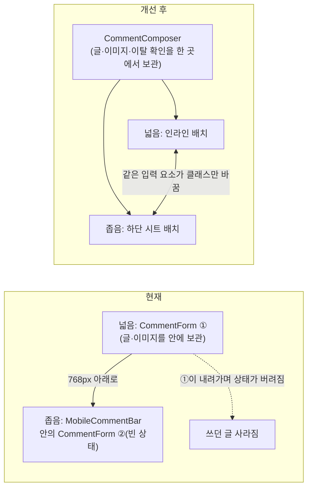
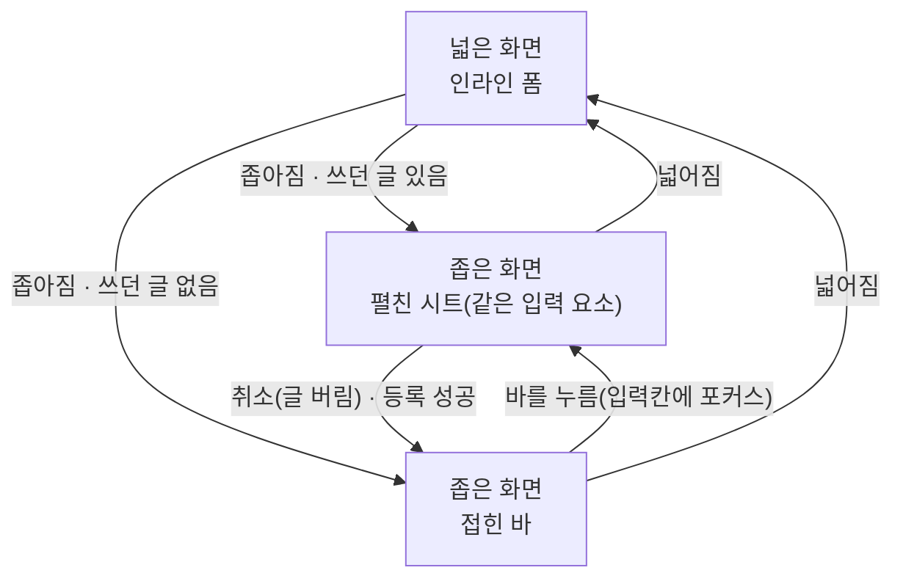

# 화면 폭이 바뀌어도 쓰던 입력을 지킨다 — 댓글 폼(1단계)·북마크 화면(2단계)

<!-- plan-result:start — 이 블록만 병합 뒤에도 고칠 수 있다(.claude/CLAUDE.md "계획과 PR 본문"). 아래는 승인된 계획 원문 -->

## 구현 결과

> #658 · 2026-11-19 대조 · 이탈 4 · 미구현 0 — 판정 근거(파일:줄)는 PR 본문 "계획 대비 구현"

- 1단계(댓글, PR 1)만 대조했다. 2단계(북마크)는 아래 #662 줄에서 대조했다
- 이탈(구현 중 발견): 좁은 화면 시트에 옛 클래스를 그대로 쓰지 않고 `md:hidden`을 뺐다. 남기면 창이 넓어질 때 CSS가 React보다 먼저 시트를 숨겨 입력칸의 포커스가 빠졌다. 접힌 바의 `md:hidden`은 그대로다
- 이탈(검증 방법): 완료 조건이 든 "펼침 조정을 렌더 뒤로 미루기"는 폭 경계에서 펼침 기록을 지우는 쪽으로 해 보니 실패하는 테스트가 없었다. 지우는 시점만 한 렌더 늦을 뿐 화면 결과가 같은 변경이라서다. 대신 "쓰던 글이 있을 때 시트를 펼쳐 두는 줄 끄기"와 "래퍼에 폭마다 다른 `key` 주기"로 새 테스트가 실패하는 것을 확인했다. 아래 보완 뒤에 생긴 "펼쳐 두기"는 렌더 뒤로 미루면 단위 테스트 2건이 실패한다
- 대조 뒤 찾아 보완함: 쓰던 글 때문에 펼쳐진 시트가 글을 다 지우거나 등록을 누르는 순간(폼은 요청 전에 입력칸을 비운다) 접혔다. 계획 그림은 시트가 취소·등록 성공에만 접힌다. 판단 표의 "쓰던 글이 있으면 접히지 않는다"를 그리는 조건에 그대로 넣은 탓이다. 펼침을 세 값(접힘·눌러 펼침·쓰던 글이 있어 펼쳐 둠)으로 바꿔, 펼쳐 둔 시트도 눌러 펼친 시트와 같은 때에만 접히게 했다. 단위 테스트 2건을 더했다(고치기 전 코드에서 실패)
- 이탈(절차): 워크트리를 만들 때 `.env` 복사가 권한에서 거부돼 하지 않고 진행했다. 이번 검증에는 `.env`가 필요하지 않았다(e2e는 `.env.test`, 단위·스토리는 MSW)
- 이탈(절차): 계획은 녹화 확인(5) 뒤 문서·기록(6)인데, 변경 후 영상을 띄우고 답을 기다리는 동안 문서·기록·계획 복사를 먼저 했다. 커밋은 사용자 답 뒤에 했다
- 계획에 없던 변경: React가 폭 변화를 늦게 알아도 포커스가 남는지 보는 e2e 1건(위 `md:hidden` 회귀용). 좁은 화면에서는 시트가 펼쳐져 있어도 `#comments` 포커스를 받지 않게 한 것과 그 단위 테스트(전 동작 유지). 판단 표 결정을 지키는 단위 테스트 5건
- 계획 문구 정정: "영향 범위"의 "넓은 화면에서 등록 응답을 기다리며 새로 쓴 글이 남는다"는 "좁은 화면에서"가 맞다. 판단 표와 구현은 좁은 화면 시트 기준이다
- 계획에 없던 변경(문서 동기화): `docs/COMMENT.md`의 상태 모델·운영 파라미터·검증 결과·남은 것·용어 사전, responsive-ux skill의 토스트 선례 문장과 z-index 표, `eslint.config.js` 주석의 옛 이름, 표 정렬

> #662 · 2026-11-19 대조 · 이탈 2 · 미구현 2 — 2단계(북마크, PR 2). 판정 근거(파일:줄)는 PR 본문 "계획 대비 구현"

- 범위: 이 대조는 2단계(PR 2)만 본다
- 이탈(구현 중 발견·사용자 결정): 계획은 사이드바(`FolderSidebar.tsx`)·폴더 카드(`MobileFolderList.tsx`)를 "변경 없음"으로 뒀으나 고쳤다. "위험 관리"대로 실측하니 두 위험이 모두 나타났다. 숨는 구역의 이름 바꾸기 입력은 포커스가 빠지며 보이지 않는 채 저장됐고, 열린 ⋮ 메뉴는 버튼만 숨어 화면 왼쪽 위에 떠 남았다. 사용자가 "숨긴 채 남기기(저장하지 않음)"와 "메뉴 닫기"를 골랐고, 새 훅 `useFolderNavHiddenGuard`가 맡는다. 숨김 여부는 DOM이 아니라 폭 판정으로 본다. jsdom에 `checkVisibility`가 없어 단위 테스트로 지킬 수 없어서이고, 결정을 물을 때 설명한 방식(blur 순간 입력이 보이는지)과 다르다. 사용자가 보는 동작은 같다
- 이탈(검증 방법) → 보완함: 완료 조건의 "입력 화면 래퍼를 폭마다 다른 요소로 두기"를 대조 전에는 깨 보지 않았다. 대조 뒤 글 화면 래퍼를 넓은 화면에서만 `<main>`으로 두니 e2e 4건이 실패했다. 그 밖에 숨긴 채 남기기 끄기(5건), 경계 조정을 effect로 미루기(같은 5건), 메뉴 닫기·저장 막기 끄기(4건), 두 훅 깨기(단위 10건)를 확인했다
- 미구현 → 보완함: 판단 표 "글 화면을 감싸는 요소"의 "HTML 표준 문장은 구현 때 원문을 확인해 문서에 단다". 대조 뒤 HTML Living Standard §4.4.14 원문을 읽어 `docs/BOOKMARK.md` §5에 인용했다
- 미구현 → 보완함: 진행 순서 6의 `pnpm docs:index`(결과 블록을 붙인 뒤 돌림)
- 계획에 없던 변경: 위 결정을 지키는 e2e 2건(메뉴 닫힘)과 `useFolderNavHiddenGuard` 단위 테스트 7건
- 계획 문구와 다른 점: 폴더 카드 목록은 `MobileFolderList`의 `className`이 아니라 제목까지 감싼 바깥 `div`에 숨김을 준다. "바꾸지 않는 것"의 "경계를 넘지 않는 화면의 DOM"은 계획의 BookmarkPage 행대로 바깥 `div`가 한 겹 생기고 넓은 화면 `<main>`이 `div`가 됐다(기존 e2e는 단언 변경 없이 통과)
- 문서 동기화: `docs/BOOKMARK.md` 마지막 검토 날짜·§8 코드 지도·§9 검증 결과, responsive-ux skill 규칙 문장과 선례 표, 계획 색인

<!-- plan-result:end -->

> 창 폭이 768px 경계를 넘으면 쓰던 댓글이 사라지는 문제를 고치고(PR 1), 같은 구조인 북마크 화면의 입력도 지킨다(PR 2).
> 저장 위치: `docs/plans/2026-11-19-keep-input-across-breakpoint.md`.

## Context

**무엇이 문제인가.** 글 상세에서 댓글을 쓰다가 창을 좁히면(또는 좁은 화면에서 넓히면) 쓰던 글과 첨부 이미지가 사라진다.
2026-11-19에 녹화로 확인했다. 폭 판정은 창 폭만 본다(`src/shared/hooks/useIsMobile.ts`, 경계는
`src/shared/config/const.ts:44`의 `(width < 48rem)` = 768px). 그래서 폰 회전뿐 아니라 데스크톱 창 크기 조절로도 일어난다.

용어: **내린다(언마운트)** = React가 부품을 화면 트리에서 빼는 것. 이때 그 부품이 들고 있던 상태가 버려진다.

### 재현 절차 (댓글, 확인됨)

1. 1280px 폭의 글 상세에서 댓글 입력칸에 글자를 쓴다.
2. 창을 700px까지 줄인다 → 인라인 폼이 사라지고 하단에 접힌 바만 보인다.
3. 바를 눌러 펼친다 → 입력칸이 비어 있다. 다시 1280px로 넓혀도 비어 있다.

녹화본: 메인 체크아웃 `.claude/browser-artifacts/verify-2026-11-19-comment-draft-resize/1-comment-draft-lost-on-resize.webm`

### 근본 원인 (댓글, 코드 추적)

- `src/widgets/comment/comment-list/ui/CommentList.tsx:142-149`는 넓을 때만 `CommentForm`을, `:181`은 좁을 때만
  `MobileCommentBar`(그 안의 또 다른 `CommentForm`)를 그린다. 경계를 넘으면 한쪽이 내려가고 다른 쪽이 새로 올라온다.
- 쓰던 글(`useCreateComment.ts:70-73`), 첨부 이미지(`:93-110`), 실패 안내(`:79`), 이탈 확인 등록(`:128-130`)이 모두
  그 폼 인스턴스 안에 있다. 내려가면 함께 버려진다.
- react.dev는 _"제거되거나 같은 자리에 다른 컴포넌트가 그려지면 React는 그 state를 버린다"_ (번역, 가져오기 에이전트로
  읽음, [Preserving and Resetting State](https://react.dev/learn/preserving-and-resetting-state))고 쓴다.
- 답글·수정 폼은 폭으로 갈아 끼우지 않아 해당 없다(`CommentItem.tsx:156-165`).

### 가설 (북마크, 아직 재현 전)

- `src/pages/bookmark/BookmarkPage.tsx`는 return이 세 갈래다(`:49-56` 좁음·폴더 목록, `:59-120` 좁음·글 화면,
  `:126-170` 넓음). 갈래가 바뀌면 그 아래 부품이 모두 새로 올라온다.
- 입력 상태는 부품 안의 `useState`다(`useRenameBookmarkFolder.ts:18-19`, `useBookmarkSearch.ts:11`). 이탈 확인 등록은 없다.
- 그래서 제목 이름 바꾸기·제출 전 검색어·사이드바와 폴더 카드의 입력이 경계에서 사라질 것으로 본다. 2단계 첫 순서에서
  실패하는 테스트로 재현한다.



### 업계 표준 · 현재 · 개선 후

| | 내용 |
| --- | --- |
| 업계 표준 | react.dev가 드는 길은 ① CSS로 숨기기 ② 상태를 위로 올리기 ③ 바깥 저장소다(위 링크, 가져오기 에이전트로 읽음). Android 품질 지침은 화면 구성이 바뀔 때 _"입력란에 쓴 글자는 유지된다"_ (번역, 가져오기 에이전트로 읽음, [Adaptive app quality](https://developer.android.com/docs/quality-guidelines/adaptive-app-quality/tier-3))를 요구한다 |
| 현재 | 폭마다 다른 부품을 그리고 상태는 각 부품 안에 둔다 |
| 개선 후 | 댓글: ②로 상태를 올리고 같은 요소가 클래스만 바꾼다. 북마크: 양쪽에 자리가 있는 입력은 같은 방식, 자리가 없는 입력은 ①로 숨긴 채 남긴다 |

- 저장소 선례: `SheetDialogContent.tsx:34-41` 주석(_두 분기가 같은 트리 모양이라 회전으로 isMobile이 바뀌어도 다시
  마운트되지 않고 클래스만 바뀐다_), `MobileCommentBar.tsx:29-33`(검색이 열리면 내리지 않고 `hidden`).
- `useIsMobile()` 사용처는 6곳이다(grep). 서로 다른 부품을 갈아 끼우는 곳은 `CommentList`와 `BookmarkPage` 둘이다.

## 판단이 필요했던 항목

| 항목 | 결정 | 근거·기각한 대안 |
| --- | --- | --- |
| 좁아지는 순간 쓰던 글이 있을 때 | 시트를 펼쳐 보여 준다. **결정(사용자, 11-19)** | 기각: 접힌 바로 두기(글이 있는데 안 보임) |
| 범위 | 북마크 포함, PR은 둘(1단계 댓글·규칙 문장, 2단계 북마크). **결정(사용자, 11-19)** | 기각: 북마크를 별도 계획으로 |
| responsive-ux skill 규칙 한 문장 | 추가한다. **결정(사용자, 11-19)** | lint는 "이 부품이 입력 상태를 갖는가"를 판정하지 못한다. 두 화면은 e2e가 지키고, 새 화면은 문장이 안내한다 |
| 북마크에서 반대편에 자리가 없는 입력 | 숨긴 채 남긴다. **결정(사용자, 11-19)** | 기각: 지금처럼 두기, 사이드바·카드 목록을 한 부품으로 합치기(별도 계획 규모) |
| 댓글을 고치는 방법 | 상태를 `CommentComposer` 한 곳에 두고, 입력 화면은 같은 `div` 하나가 클래스만 바꾼다. **결정(Claude 제안)** | 기각: 상태만 올리기(화면이 새로 올라와 포커스·커서가 사라짐), 초안 저장소(로그아웃·회원 전환 때 지울 시점을 따로 관리, 이미지 파일은 저장 불가), 이탈 확인 스토어로 초안 유무 알기(전체 비우기 때 어긋남) |
| 좁은 화면에서 시트가 접히는 조건 | "쓰던 글이 있으면 접히지 않는다"를 한 규칙으로 둔다. **결정(Claude 제안)** | 넓은 화면에서 등록한 직후 좁혔다가 실패하면 되살아난 글이 안 보이는 일을 막는다. 함께 달라지는 것: 등록 응답을 기다리며 새로 쓴 글이 성공 순간 시트와 함께 사라지던 것이 남는다 |
| 좁은 화면의 "취소" | 지금처럼 글을 버리고 접는다(안쪽을 `key`로 다시 시작). **결정(Claude 제안)** | 이슈 #590(접을 때 쓰던 글 처리)의 범위다. 다시 시작하면 진행 중이던 요청의 실패 안내가 지금과 같은 길(토스트)로 간다 |
| 좁아질 때 포커스 | 옮기지 않는다(입력칸에 있던 포커스는 같은 요소라 그대로). 바를 눌러 펼칠 때만 입력칸에 준다. **결정(Claude 제안)** | 기각: 좁아질 때마다 포커스(회전만 해도 키보드가 올라옴) |
| 미리보기 표시 여부 | 경계를 넘을 때 지금 상태를 그대로 따른다. **결정(Claude 제안)** | 새로 올라올 때의 기본값(넓음 켬·좁음 끔, `CommentForm.tsx:75`)은 그대로 |
| `useCreateComment` 반환값 | `hasInput`을 더한다(값 추가만). **이 계획 승인으로 확인받는 항목** | 레포 규칙 "반환 타입 변경은 명시적 요청 없이 불가"에 걸린다. 기각: 부품에서 다시 계산(같은 식이 두 곳) |
| 부품 이름 | `MobileCommentBar.tsx`를 지우고 `CommentComposer`로 옮긴다. **결정(Claude 제안)** | 기각: 이름 유지(넓은 화면 폼까지 맡게 돼 이름·문서가 조용히 틀려짐) |
| 북마크에서 남기는 범위 | 경계를 넘는 순간 보이던 구역 중 새 폭에서 안 보이게 된 것만 남긴다. **결정(Claude 제안)** | 기각: 한 번 보인 구역은 계속 남기기(좁은 화면에서 폴더를 드나들 때도 숨은 목록이 남아 지금 동작과 기존 e2e가 바뀜), 늘 둘 다 그리기(요청·DOM이 두 배) |
| 숨은 글 화면의 글 목록 | 숨은 동안 `BookmarkPostList`는 그리지 않는다(제목·정렬·검색창만 남김). **결정(Claude 제안)** | 창 스크롤은 하나라 숨겨도 위치를 못 지킨다. 숨은 가상 목록이 다음 쪽을 불러올 위험을 없앤다 |
| 북마크 글 화면을 감싸는 요소 | 두 폭 모두 `div`. **결정(Claude 제안)** | 같은 종류여야 상태가 이어진다. 지금 넓은 화면은 `<main>`이 두 겹이다(`AppLayout.tsx:68`, `BookmarkPage.tsx:135`). 한 겹이 낫다는 것은 제 판단이고 HTML 표준 문장은 구현 때 원문을 확인해 문서에 단다 |

### 뒤집힌 전제

| 발견 | 그래서 바뀐 것 |
| --- | --- |
| `useIsMobile`은 UA를 보지 않고 폭만 본다 | 폰 회전만의 문제가 아니다. 데스크톱 창 크기 조절로 재현·검증할 수 있다 |
| 북마크는 주소에 `folder`가 있느냐에 따라 경계 건너편 화면이 다르다 | 입력을 "양쪽에 자리가 있는 것"과 "없는 것"으로 나눠 다르게 처리한다 |

### 위험 관리

| 위험 | 확인 방법 | 드러나면 |
| --- | --- | --- |
| 고정 배치 요소의 부모가 바뀌어 시트·바 위치나 겹침 순서가 달라짐 | 기존 모바일 e2e(시트 높이·검색 오버레이·가로 화면) 변경 없이 통과 + 변경 전·후 좌표 비교 | 부모를 원래 자리로 되돌리는 구조로 바꾼다 |
| 다시 붙은 입력칸에 값이 안 채워짐(react-hook-form 7.91.0 내부 동작에 기댐) | 단위 테스트 "접었다 펼쳐도 값이 남는다" | 값을 직접 넘기는 방식으로 바꾼다 |
| 이름 바꾸기 입력이 숨는 순간 포커스를 잃어 저장됨(지금 규칙: 포커스가 빠지면 저장, `BookmarkFolderTitle.tsx:68`) | 2단계 e2e로 실측 | 커밋 전에 결과를 보고하고 그대로 둘지 묻는다 |
| 메뉴가 열린 채 그 구역이 숨음 | 2단계에서 브라우저로 실측 | 보고하고 처리 방법을 묻는다 |
| 폭을 넘지 않는 평소 화면의 DOM이 달라져 기존 e2e가 깨짐 | 기존 댓글·북마크 e2e 단언을 고치지 않고 통과 | 단언을 고치지 않고 구조를 맞춘다 |

## 세부 계획

### Phase 1 — 댓글 (PR 1)



| 위치 | 변경 내용 |
| --- | --- |
| `src/features/comment/create/hooks/useCreateComment.ts:242-263` | 반환값에 `hasInput` 추가(계산은 `:126` 그대로) |
| `src/features/comment/create/ui/CommentForm.tsx` | 화면 부분을 `CommentFormView`(훅 결과를 속성으로 받음)로 나눈다. `CommentForm`은 props 그대로 훅을 불러 `CommentFormView`에 넘긴다(답글용) |
| `src/features/comment/create/hooks/useCommentComposer.ts` (신규) | `useCreateComment` 한 번 호출, 펼침 상태, 경계를 넘는 렌더에서 펼침 초기화, 바를 눌러 펼칠 때 포커스, 토스트 위치 보정·검색 열림 여부(`MobileCommentBar.tsx:26-73`에서 옮김, 좁은 화면에서만 동작) |
| `src/features/comment/create/ui/CommentComposer.tsx` (신규) | 입력 화면을 감싸는 `div` 하나(넓으면 `mt-4`, 좁으면 `MobileCommentBar.tsx:80-83`의 시트 클래스 그대로)와 접힌 바(`:97-113` 그대로). 넓거나 펼쳐졌거나 쓰던 글이 있으면 입력 화면을, 좁고 접혔으면 바를 그린다. 포커스 핸들은 `CommentForm`과 같은 `CommentFormHandle` |
| `src/features/comment/create/ui/MobileCommentBar.tsx` | 삭제(위 두 파일로 옮김) |
| `src/widgets/comment/comment-list/ui/CommentList.tsx:142-149, 173-181` | `CommentComposer`를 폭과 상관없이 제목 아래 한 자리에 그린다. `Divider`만 넓을 때 그린다. `MobileCommentBar` 줄과 그 주석 삭제, `:48-52` 주석 갱신 |

테스트

| 위치 | 변경 내용 |
| --- | --- |
| `e2e/comment-draft-resize.spec.ts` (신규, 먼저 작성) | ① 넓은 화면에서 쓴 글이 좁혀도 펼친 시트에 남고 포커스도 그대로, 다시 넓혀도 남음 ② 쓰던 글이 없으면 좁힐 때 접힌 바 ③ 좁은 화면 시트에서 쓴 글이 넓혀도 남음 ④ 첨부 이미지도 남음 ⑤ 좁은 화면 "취소"는 글을 버리고, 넓혔다 좁혀도 되살아나지 않음 |
| `src/features/comment/create/ui/CommentComposer.test.tsx` (신규) | `MobileCommentBar.test.tsx`의 4건을 단언 그대로 옮긴다(준비 단계에 `matchMedia`를 좁은 화면으로 바꾸는 줄만 추가). 추가: 경계를 넘어도 같은 입력 노드, 이탈 확인 등록 유지, 접었다 펼쳐도 값 유지, 넓은 화면에서 `#comments` 포커스 동작 |
| `src/features/comment/create/ui/MobileCommentBar.test.tsx` | 위 파일로 이동(4건 유지). 보고에 따로 적는다 |

문서·기록

| 위치 | 변경 내용 |
| --- | --- |
| `docs/COMMENT.md` `:542-562`(모바일 댓글 바·인라인 폼), `:726-728`, `:753`, `:806` | 구조 설명을 `CommentComposer` 기준으로 다시 쓰고, "시행착오"에 이번 건 추가, 마지막 검토 날짜 갱신 |
| `docs/BACK-NAVIGATION.md:135, 299`, `docs/SEARCH.md:273, 310`, `docs/TESTING.md`·`DESIGN-SYSTEM.md`·`FE-ARCHITECTURE.md`의 `MobileCommentBar` 언급 | 새 파일 이름·위치로 |
| `.claude/skills/responsive-ux/SKILL.md` ("JS 분기" 항목 아래, 선례 표 `:109`) | 규칙 한 문장 추가: 입력 상태를 가진 화면은 `useIsMobile()`로 서로 다른 부품을 갈아 끼우지 않는다. 같은 요소가 클래스만 바꾸게 하고, 반대편에 자리가 없으면 숨긴 채 남긴다. 선례 표 경로 수정 |
| `.claude/skills/design-tokens`·`browser-verification`, 코드 주석(`globals.css`, `CreatePostForm.tsx`, 테스트·스토리·e2e 주석)의 이름 언급 | 새 이름으로 |
| `CHANGELOG.md` `[Unreleased]` → `### Fixed` | 한 항목(`changelog-release` skill 형식) |
| `docs/plans/2026-11-19-keep-input-across-breakpoint.md` (신규), `docs/PLANS-INDEX.md` | 이 계획 원문, `pnpm docs:index` |

`docs/DECISIONS.md`의 과거 항목 4곳은 고치지 않는다.

### Phase 2 — 북마크 (PR 2, PR 1 병합·배포 확인 뒤 새 워크트리)

| 구역 | 넓은 화면 | 좁은 화면 | 숨긴 채 남기는 때 |
| --- | --- | --- | --- |
| 사이드바 | 보임 | 없음 | 넓은 화면을 거친 뒤 좁아져 있는 동안 |
| 폴더 카드 목록 | 없음 | 폴더를 안 골랐을 때 보임 | 목록이 보이던 중에 넓어져 있는 동안 |
| 글 화면(제목·정렬·검색창) | 보임 | 폴더를 골랐을 때 보임 | 넓은 화면에서 좁아져 폴더 목록이 보이는 동안. 폴더를 골라 다시 보이면 그 뒤로는 평소 규칙 |

| 위치 | 변경 내용 |
| --- | --- |
| `src/pages/bookmark/hooks/useHeldBookmarkRegions.ts` (신규) | 입력 `isMobile`·`isMobileListMode`, 출력은 구역마다 "그릴지"와 "숨길지". 위 표대로 경계를 넘는 렌더에서 조정한다(선례: `useBookmarkSearch.ts:15-26`) |
| `src/pages/bookmark/BookmarkPage.tsx:48-170` | return 세 갈래를 한 트리로 합친다: 바깥 `div` 아래 사이드바 자리·폴더 목록 자리·글 화면 자리. 글 화면의 `header`·`BookmarkFolderTitle`·`Select`·`BookmarkSearch`는 두 폭에서 같은 자리에 두고 클래스·속성만 폭에 따라 바꾼다. 숨은 구역은 `hidden` 클래스 |
| `useBookmarkPage.ts`, `FolderSidebar.tsx`, `MobileFolderList.tsx` | 변경 없음(숨김은 이미 받는 `className`으로: `FolderSidebar.tsx:53`, `MobileFolderList.tsx:50`) |

| 위치 | 변경 내용 |
| --- | --- |
| `e2e/bookmark-resize-keeps-input.spec.ts` (신규, 먼저 작성) | 폴더를 고른 상태: 제목 이름 바꾸기 입력·제출 전 검색어가 경계를 넘어도 남음. 사이드바 새 폴더 입력, 폴더 카드 목록의 새 폴더 입력, 폴더를 안 고른 화면의 검색어는 원래 폭으로 돌아오면 남아 있음. 이름 바꾸기 입력이 숨을 때의 동작은 실측한 대로 단언 |
| `src/pages/bookmark/hooks/useHeldBookmarkRegions.test.ts` (신규) | 위 표의 전이마다 한 건, 경계를 넘지 않는 흐름에서는 지금과 같은 구역만 그림 |
| `docs/BOOKMARK.md`(화면 구조 절·시행착오), responsive-ux 선례 표, `CHANGELOG.md` `### Fixed`, 계획 파일의 구현 결과 블록 | 구조 설명 갱신과 기록 |

### 진행 순서 (각 단계 공통)

1. 워크트리 생성(미푸시 커밋 확인 → `.env` 복사 → `pnpm install`)
2. 실패하는 e2e를 먼저 써서 지금 코드에서 실패 출력을 남긴다(2단계는 이것이 재현이다. 재현되지 않는 항목은 바로 보고)
3. 구현 → 단위 테스트 → 구현을 일부러 깨서 새 테스트가 실패하는지 한 번 확인
4. 검증 묶음 실행
5. 브라우저 녹화로 변경 전·후를 보여 주고 확인받는다(커밋 전)
6. 문서·기록, 계획 파일 복사, `pnpm docs:index`
7. plan-verifier 대조 → 구현 결과 블록 → PR(`pnpm check:pr-body`) → CI 확인 → 사용자 병합 승인 → 병합·배포 확인 → 워크트리 정리
8. (1단계 병합 뒤) 이슈 #590에 파일 위치가 바뀌었다는 메모를 단다

## 영향 범위

- **사용자가 체감하는 변화**: 경계를 넘어도 쓰던 댓글·첨부·이름 바꾸기·검색어가 남는다. 좁아질 때 쓰던 글이 있으면 댓글
  시트가 펼쳐진 채 나온다. 넓은 화면에서 등록 응답을 기다리며 새로 쓴 글이 남는다(판단 표).
- **깨질 수 있는 것**
  - `MobileCommentBar`를 import하는 곳은 `CommentList.tsx` 하나다(구현 전에 `pnpm graph:focus`로 다시 확인).
  - `CommentForm`을 쓰는 답글 폼(`CommentItem.tsx`)은 props가 그대로라 바뀌지 않아야 한다. `CommentForm.test.tsx`가 지킨다.
  - 좁은 화면에서 `#comments`로 들어오면 지금처럼 바가 접힌 채여야 한다(`e2e/comment-icon-scroll.mobile.spec.ts`).
  - 북마크 e2e의 `main header`·`complementary` locator는 경계를 넘지 않는 한 같은 요소를 찾아야 한다.
- **데이터 계약·배포 순서**: 없음(FE만 바뀐다).
- **바꾸지 않는 것**: 답글·수정 폼, 좁은 화면 "취소"가 글을 버리는 동작, 검색이 열릴 때 댓글 바가 숨는 동작, 토스트 위치,
  시트 높이 상한, `CommentForm` props, `useBookmarkPage` 반환값, 경계를 넘지 않는 화면의 DOM, 기존 테스트의 단언.

## 검증 방법

**완료 조건**

- 새 e2e가 변경 전 코드에서 실패하고(출력 보관) 변경 후 통과한다. 재시도로 통과한 것은 통과로 치지 않는다.
- 구현을 일부러 깨면(펼침 조정을 렌더 뒤로 미루기, 입력 화면 래퍼를 폭마다 다른 요소로 두기) 새 테스트가 실패한다.
- 기존 댓글·북마크 단위·e2e 테스트가 단언 변경 없이 통과한다.
- 화면: 변경 전(보관한 녹화)과 변경 후 녹화. 새 코드가 찍혔는지 "좁혀도 글이 남는다" 단언으로 확인한다.

**실행할 검사**(머지 게이트와 같은 묶음)

```bash
pnpm type-check
pnpm test
pnpm lint && pnpm check:deps
pnpm check:docs
pnpm test:storybook
# 1단계
caffeinate -dims pnpm test:e2e e2e/comment-draft-resize.spec.ts e2e/comment.spec.ts \
  e2e/comment-sheet-height.mobile.spec.ts e2e/comment-icon-scroll.spec.ts e2e/comment-icon-scroll.mobile.spec.ts \
  e2e/comment-failure-attachment.spec.ts e2e/outcome-unknown.mobile.spec.ts \
  e2e/post-detail-search-overlay.mobile.spec.ts e2e/post-detail-landscape.mobile.spec.ts e2e/unsaved-changes.spec.ts
# 2단계
caffeinate -dims pnpm test:e2e e2e/bookmark
```

- 녹화는 `browser-verification` skill의 모킹 녹화 절차로 한다(dev 서버의 `/api`는 운영으로 가므로 등록은 모킹).
- PR마다 CI(단위·스토리·e2e 전체) 결과와 병합 뒤 배포 워크플로 성공을 확인한 뒤 보고한다.

## 남은 것

- 실기기 회전과 브라우저 확대는 자동 검증에 없다. 같은 미디어 쿼리를 타므로 같은 경로일 것으로 추측하고, 창 폭을 바꾸는
  e2e로 대신한다.
- 이슈 #590(뒤로가기로 시트 접기, 접을 때 쓰던 글 처리)은 그대로 남는다.
- 폭마다 CSS로 두 벌을 두는 화면(헤더 검색 등)은 조사하지 않았다.
- `playwright.config.ts:46-47` 주석은 옛 설명(UA 판정)이다. 이번 범위 밖이다.
