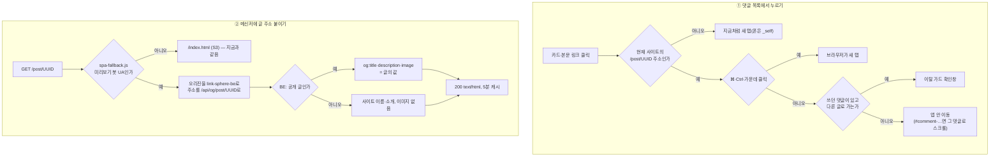
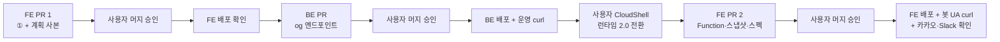

# 우리 글 링크를 앱 안에서 열고, 글 주소를 메신저에 붙이면 썸네일이 나오게 하기

<!-- plan-result:start — 이 블록만 병합 뒤에도 고칠 수 있다(.claude/CLAUDE.md "계획과 PR 본문"). 아래는 승인된 계획 원문 -->

## 구현 결과

> Phase 1: #660 · 2026-11-19 대조 · 이탈 3 · 미구현 1(보완함) — 판정 근거(파일:줄)는 PR 본문 "계획 대비 구현"

- 이탈(단위 테스트의 한계): 댓글 목록 테스트는 다른 글의 `#comment-…`가 아니라 같은 글의 `#comment-…` 스크롤을 확인함. 단위 테스트에서 `CommentList`의 글 id를 바꿀 수 없어서다
- 이탈(순서): 모킹 녹화를 검사 묶음보다 먼저 했고, 검사 묶음은 리베이스 전에 돌렸다. 리베이스 뒤 `pnpm check`·`pnpm test`·`pnpm check:docs`를 다시 돌려 보완함
- 미구현 → 보완함: "같은 글 안의 해시 이동은 이탈 가드가 막지 않는다" 단위 테스트
- 계획에 없던 변경: 같은 글로 가는 링크에 `preventScrollReset`과 함께 `replace`도 줌(FE-ARCHITECTURE §25, `PostCard.tsx`의 댓글 링크 선례)

> Phase 2-1: BE #225 · 2026-11-20 대조 · 이탈 4 · 미구현 0 — 판정 근거(파일:줄)는 BE PR 본문 "계획 대비 구현"

- 이탈(설계): `produces = text/html`을 걸지 않음. 걸면 Accept에 HTML이 없는 요청이 406을 받아(serving-path에서 발견) Content-Type을 응답에서 정하고 Accept와 상관없이 HTML을 준다
- 이탈(테스트 위치): 토큰 없이 200·`text/html`·Cache-Control 확인을 통합 테스트(`@DataJpaTest`라 HTTP 층이 없음) 대신 컨트롤러 테스트로 옮김
- 이탈(문서 위치): BE에 글 기능 문서가 없어 README API 표에 적음
- 이탈(절차): `produces`를 뺀 뒤 integrationTest를 다시 돌리지 않음 → 다시 돌려 보완함
- 계획에 없던 변경: serving-path 요청 목록에 OG HTML 사례, `<meta name="description">`도 실음, 정식 UUID만 글 id로 보고 아니면 `og:url`을 사이트 주소로
- 문서 동기화: BE README 파일 트리, `application.yml` 주석, `docs/DEPLOY.md`의 `APP_FRONTEND_URL` 설명

> Phase 2-2: 사용자 CloudShell · 2026-11-20 전환 · 이탈 0 · 미구현 0

- 계획에 없던 변경: 전환·시험·게시를 aws 명령 대신 배포 스크립트의 시험 함수를 그대로 쓰는 1회성 스크립트로 줌(LIVE 코드가 main과 다르면 멈추고, 시험 없이는 게시하지 않음)
- 참고: 게시 직후 되돌리기 명령이 이어 실행돼 LIVE가 몇 분간 1.0으로 돌아갔다가 다시 2.0으로 게시됨. 게시 상태가 DEPLOYED가 된 것은 조회 권한이 없어 확인하지 못함

> Phase 2-3: #669 · 2026-11-20 대조 · 이탈 1 · 미구현 1(보완함) — 판정 근거(파일:줄)는 PR 본문 "계획 대비 구현"

- 이탈(근거 범위): 봇 UA 8종 중 Slack·Facebook·Discord·WhatsApp만 공식 문서로 다시 확인함. X는 재인용, 카카오·Telegram·LinkedIn은 공식 문서를 못 찾아 2차 출처
- 미구현 → 보완함: 배포 시험 케이스의 "봇 UA라도 /post/edit/<id>·정적 파일은 그대로"
- 계획에 없던 변경: 시험 이벤트의 UA 단위 테스트, 배포 시험 실패 출력에 UA 표시, DEPLOY.md "메신저 미리보기 봇" 절(되돌리는 순서, 미리보기 반영이 최대 5분 늦음, 배포 시험이 오리진 선택을 보지 않는 한계)
- 계획에 없던 변경: SYSTEM-ARCHITECTURE의 옛 문장("Function 배포는 AWS CLI로 수동")을 `deploy.yml` 배포로 고침(사용자 승인)
- 문서 동기화: 계획 색인(PLANS-INDEX)

<!-- plan-result:end -->

> ① 댓글 목록에서 우리 글 주소(카드·본문 링크)를 누르면 새 탭 대신 앱 안에서 이동한다. ② 카카오톡·Slack 같은 미리보기 봇이
> `/post/<id>`를 요청하면 CloudFront Function이 그 요청만 BE로 보내고, BE가 그 글의 제목·설명·썸네일을 담은 OG 태그 HTML을 준다.

## Context

**요청(2026-11-19):** 댓글 링크 카드 계획(BE #224, `docs/plans/2026-11-19-comment-post-link-preview.md`)의 "남은 것"에 적은
제안 두 가지를 진행한다. 사용자 선택은 다음과 같다(질문 답, 2026-11-19).

- ① 범위는 카드와 본문의 우리 글 주소다. 쓰던 댓글이 있으면 기존 이탈 가드의 확인창을 띄운다. 수정 폼 안의 카드는 새 탭 그대로 둔다.
- ② 방식은 "Function이 봇만 BE로". 볼 수 없는 글이면 사이트 이름·소개만 싣고 이미지는 넣지 않는다.

**지금 동작(코드 추적):**

- 댓글 카드는 `<a target="_blank">`다(`CommentItem.tsx:90-115`). 본문 링크는 데스크톱이 `_blank`, 폰이 `_self`라 폰에서는
  앱 전체를 다시 불러온다(`MarkdownContent.tsx:146-156`).
- `/post/<id>` 요청은 기본(S3) 비헤이비어의 viewer-request Function `spa-fallback.js:107`이 `/index.html`로 바꾼다.
  `index.html`에는 `<title>Link Sphere</title>`과 사이트 설명뿐이라, 어떤 글 주소를 붙여도 봇은 같은 미리보기를 만든다.
- Function은 `cloudfront-js-1.0`이고 오리진을 바꿀 수 없다. 오리진 변경(`cf.selectRequestOriginById`)은 2.0의 viewer-request에서만
  된다. 2.0 코드는 첫 줄이 `import cf from 'cloudfront';`여야 한다
  ([AWS 문서](https://docs.aws.amazon.com/AmazonCloudFront/latest/DeveloperGuide/helper-functions-origin-modification.html), web-fetch 에이전트가 읽은 재인용).
- **캐시 키는 Function이 바꾼 뒤의 주소로 계산된다(직접 측정):** 처음 요청한 `/post/<새 UUID>`가 `x-cache: RefreshHit`이었다
  (2026-11-19, `curl` 1회). 그 주소로 캐시된 적이 없으니 이미 있던 `/index.html` 키가 적중한 것이다. AWS 문서에는 이 순서를
  밝힌 문장이 없었다(위 에이전트). 그래서 봇 요청을 `/api/og/post/<id>`로 바꾸면 사람의 `/index.html`과 캐시가 섞이지 않는다.

## 판단이 필요했던 항목

| 항목 | 결정 | 근거·기각한 대안 |
| --- | --- | --- |
| ① 쓰던 댓글이 있을 때 | 기존 이탈 가드 확인창(사용자 선택) | 앱의 다른 이동과 같은 규칙이라 코드가 늘지 않는다. 기각 "그때만 새 탭": 같은 링크가 상황마다 다르게 열린다 |
| ① 수정 폼 카드와 작성·수정 폼 미리보기의 본문 링크 | 새 탭 그대로(사용자 선택) | 고치는 도중이라 떠날 일이 드물고, 앱 안 이동이면 거의 매번 확인창이 뜬다. 미리보기의 본문 링크도 같은 미리보기라 같이 둔다 |
| ① 우리 글 주소 판정 | 현재 페이지와 같은 호스트(앞 `www.` 무시)이고 경로가 `/post/<UUID>`(끝 `/`·쿼리·`#` 허용)일 때만 | BE `PostLinkParser`와 같은 규칙이다. FE에는 사이트 주소 상수가 없어 `window.location`을 쓴다(선례 `usePostCard.ts:111`). dev(localhost)에서는 운영 주소가 외부 링크로 보인다 |
| ① 새 탭 처리 | React Router `Link`에 맡긴다 | `Link`는 보조키·가운데 클릭·`target`이 있는 클릭을 가로채지 않는다(`react-router-dom` 6.30.6 `dist/index.js:54-61` `shouldProcessLinkClick`). 직접 `onClick`으로 `navigate`하면 이 처리를 다시 짜야 한다 |
| ① 본문 링크를 바꾸는 범위 | `MarkdownContent`에 선택 속성(기본값 끔)을 더하고 댓글 목록(`CommentItem`)만 켠다 | 위 결정대로 폼 미리보기는 그대로 둬야 한다. 기본값이 끔이라 기존 사용처 3곳의 동작이 바뀌지 않는다 |
| ② 봇을 고르는 기준 | 링크 미리보기 봇만(Slack·카카오·Facebook·X·Discord·Telegram·LinkedIn·WhatsApp). 검색 봇(Googlebot 등)은 넣지 않는다 | 검색 봇에 OG만 든 HTML을 주면 앱 본문이 색인되지 않는다. 미리보기 봇은 OG 태그만 읽는다. 목록은 구현 때 각 봇 문서로 UA를 다시 확인한다 |
| ② OG HTML을 만드는 곳 | BE 새 엔드포인트 `GET /api/og/post/{postId}` | 글의 공개 여부는 BE만 안다. Function은 네트워크 호출(KVS 포함)이 Pro 요금제부터라 직접 묻지 못한다. Lambda@Edge는 호출마다 과금된다 |
| ② 반환 규칙 예외 | `ControllerSignatureRulesTest`의 "ApiResponse만 반환" 규칙에 이 엔드포인트 하나를 예외 목록으로 둔다(이유 주석) | HTML을 돌려주는 엔드포인트가 지금은 없어 규칙에 예외 목록이 없다(`ControllerSignatureRulesTest.kt:80-88`). `@Controller`로 피하면 레이어 규칙(`LayerSkeletonRulesTest.kt:70-82`)에 걸린다. 새 컨벤션이라 BE-ARCHITECTURE에 적는다 |
| ② 보는 사람 | 항상 비로그인으로 본다(`findVisiblePreviews(listOf(id), null)`, 공개 글만). 경로는 `permitAll` | 봇은 토큰을 보내지 않는다. 본인 비공개 글도 메신저 미리보기에는 기본값이 나와야 한다 |
| ② 볼 수 없는 글·없는 글·잘못된 id | 200 + 사이트 이름 "Link Sphere"와 `index.html`의 설명 문구, 이미지 없음(사용자 선택) | 카카오는 200 응답만 스크랩한다(카카오 문서, 이전 조사 재인용). 예외를 던지면 `text/html` 협상에서 오류 응답이 406으로 갈 수 있다(BE 조사, 추측) |
| ② 글 설명이 없을 때 | `og:description`을 싣지 않는다 | 사이트 소개를 넣으면 글 설명처럼 보인다 |
| ② 캐시 | `Cache-Control: public, max-age=300`. 기본 비헤이비어(`Managed-CachingOptimized`)가 이 값으로 5분 캐시한다 | 선례 `CategoryController.kt:30-38`(5분). 봇도 자체로 캐시한다(Slack 약 30분, 카카오 1시간) |
| ② 런타임 2.0 전환 | 사용자가 CloudShell에서 지금 코드 그대로 런타임만 바꿔 게시한다 | Function 런타임은 여전히 콘솔·CloudShell이 맡는다(DECISIONS 2026-11-16, 편입 여부는 infra 이슈 #11). 배포 스크립트는 LIVE 런타임을 그대로 쓴다(`scripts/deploy-cloudfront-functions.js:76`). 그래서 `import cf` 코드를 1.0에 게시하면 배포의 `test-function`에서 막힌다. 런타임을 먼저 바꿔야 한다 |
| ② OpenAPI 스펙 | 다른 엔드포인트처럼 스펙에 싣고(`@Tag`·`@Operation`), FE PR에서 vendored 스펙을 갱신한다 | 모든 엔드포인트를 문서화하는 기존 규칙(`SwaggerDocsCoverageTest`)을 따른다. `@Hidden` 선례는 없다 |

### 뒤집힌 전제

| 발견 | 그래서 바뀐 것 |
| --- | --- |
| Function 로컬 테스트가 `new Function(code + 'return handler;')`로 파일을 읽는다(`cloudfront-functions.test.ts:24-33`) | `import` 줄이 들어가면 깨진다. 로더가 첫 줄의 `import cf`를 빼고 가짜 `cf`를 넣게 고친다 |
| 배포 시험 이벤트에 `accept-encoding`만 들어간다(`cloudfront-function-deploy.js:20-47`) | `test-cases.json`에 `userAgent`를 적을 수 있게 늘린다. 비교는 `uri`만 하므로 오리진 선택은 vitest의 가짜 `cf`와 배포 뒤 `curl`로 확인한다 |

### 위험 관리 — 고치기 전에 적는 깨질 수 있는 것

- **사람이 OG HTML을 받는 것**: 봇 판정이 틀리면 사람에게 빈 HTML이 간다. 판정은 UA 정규식 하나이고 GET·`/post/<UUID>`에만 건다.
  캐시는 위 측정대로 바뀐 주소 기준이라 섞이지 않는다. 배포 뒤 봇 요청 다음에 일반 UA로 같은 주소를 받아 앱 HTML인지 본다.
- **런타임 전환이 사이트 전체를 건드림**: `spa-fallback`은 모든 페이지 요청에 붙어 있다. 2.0은 ES5.1을 모두 지원하고 기본이
  strict mode다(AWS 런타임 2.0 문서, 재인용). 그래서 게시 전 DEVELOPMENT 단계에서 `test-cases.json`의 케이스를 모두 돌린다.
  되돌리기는 같은 코드를 1.0으로 다시 게시하는 것이다(명령을 함께 준다).
- **비공개 글 노출**: 보는 사람을 항상 null로 묻는다. 본인 비공개 글도 기본값이 나오는지 통합 테스트로 확인한다.
- **HTML 주입**: 글 제목·설명·썸네일 주소는 사용자가 넣은 값이다. 속성 값은 모두 `HtmlUtils.htmlEscape`(spring-web)로 이스케이프한다.
  `"`·`<`·`&`가 든 제목으로 테스트한다.
- **drift 검사**: 사용자가 런타임을 바꾼 뒤 FE PR이 병합될 때까지 매일 차이 검사가 `snapshot.json`과 다르다고 이슈를 열 수 있다.
  FE PR에서 스냅샷을 고치고 병합 뒤 `gh workflow run cloudfront-drift-check.yml --ref main`으로 확인한다.
- **① 해시 이동**: 다른 글의 `#comment-…`로 가면 `CommentList`의 해시 스크롤(`location.key` 기준)이 돌아야 한다. 같은 글 안이면
  이탈 가드가 막지 않는다(같은 pathname). 단위 테스트로 확인한다.

## 세부 계획

### 절차

1. FE 워크트리를 새로 만든다(`git log origin/main..main` 확인 후 `EnterWorktree`). 실패하는 테스트를 먼저 쓰고 실패 출력을 남긴다 → 구현 →
   검사 묶음 → 모킹 녹화로 화면 확인 → plan-verifier 대조 → PR → CI → **사용자 머지 승인** → 배포 확인.
2. BE 워크트리(`git -C <BE> worktree add`, 비밀 파일은 `./scripts/worktree-bootstrap.sh`) → 같은 순서 → **사용자 머지 승인** → 배포 확인
   → 운영 `curl` 1~2회.
3. 사용자에게 CloudShell 명령(전환·시험·게시, 되돌리기)을 준다. 실행 결과를 받아 확인한다.
4. FE PR 2 → 같은 순서 → **사용자 머지 승인** → 배포 확인 → 운영 확인.

### Phase 1 — FE PR 1 `feat(comment)`: 우리 글 링크를 앱 안에서 열기

| 위치 | 변경 내용 |
| --- | --- |
| `src/shared/utils/url.util.ts` | `UrlUtil.toInAppPostPath(url): string \| null` 추가. "우리 글 주소 판정" 규칙에 맞으면 `/post/<id>` + 쿼리 + 해시, 아니면 null |
| `src/shared/ui/elements/MarkdownContent.tsx:10-14`·`:144-157` | 선택 속성(예: `inAppPostLinks`, 기본 false) 추가. 켜져 있고 우리 글 주소면 `<a>` 대신 `Link`(같은 클래스, `stopPropagation` 유지). 같은 글로 가는 해시 링크는 `preventScrollReset` |
| `src/widgets/comment/comment-list/ui/CommentItem.tsx:85-115` | `MarkdownContent`에 그 속성을 켜고, 카드는 우리 글 주소면 `Link`, 아니면 지금 `<a target="_blank">` |
| `src/features/comment/update/ui/CommentEditForm.tsx`, `src/features/comment/create/ui/CommentForm.tsx` | 바꾸지 않는다 |
| `docs/COMMENT.md` §5 "링크 카드" 절·§8 | 우리 글 링크는 앱 안 이동, ⌘/Ctrl은 새 탭, 쓰던 댓글이 있으면 확인창, 폼 미리보기는 새 탭 |
| `CHANGELOG.md` `[Unreleased]` → `Changed` | `comment` 항목 |
| `docs/plans/2026-11-19-post-link-in-app-and-og.md` (신규) | 이 계획 사본. 대조 뒤 구현 결과 블록을 붙이고, Phase 2가 끝나면 결과 블록만 덧붙인다 |

**테스트**

| 위치 | 확인하는 것 |
| --- | --- |
| `src/shared/utils/url.util.test.ts` | 같은 호스트·`www.`·끝 `/`·쿼리·`#comment-…`는 경로, 다른 호스트·`/post/submit`·`/post/edit/<id>`·깨진 UUID·홈은 null |
| `src/shared/ui/elements/MarkdownContent.test.tsx` | 속성이 켜지면 우리 글 주소는 `target` 없는 `/post/<id>` 링크이고 클릭하면 라우터 위치가 바뀐다. 외부 주소와 속성이 꺼진 경우는 지금 그대로(`_blank`·`_self`) |
| `src/widgets/comment/comment-list/ui/CommentList.test.tsx`(또는 `CommentItem` 테스트) | 카드 클릭이 앱 안 이동, 외부 카드는 `_blank` 그대로, 다른 글 `#comment-<id>`로 가면 해시 스크롤 |

### Phase 2-1 — BE PR `feat(post)`: OG HTML 엔드포인트

경로는 `src/main/kotlin/com/example/linksphere/` 기준.

| 위치 | 변경 내용 |
| --- | --- |
| `domain/post/PostOgController.kt` (신규) | `@RestController`·`@Tag`, `GET /og/post/{postId}`(`produces = text/html`), `ResponseEntity<String>`에 `cacheControl(5분, public)`. id는 문자열로 받아 서비스에 넘긴다 |
| `domain/post/PostOgService.kt` (신규) | UUID가 아니면 기본값. `PostLookupService.findVisiblePreviews(listOf(id), null)`로 읽어 `og:title`·`og:description`(있을 때)·`og:image`(있을 때)·`og:url`(`app.frontend.url` + `/post/<id>`)·`og:type`·`og:site_name`·`twitter:card`(이미지 있으면 `summary_large_image`, 없으면 `summary`)와 `<title>`을 담은 HTML. 값은 모두 이스케이프. 기본 설명 문구는 FE `index.html:8-11`과 같은 문장(주석으로 출처 표시) |
| `global/config/SecurityConfig.kt:45-62` 근처 | `GET /og/post/*`를 `permitAll` |
| `src/test/.../architecture/ControllerSignatureRulesTest.kt:80-88` | 반환 타입 규칙에 이 엔드포인트 하나의 예외 목록(이유 주석) |
| `docs/BE-ARCHITECTURE.md` 컨트롤러 반환 규칙 서술, 마지막 검토 | HTML 엔드포인트 예외와 이유 |
| BE 글 기능 문서(구현 때 `grep`으로 찾음) | OG 엔드포인트의 용도·응답 |
| `CHANGELOG.md` `[Unreleased]` → `Added` | `post` 항목 |

**테스트**(`src/test/kotlin/com/example/linksphere/` 기준)

| 위치 | 확인하는 것 |
| --- | --- |
| `domain/post/PostOgServiceTest.kt` (신규, 단위) | 공개 글이면 글 값, 설명·썸네일이 없으면 그 태그 없음, 글이 없으면 기본값, UUID가 아니면 기본값, `"<>&`가 든 제목이 이스케이프된다 |
| `domain/post/PostOgIntegrationTest.kt` (신규, `@PostgresIntegrationTest`) | 토큰 없이 200 `text/html`·`Cache-Control: max-age=300, public`, 남의 비공개 글과 본인 비공개 글 모두 기본값, 삭제된 글은 기본값 |

### Phase 2-2 — 사용자 CloudShell: `link-sphere-spa-fallback` 런타임을 2.0으로

FE `main`의 지금 코드 그대로 DEVELOPMENT 단계에 `cloudfront-js-2.0`으로 올린다 → `test-cases.json`의 `spa-fallback` 케이스를 모두
`test-function`으로 돌린다 → 모두 맞으면 게시. 명령(전환·시험·게시와 1.0 되돌리기)은 이 단계에서 붙여 넣을 수 있게 따로 준다.
결과는 `describe-function --stage LIVE`의 `Runtime`과 사이트 상세 주소 1회 요청으로 확인한다.

### Phase 2-3 — FE PR 2 `feat(post)`: 미리보기 봇만 BE로

| 위치 | 변경 내용 |
| --- | --- |
| `infra/cloudfront-functions/spa-fallback.js` | 첫 줄 `import cf from 'cloudfront';`. `handler` 앞부분에서 GET이고 UA가 미리보기 봇이고 `/post/<UUID>`(끝 `/` 허용)이면 `cf.selectRequestOriginById('link-sphere-be')` + `request.uri = '/api/og/post/<id>'` 후 반환. 머리말 주석에 이 분기와 런타임 2.0 이유 |
| `infra/cloudfront-functions/test-cases.json` | 봇 UA로 `/post/<UUID>` → `/api/og/post/<UUID>`, 일반 UA는 `/index.html`, 봇 UA라도 `/post/submit`·`/post/edit/<id>`·정적 파일은 지금 그대로 |
| `scripts/lib/cloudfront-function-deploy.js:20-47` | 시험 이벤트에 `userAgent`(→ `user-agent` 헤더) |
| `src/app/routes/cloudfront-functions.test.ts:24-33` | 로더가 `import cf` 줄을 빼고 가짜 `cf`를 넣는다. 봇 분기에서 `selectRequestOriginById('link-sphere-be')`를 불렀는지, 일반 요청은 안 불렀는지 |
| `infra/cloudfront/snapshot.json` | `spa-fallback`의 `Runtime`을 `cloudfront-js-2.0` |
| `src/shared/api/generated/openapi.json` → `pnpm codegen` | 배포된 BE 스펙으로 갱신(`docs/OPENAPI-CODEGEN.md` §5-1 절차) |
| `docs/DEPLOY.md` 745·755·788줄 근처, 830-858줄 경로별 응답 표 | 런타임 2.0, 봇 요청 행 추가 |
| `docs/SYSTEM-ARCHITECTURE.md` 요청 경로 서술 | 고칠 곳이 있는지 확인하고 있으면 고친다 |
| `CHANGELOG.md` `[Unreleased]` → `Added` | 메신저 미리보기 항목 |

## 영향 범위

- **① 사용자 체감**: 댓글 목록의 우리 글 링크가 같은 탭에서 열린다(폰은 새로고침 없이). 쓰던 댓글이 있으면 확인창. 외부 링크·폼 미리보기는 그대로.
- **② API**: BE에 공개 GET 하나 추가. 기존 응답은 바뀌지 않는다. `api-compat`은 경로 추가라 통과할 것으로 본다(추측, CI로 확인).
- **② 사이트 전체**: 모든 페이지 요청이 런타임 2.0 Function을 지난다. 봇이 아닌 요청의 결과는 지금과 같아야 한다(test-cases 전체로 확인).
- **비용**: Function 호출 수는 같다. 봇 요청만 Lambda 호출이 늘고, 5분 캐시로 같은 글은 한 번이다. 유료 기능은 쓰지 않는다.
- **배포 순서**: FE PR 1은 독립. ②는 BE 배포 → 런타임 전환 → FE PR 2 순서여야 한다. 거꾸로 하면 FE 배포가 `test-function`에서
  실패하거나(1.0에서 `import`), 봇이 없는 BE 경로로 가 오류 응답을 받는다.
- **공유 코드**: `MarkdownContent`(사용처 3곳, 기본값 끔이라 동작 불변), `UrlUtil`(새 메서드), Function 테스트 로더·시험 이벤트(두 Function 공통). 실제 사용처는 구현 때 `pnpm graph:focus`로 뽑는다.
- **바꾸지 않는 것**: 외부 링크 카드, 폼 미리보기의 링크, 사람에게 가는 HTML, `/api/*` 비헤이비어, WAF, 캐시 정책, `spa-status` Function.

## 검증 방법

**완료 조건**

- ①: 댓글 목록에서 우리 글 카드·본문 링크를 누르면 같은 탭에서 그 글로 가고, ⌘/Ctrl 클릭은 새 탭, 쓰던 댓글이 있으면 확인창이 뜬다.
- ②: 운영에서 공개 글 주소를 Slack·카카오톡에 붙이면 그 글의 제목·설명·썸네일이 나온다. 비공개 글 주소는 사이트 이름·소개만 나온다.
  사람이 같은 주소를 열면 지금처럼 앱이 뜬다.
- 바꾸면 안 되는 것: 위 "바꾸지 않는 것".

**증명**

1. 고치기 전 실패 출력(Phase 1 테스트, BE 테스트, Function vitest).
2. 로컬 검사 묶음: FE `pnpm check`·`pnpm test`·`pnpm check:docs`, BE `./gradlew ktlintCheck test integrationTest`. 깨 보기 확인(호스트 비교 제거, 공개 조건 제거, 봇 분기 제거).
3. ① 화면: 모킹 녹화(browser-verification skill "모킹 녹화") — 1. 카드 클릭으로 이동 2. 본문 링크 클릭 3. 쓰던 댓글이 있을 때 확인창. 영상을 바로 연다.
4. 각 PR CI 결과(FE `check`·`e2e`, BE `check`·`api-compat`·`serving-path`).
5. BE 배포 뒤: `curl https://linksphere.click/api/og/post/<공개 글 id>`로 OG 태그 확인(1회).
6. 런타임 전환 뒤: CloudShell 출력의 `Runtime: cloudfront-js-2.0`, `test-function` 결과, 상세 주소 1회 요청이 앱 HTML.
7. FE PR 2 배포 뒤(요청 수 5회 안쪽, `Accept-Encoding`은 `br` 포함):
   - Slack UA로 `/post/<공개 글 id>` → OG HTML, 같은 요청 두 번째는 `x-cache: Hit`.
   - 바로 이어 일반 UA로 같은 주소 → 앱 HTML(캐시 분리).
   - 카카오 UA로 비공개 글 주소 → 기본값.
   - `gh workflow run cloudfront-drift-check.yml --ref main` 성공.
8. 사용자 확인(제가 못 하는 것): 카카오 공유 디버거(`https://developers.kakao.com/tool/debugger/sharing`)와 Slack에 주소를 붙인 화면.

## 남은 것

- Function을 거치지 않는 주소(예: `/api/og/post/<id>`를 직접 공유)는 고려하지 않는다. `og:url`이 글 주소라 대부분의 봇은 그쪽을 쓴다.
- 봇 UA 목록에 없는 서비스(예: 일부 메신저·노트 앱)는 지금처럼 사이트 기본 미리보기가 나온다. 보이면 목록에 더한다.
- 런타임·설명을 코드로 관리할지는 infra 이슈 #11(12-03)에서 정한다. 이 계획은 그 결정을 앞당기지 않는다.
