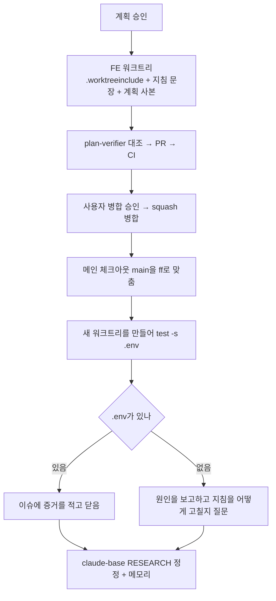

# 워크트리의 `.env`를 `.worktreeinclude`로 넣기

<!-- plan-result:start — 이 블록만 병합 뒤에도 고칠 수 있다(.claude/CLAUDE.md "계획과 PR 본문"). 아래는 승인된 계획 원문 -->

## 구현 결과

> #655 · 2026-11-19 대조 · 이탈 0 · 미구현 0 — 판정 근거(파일:줄)는 PR 본문 "계획 대비 구현"

- 계획에 없던 변경: 계획 색인 `docs/PLANS-INDEX.md`를 `pnpm docs:index`로 다시 만들어 같은 커밋에 넣음(계획 표에 빠뜨린 레포 관례)
- 대조는 순서 4번(PR 전)에 했다. 순서 5~9와 claude-base 문서 정정·메모리 수정은 이 PR 뒤 단계라 대조하지 않았고, 새 워크트리에 `.env`가 복사되는지는 #654에서 확인한다

<!-- plan-result:end -->

> 워크트리 부트스트랩의 `cp ../../../.env .`가 거부 규칙에 막혀 일주일째 실패한다. 거부 규칙은 그대로 두고, Claude Code가 워크트리를 만들 때 `.env`를 복사하는 공식 기능(`.worktreeinclude`)으로 옮긴다.

보관 위치: 구현할 때 FE `docs/plans/2026-11-19-worktreeinclude-env.md`로 복사한다.

## Context

FE 지침은 워크트리에 들어간 직후 `cp ../../../.env .`를 실행하라고 한다(`.claude/CLAUDE.md:198-203`). 이 명령이 2026-11-12부터 모든 세션에서 거부된다. 사용자가 원인 조사를 요청했고, 2026-11-19 질문에서 `.worktreeinclude`로 옮기는 안을 골랐다.

### 확인한 사실

| 사실 | 확인 수준 |
| --- | --- |
| 사용자 설정 거부 목록에 `Read(.env*)`·`Edit(.env*)`가 있다. 세션 기록상 2026-09-03에 이미 있었다 | 직접 읽음 |
| 부트스트랩 복사 결과: CLI 2.1.310은 성공 44·거부 0(마지막 성공 11-12), 2.1.322는 거부 10, 2.1.325는 거부 53 | 직접 측정(세션 기록 집계) |
| 목적지를 파일로 적은 복사는 10-12(2.1.290)에도 `cp to '…/.env' was blocked by a deny rule.`로 막혔다 | 직접 읽음(세션 기록) |
| 2.1.321 변경 이력: _"폴더로 복사·이동하는 `cp`·`mv`가 쓰는 파일에 거부 규칙이 적용되지 않던 문제를 고쳤다"_ (번역, [changelog](https://code.claude.com/docs/en/changelog)) | 재인용(web-fetch 에이전트) |
| _"허용 규칙으로 거부 규칙에 예외를 낼 수 없다."_ (번역, [permissions](https://code.claude.com/docs/en/permissions)) | 재인용 |
| _"Claude가 워크트리를 만들 때 자동으로 복사하려면 프로젝트 루트에 `.worktreeinclude` 파일을 둔다."_ (번역, [worktrees](https://code.claude.com/docs/en/worktrees)). gitignore 문법이고, 패턴에 맞으면서 gitignore된 파일만 복사한다 | 재인용 |
| 설치본(2.1.325 실행 파일): 워크트리를 새로 만든 뒤 저장소 루트의 `.worktreeinclude`를 디스크에서 읽고, `git ls-files --others --ignored`로 찾은 파일을 워크트리로 복사한다. 이 경로를 `--worktree`와 `EnterWorktree` 도구가 함께 쓴다. 복사 코드에 권한 규칙을 보는 부분은 보이지 않는다 | 직접 읽음(미니파이된 코드라 호출 관계는 해석) |
| FE 루트의 env 파일은 `.env`(gitignore), `.env.example`·`.env.test`(추적)다 | 직접 확인 |
| `.env`가 없으면 `pnpm dev`의 `/api` 프록시 대상(`vite.config.ts:27-30`)이 빈다. 타입 검사·단위 테스트·린트는 `.env`를 쓰지 않는다 | 읽는 줄만 확인, 없을 때 동작은 추적 안 함 |

원인을 2.1.321 항목으로 본 것은 시점과 명령 형태가 맞는다는 해석이다. 변경 이력의 2.1.311~2.1.318 구간은 원문을 읽지 못했다.

### 흐름



## 판단이 필요했던 항목

| 항목 | 결정 | 근거 · 기각한 대안 |
| --- | --- | --- |
| 복사 문제를 푸는 길 | `.worktreeinclude`. 결정(사용자, 11-19 질문) | 기각: 지금대로 두고 사용자가 직접 복사(매번 수고), 거부 규칙을 풀기(`.env`를 Claude가 열 수 있게 된다), 복사 스크립트로 감싸기(규칙을 피해 가는 명령 형태) |
| 넣을 패턴 | `.env` 한 줄. 결정(Claude 판단) | 루트에서 gitignore된 env 파일이 이것뿐이다. 나머지 둘은 추적 파일이라 워크트리에 이미 있다. 문서 예시와 같은 형태다 |
| PR 수와 확인 시점 | PR 하나로 올리고 병합 뒤 새 워크트리로 확인한다. 결정(Claude 판단) | 설치본이 `.worktreeinclude`를 메인 체크아웃 디스크에서 읽으므로 병합 전에는 확인할 길이 없다(메인 체크아웃에 파일을 직접 두는 것은 편집 가드가 막는다). 기각: PR 둘(파일 → 확인 → 지침)은 병합 승인이 두 번이다. 대신 지침 문장을 복사가 안 돼도 틀리지 않게 쓴다 |
| 확인 방법 | `test -s .env`만 쓴다. 결정(Claude 판단) | 내용을 읽지 않고 있는지만 본다. 거부 규칙에 걸리지 않는 것을 이 세션에서 확인했다 |
| 병합 뒤 확인 약속 | GitHub 이슈로 열어 PR 본문에 링크한다. 결정(Claude 판단) | FE 지침 "병합 뒤에 확인할 약속은 GitHub 이슈로". 계획 사본의 결과 블록은 병합 뒤 PR 없이 못 고친다 |
| BE 비밀 파일 복사 | 이번 범위에 넣지 않는다. 결정(Claude 제안) | 요청은 FE `.env`다. BE 워크트리는 FE 세션에서 `git worktree add`로 만들어 이 기능이 적용되지 않는다. FE 확인 결과를 보고 따로 묻는다 |
| claude-base 기록 | `docs/RESEARCH.md` 13.4의 곁가지 불릿만 정정한다. 결정(Claude 판단) | 되돌리기 쉬운 선택이라 결정 로그 항목은 쓰지 않는다 |

### 뒤집힌 전제

| 발견 | 그래서 바뀐 것 |
| --- | --- |
| "2026-11-17부터 거부, 원인 미확인"(claude-base RESEARCH 13.4, 메모리)은 틀렸다. 11-12부터이고 원인은 거부 규칙이다 | 두 곳을 정정한다 |
| 부트스트랩 복사는 규칙이 허용해서가 아니라 CLI 검사가 "폴더로 복사"를 놓쳐서 통과하고 있었다 | 규칙을 풀지 않고 복사 경로를 옮긴다 |
| "거부 규칙은 셸 명령은 못 막는다"(claude-base 결정 로그 11-16)는 지금 CLI와 맞지 않는다. BE 비밀 설정 파일 복사도 같은 문구로 거부된다(11-19 재현) | "남은 것"에 적고 FE 확인 뒤 묻는다 |

### 위험 관리

| 깨질 수 있는 것 | 막는 방법 |
| --- | --- |
| 거부 규칙이 하네스의 복사까지 막는다(실행으로는 확인 전) | 병합 뒤 새 워크트리로 확인한다. 없으면 보고하고 지침을 어떻게 고칠지 묻는다. 지침은 "없으면 알린다"로 써서 그 사이에도 틀리지 않는다 |
| 메인 체크아웃의 main이 뒤처져 `.worktreeinclude`가 디스크에 없다 | 지침에 한 구절로 적는다. 병합 뒤 `git status`가 깨끗한지 보고 ff로 맞춘다 |
| `.env` 값이 대화에 찍힌다 | 내용을 읽는 명령을 쓰지 않는다. `test -s`만 쓴다 |
| 다른 세션이 이미 만든 워크트리 5개 | 건드리지 않는다. 새로 만드는 워크트리부터 적용된다 |
| 계획 사본이 공개 레포에 올라간다 | 키 이름·값·비공개 이름을 적지 않는다. 사본도 금지 값 검사 대상에 넣는다 |

## 세부 계획

### FE (PR 1개)

| 위치 | 변경 내용 |
| --- | --- |
| `.worktreeinclude` (신규) | 주석 한 줄과 `.env` 한 줄 |
| `.claude/CLAUDE.md:198-203` | 부트스트랩 불릿을 아래 문안으로 바꾼다 |
| `docs/plans/2026-11-19-worktreeinclude-env.md` (신규) | 이 계획의 사본. 대조 뒤 H1 아래 구현 결과 블록 |

`.worktreeinclude`:

```
# Claude Code가 워크트리를 만들 때 메인 체크아웃에서 복사할 gitignore 파일 (.claude/CLAUDE.md "워크트리")
.env
```

`.claude/CLAUDE.md` 불릿:

````
- **Never** 워크트리 진입 후 부트스트랩 생략 → gitignore된 `.env`는 루트의 `.worktreeinclude`가 맡는다. `EnterWorktree`가 워크트리를
  만들 때 Claude Code가 메인 체크아웃의 `.env`를 복사한다([worktrees 문서](https://code.claude.com/docs/en/worktrees)). 진입 직후 반드시 실행:
  ```bash
  test -s .env
  pnpm install
  ```
  `.env`가 없으면 `cp`로 복사하지 않고 사용자에게 알린다 — 사용자 설정의 `.env` 읽기·편집 거부 규칙이 `cp ../../../.env .`를 막고
  (2026-11-12부터, 허용 규칙으로 풀 수 없다), 메인 체크아웃이 `.worktreeinclude`가 들어오기 전 커밋이면 복사가 일어나지 않는다
````

순서:

1. `git log origin/main..main`이 비어 있는지 확인하고 `EnterWorktree`(이름 `worktreeinclude-env`) → `pnpm install`. `.env` 복사는 시도하지 않는다.
2. 파일 둘을 쓰고 계획 사본을 복사한다.
3. `pnpm check:docs`를 돌린다. 코드 변경은 없지만 push 때 pre-push 검사가 돈다.
4. `plan-verifier`에 계획·diff·대화 요약을 넘겨 대조하고 결과 블록을 붙인다.
5. `.gitmessage` 형식으로 커밋한다(`chore(claude): …`). push 뒤 "병합 뒤 새 워크트리에서 `.env` 복사 확인" 이슈를 연다.
6. PR 본문(`## 계획 대비 구현`, 이슈 링크)을 `pnpm check:pr-body`로 검사하고 PR을 연다. CI 결과를 확인한다.
7. 사용자 병합 승인 뒤 `gh pr merge <번호> --squash`. 배포 워크플로는 이 경로들에 걸리지 않는다(`deploy.yml` 경로 필터).
8. 작업 워크트리를 정리하고, 메인 체크아웃이 깨끗한지 확인한 뒤 main을 ff로 맞춘다.
9. 확인: `EnterWorktree`(이름 `wti-probe`) → `test -s .env` → `ExitWorktree(remove)`. 결과를 이슈에 적고 닫는다.

### claude-base

| 위치 | 변경 내용 |
| --- | --- |
| `docs/RESEARCH.md:947-948` | 곁가지 불릿을 정정한다: 거부 시작일(11-12, CLI 2.1.322), 원인(거부 규칙과 2.1.321 변경), 해결 위치(FE `.worktreeinclude`와 확인 결과), BE 비밀 파일 복사도 같은 원인으로 거부된다는 것 |

순서: FE 확인(9번) 뒤 claude-base 워크트리에서 고쳐 커밋하고, main으로의 ff 병합은 사용자 확인을 받는다.

### 메모리

| 위치 | 변경 내용 |
| --- | --- |
| `claude-code-settings-guide-followups.md` 마지막 불릿 | "2026-11-17부터 … 원인 미확인"을 지우고 새 메모를 가리킨다 |
| 새 메모 1건 + `MEMORY.md` 색인 | 거부 원인, 우회하지 않는다는 것, `.worktreeinclude`가 메인 체크아웃 디스크에서 읽힌다는 것, BE는 미정이라는 것 |

## 영향 범위

- **FE**: 새로 만드는 워크트리에 `.env`가 들어간다. 지침의 부트스트랩 명령이 바뀐다. 앱 코드·배포 변화 없음.
- **사용자 설정**: 바꾸지 않는다. `.env` 읽기·편집 거부 규칙은 그대로다.
- **claude-base**: 문서 한 곳. 훅 코드는 건드리지 않는다.
- **BE·infra**: 변경 없음.
- **바꾸면 안 되는 것**: `~/.claude/settings.json`, 다른 세션의 워크트리, `docs/plans/`의 기존 계획(옛 부트스트랩 명령이 적혀 있어도 고치지 않는다).

## 검증 방법

| 끝 상태 | 증명 |
| --- | --- |
| 새 워크트리에 `.env`가 있다 | 병합·ff 뒤 만든 `wti-probe` 워크트리에서 `test -s .env`가 종료 코드 0 |
| 거부 규칙이 그대로다 | `jq '.permissions.deny' ~/.claude/settings.json` 출력이 작업 전과 같다 |
| 지침이 실제와 맞다 | `.claude/CLAUDE.md` 불릿의 두 명령을 `wti-probe`에서 그대로 실행한 결과 |
| 문서 참조가 맞다 | `pnpm check:docs` 통과 |
| PR 게이트 | CI 성공, `pnpm check:pr-body` 통과 |
| 시험 흔적이 없다 | `git worktree list`에 `worktreeinclude-env`·`wti-probe`가 없다 |
| 기록이 맞다 | claude-base `docs/RESEARCH.md` 13.4에 "2026-11-17부터"가 없다 |
| 계획 대조 | plan-verifier 판정을 결과 블록과 PR 본문에 반영 |

## 남은 것

- BE 비밀 설정 파일 복사: 같은 원인으로 거부된다. FE 확인 결과를 보고 선택지를 정리해 묻는다.
- claude-base 결정 로그 11-16의 전제("셸 명령은 못 막는다")와 가드가 `cp`를 통과시키는 설계: BE를 정할 때 함께 다룬다.
- 다른 세션이 이미 만든 워크트리: `.env`가 필요하면 그 세션에서 사용자가 복사한다.
