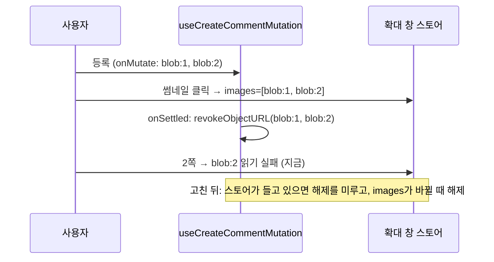

# 업로드 중 연 이미지 확대 창이 "첨부 이미지 N"으로 깨지는 문제

<!-- plan-result:start — 이 블록만 병합 뒤에도 고칠 수 있다(.claude/CLAUDE.md "계획과 PR 본문"). 아래는 승인된 계획 원문 -->

## 구현 결과

> #670 · 2026-11-20 대조 · 이탈 0 · 미구현 0 — 판정 근거(파일:줄)는 PR 본문 "계획 대비 구현"

- 이탈·미구현·계획에 없던 변경 없음. 녹화는 등록 응답 대신 업로드 PUT을 붙잡아 같은 "업로드 중" 상태를 만들었고, 고치기 전 동작은 같은 워크트리에서 `onSettled`를 잠깐 되돌려 찍었다

<!-- plan-result:end -->

## Context

댓글에 이미지 2장을 붙여 등록하고, 업로드가 끝나기 전(임시 댓글이 반투명할 때) 썸네일을 눌러 확대 창을 열면
1쪽은 보이다가 2쪽으로 넘기면 깨지고(`alt` "첨부 이미지 2"), 1쪽으로 돌아와도 깨진다(사용자 확인: 올리자마자 열었음).

추적한 경로:

- 임시 댓글은 이미지를 `blob:` URL로 그린다 — `src/entities/comment/api/comment.queries.ts:219`(답글 `:285`)
- 썸네일을 누르면 그 순간의 주소 목록을 확대 창 스토어에 복사한다 — `src/shared/ui/elements/MarkdownContent.tsx:136-141`
- 업로드가 끝나면 `onSettled`가 `blob:` URL을 바로 해제한다 — `comment.queries.ts:249`(답글 `:328`)
- 목록은 서버 주소로 바뀌지만 스토어는 해제된 주소를 계속 들고 있어, 새로 읽는 순간(쪽 이동) 실패한다

사용자 결정: **A. 확대 창이 들고 있는 동안 해제를 미룬다**(B 서버 주소 교체·C 업로드 중 확대 막기는 기각 — B는 보는 중
깜빡임·실패 처리 추가, C는 막힌 이유 안내가 따로 필요).

## 변경

1. `src/shared/ui/elements/dialog/image-viewer/imageViewer.store.ts`에 새 함수
   `revokeObjectUrlsWhenUnused(urls: string[])`를 더한다(새 기능은 새 코드로).
   - 스토어 `images`에 `urls` 중 하나라도 `src`로 있으면 `useImageViewerStore.subscribe`로 기다렸다가, 더는 없을 때
     구독을 풀고 해제한다. 없으면 바로 해제한다.
   - 스토어는 닫혀도 `images`를 비우지 않으므로(:20 주석) 해제 시점은 "다음에 다른 이미지로 확대 창을 열 때"다.
     그때까지 임시 파일 몇 장이 메모리에 남는다(목록은 이미 서버 주소라 다시 이 `blob:`을 열 길은 없다).
2. `comment.queries.ts`의 `useCreateCommentMutation`·`useCreateReplyMutation` `onSettled`에서
   `context?.blobUrls.forEach(URL.revokeObjectURL)` 대신 위 함수를 부른다(entities → shared 방향이라 레이어 규칙 안).
3. 문서: `docs/COMMENT.md` 58줄 Mermaid 노드와 946줄 표의 `onSettled` 설명을 "확대 창이 들고 있으면 바뀔 때까지 미룸"으로
   고치고, 시행착오에 이 버그를 짧게 남긴다. `CHANGELOG.md` `[Unreleased]` Fixed 항목. 계획 스냅샷
   `docs/plans/2026-11-20-comment-image-viewer-blob-revoke.md` + `pnpm docs:index`.
4. 작업은 워크트리에서(`git log origin/main..main` 먼저 확인 → `EnterWorktree` → `test -s .env` → `pnpm install`).

바꾸면 안 되는 것: 확대 창 닫힘 애니메이션 동안 `images` 유지 동작, 확대 창 없이 등록한 경우 즉시 해제, 계정 사진
미리보기(`useUpdateAccount`)의 해제 시점.

## 테스트(먼저 실패 확인)

- `imageViewer.store.test.ts`: ① 스토어가 안 들고 있으면 바로 해제 ② 들고 있으면 해제 안 함 → `setImages`로 다른
  이미지가 들어오면 해제 ③ 일부만 겹쳐도 미룸. `URL.revokeObjectURL`은 `vi.spyOn`.
- `comment.queries.test.ts`: 등록 중 스토어에 `blob:` 목록을 넣고 응답을 받은 뒤 그 URL이 해제되지 않았는지(답글도).
- 고치기 전 실패 출력을 남기고, 구현을 되돌려 새 테스트가 실패하는지 한 번 확인한다.

## 검증

- `pnpm type-check` → `pnpm test` → `pnpm lint`·`pnpm check:deps` → `pnpm check:docs`
- `browser-verification` skill로 녹화: MSW/route로 댓글 등록 응답을 몇 초 늦춘 상태에서 이미지 2장 등록 → 바로 확대 →
  응답 뒤 2쪽·1쪽 이동 시 이미지가 보이는지(`img.naturalWidth > 0`과 `src`가 `blob:`인지 함께 단언). 고치기 전 브랜치에서
  같은 절차로 깨짐을 먼저 재현해 원인을 확정한다.
- PR 전 plan-verifier 대조, PR CI 확인, 병합은 사용자 승인 뒤, 배포 워크플로 성공 확인 후 워크트리 정리.

## 완료 조건

- 위 재현 절차에서 응답 뒤에도 두 쪽 모두 이미지가 보이는 녹화 + 고치기 전 깨짐 녹화
- 새 테스트가 고치기 전 실패·고친 뒤 통과, 검사 묶음 전부 통과
