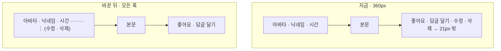

# 내 댓글의 수정·삭제를 이름 줄 ⋮ 메뉴로 옮겨 좁은 폰의 가로 넘침을 없앤다

<!-- plan-result:start — 이 블록만 병합 뒤에도 고칠 수 있다(.claude/CLAUDE.md "계획과 PR 본문"). 아래는 승인된 계획 원문 -->

## 구현 결과

> #666 · 2026-11-20 대조 · 이탈 2 · 미구현 0 — 판정 근거(파일:줄)는 PR 본문 "계획 대비 구현"

- 이탈(위치): 좁은 폭 넘침 e2e를 `e2e/comment-delete.spec.ts`가 아니라 새 파일 `e2e/comment-action-row.mobile.spec.ts`에 두었다. 폰 에뮬레이션 프로젝트(mobile-chrome)는 `*.mobile.spec.ts`만 돌린다. 폭은 360px 하나에서 320·360·375px로 늘었고, ⋮가 내 댓글에만 있는지와 이름 줄 높이가 남의 댓글과 같은지도 함께 본다.
- 이탈(측정 결과): 넘침 단언을 `scrollWidth <= innerWidth`에서 `scrollWidth <= 설정한 화면 폭`으로 바꿨다. 폰 에뮬레이션에서는 `innerWidth`가 내용 폭(381px)을 따라 늘어, 원래 단언은 고치기 전 코드에서도 통과했다.
- 계획에 없던 변경: 전체 e2e에서 터치 크기 스펙 2개(`touch-targets.spec.ts`·`touch-targets.mobile.spec.ts`)가 동작 줄 버튼 4개를 전제해 실패했다. 2개(좋아요·답글 달기)와 ⋮를 보도록 바꾸고 `docs/TESTING.md` 설명을 고쳤다.
- 계획에 없던 발견: ⋮가 이름 칸을 차지해 좁은 폰의 내 답글에서 긴 닉네임이 더 일찍 말줄임된다. 잘린 이름은 본인만 보므로 그대로 두기로 사용자가 정했다(`docs/COMMENT.md` §5 "내 댓글 메뉴"·§9).
- 수정을 고른 뒤 포커스가 수정 입력칸으로 가는 것을 확인해, 계획에서 조건부로 둔 `onCloseAutoFocus` 보완은 넣지 않았다.

<!-- plan-result:end -->

> 360px 폭에서 내 댓글의 "좋아요 · 답글 달기 · 수정 · 삭제" 줄이 21px 넘쳐 페이지 전체가 가로로 밀린다. 수정·삭제를 이름 줄 오른쪽 끝 ⋮ 메뉴로 옮긴다.

## Context

PR #664 화면 확인 중 발견했다(모킹, 360×727, `isMobile`). 댓글 시트를 열기 전부터 `innerWidth=381`,
`visualViewport.width=360`이었고, 넘친 요소는 "삭제" 버튼(x=312, 오른쪽 끝 381, 폭 68)이었다. 부모는
`src/widgets/comment/comment-list/ui/CommentItem.tsx:155`의 동작 줄(`flex items-center gap-1`, 줄바꿈 없음)이다.

- 버튼 네 개는 모두 터치 높이 44px(`min-h-11`)와 좌우 `px-2`를 갖고, 글자는 `Button` 기본 `text-sm`이다(부모의 `text-xs`는 덮인다).
- 버튼 폭은 고정이라 넘침은 화면 폭과 1:1로 줄어든다. 계산으로는 375px에서 약 6px, 320px에서 약 61px 넘친다(계산, 실측 아님).
  `responsive-ux` skill 점검 목록은 _"375px 뷰포트에서 가로 스크롤 0"_ 이다(`.claude/skills/responsive-ux/SKILL.md:220`).
- 남의 댓글(수정·삭제 없음)과 답글(답글 달기 없음)은 버튼이 적어 넘치지 않는다고 본다(계산, 재현으로 확인한다).

## 판단이 필요했던 항목

| 항목 | 결정 | 근거·기각한 대안 |
| --- | --- | --- |
| 고치는 방법 | **수정·삭제를 ⋮ 메뉴(`KebabMenu`)로 옮긴다, 모든 폭** (사용자 선택) | 글 카드가 같은 방식이다(`PostCard.tsx:149`, 모든 폭). YouTube도 내 댓글의 수정·삭제를 ⋮에 둔다 — _"댓글 오른쪽 위를 가리킨다. 더보기를 누른다. 수정 또는 삭제를 고른다"_ (번역, YouTube 고객센터, https://support.google.com/youtube/answer/6000964). 약 90px가 줄어 320px까지 들어간다(계산). 기각: 좁은 폭만 ⋮ — 폭마다 모양이 둘로 갈린다. 여백만 줄이기(`px-2`→`px-1`, 약 32px) — 320px에서 약 29px 여전히 넘친다. 좁은 폭에서 아이콘만 — _"아이콘 라벨은 사용자가 아무것도 하지 않아도 늘 보여야 한다"_ (번역, NN/g, https://www.nngroup.com/articles/icon-usability/). 줄바꿈 허용 — 좁은 폭에서 줄이 44px 늘어 #664에서 높이를 줄인 방향과 반대 |
| ⋮ 위치 | **이름 줄(닉네임·시간) 오른쪽 끝** (사용자 선택) | YouTube와 같은 자리. 기각: 동작 줄 오른쪽 끝 — 높이는 늘지 않지만 사용자가 이름 줄을 골랐다 |
| 이름 줄 높이 | **음수 마진으로 그대로 둔다** (사용자 선택) | `PostCard.tsx:127-133`의 선례(_"히트 영역은 그대로고 레이아웃 기여분만 줄인다"_). 터치 영역이 본문 첫 줄 오른쪽 끝과 약 4px 겹친다(계산). 기각: 높이 늘림 — 내 댓글만 본문이 약 24px 내려가 남의 댓글과 간격이 달라진다 |
| 데스크톱에서 ⋮ 보이기 | **늘 보임** (사용자 선택) | 글 카드와 같다. 기각: 올렸을 때만(`hoverReveal`, `FolderSidebar.tsx:337`·YouTube) — 내 댓글을 고칠 곳을 찾아야 한다 |
| 터치 크기 | 터치 기기 44px, 넓은 폭 + 마우스에서만 줄인다(`size-11 md:pointer-fine:size-8` 꼴) | `responsive-ux` skill "터치 타깃"(`min-h-11 md:pointer-fine:min-h-0` 형태) |
| 메뉴 항목 모양 | 글 카드 메뉴와 같게 — 아이콘 + 문구, 삭제는 `text-destructive focus:text-destructive` | `PostCard.tsx:155-183`이 이 앱에서 수정·삭제 메뉴의 유일한 선례 |
| 동작 줄 | 좋아요 · 답글 달기만 남긴다. 내 답글이면 좋아요만 | 수정·삭제가 메뉴로 갔으니 나머지는 그대로 |

### 시안 후보 (반영 전 승인)

ASCII로 위 결정을 골랐다. 구현한 뒤 커밋 전에 실제 화면 스크린샷을 지금/바꾼 뒤로 나란히 보여 주고 확인받는다.
조합: 360px 폰 · 1280 데스크톱 · 라이트·다크 · 내 댓글 / 내 답글 / 남의 댓글 · 메뉴 열림.

## 세부 계획

| 위치 | 변경 내용 |
| --- | --- |
| `e2e/comment-delete.spec.ts` | 먼저 360×727에서 내 댓글이 있는 글 상세의 `document.documentElement.scrollWidth <= innerWidth` 테스트를 더해 고치기 전 실패 출력을 남긴다. 삭제 흐름은 "댓글 메뉴"를 연 뒤 "삭제"를 누르도록 바꾼다 |
| `src/shared/config/texts.ts` `ariaLabels` | `commentMenu: '댓글 메뉴'` 추가(`postMenu` 옆) |
| `src/widgets/comment/comment-list/ui/CommentItem.tsx:123` 이름 줄 | `isOwner && canShowActionBar`일 때 `ml-auto shrink-0` + 음수 마진으로 `KebabMenu`(`aria-label={TEXTS.ariaLabels.commentMenu}`)를 둔다. 항목: 수정(`setIsEditing(true)`), 삭제(`onDelete(comment.id)`) |
| `CommentItem.tsx:172-187` 동작 줄 | 수정·삭제 `ActionButton` 두 개를 지운다. 쓰이지 않게 된 `Edit2`·`Trash2` import도 지운다 |
| 포커스 | 수정을 고르면 메뉴가 닫히며 트리거로 포커스를 돌리려 하는데 트리거가 사라진다. 수정 폼 입력칸(`CommentEditForm.tsx:88` `autoFocus`)에 포커스가 남는지 확인하고, 안 남으면 `onCloseAutoFocus`에서 `preventDefault`(`FolderSidebar.tsx:341` 선례) |
| `docs/COMMENT.md` | 수정·삭제 자리를 설명하는 곳(§5·§8 코드 지도), §9의 360px 넘침 메모에 고친 결과 |
| `CHANGELOG.md` `[Unreleased]` | Fixed 항목 1개 |
| `docs/plans/2026-11-20-comment-owner-menu.md` (신규) | 이 계획 사본 + `pnpm docs:index` 색인 재생성 |

## 영향 범위

- `CommentItem`은 글 상세 댓글 목록에서만 쓴다(`pnpm graph:focus`로 다시 확인). `KebabMenu`·`ActionButton`은 고치지 않는다.
- `e2e/comment-delete.spec.ts`의 삭제 흐름 기대가 바뀐다 — 화면 요구가 바뀐 경우라 보고에 따로 적는다.
- 바꾸면 안 되는 것: 좋아요·답글 달기 동작과 터치 높이, 삭제 확인 창(`useDeleteComment`의 `openConfirm`), 수정 폼, 낙관적 댓글(`temp-`)·삭제된 댓글·수정 중에는 메뉴도 안 보이는 것, 남의 댓글 모양.

## 검증 방법

- 고치기 전 실패: 새 360px 넘침 e2e가 main 코드에서 실패하는 출력.
- 머지 게이트 묶음: `pnpm type-check` · `pnpm test` · `pnpm lint` · `pnpm check:deps` · `pnpm check:docs`, 댓글 e2e `pnpm test:e2e e2e/comment-delete.spec.ts` 등.
- 측정(바꾸기 전·뒤): 320·360·375px에서 `scrollWidth`와 `innerWidth`, 내 댓글·남의 댓글의 이름 줄 높이(`getBoundingClientRect().height`)가 바뀌지 않는지.
- 키보드: ⋮ 포커스 → Enter로 메뉴 → 수정 고르면 입력칸 포커스, 삭제 고르면 확인 창.
- `browser-verification` skill로 위 시안 조합 스크린샷을 열어 보여 주고 확인받은 뒤 커밋.
- 완료 조건: 위 검사 통과, 320~375px 가로 넘침 0, 이름 줄 높이 변화 0, 사용자 화면 확인, PR CI 통과.

## 남은 것

없음
