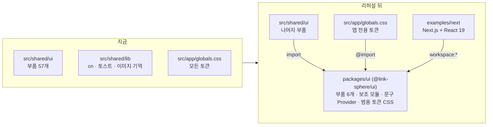
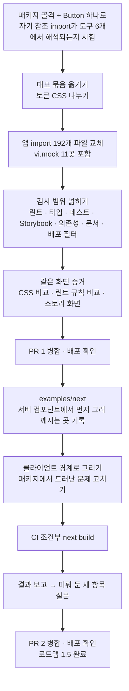

# 디자인 시스템 1.5단계: 분리 리허설(저장소 안 패키지와 Next.js 예제 앱)

<!-- plan-result:start — 이 블록만 병합 뒤에도 고칠 수 있다(.claude/CLAUDE.md "계획과 PR 본문"). 아래는 승인된 계획 원문 -->

## 구현 결과

> #665(Phase 1) · 2026-11-20 대조 · 이탈 8 · 미구현 1(PR 전에 보완) — 판정 근거(파일:줄)는 PR 본문 "계획 대비 구현". Phase 2·3은 다음 PR에서 덧붙인다

- 이탈(워크스페이스 범위): `pnpm-workspace.yaml`에 `packages/*`만 넣었다. `examples/*`는 그 폴더가 생기는 Phase 2에서 더한다
- 이탈(타입 검사): 루트 `tsconfig.json`의 `references`에 패키지를 넣지 않았다. composite 설정에서 TS2742가 나서 패키지는 자기 `tsc --noEmit`으로 따로 검사하고, 루트 `type-check`·`build`가 이어서 부른다(Turborepo의 패키지별 검사 방식)
- 이탈(옮기지 않은 파일): 토스트 래퍼 테스트와 `Toaster` 스토리는 앱에 남겼다. 앱 문구(`TEXTS`), 앱 setup의 sonner 목, 앱의 `showNoticeToast`를 쓰기 때문이다(원칙 문서 §1.5)
- 이탈(토큰 나누기): t1~t14 글자 크기 스케일을 앱이 아니라 패키지로 옮겼다. 패키지의 `cn()`이 이 이름들을 알고 그 테스트가 토큰 CSS와 대조하기 때문이다. `--toast-offset-bottom`은 기본값 24px만 패키지에 두고, 탭바에 맞춘 모바일 값은 앱에 남겼다(원칙 문서 §1.5). 줄마다가 아니라 묶음별로 어느 쪽인지 PR 본문 표에 남겼다
- 이탈(패키지 테스트): `KO_UI_TEXTS`로 감싸는 패키지 `render`를 만들지 않았다. 옮긴 테스트가 문구 Provider 없이 그려지는 부품뿐이라 Testing Library `render`를 그대로 쓴다. 필요한지는 Phase 3 세 번째 항목에서 다시 본다
- 이탈(문서 검사 범위): `check-docs`가 경로로 읽는 접두사에 `packages/` 전체가 아니라 `packages/ui`와 `examples`만 더했다. 문서가 다른 저장소의 `packages/...` 경로를 인용하고 있어서다. 판정 함수 테스트 대신 고치기 전 오탐 출력과 고친 뒤 결과를 증거로 남겼다
- 이탈(절차): 계획은 묶음을 옮기기 전에 `Button` 하나로 타입·빌드·Vitest·Storybook·의존성 검사의 해석을 시험하기로 했다. 실제로는 타입·빌드·Vitest만 시험하고 묶음 전체를 옮겼고, Storybook과 의존성 검사는 다 옮긴 뒤에 처음 돌렸다
- 이탈(절차): 계획은 구현 전에 `pnpm graph:focus`로 사용처를 뽑기로 했다. 실제로는 대표 묶음을 다 옮긴 뒤에 처음 뽑았다
- 미구현 → 보완함: `FE-ARCHITECTURE.md` §1 표의 공용 UI 위치에 `packages/ui`를 더했다(§3 트리는 처음부터 고쳤다)
- 계획에 없던 변경: Stryker 설정에 패키지 별칭을 더했다(샌드박스에서 문구 Provider 모듈이 두 벌로 읽혀 context가 갈렸다). 그 밖에 패키지 `devDependencies`, 패키지 Vitest 설정의 `tsconfig.node.json` 등록, 의존성 검사의 devDependency 금지 범위를 패키지로 넓힘, `jsdom` 하위 의존성의 lockfile 갱신, CLAUDE.md 타입 검사 안내 보완, shadcn 설정(`components.json`)의 `cn` 경로가 있다. 패키지 `lib/`의 `cn`·토스트 래퍼에도 공용 UI API 규칙 2개가 걸린다(패키지 전체를 그 블록에 넣은 결과이고 위반은 없다). 원칙 문서 §1.5는 새 Critical Rules 줄이 정본으로 가리켜야 해서 Phase 2보다 먼저 만들었다
- 계획에 없던 변경(테스트, 단언은 그대로): 옮긴 테스트 둘이 `renderWithProviders` 대신 `render`를 쓴다. 글자 크기 토큰 대조 테스트의 이름과 CSS 경로 계산을 바꿨고, 경계 린트 테스트의 실패 사례 입력 하나를 옮긴 모듈 대신 남은 모듈 경로로 바꿨다
- 문서 동기화: 옮긴 파일 경로와 토큰 위치를 skill 넷, `/new-feature` 명령, docs 문서 일곱 개, `FE-ARCHITECTURE.md` §2 린트 표, e2e 주석 네 곳, 스토리·설정 주석에서 고쳤다

<!-- plan-result:end -->

> 공용 UI 부품 6개와 그 보조 모듈·문구 Provider·범용 색 토큰을 저장소 안 패키지 `packages/ui`(`@link-sphere/ui`)로 떼어 낸다. 이 앱과 새 Next.js(React 19) 예제 앱이 모두 그 패키지로 화면을 그리게 한다. 리허설에서 드러난 문제를 기록하고, 미뤄 둔 세 항목은 결과를 본 사용자의 답으로 정한다. PR 둘로 낸다. 이 앱의 화면 모양·문구·동작은 바뀌지 않는다.

## Context

- **요청**: "분리 리허설 계획 세워줘"(2026-11-19). [로드맵](../DESIGN-SYSTEM-ROADMAP.md) §5의 1.5단계다. 이 단계에서 정할 것은 "부품 몇 개를 저장소 안 패키지로 떼어 내는 방법"과 "빈 예제 앱을 무엇으로 만들지"이고, 끝났다고 볼 증거는 "떼어 낸 부품이 빈 예제 앱에서 그려지고, 이 앱도 그 패키지로 같은 화면을 그린다"이다.
- **왜**: 1단계 린트는 import 결합만 막는다. 다른 앱에서 그려 봐야 남은 묶임이 드러난다. 색 토큰 CSS, 문구 Provider, 함께 설치해야 하는 패키지, React 버전이 그런 것들이다(로드맵 "순서의 이유"). 사용자가 가장 걱정하는 것은 다음 프로젝트에 합치기 어려워지는 것이다. 다음 프로젝트는 React 19 기반 Next.js일 확률이 높다.
- **사용자 결정(2026-11-19 질문 답)**: 예제 앱은 Next.js + React 19, 떼어 낼 범위는 대표 묶음, 리허설 뒤에는 패키지와 예제 앱을 모두 남긴다.
- **지금 상황** (2026-11-19 직접 확인, `main` ae0dc4df. "보고"로 적은 것은 조사 에이전트가 전한 것이고 읽지 않았다)
  - **워크스페이스**: `pnpm-workspace.yaml:1`에 "패키지가 하나인 레포라 `packages`는 두지 않는다"고 적혀 있고, 파일에는 `overrides`·`auditConfig`만 있다.
  - **설치 설정**: `.npmrc:1`의 `shamefully-hoist=true` 때문에 선언하지 않은 의존성도 저장소 안에서는 해석된다. `:12`는 `ignore-scripts=true`다.
  - **경로 별칭**: `@`→`./src`이고, `moduleResolution`은 `bundler`다(`tsconfig.app.json:12`, `:30-32`). 부품끼리도 `@/`로 import하며 상대 경로는 린트가 막는다(`eslint.config.js:769-861`).
  - **CSS**: `src/app/globals.css:1`은 `@import 'tailwindcss'`만 있고 `@source`가 없다(자동 탐지). 다크 모드는 `.dark` 클래스다(`:5`).
  - **검사 범위가 `src`에 고정됨**:
    - 타입 검사: `tsconfig.app.json:35`
    - 단위 테스트: 앱 setup으로 돈다(`vitest.unit.ts:19-20`)
    - 스토리: `.storybook/main.ts:8`
    - 의존성 검사: `scripts/lib/depcruise.js:46`(보고)
    - ESLint: 규칙 블록 대부분이 `src/**`다(`eslint.config.js:640`~`:1950`)
    - 스토리 제목 규칙: `/src/` 뒤 경로로 제목을 계산한다(`eslint.config.js:1067-1080`). 지금 제목은 `Shared/UI/Atoms/Button` 꼴이다.
  - **배포 경로 필터**: `deploy.yml:6-26`에 `packages/**`·`pnpm-workspace.yaml`이 없다. `deploy-storybook.yml`·`history.yml`도 같다(보고).
  - **문서 검사**: `scripts/check-docs.js:119`의 `PATH_TOKEN_RE`는 앞쪽이 고정돼 있지 않다. 그래서 `packages/ui/src/a.tsx` 안의 `src/a.tsx`를 루트 경로로 읽는다. 예외 목록 선례는 `:54`의 `KNOWN_EXTERNAL_PREFIXES`다.
  - **테스트 setup**: `src/test/setup.ts:10`이 `failedImageCache`를 초기화하고 `:75`가 `sonner`를 목으로 바꾼다. 옮길 모듈을 `vi.mock`하는 곳은 11곳이다.
  - **경계 린트**: 허용 목록은 `scripts/lib/ui-boundary-rule.js:13-34`이고, 옮길 보조 모듈 세 개(`cn`·토스트 래퍼·`failedImageCache`)가 들어 있다.
  - **문구**: `src/shared/ui/texts/`에 Provider, `UiTexts` 타입, 한국어 기본 묶음 `KO_UI_TEXTS`가 있다. 이 앱은 `KO_UI_TEXTS`를 쓰지 않고 `TEXTS`를 넘긴다.
  - **규모**: 대표 묶음을 옮기면 import 경로가 바뀌는 파일은 192개다(`grep -rlE`, `src`·`e2e`·`.storybook`, 옮기는 파일 포함).
- **떼어 낼 것(대표 묶음)**

  | 묶음 | 지금 위치(`src/shared/` 아래) | 이걸로 확인할 것 |
  | --- | --- | --- |
  | `Button` | `ui/atoms/button.tsx` | Radix Slot·cva를 패키지가 선언하는지 |
  | `Spinner` | `ui/atoms/spinner.tsx` | 다른 앱이 `KO_UI_TEXTS`로 문구를 넣을 수 있는지 |
  | `Tooltip` | `ui/atoms/tooltip.tsx` | 팝업, 위쪽에 `TooltipProvider`가 필요함 |
  | `Toaster` | `ui/atoms/sonner.tsx` | `next-themes`의 `useTheme`, CSS 변수 `--toast-offset-bottom` |
  | `LinkThumbnail` | `ui/atoms/link-thumbnail.tsx` | 실패 이미지 기억, `className`이 `img`로 가는 것 |
  | `TooltipWrapper` | `ui/elements/TooltipWrapper.tsx` | 토스트 래퍼와 `Toaster`를 함께 장착해야 하는 것 |
  | 보조 모듈 | `lib/tailwind/utils.ts`(`cn`), `lib/toast/toast.ts`·`toast-layout.ts`, `lib/image/failedImageCache.ts` | 앱도 패키지에서 가져다 쓰는지 |
  | 문구 Provider | `ui/texts/` 3개 | 남는 부품도 같은 Provider를 읽는지 |
  | 범용 색 토큰 | `src/app/globals.css`의 일부 | Tailwind 테마를 패키지로 나누는 법 |

  위 파일의 스토리·테스트도 함께 옮긴다.

- **선례** (조사 에이전트가 읽은 공식 문서. 구현 첫 단계에서 제가 다시 받아 확인한다)

  | 주제 | 내용 | 출처 |
  | --- | --- | --- |
  | 워크스페이스 | `"foo": "workspace:*"`로 저장소 안 패키지를 잇는다 | [pnpm Workspace](https://pnpm.io/workspaces) |
  | 빌드 없는 내부 패키지 | 쓰는 앱의 번들러가 TS 소스를 변환한다("Just-in-Time") | [Turborepo Internal Packages](https://turborepo.dev/docs/core-concepts/internal-packages) |
  | 테마 공유 | `@theme`를 별도 CSS 파일로 떼어 프로젝트마다 `@import`한다 | [Tailwind Theme](https://tailwindcss.com/docs/theme) |
  | 스캔 경로 | `@source`로 자동 탐지 밖의 경로를 등록한다 | [Tailwind Detecting classes](https://tailwindcss.com/docs/detecting-classes-in-source-files) |
  | Next.js | 워크스페이스 패키지를 자동으로 변환한다. 아니면 `transpilePackages` | [Next.js transpilePackages](https://nextjs.org/docs/app/api-reference/config/next-config-js/transpilePackages) |
  | 구조 | `apps/web` + `packages/ui`. 앱이 패키지의 `cn`을 가져다 쓴다 | [shadcn Monorepo](https://ui.shadcn.com/docs/monorepo) |
  | 예제 앱 | 저장소 안 `examples/`(Vite + React 19) | [SEED](https://github.com/daangn/seed-design) |
  | 서버 컴포넌트 경계 | 훅을 쓰는 부품 파일에 `'use client'` | [react.dev 'use client'](https://react.dev/reference/rsc/use-client) |

## 판단이 필요했던 항목

| 항목 | 결정 | 근거·기각한 대안 |
| --- | --- | --- |
| 예제 앱 | **결정(사용자)**: Next.js App Router + React 19 | 다음 프로젝트와 같은 환경이다. 기각: Vite + React 19(서버 컴포넌트 경계가 드러나지 않는다), Vite + React 18(폴더를 옮겨도 되는지만 본다) |
| 떼어 낼 범위 | **결정(사용자)**: 대표 묶음(위 표) | 위험 종류마다 하나씩 골랐고, 분류를 미뤄 둔 두 부품도 넣었다. 기각: 최소 묶음(파일 111개. 미뤄 둔 항목을 정할 근거가 생기지 않는다), 범용 52개 전부(293개. 사실상 3단계의 이동이고 토큰을 정하기 전에 옮기게 된다) |
| 리허설 뒤 | **결정(사용자)**: 패키지와 예제 앱을 모두 남긴다. 예제 앱은 패키지나 예제 앱이 바뀐 PR에서만 빌드한다 | 합치기 어려운 문제를 이후 PR에서도 계속 확인한다. 기각: 패키지만 남기기(앱 밖에서 도는지 다시 보지 않는다), 되돌리고 기록만 남기기(3단계에서 같은 이동을 다시 한다). 대가: Next.js 설치·갱신 비용, 3단계까지 공용 UI가 두 곳에 나뉜다 |
| 폴더 | **제 판단**: `packages/ui`, `examples/next`. 앱은 루트에 그대로 둔다 | 앱을 `apps/` 아래로 옮기면 모든 설정 경로가 바뀐다. 폴더 이름은 shadcn(`packages/ui`)과 SEED(`examples/`)를 따른다 |
| 패키지 형태 | **제 판단**: 빌드 없이 TS 소스를 내보낸다. `private: true`로 두고 게시하지 않는다 | 빌드 도구는 3단계에서 정할 일이다. 나중에 빌드 방식으로 바꿔도 설정을 더하는 정도다. 기각: `tsc` 빌드(지금 빌드 도구를 고르게 되고, 앱을 개발할 때 감시 빌드가 필요하다) |
| 패키지 이름과 공개 경로 | **제 판단**: `@link-sphere/ui`. 공개 경로는 지금 폴더 구조를 그대로 옮긴다(`@/shared/ui/atoms/button`→`@link-sphere/ui/atoms/button`, `@/shared/lib/tailwind/utils`→`@link-sphere/ui/lib/tailwind/utils`) | import 교체가 접두사 바꾸기로 끝난다. 3단계에서 이름을 바꾸면 같은 방식으로 한꺼번에 바꾼다 |
| 패키지 안 import | **제 판단**: 패키지 이름으로 자기 자신을 가리킨다(`@link-sphere/ui/lib/...`). TS·Vite·Vitest·Storybook·Next·dependency-cruiser가 모두 해석하는지 구현 첫 단계에서 시험한다. 하나라도 안 되면 상대 경로로 바꾸고 상대 경로 금지 규칙을 패키지에서만 끈다 | shadcn 템플릿과 같은 방식이고, 앱의 "상대 경로 금지"와도 모양이 같다. 기각: `@/` 별칭(패키지 밖에서는 다른 곳을 가리킨다), Node의 `#` 경로(Turborepo가 권하지만 앱 규칙과 모양이 달라진다) |
| 의존성 선언 | **제 판단**: `react`·`react-dom`은 `peerDependencies`(`>=18`)로, 나머지(Radix·cva·clsx·tailwind-merge·lucide-react·sonner·next-themes)는 `dependencies`로 둔다. 버전은 지금 설치본을 그대로 쓴다 | shadcn 템플릿과 같은 모양이다. 버전 범위 규칙은 3단계 "함께 쓸 패키지 범위 선언"이라 미리 정하지 않는다 |
| 선언하지 않은 import 막기 | **제 판단**: dependency-cruiser가 패키지 파일을 패키지 `package.json` 기준으로 검사한다. 선언하지 않은 import를 일부러 넣어 잡히는지 확인한다. 안 잡히면 패키지만 따로 검사하도록 실행을 하나 더한다 | `shamefully-hoist` 때문에 설치로는 드러나지 않는다. 이미 쓰는 도구다 |
| 색 토큰 | **제 판단**: 범용 토큰을 `packages/ui/src/styles/tokens.css`로 옮기고 앱 `globals.css`가 `@import`한다. 범용 토큰은 색·반경·z-index·글자 크기, 다크 변형, `@layer base`의 기본 테두리와 커서, 동작 줄이기, `--toast-offset-bottom`이다. 앱에 남기는 것은 카테고리 색·`hover-or-open`·`--kbd-in-primary-*`·`--navbar-height`·사이드바·차트·nprogress·t1~t14다. 패키지 CSS에는 자기 소스를 가리키는 `@source`를 둔다. 줄마다 어느 쪽인지는 구현 첫 단계에서 다시 확인해 PR 본문 표에 남긴다 | Tailwind 문서의 공유 방법이다. 이 앱은 루트 자동 탐지가 `packages/`까지 읽어서 `@source`가 없어도 돌아간다. 그래서 빠졌는지는 예제 앱으로 확인한다 |
| 공개 Storybook | **제 판단**: 옮긴 부품의 스토리 제목과 주소를 그대로 둔다(`Shared/UI/Atoms/Button`). 제목 규칙이 `packages/ui/src/`를 `shared/ui/`로 읽게 고친다 | 문서가 가리키는 주소(`shared-ui-...--docs`)가 깨지지 않는다. 부품을 모두 옮기는 3단계에서 다시 본다 |
| 패키지의 테스트·스토리 | **제 판단**: 패키지 테스트는 앱 setup 없이 도는 패키지 전용 Vitest 프로젝트(jsdom + jest-dom)로 돌린다. 문구는 `KO_UI_TEXTS`로 감싸는 패키지 안 `render`를 쓴다. 스토리는 앱 Storybook 하나가 함께 읽는다 | 옮긴 부품의 테스트가 앱 문구·라우터·MSW 없이 돈다는 것 자체가 증거다. 미뤄 둔 "스토리·테스트가 앱 문구·라우터를 쓰는 것"을 실제로 해 보는 자리다 |
| 계약 테스트 | **제 판단**: `src/shared/ui/ApiContract.test.tsx` 한 파일을 유지하고 훑는 범위에 패키지 폴더를 더한다 | 판정 코드를 복사하지 않는다. 부품이 모두 옮겨지는 3단계에서 패키지로 옮긴다 |
| 남는 부품의 문구 | **제 판단**: `src/shared/ui`에 남는 부품도 `useUiTexts`를 패키지에서 가져온다. `UiTexts` 타입에는 아직 패키지에 없는 부품의 키도 그대로 둔다 | Provider가 둘이 되면 문구가 갈린다. 남는 키는 3단계에서 부품이 옮겨지면 자리가 맞는다 |
| `'use client'` | **제 판단**: 패키지 파일에 붙이지 않는다. 예제 앱의 서버 컴포넌트에서 직접 그려 어느 부품이 깨지는지 기록한 뒤, 예제 앱 쪽에서 클라이언트 경계로 감싸 그린다 | 어느 파일에 붙일지는 3단계에서 정한다. 기각: 지금 붙이기(Vite 빌드 경고를 따로 봐야 하고 3단계 결정을 앞당긴다) |
| 3단계까지 새 범용 부품의 자리 | **제 판단**: 지금처럼 `src/shared/ui`에 만든다. 패키지로 옮기는 것은 3단계에서 한다 | 나뉘어 있는 동안 규칙을 새로 더하지 않는다 |
| 예제 앱 빌드 시점 | **제 판단**: `ci.yml` check 잡에 단계를 하나 더한다. `packages/**`·`examples/**`·`pnpm-lock.yaml`·`pnpm-workspace.yaml`이 바뀐 PR에서만 `next build`를 돌린다 | 필수 검사 목록(저장소 규칙셋)을 바꾸지 않아도 된다. 선례: e2e 잡의 "바뀐 스펙만 반복" |
| Next.js 텔레메트리 | **제 판단**: 스크립트와 CI에서 `NEXT_TELEMETRY_DISABLED=1`을 쓴다 | `next build`는 기본으로 익명 사용 정보를 보낸다. 구현할 때 공식 문서로 확인한다 |
| 미뤄 둔 세 항목 | **결정 경로**: 리허설 결과를 보고한 뒤 사용자 답으로 정하고 원칙 문서에 적는다 | 1단계 계획(`2026-11-18-design-system-stage1-decoupling.md:88`)이 정한 경로와 같다 |
| 기록 위치 | **제 판단**: 원칙 문서에 "1.5 분리 리허설에서 알게 된 것과 정한 것" 절을 더한다. `DECISIONS.md`·`CHANGELOG.md` 항목은 만들지 않는다 | 1단계 선례(§1.1·§1.3·§1.4)를 따른다. 화면 동작이 바뀌지 않는다 |
| PR 나누기 | **제 판단**: PR 1은 패키지로 떼어 내고 이 앱이 쓰게 하는 것, PR 2는 예제 앱·CI·결과 기록·미뤄 둔 항목이다 | 앱 쪽 교체와 예제 앱을 따로 되돌릴 수 있다 |

### 뒤집힌 전제

| 발견 | 그래서 바뀐 것 |
| --- | --- |
| 원칙 문서 §2는 "받는 쪽은 패키지 경로를 Tailwind에 등록한다"고 적는다. 그런데 이 앱은 루트 자동 탐지가 `packages/`를 읽어서 등록하지 않아도 돌아갈 수 있다 | 등록이 필요한지는 예제 앱으로 확인한다(`@source`를 빼 보는 시험) |
| 설치가 선언하지 않은 의존성을 막아 줄 거라고 여기기 쉽다. 그러나 `shamefully-hoist=true`라서 막지 못한다 | 정적 검사로 막는다 |
| 패키지만 고쳐도 배포될 것 같지만, 경로 필터에 없어서 배포도 Storybook 갱신도 돌지 않는다 | 세 워크플로의 경로 필터에 더한다 |
| 문서 검사가 새 경로를 그대로 읽을 거라고 여겼다. 실제로는 `src/`가 들어간 패키지 경로를 루트 경로로 잘못 읽는다 | 문서 검사를 고친다 |

### 위험 관리

- **React 두 벌**: 패키지 파일이 루트 `node_modules`의 React 18을 해석할 수 있다. 그러면 훅 오류("Invalid hook call")가 난다. 대응은 이 순서로 한다. ① Next 자체 해석으로 해결되는지 확인 ② pnpm `dependenciesMeta.injected` ③ 번들러 별칭. 툴팁이 열리면(훅이 돌면) 해결된 것으로 본다.
- **CSS 순서**: 토큰을 다른 파일로 옮기면 규칙 순서가 바뀔 수 있다. 빌드한 CSS를 옮기기 전후로 비교한다.
- **다른 세션의 브랜치**: 병합 뒤 옛 경로로 import하는 브랜치는 타입 검사에서 실패한다(조용히 깨지지는 않는다). 시작할 때 `git worktree list`로 확인하고, 병합 전에 사용자에게 알린다.
- **번들 크기**: `vite.config.ts:10-11`, `:166-177`의 부작용 없음 판정은 `src`만 본다. 패키지 `package.json`에 `sideEffects`를 선언하고, 빌드 결과 크기와 zod·dayjs 검사로 확인한다.
- **Next.js 설치 시간**: CI 설치 시간을 전후로 재서 PR에 적는다. 많이 늘면 줄이는 방법(`pnpm install --filter`)을 그때 묻는다.
- **Dependabot**: 예제 앱 의존성도 갱신 PR 대상이 된다. 지금 설정(`directory: /`, `allow`의 `direct`)이 워크스페이스를 어떻게 읽는지 확인해 PR에 적는다.
- **서버 실행**: 이 앱의 `pnpm dev`는 띄우지 않는다. 예제 앱은 `next start`를 빈 포트(`scripts/pick-e2e-port.js`)로만 띄운다.

## 세부 계획

### Phase 1 (PR 1) — 패키지로 떼어 내고 이 앱이 그 패키지를 쓴다

| 위치 | 변경 내용 |
| --- | --- |
| `pnpm-workspace.yaml` | `packages: ['packages/*', 'examples/*']`를 더하고 1행 주석을 고친다. `overrides`·`auditConfig`는 그대로 둔다 |
| `packages/ui/package.json`, `packages/ui/tsconfig.json` (신규) | 이름, `private`, `type: module`, `exports`(폴더별 공개 경로와 `./styles.css`), `peerDependencies`·`dependencies`("의존성 선언" 결정), `sideEffects`. 루트 `package.json`에 `"@link-sphere/ui": "workspace:*"` |
| `tsconfig.json`(루트) | `references`에 패키지 tsconfig를 더해 `pnpm type-check`가 함께 검사한다 |
| `packages/ui/src/atoms/`·`elements/`·`lib/`·`texts/` (신규, `git mv`) | 대표 묶음과 그 스토리·테스트를 옮긴다. 패키지 안 import는 자기 참조로 바꾼다 |
| `packages/ui/src/styles/tokens.css` (신규), `src/app/globals.css` | "색 토큰" 결정대로 나눈다. `globals.css`는 `@import 'tailwindcss'` 다음 줄에 `@import '@link-sphere/ui/styles.css'` |
| `packages/ui/src/test/` (신규) | 패키지 테스트용 setup과 `render`("패키지의 테스트·스토리" 결정) |
| `src/**`, `e2e/**`, `.storybook/**`의 192개 파일 | 옮긴 모듈의 import 경로만 접두사를 바꾼다. `vi.mock` 11곳과 `src/test/setup.ts:10`도 포함한다 |
| `src/shared/lib/tailwind/utils.test.ts` → 패키지 | 글자 크기 토큰 대조가 패키지 CSS를 읽게 한다 |
| `src/shared/ui/ApiContract.test.tsx` | 훑는 범위에 패키지 폴더를 더한다 |
| `eslint.config.js` | `src/shared/ui/**` 블록과 공용 규칙 블록에 `packages/ui/src/**`를 더한다. 패키지 안 `@/` import를 금지한다. 스토리 제목 규칙과 경계 린트 대상을 고친다 |
| `scripts/lib/ui-boundary-rule.js` + 테스트 | 옮긴 보조 모듈을 허용 목록에서 빼고 `@link-sphere/ui/` 경로를 허용한다 |
| `scripts/lib/depcruise.js`, `.dependency-cruiser.cjs` | 입력에 패키지를 넣고, 패키지 선언을 기준으로 검사한다 |
| `vitest.config.ts`(필요하면 `packages/ui/vitest.config.ts`) | 패키지 프로젝트를 더하고 커버리지 범위를 넓힌다 |
| `.storybook/main.ts` | stories 글롭에 패키지를 더한다 |
| `scripts/check-docs.js` | `packages/`·`examples/` 경로를 그대로 검사한다. 판정 함수를 떼어 낼 수 있으면 `src/test/scripts/doc-index.test.ts`처럼 테스트를 더하고, 아니면 고치기 전 오탐 출력과 고친 뒤 결과를 증거로 남긴다 |
| `scripts/mutation-report.js`, `scripts/dep-graph.js` | diff 범위에 `packages`를 더한다 |
| `.github/workflows/deploy.yml`, `deploy-storybook.yml`, `history.yml` | 경로 필터에 `packages/**`·`pnpm-workspace.yaml`을 더한다 |
| `docs/DESIGN-SYSTEM-PRINCIPLES.md` §5·§5.5·§6, `docs/FE-ARCHITECTURE.md` §1·§3, `design-tokens`·`texts-conventions` skill, 그 밖에 `pnpm check:docs`가 찾는 옛 경로 | 옮긴 파일 경로와 토큰 위치를 고친다 |
| `.claude/CLAUDE.md` | Critical Rules에 한 줄을 더한다: 패키지(`packages/ui`) 안에서 `@/`·앱 코드 import 금지, 린트 이름, 정본은 원칙 문서 §1.5. 토큰 위치 문장을 고친다 |
| `docs/DESIGN-SYSTEM-ROADMAP.md` §5 1.5행 | 상태를 "진행"으로 바꾸고 계획과 PR을 링크한다 |
| `docs/plans/2026-11-20-design-system-split-rehearsal.md` (신규), `docs/PLANS-INDEX.md` | 계획 스냅샷과 구현 결과 블록, 색인 재생성(`pnpm docs:index`) |

### Phase 2 (PR 2) — Next.js 예제 앱, CI, 리허설 결과

| 위치 | 변경 내용 |
| --- | --- |
| `examples/next/` (신규): `package.json`, `next.config.ts`, `tsconfig.json`, `postcss.config.mjs`, `app/layout.tsx`, `app/page.tsx`, `app/globals.css`, `app/providers.tsx` | `create-next-app` 없이 공식 수동 설치 문서대로 직접 쓴다. 버전은 `npm view`로 확인한 최신 안정판을 정확한 버전으로 고정한다(`next`, `react`·`react-dom` 19, `@tailwindcss/postcss`는 루트와 같은 4.3.5, `typescript`). 화면에는 `Button` 종류, `Spinner`(`KO_UI_TEXTS`), `Tooltip`·`TooltipWrapper`, `Toaster`, `LinkThumbnail`(로컬 이미지와 깨진 주소), 밝은·어두운 테마를 둔다 |
| `.gitignore`, `.prettierignore`, `eslint.config.js` 전역 무시 | `.next/`·`next-env.d.ts`를 뺀다. ESLint는 `**/.next/**`처럼 `**/`를 붙인다(CLAUDE.md "ignore 패턴" 규칙) |
| `packages/ui/**` | 예제 앱에서 드러난 문제만 고친다(예: `@source`, `exports`). 고친 것마다 결과 기록에 적는다 |
| `.github/workflows/ci.yml` check 잡 | 예제 앱 빌드 단계를 더한다("예제 앱 빌드 시점" 결정). `NEXT_TELEMETRY_DISABLED=1` |
| `docs/DESIGN-SYSTEM-PRINCIPLES.md` §1.5 (신규 절) | 알게 된 것을 표로 적는다(문제, 드러난 곳, 대응, 3단계로 넘길 것). 미뤄 둔 세 항목에 대한 사용자 답도 적는다 |
| `docs/DESIGN-SYSTEM-ROADMAP.md` §5 1.5행 | "완료"로 바꾸고 링크한다 |
| 계획 결과 블록, `docs/PLANS-INDEX.md` | Phase 2 결과를 덧붙이고 색인을 다시 만든다 |

### Phase 3 (PR 2 안) — 미뤄 둔 세 항목 정하기

리허설 결과를 본문에 적은 뒤 질문으로 묻는다.

1. **보조 모듈의 자리**: 패키지 `lib/`로 옮기고 앱도 패키지에서 쓰는 방식을 규칙으로 삼을지. 앱 것과 섞인 세 파일(`config/const.ts`, `types/common.type.ts`, `utils/common.util.ts`)은 부품이 쓰는 이름만 떼어 옮길지.
2. **`LinkThumbnail`·`TooltipWrapper`의 분류**: `LinkThumbnail`의 `className`을 어느 요소에 붙일지도 함께 정한다.
3. **범용 부품의 스토리·테스트가 앱 문구·라우터를 쓰는 것**: 패키지 `render`로 바꾸는 규칙으로 할지. `ImageViewer.stories.tsx`의 앱 배선 스토리 둘을 어디에 둘지.

답은 원칙 문서에 적는다. 코드를 바꿔야 하는 답이면(예: `className` 자리, 화면이 바뀔 수 있다) 그 변경은 따로 계획을 세운다.

## 영향 범위

- **공유 코드**: `Button`(import 39곳), `cn`(앱 파일 74개), 토스트 래퍼(24개), `Tooltip`은 거의 모든 화면이 쓴다. import 경로만 바뀌고 결과 클래스와 동작은 같아야 한다. 이는 CSS 비교와 e2e로 확인한다. 구현 전에 `pnpm graph:focus`로 사용처를 뽑아 PR 본문에 요약한다.
- **데이터 계약·API·화면 문구**: 바뀌지 않는다. 배포 순서 제약도 없다.
- **배포**: PR 1은 `src`가 바뀌어 배포가 돈다. PR 2가 `packages`를 고치면 배포가 돌고, 아니면 경로 필터에 걸리지 않으므로 수동으로 실행한다.
- **공개 Storybook**: 옮긴 부품의 주소는 그대로다.
- **이전 동작을 단정하는 테스트**: 단언은 바꾸지 않는다. 바뀌는 것은 import·`vi.mock` 경로와 `utils.test.ts`가 읽는 CSS 경로뿐이고, 이것은 보고에 따로 적는다.
- **다른 세션의 브랜치**: import 경로가 충돌한다("위험 관리" 참고).

## 검증 방법

- **작업 환경**: `git log origin/main..main`, `git worktree list` → 워크트리 → `test -s .env`, `pnpm install` → `node -v`가 v24인지 확인.
- **공식 문서 다시 받기(구현 전)**: 선례 표의 링크와 Next.js 수동 설치, Tailwind의 Next.js 설치, Next.js 텔레메트리, pnpm `injected`.
- **첫 시험(Phase 1 시작)**: 패키지 골격과 `Button` 하나로 자기 참조 import를 시험한다. `pnpm type-check`·`pnpm build`·`pnpm test`·`pnpm test:storybook`·`pnpm check:deps`에서 해석되는지, Next 해석은 Phase 2 첫 단계에서 본다.
- **같은 화면 증거(Phase 1)**
  - 옮기기 전후 `pnpm build`의 CSS 파일을 정렬·정규화해 비교한다. 차이가 있으면 PR 본문에 설명한다. JS 자산 크기도 전후로 비교한다.
  - 옮기기 전 `eslint --print-config src/shared/ui/atoms/button.tsx`와 옮긴 뒤 `eslint --print-config packages/ui/src/atoms/button.tsx`의 `rules`를 비교한다. 차이는 의도한 것뿐이어야 한다.
  - 옮긴 부품의 Storybook 스토리 몇 개를 전후로 찍어 나란히 보여 준다.
  - 선언하지 않은 import를 패키지 파일에 잠깐 넣어 `pnpm check:deps`가 실패하는 출력을 남긴다. 패키지 안 `@/` import로 `pnpm lint`가 실패하는 출력도 남긴다. 둘 다 되돌린다.
  - 옛 경로(`@/shared/lib/tailwind/utils` 등) import가 0건인지 `grep`으로 확인한다.
- **예제 앱(Phase 2)**
  - 먼저 서버 컴포넌트에서 직접 그려 `next build` 오류 출력을 남긴다(어느 부품에 `'use client'`가 필요한지).
  - `next build`를 통과시킨다. `next start`(빈 포트)를 Playwright MCP로 열어 스크린샷을 찍는다: 밝은·어두운 화면, 툴팁 열림, 토스트, 스피너 라벨, 썸네일 대체 화면.
  - 패키지 CSS에서 `@source`를 빼 보고 패키지 클래스가 빠지는지 확인한다(`@source`가 필요하다는 증거).
  - CI에서 패키지를 건드린 PR에는 예제 앱 단계가 돌고, 건드리지 않은 PR에서는 건너뛰는지 확인한다.
- **검사 묶음(PR마다)**: `pnpm type-check`, `pnpm test`, `pnpm test:storybook`, `pnpm lint`, `pnpm check:deps`, `pnpm format:check`, `pnpm check:docs`, `pnpm build`. e2e는 PR CI 전체 실행으로 확인한다.
- **PR마다**: `plan-verifier` 대조, `pnpm docs:index`, `pnpm check:pr-body`, PR CI 통과, 사용자 승인 뒤 squash 병합, 배포 워크플로 success 확인, 워크트리 정리.
- **완료 조건**
  - 대표 묶음 파일이 `src/`에 없고 `packages/ui/src/`에 있으며, 옛 경로 import가 0건이다.
  - 이 앱이 검사 묶음과 e2e를 통과하고, CSS 비교의 차이가 모두 설명돼 있다.
  - 예제 앱이 CI에서 `next build`를 통과하고, 위 스크린샷이 있다.
  - 원칙 문서 §1.5에 리허설 결과와 미뤄 둔 세 항목의 사용자 답이 적혀 있다.
  - 로드맵 §5의 1.5단계가 "완료"다.
  - 두 PR의 병합 커밋이 배포 워크플로(또는 수동 실행)에서 success다.
- **바꾸면 안 되는 것**: 이 앱의 화면 모양·문구·동작, `src/shared/config/texts.ts`, 기존 테스트의 단언, 옮기지 않는 부품의 코드(import 줄은 예외), 공개 Storybook 주소, `docs/plans`의 기존 파일, `DECISIONS.md`의 과거 항목, 저장소 규칙셋(필수 검사 목록).

## 남은 것

- **3단계(패키지화)**
  - 저장소 구조를 비교한다. 이 리허설로 출발점이 모노레포 쪽으로 기울었다는 것을 그 계획에 적는다. 별도 저장소를 고르면 `packages/ui`와 `examples/next`를 새 저장소로 옮긴다.
  - 그 밖에 정할 것: 빌드 도구, 함께 쓸 패키지 범위, `'use client'`를 붙일 파일, 공개 범위와 이름.
- **나머지 부품과 보조 모듈의 이동**: 3단계에서 한다.
- **2단계(토큰)**: 패키지 CSS에서 시작한다.
- **Next.js 설치 시간**: 많이 늘면 `--filter` 설치로 줄일지 그때 묻는다.
- **곁가지(제안, 수락 전)**: `src/shared/ui/atoms/kbd.tsx:13`의 "툴팁 안이면 색을 바꾸는" 선택자는 지금 어떤 요소에도 걸리지 않는다. `tooltip.tsx`에 `data-slot="tooltip-content"`가 없기 때문이다.
