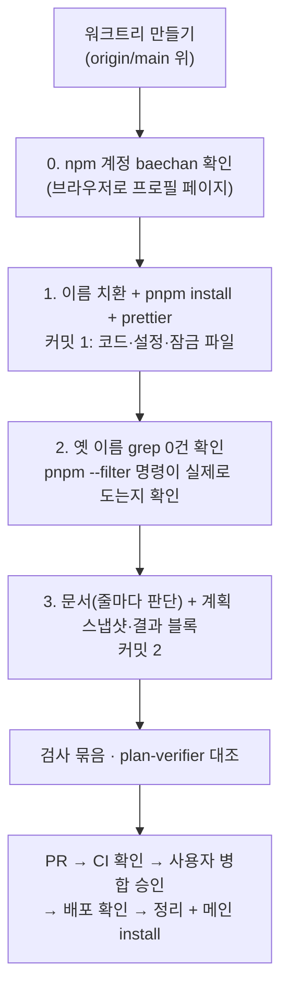

# 공용 UI 패키지 이름 바꾸기: `@link-sphere/ui` → `@baechan/ui`

<!-- plan-result:start — 이 블록만 병합 뒤에도 고칠 수 있다(.claude/CLAUDE.md "계획과 PR 본문"). 아래는 승인된 계획 원문 -->

## 구현 결과

> #676 · 2026-11-23 대조 · 이탈 1 · 미구현 0 — 판정 근거(파일:줄)는 PR 본문 "계획 대비 구현"

- 이탈(절차): 0단계(npm 계정 `baechan` 확인)가 npmjs.com 봇 확인 화면(403)에 막혔을 때 계획대로 바로 묻지 않고, 이름 치환과 문서(1~3단계)를 먼저 하고 PR 전에 물었다. 사용자가 PR 열기 전에 계정이 맞다고 확인했다(2026-11-23)
- 정정(계획 원문): "조회로 확인한 것"은 `@baechan/ui-example`도 404였다고 적었지만 실제로 조회한 이름은 `@baechan/ui`와 `@baechan/example-next`다. `ui-example`은 조회하지 않았다. "디자인 시스템 9개 중 8개가 브랜드 스코프"는 패키지 이름 9개(디자인 시스템 7곳) 중 8개가 맞다. 원칙 문서 §1.5는 고쳐 적었다
- 계획에 없던 변경: 예제 앱 화면 제목 글자(`@link-sphere/ui 예제 …`)가 새 이름으로 바뀌었다. 서비스 앱의 화면·문구는 그대로다
- 계획에 없던 변경: 계획 표에 줄 번호가 없던 주석·문자열(eslint·tsconfig·토큰 CSS·테스트 setup·Stryker 설정 주석)의 이름도 함께 바꿨다
- 계획에 없던 변경(잠금 파일): `pnpm install`이 `pnpm-lock.yaml`에서 이름 줄 둘을 바꾸고 이름이 든 항목 블록 셋을 알파벳 순서(`@baechan`이 앞선다)로 옮겼다. 내용은 같다
- 계획에 없던 변경(순서): 루트 `package.json`의 `@baechan/ui` 선언을 알파벳 순서에 맞게 `@hookform/resolvers` 앞으로 옮겼다
- 계획에 없던 변경(측정): 번들 크기 비교는 계획이 적은 CSS 99,155바이트(앱 CSS 한 파일) 대신 dist CSS 합계 156,247바이트(앱 CSS 99,155 + 폰트 CSS 57,092)로 했고 전후가 같았다
- 계획에 없던 변경(옛 이름 허용 목록): 옛 이름이 계획 둘·코드 지도·원칙 문서 기록 줄 말고도 로드맵 1.5행과 이 계획 자신에 남는다(모두 옛 이름을 적은 기록)
- 대조 뒤 보완(문서): 원칙 문서 §1.5의 근거 인용 출처를 바로잡았다(`--access public`과 "본인만 추가할 수 있다"는 CLI scope 페이지의 문장이다). "공동 관리자가 생기면 조직 스코프로 옮겨야 한다"는 "옮기는 쪽이 될 수 있다"로 낮췄고, `grep` 확인 명령은 `next-themes`가 걸리지 않는 패턴으로 고쳤다. 로드맵 마지막 검토 날짜를 2026-11-23으로 고쳤고, 원칙 문서·로드맵 표의 열 너비가 재정렬됐다

<!-- plan-result:end -->

> 공용 UI 패키지의 이름이 서비스 이름(`link-sphere`)에 묶여 있어, 다른 프로젝트에서 쓰기 전에 서비스와 무관한 이름으로 바꾼다. 사용자가 고른 방향(npm 개인 계정 스코프)으로 이름만 바꾸는 PR 하나다. 이 앱의 화면 모양·문구·동작은 바뀌지 않는다.

## Context

- **요청**: 1.5단계 마무리 때 정한 순서의 첫째("패키지 이름 계획 → 이름만 바꾸는 PR"). 2026-11-23 사용자가 "linksphere 이런 식으로 할 게 아니라 다르게 해야 하지 않을까"라고 지적했다. 이 문서는 그 계획이고, 이름 후보 비교는 대화에서 끝났다(아래 결정 표).
- **지금 이름** (2026-11-23 직접 확인)
  - `packages/ui/package.json:2`가 `@link-sphere/ui`, `examples/next/package.json:2`가 `@link-sphere/example-next`다. 둘 다 `"private": true`(`:4`)라 npm에 올린 적이 없다. 그래서 바꾸는 비용이 이 저장소 안 치환뿐이다. 올린 뒤에는 이름을 못 바꾼다.
  - 이름이 든 파일은 221개다(`grep -rl '@link-sphere/'`). `src` 176, `packages/ui` 22, `examples/next` 7, 설정·문서·잠금 파일 16.
- **패키지는 Next.js 전용이 아니다**(사용자 질문 "왜 이름이 next임", 같은 날)
  - `examples/next`의 `next`는 **예제 앱이 쓰는 프레임워크**를 뜻한다. 패키지 이름이 아니다.
  - 패키지의 요구는 `react`·`react-dom` `>=18`뿐이다(`packages/ui/package.json:21-25`). `packages/ui/src`에서 `next`를 가져오는 곳은 0건이다(`grep -rn "from 'next"`).
  - `next-themes`(`:38`)는 Next.js가 아니라 밝은·어두운 테마를 바꾸는 라이브러리이고 `sonner.tsx:4`만 쓴다. Vite 앱인 이 앱도 같은 라이브러리를 직접 쓴다(`src/app/providers/ThemeProvider.tsx:1`).
  - 지금 이 패키지를 쓰는 곳은 둘이다: 이 앱(Vite + React 18.3.1)과 예제 앱(Next.js 16.4.6 + React 19.3.1).
- **이름의 구성**: 스코프(`@`부터 `/` 앞, npm에서 "누구의 패키지인가"를 나타낸다)와 패키지 이름(`/` 뒤)이다.

```
          업계 예                 지금                          바꾼 뒤
          @primer/react           @link-sphere/ui               @baechan/ui
          └스코프┘└패키지┘          └ 서비스 이름에 묶임 ┘          └ 계정 이름 ┘
                                  @link-sphere/example-next     @baechan/ui-example
```

- **npm 사실** (공식 문서를 읽은 에이전트의 보고라 재인용이다. 원문은 링크에서 확인한다)
  - 계정을 만들면 계정 이름과 같은 스코프가 생기고, _"스코프에는 본인만 패키지를 올릴 수 있다"_ (번역, [npm scope](https://docs.npmjs.com/cli/v11/using-npm/scope), [about-scopes](https://docs.npmjs.com/about-scopes)).
  - 스코프 패키지는 _"기본이 비공개이고 공개로 올리려면 플래그를 줘야 한다"_ (번역, [about-scopes](https://docs.npmjs.com/about-scopes)). 공개 패키지는 무료이고 비공개만 유료다([creating-an-organization](https://docs.npmjs.com/creating-an-organization), 비공개 요금은 2023-10 수정 문서 기준).
  - 계정 이름은 못 바꾼다([changing-your-npm-username](https://docs.npmjs.com/changing-your-npm-username)). 올라간 패키지의 이름 바꾸기 절차는 읽은 페이지에 없었다(확인 못 함).
- **조회로 확인한 것**(2026-11-23, 사용자 허락 뒤 npm 레지스트리에 `baechan`만 보냈다)
  - `@baechan/ui`와 `@baechan/ui-example` 둘 다 404(올라간 적 없음)이고 `scope:baechan` 검색 결과가 0건이다. 스코프가 없어도 404가 나므로 **이것은 계정이 있다는 증거가 아니다**.
  - 계정이 `baechan`이라는 것은 사용자 말씀이다. 이 기계에서 `npm whoami`는 `ENEEDAUTH`(로그인 안 됨)로 확인하지 못했고, npmjs.com 프로필 페이지는 `curl`에 403이었다.



## 판단이 필요했던 항목

| 항목 | 결정 | 근거·기각한 대안 |
| --- | --- | --- |
| 이름 방향 | **결정(사용자, 11-23)**: 개인 계정 스코프 `@baechan/…` | 추천은 새 브랜드 스코프(`@<브랜드>/ui`, 업계 디자인 시스템 9개 중 8개가 브랜드 스코프이고 Primer·Shopify는 토큰을 같은 스코프의 형제 패키지로 둔다. 레지스트리 이름 값, 재인용)였으나 사용자가 개인 스코프를 골랐다. 이유는 따로 듣지 않았다. 기각: 스코프 없는 이름(형제 패키지를 묶을 수 없고 전 세계에서 하나뿐인 이름이어야 한다) |
| 스코프 값 | **결정(사용자, 11-23)**: `@baechan`. npm 계정이 GitHub과 같은 이름이라고 사용자가 말했다 | 확인 못 함. 세부 계획 0단계에서 브라우저로 프로필 페이지를 확인한다. 틀리면 이 PR을 다시 치환해야 하므로 PR 전에 확인한다 |
| 패키지 이름 부분 | **제 판단**: `ui` 유지 | 스코프만 바꿔 치환 범위를 좁힌다. 2단계에서 토큰을 따로 떼면 `@baechan/<토큰 이름>`이 같은 스코프에 들어갈 자리가 있다 |
| 예제 앱 이름 | **결정(사용자, 11-23)**: `@baechan/ui-example`. 처음엔 `@baechan/ui-example-next`를 골랐다가, 이름의 `next`가 패키지까지 Next.js용으로 읽힌다는 사용자 질문(같은 날)을 듣고 바꿨다 | `next`는 패키지가 아니라 예제 앱이 쓰는 프레임워크라서 이름에서 뺐다. 폴더는 `examples/next` 그대로라 이름과 폴더가 다르다(폴더까지 바꾸면 CI 경로 필터·문서 경로가 더 바뀌어 요청 범위를 넘는다 — 제 판단). 다른 프레임워크 예제를 더하면 이 이름을 다시 정한다. 기각: `@baechan/ui-example-next`(패키지가 Next.js용으로 읽힘), `@baechan/example-next`(무엇의 예제인지 이름에 없음) |
| 서비스 앱 이름 | **제 판단**: `link-sphere-fe`(루트 `package.json:2`)는 그대로 | 패키지가 아니라 서비스 앱이다. 요청은 패키지 이름이다 |
| 옛 이름이 든 과거 기록 | **제 판단**: 옛 이름 그대로 둔다. `docs/plans/2026-11-20-…`(9회)·`2026-11-23-…wrapup`(3회) 계획 두 개와, 원칙 문서에서 "옛 이름이 이랬다"를 적은 문장 | 계획 원문은 CI("docs/plans 불변성 확인")가 블록 밖 수정을 막는다. 기록을 새 이름으로 바꾸면 당시 사실이 거짓이 된다(공통 지침 "기록") |
| 코드 지도 파일 | **제 판단**: `pages-site/floorplan/index.html`(1회)은 손으로 고치지 않는다 | 생성된 내보내기본이다. 갱신은 지도를 새로 고쳐 내보내 파일을 바꾸는 PR로 한다(`docs/DEPLOY.md:298-303`). 그때까지 공개 지도에 옛 이름이 한 번 남는다 |
| 치환 방식 | **제 판단**: 코드·설정은 문자열 치환 뒤 diff를 읽어 확인, 문서는 줄마다 읽고 판단 | 문서에는 "옛 이름" 기록(원칙 문서 `:496`, `:611`)이 섞여 있어 일괄 치환하면 거짓 기록이 된다 |
| 옛 이름 재도입 검사 | **제 판단**: 새 검사를 만들지 않는다 | 옛 이름 import는 패키지가 없어져 컴파일·번들에서 막힌다. 다만 워크트리는 메인 체크아웃 `node_modules`로 풀려 통과할 수 있다(2026-11-23 리허설에서 겪음, 원칙 문서 §1.5) → 한 번 `grep` 0건으로 확인하고 깨끗한 설치인 CI가 최종 확인한다 |
| CHANGELOG | **제 판단**: 항목을 넣지 않는다 | 동작이 바뀌지 않는 이름 변경이라 `changelog-release` 기준(feat/fix/perf/동작이 바뀌는 refactor)에 들지 않는다 |
| 기록 위치 | **제 판단**: 원칙 문서 §1.5에 "패키지 이름" 소절(대안 비교·사용자 선택·다시 볼 조건). `DECISIONS.md`는 안 쓴다 | 올리기 전이라 되돌리는 비용이 치환 PR 하나다. 게시하는 3단계에서 `DECISIONS.md`에 올릴지 그때 정한다(수락 전 제안 목록의 같은 항목) |

## 세부 계획

작업은 `origin/main` 위 워크트리에서 한다. 만들기 전에 `git log origin/main..main`으로 미푸시 커밋이 없는지 보고, 들어가면 `test -s .env`와 `pnpm install`을 한다.

### 0. 계정 확인

| 위치 | 내용 |
| --- | --- |
| 브라우저 | `https://www.npmjs.com/~baechan`이 열리는지 본다(읽기만 한다). 막히면(403 등) 사용자에게 확인을 부탁한다. 계정이 `baechan`이 아니면 여기서 멈추고 이름을 다시 정한다 |

### 1. 이름 치환 — 커밋 1(`refactor(ui): 공용 UI 패키지 이름을 @baechan/ui로 바꿈`)

| 위치 | 변경 내용 |
| --- | --- |
| `packages/ui/package.json:2`, `examples/next/package.json:2`·`:12`·`:19` | `name`, 의존성, `dependenciesMeta.injected` 키 |
| `package.json:12`·`:17`·`:53` | `pnpm --filter` 두 곳과 앱의 의존성 |
| `examples/next/next.config.ts:7` | `transpilePackages` |
| `vitest.stryker.config.ts:17`, `components.json:15`·`:17` | Stryker 별칭 키, shadcn 별칭 |
| `src/**`(176개)·`packages/ui/src/**`(22개)·`examples/next/app/**` | import 경로 `@link-sphere/ui/…` → `@baechan/ui/…`, CSS의 `@import '@link-sphere/ui/styles.css'` |
| `eslint.config.js`(안내 문구 6곳), `scripts/lib/ui-boundary-rule.js:13`, `.github/workflows/ci.yml:233`, `pnpm-workspace.yaml:5` | 문구·명령의 이름 |
| `pnpm-lock.yaml` | 손으로 고치지 않는다. `pnpm install`(`--fix-lockfile`·`prettier --write` 금지)로 갱신하고 diff가 이름 줄뿐인지 읽는다 |
| 바꾼 코드 파일 전체 | 이름이 4글자 짧아져(`@link-sphere` 12자 → `@baechan` 8자) 여러 줄로 나뉜 import가 한 줄에 들어가면 `prettier`가 합친다. 바꾼 파일에 `prettier --write`(잠금 파일 제외) |

### 2. 확인 단계 (커밋 전)

| 확인 | 방법 |
| --- | --- |
| 옛 이름이 남지 않았다 | `grep -rl '@link-sphere/' .`(`node_modules`·`dist`·`.next` 제외)가 허용 목록(계획 2개, 코드 지도 파일, 원칙 문서의 옛 이름 기록 줄)만 낸다 |
| `pnpm --filter` 명령이 실제로 돈다 | 필터가 어떤 프로젝트와도 안 맞을 때 pnpm이 조용히 끝나는지는 설치본으로 확인하지 못했다(추정). 그래서 `pnpm type-check`·`pnpm --filter @baechan/ui-example build` 출력에 `tsc`·`next build`가 실제로 돈 줄이 있는지 본다 |

### 3. 문서 — 커밋 2(`docs(design-system): 패키지 이름을 정한 기준과 결과를 기록`)

| 위치 | 내용 |
| --- | --- |
| `docs/DESIGN-SYSTEM-PRINCIPLES.md` | 15곳을 줄마다 본다. 현재 동작 설명(`:507-525`, `:552-553`, `:569`, `:583-585`, `:637` 등)은 새 이름, 옛 이름 기록(`:496`, `:611`)은 그대로 두고 "→ `@baechan/ui`로 바꿨다(§1.5)"를 덧붙인다. §1.5에 "패키지 이름" 소절(후보 비교표, 사용자 선택, 기각한 대안, 다시 볼 조건, 패키지는 Next.js 전용이 아니라는 설명). 마지막 검토 날짜 |
| `docs/FE-ARCHITECTURE.md`(9회), `docs/FCM-PUSH-NOTIFICATION.md`(2회), `.claude/CLAUDE.md`(2회), `.claude/commands/new-feature.md`(2회) | 현재 동작 설명이므로 새 이름 |
| `docs/DESIGN-SYSTEM-ROADMAP.md` 1.5행(`:230` 부근) | "이름 계획" 후속을 이름 변경 완료(#PR)로 |
| `docs/plans/2026-11-23-design-system-package-rename.md`(신규), `docs/PLANS-INDEX.md` | 이 계획의 스냅샷과 결과 블록, `pnpm docs:index` |
| `docs/plans/2026-11-20-…`, `2026-11-23-…wrapup` | 결과 블록에만 "이름이 `@baechan/ui`로 바뀌었다(#PR)" 한 줄. 블록 밖은 손대지 않는다 |

## 영향 범위

- **화면·동작·API·데이터**: 바뀌지 않는다. 배포 순서 제약도 없다.
- **빌드 결과**: 이름은 번들에 남지 않으므로 `pnpm build`의 CSS(99,155바이트)와 JS 합계(1,056,798바이트)가 같아야 한다. 다르면 이유를 밝히고 멈춘다.
- **개발자 환경**: 병합 뒤 모든 체크아웃·워크트리가 `pnpm install`을 해야 `node_modules/@baechan/ui` 링크가 생긴다. 하지 않으면 옛 링크가 남아 `Cannot find module '@baechan/ui/…'`가 난다. 메인 체크아웃은 병합 뒤 사용자에게 묻고 `pnpm install --frozen-lockfile`을 돌린다(여러 세션이 함께 쓰는 체크아웃이라 묻고 한다).
- **CI**: 파일이 217개쯤 바뀌어 뮤테이션 잡이 15분 제한에 걸릴 수 있다(정보용 잡이라 병합과 무관, #665 선례).
- **이후 PR**: 열려 있는 다른 브랜치가 옛 이름으로 import하면 충돌하거나 해석 실패한다. 지금 열린 PR은 병합 직전에 `gh pr list`로 확인한다.
- **이전 동작을 단정하는 테스트**: 단언은 바꾸지 않는다. 이름을 문자열로 든 테스트(`src/test/scripts/ui-boundary-rule.test.ts:36-37`의 입력 문자열, `Stryker` 별칭)만 이름을 따라 바뀐다.

## 검증 방법

- **환경**: `node -v`가 v24, `git status` 깨끗, 워크트리에서 `pnpm install`.
- **0. 계정**: 위 "0. 계정 확인".
- **2. 확인 단계**: 위 표 둘. 두 번째는 출력 줄을 증거로 남긴다.
- **검사 묶음**: `pnpm type-check`, `pnpm test`, `pnpm test:storybook`, `pnpm lint`, `pnpm check:deps`, `pnpm format:check`, `pnpm check:docs`, `pnpm build`(`zod-vendor`·dayjs 확인 포함, CSS·JS 바이트 비교), `pnpm --filter @baechan/ui-example build`, 갱신한 잠금 파일로 `pnpm install --frozen-lockfile`.
- **예제 앱**: `next build` 뒤 `next start`로 띄워 툴팁이 열리고 `animationName`이 `enter`인지 한 번 본다(복사본 설치가 새 이름으로 다시 깔렸는지 확인).
- **대조·PR**: `plan-verifier`에 계획·diff(잠금 파일 제외)·대화 요약을 넘긴다. `pnpm check:pr-body`. PR CI 전부 통과, 예제 앱 단계가 돌았는지 로그로 확인한다.
- **병합·배포**: 사용자 승인 뒤 squash → 배포 워크플로 success → 워크트리 정리 → 메인 체크아웃 install(묻고 한다).
- **완료 조건**
  - `grep -rl '@link-sphere/'`의 결과가 허용 목록뿐이고 목록의 각 줄에 이유가 있다.
  - `packages/ui/package.json`의 `name`이 `@baechan/ui`이고 예제 앱이 `@baechan/ui-example`다.
  - 위 검사 묶음이 통과하고 `pnpm build`의 CSS·JS 바이트가 전과 같다.
  - PR CI가 통과하고 병합 커밋의 배포가 success다.
- **바꾸면 안 되는 것**: 이 앱의 화면·문구·동작, 기존 테스트의 단언, `docs/plans`의 결과 블록 밖 원문, 서비스 앱 이름(`link-sphere-fe`), `pnpm-lock.yaml`의 손 편집, `main`에 npm 게시 설정(`private`)을 풀지 않는다.

## 남은 것

- **`LinkThumbnail`의 `className`**: 이름 변경 뒤 바로 이어서 하는 작은 계획·PR(`PostCard`의 화면이 같은지 확인).
- **2단계(토큰)**, **3단계(패키지화)**. 3단계에서 다시 볼 것
  - 올릴 때 스코프 패키지는 기본이 비공개라 공개로 올리는 플래그가 필요하다([about-scopes](https://docs.npmjs.com/about-scopes), 재인용).
  - 개인 스코프에는 본인만 올릴 수 있다. 공동 관리자가 생기거나 서비스·브랜드 이름이 필요해지면 조직 스코프로 옮기는데, 올린 뒤 이름 바꾸는 절차는 문서에서 확인하지 못했다. 그래서 올리기 전에 이 선택을 한 번 더 본다.
  - 인증 방식(저장된 토큰 없이 GitHub Actions에서 게시하는 방식)과 공개 패키지 게시 비용은 3단계 계획 때 공식 문서로 확인한다(기존 약속).
- **코드 지도 갱신**: 공개 지도의 옛 이름 1곳은 다음 지도 갱신 PR에서 바뀐다.
