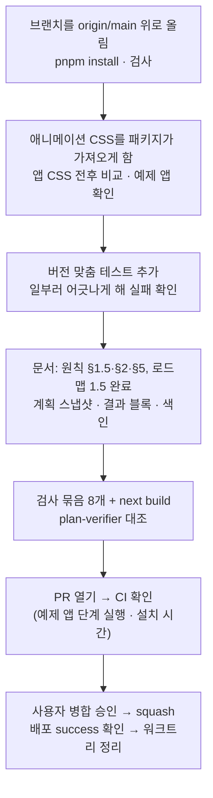

# 디자인 시스템 1.5단계 마무리: 리허설 답 반영과 둘째 PR

<!-- plan-result:start — 이 블록만 병합 뒤에도 고칠 수 있다(.claude/CLAUDE.md "계획과 PR 본문"). 아래는 승인된 계획 원문 -->

## 구현 결과

> #673 · 2026-11-23 대조 · 이탈 0 · 미구현 0 — 판정 근거(파일:줄)는 PR 본문 "계획 대비 구현"

- 계획에 없던 변경(테스트): 대조 목록에 `next-themes`가 드는지 보는 단언을 하나 더했다. 목록이 비면 버전 대조가 아무것도 검사하지 않고 통과하기 때문이다
- 계획에 없던 변경(시험, 되돌림): 패키지에서 `tw-animate-css` 선언을 잠깐 지워 `pnpm check:deps`가 CSS의 `@import`를 보지 않는 것을 확인했다. 깨끗한 설치에서 빌드가 실패하는지는 워크트리에서 확인하지 못했다(원칙 문서 §1.5 "알게 된 것")
- 계획에 없던 변경(문서): 원칙 문서 §1.5 "패키지의 경계"에 "앱과 함께 선언한 의존성" 줄을, "알게 된 것"에 "복사본은 패키지를 고쳐도 따라오지 않는다"·"의존성 검사는 CSS `@import`를 보지 않는다" 줄을, "예제 앱"에 린트 범위를 더했다. `DEPLOY.md`에 Dependabot이 워크스페이스 안 `package.json`을 고치는지 아직 보지 못했다는 문장을 더했다
- 대조 뒤 보완(문서): 버전 맞춤 테스트의 범위를 문서에서 "패키지 `dependencies` 가운데 루트도 선언한 것"으로 좁혀 코드와 맞췄다(패키지 `devDependencies`는 대조하지 않는다). 원칙 문서 §1.4 계약 테스트 설명에 남아 있던 "`LinkThumbnail`은 분리 리허설 계획에서 정한다"를 고쳤다
- 문서 동기화: 원칙 문서 §1.4 "다시 볼 조건"의 `LinkThumbnail` 줄과 토큰 기준 문단, 앱 CSS·예제 앱 CSS의 주석, `.gitignore`의 `*.tsbuildinfo` 주석, `FE-ARCHITECTURE.md` §19의 `pnpm build`·`pnpm type-check` 설명(#665에서 패키지 타입 검사를 더하고 고치지 않은 것)
- 이름 변경: 패키지 이름이 `@link-sphere/ui`에서 `@baechan/ui`로 바뀌었다(#676, [계획](./2026-11-23-design-system-package-rename.md)). 아래 원문의 옛 이름은 당시 기록이라 그대로 둔다

<!-- plan-result:end -->

> 분리 리허설 둘째 PR(Next.js 예제 앱)을 끝낸다. 리허설 결과를 본 사용자의 답 다섯 가지를 원칙 문서에 적고, 그중 코드를 바꾸는 둘(애니메이션 CSS를 패키지가 가져오기, 앱과 패키지의 버전 맞춤 테스트)을 같은 PR에 넣는다. 로드맵 1.5단계를 "완료"로 바꾼다. 이 앱의 화면 모양·문구·동작은 바뀌지 않는다.

## Context

- **요청**: "PR 2 진행"(2026-11-20), "질문 나한테 줘 선택할게"(2026-11-23). 원 계획은 [`2026-11-20-design-system-split-rehearsal.md`](./2026-11-20-design-system-split-rehearsal.md)이고, 그 Phase 3이 "코드를 바꿔야 하는 답이면 그 변경은 따로 계획을 세운다"고 적었다. 이 문서가 그 계획이다.
- **지금 상황** (2026-11-23 직접 확인)
  - 예제 앱·CI 단계·무시 목록은 워크트리 브랜치에 커밋돼 있다(`d80711c0`, 아직 push하지 않음). 그 상태에서 루트 검사 묶음 8개와 `next build`가 통과했다.
  - `origin/main`이 앞서 있다(#671·#672 등). 브랜치를 다시 올려야 한다.
  - 애니메이션 CSS: `src/app/globals.css:5`와 `examples/next/app/globals.css:5`가 `tw-animate-css`를 직접 가져온다. 루트는 `devDependencies`에 `^1.4.0`으로 선언한다. 패키지 토큰 CSS는 이 CSS의 키프레임 변수를 이미 안다(`packages/ui/src/styles/tokens.css:357`).
  - 함께 선언한 의존성: 루트와 `packages/ui`가 둘 다 선언한 패키지는 9개이고 버전 문자열이 모두 같다(`jq`로 대조).
  - 앱 코드가 직접 가져오는 것은 그중 `next-themes`뿐이다(`src/app/providers/ThemeProvider.tsx:1`, `Navbar.tsx:2`). 패키지의 `Toaster`도 `next-themes`의 `useTheme`을 읽는다(`packages/ui/src/atoms/sonner.tsx:29`). 두 벌이 되면 토스트 테마가 앱을 따라가지 않는다 — 예제 앱에서 링크 설치일 때 어두운 화면의 토스트 테마가 `light`로 측정됐다.
  - 패키지 이름이 들어간 파일은 약 220개다(`grep -rl`, `src` 176·`packages` 22·`examples` 8·설정과 문서).
- **리허설 결과**(둘째 PR에서 측정): 원칙 문서 §1.5에 적을 내용이다.
  - 서버 컴포넌트에서 직접 그리면 파일 4개가 깨진다(`UiTextsProvider`·`TooltipWrapper`·`link-thumbnail`은 빌드 오류, `sonner`는 프리렌더에서만 오류). `Spinner`는 Provider를 거쳐 함께 깨진다.
  - 실행 중 React는 한 벌이다(Next App Router가 자기 React로 모은다).
  - 링크 설치에서는 타입과 `next-themes`가 두 벌이 됐다. 복사본 설치(`dependenciesMeta.injected`) + `transpilePackages` + `@types/react` 선택 peer로 풀었다.
  - 패키지 CSS의 `@source`만으로 충분하다(빼면 CSS 27,265 → 12,698바이트). 받는 쪽은 Tailwind에 경로를 등록하지 않는다.
  - `tw-animate-css`가 없으면 툴팁 애니메이션이 오류 없이 사라진다(`animationName` `none`).

## 판단이 필요했던 항목

| 항목 | 결정 | 근거·기각한 대안 |
| --- | --- | --- |
| 보조 모듈의 자리 | **결정(사용자)**: 부품을 옮길 때 패키지 `lib/`로 옮기고 앱도 패키지에서 가져다 쓴다. 앱 것과 섞인 세 파일은 부품이 쓰는 이름만 떼어 옮긴다. 적용은 3단계 | 리허설에서 `cn`·토스트 래퍼로 해 본 방식이다. 기각: 패키지와 앱에 사본을 하나씩(한쪽만 고치면 어긋난다), 3단계로 미룸 |
| `LinkThumbnail`·`TooltipWrapper` | **결정(사용자)**: 둘 다 범용으로 확정한다. `LinkThumbnail`의 `className`은 맨 바깥 요소로 보내고 `img`용 클래스는 새 속성으로 받는다. 코드 변경은 별도 계획·PR | 예제 앱에서 앱 코드 없이 그려졌다. `className`을 넘기는 곳은 `PostCard` 한 곳이다. 기각: 지금처럼 `img`로 두고 예외로 기록(받는 쪽이 이 부품만 따로 기억해야 한다) |
| 범용 부품의 스토리·테스트 | **결정(사용자)**: 부품을 패키지로 옮길 때(3단계) 그 스토리·테스트도 패키지 방식으로 바꾼다. 문구가 필요한 테스트는 그때 `KO_UI_TEXTS`로 감싸는 패키지 `render`를 만든다. `ImageViewer` 스토리의 앱 배선 둘은 앱 쪽 스토리로 나눈다. 앱에 남긴 토스트 래퍼 테스트와 `Toaster` 스토리도 같은 방식 | 대상은 15개 파일이다. 패키지 안에서는 `@/` import를 린트가, 선언하지 않은 패키지를 의존성 검사가 이미 막아 새 검사가 필요 없다. 기각: 지금 15개를 미리 고침(옮길 때 경로를 또 고친다), 고치지 않음(패키지로 옮길 수 없다) |
| 애니메이션 CSS | **결정(사용자)**: 패키지 토큰 CSS가 `tw-animate-css`를 가져오고 패키지 `dependencies`에 선언한다. 이번 PR | 받는 쪽은 패키지 CSS 한 줄만 가져오면 된다. 빠뜨려도 오류가 없던 조건이 없어진다. 기각: 받는 쪽이 가져옴(지금 그대로) |
| 버전 어긋남 막기 | **결정(사용자)**: 루트와 `packages/ui`가 함께 선언한 패키지의 버전 문자열이 같은지 보는 테스트. 이번 PR | 한쪽만 올리는 PR이 CI에서 실패한다. 기각: `next-themes`를 peer로만(3단계의 "함께 쓸 패키지 범위"를 앞당긴다), 기록만 |
| 테스트의 모양 | **제 판단**: Vitest 테스트 한 파일(`src/test/workspace-shared-deps.test.ts`). 패키지 `dependencies`의 이름마다 루트가 `dependencies`나 `devDependencies`에 선언했으면 문자열이 같아야 한다 | 사용자가 고른 방식이다. 저장소 파일을 읽어 대조하는 테스트 선례는 `packages/ui/src/lib/tailwind/utils.test.ts`(토큰 CSS 대조)다. 패키지 쪽에 두지 않는 이유: 루트 `package.json`을 읽으면 패키지가 이 저장소에 묶인다. 기각: 버전 맞춤 전용 도구를 새로 설치(규칙 하나에 의존성이 는다. 그 도구들의 지금 동작은 확인하지 않았다) |
| 루트의 `tw-animate-css` 선언 | **제 판단**: 루트 `devDependencies`와 예제 앱 `dependencies`에서 지운다 | 직접 가져오는 줄이 없어진다. 두 곳에 남기면 버전이 어긋날 자리가 하나 더 생긴다 |
| `@import` 자리 | **제 판단**: 토큰 CSS 맨 위(`@source` 앞) | CSS는 `@import`가 다른 규칙보다 앞에 와야 한다. 앱 CSS에서 이 CSS의 순서가 토큰 뒤에서 앞으로 바뀌므로 빌드 결과를 전후로 비교한다 |
| 패키지 이름 | **결정(사용자)**: 이 PR은 지금 이름(`@link-sphere/ui`)으로 끝낸다. 병합 뒤 이름 계획(후보·npm 조건·비용 비교)을 따로 세우고, 이름만 바꾸는 PR을 낸다 | 리허설 결과와 220개 파일 치환을 한 diff에 섞지 않는다. 기각: 이번 PR에 포함, 3단계까지 미룸(옛 이름이 코드·문서에 계속 쌓인다) |
| 기록 위치 | **제 판단**: 원칙 문서 §1.5·§2·§5. `DECISIONS.md`·`CHANGELOG.md` 항목은 만들지 않는다 | 원 계획과 같다. 문서와 설정을 고치면 되돌릴 수 있고 화면 동작이 바뀌지 않는다 |
| 병합 뒤에 확인할 것 | **제 판단**: GitHub 이슈 하나로 연다 | 예제 앱 단계가 앱만 바뀐 PR에서 건너뛰는지는 그런 PR이 열려야 보인다(경로 필터는 로컬에서 확인했다). Dependabot이 워크스페이스 안 `package.json`을 고치는지는 12월 실행에서 보인다 |

## 세부 계획

| 위치 | 변경 내용 |
| --- | --- |
| 브랜치 | `git fetch origin` 뒤 `origin/main` 위로 rebase. `pnpm-lock.yaml`이 충돌하면 main 것을 받고 `pnpm install`로 다시 만든다(`--fix-lockfile`은 쓰지 않는다 — `deprecated` 줄이 지워진다) |
| `packages/ui/src/styles/tokens.css` | 머리 주석 다음, `@source` 앞에 `@import 'tw-animate-css';`. 머리 주석에 "받는 쪽은 이 파일 하나만 가져온다"를 반영 |
| `packages/ui/package.json` | `dependencies`에 `tw-animate-css` `^1.4.0`(루트의 선언 그대로) |
| `src/app/globals.css:5` | `@import 'tw-animate-css';` 줄 삭제 |
| `package.json`(루트) | `devDependencies`의 `tw-animate-css` 삭제 |
| `examples/next/app/globals.css`, `examples/next/package.json` | `tw-animate-css` import 줄·주석과 의존성 삭제 |
| `pnpm-lock.yaml` | `pnpm install`로 갱신 |
| `src/test/workspace-shared-deps.test.ts` (신규) | "테스트의 모양" 결정대로. 실패 메시지에 어느 패키지가 어떻게 다른지 적는다 |
| `src/shared/ui/ApiContract.test.tsx:154-155` | `LinkThumbnail` 예외 사유 문구만 고친다("별도 PR에서 맨 바깥 요소로 옮긴다"). 단언은 그대로 |
| `docs/DESIGN-SYSTEM-PRINCIPLES.md` §1.5 | 서두 문단, "옮긴 것" 아래 두 파일의 자리, "패키지의 경계" 표(형태·의존성 선언), "알게 된 것" 표(React peer·`tw-animate-css` 행 갱신, 서버 컴포넌트 경계·두 벌·`@source`·Next 증분 캐시·버전 맞춤 행 추가), 새 소절 "예제 앱"(무엇을 그리는지, 실행 명령, 패키지를 고친 뒤 `pnpm install`), 새 소절 "미뤄 둔 항목의 답"(위 결정 표의 사용자 결정 여섯 줄) |
| 같은 문서 §1.1·§2·§5·머리 | §1.1 마지막 줄에 "정했다(§1.5)". §2의 "받는 쪽은 패키지 경로를 Tailwind에 등록한다"와 `tw-animate-css` 문장을 리허설 결과로 고치고 Next.js에서 쓰는 조건을 한 줄 더한다. §5.1·§5.2의 두 부품 줄과 §5.5 셋째 불릿을 답으로 고친다. "마지막 검토" 날짜 |
| `docs/DESIGN-SYSTEM-ROADMAP.md` §5 1.5행 | "완료"로 바꾸고 PR을 링크. 남은 것(이름 계획, 썸네일 PR)을 적는다 |
| `docs/FE-ARCHITECTURE.md` §3·§19 | `packages/ui` 트리 아래 `examples/next` 설명, 예제 앱 명령(`pnpm --filter @link-sphere/example-next build`) |
| `docs/DEPLOY.md` "npm 패키지 업데이트" | 루트와 패키지가 함께 선언한 것은 두 곳을 같이 올린다는 한 줄(테스트가 막는다) |
| `docs/plans/2026-11-20-design-system-split-rehearsal.md` 결과 블록 | Phase 2·3 결과를 덧붙인다(TypeScript 5.9.3, 복사본 설치, 답으로 생긴 코드 변경은 이 계획을 가리킴) |
| `docs/plans/2026-11-23-design-system-split-rehearsal-wrapup.md` (신규), `docs/PLANS-INDEX.md` | 이 계획의 스냅샷과 결과 블록, `pnpm docs:index` |
| PR·이슈 | PR 본문 `## 계획 대비 구현`(두 계획), 병합 뒤 확인 이슈 1개 |

## 영향 범위

- **이 앱의 CSS**: `tw-animate-css`가 앱 CSS에서 토큰보다 앞에 오게 된다. 규칙 내용은 같아야 하고 순서만 달라질 수 있다 — 전후 비교로 확인한다. 이 CSS를 쓰는 곳은 툴팁·다이얼로그·드롭다운·시트 등 열림·닫힘 애니메이션 전체다.
- **설치**: 루트에서 `tw-animate-css` 선언이 빠지고 패키지에 생긴다. 앱 코드의 import는 바뀌지 않는다.
- **새 테스트**: 이후 의존성을 올리는 PR(Dependabot 포함)이 한쪽만 올리면 `pnpm test`가 실패한다. 의도한 동작이다.
- **데이터 계약·API·화면 문구**: 바뀌지 않는다. 배포 순서 제약도 없다.
- **배포**: `src`와 `packages`가 바뀌어 배포 워크플로가 돈다.
- **이전 동작을 단정하는 테스트**: 단언은 바꾸지 않는다. `ApiContract.test.tsx`의 사유 문구 한 줄만 바뀐다.

## 검증 방법

- **환경**: rebase 뒤 `node -v`가 v24, `pnpm install`, `git status`가 깨끗한지.
- **애니메이션 CSS**
  - 바꾸기 전 `pnpm build`의 CSS를 스크래치패드에 복사하고, 바꾼 뒤 CSS와 정렬·정규화해 비교한다. 차이는 PR 본문에 설명한다.
  - 예제 앱을 `next build` → `next start`(빈 포트, `scripts/pick-e2e-port.js`)로 띄워 Playwright MCP로 툴팁의 `animationName`이 `enter`인지 본다. 예제 앱 CSS에 직접 import가 없는 상태에서다.
  - 받는 쪽이 한 번 더 가져오면 CSS가 겹치는지: 예제 앱 CSS에 import를 잠깐 다시 넣어 크기를 비교하고 되돌린다. 결과를 원칙 문서 §2에 적는다.
  - `pnpm test:storybook`(애니메이션을 쓰는 스토리 포함).
- **버전 맞춤 테스트**: 통과를 확인한 뒤 `packages/ui/package.json`의 `next-themes`를 잠깐 다른 버전으로 고쳐 실패 출력을 남기고 되돌린다.
- **검사 묶음**: `pnpm type-check`, `pnpm test`, `pnpm test:storybook`, `pnpm lint`, `pnpm check:deps`, `pnpm format:check`, `pnpm check:docs`, `pnpm build`(zod·dayjs 확인 포함), `pnpm --filter @link-sphere/example-next build`, `pnpm install --frozen-lockfile`.
- **대조·PR**: `plan-verifier`에 두 계획·diff·대화 요약을 넘긴다. `pnpm docs:index`, `pnpm check:pr-body`. PR CI에서 예제 앱 단계가 실제로 돌았는지와 설치 단계 시간(기준: 최근 PR 3건 3~5초)을 로그로 확인해 PR 본문에 적는다.
- **병합·배포**: 사용자 승인 뒤 squash 병합 → 배포 워크플로 success → 워크트리 정리.
- **완료 조건**
  - `tw-animate-css`를 직접 가져오는 줄이 `packages/ui/src/styles/tokens.css` 한 곳뿐이고, 예제 앱 툴팁에 애니메이션이 있다.
  - 버전 맞춤 테스트가 있고, 일부러 어긋나게 했을 때 실패한 출력이 있다.
  - 원칙 문서 §1.5에 리허설 결과와 사용자 답이 있고, 로드맵 1.5행이 "완료"다.
  - PR CI가 통과하고 병합 커밋의 배포가 success다.
- **바꾸면 안 되는 것**: 이 앱의 화면 모양·문구·동작, 기존 테스트의 단언, `docs/plans`의 기존 원문(결과 블록 제외), `DECISIONS.md`의 과거 항목, 패키지 이름(이 PR에서는), `LinkThumbnail`의 코드, 저장소 규칙셋.

## 남은 것

- **이름 계획과 치환 PR**: 병합 뒤 바로. 방향별 후보, npm에 올릴 때의 조건(스코프 소유)과 비용을 공식 문서로 확인해 비교표로 보여 준 뒤 사용자가 고른다. 이름이 비어 있는지 조회하는 것은 그때 묻는다.
- **`LinkThumbnail`의 `className`**: 작은 계획·PR. `PostCard`의 화면이 같은지 확인한다.
- **병합 뒤 확인(이슈)**: 예제 앱 단계가 앱만 바뀐 PR에서 건너뛰는지, 12월 Dependabot 실행이 `packages/ui`·`examples/next`의 `package.json`을 고치는지.
- **3단계로 넘긴 판단**: `'use client'`를 붙일 파일(후보 4개), 함께 쓸 패키지 범위(`next-themes`를 peer로 둘지), 빌드해서 줄지(지금은 받는 쪽 Next.js에 `transpilePackages`가 필요하다), 저장소 구조.
- **2단계(토큰)**: 패키지 토큰 CSS에서 시작한다.
