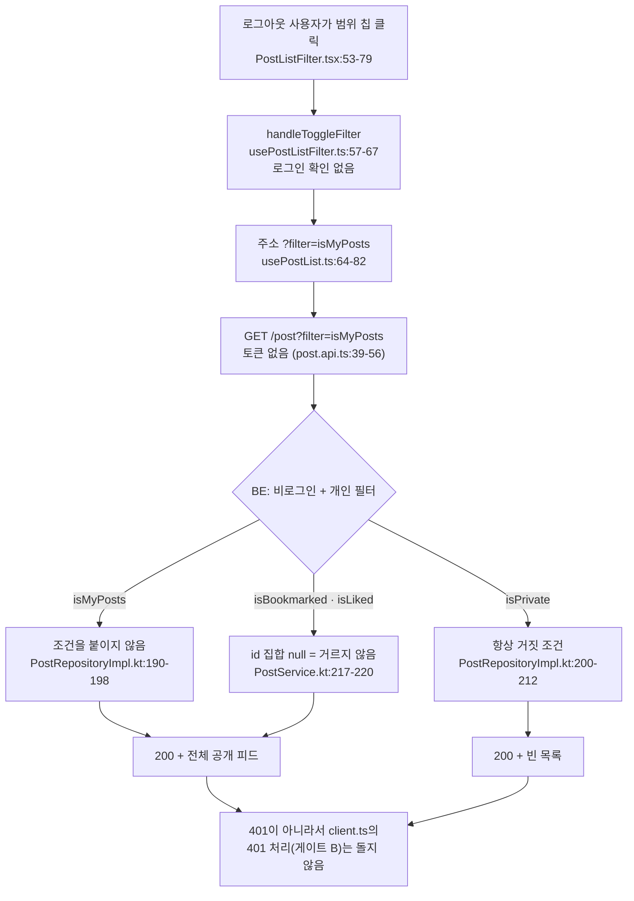
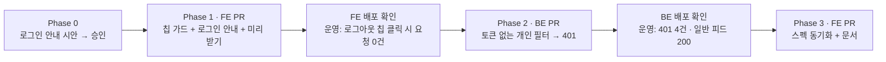
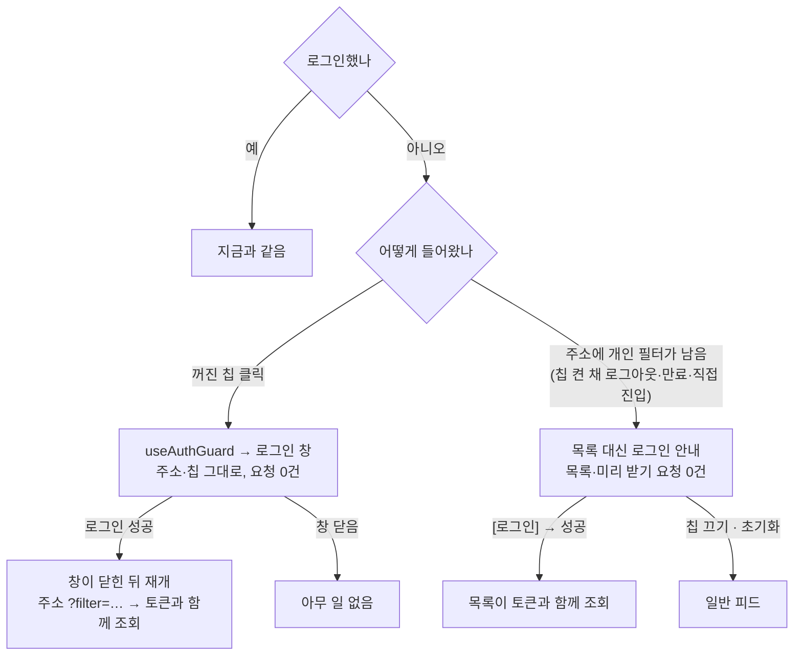

# 로그아웃 상태에서 로그인 전용 범위 칩이 그대로 조회되는 문제

<!-- plan-result:start — 이 블록만 병합 뒤에도 고칠 수 있다(.claude/CLAUDE.md "계획과 PR 본문"). 아래는 승인된 계획 원문 -->

## 구현 결과

> Phase 1: #675 · 2026-11-23 대조 · 이탈 3 · 미구현 3(보완함) — 판정 근거(파일:줄)는 PR 본문 "계획 대비 구현"

- 이탈(구현 중 재현된 버그): 로그인 뒤 재개를 "재개 시점의 최신 `toggleFilter`" 대신 새 함수 `turnFilterOn`(`usePostList.ts`, 계획 표에 없던 파일)으로 함. 로그인 창이 닫힐 때의 뒤로가기가 주소 초안을 비워, 최신 `toggleFilter`로도 직전에 고른 라벨이 주소에서 빠졌다
- 이탈(순서): e2e 새 테스트를 구현 뒤에 씀. 단위 테스트 20건은 구현 전에 실패를 확인했고, e2e는 미리 받기·목록 안내·칩 가드를 하나씩 뺀 변형에서 실패하는 것으로 보완함
- 이탈(순서): 화면 녹화를 커밋 뒤에 함(리베이스로 커밋을 먼저 만들었다)
- 미구현 → 보완함: 미리 받기 요청 0건 테스트(`src/app/routes/AppRoutes.test.tsx`), 2026-10-14 계획의 `대체됨`, `docs/PLANS-INDEX.md` 재생성
- 계획에 없던 변경: 로그인 안내에서 칩을 끄는 e2e, `post-list-payload.test.ts`, 재개 시나리오 G·H, `PostList.test.tsx`의 기존 테스트 입력을 로그인 상태로 바꿈(계획의 입력 변경 목록에 없던 파일), CHANGELOG Notes의 배포 순서, 문서 줄 번호 동기화
- 위험 관리 표의 추정을 재현으로 확인함: 새 FE + 옛 BE 구간에서 칩을 켠 채 로그아웃한 뒤 그 자리에서 다시 로그인하면 조건 없는 공개 글이 새 응답 전까지 잠깐 보인다
- 계획이 다루지 않은 한계: 공백이 낀 손 입력 주소(`?filter=%20isMyPosts`)에서는 로그인 안내는 뜨는데 칩이 꺼져 보이고 초기화가 듣지 않는다(`docs/SEARCH.md` §11)

> Phase 2: BE #227 · 2026-11-24 대조 · 이탈 1 · 미구현 0 — 절차 이탈 1건은 보완함. 항목별 결과는 BE 저장소의 같은 이름 계획 파일, 판정 근거는 BE PR 본문

- 배포 순서를 계획대로 지킴: FE #675 배포(2026-11-23) → BE #227 배포(2026-11-24)
- 완료 조건 확인: BE 배포 뒤 운영에 토큰 없는 요청 6건 — 범위 값 4종은 401 `NOT_LOGGED_IN`, 필터 없음과 `excludeBots`는 200

> Phase 3: #678 · 2026-11-24 대조 · 이탈 0 · 미구현 0 — 판정 근거(파일:줄)는 PR 본문 "계획 대비 구현"

- 이탈·미구현 없음
- 계획에 없던 변경(문서 동기화): Phase 1에서 "BE는 아직 200"을 전제로 적은 문장을 BE 배포 뒤 사실로 맞춤(`CHANGELOG.md`의 Fixed 배경·Notes, `docs/SEARCH.md` §9·§11, 소스 주석 두 곳), `docs/VERSION-COMPATIBILITY.md`에 미릴리즈 행(BE #227) 추가
- 대조 뒤 보완: 결과 블록의 Phase 2 줄을 색인이 읽는 형식으로 고침, 확인 수준이 드러나지 않던 문장에 코드 추적·추론임을 적음, 토큰 없는 상세·댓글 조회가 200인 것을 운영에서 다시 확인함(3건)

<!-- plan-result:end -->

> 피드의 범위 칩 4개(북마크한·좋아요한·내가 작성한·나만 볼 수 있는)는 로그인이 있어야 뜻이 있는데, 로그아웃 상태에서도
> 요청이 그대로 나가고 BE가 200으로 답한다. 화면은 요청 전에 로그인을 유도하고(칩 클릭 → 로그인 창, 주소에 남은 필터 →
> 로그인 안내), BE는 토큰 없는 개인 필터 요청을 401로 거절한다. 전역 401 처리(`client.ts`)는 바꾸지 않는다.

## Context

### 증상

로그아웃 상태에서 피드(`/post`)의 범위 칩을 누르면 칩이 켜지고 요청이 나간다. 3개는 조건 없이 전체 피드가 그대로
나오고, "나만 볼 수 있는"은 빈 목록이 나온다. 사용자는 왜 그런 결과가 나왔는지 알 수 없다.

### 가설

칩에 로그인 확인이 없고, BE는 비로그인이면 개인 필터를 조용히 버리거나(3개) 빈 결과를 준다(1개).

### 재현 절차 (2026-11-23, 운영, 로그아웃 상태, 읽기 전용)

토큰 없이 `GET /api/post?size=3&filter=…`를 5번 보내고, 운영 화면에서 칩을 하나씩 눌러 주소·목록을 읽었다.

| 칩 | 요청 | 응답 | 화면 |
| --- | --- | --- | --- |
| 없음 | `/post` | 200, 글 있음 | 피드 10개 |
| 내가 작성한 | `?filter=isMyPosts` | 200, 글 있음 | 피드 10개 그대로, 칩만 켜짐 |
| 북마크한 | `?filter=isBookmarked` | 200, 글 있음 | 위와 같음 |
| 좋아요한 | `?filter=isLiked` | 200, 글 있음 | 위와 같음 |
| 나만 볼 수 있는 | `?filter=isPrivate` | 200, 0건 | "등록된 링크가 없거나 검색 결과가 없어요." |

### 근본 원인 (코드 추적)

- 남의 비공개 글은 새지 않는다. 공개 범위 조건이 항상 붙는다(`PostRepositoryImpl.kt:217-226`). 보안 구멍이 아니라
  "물어본 것과 다른 답을 200으로 준다"는 정확성 문제다.
- **같은 화면이 되는 다른 경로 세 가지**(클릭만 막으면 남는다).
  - 칩을 켠 채 로그아웃: 공개 화면에서는 이동 없이 그 자리에 남아(`auth.queries.ts:110-117`) 주소의 `filter`가 그대로다.
    로그인 만료(`AuthUtil.applySessionExpired`), 다른 탭 로그아웃(`applySignOutFromElsewhere`)도 같다.
  - 그 주소로 바로 진입(즐겨찾기·공유 링크).
  - 피드 미리 받기: 라우트의 `usePostFeedPrefetch.ts:15-26`이 로그인 여부와 상관없이 주소의 `filter`로 요청을 먼저 보낸다.
- 좋아요·북마크·댓글은 이미 클릭 전 가드가 있다(`useAuthGuard.ts:28-59`, `e2e/guest-guard.spec.ts`). 칩만 빠져 있었다.

### 업계 비교

로그인이 필요한 조작은 세 층을 겹쳐 다룬다. 제안된 두 안(칩에서 로그인 창 / 인증이 빠지면 로그인 창을 띄우는 시스템)은
서로 다른 층이다.

| 층 | 업계 | 지금 | 이 계획 뒤 |
| --- | --- | --- | --- |
| ① 화면(요청 전) | 조작하는 순간 로그인 유도, 요청을 안 보냄 | 좋아요·북마크·댓글만 | 범위 칩과 주소에 남은 필터도 |
| ② 전송층(응답 뒤) | 401을 한곳에서 갱신·재로그인(안전망) | 이미 있음(`client.ts:398-445`) | 그대로 |
| ③ 서버(최종 판정) | 로그인이 필요한 요청은 명시적으로 거절 | 200으로 조용히 무시 | 401 `NOT_LOGGED_IN` |

근거는 아래 "근거 선례"에 모았다.

## 판단이 필요했던 항목

| 항목 | 결정 | 근거·기각한 대안 |
| --- | --- | --- |
| 로그아웃 상태의 칩 클릭 | **로그인 창 + 로그인 뒤 그 칩 자동 적용**(2026-11-23 사용자 선택) | 북마크 버튼과 같은 방식(`useBookmarkPostButton.ts:50-56`, `resumeAfterLogin`). 기각: ① 로그인 창만(로그인 뒤 다시 눌러야 함) ② 칩 숨김(방문자가 기능을 알 수 없고 2026-10-14 "숨기지 않는다"를 뒤집음) |
| 켜진 칩을 끄는 클릭 | 로그인 없이 허용 | 끄는 데는 로그인이 필요 없다. 막으면 로그아웃된 뒤 남은 칩을 끌 방법이 초기화 버튼뿐이 된다 |
| 주소에 필터가 남은 로그아웃 상태 | **목록 자리에 로그인 안내 + 로그인 버튼**(사용자 선택) | YouTube 구독 탭 방식. 로그인하면 그 목록이 바로 나온다. 기각: ① 주소에서 필터를 빼고 일반 피드(다시 로그인해도 필터가 꺼져 있음) ② 그대로 둠 |
| BE 응답 | **토큰 없는 개인 필터 요청은 401 `NOT_LOGGED_IN`**(사용자 선택) | GitHub API가 같은 상황에서 명시적으로 거절한다(아래). 기각: ① 4개 모두 빈 목록으로 통일(왜 비었는지 알려 주지 않음) ② 그대로 |
| 401 대 422 | 401 `NOT_LOGGED_IN` | GitHub 검색은 422를 쓰지만, FE가 이미 `NOT_LOGGED_IN`을 알고 처리한다(`client.ts:409-445`, `error-toast.ts:66-68`). 새 코드를 만들면 FE 분기를 더해야 한다 |
| BE에서 401을 내는 자리 | `PostService.getPostsByCursor`에서 예외 → `GlobalExceptionHandler`가 401 | 필터 이름 목록이 domain에 있다. 기각: ① `SecurityConfig`의 `GET /post` 규칙 확장 — "global → domain 금지"에 걸린다(BE `.claude/CLAUDE.md` 레이어 규칙) ② 컨트롤러 — 비즈니스 로직 금지 ③ 저장소 — 예외 생성 금지 |
| 재개 액션이 기준으로 삼는 주소 | 로그인 뒤 재개하는 시점의 최신 주소에 "켜기"(이미 켜져 있으면 그대로) | 클릭 때 만든 함수를 그대로 부르면, 다른 조건(카테고리·검색)의 전환이 끝나기 전에 칩을 누른 경우 직전에 고른 검색어가 사라진다 — 재개가 클릭 때의 주소로 초안을 만들기 때문이다(`useSearchParamsDraft.ts:69-70`). 로그인 창은 라우터의 최신 주소 위에 열린다(`useBackClosableOverlay.ts:31-44`) |
| FE 쿼리 함수에서 "토큰 없음 + 개인 필터"를 네트워크 없이 끝내는 안 | 하지 않는다 | 로그아웃 순간의 배경 재요청 1건까지 막을 수 있지만 사용자에게 보이는 결과는 같고, 조회 계층(entities)에 로그인 판단이 들어간다. 화면 층에서 목록·미리 받기를 그리지 않는 것으로 충분하다 |
| 전역 401 처리(제안 2안) | **이번엔 그대로**(사용자 선택) | 화면에서 요청을 미리 막으면 정상 흐름에서는 타지 않는 마지막 안전망이다. 토큰 없이 보낸 요청의 401은 지금처럼 로그인 페이지로 간다 |
| 배포 순서 | FE 먼저, BE 나중 | BE가 먼저 나가면 지금 화면의 칩 클릭이 전부 로그인 페이지 이동이 된다 |
| 배포 간격(FE 배포 확인 → BE PR 병합) | **바로 이어서 병합**(2026-11-23 사용자 선택) | 옛 화면이 떠 있는 탭의 증상 세 가지(위험 관리)를 과도기 동작으로 받아들인다. 기각: ① 하루 뒤 병합(옛 탭이 줄지만 작업이 하루 더 열림) ② 일주일 뒤 병합(그 사이 BE main이 바뀌면 PR을 다시 맞춰야 함) |
| DECISIONS.md | 새 항목을 만들지 않는다 | BE 재배포로 되돌릴 수 있다. 근거는 `docs/SEARCH.md`·`docs/AUTH.md`와 이 계획에 남긴다(2026-10-14 칩 계획과 같은 판단) |

### 시안 후보 (Phase 0, 반영 전 승인)

로그인 안내는 새 화면 요소다. 실제 `EmptyState`·`Button` 클래스와 토큰 CSS로 라이트·다크, 폰·데스크톱 시안을 만들어
나란히 보여 주고 고른 뒤 반영한다.

- 모양: ⓐ 빈 목록 상자(`border rounded-lg bg-muted/10`) 안에 문구 한 줄 + 로그인 버튼 / ⓑ 같은 상자에 제목·설명
  두 줄 + 버튼 / ⓒ 자물쇠 아이콘 + 문구 + 버튼
- 문구: 켜진 칩과 상관없는 한 가지 문구로 할지, 칩 이름을 넣을지("'내가 작성한' 글은 로그인하면 볼 수 있어요")
- 버튼: 내비게이션 바 [로그인]과 같은 창을 연다. 로그인이 풀린 채 남은 화면이면 그 이유의 창을 연다(`useAuthGuard`)

### 근거 선례

문서 인용은 조회 도구가 원문 페이지에서 옮겨 온 문장이다. "직접 확인"만 이 세션에서 호출하거나 화면으로 봤다.

- 화면 층
  - [UI Patterns "Lazy Registration"](https://ui-patterns.com/patterns/LazyRegistration):
    _"가입하기 전이나 가입 없이도 제한된 기능·콘텐츠를 쓸 수 있게 한다"_ (번역)
  - [Auth0 블로그](https://auth0.com/blog/should-you-give-users-access-before-they-register/)(기업 블로그):
    _"정보를 저장하거나 개인화하려는 순간에 계정을 만들도록 안내한다"_ (번역)
  - [NN/g "Login Walls"](https://www.nngroup.com/articles/login-walls/):
    _"사이트는 사용자가 그 벽으로 큰 이득을 얻을 때만 로그인 벽을 써야 한다"_ (번역)
  - YouTube(직접 확인, 2026-11-23): 로그아웃 상태의 구독 탭은 전체 영상 대신 "즐겨찾는 YouTube 채널의 업데이트를
    확인하려면 로그인하세요."와 로그인 버튼을 보여 준다
  - GitHub 웹(직접 확인): 로그아웃 상태의 `github.com/issues/assigned`는 404 화면이다(숨기는 쪽)
- 전송 층
  - [Apollo Client 공식 문서](https://www.apollographql.com/docs/react/data/error-handling):
    _"토큰 기반 인증을 쓴다면 토큰이 만료됐을 때 재인증을 자동으로 처리하고 싶을 수 있다"_ (번역)
  - [dev.to 글](https://dev.to/aragossa/please-stop-redirecting-to-login-on-401-errors-3c0l)(개인 블로그):
    _"401은 치명적 오류가 아니라 복구할 수 있는 오류로 다뤄라"_ (번역)
- 서버 층
  - [OWASP Authorization Cheat Sheet](https://cheatsheetseries.owasp.org/cheatsheets/Authorization_Cheat_Sheet.html):
    _"개발자는 클라이언트 쪽 접근 제어 검사에 절대 기대면 안 된다"_ (번역)
  - [RFC 9110 §15.5.2](https://www.rfc-editor.org/rfc/rfc9110.html#section-15.5.2):
    _"401은 대상 리소스에 유효한 인증 정보가 없어 요청이 적용되지 않았음을 뜻한다"_ (번역)
  - GitHub API(직접 호출, 토큰 없음): `/user/starred`는 401 "Requires authentication", 검색 `author:@me`는 422
    "Validation Failed". 조건을 빼고 전체 결과를 주지 않는다
- 배포 순서(먼저 넓히고, 옮기고, 나중에 좁힌다)
  - [Danilo Sato, "ParallelChange"](https://martinfowler.com/bliki/ParallelChange.html)(martinfowler.com, 2014-05-13):
    _"모든 사용처가 새 버전으로 옮겨 가면, 옛 버전을 없애는 축소 단계를 수행한다"_ (번역). 이 글은 코드
    인터페이스 변경을 다루고, 열려 있는 브라우저 탭은 다루지 않는다 — 여기서는 FE를 먼저 배포하는 순서의 근거로만
    쓴다. 옛 화면 탭이 새 화면으로 바뀔 시간을 따로 두지는 않는다(판단 표 "배포 간격")

### 뒤집힌 전제

| 발견 | 그래서 바뀐 것 |
| --- | --- |
| "나만 볼 수 있는"은 전체 검색이 아니라 빈 목록이고, 전체 피드가 나오는 것은 나머지 3개다 | 대상을 칩 4개 전부로 잡았다 |
| 클릭만 막아도 칩 켠 채 로그아웃·직접 진입·미리 받기로 같은 요청이 나간다 | 목록과 미리 받기에도 같은 조건을 건다 |
| 전역 401 처리는 이미 있지만 이 요청은 200이라 타지 않는다 | 화면 층에서 막고, BE를 401로 바꾼다 |
| 2026-10-14 칩 계획이 "비로그인은 조건을 붙이지 않는다, 칩도 숨기지 않는다"를 선례로 정했다 | 그 계획(FE·BE 사본)의 결과 블록에 `대체됨`을 덧붙인다. 칩을 숨기지 않는 것은 유지한다 |

### 위험 관리

| 위험 | 대처 |
| --- | --- |
| 칩을 켠 채 제자리 로그아웃하면 `AuthUtil.clearQueries()`의 `resetQueries()`가 화면이 안내로 바뀌기 전에, 아직 마운트된 목록을 토큰 없이 한 번 다시 보낸다(`auth.util.ts:71-76`, `docs/AUTH.md` §8-E). BE가 401이면 그 쿼리 캐시가 에러로 남는다 | 이 요청 1건은 남긴다(인증 공용 코드는 고치지 않는다). 그 401은 이동·토스트 없이 끝난다 — 로그아웃 직후 구간이거나 인증 세대가 바뀐 요청이라서다(`client.ts:416-418`·`440-443`, `error-toast.ts:92-109`). 남은 에러 캐시는 다시 로그인할 때 목록이 그려지기 전에 지워진다(`auth.queries.ts:48-72`의 순서: 토큰 저장 → 에러 캐시 리셋 → 무효화). 다른 탭의 로그인을 넘겨받을 때도 같은 리셋이 돈다(`auth.keys.ts:30-33`, `useAuthEpochSync.ts:39-45`). e2e ④⑤로 고정한다 |
| 로그인 뒤 재개 액션은 effect 안에서, 클릭 시점에 만든 함수로 실행된다(`useLoginDialog.ts:95-111`). `flushSync`를 쓰면 개발 모드에서 React 경고가 나고, 클릭 때의 주소 값은 낡았을 수 있다 | 재개 액션은 `flushSync` 없이 칩 표시를 켜고, 재개 시점의 최신 `toggleFilter`를 부른다(판단 표 "재개 액션이 기준으로 삼는 주소"). 재개로 쓴 주소 초안이 지금 위치의 것으로 남아야 그 뒤 연달아 누른 칩이 이어 붙는다(`useSearchParamsDraft.ts:69-74`). 구현 때 ref·effect를 쓰는 근거는 react.dev 문서를 조회해 주석에 링크로 남긴다. "재개 직후 칩이 켜져 있다", "클릭 뒤 바뀐 검색어가 재개 뒤에도 남는다"를 단위 테스트와 e2e ②로 확인한다 |
| 새로고침 직후 세션 복원 전에 개인 필터 요청이 토큰 없이 나가면, BE가 401이 된 뒤에는 로그인 사용자가 로그인 페이지로 튕긴다 | 지금 구조로 막혀 있다. 피드 라우트는 복원 스피너 아래라 복원 전에는 목록·미리 받기가 그려지지 않는다(`AppShellLayout.tsx:19-21`, `AppRoutes.tsx:272-280`). 세션 흔적이 없으면 복원을 하지 않는다(`useAppInitialization.ts:51`). 복원이 실패하면 로그아웃 상태가 되어 안내가 뜬다. e2e ⑥으로 고정한다 |
| BE 배포 뒤에도 옛 화면이 떠 있는 탭(FE 배포 전에 열려 그대로 남은 탭). 이미 받은 코드라 FE에서 고칠 수 없다 | 증상 세 가지(코드로 추적, 실행해 보지 않음). ① 로그아웃 상태로 칩을 누르면 로그인 페이지로 간다(`client.ts:440-443`, 사용자 확인) ② 칩을 켠 채 로그아웃하면 전체 피드 대신 "게시글을 불러오지 못했어요"가 뜬다(`PostList.tsx:51`) ③ 로그아웃 상태로 개인 필터 목록이 떠 있던 탭은 창으로 돌아와 재조회하거나(`queryClient.ts:96`) 다음 쪽을 받을 때(`usePostList.ts:209-216`) 로그인 페이지로 간다. 옛 탭은 탭으로 돌아올 때 새 버전을 확인하고(5분 간격, `useAppVersionCheck.ts:9`) 다른 화면으로 이동할 때 새로고침된다(`useNewVersionReload.ts:28`) — 피드에만 머무는 탭은 그대로 남는다. 줄이는 방법은 FE 배포와 BE 배포 사이를 띄우는 것뿐인데, 띄우지 않고 과도기 동작으로 받아들인다(판단 표 "배포 간격", 사용자 선택) |
| 새 FE + 옛 BE 구간 | 화면이 요청을 보내지 않으므로 BE 응답과 무관하다. 칩을 켠 채 로그아웃할 때의 1건은 옛 BE가 지금처럼 200으로 답해 캐시에 남는다. 그 자리에서 다시 로그인하면 그 응답이 잠깐 보였다가 새 응답으로 바뀔 수 있다(코드를 읽고 추정, 실행해 보지 않음). BE 배포 뒤에는 에러 캐시라 위 리셋으로 사라진다 |

## 세부 계획

고친 뒤의 화면 흐름:

### Phase 0 — 시안 (FE, 코드 반영 전)

| 위치 | 변경 내용 |
| --- | --- |
| 스크래치패드의 시안 페이지 | "시안 후보"의 모양·문구 조합을 실제 클래스·토큰으로 그려 나란히 보여 주고 질문으로 확정한다 |

### Phase 1 — FE PR (`link-sphere_FE_NEW`, 워크트리)

| 위치 | 변경 내용 |
| --- | --- |
| `src/widgets/post/post-list/utils/post-list-payload.ts` | 범위 칩 키 목록을 이 파일로 옮기고(지금 `usePostListFilter.ts:10`), 주소의 `filter`에 로그인 전용 값이 있는지 보는 함수를 더한다. 쉼표로 나눈 값의 앞뒤 공백을 떼고 비교한다(BE `PostService.kt:178`과 같은 파싱 — 손으로 친 `?filter=%20isMyPosts`도 잡는다). 목록·미리 받기·칩이 같이 쓴다 |
| `src/widgets/post/post-list/hooks/usePostListFilter.ts:57-67` | 로그아웃 상태에서 **꺼진** 칩을 누르면 표시·주소를 바꾸지 않고 `useAuthGuard`를 부른다(`resumeAfterLogin: true`). 재개 액션은 `flushSync` 없이 칩 표시를 켜고, 재개 시점의 최신 `toggleFilter`로 그 칩을 켠다(이미 켜져 있으면 그대로). 켜진 칩을 끄는 클릭과 로그인 상태의 동작은 그대로 둔다 |
| `src/widgets/post/post-list/hooks/usePostListLoginGate.ts` (신규) | 로그아웃 + 주소에 로그인 전용 필터가 있으면 `needsLogin`, 로그인 창을 여는 `handleSignIn`을 돌려준다. 첫 로딩 청크에 들어가므로 `usePostList.ts`를 import하지 않는다 |
| `src/widgets/post/post-list/ui/PostList.tsx:42-77` | `needsLogin`이면 목록(`AsyncBoundary`)과 "적용 중" 덮개 대신 로그인 안내를 그린다. 모양·문구는 Phase 0 결과 |
| `src/app/routes/AppRoutes.tsx:124-128` | `needsLogin`이면 피드 미리 받기를 부르지 않는다(훅을 조건부로 부를 수 없어 안쪽 컴포넌트로 나눈다) |
| `src/shared/config/texts.ts` | 로그인 안내 문구 키(`texts-conventions` skill) |
| `src/widgets/post/post-list/hooks/usePostListFilter.test.tsx` | 로그아웃 + 꺼진 칩 → 주소 불변·로그인 창 요청 / 재개 액션 실행 → 목록 응답 전에도 칩이 켜져 있고 주소에 필터가 붙음 / 클릭 뒤 검색어가 바뀐 채 재개 → 검색어가 남고 필터가 붙음 / 로그아웃 + 켜진 칩 → 꺼짐 / 로그인 → 기존대로 |
| 기존 테스트 — `usePostListFilter.test.tsx:188-216`, `PostListFilter.test.tsx:95-158`, `usePostList.test.tsx:217-410`, `e2e/post-list-filters.spec.ts:41-54`·`80-93` | **입력 변경**: 로그인 준비 없이 개인 칩을 켜거나 개인 필터 주소로 들어가던 테스트를 로그인 상태로 준비한다(단언은 그대로). 요구가 바뀌어 고치는 것이라 PR 본문에 따로 적는다. 로그인 fixture를 쓰는 `e2e/liked-filter-limit.spec.ts`·`post-card-click-area.spec.ts`·`bookmark-folder-dialog.spec.ts`는 그대로다 |
| `src/widgets/post/post-list/ui/PostList.test.tsx` | 로그아웃 + 개인 필터 주소 → 안내가 보이고 목록 요청 0건 / 로그인 → 목록 |
| `src/widgets/post/post-list/hooks/usePostFeedPrefetch.test.tsx` 또는 라우트 테스트 | 로그아웃 + 개인 필터 주소 → 미리 받기 요청 0건 |
| `e2e/guest-guard.spec.ts` | ① 칩 클릭 → 로그인 창, `filter`가 붙은 목록 요청 0건 ② 로그인 성공 → 주소 `filter=isMyPosts`, 칩 켜짐, 요청에 토큰 ③ `/post?filter=isPrivate` 직접 진입 → 안내, 요청 0건 ④ 로그인 상태로 칩을 켠 뒤 로그아웃 → 안내가 보이고 `/auth/login`으로 가지 않으며 에러 토스트가 없다(목은 토큰 없는 개인 필터 요청에 401 `NOT_LOGGED_IN`을 준다 — 새 BE와 같은 조건) ⑤ ④에서 다시 로그인 → 목록 표시 ⑥ 세션 흔적이 있는 채 `/post?filter=isMyPosts` 새로고침 → 토큰 없는 개인 필터 요청 0건, 복원 뒤 토큰과 함께 조회 |
| `docs/SEARCH.md:138-144` | 범위 칩의 로그아웃 동작과 칩 키 목록의 새 위치 |
| `docs/AUTH.md` §5 게이트 C 설명, §8-D 사용처(`:634`) | 범위 칩과 로그인 안내를 사용처에 더한다 |
| `CHANGELOG.md` `[Unreleased]` | Fixed 1건(`changelog-release` skill) |
| `docs/plans/2026-11-23-login-only-filter-chips.md` (신규) | 이 계획 스냅샷 |
| `docs/plans/2026-10-14-liked-filter-chip.md` | 결과 블록을 만들어 `대체됨`(비로그인 행)을 적는다 |
| `docs/PLANS-INDEX.md` | `pnpm docs:index`로 다시 만든다 |

### Phase 2 — BE PR (`link-sphere_BE_NEW`, 워크트리, FE 배포 확인 뒤)

| 위치 | 변경 내용 |
| --- | --- |
| `global/exception/LoginRequiredException.kt` (신규) | 로그인이 필요한 요청을 비로그인으로 보냈을 때 던지는 예외 |
| `global/exception/GlobalExceptionHandler.kt` | 위 예외 → 401, code `NOT_LOGGED_IN`, 메시지는 보안 진입점과 같은 값(`CustomAuthenticationEntryPoint.kt:25`). 기존 401 핸들러(`:187-198`) 옆에 둔다. 등록 누락은 `ExceptionHandlerCoverageTest`가 잡는다 |
| `domain/post/PostService.kt:178` 뒤 | `currentUserId`가 null이고 `filters`에 `isMyPosts`·`isPrivate`·`isBookmarked`·`isLiked` 중 하나라도 있으면 위 예외. 목록은 기존 필터 상수 옆(`:57-61`)에 둔다 |
| `domain/post/PostController.kt:75-83` | `@Operation` 설명에 "토큰 없이 개인 필터를 보내면 401 `NOT_LOGGED_IN`" |
| `PostServiceTest.kt:1066-1076` | **기대값 변경**: "비로그인이면 북마크·좋아요 필터를 무시한다" → 예외를 던지고 저장소를 부르지 않는다 |
| `PostServiceTest.kt:1091-1099` | 입력만 변경(`isMyPosts`를 비로그인으로 넣던 것을 로그인 사용자로). 단언(member에 묻지 않는다)은 그대로 |
| `PostServiceTest.kt:968-981` | 입력만 변경(비로그인 + `isLiked`로 쉼표·공백 파싱을 보던 것을 게이트에 걸리지 않는 입력으로). 단언의 뜻(나눈 값을 그대로 저장소에 넘긴다)은 그대로 |
| `PostInteractionPortIntegrationTest.kt:167-170` | **기대값 변경**: "비로그인이면 무시하고 공개 글을 모두 돌려준다" → 예외 |
| `PostServiceTest.kt` (추가) | 칩 4개 각각 + `isMyPosts,excludeBots` 조합이 비로그인이면 예외 / `excludeBots`만이면 통과 / 로그인이면 통과 |
| `PostSecurityTest.kt:186-195` | 이 테스트는 서비스가 목이라(`@MockitoBean`, `:55`) 단언 200은 그대로다. 실제와 어긋난 입력만 고친다(요청에서 `filter=isPrivate`를 뺀다). 서비스가 위 예외를 던지면 401 `NOT_LOGGED_IN` 본문이 나오는 케이스를 더한다 |
| `docs/BE-ARCHITECTURE.md` §4 code 표, §5, §7-8(`:664-666`) | 예외·code 행 추가, "공개 GET이지만 개인 필터는 로그인 필요", "null이면 거르지 않는다(비로그인…)" 문장 수정 |
| `CHANGELOG.md`, `docs/plans/2026-11-23-login-only-filter-chips.md`(신규), `docs/plans/2026-10-14-liked-filter-chip.md`(`대체됨`) | 기록 |

### Phase 3 — FE PR (문서·스펙, BE 배포 확인 뒤)

| 위치 | 변경 내용 |
| --- | --- |
| `src/shared/api/generated/openapi.json`, `openapi.gen.ts` | `pnpm codegen:fetch` → `pnpm codegen`으로 `GET /post` 설명 변경을 받는다 |
| `docs/AUTH.md` §10 "후속 — 공개 조회는 401을 주지 않았다" | 비로그인 개인 필터가 이제 401이라는 후속 한 단락 |
| `docs/SEARCH.md` 범위 칩 절 | "BE는 토큰 없는 개인 필터를 401로 거절한다" |

## 영향 범위

**데이터**: 읽기만 바뀐다. 생성·수정·삭제 경로와 테이블은 건드리지 않는다.

**공유 코드 사용처**

- `useAuthGuard`: 시그니처를 바꾸지 않고 호출처만 늘린다.
- `PostService.getPostsByCursor`: 호출처는 `PostController.getAllPosts` 하나다(`grep`으로 확인).
- 범위 칩 키 목록: `usePostListFilter.ts`(카운트·초기화)와 새 판정 함수가 같은 목록을 본다.
- 구현 때 `pnpm graph:focus`로 `post-list-payload.ts`·`PostList.tsx`의 실제 사용처를 다시 뽑는다.

**회귀 가능성**

| 기존 동작 | 확인 |
| --- | --- |
| 로그인 사용자의 칩(연타·뒤로가기·낙관적 표시) | 기존 `usePostListFilter.test.tsx`·`PostListFilter.test.tsx`·`e2e/post-list-filters.spec.ts`가 그대로 통과 |
| 비로그인 일반 피드·검색·카테고리·봇 숨기기 | `e2e` 기존 스펙, BE `PostSecurityTest`의 토큰 없음 200 |
| 세션 흔적이 있는 새로고침(`/post?filter=isPrivate`) | 복원 전에는 스피너라 목록·미리 받기가 그려지지 않는다(`AppShellLayout.tsx:19-21`, `AppRoutes.tsx:272-280`). e2e ⑥으로 요청 순서를 확인 |
| 만료 토큰의 401 갱신 경로 | BE `PostSecurityTest.kt:163-183`은 건드리지 않는다 |
| `filter=isLiked` 한도 안내, 북마크 폴더 창에서 오는 `filter=isBookmarked` 주소 | `e2e/liked-filter-limit.spec.ts`, `e2e/bookmark-folder-dialog.spec.ts`(로그인 상태) |
| BE 요청 경로 비교 검사 | 요청 목록(`scripts/serving-path-experiment/requests.json`)에 토큰 없는 개인 필터 요청이 없다. CI `serving-path`로 확인 |

**데이터 계약과 배포 순서**: `GET /post`에 "토큰 없음 + 개인 필터 → 401"이 생긴다. FE를 먼저 배포해 요청을 보내지 않게 한
뒤 BE를 배포한다. 그 사이에는 깨지는 것이 없다. BE 배포 뒤에는 옛 화면이 떠 있는 탭만 영향을 받는다(위험 관리).
되돌리기는 BE 재배포다.

**이전 동작을 단정하는 문서**: FE `docs/SEARCH.md:138-144`, `docs/AUTH.md:1471`, BE `docs/BE-ARCHITECTURE.md:664-666`,
두 저장소의 `docs/plans/2026-10-14-liked-filter-chip.md`.

## 검증 방법

**완료 조건**

- 로그아웃 상태에서 범위 칩을 켜려고 누르면 개인 필터가 붙은 목록 요청이 0건이고 로그인 창이 뜬다. 로그인하면 그 칩이
  켜진 목록이 나온다.
- 로그아웃 상태에서 주소에 개인 필터가 있으면 목록 대신 로그인 안내가 보이고 요청이 0건이다. 예외는 칩을 켠 채
  로그아웃하는 순간의 배경 재요청 1건이다(위험 관리 첫 행) — 로그인 페이지 이동·에러 토스트 없이 안내로 바뀐다.
- 운영 BE는 토큰 없는 개인 필터 요청 4종에 401 `NOT_LOGGED_IN`을 주고, 필터 없는 요청과 `filter=excludeBots`에는 200을 준다.
- 바꾸지 않는 것: `client.ts`의 401 분기, `useAuthGuard` 시그니처, 로그인 사용자의 칩 동작, 만료 토큰 갱신 경로.

**단계별**

1. Phase 0: 시안을 보여 주고 고른 답을 받는다.
2. Phase 1: 새 테스트를 먼저 쓰고 고치기 전 실패 출력을 남긴다. `pnpm type-check` → `pnpm test` → `pnpm lint` ·
   `pnpm check:deps` → `pnpm check:docs` → `pnpm test:e2e`. 새 테스트는 구현을 일부러 깨서 실패하는지 한 번 확인한다.
3. Phase 1 화면: `browser-verification` skill로 ① 칩 클릭 → 로그인 창 → 로그인 → 칩 적용 ② 칩 켠 채 로그아웃 → 안내
   ③ 직접 진입 → 안내를 녹화해 바로 보여 준다.
4. Phase 1 대조·PR·배포: `plan-verifier` 대조 → PR CI → 병합 승인 → 배포 워크플로 성공 확인 → 운영에서 로그아웃 상태로
   칩을 눌러 `filter`가 붙은 요청이 없는지 본다(요소를 지정한 클릭, 요청 수를 적는다).
5. Phase 2: 바뀌는 테스트의 고치기 전 실패 출력을 남기고 `./gradlew test`, PR CI(`check`·`api-compat`·`serving-path` 잡).
   `plan-verifier` 대조 → 병합 승인 → 배포 확인. 배포 뒤 재현 표를 다시 실행한다 —
   개인 필터 4종 401, 필터 없음·`excludeBots` 200.
6. Phase 3: `pnpm codegen` 결과와 `pnpm check:docs`, PR CI.

## 남은 것

- 전역 401 처리에서 "토큰 없이 보낸 요청의 401"을 로그인 페이지 이동 대신 그 자리 로그인 창으로 바꾸는 일은 하지
  않는다(사용자 결정). 필요해지면 별도 계획으로 한다.
- BE 저장소 계층의 비로그인 분기(`PostRepositoryImpl.kt:190-212`)는 서비스가 먼저 거절하므로 HTTP로는 닿지 않게 된다.
  이번에는 그대로 둔다.
- 로그인 상태의 운영 화면 확인(칩 4개가 로그인 사용자에게 그대로 동작)은 로그인이 필요해 `browser-verification` skill의
  로그인 절차를 따른다.
