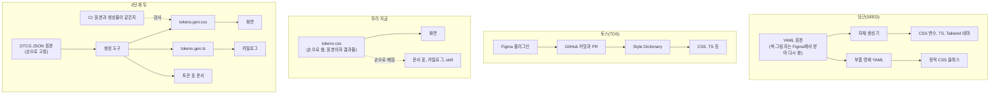
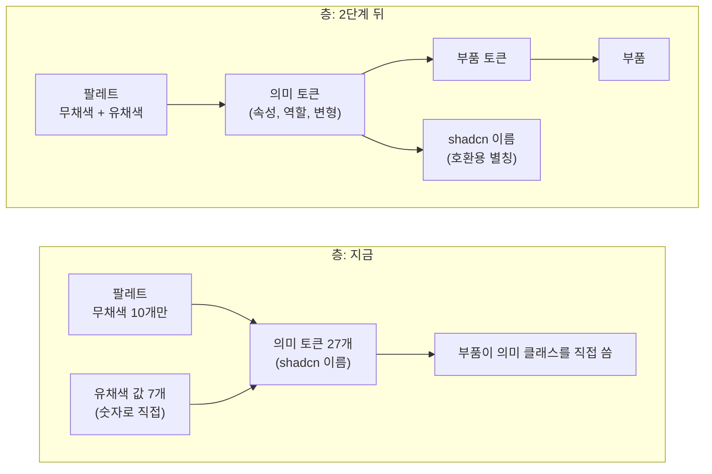
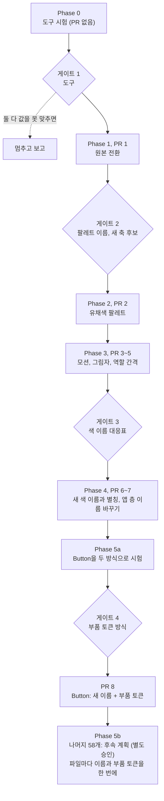

# 디자인 시스템 2단계(토큰): 원본에서 만들고 당근·토스 규격을 따른다

<!-- plan-result:start — 이 블록만 병합 뒤에도 고칠 수 있다(.claude/CLAUDE.md "계획과 PR 본문"). 아래는 승인된 계획 원문 -->

## 구현 결과

> #687 · 2026-11-25 대조 · 이탈 3 · 미구현 0 — 판정 근거(파일:줄)는 PR 본문 "계획 대비 구현"

- 게이트 1(사용자 결정, 2026-11-24): 생성 도구는 Style Dictionary 5.8.0(추천은 Terrazzo). 반경 4개는 계산식 대신 브라우저 기본 글자 크기 16px의 계산값을 고정 값으로 옮기고 `--radius` 변수를 없앴다(추천은 계산식 유지). 16px에서는 화면이 같고, 기본 글자 크기를 바꾼 브라우저에서만 sm·md·xl이 1px 안쪽으로 달라진다. 기록은 DECISIONS.md 2026-11-24 항목과 CHANGELOG. 전후 앱 빌드 CSS로 그린 미리보기를 대화에서 보였고 PR 본문에는 값 표를 남겼다
- 이탈(구조): 생성 CSS의 테마 블록이 계획의 4개가 아니라 5개다. 반경을 색과 같은 블록에 두지 않고 따로 `@theme static`으로 냈다. 카탈로그가 반경 변수 값을 읽어 그리는데, 고정 값을 색과 같은 블록에 두면 변수가 출력되지 않는다. 그래서 반경 유틸리티가 값 대신 반경 변수를 가리키고, 예제 앱 CSS에 반경 변수 4개가 새로 나온다
- 이탈(범위): 카탈로그 스토리의 범용 색 묶음은 이름을 손으로 적는 방식을 유지했다. 묶음 제목과 글자색 짝이 원본에 없어서다. 대신 이름을 생성 목록의 타입으로 검사하고(원본에 없는 이름이면 타입 오류), 묶음에 넣지 않은 범용 색은 따로 모아 보인다. 반경·겹침 순서·글자 눈금·역할은 생성 목록을 읽는다
- 이탈(절차): 규칙 비교가 못 보는 것(동작 줄이기, 폰 크기 토스트 위치, 열림·닫힘 시간, JS 타이머)을 임시 브라우저 스펙으로 따로 보지 않았다. 규칙 비교가 미디어 쿼리·키프레임 안의 규칙까지 경로로 나눠 반경 밖의 규칙이 바뀌지 않았음을 보였고, 이 PR은 JS의 시간·타이머를 건드리지 않았다. e2e(동작 줄이기, 메뉴 열림·닫힘 포함)는 통과했다
- 계획에 없던 변경: 패키지 토큰 CSS에 생성 목록 폴더를 훑지 않는 `@source not` 한 줄, 라이트·다크 파일 목록을 적은 DTCG 모드 파일(`tokens.resolver.json`), Style Dictionary가 같은 토큰을 속성 단위로 합쳐 다크 토큰에 라이트 설명이 섞이던 것을 생성 스크립트의 파일 단위 합치기로 막은 것(DESIGN-SYSTEM.md §10), 끊긴 별칭·틀린 값을 토큰 경로와 함께 알리는 오류 문구, 뮤테이션 테스트용 Vitest 설정에 `@baechan/ui/tokens` 별칭(PR CI의 뮤테이션 잡이 이 import를 풀지 못해 첫 테스트 실행에서 멈춘 것을 보고 고침, DESIGN-SYSTEM.md §10)
- 계획에 없던 발견: 이 계획 스냅샷의 글자 한 줄이 쓰지 않는 유틸리티 하나를 만든다(화면 영향 없음, 원문이라 고치지 않음). skill 표를 링크로 바꾸면서 쓰는 곳이 없던 글자 크기 눈금 유틸리티 11개(t2~t10, t12, t13)가 빌드에서 빠졌다. `pnpm audit`은 Style Dictionary가 거치는 `glob` 13.0.7의 경고를 Storybook 경로로만 보여 준다(같은 판이라 건수는 그대로). 생성 스크립트는 그 함수를 부르지 않는다(DESIGN-SYSTEM.md §9)
- 문서 동기화: `.claude/CLAUDE.md` 디자인 토큰 절, 원칙 문서 §1.5(색 토큰 수 28 → 27 포함), DESIGN-SYSTEM.md §6의 색 개수(59 → 58)와 §8 "새 토큰 축 추가" 행, FE-ARCHITECTURE.md 패키지 트리, 로드맵의 그림·방향 결정·측정 명령·2단계 행, 결정 색인과 주제 분류, 잠금 파일
- 뒤 PR로 넘긴 약속(Phase 3): 모션 토큰을 넣을 때 지속 시간 유틸리티가 `--transition-duration-*` 테마 변수를 읽는지 생성된 CSS로 확인하는 테스트를 함께 둔다(2026-11-24 대화에서 말함. Tailwind 공식 문서의 테마 이름 표에 없는 동작이라서)

> #692 · 2026-11-26 대조 · 이탈 1 · 미구현 0 — 판정 근거(파일:줄)는 PR 본문 "계획 대비 구현"

- 게이트 2(사용자 결정, 2026-11-26, 8개 모두 추천안): ① 팔레트 이름은 당근·토스와 같은 색 단어(`neutral` → `gray`, `red`·`blue`·`yellow`·`green`)이고, 번호는 같은 색상의 Tailwind 단계 가운데 명도가 가장 가까운 것이다 ② 팔레트 밖 값 3개도 팔레트로 옮긴다(`gray.550`, `white-alpha.10`·`15`). 의미 색에 숫자 값이 있으면 생성 스크립트가 멈춘다 ③ 새 축 클래스는 당근 꼴(`duration-d4`, `ease-<이름>`, `shadow-s1`~`s4`)이다. Tailwind 기본 시간·곡선이 토큰을 가리키게 해서 `transition`만 붙은 곳은 그대로 둔다 ④ 린트는 숫자, Tailwind 기본 이름, 대괄호 값을 모두 막는다(`shadow-none`은 허용) ⑤ 시간 눈금은 쓰는 단계만 둔다(d3 150ms, d4 200ms, d6 300ms). 역할은 `color-transition`(→ d3) ⑥ 600ms는 `d12` ⑦ 곡선은 `ease-easing`(0.4, 0, 0.2, 1)·`ease-enter`(0, 0, 0.2, 1)·`ease-sheet`(0.32, 0.72, 0, 1) ⑧ 역할 간격은 `between-chips`(8px) 하나. 그림자는 지금 쓰는 `xs`·`sm`·`md`·`lg`를 순서대로 `s1`~`s4`로 옮기고 값은 그대로 둔다. ①②의 기록은 DESIGN-SYSTEM.md §5 "유채색도 팔레트로"이고, ③~⑧은 PR 3~5에서 그 문서에 옮긴다
- 이탈(절차): 규칙 비교가 못 보는 것(동작 줄이기, 폰 크기 토스트 위치, 열림·닫힘 시간, JS 타이머)을 PR 1처럼 임시 브라우저 스펙으로 따로 보지 않았고, 뺀다는 것도 미리 밝히지 않았다. 바뀐 규칙은 `:root`·`.dark`의 변수 선언뿐이고(미디어 쿼리·키프레임 안 규칙을 포함한 나머지 규칙은 그대로) JS는 바꾸지 않았다. 의미 색·반경·겹침 순서·글자 토큰의 계산값은 라이트·다크와 기본 글자 크기 16px·20px에서 같았고, e2e(동작 줄이기, 폰 배치의 토스트 자리 포함)는 통과했다. 모션 값을 옮기는 PR 3은 이 확인이 실제로 필요한 PR이다
- 계획에 없던 변경: 토큰 표 문서의 팔레트 표에 설명 칸을 더했다. 값을 정한 근거(대비 실측 등)를 의미 색에서 팔레트로 옮기면서 문서에서 사라지지 않게 하려고서다. 앱 CSS의 다크 `--sidebar-border` 주석은 "패키지 `--border`와 같은 이유로 숫자로 둔다"였는데, 이 PR로 패키지 쪽이 팔레트를 가리키게 돼 주석만 지금 사실로 고쳤다(값·참조는 그대로)
- 계획에 없던 발견: 앱 전용 `--sidebar-border`(다크)는 숫자 값으로 남는다(앱 전용 토큰은 범위 밖). Tailwind와 값이 다른 팔레트 다섯 가운데 대비 때문에 고친 기록이 있는 것은 `blue-600`·`green-700`뿐이다. `yellow-500`·`green-500`은 2026-03-14 의미 색을 처음 정의한 커밋에서 적은 값이고 이유가 기록에 없다(게이트 2 질문 본문은 다섯 모두 대비 때문이라고 잘못 썼고, 같은 날 정정했다). 알림 창을 목록에서 지우는 300ms 타이머 2곳(`GlobalAlertDialogs.tsx`, `alertDialog.store.ts`)은 본문 닫힘 애니메이션(`duration-200`)보다 긴 값을 숫자로 적었고 이유 주석이 없다. PR 3에서 어느 토큰과 묶을지 정한다
- 문서 동기화: DESIGN-SYSTEM.md §5(새 단락, 2026-10-29 단락의 뒤집힘 표시, 그림의 팔레트 개수, 별칭 예시)·§6 표·§8 두 레시피·§9 실측, 로드맵의 토큰 층 행과 2단계 행, 원칙 문서, `design-tokens` skill

> #693 · 2026-11-26 대조 · 이탈 0 · 미구현 0 — 판정 근거(파일:줄)는 PR 본문 "계획 대비 구현"

- 게이트 2 ③④의 시간·곡선 몫과 ⑤~⑦을 그대로 넣었고, 그 기록은 DESIGN-SYSTEM.md §5 "시간과 곡선"이다. 시간 토큰은 d3·d4·d6·d12와 역할 `color-transition`, 곡선 토큰은 `easing`·`enter`·`sheet`이다. Tailwind 기본 시간은 `color-transition`을, 기본 곡선은 `easing`을 가리켜 `transition`만 붙은 곳은 고치지 않았다
- #687 블록에서 넘긴 약속(지속 시간 유틸리티가 `--transition-duration-*`를 읽는지 보는 테스트): 생성된 토큰 CSS를 설치된 Tailwind로 실제로 컴파일하는 `src/test/tailwind-motion-theme.test.ts`로 지켰다
- #692 블록에서 넘긴 300ms 타이머: 알림 창 2곳과 이미지 보기 1곳의 타이머를 `DURATION_MS.d6`에 묶었다. 닫힘 애니메이션(d4)보다 길게 둔 이유는 여전히 기록에 없어 값은 그대로 두었다. 클래스와 같은 시간을 기다리는 타이머(맨 위로 버튼, 댓글 강조)는 그 클래스와 같은 토큰을 읽는다
- 카탈로그(Storybook 토큰 스토리)에 시간·곡선을 더했다(`Motion` 스토리). Phase 3 표에는 카탈로그 스토리 행이 없어 대조 때 빠져 있었는데, "검증 방법"의 끝 조건 "토큰 표 문서와 카탈로그가 원본에서 만들어지고"를 채우려고 사용자 결정(2026-11-26)으로 이 PR에 넣었다. 이름·값·설명은 생성 목록에서 읽는다. 당근 SEED Motion 문서는 값 표만 두지만, 곡선은 숫자만으로 차이가 안 보여 표 옆에 재생 예시를 함께 둔다(같은 날 사용자 결정). 예시 클래스 3개가 앱 CSS 규칙으로 더해진다(DESIGN-SYSTEM.md §9)
- 계획에 없던 변경: 린트 규칙 본문을 `scripts/lib/no-raw-motion-rule.js`에 두고 단위 테스트로 고정했다. 선례로 든 z-index 규칙은 `eslint.config.js` 안에 있지만, 이 규칙은 `ui-boundary-rule.js`처럼 설정 파일 밖에 두었다(규칙 파일 머리말). 규칙은 괄호(변수) 값도 막고, `delay-*`와 대괄호 속성으로 적은 시간은 보지 않는다. 토큰 표는 별칭 값을 가리키는 변수와 최종 값으로 함께 보인다
- 계획에 없던 발견: 데스크톱 대화상자의 딤은 시간 클래스가 없어 tw-animate 기본값 150ms로 움직이고 내용(200ms)보다 먼저 끝난다(이 PR 전부터 그렇다. 화면이 바뀌는 일이라 손대지 않았고, 따로 고칠지 사용자에게 묻는다). 계획이 `cn()` 덮어쓰기의 예로 든 모바일 시트는 중앙 모달의 시간 클래스를 받지 않아 실제로 덮어쓰는 일이 없다(기존 테스트가 그 상태를 보고, 덮어쓰기 자체는 새 `cn()` 테스트가 본다). 옛 시간·곡선 규칙 5개가 고치지 않는 기록과 skill에 옮겨 둔 인용의 글자 때문에 앱 CSS에 남는다. 예제 앱 CSS에는 패키지 안 테스트·주석 글자에서 유틸리티 규칙 4개와 `@property` 하나가 새로 생긴다(DESIGN-SYSTEM.md §9)
- 절차: #692 블록이 이 PR에 넘긴 확인(열림·닫힘 시간, JS 타이머, 동작 줄이기, 폰 크기 토스트 자리)은 임시 브라우저 스펙과 CSS 계산값 비교로 했다. 모바일 시트의 시간과 실제 화면의 동작 줄이기는 기존 e2e로 갈음했다(DESIGN-SYSTEM.md §9)
- 문서 동기화: DESIGN-SYSTEM.md §5 새 단락과 그림의 테마 블록 수·구조 그림의 카탈로그 스토리·§6 표·§8 규칙 수와 레시피·§9 실측, `motion-ux` skill(시간·곡선 토큰, 타이머 표, 실측), `design-tokens` skill, 로드맵의 토큰 축·토큰 강제·2단계 행과 측정 ②, COMMENT.md·FE-ARCHITECTURE.md의 클래스 이름, 토큰 표
- 딤 시간 → 보완함(#694): 대화상자·확인 창의 딤에 `duration-d4`를 붙여 창과 함께 사라지게 했다. 이 PR 병합 뒤 작은 PR로 고치기로 사용자가 정했고(2026-11-26), 전후 녹화를 보고 반영을 승인했다

> #696 · 2026-11-27 대조 · 이탈 2 · 미구현 0 — 판정 근거(파일:줄)는 PR 본문 "계획 대비 구현"

- 게이트 2 ③④⑧의 그림자 몫을 넣었고, 그 기록은 DESIGN-SYSTEM.md §5 "그림자"다. 지금 쓰던 Tailwind 기본 그림자 `xs`·`sm`·`md`·`lg`를 순서대로 `shadow-s1`~`shadow-s4`로 옮기고 값은 그대로 두었다(쓰는 곳 29곳, 앱 27·패키지 2). 게이트 ⑧이 단계만 정해 역할 토큰은 없고, 다크 값도 따로 두지 않았다(당근은 다크 값이 다르지만 따르면 화면이 바뀐다)
- 이탈(범위) → 보완함: 처음 구현은 이름 없는 `shadow` 클래스(Tailwind 호환 테마의 기본값, 옮기기 전 `sm`과 같은 값)를 린트에서 뺐다. 게이트 ④는 기본 이름을 막기로 했는데, 토큰 묶음 이름 같은 낱말과 구분하지 못한다는 이유로 범위를 좁힌 것이었다. 대조에서 이것이 짚혀, 다른 클래스와 함께 쓰거나 변형·투명도가 붙으면 막도록 고쳤다. 문자열 전체가 그 낱말 하나뿐인 것만 보지 않는다(토큰 묶음 이름이 그 꼴이다). 고치기 전에 새 규칙 테스트 4개가 실패하는 것을 확인했고, 지금 코드에 걸리는 곳은 없다
- 이탈(절차): 계획은 PR마다 규칙 비교가 못 보는 것(동작 줄이기, 폰 크기 토스트 위치, 열림·닫힘 시간, JS 타이머)을 임시 브라우저 스펙으로 보게 했다. 이 PR은 그것을 보지 않았고 뺀다는 것도 미리 밝히지 않았다. 대신 전후 그림자 값을 밝은·어두운 바탕에서 찍어 픽셀이 같음을 보고, Storybook에서 부품 계산값을 읽었다. 이 PR은 시간·위치·JS를 바꾸지 않았고, 규칙 비교에서 선언이 바뀐 규칙은 토큰 변수 4개가 더해진 테마 층 하나다. e2e(동작 줄이기, 폰 배치의 토스트 자리 포함)는 통과했다
- 그림자 색은 팔레트를 가리키지 않고 검정에 투명도를 붙인 숫자로 적었다. 팔레트에 검정 투명도 단계가 없고, 당근도 그림자 색은 팔레트가 아니라 값으로 적는다(계획 결정 표의 "당근은 색 전부가 팔레트를 거친다"는 의미 색의 이야기이고 그림자에는 맞지 않았다). Tailwind는 이 색을 그림자 색 클래스가 덮어쓸 수 있게 감싸고, 그 꼴을 생성 CSS를 실제로 컴파일하는 테스트가 본다
- `cn()`에 그림자 토큰 이름을 생성 목록에서 등록했다. 등록하지 않으면 tailwind-merge 3.7.0이 토큰 클래스를 그림자 색으로 보아, 쓰는 쪽이 넘긴 `shadow-none`(이미지 보기, 모바일 북마크 정렬 아이콘)이 부품 그림자를 지우지 못한다. 등록 전에 실패하는 병합 테스트를 먼저 썼다
- 카탈로그(Storybook 토큰 스토리)에 `Shadow` 스토리를 더했다. Phase 3 표에는 행이 없지만 #693의 `Motion`처럼 끝 조건 "카탈로그가 원본에서 만들어지고"를 채우려는 것이고, 이름·값·설명은 생성 목록에서 읽는다
- 계획에 없던 변경: 린트 규칙 본문을 설정 파일 밖(`scripts/lib/`)에 두고 단위 테스트로 고정했다(#693과 같은 꼴). Tailwind 컴파일 도우미를 시간·곡선 테스트에서 떼어 공용 파일로 두고 그림자 테스트와 함께 쓴다(시간·곡선 테스트의 단언은 그대로). 생성 스크립트는 크기 검사를 함수로 떼어 그림자 층과 함께 쓰고, 층 배열이 아닌 값·음수 흐림·안쪽 그림자(`inset`)를 멈춘다. 쓰는 곳 29곳 밖에도 스토리 2곳, 클래스 묶음을 단언하는 테스트 3곳, 규칙 테스트 샘플 1곳, `responsive-ux` skill 문장 1곳의 이름을 바꿨다(Tailwind가 이 글자로 옛 규칙을 계속 만들어서)
- 계획에 없던 발견: 고치지 않는 기록(지난 릴리즈의 CHANGELOG, 계획 스냅샷 `2026-09-21`·`2026-09-24`)의 글자 때문에 옛 그림자 규칙 4개가 앱 CSS에 남는다. 예제 앱 CSS에는 패키지 소스의 글자(`cn()` 설정 키, 병합 테스트 값)에서 이름 없는 그림자와 그림자를 없애는 규칙 2개가 새로 생긴다. 진행 막대(NProgress)의 대괄호 그림자는 앱 CSS의 `@apply`라 린트 밖이고 그대로 두었다. 모두 쓰는 곳이 없거나 화면과 무관하다(DESIGN-SYSTEM.md §9)
- 문서 동기화: DESIGN-SYSTEM.md §5 그림(테마 블록 수, `cn()` 등록 목록)·새 단락·§6 표·§8 규칙 수와 레시피 "그림자 단계 더하기"·§9 실측, `design-tokens` skill 그림자 절, 로드맵의 토큰 축·토큰 강제·2단계 행과 측정 ②, 토큰 표, FE-ARCHITECTURE.md 린트 규칙 표(#693 문서 동기화 누락 보완: `no-raw-motion` 행을 함께 더함)

> #699 · 2026-11-27 대조 · 이탈 2 · 미구현 0 — 판정 근거(파일:줄)는 PR 본문 "계획 대비 구현"

- 게이트 2 ⑧의 역할 간격 몫을 넣었고, 그 기록은 DESIGN-SYSTEM.md §5 "역할 간격"이다. 토큰은 칩 사이 간격 `between-chips`(0.5rem, 기본 글자 크기에서 8px) 하나이고 클래스는 `gap-between-chips`다. 게이트가 센 칩 줄 4곳(피드 카드의 카테고리·태그 줄, 피드 위 필터의 카테고리·범위 줄)을 옮겼고 계산값은 전과 같다. 당근 이름 `spacing-x.between-chips`에서 `x`를 뺀 것은 우리 칩 줄이 줄을 바꿔 쌓여 위아래 간격도 같은 값이라서다
- 골격(사용자 결정, 2026-11-27): 피드 카드를 불러오는 동안 보이는 골격(`PostCardSkeleton.tsx`)의 칩 자리도 같은 토큰으로 옮겼다. 게이트가 센 4곳 밖이라 대조에서 발견으로 짚혔고, 토큰 값을 바꾸면 골격과 실제 칩 줄의 간격이 어긋나서 이 PR에 넣기로 사용자가 정했다(추천안). 그래서 앱 코드에서 쓰는 곳은 5곳이다. 골격은 잠깐만 보여 운영에서 잡기 어렵고, 같은 클래스라 칩 줄 계산값으로 갈음한다
- 숫자 눈금은 Tailwind 것을 그대로 두고 린트도 두지 않았다(계획 Phase 3). 2026-09-16의 "간격 토큰을 두지 않는다" 기록에서 숫자 눈금을 잠그지 않는다는 판단은 그대로이고, 이름 붙은 간격을 하나도 두지 않는다는 부분만 뒤집혔다고 §5와 §11에 적었다
- 테마 키는 `--spacing-<이름>`이고, 카탈로그가 변수를 읽어서 `@theme static`으로 낸다. 이 키는 다른 간격·크기 유틸리티도 읽어서 이름에 `xs`~`7xl` 꼴을 쓰지 않는다. 값은 rem으로 적어 기본 글자 크기를 바꾼 브라우저에서도 옮기기 전과 같다(16px·20px에서 확인). 역할 토큰은 숫자 눈금을 가리키지 않고 값을 직접 적는다(당근의 `between-chips`는 눈금 `x2`를 가리킨다. 우리 원본에는 숫자 눈금 토큰이 없다). Tailwind의 `--spacing`을 다시 정의하지 않는 동안은 값이 같고, 이 점은 대조 뒤 §5 "눈금을 가리키지 않는다"에 적었다
- `cn()`에 역할 간격 이름을 생성 목록에서 등록했다. 등록하지 않으면 tailwind-merge 3.7.0이 토큰 클래스를 간격으로 보지 않아, 쓰는 쪽이 넘긴 숫자 간격과 둘 다 남는다. 등록 전에 실패하는 병합 테스트를 먼저 썼다. 이 등록은 gap 밖의 간격 유틸리티에도 같은 이름을 알린다
- 이탈(절차): 계획은 PR마다 규칙 비교가 못 보는 것(동작 줄이기, 폰 크기 토스트 위치, 열림·닫힘 시간, JS 타이머)을 임시 브라우저 스펙으로 보게 했다. 이 PR은 그것을 보지 않았고 뺀다는 것도 미리 밝히지 않았다(#692·#696에 이어 세 번째). 대신 전후 CSS를 같은 칩 줄에 입혀 간격과 칩 위치가 기본 글자 크기 16px·20px에서 같음을 보였고, Storybook의 칩 스토리 2개와 카탈로그도 같은 값이었다. 이 PR은 시간·위치·JS를 바꾸지 않았고, 규칙 비교에서 새 규칙은 칩 간격 클래스 하나, 선언이 바뀐 규칙은 토큰 변수 하나가 더해진 테마 층 하나다. e2e는 통과했다. 피드 카드·필터는 스토리가 없어 병합 뒤 운영 화면에서 본다
- 이탈(절차): 계획 "뒤집힌 전제"는 간격 토큰 이름이 `xs`~`7xl` 꼴이면 크기 클래스 값이 바뀌는 충돌을 게이트 2의 후보 표에서 함께 보이게 했다. 2026-11-26 게이트 2의 역할 간격 후보 표에는 이 충돌이 없었다. 고른 이름이 그 꼴이 아니어서 결정에는 영향이 없고, 충돌은 이 PR에서 DESIGN-SYSTEM.md §5와 §8 레시피 "역할 간격 더하기"에 적었다
- 카탈로그(Storybook 토큰 스토리)에 `Spacing` 스토리를 더했다. Phase 3 표에는 행이 없지만 #693의 `Motion`, #696의 `Shadow`처럼 끝 조건 "카탈로그가 원본에서 만들어지고"를 채우려는 것이고, 이름·값·설명은 생성 목록에서 읽는다. 피드 카드 태그 줄과 같은 배지를 좁은 상자에 늘어놓아 줄바꿈 간격까지 보인다
- 계획에 없던 변경: 게이트가 센 4곳(스토리·테스트를 뺀 수) 밖에 동작 칩·필터 칩 스토리의 칩 줄 2곳도 바꿨다. 생성된 토큰 CSS를 설치된 Tailwind로 컴파일해 테마 키가 클래스로 이어지는지 보는 테스트를 더했다(#693·#696과 같은 꼴). 테스트와 토큰 설명에는 클래스 이름을 글자 그대로 적지 않아 예제 앱 CSS에 새 규칙이 생기지 않는다
- 계획에 없던 발견: 계획의 통과 기준 "짝지은 옛 클래스와 새 클래스의 본문이 같다"는 간격에서는 글자로 맞을 수 없다(옛 규칙은 계산식, 새 규칙은 변수). 같다는 것은 브라우저 계산값과 컴파일 테스트로 보였고, 대조 뒤 §9에 적었다
- 문서 동기화: DESIGN-SYSTEM.md 머리말·§1·§5 그림(테마 블록 수 8 → 9)·새 단락·§6 표·§8 레시피·§9 실측·§11 옛 항목, `design-tokens` skill 역할 간격 절(#696 문서 동기화 누락 보완: 공용 토큰 목록 문장에 "그림자"를 함께 더함), 로드맵의 토큰 축·2단계 행과 측정 ②(표 정렬은 Prettier가 다시 맞춤), 토큰 표(122 → 123개). `responsive-ux`·`motion-ux` skill은 간격 내용이 없어 고치지 않았다

> #702 · 2026-11-27 대조 · 이탈 2 · 미구현 0 — 판정 근거(파일:줄)는 PR 본문 "계획 대비 구현"

- 게이트 3(사용자 결정, 2026-11-27, 4개 모두 추천안): ① shadcn의 primary는 당근의 brand 역할이 된다(배경 bg.brand-solid, 글자 fg.brand, 선 stroke.brand-solid, 그 배경 위 글자 fg.on-brand-solid). 브랜드 색이 무채색이어도 쓰임이 같고 값이 바뀌지 않는다 ② 클래스 꼴은 당근 그대로다. 유틸리티 뒤에 종류(fg·bg·stroke)부터 붙여 배경 클래스는 bg가 두 번 나온다. Tailwind 문서에 있는 색 이름공간 하나만 쓰는 대신, 유틸리티와 색 종류가 어긋난 짝을 막는 린트를 새로 둔다 ③ 색의 원시 CSS 변수(의미 색, 팔레트)에 `--bui-` 접두사를 붙인다(`--bui-color-fg-neutral`, `--bui-color-palette-gray-900`). Tailwind 테마 키, 옛 shadcn 이름의 변수, 시간·곡선·그림자·간격 변수 이름은 그대로다 ④ 층을 다 옮긴 뒤 옛 shadcn 이름을 린트로 막는다(앱 층은 PR 7 끝, 공용 UI는 5단계 끝). 기록은 DESIGN-SYSTEM.md §5 "색 이름"
- 대응표의 나머지는 제 판단이다(게이트 3 본문에 표시): 표면 세 층(옛 background·card·popover → bg.layer-basement·layer-default·layer-floating), accent → bg.transparent-pressed 하나(당근은 선택된 칸을 따로 두지만 우리는 두 경우 값이 같다), 딤 위 글자 fg.on-overlay(당근에 없어 on-<배경> 꼴로 더함). 카드로 묻지 않고 "바꿀 줄이 있으면 PR 6 전에 말해 달라"는 가정 줄로 밝혔고, 다음 사람 글은 PR 6 진행 지시였다. 쓰이는 짝은 계획의 51가지가 아니라 49가지(검색에 걸린 하나는 스토리의 데이터 문자열)이고 PR 7 범위는 35가지 312곳이다
- 새 의미 색은 32개(글자 14, 배경 12, 선 6)이고 값은 옛 이름이 가리키던 팔레트 그대로다. 쓰는 곳은 바꾸지 않아 화면이 같다. 원색 린트가 새 이름의 가운데 마디(두 번째 bg, stroke 뒤의 neutral)를 원색으로 잡던 것을 고쳤다(계획 "뒤집힌 전제"). `cn()`에는 등록하지 않는다. tailwind-merge 3.7.0이 새 이름을 색으로 보아 같은 속성이면 뒤의 것만 남기고 글자 크기 토큰은 지우지 않으며, 그 동작을 병합 테스트로 고정했다
- 이탈(구조): 계획 결정 표는 "shadcn 이름은 새 토큰을 가리키는 별칭"이다. 옛 이름 27개 가운데 24개는 그렇고 셋은 팔레트를 가리킨다. secondary-foreground·accent-foreground는 라이트가 gray.900이라 본문 글자 fg.neutral(gray.950)과, input은 다크가 흰색 15%라 stroke.neutral-weak(10%)와 값이 달라 합치면 화면이 바뀐다. 셋의 다크 값은 옛 이름 다크 파일에 둔다. 앞의 둘은 PR 7 시작 때 미리보기로, input은 5단계에서 합칠지 묻는다(게이트 3 본문에서 말함)
- 이탈(절차): 규칙 비교가 못 보는 것(동작 줄이기, 폰 크기 토스트 위치, 열림·닫힘 시간, JS 타이머)을 임시 브라우저 스펙으로 보지 않았다(#692·#696·#699에 이어 네 번째). 이번에는 구현을 시작할 때와 검사 묶음을 돌리기 직전에 뺀다고 밝혔지만 사용자 답은 받지 않았다. 이 PR은 색 변수 선언만 바꾸고 시간·위치·JS는 건드리지 않았다. 빌드된 CSS 비교에서 바뀐 규칙은 `:root`·`.dark` 두 개이고 선언은 모두 사용자 지정 속성이다. e2e(동작 줄이기, 폰 배치의 토스트 자리 포함)는 재시도 없이 통과했다
- 안쪽 `.dark`(계획에 없던 변경): CSS 변수 안의 `var()`는 그 변수를 적은 요소에서 풀려, 별칭을 `:root`에만 두면 문서 뿌리가 아닌 요소에 붙은 `.dark`에서 옛 이름이 라이트 값을 받는다. 전에는 옛 이름에 값을 직접 적어 그 경우에도 다크 값이 나왔으므로, 생성 스크립트가 다크에서 최종 값이 바뀌는 별칭 17개를 `.dark`에 다시 적는다. 지금은 앱과 Storybook 모두 문서 뿌리에 `.dark`를 붙여 화면 차이는 없다. 다시 적는 부분을 빼면 실패하는 컴파일 테스트를 두었고(빼 보니 104개 중 17개 실패), Chromium 계산값에서 그 한 줄을 지운 사본은 안쪽 `.dark`에서만 차이가 났다
- 계획에 없던 변경: 옛 이름을 별칭 전용 원본 파일 둘(라이트·다크)로 나누고 모드 파일에 더했다. 옛 이름이 의미 색이나 팔레트가 아닌 것을 가리키면 `pnpm tokens`가 멈춘다. 원색 린트 본체를 설정 파일 밖(`scripts/lib/`)으로 옮기고 오류 문구를 토큰 표로 안내하게 고쳤다(#693·#696과 같은 꼴, 짝 린트도 같다). 생성된 토큰 CSS를 설치된 Tailwind로 컴파일해 새 이름 32개와 옛 이름 27개의 규칙이 토큰 변수를 읽는지 보는 테스트를 더했다. 토큰 표 생성기는 의미 색 표에 대표 클래스와 옛 이름 열을 더하고 옛 이름 표를 따로 낸다. 카탈로그(Storybook 토큰 스토리)의 색 스토리는 의미 색을 종류별로 먼저 그리고 옛 이름 묶음 제목에 "(옛 shadcn 이름)"을 붙인다. 옛 묶음 함수가 의미 색 이름의 타입에 묶여 있어 함께 바꿨고, 끝 조건 "카탈로그가 원본에서 만들어지고"에 해당한다. 앱 CSS의 팔레트 참조 24줄과 주석 하나의 변수 이름을 바꿨다(앱 전용 토큰의 이름·값은 그대로)
- 계획에 없던 발견: 구현 중 규칙이 두 번 하나씩 늘었다. 병합 테스트에 옛 이름 테두리 클래스를, 이 문서 묶음의 §5에 안쪽 링 유틸리티 이름을 글자 그대로 적어서다. 조각으로 잇거나 풀어 써서 둘 다 전과 같아졌다(DESIGN-SYSTEM.md §9). 검사 묶음에서 패키지 타입 검사가 병합 테스트의 배열 구조 분해(`noUncheckedIndexedAccess`)로 실패했고, 고친 뒤 다시 돌려 통과했다
- 원색 린트의 하이픈 유틸리티(대조에서 짚음) → 보완함: 앞 경계를 바꾸면서 하이픈으로 이어진 그림자·링 유틸리티(안쪽 그림자, 안쪽 링, 드롭 그림자, 글자 그림자) 뒤에 붙은 원색이 잡히지 않게 됐다. 전에는 낱말 경계가 가운데 마디에서 맞아 잡혔다. 네 유틸리티를 목록에 통째로 적었고, 고치기 전에 새 규칙 테스트 4개가 실패하는 것을 확인했다. 지금 코드에 걸리는 곳은 없다
- 문서 동기화: DESIGN-SYSTEM.md §5(새 절 "색 이름", 그림 두 곳, "색상 2층"의 변수 이름 메모)·§6 표와 색 개수(58 → 90)·§8 레시피(새 색 토큰 추가 고침, 별칭 대상 바꾸기·짝 린트 예외 추가, 규칙 수 7 → 8)·§9 실측, `design-tokens` skill(팔레트 변수 이름, 이름 전환 안내), FE-ARCHITECTURE.md 린트 표(원색 린트 행, 짝 린트 행), 로드맵의 토큰 강제·2단계 행, 토큰 표(123 → 155개), 계획 색인. 계획은 skill·DESIGN-SYSTEM.md·로드맵을 PR 7 행에 두었지만, 이 PR에서 바뀐 사실(변수 이름, 새 린트)을 함께 고쳤다
- 뒤 PR로 넘긴 것: PR 7 시작 때 보조 글자 둘을 fg.neutral로 합칠지 미리보기로 묻는다. 앱 층에서 종류가 어긋난 8곳(피드 카드 구분선, 인증 카드 4곳의 테두리, 댓글 강조 2곳, 알림 점)은 새 이름으로 옮길 때 이유를 단 예외로 둔다. 5단계에서는 input을 합칠지, 공용 UI의 어긋난 짝을 어떻게 할지, 대화창 배경을 floating 층으로 옮길지(옮기면 다크에서 gray.950 → gray.900)를 묻는다(게이트 3 본문에서 말함). 이름을 바꾼 결정 기록(DECISIONS.md)은 계획대로 PR 7에서 쓴다

> #704 · 2026-11-28 대조 · 이탈 1 · 미구현 0 — 판정 근거(파일:줄)는 PR 본문 "계획 대비 구현"

- 앱 층(`src/shared` 밖)에서 옛 shadcn 이름을 쓰던 313곳(47개 파일, `globals.css` 다섯 곳과 앱 층 테스트의 클래스 단언 17곳 포함)과 e2e 단언 2곳을 새 이름으로 옮겼다. 상태색(옛 primary·destructive·info·warning·success)은 쓰는 유틸리티에 따라 같은 역할의 글자·배경·선 이름으로 나눴다. 옛·새 짝 54개의 라이트·다크 계산값은 아래 하나를 빼고 같았다. 계획의 311곳, 게이트 3의 312곳과 다른 이유는 두 수를 센 방법이 기록에 없어 확인하지 못했다. 빠뜨린 곳이 없다는 근거는 바꾼 뒤 스캔과 옛 이름 린트가 앱 층·e2e에서 0곳을 내는 것이다
- 고른 칸의 글자(사용자 결정, 2026-11-27, 추천안): #702 블록이 넘긴 질문을 PR 7 시작 때 미리보기와 함께 물었다. 최근 검색 드롭다운에서 고른 줄의 글자(옛 accent-foreground 3곳)를 fg.neutral로 합쳐 라이트에서 gray.900 → gray.950이 됐다(다크는 같음). 실제 앱 빌드에서도 확인했다. 별칭과 그것을 쓰는 공용 UI 11곳은 5단계에서 정한다. 앱 층에 secondary-foreground는 쓰는 곳이 없었다. 화면 변경이라 CHANGELOG에 항목을 넣었다
- 게이트 3 ④의 앱 층 몫: `custom-tailwind/no-legacy-color`를 앱 층에 걸었다(스토리·테스트 제외). 목록이 토큰 원본의 옛 이름과 같은지는 단위 테스트가 본다
- 종류가 어긋난 8곳(#702 블록에서 넘김): 값을 지키려고 옛 이름이 가리키던 종류를 그대로 쓰고 줄마다 이유를 단 짝 린트 예외로 두었다
- 클래스 이름을 단언하던 테스트 둘(피드 목록 훅, 필터)과 e2e 댓글 강조 단언 2곳을 새 이름으로 바꿨다(요구가 바뀐 경우)
- 이름을 바꾼 결정 기록(#702 블록에서 넘김): DECISIONS.md 2026-11-27 "범용 색 이름"
- 이탈(절차): 규칙 비교가 못 보는 것(동작 줄이기, 폰 크기 토스트 위치, 열림·닫힘 시간, JS 타이머)을 임시 브라우저 스펙으로 보지 않았다(#692·#696·#699·#702에 이어 다섯 번째). e2e를 돌리기 직전에 기존 e2e로 갈음한다고 밝혔고 그에 대한 답은 받지 않았다. 이 PR이 JS에서 바꾼 것은 댓글 강조 타이머가 붙이고 떼는 클래스 문자열뿐이고, e2e가 그 경로를 본다. e2e는 396개가 재시도 없이 통과했다
- 예제 앱 CSS 비교(대조에서 짚음) → 보완함: 대조 때까지 하지 않았다. 패키지에서 바뀐 두 파일(토큰 원본 설명, 생성 목록)만 잠시 `main` 판으로 돌려 빌드해 비교했고 바이트까지 같았다 → 정정(#705): 예제 앱은 설치할 때 만든 패키지 복사본으로 빌드해 두 빌드 모두 고치기 전 패키지를 봤다. 다만 이 PR 직전 `main`의 예제 앱 CSS와 이 PR 뒤 `main`으로 복사본을 새로 만든 CSS가 규칙·바이트 모두 같아 결론은 맞다(DESIGN-SYSTEM.md §9 2026-11-28, §10)
- 계획에 없던 변경: 앱 CSS가 `design-tokens` skill 폴더를 훑지 않게 `@source not` 한 줄을 더했다. 문서를 고치자 skill 색 표의 클래스 이름이 쓰지 않는 규칙을 만들어서다. 그 결과 skill에만 있던 규칙 5개(글자 크기 눈금 하나 포함, 쓰는 곳 없음)가 앱 CSS에서 빠졌다. 같은 이유로 DESIGN-SYSTEM.md §1 그림의 예시를 실제 코드의 클래스로 바꾸고 용어 사전에서 클래스 이름을 뺐다. 린트 본체를 설정 파일 밖(`scripts/lib/`)에 두고 타입 선언과 단위 테스트를 붙였다(#693·#702와 같은 꼴). 토큰 원본의 옛 이름 설명을 지금 사실로 고쳤다(값은 그대로)
- 빌드 CSS 규칙은 1083 → 1128개다. 선언이 바뀐 규칙 5개(body, 진행 표시줄 셋, 테마 층 `:root`)는 같은 값의 새 변수를 읽거나 그 변수를 선언한다
- 임의 값 안의 변수 참조(계획 대조 뒤 발견) → 보완함: 진행 표시줄 끝 그림자가 `globals.css`에서 옛 이름 변수를 읽고 있었다. 클래스가 아니라 스캔과 린트가 못 봤다. 같은 값의 새 변수로 옮기고 라이트·다크 그림자 색이 바꾸기 전과 같은 것을 확인했다. 앱 층에 같은 꼴은 더 없다
- 문서 동기화: `.claude/CLAUDE.md` 색 규칙 예시, `design-tokens` skill 색 표, `responsive-ux` skill 예시 한 줄, DESIGN-SYSTEM.md §5 "색 이름"(상태 문장, 결정 표, 그림, 못 잡는 것, 새 단락 "앱 층 옮기기")·§8 규칙 수(8 → 9)·§9 실측·용어 사전, FE-ARCHITECTURE.md 린트 표, 로드맵의 토큰 강제·2단계 행, 토큰 표, BOOKMARK·BUILD-VERSION·COMMENT·SEARCH 문서의 클래스 이름, 결정 색인, 계획 색인

> #705 · 2026-11-28 대조 · 이탈 2 · 미구현 0 — 판정 근거(파일:줄)는 PR 본문 "계획 대비 구현"

- 게이트 4(사용자 결정, 2026-11-28, 둘 다 추천안): ① 부품 토큰은 당근식으로 빌드 때 Tailwind 클래스로 굳힌다. 생성 스크립트가 부품 토큰 원본을 레시피의 클래스 문자열로 만들고 Button의 cva가 그것을 읽는다. 부품별 CSS 변수는 두지 않는다 ② 배치만 하는 부품은 토큰 파일을 만들지 않고 계약 표에 이유를 적는다(당근 Box·Flex·Stack과 같음). 기록은 DECISIONS.md 2026-11-28 "부품 토큰"과 DESIGN-SYSTEM.md §5 "부품 토큰"
- Phase 5a(시험): 같은 원본으로 두 방식을 만들어 쟀다. Storybook 버튼 26개 × 보통·호버·포커스 × 20속성 × 라이트·다크 1,560값에서 당근식은 0곳, 토스식은 다크 outline·icon 버튼의 포커스 테두리 2곳이 달랐다. 앱 CSS는 당근식 +2.1KB, 토스식 +9.5KB다. Button을 쓰는 95곳 가운데 `style`로 덮는 곳은 없다. 토스식 코드는 저장소에 넣지 않았다(DESIGN-SYSTEM.md §9)
- 제 판단(게이트 본문에서 밝힘): 레시피를 자기 부품만 쓰는지는 의존성 규칙 두 개(`pnpm check:deps`)로 본다(계획의 "테스트 또는 린트"). 별칭 위 투명도는 DTCG에 꼴이 없어 `$extensions`의 확장으로 적는다
- 화면과 공개 속성은 그대로다. 최종 상태에서도 1,560값이 기준과 같고, 앱의 Button 95곳에서 쓰는 쪽 클래스가 살아남는지가 전후로 같다. 앱 CSS는 111,163 → 114,429바이트(gzip +249), 규칙 1,128 → 1,151개이고 선언이 바뀐 규칙은 없다. 스토리와 계약 테스트는 고칠 것이 없었다(계약 테스트는 패키지 atoms를 모두 훑어 Button도 본다)
- 이탈(범위): Button에 옛 이름 셋이 남았다(outline·ghost 호버 글자, secondary 글자, outline 다크 배경·테두리). 값이 의미 색과 달라 합치면 화면이 바뀌어서 부품 토큰이 옛 이름을 가리킨다. #702·#704 블록이 5단계에서 묻기로 넘긴 질문이고, 이 PR에서는 묻지 않았다. 언제 물을지 PR을 연 뒤 여쭈었고, Phase 5b에서 공용 UI의 다른 부품과 함께 미리보기로 묻기로 사용자가 정했다(2026-11-28, 추천안)
- 이탈(절차): 규칙 비교가 못 보는 것(동작 줄이기, 폰 크기 토스트 위치, 열림·닫힘 시간, JS 타이머)을 임시 브라우저 스펙으로 보지 않았고, 뺀다는 것도 미리 밝히지 않았다(#692·#696·#699·#702·#704에 이어 여섯 번째). Storybook 계산값이 호버·포커스·다크를 봤고, 이 PR은 전환 클래스와 JS를 바꾸지 않았다. e2e는 396개가 재시도 없이 통과했다
- CHANGELOG(대조에서 짚음) → 보완함: 계획 결정 표는 화면이 안 바뀌는 PR에 항목을 넣지 않는데 처음에는 넣었다. 뺐다
- 검사 묶음(대조에서 짚음) → 보완함: 대조 때까지 기록이 없던 Storybook 브라우저 테스트, 예제 앱 빌드, e2e를 돌렸고, 빌드 CSS 규칙 비교(앱·예제 앱), 생성 스크립트의 세 검사와 CI 생성물 최신성 확인의 레시피 경로를 일부러 실패시켜 막는 것을 봤다(DESIGN-SYSTEM.md §9)
- 색인(대조에서 짚음) → 보완함: 새 결정이 주제 표에 없어 색인 생성이 멈췄다. 주제를 더하고 결정 색인과 계획 색인을 다시 만들었다(CI는 이것을 보지 않는다)
- 계획에 없던 변경: 다크 값 부품 토큰 파일과 모드 파일 등록, 생성 스크립트의 레시피 생성(속성 이름 → 유틸리티 표, 표에 없는 속성이나 의미 색이 아닌 부품 색이면 멈춤, 투명도 확장), 레시피 폴더 `src/recipes/`(Tailwind가 훑는 자리)와 패키지 내보내기 한 줄, CI 생성물 최신성 확인과 `pnpm tokens`의 prettier 대상에 레시피 추가, 토큰 표의 "부품 토큰: Button" 절. 생성 토큰 목록의 부품 토큰에는 CSS로 나가지 않는 변수 이름이 실려 있어(대조에서 발견, 읽는 곳은 없다) 목록 타입의 설명에 그렇다고 적었다
- 계획에 없던 발견: Tailwind 4.3.5는 변수만 받은 유틸리티의 값 종류를 추론하지 않아, 토스식에서는 글자 크기 변수에 length 표시가 필요했다. dependency-cruiser 18.7.2가 하위 폴더를 받는 첫 정규식을 안전하지 않다며 멈춰 다른 꼴로 바꿨다. Button 글자 크기는 우리 눈금 t4와 줄 높이가 달라 Tailwind 기본값을 임의 값 클래스 둘로 옮겼다. 예제 앱은 설치할 때 만든 패키지 복사본을 빌드해, 처음 돌린 예제 앱 빌드는 고치기 전 Button을 봤다. 복사본을 다시 만들어 비교했고 #704 블록의 같은 비교에 정정을 붙였다(DESIGN-SYSTEM.md §10). 카탈로그(Storybook 토큰 스토리)에는 부품 토큰이 없다
- 문서 동기화: DESIGN-SYSTEM.md §5 새 단락 "부품 토큰"·§9 실측·§10 새 항목, 원칙 문서 §1.4 규칙 표, 로드맵의 토큰 층·2단계 행과 API 규칙 행의 줄 번호, 토큰 표(155 → 195개), 결정 색인, 계획 색인
- 뒤 계획으로 넘긴 것(Phase 5b): 나머지 58개 부품의 부품 토큰과 색 이름, 배치만 하는 부품의 계약 표 기재와 "토큰 파일이 있거나 이유가 적혀 있다"를 보는 검사, 옛 이름 셋(accent-foreground·secondary-foreground·input)을 합칠지(위 이탈), 공용 UI의 옛 이름 린트

<!-- plan-result:end -->

> 손으로 적는 토큰 CSS를 "원본 파일(DTCG) → 생성" 구조로 바꾸고, 그 위에 유채색 팔레트, 새 축(모션·그림자·간격), 당근식 색 이름, 부품 토큰을 차례로 얹는다. 화면은 게이트에서 따로 정한 것 말고는 바뀌지 않는다. PR 8개 안팎과 부품 단계의 후속 계획 하나로 나뉘고, 실제 자료를 보여 드리고 여쭙는 지점(게이트)이 4곳 있다.

## Context

- **계기**: 로드맵 2단계다. 로드맵이 적은 "정할 것"은 원본 형식, 토큰 이름 규칙, 빠진 축(간격·그림자·모션), 유채색 원시 층, 컴포넌트 층이고, 끝났다고 볼 증거는 _"토큰 표와 카탈로그가 원본에서 만들어지고 전후 계산값 차이가 설명된다"_ 이다(`docs/DESIGN-SYSTEM-ROADMAP.md:231`).
- **방향(사용자, 2026-11-24)**: 당근(SEED)과 토스(TDS)의 규격을 거의 그대로 따르고, 단계마다 "당근은 / 토스는 / 우리는 / 이유"를 붙인다.
- **이 계획이 다루는 것**: 범용 토큰(`packages/ui`, 패키지 이름 `@baechan/ui`)이다. 앱 전용 토큰(`src/app/globals.css`의 카테고리·차트·사이드바·kbd)은 값도 이름도 건드리지 않는다.

### 용어

| 용어 | 뜻 |
| --- | --- |
| 토큰 | 이름을 붙인 디자인 값(색, 크기, 시간 등). 부품은 값 대신 이름을 쓴다 |
| 팔레트(원시) 층 | 뜻 없이 값만 가진 토큰. 예: `--palette-neutral-900` |
| 의미 층 | "어디에 쓰는가"를 이름에 담은 토큰. 팔레트를 가리킨다. 예: 흐린 글자색 |
| 부품 층 | 부품 하나만 쓰는 토큰. 의미 토큰을 가리킨다. 예: 버튼의 배경색 |
| 별칭 | 값을 직접 갖지 않고 다른 토큰을 가리키는 토큰 |
| 원본·생성물 | 사람이 고치는 파일과, 도구가 원본에서 만들어 내는 파일(직접 고치지 않는다) |
| DTCG | W3C 커뮤니티 그룹이 정한 토큰 파일 형식 명세(2025.10이 첫 안정판). 색 값은 `colorSpace`·`components`를 가진 객체로 적는다([Format](https://www.designtokens.org/tr/2025.10/format/), [Color](https://www.designtokens.org/tr/2025.10/color/), 웹 조회 에이전트로 읽음) |
| 모드 | 같은 토큰이 상황마다 다른 값을 갖는 것. 여기서는 라이트·다크 |
| 게이트 | 구현을 멈추고 실제 자료(표·코드·화면)를 보여 드린 뒤 답을 받는 지점 |

### 지금 상태

| 지점 | 사실 | 근거 | 확인 수준 |
| --- | --- | --- | --- |
| 원본 | 손으로 쓴 CSS 한 파일이 원본이자 결과물이다. 변환 도구가 없다 | `packages/ui/src/styles/tokens.css`(387줄), 로드맵 `:190` | 직접 읽음 |
| 층 | 무채색 팔레트 10개(`:187-196`) → 의미 토큰 27개(`:197-240`, 다크 `:243-269`) → Tailwind 색 이름 27개(`:20-46`). 유채색 값 7개(위험·정보·경고·성공의 라이트·다크)는 의미 토큰에 숫자로 직접 적혀 있다. 부품 층은 없다 | `tokens.css` | 직접 읽음 |
| 있는 축 | 색, 반경 4개(`:47-50`), 겹침 순서 8개(`:66-73`), 글자 크기 눈금 14단계(`:92-119`)와 역할 8개(`:147-174`) | `tokens.css` | 직접 읽음 |
| 없는 축 | 모션·그림자·간격은 Tailwind 기본 클래스를 직접 쓴다. 지속 시간 200ms 11곳·300ms 4곳·600ms 2곳·150ms 1곳, 그림자 `lg` 12·`xs` 6·`md` 6·`sm` 5곳. 같은 시간이 JS 상수로도 따로 적혀 있다(`BackToTopButton.tsx:12` 등) | 저장소 전체 검색 | 조사 에이전트 보고 |
| 쓰는 곳 | 의미 색 클래스 549곳(테스트·스토리 제외). 공용 UI 238곳, 앱 층(widgets·features·entities·pages) 311곳. 검토 에이전트의 집계는 536곳이고, 그 가운데 112곳이 투명도 수식자(`/90` 등), 24곳이 `dark:` 뒤에 있다 | 저장소 전체 검색 | 에이전트 보고(집계 둘이 다르다) |
| 한 토큰이 여러 속성에 쓰인다 | 토큰 27개가 (속성, 토큰) 짝 51가지로 쓰이고 13개는 둘 이상의 속성에 쓰인다. 예: `primary`가 배경 17·글자 22·테두리 6·링 5곳 | 저장소 전체 검색 | 검토 에이전트 보고 |
| 부품 | 공용 부품 파일 59개(`packages/ui` 6 + `src/shared/ui` 53). `cva`를 쓰는 파일은 4개 | 파일 목록 | 개수는 직접 셈 |
| 손으로 베낀 표 | 카탈로그 스토리의 배열 5개(`src/shared/ui/tokens/DesignTokens.stories.tsx`), `design-tokens`·`motion-ux` skill, `docs/DESIGN-SYSTEM.md` §5~§9 | 각 파일 | 조사 에이전트 보고 |
| 토큰 CSS를 읽는 테스트 | `cn()` 테스트가 `tokens.css`를 파일로 읽어 글자 크기 토큰 이름을 뽑는다 | `packages/ui/src/lib/tailwind/utils.test.ts:10-16` | 직접 읽음 |
| 생성물 선례 | 생성 파일을 커밋하고 CI가 다시 만들어 같은지 본다 | `.github/workflows/ci.yml:103-114`, `package.json:34`(`codegen`) | 직접 읽음 |
| 색 린트 | `bg-neutral…`·`stroke-neutral…` 꼴을 원색 클래스로 보고 막는다 | `eslint.config.js:459` | 직접 읽음 |
| 배포 경로 | `packages/**`가 바뀌면 앱 배포가 돈다 | `.github/workflows/deploy.yml:6-29` | 직접 읽음 |
| Tailwind 4.3.5의 테마 키 | `duration-*`은 `--transition-duration`을 먼저 찾는다. 색은 속성마다 자기 키를 먼저 찾고 `--color`로 내려간다(`--background-color`, `--text-color`, `--border-color`, `--ring-color`, `--outline-color`가 각각 따로다). `max-w-*`는 `--spacing`도 읽는다 | `node_modules/tailwindcss/dist/lib.mjs` | 직접 읽음 |
| Tailwind 연결 방식 | 앱·Storybook·예제 앱 모두 PostCSS 플러그인(`@tailwindcss/postcss`)이다. 앱 쪽은 저장소 전체(`**/*`)를 훑고 JSON·Markdown도 대상이다 | `postcss.config.js`, `examples/next/postcss.config.mjs`, `node_modules/@tailwindcss/postcss/dist/index.mjs` | 직접 읽음(JSON·Markdown이 대상이라는 것은 검토 에이전트 보고) |
| `cn()`이 아는 이름 | 글자 크기 토큰만 등록돼 있다. tailwind-merge 기본 설정은 지속 시간을 숫자로, 그림자를 `xs`~`2xl` 꼴로, 간격을 숫자로만 안다 | `packages/ui/src/lib/tailwind/utils.ts:33-36`, `node_modules/tailwind-merge/src/lib/default-config.ts:264-265`, `:1977` | 직접 읽음 |
| 클래스 묶음을 통째로 단언하는 테스트 | 모달의 클래스 묶음 전체를 문자열로 비교한다. 바뀐 e2e 스펙은 CI가 10번 반복 실행한다 | `src/shared/ui/atoms/dialog.test.tsx:237-238`, `.github/workflows/ci.yml:304` | 직접 읽음 |

### 당근·토스·우리

| | 당근(SEED) | 토스(TDS) | 우리 지금 | 2단계 뒤 |
| --- | --- | --- | --- | --- |
| 원본 | YAML 파일(자체 형식). 색·그림자는 Figma에서 받아 YAML을 다시 쓴다 | Figma 플러그인이 GitHub에 커밋하고 PR을 만든다 | 손으로 쓴 CSS | DTCG JSON(손으로 고친다. Figma 없음) |
| 생성 | 자체 생성기 → CSS 변수·TS·Tailwind 테마 | Style Dictionary → CSS·TS 등 | 없음 | 생성 도구(게이트 1) → CSS·TS·토큰 표 |
| 층 | 팔레트 → 의미 → 부품 명세 | Base → Semantic → Component | 무채색 팔레트 → 의미 | 팔레트(전부) → 의미 → 부품 |
| 색 이름 | 속성·역할·변형·상태. 예: `$color.fg.neutral-muted`, `$color.bg.brand-solid` | 대상·역할·변형. 예: `fill-brand` | shadcn 이름. 예: `muted-foreground` | 당근식 + shadcn 이름은 호환용 별칭 |
| 축 | 색, 크기 눈금, 반경, 시간, 가속 곡선, 그림자, 글자 | 공개 문서에는 색·글자만 있다 | 색, 반경, 겹침 순서, 글자 | + 시간, 가속 곡선, 그림자, 역할 간격 |
| 부품 층이 화면에 닿는 법 | 빌드 때 정적 CSS 클래스로 굳힌다. 부품별 CSS 변수는 없다 | 부품별 CSS 변수(`--button-*`)를 열어 둔다 | 부품 층 없음 | Button으로 두 방식을 비교(게이트 4) |

- **당근 근거(직접 읽음, 2026-11-24)**: [ARCHITECTURE.md](https://github.com/daangn/seed-design/blob/dev/ARCHITECTURE.md), [packages/rootage](https://github.com/daangn/seed-design/tree/dev/packages/rootage)의 `color.yaml`·`collections.yaml`·`components/action-button.yaml`·`AGENTS.md`, [Tailwind 4 테마 패키지](https://github.com/daangn/seed-design/tree/dev/packages/tailwind4-theme). 이름 규칙은 [색 역할 문서](https://seed-design.io/llms/foundations/color/color-role.txt)가 _"Property(속성), Role(역할), Variant(변형), State(상태)"_ 로 적는다. 부품 층이 정적 CSS로 굳는 과정은 웹 조회 에이전트로 읽었다.
- **토스 근거(직접 읽음, 2026-11-24)**: 토스 기술 블로그 [달리는 기차 바퀴 칠하기: 7년만의 컬러 시스템 업데이트](https://toss.tech/article/tds-color-system-update)가 _"토큰의 추상화 단계 (e,g Base, Semantic, Component)"_ 와 Token Studio → GitHub PR → Style Dictionary 흐름을 적는다. `--button-*` 변수는 [TDS Button 문서](https://tossmini-docs.toss.im/tds-mobile/components/button/)에 있다. TDS 저장소는 비공개라 내부 구조는 이 두 자료가 전부다.

## 판단이 필요했던 항목

### 결정 표

| 항목 | 결정 | 근거·기각한 대안 |
| --- | --- | --- |
| 원본 형식 | **결정(사용자, 2026-11-24)**: DTCG 원본 + 변환. 먼저 시험하고, 지금 값을 재현하지 못하면 멈추고 보고한다 | 기각: CSS를 원본으로 유지(표·카탈로그를 계속 손으로 베낀다). 당근·토스 둘 다 원본과 생성물이 나뉘어 있다 |
| 색 이름 | **결정(사용자, 2026-11-24)**: 당근·토스식(속성·역할·변형)으로 바꾼다. 구조를 먼저 만들고 이름은 뒤 단계에서 바꾼다. shadcn 이름은 새 토큰을 가리키는 호환용 별칭으로 남긴다. 대응표는 그 단계 시작 때 확인받는다 | 같은 날 먼저 고른 "지금 이름 유지·문서화"를 뒤집은 것이다. 기각: 새 이름은 원본 층에만 두고 클래스는 shadcn 이름 그대로(검토 에이전트가 낸 안. 치환·린트 수정·테스트 수정이 없어지지만 사용자가 클래스까지 바꾸기로 정했다) |
| 빠진 축 | **결정(사용자, 2026-11-24)**: 모션·그림자·간격을 모두 둔다 | 로드맵 `:231`의 "빠진 축" |
| 따를 기준 | **결정(사용자, 2026-11-24)**: 당근·토스를 따르고 단계마다 설명을 붙인다 | 사용자: 해 본 적이 없어 무엇이 맞는지 판단하기 어렵다 |
| 부품 층의 범위 | **결정(사용자, 2026-11-24)**: 모든 부품 토큰까지 2단계에 한다 | 기각: 기준만 정하고 넓히기는 나중(제 추천이었다) |
| Figma 연동·시각 회귀 도구 | **결정(사용자, 2026-11-18)**: 하지 않는다 | 당근·토스의 Figma 단계는 따르지 않는다. 원본은 손으로 고친다 |
| 유채색 팔레트 | **제 판단(2026-11-24 대화에서 밝힘)**: 유채색도 팔레트를 거치게 한다 | 당근은 색 전부가 팔레트를 거친다(`color.yaml`의 `$color.fg.critical` → `$color.palette.red-700`). 2026-10-29 결정을 뒤집는다(아래 "뒤집힌 전제") |
| 새 축의 모양 | **제 판단(대화에서 밝힘)**: 눈금 + 역할 두 층. 값은 지금 화면 값 그대로 | 당근의 시간·크기 축이 눈금(`d1`~`d6`, `x1`~)과 역할 토큰 두 층이다. 값을 당근 값으로 바꾸면 화면이 바뀐다 |
| 팔레트 값과 모드 | **제 판단(대화에서 밝힘)**: 팔레트 값은 모드와 무관하게 고정하고, 의미 토큰이 모드마다 다른 팔레트를 가리킨다(지금 구조) | 당근은 팔레트 값 자체가 모드마다 다르다. 그대로 따르면 다크 화면 값이 전부 바뀐다 |
| 원본 문법 | **제 판단(대화에서 밝힘)**: 당근의 YAML이 아니라 DTCG JSON | 당근의 YAML은 당근 자체 생성기만 읽는다. 사용자가 고른 것도 DTCG다 |
| 앱 전용 토큰 | **제 판단(대화에서 밝힘)**: 범위 밖 | 패키지가 다른 프로젝트로 가져갈 토큰만 다룬다 |
| 생성물을 커밋할지 | **제 판단**: 생성 CSS·TS·문서를 커밋하고 CI가 다시 만들어 같은지 본다 | 선례가 하나다(`openapi.gen.ts`, `ci.yml:103-114`). 기각: 빌드 때마다 생성(단위 테스트·Storybook·예제 앱이 모두 생성 단계를 먼저 돌려야 한다) |
| 파일 배치 | **제 판단**: 원본은 `packages/ui/tokens/`(패키지 `src` 밖), 생성 CSS는 `tokens.css` 옆의 `tokens.gen.css`, 생성 TS는 `packages/ui/src/generated/` 한 폴더, 진입 파일(`./styles.css` → `tokens.css`)은 그대로 | `packages/**`라 배포 경로 필터에 걸린다. 이름은 `openapi.gen.ts` 선례. 생성물 폴더를 하나로 두면 린트·뮤테이션·커버리지의 예외 목록에 한 줄씩만 더하면 된다(지금 예외는 `src/shared/api/generated/`뿐이다: `eslint.config.js:646`, `scripts/mutation-report.js:18`, `vitest.config.ts:60`) |
| 토큰 표 문서의 자리 | **제 판단**: 통째로 생성하는 문서 하나(`docs/DESIGN-TOKENS.md`). 설명("당근은 / 토스는 / 우리는 / 이유")은 `docs/DESIGN-SYSTEM.md`의 새 절 | 통째로 생성하는 문서의 선례가 `docs/PLANS-INDEX.md` 하나다. 토큰을 정한 이유는 지금도 `DESIGN-SYSTEM.md`에 있다 |
| 단계 순서 | **제 판단**: 색 이름은 Phase 4에서 토큰·별칭과 앱 층(311곳)만 바꾼다. 공용 UI(238곳)의 이름은 Phase 5에서 부품 토큰을 넣을 때 함께 바꿔 파일마다 한 번만 고친다 | 기각 1: 549곳을 먼저 다 바꾸고 부품 토큰은 그 뒤(공용 UI의 클래스 문자열과 그것을 통째로 단언하는 테스트를 두 번 고친다, `dialog.test.tsx:237-238`). 기각 2: 부품 토큰을 패키지에 이미 있는 6개 파일로 줄이고 나머지는 3단계에서(검토 에이전트가 낸 안. 사용자가 모든 부품을 2단계에 하기로 정했다). 치르는 값: 후속 계획이 끝날 때까지 공용 UI는 옛 이름(별칭으로 동작), 앱 층은 새 이름이다 |
| 부품 단계의 계획 단위 | **제 판단**: Button 파일럿까지가 이 계획이다. 나머지 58개는 파일럿 결과로 후속 계획을 세워 따로 승인받는다 | 부품별 토큰 표는 방식(게이트 4)이 정해져야 사실대로 쓸 수 있다. 2단계는 후속 계획까지 끝나야 끝난다 |
| "화면이 같은지" 확인 | **제 판단**: 설치된 Tailwind로 클래스마다 만들어지는 규칙을 전후로 비교하는 임시 스크립트를 주된 확인으로 쓰고, 그것이 못 보는 것만 임시 Playwright 스펙으로 본다. 둘 다 커밋하지 않는다 | 검토 에이전트가 낸 방법이고 API가 설치본에 있음을 확인했다(`node_modules/@tailwindcss/node/dist/index.d.ts`의 `__unstable__loadDesignSystem`, `tailwindcss/dist/lib.d.mts`의 `candidatesToCss`). 이름에 `__unstable__`이 붙은 API라 상시 CI 검사로는 두지 않는다. 기각: 빌드된 CSS 글자 비교 + 화면 스냅샷만(이름을 바꾸는 단계에서는 선택자가 전부 달라져 비교가 안 되고, 호버·`dark:`·닫히는 중 상태를 못 본다). 시각 회귀 도구는 들이지 않는다(2026-11-18 결정) |
| 이름을 바꾸는 범위 | **제 판단**: 색만. 반경·겹침 순서·글자 토큰의 이름은 그대로 | 사용자가 정한 것이 색 이름이다 |
| CHANGELOG | **제 판단**: 화면이 안 바뀌는 PR은 항목 없음. 게이트에서 화면 변경이 정해지면 그 PR에 항목과 미리보기를 넣는다 | 선례 #657·#665·#676·#684 |

### 게이트에서 여쭐 것 (지금 정하지 않는다)

| 게이트 | 보여 드릴 자료 | 여쭐 것 |
| --- | --- | --- |
| 1. 도구 | Terrazzo와 Style Dictionary로 지금 토큰을 실제로 만들어 본 결과(생성된 CSS, 우리가 써야 하는 변환 코드 양, 값 차이 표) | 어느 도구로 갈지. 둘 다 변환 코드를 많이 써야 하면 그 사실과 함께 보고하고 그때 선택지를 낸다 |
| 2. 팔레트·새 축 | 유채색 팔레트 이름표(색 이름을 당근처럼 `gray`·`red`로 할지, 단계 번호), 팔레트 밖 값 3개의 처리, 새 축 후보 값 표(지금 쓰는 값과 쓰는 곳 수), 600ms처럼 눈금 밖 값의 처리 | 이름과 값. 그림자 이름을 당근식 단계로 할지 지금 쓰는 Tailwind 키(`xs`·`sm`·`md`·`lg`)를 원본에서 다시 정의할지(뒤쪽은 쓰는 곳과 `cn()`이 그대로다). 모션·그림자를 린트로 강제할지(선례: 겹침 순서·글자 크기) |
| 3. 색 이름 | (속성, 옛 이름) → 새 이름 대응표(쓰이는 짝 51가지 전부, 당근 `color.yaml`의 실제 이름과 대조), 실제 부품의 클래스 전후 | 대응표. 클래스 꼴 두 가지: (가) 당근 그대로 `bg-bg-…`(색 키 하나. 배경에 글자용 토큰을 붙여도 막히지 않아 짝 검사가 따로 필요하다) (나) 속성별 테마 키로 `bg-…`(짝이 없는 조합은 오류 없이 규칙이 안 만들어지므로 링·외곽선 키까지 펼치고 빈 규칙 검사가 필요하다). CSS 변수 접두사(당근은 `--seed-`). 이전이 끝난 층에서 옛 이름을 린트로 막을지 |
| 4. 부품 토큰 방식 | Button을 두 방식으로 만든 실제 코드와 생성된 CSS(당근식: 빌드 때 굳힘, 토스식: 부품별 CSS 변수) | 방식. 부품만의 결정이 없는 부품(배치만 하는 부품)을 어떻게 적을지 |

### 뒤집힌 전제

| 발견 | 그래서 바뀐 것 |
| --- | --- |
| 2026-10-29에 "유채색은 모드마다 한 번씩만 쓰여 층을 나눠도 1:1 별칭만 늘어난다"며 숫자로 뒀다(`docs/DESIGN-SYSTEM.md:133-150`) | Phase 2에서 유채색 팔레트를 둔다. 문서에는 옛 판단과 뒤집은 이유(당근 규격을 따르기로 함)를 함께 남긴다 |
| 간격은 "축 자체는 미도입, 반복 패턴은 부품으로 하나씩 해소"로 기록돼 있다. 숫자 눈금(`--spacing`)을 잠그면 클래스 591곳이 무너진다는 이유다(`docs/DESIGN-SYSTEM.md:606-615`) | 숫자 눈금은 Tailwind 것을 그대로 쓰고(당근의 `xN`도 N×4px로 같은 눈금이다) 이름 붙은 역할 간격만 더한다. 간격은 린트로 강제하지 않는다. 게이트 2의 후보가 적게 나올 수 있고, 그러면 그대로 보고한다 |
| DTCG의 색 값은 문자열이 아니라 객체다 | 통과 기준은 "문자열이 같다"가 아니라 "계산값이 같고, 표기가 달라진 곳은 표로 설명된다"다 |
| Style Dictionary의 기본 CSS 변환은 색을 hex·rgb로 바꾼다(문서, 웹 조회 에이전트로 읽음) | "`oklch()` 그대로 나온다"를 시험 기준에 넣는다. sRGB 밖 값이면 색이 달라진다 |
| 색 린트 정규식이 새 이름(`…-neutral-…`)을 원색으로 본다(`eslint.config.js:459`) | Phase 4의 첫 PR에서 규칙을 함께 고친다 |
| `cn()` 테스트가 `tokens.css`를 직접 읽어 `--text-<이름>:` 꼴을 글자 크기 토큰으로 본다(`utils.test.ts:10-16`). 색을 `--text-color-…` 키로 내면 색 이름까지 글자 크기로 읽힌다 | 테스트와 `cn()`의 글자 크기 목록이 CSS를 다시 읽지 않고 생성된 토큰 목록을 읽게 한다. 단언은 그대로 둔다 |
| Tailwind가 저장소 전체를 훑어 JSON의 글자도 클래스 후보로 본다. DTCG의 `$type` 값(`"shadow"`, `"border"`, `"transition"`)은 그대로 Tailwind 클래스 이름이다 | 앱 CSS(`src/app/globals.css`)에 원본 폴더와 생성 문서를 훑지 않게 하는 `@source not`을 넣는다(Phase 1) |
| Vite는 Tailwind보다 먼저 `@import`를 풀고, 다른 규칙 뒤에 온 `@import`는 그대로 남긴다(검토 에이전트가 설치본에서 읽음. 제가 직접 읽지는 않았다) | 생성 CSS의 `@import`를 `tw-animate-css` import 바로 다음 줄에 둔다 |
| `--spacing-<이름>`은 `max-w-<이름>` 같은 다른 유틸리티도 읽는다(`lib.mjs`, 직접 읽음). 이름이 `md`·`lg`면 지금 쓰는 `max-w-md` 등의 값이 바뀐다 | 역할 간격 이름에 `xs`~`7xl` 꼴을 쓰지 않거나 속성별 키로 낸다. 게이트 2의 후보 표에서 이 충돌을 함께 보인다 |
| `cn()`이 이름 붙은 지속 시간·그림자·간격을 모른다. 등록 없이 쓰면 앞의 숫자 클래스가 지워지지 않고 둘 다 남는다(검토 에이전트가 설치본으로 실행해 확인). 모바일 시트가 `cn()`으로 200ms를 300ms로 덮어쓰는 곳이 실제로 있다(`SheetDialogContent.tsx:16`) | 새 이름의 등록을 그 이름을 처음 쓰는 PR에 함께 넣고, 쓰는 곳을 옮기기 전에 테스트로 확인한다 |
| `shadow-<이름>`은 값을 규칙에 그대로 박아 넣어 변수를 참조하지 않는다. 기본 `@theme`에 두면 변수가 출력에서 빠진다(검토 에이전트 실행 결과) | 카탈로그가 읽는 새 축 토큰은 `@theme static`으로 낸다(겹침 순서·글자 눈금 선례, `tokens.css:58-60`) |
| 문서가 `tokens.css` 줄 번호를 인용한다(`docs/COMMENT.md` 한 곳) | 생성 파일은 줄이 자주 밀린다. 줄 번호 대신 토큰 이름으로 인용한다 |
| 조사에서 나온 문서 어긋남: 패키지 색 토큰 수(문서 28, 실제 27), `DESIGN-SYSTEM.md` 안의 색 개수(58과 59), `tokens.css` 주석이 말하는 카탈로그의 값 읽는 방법 | 표를 생성 문서로 바꾸면서 함께 사라지거나 고친다(Phase 1). 고친 목록은 PR 본문에 적는다 |

### 위험 관리

| 위험 | 막는 방법 |
| --- | --- |
| 도구가 지금 값을 재현하지 못한다 | Phase 0에서 멈추고 보고한다(사용자가 건 조건) |
| 원본만 고치고 생성물을 안 고친다 | CI "토큰 생성물 최신성 확인" 단계 |
| Tailwind 스캐너가 원본 JSON·스크립트·문서의 글자를 클래스로 읽어 유틸리티를 만든다(주석에서 실제로 겪은 일, `tokens.css:55-57`) | `@source not`으로 원본 폴더와 생성 문서를 뺀다. 빌드된 CSS를 규칙 단위로 비교해 "새로 생긴 규칙"과 "바뀐 규칙"을 나눠 본다 |
| 색 이름 치환 실수(앱 층 311곳, 뒤이어 공용 UI) | (속성, 옛 이름) 대응표로 돌리는 치환 스크립트(커밋하지 않음). 옛 클래스와 짝지은 새 클래스의 규칙 본문이 변형·수식자까지 같은지, 규칙이 안 만들어지는 클래스가 없는지 본다 |
| `cn()`(tailwind-merge)이 새 이름을 몰라 클래스가 겹쳐 남는다 | 새 이름을 처음 쓰는 PR에서 등록하고, 글자 크기 토큰과 같은 방식의 테스트를 더한다(`utils.test.ts` 선례). 등록 목록은 생성된 토큰 목록에서 읽는다 |
| 생성 TS가 린트·뮤테이션·커버리지에 걸린다 | 생성물 폴더를 예외 목록 세 곳에 더한다(Phase 1) |
| 예제 앱(Next.js)이 생성 CSS를 못 읽는다 | 로컬에서 `pnpm install` 뒤 예제 앱 빌드, CI "예제 앱 빌드" 단계 |
| 부품 단계가 끝없이 커진다 | 파일럿 → 게이트 4 → 후속 계획 승인. 묶음(배치)마다 PR |
| 새 의존성 | 생성 도구는 `packages/ui`의 `devDependencies`에만 둔다. 무료, 라이선스 확인(Terrazzo MIT, Style Dictionary Apache-2.0, 웹 조회 에이전트로 읽음), 설치 뒤 `pnpm audit` |
| 다른 세션의 계획 PR과 색인 충돌 | main 위로 rebase → `pnpm docs:index` → force-with-lease |

## 세부 계획

모든 PR은 병합 전에 따로 승인을 받는다. 이 계획 파일은 PR 1에 `docs/plans/2026-11-24-design-tokens-stage2.md`로 커밋하고, 뒤 PR은 결과 블록에 `>` 줄을 하나씩 더한다. 게이트에서 정해진 것은 결과 블록과 해당 문서에 남긴다(계획 원문은 고치지 않는다).

### Phase 0: 도구 시험 (PR 없음)

- **당근은** 자체 생성기를 쓴다. **토스는** Style Dictionary를 쓴다. **우리는** DTCG를 읽는 공개 도구 둘(Terrazzo 2.x, Style Dictionary 5.x)을 지금 토큰으로 실제로 돌려 보고 고른다. **이유**: 자체 생성기를 만들 규모가 아니고, 도구 문서만으로는 Tailwind 4의 `@theme` 출력과 `oklch()` 보존을 확인할 수 없었다.
- **하는 곳**: 저장소 밖 스크래치패드. 두 도구를 설치하고 지금 토큰을 DTCG로 옮긴 사본으로 CSS를 만든다. 저장소는 건드리지 않는다.

| 기준 | 왜 보나 |
| --- | --- |
| 색이 `oklch()`로 나온다(hex·rgb로 바꾸지 않는다) | sRGB 밖 값이면 색이 달라진다. 우리 값이 밖인지도 여기서 계산한다 |
| 라이트·다크가 `:root`·`.dark` 선택자로 나온다 | 지금 구조(`tokens.css:177`, `:243`) |
| 별칭이 `var()` 참조로 남는다 | 앱 CSS(`src/app/globals.css`)가 팔레트 변수를 24곳에서 참조한다(직접 셈) |
| `@theme inline`·`@theme static`·기본 `@theme` 블록과 `--text-<이름>--line-height` 같은 하위 키를 만들 수 있다 | 직접 지원이든 출력 형식 확장이든 된다. 우리가 써야 하는 코드 줄 수를 센다 |
| `calc(var(--radius) - 4px)` 반경 | 표현하지 못하면 계산값이 같은 고정 값으로 옮기고 표로 보고한다 |
| 설명(`$description`)이 생성물에 실린다 | 지금 주석의 이유를 토큰 표로 옮긴다 |
| 결과가 매번 같고 prettier를 거쳐도 다시 바뀌지 않는다 | CI 최신성 검사와 `pnpm format:check` |
| Node 24, 라이선스, 무료, 설치되는 패키지 수, `pnpm audit` | 비용과 공급망 |
| 2025.10의 모드 파일(리졸버) 지원 | 라이트·다크를 명세 방식으로 적을 수 있는지 |

- **판정**: 도구가 만든 CSS로 바꿔 끼웠을 때 "검증 방법"의 클래스 규칙 비교가 차이 0이고 `:root`·`.dark` 변수의 계산값이 같으면 통과다. 표기만 달라진 곳은 표로 설명한다. 도구마다 우리가 써야 했던 변환 코드의 수와 줄 수를 함께 적는다. 둘 다 통과하지 못하면 멈추고 보고한다.
- **끝**: 비교 표와 추천을 보고하고 게이트 1에서 답을 받는다.

### Phase 1: 원본 전환 (PR 1) — 이름·값은 그대로

- **당근은** `color.yaml`·`radius.yaml`처럼 축마다 원본 파일을 두고 생성기가 CSS 변수·TS·Tailwind 테마를 만든다. **토스는** 원본에서 플랫폼별 코드를 만든다. **우리는** 축마다 DTCG 파일을 두고 CSS·TS·토큰 표를 만든다. **이유**: 지금은 같은 값을 CSS, 카탈로그, 문서, skill에 손으로 네 번 적는다.

| 위치 | 변경 내용 |
| --- | --- |
| `packages/ui/tokens/*.tokens.json`(신규) | 지금 토큰을 이름·값 그대로 옮긴다: 팔레트, 의미 색(라이트·다크), 반경, 겹침 순서, 글자 크기 눈금·역할. 주석에 있던 토큰별 이유는 `$description`으로 옮긴다 |
| `packages/ui/scripts/`(신규 생성 스크립트), `packages/ui/package.json` | 생성 스크립트와 `tokens:build`. 도구를 `devDependencies`에 선언한다 |
| `packages/ui/src/styles/tokens.gen.css`(신규, 생성·커밋) | `@theme` 블록 4개와 `:root`·`.dark` 선언 |
| `packages/ui/src/styles/tokens.css` | 토큰 선언을 빼고 생성 CSS를 `@import`한다. import는 `tw-animate-css` import 바로 다음 줄에 둔다. 손으로 쓰는 것만 남긴다(`@source`, `@custom-variant`, base 레이어 4개, `--toast-offset-bottom`, 동작 줄이기 블록). `exports`의 `./styles.css`는 그대로다 |
| `packages/ui/src/generated/tokens.gen.ts`(신규, 생성·커밋), `packages/ui/package.json`의 `exports` | 카탈로그·문서·`cn()`이 읽는 토큰 목록(이름, 층, 라이트·다크 값, 설명). 내보내기 한 줄을 더한다 |
| `eslint.config.js:646`, `scripts/mutation-report.js:18`, `vitest.config.ts:60` | 생성물 폴더를 예외 목록에 더한다(지금은 `src/shared/api/generated/`만 있다) |
| `src/app/globals.css` | 원본 폴더와 생성 문서를 Tailwind가 훑지 않게 `@source not`을 넣는다 |
| `packages/ui/src/lib/tailwind/utils.ts` | 글자 크기 토큰 목록을 손으로 적지 않고 생성 목록에서 읽는다(동작은 그대로) |
| 루트 `package.json`, `scripts/`(신규 문서 생성 스크립트) | `tokens` 스크립트: 패키지 생성 → 토큰 표 생성 → prettier(`codegen` 선례) |
| `docs/DESIGN-TOKENS.md`(신규, 생성), `README.md` 문서 목록 | 토큰 표 문서와 등록 |
| `.github/workflows/ci.yml` | "토큰 생성물 최신성 확인" 단계를 `pnpm check` 앞에 둔다(`:103-114`와 같은 꼴) |
| `src/shared/ui/tokens/DesignTokens.stories.tsx` | 패키지 토큰의 손 배열을 생성 목록으로 바꾼다. 앱 전용 토큰 배열은 그대로 둔다 |
| `packages/ui/src/lib/tailwind/utils.test.ts` | 토큰 이름을 CSS 정규식 대신 생성 목록에서 읽는다(단언은 그대로) |
| `.claude/skills/design-tokens/SKILL.md`, `docs/DESIGN-SYSTEM.md` §5~§9 | 값을 베껴 적은 표만 생성 문서 링크로 바꾼다. 쓰는 법과 이유는 남긴다 |
| `docs/COMMENT.md` | 토큰 CSS 줄 번호 인용을 토큰 이름으로 |
| `docs/DESIGN-SYSTEM.md`(새 절), `docs/DESIGN-SYSTEM-ROADMAP.md:190`, `docs/DECISIONS.md` | 원본·생성 구조 설명, 로드맵 "토큰 원본" 행, 원본 형식과 도구를 고른 기록(기각한 쪽과 이유) |
| `docs/plans/2026-11-24-design-tokens-stage2.md`(신규), `docs/PLANS-INDEX.md` | 이 계획의 스냅샷과 결과 블록, `pnpm docs:index` |

### Phase 2: 유채색 팔레트 (PR 2)

- **당근은** 의미 토큰이 모두 팔레트를 가리킨다(`$color.fg.critical` → `$color.palette.red-700`). **토스는** Base 층에 `blue-500` 같은 이름을 둔다. **우리는** 유채색 값 7개를 팔레트로 올리고 의미 토큰이 별칭으로 가리키게 한다. **이유**: 층이 하나로 통일되고, 부품 토큰이 가리킬 대상이 생긴다.

| 위치 | 변경 내용 |
| --- | --- |
| 원본 색 파일 | 유채색 팔레트 토큰을 더하고(이름은 게이트 2), 의미 토큰의 숫자 값을 별칭으로 바꾼다. 팔레트 밖 값 3개(라이트 `--muted-foreground`, 다크 `--border`·`--input`)는 게이트 2에서 정한 대로 |
| `src/app/globals.css` | 팔레트 이름이 바뀌면(게이트 2) 팔레트 참조의 이름만 따라 바꾼다. 값은 그대로 |
| 생성물 3종 | 다시 생성 |
| `docs/DESIGN-SYSTEM.md` §5, 로드맵 `:192` | 2026-10-29 판단과 뒤집은 이유, "토큰 층" 행 |
| 결과 블록, `docs/PLANS-INDEX.md` | `>` 줄 추가, `pnpm docs:index` |

### Phase 3: 새 축 (PR 3 모션, PR 4 그림자, PR 5 역할 간격)

- **당근은** 시간을 눈금(`d1`~`d6`)과 역할(`color-transition` 등)로, 가속 곡선을 이름(`enter`·`exit` 등)으로, 그림자를 단계(`s1`~`s3`)로, 간격을 4px 눈금과 역할 6개로 둔다. **토스는** 공개 문서에 이 축이 없다. **우리는** 지금 화면에서 쓰는 값만 눈금으로 올리고 반복되는 쓰임에 역할 이름을 붙인다. 간격의 숫자 눈금은 Tailwind 것을 그대로 쓴다. **이유**: 값을 당근 값으로 맞추면 화면이 바뀐다. 따르는 것은 구조와 이름 짓는 법이다.

| 위치 | 변경 내용 |
| --- | --- |
| 원본에 축 파일 추가 | 게이트 2에서 확인받은 눈금·역할 토큰. Tailwind 테마 키로 내보낸다(`--transition-duration-*`, `--ease-*`, `--shadow-*`, 간격은 `--spacing-*` 또는 속성별 키). 카탈로그가 읽는 것은 `@theme static`으로 낸다 |
| `packages/ui/src/lib/tailwind/utils.ts`, `utils.test.ts` | 새 이름을 `cn()`에 등록하고 테스트를 더한다(글자 크기 토큰 선례). 쓰는 곳을 옮기기 전에, 같은 PR 안에서 먼저 한다 |
| 쓰는 곳(지속 시간 18곳, 가속 곡선 4곳, 그림자 29곳 안팎, 역할 간격 대상) | Tailwind 기본 클래스를 토큰 클래스로 바꾼다. 계산값은 같다. `cn()`으로 시간을 덮어쓰는 곳(`SheetDialogContent.tsx:16`)은 덮어쓰기가 그대로 동작하는지 기존 테스트로 확인한다 |
| JS에 숫자로 따로 적힌 시간(`BackToTopButton.tsx:12`의 `TRANSITION_MS = 200`, 닫힘을 기다리는 300ms 타이머들. 목록은 조사 에이전트 보고라 구현 때 다시 뽑는다) | 생성된 TS 값(`tokens.gen.ts`)을 읽게 한다. 값은 그대로 |
| `eslint.config.js` | 게이트 2에서 정하면 모션·그림자의 원시 값 클래스를 막는 규칙을 더한다(`no-raw-z-index` 선례). 간격은 대상이 아니다 |
| `.claude/skills/motion-ux/SKILL.md`·`design-tokens`·`responsive-ux`, `docs/DESIGN-SYSTEM.md`, 로드맵 `:191` | 새 축 설명, 간격 토큰 기록을 뒤집은 이유, "토큰 축" 행 |
| 생성물, 결과 블록, 색인 | 다시 생성, `>` 줄, `pnpm docs:index` |

동작 줄이기 블록(`tokens.css:358-387`)은 그대로 둔다. 당근은 모션 토큰에 "줄이기" 모드를 따로 두지만, 그대로 따르면 지금 동작이 바뀐다.

### Phase 4: 색 이름 바꾸기 (PR 6 토큰·별칭·린트, PR 7 앱 층)

- **당근은** `fg`·`bg`·`stroke` 속성 뒤에 역할(`neutral`·`brand`·`critical`)과 변형(`muted`·`weak`·`solid`)을 붙인다. **토스는** 대상(`fill`·`text`·`border`)과 역할(`brand`·`neutral`)을 붙인다. **우리는** 게이트 3의 대응표대로 새 의미 토큰을 만들고, shadcn 이름은 새 토큰을 가리키는 별칭으로 남긴다. **이유**: 이름만 보고 "어디에 쓰는 무슨 색"인지 읽히고, 나중에 shadcn 부품을 더 들여도 옛 이름이 그대로 동작한다.

대응표는 토큰 이름 하나가 아니라 (속성, 옛 이름) 짝마다 한 줄이다. 같은 `primary`도 배경에 쓰면 `bg.…`, 글자에 쓰면 `fg.…`, 테두리·링에 쓰면 `stroke.…`로 갈린다. 아래는 초안의 모양이다(당근 이름은 `color.yaml`에서 직접 본 것만 적었다. 쓰이는 짝 전부는 게이트 3에서 낸다):

| 지금 | 당근식 이름(초안) | 비고 |
| --- | --- | --- |
| `muted-foreground` | `fg.neutral-muted` | 가장 많이 쓰인다(136곳 이상, 조사 에이전트 보고) |
| `destructive`(글자) | `fg.critical` | |
| `primary`(배경) | `bg.brand-solid` | 우리 브랜드 색이 무채색이라 역할을 `brand`로 볼지 게이트 3에서 확인 |
| `border` | `stroke.neutral-weak` | |

| 위치 | 변경 내용 |
| --- | --- |
| PR 6: 원본 색 파일, 생성물 | 새 이름의 의미 토큰을 만들고 shadcn 이름을 별칭으로 돌린다. 이 PR에서 쓰는 곳은 바꾸지 않는다(옛 이름이 그대로 동작) |
| PR 6: `eslint.config.js:446-479` | `no-raw-color`가 새 이름을 원색으로 보지 않게 고친다. 원색 클래스는 계속 막는다(규칙 테스트로 양쪽을 확인) |
| PR 6: `packages/ui/src/lib/tailwind/utils.ts`, 검사 | 클래스 꼴에 따라 필요하면 새 이름을 `cn()`에 등록한다. 게이트 3에서 고른 꼴에 맞는 검사를 넣는다((가)면 속성과 토큰 종류가 어긋난 짝을 막는 린트, (나)면 링·외곽선 키까지 펼친 생성과 규칙이 안 만들어지는 클래스 확인) |
| PR 7: 앱 층 311곳(widgets·features·entities·pages), `src/app/globals.css`의 의미 색 참조 | 대응표로 클래스 이름을 바꾼다. 클래스 이름을 단언하는 테스트는 같은 PR에서 새 이름으로 바꾼다(요구가 바뀐 경우라 PR 본문에 목록). 게이트 3에서 정하면 앱 층에 옛 이름을 막는 린트 규칙을 건다 |
| PR 7: `.claude/CLAUDE.md`(색 규칙의 예시), `design-tokens` skill, `docs/DESIGN-SYSTEM.md`, 로드맵, `docs/DECISIONS.md` | 예시 클래스와 이름 규칙, 이름을 바꾼 기록 |
| 공용 UI 238곳(`packages/ui/src`, `src/shared/ui`) | 이 Phase에서 바꾸지 않는다. Phase 5에서 부품 토큰을 넣을 때 파일마다 함께 바꾼다(별칭 덕에 그때까지 옛 이름이 동작한다) |
| 각 PR: 생성물, 결과 블록, 색인 | 다시 생성, `>` 줄, `pnpm docs:index` |

### Phase 5: 부품 토큰 (Phase 5a Button 시험 → 게이트 4 → PR 8 → Phase 5b 후속 계획)

- **당근은** 부품마다 명세 파일(`components/action-button.yaml`)에 "변형·상태·부위별 값"을 적고 빌드 때 정적 CSS 클래스로 굳힌다. 부품별 CSS 변수는 만들지 않는다. **토스는** 부품이 `--button-background-color` 같은 CSS 변수를 열어 두어 쓰는 쪽이 덮어쓸 수 있다. **우리는** Tailwind + `cva` 구조라 둘 다 그대로는 옮길 수 없다. Button(`packages/ui/src/atoms/button.tsx`)을 두 방식으로 만들어 실제 코드로 비교한다. **이유**: 59개에 퍼뜨린 뒤에는 방식을 바꾸기 어렵다.

| 위치 | 변경 내용 |
| --- | --- |
| Phase 5a(워크트리, 병합 전): `packages/ui/tokens/components/button.tokens.json`, `button.tsx` | 버튼의 변형·크기별 결정을 부품 토큰으로 적고 두 방식으로 구현해 본다. 비교 항목: 생성된 CSS 크기, 쓰는 쪽이 덮어쓰는 방법, 토큰과 부품의 연결을 검사로 강제할 수 있는지, 59개에 반복하기 쉬운지. CSS 변수 방식은 글자 크기 변수에 종류 표시가 필요한지도 본다(`text-(--변수)`는 색으로 풀린다는 검토 에이전트 실행 결과가 있다) |
| PR 8: 고른 방식의 Button, 스토리, 계약 테스트 | 색 클래스를 새 이름으로 바꾸면서 부품 토큰을 넣는다. 화면과 Button의 공개 속성은 그대로. 부품 토큰이 자기 부품에서만 쓰이는지 보는 검사(방식에 맞는 테스트 또는 린트) |
| PR 8: `docs/DESIGN-SYSTEM.md`, 원칙 문서, 로드맵 `:192`, `docs/DECISIONS.md` | 부품 층의 방식과 고른 이유, 기각한 쪽 |
| Phase 5b: 후속 계획(별도 문서·별도 승인) | 나머지 58개의 부품별 표와 묶음(배치) 순서. 파일마다 색 이름과 부품 토큰을 한 번에 바꾼다. 기존의 부품 전용 변수(`--toast-offset-bottom`, sonner의 상태색 변수)도 이 표에 넣는다. 끝나면 공용 UI에도 옛 이름 린트를 건다(게이트 3에서 정한 경우) |

## 영향 범위

- **화면**: 바뀌지 않는 것이 기본이다. 게이트에서 값 변경이 정해지면 그 PR에 실제 스타일 미리보기와 CHANGELOG 항목을 넣는다.
- **클래스 이름(개발자가 보는 것)**: Phase 3에서 모션·그림자·역할 간격 클래스가, Phase 4에서 앱 층의 색 클래스 311곳이, Phase 5에서 공용 UI의 색 클래스 238곳이 새 이름으로 바뀐다. shadcn 색 이름은 별칭으로 계속 동작한다. Phase 5b가 끝날 때까지 공용 UI는 옛 이름, 앱 층은 새 이름이다.
- **공유 코드의 사용처**: `tokens.css`는 앱 CSS, Storybook, 예제 앱, `cn()` 테스트가 읽는다. 진입 경로(`@baechan/ui/styles.css`)는 그대로다. 구현 때 `pnpm graph:focus`로 다시 뽑는다.
- **이전 동작을 단정하는 테스트·문서**: 클래스 이름을 단언하는 테스트 48개 안팎(조사 에이전트 보고), 토큰 표를 가진 skill 3개와 문서들, `.claude/CLAUDE.md`의 색 규칙 예시. 해당 PR에서 함께 고친다. e2e의 `z-scrim` 같은 선택자는 색 이름이 아니라 그대로다.
- **린트가 못 보는 곳**: 색·겹침 순서 린트는 스토리와 테스트 파일을 보지 않는다(`eslint.config.js:2016-2017`). 그 파일들의 옛 이름은 치환 스크립트와 검색으로 확인한다.
- **예제 앱(`examples/next`)**: 패키지 사본을 설치해 쓰므로 새 파일(`tokens.gen.css`)은 `pnpm install`을 다시 해야 보인다. CI "예제 앱 빌드"가 확인한다.
- **배포**: PR마다 `packages/**`·`src/**`가 바뀌어 앱 배포와 Storybook 배포가 돈다. 데이터·API 계약 변경은 없다.
- **의존성**: 생성 도구 하나가 `packages/ui`의 `devDependencies`에 들어간다. 운영 번들에는 들어가지 않는다.
- **3단계(패키지화)로 넘기는 것**: 원본 JSON과 생성 TS를 패키지 밖으로 내보낼지, 생성 단계를 게시 절차의 어디에 둘지.

## 검증 방법

- **환경(PR마다)**: `git log origin/main..main` 확인 → 새 워크트리 → `test -s .env`, `pnpm install`, `node -v`가 v24.
- **주된 확인: 클래스 규칙 비교(임시 Node 스크립트, 스크래치패드, 커밋하지 않음)**
  - 설치된 Tailwind로 진입 CSS 둘(앱 `src/app/globals.css`, 예제 앱 `examples/next/app/globals.css`)을 고치기 전과 뒤에 각각 읽어 들이고, 코드에서 긁은 클래스 전부(`hover:`·`dark:`·`data-[state=…]:` 같은 변형과 `/90` 같은 수식자를 붙은 그대로)에 대해 만들어지는 규칙을 뽑는다.
  - 통과: 같은 클래스의 선언 본문이 전후로 같다. Phase 3~5처럼 이름이 바뀌는 단계는 대응표로 짝지은 옛 클래스와 새 클래스의 본문이 같다. 규칙이 안 만들어지는 클래스가 없다.
  - 왜 이것이 주된 확인인가: 브라우저를 띄우지 않고 호버·다크·닫히는 중 상태까지 모든 클래스를 본다. 화면 스냅샷은 그 순간 그려진 상태만 본다.
- **브라우저로 보는 것(임시 Playwright 스펙, `.claude/browser-artifacts/`, e2e 모킹 도구 재사용, 커밋하지 않음)**
  - `:root`·`.dark` 변수 값: 탐침 요소에 값을 입혀 계산값으로 읽는다(표기만 다른 `oklch()`가 같은 값으로 정규화된다). 라이트·다크 둘 다.
  - 규칙 비교가 못 보는 것: 동작 줄이기(`emulateMedia`), 폰 크기에서 토스트 위치, 열림·닫힘 애니메이션의 실제 시간, JS 타이머와 CSS 시간이 맞는지.
- **빌드된 CSS**: 전후를 규칙 단위로 나눠 "새로 생긴 규칙"과 "바뀐 규칙"을 따로 본다. 원본 JSON이나 문서에서 뜻밖의 유틸리티가 생기지 않았는지 여기서 확인한다.
- **고친 뒤(PR마다)**
  - CI와 같은 묶음: `pnpm check` → `pnpm test` → `pnpm check:docs` → `pnpm build` → `pnpm build-storybook` → `pnpm test:storybook` → 예제 앱 빌드 → `pnpm test:e2e`(`caffeinate -dims`로 묶고, 도는 동안 파일을 고치지 않는다).
  - 위 세 확인을 기준값(고치기 전에 먼저 뜬다)과 비교한다.
  - 새 테스트가 실제로 막는지: 등록을 잠깐 빼거나 원본만 고쳐 실패를 확인하고 되돌린다(CI 최신성 단계의 명령도 로컬에서 같은 방식으로 실패시켜 본다).
  - `plan-verifier`에 계획·diff·대화 요약을 넘겨 대조하고 PR 본문 "계획 대비 구현"과 결과 블록을 쓴다. `pnpm check:pr-body`.
- **병합 뒤(PR마다, 병합 승인 뒤 squash)**: 병합 SHA의 `Frontend Deploy (S3 + CloudFront)`와 `Storybook Deploy (GitHub Pages)`가 success인지 확인한다. 운영을 한 번 열어 `:root` 변수 몇 개와 대표 부품의 클래스·계산값을 읽는다(페이지 로드 1회, 좌표 클릭 없음). 워크트리를 정리한다.
- **완료 조건(2단계 전체)**
  - 토큰 표 문서와 카탈로그가 원본에서 만들어지고, CI가 원본과 생성물이 같은지 본다.
  - 패키지 토큰 값이 원본 JSON에만 있다(생성물과 원본 밖에 손으로 적은 값이 없다).
  - 전후 계산값이 같거나 차이가 문서에 표로 설명돼 있다.
  - 유채색 팔레트, 새 축 세 가지, 당근식 색 이름(+ shadcn 별칭)이 들어가 있고 앱 층의 쓰는 곳이 옮겨졌다.
  - Button이 새 색 이름과 부품 토큰을 쓰고, 나머지 부품의 후속 계획(이름 + 부품 토큰)이 끝났다.
  - 로드맵 §4의 토큰 행 4개와 §5의 2단계 행이 새 상태를 말한다.
- **바꾸면 안 되는 것**: 게이트에서 정하지 않은 화면, 앱 전용 토큰의 값과 이름, 반경·겹침 순서·글자 토큰의 이름, 패키지 `exports`의 `./styles.css` 경로, 부품의 공개 속성, 클래스 이름 단언을 뺀 기존 테스트의 단언. Figma 연동·시각 회귀 도구·유료 도구는 들이지 않는다.

## 남은 것

- **게이트 4곳의 답**: 위 "게이트에서 여쭐 것" 표. 답을 받기 전에는 그 단계의 구현을 시작하지 않는다.
- **Phase 5b 후속 계획**: 파일럿 뒤에 세우고 따로 승인받는다. 2단계는 그 계획까지 끝나야 끝난다.
- **이번 조사에서 본 것(이 계획 밖, 따로 여쭙는다)**
  - `packages/ui/src/atoms/tooltip.tsx:21`만 변수 참조에 대괄호 문법을 쓴다(다른 부품은 괄호 문법). 빌드에서 확인하지 않았다.
  - `cn()`에 겹침 순서 토큰이 등록돼 있지 않아 `z-nav`와 `z-modal`을 함께 넘기면 둘 다 남는다(검토 에이전트 실행 결과). 지금 그렇게 겹쳐 쓰는 곳이 있는지는 확인하지 않았다.
- **메모 갱신**: 단계가 끝날 때마다 디자인 시스템 진행 메모의 상태를 고친다.
- **다음 디자인 시스템 계획**(별도 계획·승인): 3단계(패키지화).
