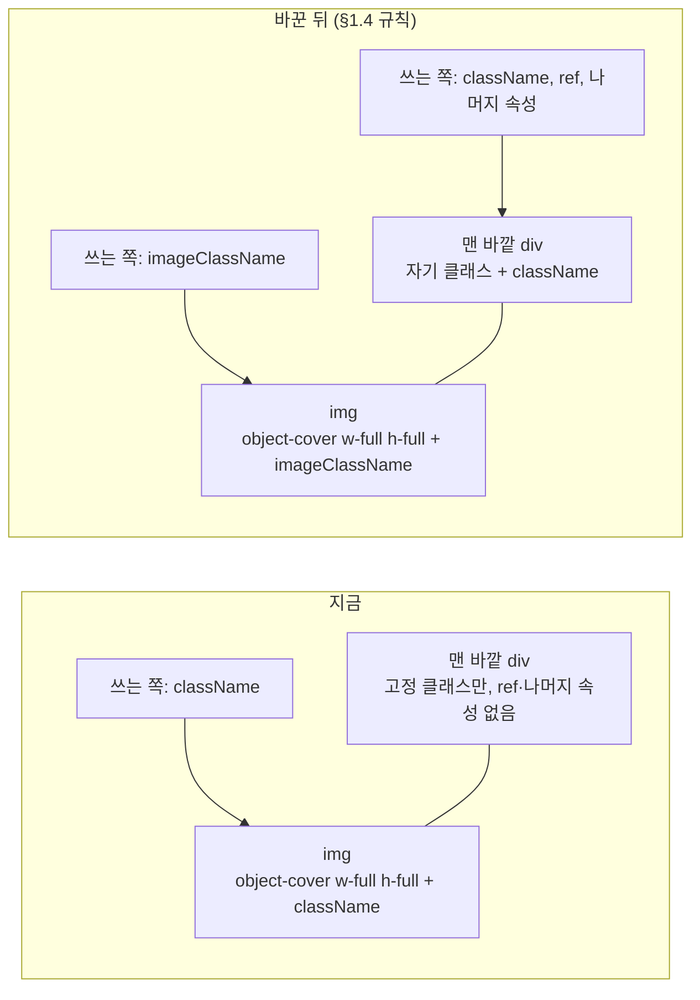

# `LinkThumbnail`의 `className`을 맨 바깥 요소로 옮기기

<!-- plan-result:start — 이 블록만 병합 뒤에도 고칠 수 있다(.claude/CLAUDE.md "계획과 PR 본문"). 아래는 승인된 계획 원문 -->

## 구현 결과

> #684 · 2026-11-24 대조 · 이탈 2 · 미구현 0 — 판정 근거(파일:줄)는 PR 본문 "계획 대비 구현"

- 이탈(계획의 전제가 실측과 다름): 호버 확대를 `transform` 계산값으로 읽기로 했지만(`img`만 1.05배), 이 앱에서 `scale-105`는 `scale` 속성으로 나와 `transform`은 올리기 전후 모두 `none`이었다. 그래서 `scale`·`transform` 계산값, 그려진 크기, 스크린샷 해시를 함께 떠서 고치기 전후를 비교했고 모두 같았다(`img`의 `scale`만 `none` → `1.05`, 맨 바깥 `div`의 크기는 그대로). 잰 것은 데스크톱 배치(`chromium` 프로젝트, 1280×720) 한 가지다
- 이탈(절차): 재측정 직후 전후 스크린샷을 바로 열어 보여 주기로 했지만, 계획 대조를 맡긴 뒤 PR을 열기 전에 보여 줬다
- 계획에 없던 변경: 원칙 문서 §1.4에 "뒤에 고친 atoms 1개" 문단을 더했다(계획은 개수와 줄 삭제만 적었다). §6 18번에는 atoms를 만드는 방식을 두 폴더로 다시 센 값과 `scale` 발견도 적었다
- 계획에 없던 변경: 스토리의 조절 칸(`argTypes`)에 `className`·`imageClassName`을 더했다
- 계획에 없던 발견: 계약 테스트가 `LinkThumbnail`을 그리게 되면서 React 18의 `fetchPriority` 개발 경고가 자세한 출력(verbose)에 한 번 찍힌다. 기본 `pnpm test` 출력에는 나오지 않고 속성은 DOM에 붙는다. 이번에 고치지 않았다
- 대조 뒤 보완(문서): 원칙 문서 §6 18번의 "예외 줄만 지우고 돌리면"을 실제 실행 상태(그리는 법도 더한 상태)에 맞게 고치고 측정 범위를 적었다
- 문서 동기화: 원칙 문서와 로드맵의 마지막 검토 날짜, Prettier가 다시 맞춘 표 칸 너비
- 병합 뒤 확인(배포 2종, 운영 `/post` 클래스)은 이 대조의 범위 밖이다. 결과는 #684 본문 "검증"에 적는다

<!-- plan-result:end -->

> 공용 UI 부품 `LinkThumbnail`만 `className`이 안쪽 `img`로 가서 API 규칙(§1.4)의 예외로 남아 있다. `className`을 맨 바깥 요소로 보내고 `img`용 클래스는 새 속성 `imageClassName`으로 받게 고쳐 예외를 없앤다. 넘기는 곳은 `PostCard` 한 곳이고 화면은 바뀌지 않는다.

## Context

- **계기**: 2026-11-23 분리 리허설 뒤 사용자가 정했다. _"`LinkThumbnail`의 `className`은 맨 바깥 요소로 보내고 `img`용 클래스는 새 속성으로 받는다(§1.4의 규칙에 맞춘다)"_ (`docs/DESIGN-SYSTEM-PRINCIPLES.md:607`). 적용 시점이 "별도 계획·PR(1.5단계 뒤)"였고, 로드맵 1.5단계 행의 마지막 문장이 이 일을 "이어서 할 일"로 적고 있다(`docs/DESIGN-SYSTEM-ROADMAP.md:230`).
- **용어**: 맨 바깥 요소는 부품이 그리는 DOM 가운데 가장 바깥 것이다. `LinkThumbnail`에서는 16:9 자리를 잡는 `div`다. 계약 테스트는 부품을 실제로 그려 `ref`·`className`·나머지 속성이 같은 요소에 닿는지 보는 테스트다(`src/shared/ui/ApiContract.test.tsx`).
- **규칙**: 저수준 부품(atoms)은 `forwardRef`로 `ref`·나머지 속성·`className`을 같은 대상 요소에 넘긴다(§1.4, `.claude/CLAUDE.md` Critical Rules). 근거로 든 react.dev `forwardRef` 인용은 §1.4에 있다(`docs/DESIGN-SYSTEM-PRINCIPLES.md:382-396`).

### 지금 상태 (직접 읽어 확인)

| 지점 | 사실 | 근거 |
| --- | --- | --- |
| 부품 | 일반 함수 컴포넌트다. `className`을 `img`에 합치고(`cn('object-cover w-full h-full', className)`), 맨 바깥 `div`는 고정 클래스만 갖는다. `ref`와 나머지 속성은 받지 않는다 | `packages/ui/src/atoms/link-thumbnail.tsx:27`, `:53`, `:62` |
| 쓰는 곳 5곳 | `className`을 넘기는 곳은 `PostCard` 하나다(`group-hover:scale-105 transition-transform duration-300`, 카드에 올리면 이미지가 커지는 연출). 나머지 4곳은 `src`·`alt`만 넘긴다 | `src/widgets/post/post-card/ui/PostCard.tsx:284-289`, `LinkPreviewCard.tsx:97`, `CommentItem.tsx:38`, `CommentEditForm.tsx:130`, `examples/next/app/showcase.tsx:86-87` |
| 계약 테스트 | `LinkThumbnail`이 계약 밖 표에 이유와 함께 있다(계약 밖 16개 가운데 하나) | `src/shared/ui/ApiContract.test.tsx:154-155` |
| 이름 선례 | 부분을 꾸미는 속성은 모두 `<부분>ClassName` 꼴이다: `iconClassName`, `labelClassName`, `triggerClassName`, `spinnerClassName` | `src/shared/ui/elements/ActionButton.tsx:16`, `ActionChip.tsx:18`, `KebabMenu.tsx:17`, `CenteredSpinner.tsx:8` |
| 코드 선례 | `forwardRef` + `Omit<ComponentPropsWithoutRef<'div'>, 'children'>` + `cn(자기 클래스, className)` + `{...props}` | `src/shared/ui/atoms/featured-icon.tsx:24-38` |
| 패키지 사용자 | 이 앱과 예제 앱뿐이다. 패키지는 아직 게시 전이다(3단계 패키지화가 미착수) | `docs/DESIGN-SYSTEM-ROADMAP.md` §5 단계 표 |

## 판단이 필요했던 항목

| 항목 | 결정 | 근거·기각한 대안 |
| --- | --- | --- |
| `className`의 자리 | **결정(사용자, 2026-11-23)**: 맨 바깥 요소로 옮기고 `img`용은 새 속성으로 받는다 | 기각: 지금처럼 두고 예외로 기록(받는 쪽이 이 부품만 따로 기억해야 한다). `docs/DESIGN-SYSTEM-PRINCIPLES.md:607` |
| 새 속성 이름 | **제 판단**: `imageClassName` | 저장소 선례가 `<부분>ClassName` 꼴 하나다(위 표). 기각: `classNames={{ image }}` 같은 객체 꼴(이 저장소 부품에 선례가 없다. sonner에 넘기는 설정에만 있다) |
| `ref`·나머지 속성도 함께 연다 | **제 판단(기록된 결정의 범위 안)**: `forwardRef`로 바꾸고 `ref`·나머지 속성을 맨 바깥 `div`로 넘긴다 | §1.4가 "코드를 고치면서 계약 테스트의 예외 줄을 지운다"고 적었다(`:490-491`). 계약 테스트는 셋이 같은 요소에 닿아야 통과한다. 기각: `className`만 옮기고 예외 이유를 바꿔 남긴다(예외가 그대로 남는다) |
| 이미지를 못 받았을 때의 `imageClassName` | **제 판단**: 쓰이지 않는다(안내 아이콘으로 바뀌면 `img`가 없다). 속성 설명에 적는다 | 아이콘에 붙이면 호버 확대 같은 이미지용 연출이 아이콘에 걸린다 |
| 스토리 | **제 판단**: `imageClassName` 스토리 하나를 더한다(`group`으로 감싼 호버 확대) | atoms를 고치면 같은 커밋에서 스토리를 갱신한다(`.claude/CLAUDE.md`). 인터페이스에 `className`·`imageClassName`을 직접 적어 자동 속성 표에 보이게 한다(§6 17번) |
| "화면이 같은지" 확인 방법 | **제 판단**: 실제 브라우저에서 바꾸기 전후의 썸네일 DOM(`outerHTML`)과 호버 때 `transform` 값을 비교하고 스크린샷을 남긴다. 스펙은 커밋하지 않는다 | `PostCard`에 단위 테스트가 없고(`ui/`에 `PostCard.tsx`뿐), jsdom은 호버 변형을 계산하지 못한다. 화면이 바뀌지 않는 변경이라 녹화를 보고 승인받는 절차는 밟지 않고, 비교 결과가 다르면 멈추고 보고한다. 기각: 호버 확대를 e2e로 상시 고정(연출 하나를 위해 브라우저 테스트를 늘린다) |
| CHANGELOG | **제 판단**: 항목 없음 | 화면이 바뀌지 않는 공용 UI 리팩터링(#657·#665·#676)이 모두 항목 없이 병합됐다(`CHANGELOG.md`에 세 번호의 항목이 없다) |
| 커밋 종류 | **제 판단**: `refactor(ui)` | 선례 #665·#676 |
| §6의 날짜 붙은 측정(13·14번) | **제 판단**: 고치지 않고 18번을 새로 더한다 | 2026-11-19에 잰 기록이다. 지금 상태를 말하는 §1.4·§1.5·§5의 문장만 고친다 |

## 세부 계획

| 위치 | 변경 내용 |
| --- | --- |
| `packages/ui/src/atoms/link-thumbnail.tsx` | `forwardRef<HTMLDivElement, LinkThumbnailProps>`로 바꾼다. 속성 타입은 `Omit<React.ComponentPropsWithoutRef<'div'>, 'children'>`를 잇고 `className`(맨 바깥 요소)·`imageClassName`(이미지 요소)을 설명과 함께 직접 적는다. 맨 바깥 `div`는 `ref` + `cn('relative aspect-video w-full overflow-hidden bg-muted', className)` + `{...props}`, `img`는 `cn('object-cover w-full h-full', imageClassName)`. `displayName`을 단다. 나머지(에러 상태, https 치환, 실패 캐시, `priority`)는 그대로 |
| `src/widgets/post/post-card/ui/PostCard.tsx:287` | `className=` → `imageClassName=`(값 그대로) |
| `packages/ui/src/atoms/link-thumbnail.test.tsx` | 테스트 추가(먼저 써서 실패 출력을 남긴다): `className`은 맨 바깥 요소에만 붙는다 · `imageClassName`은 `img`에만 붙는다 · `ref`와 `data-*` 속성이 맨 바깥 요소에 닿는다 · 이미지 실패로 아이콘이 돼도 `className`은 맨 바깥 요소에 남는다 |
| `src/shared/ui/ApiContract.test.tsx` | `ATOMS_OUTSIDE_CONTRACT`에서 `LinkThumbnail` 줄을 지우고 `ATOM_RECIPES`에 그리는 법(`src`·`alt`)을 더한다(`src`가 없으면 아무것도 그리지 않는다) |
| `packages/ui/src/atoms/link-thumbnail.stories.tsx` | `ImageClassName` 스토리 추가(`group` 래퍼 + 호버 확대 클래스) |
| `docs/DESIGN-SYSTEM-PRINCIPLES.md` | §1.4: 계약 표의 개수(60→61, 계약 밖 16→15), 계약 밖 목록에서 `LinkThumbnail` 줄 삭제, "다시 볼 조건"의 `LinkThumbnail` 줄 삭제. §1.5 "미뤄 둔 항목의 답" 표의 적용 시점을 "했다(#PR)"로. §5 분류표의 상태 칸. §6에 18번(계약 테스트 건수, 전후 DOM 비교 방법과 결과) 추가. 개수는 구현 때 다시 세서 적는다 |
| `docs/DESIGN-SYSTEM-ROADMAP.md:230` | 1.5단계 행의 "이어서 할 일(별도 계획)" 문장을 한 일(#PR, 계획 링크)로 바꾼다 |
| `docs/plans/2026-11-24-link-thumbnail-classname.md`(신규), `docs/PLANS-INDEX.md` | 이 계획의 스냅샷과 구현 결과 블록, `pnpm docs:index` |

## 영향 범위

- **화면**: 바뀌지 않는다. `PostCard`의 `img`는 같은 클래스 문자열을 받고(속성 이름만 바뀐다), `className`을 넘기지 않는 4곳은 맨 바깥 `div`의 클래스가 그대로다. 검증에서 DOM을 비교해 확인한다.
- **`className`의 뜻이 바뀐다**: 앞으로 `LinkThumbnail`에 `className`을 넘기면 16:9 자리(`div`)에 붙는다. 옛 뜻으로 넘기던 곳은 `PostCard`뿐이고 이 PR에서 고친다. 타입 검사는 이 실수를 못 잡는다(`className`도 유효한 속성이다).
- **공용 코드의 사용처**: 위 5곳이 전부다(`grep -rln "LinkThumbnail"`로 확인. 구현 때 `pnpm graph:focus "packages/ui/src/atoms/link-thumbnail.tsx" --text`로 다시 뽑는다).
- **예제 앱(`examples/next`, React 19)**: `className`을 넘기지 않아 코드 변경이 없다. `forwardRef`로 만든 `Spinner`(`packages/ui/src/atoms/spinner.tsx:7`)가 이미 같은 앱에서 그려지고 있다. CI의 "예제 앱 빌드" 단계가 확인한다.
- **이전 동작을 단정하는 문서·테스트**: 계약 테스트의 예외 줄, 원칙 문서 §1.4·§1.5·§5, 로드맵 1.5단계 행. 같은 PR에서 고친다. `ApiContract.test.tsx`의 줄이 밀리므로 `pnpm check:docs`로 `파일:줄` 참조를 확인한다.
- **배포**: `src/**`와 `packages/**`가 바뀌어 병합하면 앱 배포와 Storybook 배포가 둘 다 돈다. 데이터·API 계약 변경은 없다.

## 검증 방법

- **환경**: `git log origin/main..main` 확인 → `EnterWorktree` → `test -s .env`, `pnpm install`, `node -v`가 v24.
- **고치기 전(기준값)**
  - 새 단위 테스트 4개와 예외 줄을 지운 계약 테스트를 먼저 돌려 실패 출력을 남긴다.
  - 임시 Playwright 스펙(`.claude/browser-artifacts/`, e2e 모킹 도구 재사용, 커밋하지 않음)으로 `/post`를 연다. 목 게시글에 `ogImage`를 넣고(기본 목은 `null`이라 썸네일이 안 그려진다) 이미지 요청은 로컬 이미지로 응답한다. 첫 카드 썸네일의 `outerHTML`, 카드 링크에 마우스를 올린 뒤 `img`와 맨 바깥 `div`의 `transform` 계산값, 스크린샷을 저장한다.
- **고친 뒤**
  - `pnpm type-check` → `pnpm test`(새 테스트와 계약 테스트 통과) → `pnpm lint`·`pnpm check:deps` → `pnpm format:check` → `pnpm check:docs` → `pnpm test:storybook`(새 스토리).
  - 새 테스트가 실제로 막는지: `className`과 `imageClassName`의 자리를 잠깐 맞바꿔 실패를 확인하고 되돌린다.
  - 같은 임시 스펙을 다시 돌려 `outerHTML`이 기준값과 같고 호버 `transform`이 같은지(`img`만 1.05배, `div`는 `none`) 비교한다. 전후 스크린샷을 바로 열어 보여 준다.
  - `plan-verifier`에 계획·diff·대화 요약을 넘겨 대조하고 PR 본문 "계획 대비 구현"과 결과 블록을 쓴다. `pnpm check:pr-body`.
- **병합 뒤**(사용자 병합 승인 뒤 squash): 병합 SHA의 `Frontend Deploy (S3 + CloudFront)`와 `Storybook Deploy (GitHub Pages)`가 success인지 확인한다. 운영 `/post`를 한 번 열어 첫 카드 썸네일의 `img`·`div` 클래스가 병합 전과 같은지 읽는다(페이지 로드 1회, 클릭 없음). 워크트리를 정리한다.
- **완료 조건**
  - `LinkThumbnail`이 계약 테스트 안에 있고 계약 밖 표에 없다.
  - `className`은 맨 바깥 요소, `imageClassName`은 `img`로 간다는 단위 테스트가 통과한다.
  - `PostCard` 썸네일의 전후 `outerHTML`과 호버 `transform`이 같다.
  - 원칙 문서와 로드맵이 새 상태를 말한다.
- **바꾸면 안 되는 것**: 썸네일의 동작(실패 시 자리 유지, 2회 실패 캐시, https 치환, `priority`), 기존 테스트 10개의 단언, 다른 사용처 4곳의 코드, 예제 앱 코드.

## 남은 것

- **메모 갱신**: 병합 뒤 디자인 시스템 진행 메모의 "다음 순서"에서 이 항목을 지운다.
- **이 일 다음의 디자인 시스템 계획**(각각 별도 계획·승인): 2단계(토큰) → 3단계(패키지화).
