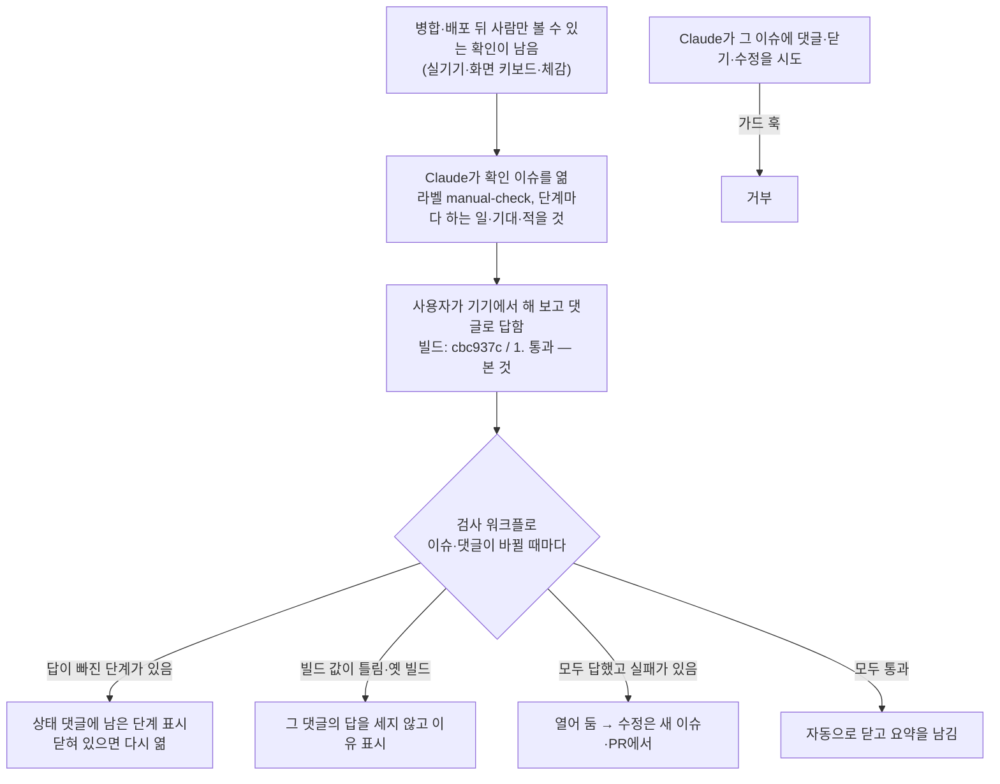
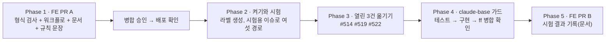

# 사람이 직접 해야 하는 확인을 "확인했다는 말"이 아니라 적힌 답으로 닫기

<!-- plan-result:start — 이 블록만 병합 뒤에도 고칠 수 있다(.claude/CLAUDE.md "계획과 PR 본문"). 아래는 승인된 계획 원문 -->

## 구현 결과

> #683 · 2026-11-24 대조 · 이탈 0 · 미구현 0 — 판정 근거(파일:줄)는 PR 본문 "계획 대비 구현"
> Phase 2~5: #686 · 2026-11-24 대조 · 이탈 1 · 미구현 0 — 판정 근거는 #686 본문 "계획 대비 구현", 실행 번호와 댓글 링크는 `docs/MANUAL-CHECK.md` §9. 가드는 이 기계의 claude-base 저장소(원격 없음, main `125841b`)에 있다

- 대조 범위: Phase 1(PR A). Phase 2~5는 병합 뒤 단계라 결과를 #686에서 이 블록에 덧붙였다("Phase 2~5"로 시작하는 불릿)
- 계획에 없던 변경: 같은 이슈의 대기 실행을 취소하지 않는 `queue: max`(기본값이면 이슈를 닫는 실행이 취소될 수 있어서), 워크플로에 적힌 라벨·표식이 판정 코드 상수와 같은지 보는 테스트, 본문의 확인할 빌드가 main에 없는 값이면 답을 기다리지 않고 본문 형식 오류로 판정, 상태 댓글의 문서 링크를 절대 주소로 넣음
- 계획에 없던 변경(판정 세부): 본문에 없는 단계 번호의 답은 이유와 함께 세지 않음, 빌드 줄도 판정 줄도 없는 댓글은 메모로 보고 조용히 건너뜀, 실패가 있는 채 닫힌 이슈도 다시 엶, 판정과 본 것 사이 기호는 하이픈·콜론·없음도 받음
- 대조에서 나온 결함 → 보완함: "통과가 아니면 댓글 이벤트여도 닫지 않는다"와 실패 문구를 단언하는 테스트가 없던 것, 버전 화면을 설명하는 문서 링크가 틀린 것, 문서가 가리킨 줄 번호 한 곳
- Phase 2~5 대조 범위: Phase 2·3은 이슈 타임라인과 워크플로 실행 기록으로, Phase 4는 claude-base의 두 커밋(`e82b9cb`, `125841b`)으로, Phase 5는 문서 diff로 대조했다. 완료 조건 가운데 셋(답이 빠진 채 닫으면 다시 열림, 틀린 빌드·옛 빌드의 답은 세지 않음, 모두 통과면 닫고 요약)은 실행 기록으로 확인됐고, 가드 반영 뒤 거부는 반영한 세션에서 직접 본 것이다
- Phase 2~5 이탈(사용자가 질문으로 정함): 계획은 변수로 가린 이슈 번호를 규칙 문장에 맡기고 라벨 없는 이슈는 가드가 통과시킨다고 했다. 실제로는 번호·저장소를 읽을 수 없는 이슈 쓰기 명령(변수, 명령 치환)을 라벨 조회 없이 막는다. 가드를 처음 반영하기 직전 대조에서, Phase 3에서 세 이슈를 옮긴 명령이 바로 그 형태라 가드를 지나가는 것을 확인했기 때문이다. 그래서 라벨 없는 이슈도 번호와 저장소를 직접 적어야 고칠 수 있다(최근 60일 명령 재생에서 새로 막히는 명령 2개)
- Phase 2~5 계획에 없던 변경(같은 질문에서 정함): `manual-check` 라벨 자체를 지우거나 이름을 바꾸는 명령도 막는다. 설명·색 편집과 라벨 생성은 통과한다. claude-base ff 병합 확인은 첫 커밋과 보완 커밋에 한 번씩, 두 번 받았다
- Phase 2~5 계획에 없던 변경(가드 세부): 조회할 저장소를 정할 때 명령 안의 `GH_REPO=`도 읽고, 절대경로 `gh`·`#번호`·`{owner}/{repo}` 자리표시자·번호가 여럿인 명령도 판정한다. 대조에서 번호 앞 단어가 `-`로 시작하면 번호를 놓치는 형태 4개가 나와 인자를 앞에서부터 차례로 읽게 고쳤다. 가짜 gh로 훅을 실제 실행하는 테스트를 더했다
- Phase 2~5 계획에 없던 변경(측정기): 거부 문구 목록에는 G7을 더하지 않았다. 대신 과거 명령 재생이 라벨을 조회하지 않게 하고 G7 거부를 집계에서 뺐다
- Phase 2~5 계획에 없던 변경(시험): 경로 ③에 판정 글자가 통과·실패가 아닌 답을 하나 더 썼다. 세 답을 2초 사이에 달아 기다리던 실행이 취소되지 않는 것도 함께 봤다(세 실행 모두 성공)
- Phase 2~5 계획에 없던 변경(옮긴 3건): 확인 항목 수는 5·5·3 그대로다. `적을 것` 13줄은 원래 본문에 없어 새로 썼다(옮기기 전에 알림). 첫 문단의 PR 번호(#515·#520·#523), #514 1번의 "(폴더가 많은 계정으로)"와 4번의 "창을 연 채", #522의 `결과에 따라` 문장도 새로 썼다(옮긴 뒤에 알림)
- Phase 2~5 계획에 없던 변경(반영 뒤 확인): 계획의 "같은 라벨 다시 붙이기"에 더해 번호를 변수로 준 명령, 없는 저장소를 가리키는 라벨 삭제, 변수 번호 읽기를 실행해 봤다
- Phase 2~5 달라진 점(이탈로 치지 않음): 라벨 조회는 "명령당 1회"가 아니라 대상 이슈마다 1회다(재생에서 명령 35개에 39번). 문서의 워크플로 실행은 링크 대신 실행 번호와 주소 틀로 적었다
- Phase 2~5 문서 동기화: `docs/MANUAL-CHECK.md` §5.6·§10.1·§11을 가드가 반영된 지금 기준으로 고쳤다(계획 표는 §9만 적었다)
- Phase 2~5 대조에서 나온 결함 → 보완함: 문서가 "여섯 경로 모두 로컬에서 먼저 돌려 본 판정과 같았다"고 적었는데 경로 ③의 세 번째 답은 미리 돌려 보지 않은 것이어서 문장을 좁혔다. 옮긴 3건에서 새로 쓴 글을 `적을 것`만 적었던 것도 채웠다
- Phase 2~5 대조가 확인하지 못한 것: 가드 반영 뒤 거부 3종은 훅이 실행 전에 막아 출력 파일이 없고 그 세션의 대화 기록에만 있다
- Phase 2~5 남은 것(2026-11-24 기준): 옮긴 #514·#519·#522는 답이 0개인 채 열려 있다. 확인자가 기기에서 해 보고 댓글로 답해야 닫힌다

<!-- plan-result:end -->

> 사람이 직접 눌러 봐야 하는 확인(실기기·체감)을 "확인 이슈"라는 정해진 형식의 GitHub 이슈로 열고, 확인자가 단계마다
> 판정과 본 것을 댓글로 적어야만 닫히게 한다. 검사 워크플로가 답이 빠진 채 닫힌 이슈를 다시 열고, 적은 빌드 값이
> 확인할 변경을 포함하는지 대조한다. Claude는 가드 훅으로 그 이슈에 답하거나 닫지 못한다.

## Context

### 왜 하나

2026-11-24 사용자가 로그인 상태의 운영 확인을 직접 눌러 본 뒤 물었다. 대화에서 "확인했어"라고만 하면 안 눌러 봐도
통과되는데, 귀찮더라도 확인자가 실제로 확인해야만 넘어가는 시스템이 있어야 하지 않느냐는 것이다. 업계 조사 뒤
"확인 이슈 형식 + 검사 워크플로를 먼저, 운영 자동 스모크는 따로 계획"이라는 추천을 받아들였다.

### 지금 상황 (2026-11-24 직접 확인)

| 사실 | 근거 |
| --- | --- |
| "잘되네" 한마디로 4개 항목을 통틀어 통과로 기록하고 닫았다 | #593 닫을 때 댓글: "항목별 결과를 따로 받지는 않았다. 1~4번을 통틀어 기대대로 동작한 것으로 적는다" |
| 체크박스 7개가 하나도 표시되지 않은 채 한 줄 댓글로 닫혔다 | #516 본문과 댓글 |
| 두 건 모두 사용자 말을 듣고 Claude가 댓글을 쓰고 닫았다 | 댓글 문체로 본 추정(기록으로 확인하지는 않음) |
| 실기기 확인 이슈 3건이 11월 초부터 열려 있다 | #514, #519, #522 |
| 확인 이슈를 구분하는 라벨이 없다 | `gh label list`에 해당 라벨 없음 |
| 확인 이슈의 본문 형식이 건마다 다르다 | #519는 체크박스 목록, #593은 번호 표 |

### 업계는 어떻게 다루나

결론은 "확인했다는 말은 증거가 아니다"로 모인다. 인용은 원문 페이지에서 문장을 다시 찾아 대조했고, 대조하지 못한
것은 "재인용"이라 적었다.

| 장치 | 내용 | 출처 |
| --- | --- | --- |
| 본 값으로 응답 | _"가능하면 응답은 언제나 그 항목의 실제 상태나 값을 말해야 한다"_ (번역) | [NASA CR 177549 §6.2.3](https://ntrs.nasa.gov/citations/19910017830) |
| 비면 통과 불가 | 검증 단계가 하나라도 표시되지 않은 채 남으면 테스트 케이스 전체가 실패다 | [Azure Test Plans "Run manual tests"](https://learn.microsoft.com/en-us/azure/devops/test/run-manual-tests?view=azure-devops), [Xray](https://docs.getxray.app/display/XRAY/Execute+Tests)(재인용) |
| 사람 대신 기계 | 스크립트가 운영에서 핵심 흐름을 주기적으로 눌러 본다 | [AWS CloudWatch Synthetics](https://docs.aws.amazon.com/AmazonCloudWatch/latest/monitoring/CloudWatch_Synthetics_Canaries.html) — 이번 범위 밖("남은 것") |

- 기록이 쉬울수록 건성 통과가 늘었다: _"기록된 체크리스트 준수율은 크게 믿기 어렵고 실제보다 높을 수 있으며, 전자
  서식으로 기록이 쉬워질 때 특히 그렇다"_ (번역, [Saturno 외, World J Surg 2014](https://doi.org/10.1007/s00268-013-2300-6), 초록).
- 항공도 같은 문제를 봤다: _"조종사는 체크리스트를 '돌리지만' 응답은 기억에서 나왔고 항목의 실제 상태에 근거하지
  않았다"_ (번역, [NASA CR 177549 §6.1.1](https://ntrs.nasa.gov/citations/19910017830)).

### 고친 뒤의 흐름



## 판단이 필요했던 항목

| 항목 | 결정 | 근거·기각한 대안 |
| --- | --- | --- |
| 범위 | 확인 이슈 형식 + 검사 워크플로 + 가드. 운영 자동 스모크는 별도 계획 — **사용자(11-24, "추천대로")** | 스모크는 테스트 계정 비밀번호를 시크릿에 두는 일과 운영 데이터를 바꾸지 않는 범위를 따로 정해야 한다 |
| 답을 적는 곳 | 이슈 댓글 — **사용자(11-24 질문)** | 폰에서 쓰기 쉽고 누가 언제 적었는지 댓글마다 남는다. 기각: 이슈 본문 칸(폰에서 본문 편집이 번거롭고 누가 채웠는지 흐려짐) |
| 검사 깊이 | 답 + 빌드 값 대조 — **사용자(11-24 질문)** | 배포본을 실제로 열었는지를 기계가 확인하는 유일한 부분이고, 옛 빌드가 남은 탭으로 확인하는 실수도 잡는다. 기각: 답이 있는지만 |
| Claude 제한 | 규칙 문장 + 가드 훅 — **사용자(11-24 질문, Claude 추천은 규칙 문장만이었다)** | 워크플로는 사용자와 Claude를 구분하지 못한다(같은 GitHub 계정) |
| 가드가 막는 범위 | 확인 이슈에 대한 Claude의 댓글·닫기·본문과 라벨 수정·삭제를 모두 거부, 확인 창 없음 — **사용자(11-24 질문)** | 기각: 답 형식 댓글과 닫기만 거부(본문 수정으로 단계를 바꿀 수 있고 명령에서 댓글 내용을 읽는 판정이 복잡함) |
| 동작 시험 | 가드 반영 전에 "[시험]" 이슈 한 건에서만 Claude가 답 댓글을 써서 확인 — **사용자(11-24 질문)** | "Claude는 답을 쓰지 않는다"의 예외는 이 한 건뿐이다. 기각: 사용자가 댓글 대여섯 개를 직접 씀 |
| 열린 확인 이슈 3건 | 새 형식으로 옮긴다 — **사용자(11-24 질문)** | 첫 실제 사용이 된다 |
| 답 없이 닫기 | 닫기 사유와 상관없이 다시 연다 — **사용자(11-24 질문에서 "확인 안 함으로 닫기 허용"을 고르지 않음)** | 확인할 수 없게 된 이슈는 사용자가 라벨을 떼어 검사 대상에서 뺀다. 라벨이 떼어지면 워크플로가 그 사실을 댓글로 남긴다(Claude 제안) |
| 라벨 이름 | `manual-check` — Claude 제안 | 기존 라벨 선례(`uptime`, `cloudfront-drift`)와 같은 영어 소문자 |
| 단계 형식 | 번호 + 하는 일, `기대:`, `적을 것:` — Claude 제안 | `적을 것`은 해 봐야 알 수 있는 것(주소창 값, 뜬 문구, 개수)으로 정한다. NASA의 "실제 값으로 응답"을 옮긴 것 |
| 답으로 세는 댓글 | 저장소 주인(`OWNER`)이 쓴 댓글, 같은 단계에 답이 여럿이면 가장 늦은 답 — Claude 제안 | 공개 저장소라 누구나 댓글을 달 수 있다. 실패한 단계는 수정이 배포된 뒤 다시 답하면 된다 |
| 본 것의 최소 길이 | 5자 — Claude 제안 | 얕은 검사의 선례(Danger·GitLab "본문 5자 미만이면 실패", `docs/PR-BODY-CHECK.md` §5.1). 내용이 맞는지는 판정하지 않는다 |
| 자동 닫기 | 모두 통과면 닫는다. 댓글 이벤트에서만 — Claude 제안 | 사용자가 다시 확인하려고 연 이슈를 워크플로가 곧바로 닫지 않게 한다 |
| 적용 저장소 | 워크플로는 FE에만 — Claude 제안 | BE 변경이라도 화면으로 보는 확인이면 FE 이슈로 연다 |
| 가드의 라벨 이름 위치 | 가드 코드의 상수 — Claude 제안 | 정책 파일에 두면 다른 폴더에서 `-R`로 부른 명령의 저장소 정책을 찾지 못한다 |
| 가드의 라벨 조회 실패 | 통과시킨다 — Claude 제안 | `bash-guard.mjs` 머리말의 관례(fail-open). 조회가 안 되는 상황이면 `gh` 명령도 실패한다 |
| 결정 기록 | FE `DECISIONS.md`는 항목 없음, claude-base `DECISIONS.md`는 가드 선례대로 한 항목 | FE 쪽은 워크플로를 지우면 되돌아간다 |
| CHANGELOG | 항목 없음 | 앱 동작이 바뀌지 않는다 |

### 뒤집힌 전제

| 발견 | 그래서 바뀐 것 |
| --- | --- |
| 체크박스 목록이면 된다고 봤는데, #516은 체크 0개로 닫혔고 수술 연구도 기록이 쉬울수록 건성 통과가 늘었다고 한다 | 체크 대신 단계마다 본 것을 적게 하고 기계가 빈 곳을 본다 |
| 이슈 닫기를 막는 설정을 GitHub 문서에서 찾지 못했다 | 닫힌 뒤 워크플로가 다시 연다 |
| 워크플로는 사용자와 Claude를 구분하지 못한다(같은 계정, API의 작성자 관계가 둘 다 `OWNER`) | 가드 훅으로 Claude 쪽을 막는다 |
| 가드는 명령 문자열만 본다(`bash-guard.mjs:1`). 댓글 내용이 파일로 오면 형식을 알 수 없다 | 댓글 종류를 가리지 않고 전부 거부한다 |
| `issues`·`issue_comment` 워크플로는 기본 브랜치의 파일로만 돈다 | 동작 시험은 병합 뒤에 하고, 결과는 문서 PR로 따로 남긴다 |

### 위험 관리

| 위험 | 대처 |
| --- | --- |
| 공개 저장소라 외부인이 이슈·댓글을 쓸 수 있다 | 라벨이 붙은 이슈만 본다. 외부인은 라벨을 붙일 수 없다 — _"저장소에 triage 권한이 있는 사람은 누구나 라벨을 붙이고 뗄 수 있다"_ (번역, [GitHub Docs "Managing labels"](https://docs.github.com/en/issues/using-labels-and-milestones-to-track-work/managing-labels)). 답은 `OWNER` 댓글만 센다. 본문·댓글은 `${{ }}`로 셸에 넣지 않고 API로 받아 파일로 읽는다(`pr-body.yml:35` 선례). 검사 job은 읽기 권한만 갖고 이슈 쓰기는 별도 job이 한다(`uptime-check.yml:91` 선례) |
| 워크플로가 자기 댓글·다시 열기로 또 도는 반복 | _"`workflow_dispatch`와 `repository_dispatch`를 빼면, `GITHUB_TOKEN`으로 일어난 다른 이벤트는 워크플로 실행을 아예 만들지 않는다"_ (번역, [GitHub Docs](https://docs.github.com/en/actions/reference/workflows-and-actions/events-that-trigger-workflows)) |
| `issue_comment`는 PR 댓글에도 뜬다 | job 조건으로 건너뛴다(라벨 없음·PR). 건너뛴 실행 기록이 Actions 목록에 남는다 |
| FE 빌드와 무관한 확인(BE만 바뀐 경우) | 본문에 `확인할 빌드: 없음`이면 빌드 줄을 요구하지 않는다 |
| 가드 반영 뒤 Claude가 확인 이슈 본문의 오타를 고칠 수 없다 | 사용자가 고치거나 Claude가 새 이슈를 연다(사용자 선택에 따른 결과) |
| 가드가 못 보는 길(`gh api graphql`, `curl`, 변수로 가린 번호) | 규칙 문장과 공통 지침 "가드에 막히면 우회하지 않는다"가 맡는다 |
| 값을 지어내 적는 것 | 막지 못한다. 요청 단위 서버 기록이 없다(BE 접속 로그 꺼짐, CloudFront 접근 로그는 Free 플랜에서 불가) |

## 세부 계획



### 형식과 판정 규칙

이슈 본문(Claude가 쓴다):

```
## 무엇을 확인하나
## 왜 사람이 봐야 하나        ← 자동 테스트로 못 보는 이유. 비면 형식 오류
## 확인 항목

확인할 빌드: 890e4c5 이후     ← FE 빌드와 무관하면 "확인할 빌드: 없음"

1. 피드에서 북마크 버튼을 눌러 시트를 띄우고 하단 뒤로 버튼을 누른다
   - 기대: 시트만 닫히고 피드는 그대로다
   - 적을 것: 뒤로 버튼을 누른 뒤 보이는 화면
## 결과에 따라
```

답 댓글(사용자가 쓴다). 빌드 값은 버전 화면 `/version`의 "이 탭이 실행 중인 빌드" 7자리다(`VersionPage.tsx:102`):

```
빌드: cbc937c
1. 통과 — 시트만 닫혔고 피드 스크롤 위치도 그대로
```

| 상황 | 워크플로가 하는 일 |
| --- | --- |
| 본문 형식 오류(필수 절, 1부터 이어지는 번호, `기대`·`적을 것`, `확인할 빌드` 줄) | 상태 댓글에 고칠 곳을 적는다. 닫혀 있으면 다시 연다 |
| 답이 빠진 단계가 있다 | 상태 댓글에 "답 x/y, 남은 단계"를 적는다. 닫혀 있으면 다시 연다 |
| 답 댓글에 빌드 줄이 없거나, main에 없는 값이거나, 확인할 빌드를 포함하지 않는다 | 그 댓글의 답을 세지 않고 이유를 적는다(`git merge-base --is-ancestor`) |
| 판정이 `통과`·`실패`가 아니거나 본 것이 5자 미만이다 | 그 답을 세지 않는다 |
| 모두 답했고 실패가 있다 | 열어 두고 실패 단계를 적는다 |
| 모두 통과다 | 댓글 이벤트면 닫고 요약(단계·판정·본 것·빌드)을 남긴다 |
| 라벨이 떼어졌다 | "검사 대상에서 빠짐(답 x/y)" 댓글을 한 번 남긴다 |

상태 댓글은 표식(`<!-- manual-check-status -->`)으로 찾아 하나만 갱신한다(`ci.yml:161-174`의 PR 댓글 갱신 방식).

### Phase 1 — FE PR A (`link-sphere_FE_NEW`, 워크트리)

| 위치 | 변경 내용 |
| --- | --- |
| `src/test/scripts/manual-check.test.ts` (신규) | 판정 규칙 표의 행마다 테스트를 먼저 쓴다. 본뜬 파일: `src/test/scripts/pr-body.test.ts` |
| `scripts/lib/manual-check.js`, `manual-check.d.ts` (신규) | 순수 함수: 본문에서 단계 뽑기, 본문 형식 오류 찾기, 댓글에서 답 뽑기, 종합 판정, 상태 댓글 만들기. 빌드 포함 여부는 주입받는다. 본뜬 파일: `scripts/lib/pr-body.js` |
| `scripts/check-manual-issue.js` (신규) | `pnpm check:manual-issue <본문 파일>`: 이슈를 열기 전 본문 형식 검사. 워크플로에서는 이슈·댓글 JSON을 받아 판정과 할 일을 내놓고 빌드 포함 여부를 git으로 확인한다. 본뜬 파일: `scripts/check-pr-body.js` |
| `package.json` | `check:manual-issue` 명령 |
| `.github/workflows/manual-check.yml` (신규) | `issues`(opened·edited·closed·reopened·labeled·unlabeled), `issue_comment`(created·edited·deleted). 검사 job(읽기 권한, 전체 히스토리 checkout) + 반영 job(`issues: write`: 상태 댓글 갱신, 다시 열기, 닫기). 이슈별 concurrency. 액션 고정 버전은 `pr-body.yml`과 같다 |
| `docs/MANUAL-CHECK.md` (신규) | 독립 기능 문서(13절 순서). 언제 확인 이슈를 여는가(자동 테스트로 못 보는 것만), 형식, 판정 규칙, 업계 근거, 한계. 본뜬 파일: `docs/PR-BODY-CHECK.md` |
| `README.md` `## 문서` | 새 문서 등록(`:221` PR-BODY-CHECK 행 옆) |
| `.claude/CLAUDE.md` Critical Rules | Never 한 줄: 확인 이슈에 Claude가 답을 쓰거나 닫거나 고치지 않는다. 사람 확인이 남으면 확인 이슈를 열고, 대화의 "확인했어"는 증거로 치지 않고 이슈에 적어 달라고 안내한다 |
| `.claude/CLAUDE.md` "계획과 PR 본문", `.github/pull_request_template.md:20` | "병합 뒤에 확인할 것은 GitHub 이슈로"에 "사람이 직접 봐야 하는 확인은 확인 이슈로"를 잇는다 |
| `docs/PR-BODY-CHECK.md` §13 | 관련 문서 링크 한 줄, 마지막 검토 날짜 |
| `docs/plans/2026-11-24-manual-check-issue.md` (신규), `docs/PLANS-INDEX.md` | 이 계획 스냅샷, `pnpm docs:index` |

### Phase 2 — 켜기와 시험 (PR A 병합·배포 확인 뒤)

| 위치 | 변경 내용 |
| --- | --- |
| GitHub 라벨 | `gh label create manual-check`(설명: 사람이 직접 해 보고 답을 적어야 닫히는 확인) |
| 시험용 이슈 1건(제목 "[시험] …") | 여섯 경로를 차례로 실행한다: ① 형식 오류 본문 ② 답이 빠진 채 닫기 → 다시 열림 ③ 틀린 빌드 값·옛 빌드 ④ 실패 답 → 열린 채 ⑤ 모두 통과 → 자동 닫힘 ⑥ 라벨 떼기 → 기록 댓글. 답 댓글은 Claude가 쓴다(승인된 예외, 이 한 건만). 끝나면 닫힌 채 기록으로 둔다 |

### Phase 3 — 열린 확인 이슈 3건 옮기기

| 위치 | 변경 내용 |
| --- | --- |
| #514, #519, #522 | 확인 항목은 그대로 두고 형식만 바꾼다(번호·기대·적을 것, 확인할 빌드는 해당 변경의 병합 커밋). `pnpm check:manual-issue`로 확인한 뒤 본문을 고치고 라벨을 붙인다. 바꾼 본문은 보고에 링크로 보여 준다 |

### Phase 4 — claude-base 가드 (`~/project/claude-base`, 워크트리)

| 위치 | 변경 내용 |
| --- | --- |
| `hooks/guards.test.mjs` | G7 테스트를 먼저 쓴다: 라벨 있는 이슈의 close·comment·edit·delete·transfer 거부, `-R`·URL 형태, `gh api`의 `issues/<번호>` 쓰기 거부, 라벨 없는 이슈·view·list·create·reopen 통과, 조회 실패 통과, 서브에이전트도 같은 판정 |
| `hooks/bash-guard.mjs` | 새 규칙 G7과 머리말 설명. `decide`의 주입 옵션에 라벨 조회 함수를 더한다(기존 호출은 그대로 동작). 거부 문구는 답은 사용자가 쓰고 실패 분석은 새 이슈·PR에 `Refs #번호`로 걸라고 안내한다 |
| `scripts/rule-metrics.mjs` | 거부 문구 목록(`:63` 근처)에 G7 문구가 필요한지 확인하고 필요하면 더한다 |
| `README.md` "적용된 것", `docs/DECISIONS.md`(덧붙임), `docs/plans/2026-11-24-manual-check-issue.md`(신규) | 기록. 검증 칸은 기존 행의 관례(테스트 수, 변이, 과거 명령 재생)를 따른다 |

### Phase 5 — FE PR B (문서)

| 위치 | 변경 내용 |
| --- | --- |
| `docs/MANUAL-CHECK.md` §9 검증 결과 | 시험용 이슈의 여섯 경로 결과(이슈·실행 링크), 옮긴 3건의 상태 댓글, 가드 거부 확인 |
| `docs/plans/2026-11-24-manual-check-issue.md` 결과 블록, `docs/PLANS-INDEX.md` | 병합 뒤 단계의 결과 |
| (시험에서 결함이 나오면) Phase 1의 해당 파일 | 실패하는 테스트를 먼저 더하고 고친다 |

## 영향 범위

**데이터**: 앱 데이터와 운영 DB는 건드리지 않는다. 바뀌는 것은 GitHub 이슈다.

| 대상 | 생기는 일 |
| --- | --- |
| 새 확인 이슈 | Claude가 만들고, 답은 사용자가 쓰고, 닫기는 워크플로가 한다 |
| 열린 3건(#514·#519·#522) | 본문 형식이 바뀌고 라벨이 붙는다. 확인 항목은 그대로다 |
| 닫힌 확인 이슈(#516·#593 등) | 건드리지 않는다(라벨이 없어 검사 대상이 아니다) |
| 라벨 없는 다른 이슈·PR | 워크플로가 건너뛴다. 가드도 통과시킨다 |

**공유 코드**: `bash-guard.mjs`는 모든 저장소의 모든 Bash 명령에서 뜬다. G7은 `gh issue`의 쓰기 명령과 `gh api`의 이슈
쓰기에서만 라벨을 조회한다(명령당 `gh` 호출 1회). 다른 명령의 판정은 바뀌지 않는다(기존 테스트 전부 통과로 확인).

**이전 동작을 단정하는 문서·테스트**: `.claude/CLAUDE.md`와 PR 템플릿의 "병합 뒤에 확인할 것은 GitHub 이슈로" 문장,
claude-base README "적용된 것"의 가드 설명. 기존 테스트의 기대값은 바꾸지 않는다.

**배포 순서**: 계약 변경이 없다. PR A가 `src/test/**`를 건드려 FE 배포 워크플로가 돌 수 있으니 병합 뒤 성공을 확인한다.
가드는 ff 병합 즉시 모든 세션에 적용되므로 Phase 2(Claude가 시험용 이슈에 답함)와 Phase 3 뒤에 반영한다.

## 검증 방법

**완료 조건**

- 답이 빠진 확인 이슈를 닫으면 다시 열리고 남은 단계가 댓글로 보인다(시험용 이슈 ②).
- 틀린 빌드 값이나 확인할 변경을 포함하지 않는 빌드로 쓴 답은 세지 않는다(③).
- 모든 단계가 통과로 답해지면 이슈가 닫히고 요약이 남는다(⑤).
- 가드 반영 뒤 Claude의 확인 이슈 수정 명령이 거부된다. 확인은 이미 라벨이 붙은 이슈에 같은 라벨을 다시 붙이는
  명령으로 한다(가드가 놓쳐도 아무것도 바뀌지 않는 명령).
- 바꾸지 않는 것: 앱 코드, 기존 워크플로와 필수 체크 구성, 닫힌 이슈, `~/.claude/settings.json`.

**단계별**

1. Phase 1: 새 테스트의 고치기 전 실패 출력을 남긴다. 구현을 일부러 깨서 테스트가 실패하는지 한 번 확인한다.
   `pnpm check` → `pnpm test` → `pnpm check:docs`. 병합 전 실제 데이터 확인으로 #593·#519의 본문과 댓글을 받아
   로컬에서 판정을 돌린다(둘 다 형식 오류로 나와야 한다).
2. Phase 1 대조와 PR: `plan-verifier` 대조 → PR CI → 병합 승인 → 배포 워크플로 결과 확인.
3. Phase 2: 여섯 경로마다 이슈 타임라인과 워크플로 실행 링크를 남긴다. 기대와 다르면 멈추고 보고한다.
4. Phase 3: 세 이슈에 상태 댓글 "답 0/N"이 달렸는지 본다.
5. Phase 4: `node --test hooks/*.test.mjs` 전부 통과, 새 판정 줄의 변이를 테스트가 잡는지 확인. 사용자에게 무엇을
   병합하는지 풀어 설명하고 ff 병합 확인을 받는다. 반영 뒤 위 완료 조건의 거부 확인을 한다.
6. Phase 5: `pnpm check:docs`, PR CI, 병합 승인.

사람 승인 지점은 세 곳이다: PR A 병합, claude-base ff 병합, PR B 병합.

## 남은 것

- 운영 자동 스모크(테스트 계정으로 로그인 뒤 흐름을 기계가 눌러 봄)는 별도 계획이다. 2026-11-24에 사용자가 직접
  눌러 본 범위 칩 4개가 그 첫 대상이다.
- 값을 지어내 적는 것은 막지 못한다(위험 관리 마지막 행).
- BE·infra 저장소에는 워크플로를 두지 않는다.
- 실패 답이 달린 확인 이슈를 Claude가 다음 세션에서 스스로 알아채는 장치는 없다. 사용자가 알려 주거나 관련 작업을
  시작할 때 `gh issue list --label manual-check`로 본다.
- 실패를 통과로 바꾸는 답이 수정이 들어간 빌드에서 나왔는지는 대조하지 않는다(확인할 빌드 이후이기만 하면 된다).
