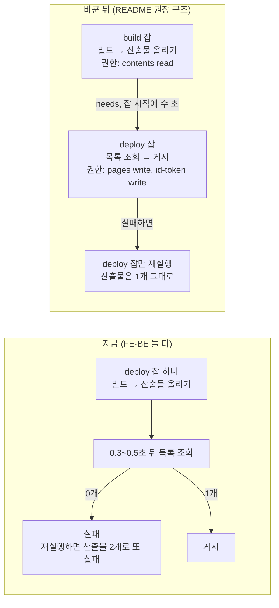

# GitHub Pages 배포를 build·deploy 두 잡으로 나누기 (FE Storybook → BE API 문서)

<!-- plan-result:start — 이 블록만 병합 뒤에도 고칠 수 있다(.claude/CLAUDE.md "계획과 PR 본문"). 아래는 승인된 계획 원문 -->

## 구현 결과

> #677(PR 1) · 2026-11-24 대조 · 이탈 0 · 미구현 0 — 판정 근거(파일:줄)는 각 PR 본문 "계획 대비 구현"
> PR 2: BE #228 · 2026-11-24 대조 · 이탈 0 · 미구현 0 — 병합 뒤 확인 값은 각 PR 본문 "검증". 아래 병합 뒤 결과는 #682에서 덧붙였다

- 이탈·미구현·계획에 없던 변경 없음(PR 1 — FE 범위)
- PR 1 병합 뒤 확인 ①~⑤(2026-11-24, 병합 커밋 `c221b3c1`): main에서 push 실행, `deploy` 잡만 재실행, 수동 실행이 모두 `Found 1 artifact(s)`로 성공했다. "올리기 완료 → 조회 시작" 간격은 push 실행 11.00초, 수동 실행 8.16초다(한 잡일 때 0.29~0.40초). `github-pages` 환경의 최신 배포가 병합 커밋이고, `deploy` 잡을 재실행한 뒤에도 그 실행의 산출물은 1개였다. 실행 전체 시간은 63~66초로 한 잡이던 전날 실행(67초)과 거의 같다
- PR 2(BE #228, 병합 커밋 `41cd82c`): BE `api-docs-pages.yml`을 같은 구조로 나눴다. 병합 뒤 push 실행과 `deploy` 잡만 재실행한 것이 모두 `Found 1 artifact(s)`로 성공했고 간격은 13.38초다(한 잡이던 같은 날 실행은 0.49초). 공개 API 문서는 200이고 `openapi.json`의 `servers`가 운영 주소 그대로다
- 계획에 없던 것(PR 2): BE 브랜치 수동 실행 1회(계획의 검증 절은 브랜치 수동 실행을 PR 1에만 적었다. 게시는 일어나지 않았다)
- 계획에 없던 것(기록): 이 계획이 잡 구조와 권한 배치를 바꾼 앞선 계획 `docs/plans/2026-10-30-docs-to-github-pages.md`에 "대체됨(일부)" 표시를 달았다. BE는 #228에서 달았고 FE는 #677에서 빠뜨려 #682에서 달았다
- 확인되지 않은 것: "나눴기 때문에 0개가 안 나왔다"는 증명되지 않았다. 한 잡 구조인 BE 실행이 같은 날 04:10(UTC)에 0.49초 간격으로 성공했으니 GitHub 쪽 지연이 그 무렵 풀렸을 수 있다. 0개가 나온 실행이 없어서, 실패한 실행에 쓰는 `gh run rerun <실행 번호> --failed`는 두 잡 구조에서 실행해 보지 못했다. 해 본 것은 성공한 실행에 쓴 `gh run rerun --job <잡 번호>`다
- 메모리 정정("남은 것"의 둘째 항목): "실패하면 새 실행으로 올린다"고 적었던 작업 메모를 2026-11-24에 위 결과로 고쳤다(저장소 밖 파일이라 diff에는 없다)
- 세부 조정(문서 검사): `docs/DEPLOY.md`의 README 링크는 계획이 인용한 README 파일 주소 대신 같은 SHA의 저장소 첫 화면 "Usage" 절 주소로 적었고, 액션 소스는 파일 경로를 빼고 함수 이름만 적었다. `pnpm check:docs`가 외부 저장소 경로를 이 저장소 경로로 읽어 실패했기 때문이다
- 관찰 표 보충(대조 뒤 실행 로그로 다시 잼): 표에서 "1초 미만"·"미추출"이던 간격은 0.30초(45322307942)와 0.40초(45323816926)다. 0개를 받은 실행 3개의 간격은 0.29~0.40초이고, 문서에는 이 범위로 적었다

<!-- plan-result:end -->

> 산출물을 올린 직후 목록 조회가 빈 결과를 받아 Storybook 공개 배포가 실패한다. 공식 README가 권하는 구조(올리는 잡과 배포하는 잡을 분리)로 바꿔 조회 시점을 늦추고, 실패해도 배포 잡만 다시 돌릴 수 있게 한다. FE를 먼저 병합해 main에서 확인한 뒤 같은 구조인 BE에 같은 변경을 한다. 공개 사이트의 내용은 바뀌지 않는다.

## Context

- **계기**: 2026-11-24 #676 병합 직후 `Storybook Deploy (GitHub Pages)`가 마지막 단계에서 실패했다. 실패한 잡 재실행 1회, 새 실행 2회도 모두 실패했다. 공개 Storybook은 이전 배포(`f3497f3c`) 내용 그대로다. 사용자가 계획을 세우라고 했다(같은 날).
- **용어**: 산출물(artifact)은 워크플로 실행이 GitHub에 올려 두는 파일 묶음이다. 잡(job)은 러너 한 대에서 차례로 도는 단계 묶음이다. Pages 배포는 "산출물 올리기 → 그 산출물을 이름으로 찾아 게시" 두 동작이다.

### 가설

올린 직후에는 산출물이 목록에 아직 안 보이는 순간이 있고, 배포 액션이 그 순간에 한 번만 조회해 0개를 받는다.

### 관찰 (2026-11-24, 실행 로그와 API로 직접 확인)

| 실행 | 저장소 | 올리기 완료 → 조회 시작 | 조회 결과 |
| --- | --- | --- | --- |
| 45187936184 (11-23) | FE | 0.35초 | 1개, 성공 |
| 45322307942 (#676 병합) | FE | 1초 미만(정확한 값 미추출) | 0개, 실패 |
| 같은 실행의 재실행 | FE | 0.33초 | 2개(중복), 실패 |
| 45323578479 (새 실행) | FE | 0.29초 | 0개, 실패 |
| 45323816926 (새 실행) | FE | 미추출 | 0개, 실패 |
| 45324317860 (같은 날 04:10) | BE | 0.49초 | 1개, 성공 |

- 실패한 실행의 산출물은 수 분 뒤 같은 이름 조건으로 조회하면 1개가 나온다(`gh api repos/<FE>/actions/runs/45323816926/artifacts?name=github-pages`). 산출물 자체는 정상이다.
- 성공한 11-23 실행과 실패한 실행이 내려받은 액션 SHA 6개와 러너 이미지 버전이 같다. 워크플로 파일의 마지막 변경은 #665(11-20)이고 그 뒤 성공한 실행이 있다. 직전 37회는 모두 성공이다.

### 근본 원인

- **확인한 것**
  - `actions/deploy-pages` v5.0.1(고정된 SHA, 최신 릴리스)의 `getArtifactMetadata`는 `listArtifacts()`를 한 번 부르고 0개면 바로 던진다. 재시도가 없다(`src/internal/api-client.js`, 스택 트레이스 `:85`).
  - 같은 실행을 재실행하면 한 잡이 산출물을 다시 올려 2개가 되고 `:89`에서 던진다. 지금 구조에서는 재실행으로 복구할 수 없다.
- **모르는 것**: GitHub 안에서 목록이 왜, 얼마나 늦게 갱신되는지. 상태 페이지는 "All Systems Operational"이었다.
- **같은 보고**: [actions/deploy-pages#451](https://github.com/actions/deploy-pages/issues/451)이 같은 로그를 싣고 있다. 11-22 댓글은 _"요 며칠 아주 자주 본다. 전에는 드물었는데 지금은 대부분 실패한다"_ (번역)고 한다. 보고자는 _"올리기를 앞선 잡으로 옮겼더니 우리 쪽에서는 해결됐다"_ (번역)고 적었다(한 저장소의 경험담이다).
- **공식 권장**: deploy-pages [README](https://github.com/actions/deploy-pages/blob/368f82528645a54fb793d4d04e342629a3f51346/README.md)는 _"이 액션은 전용 잡에서 쓰기를 권한다"_ (번역)며 build 잡과 deploy 잡을 나눈 예시를 싣는다. 우리 두 워크플로는 한 잡에 둘 다 있는 시작 워크플로 `pages/static.yml`을 본떴다.



## 판단이 필요했던 항목

| 항목 | 결정 | 근거·기각한 대안 |
| --- | --- | --- |
| 해결 방식 | **결정(사용자, 11-24)**: 잡을 둘로 나눈다 | README 권장 구조다. 기각: 한 잡에 대기 단계 추가(몇 초가 맞는지 근거가 없고 재실행 복구가 여전히 안 된다), 그대로 두고 지켜보기(실패할 때마다 전체 빌드를 다시 돌린다) |
| BE 포함 | **결정(사용자, 11-24)**: FE를 확인한 뒤 BE도 한다 | BE `api-docs-pages.yml`이 같은 구조·같은 액션 버전이다. 기각: FE만 |
| 권한 위치 | **결정(사용자, 11-24)**: `pages: write`·`id-token: write`는 배포 잡에만 | README 예시의 배치다. 빌드 잡은 npm·Gradle 의존성 코드가 도는 구간이다. 기각: 워크플로 전체에 그대로(시작 워크플로 `nextjs.yml`의 배치) |
| PR 수와 순서 | **제 판단**: PR 1(FE) 병합 → main에서 확인 → PR 2(BE) | `github-pages` 환경이 main만 허용해 게시 성공은 병합 뒤에만 확인된다. FE에서 확인한 구조를 BE에 옮긴다 |
| 병합 전 확인 | **제 판단**: PR 브랜치에서 수동 실행을 1회 돌린다 | 권한을 줄인 build 잡이 올리기까지 되는지 main 전에 본다. deploy 잡은 환경 보호 규칙에 막혀 실행이 실패로 끝나는 것이 예상 결과다(`docs/DEPLOY.md:287-289`). 실패 알림이 올 수 있다 |
| 재시도·대기 단계 | **제 판단**: 넣지 않는다 | 요청을 푸는 최소한이다. 나눈 뒤에도 0개가 나오면 잰 간격과 함께 보고하고 다시 계획한다 |
| 액션 버전 | **제 판단**: SHA 고정 그대로 | deploy-pages v5.0.1이 최신 릴리스다(`gh release list`). 올릴 버전이 없다 |
| 커밋 종류·CHANGELOG | **제 판단**: FE는 `fix(storybook)` + `[Unreleased]` 항목, BE는 `ci` 종류에 항목 없음 | FE는 공개 Storybook이 갱신되지 않던 실패를 고친다. BE는 실패한 적이 없는 예방 변경이다. 각 저장소 `.gitmessage`를 먼저 읽고 맞춘다 |
| 기록 위치 | **제 판단**: 각 저장소 `docs/DEPLOY.md`의 Pages 절. `DECISIONS.md`는 쓰지 않는다 | 되돌리는 비용이 revert PR 하나다. 실패 경위는 FE 문서에만 쓰고 BE 문서는 링크한다 |
| 계획 파일 | **제 판단**: 같은 계획을 두 저장소 `docs/plans/2026-11-24-pages-deploy-split-jobs.md`에 둔다 | 선례: `2026-10-30-docs-to-github-pages.md`가 두 저장소에 있다 |

### 뒤집힌 전제

| 발견 | 그래서 바뀐 것 |
| --- | --- |
| "새 실행으로 올리면 된다"(11-24 제 보고)가 2회 연속 틀렸다 | 운영 요령이 아니라 구조를 바꾼다. 이 말을 적은 메모리도 고친다 |
| 워크플로가 본뜬 `static.yml`은 시작 워크플로 중 한 잡 구조인 예외다(`nextjs.yml`은 두 잡, README는 전용 잡 권장) | 본뜨는 대상을 README 예시로 바꾼다 |

### 위험 관리

- **나눠도 실패할 수 있다.** 목록이 늦는 시간의 분포를 모른다. 그 경우에도 배포 잡만 재실행해 복구할 수 있고(아래 검증 ④에서 확인), 잰 간격과 함께 보고한 뒤 다시 계획한다.
- **검증하면서 공개 Pages에 같은 내용이 여러 번 게시된다.** FE 최대 3회, BE 최대 2회다. 내용은 같다.

## 세부 계획

### PR 1 — FE (`origin/main` 위 워크트리)

| 위치 | 변경 내용 |
| --- | --- |
| `.github/workflows/deploy-storybook.yml:40-43` | 워크플로 권한을 `contents: read`만 남긴다 |
| `.github/workflows/deploy-storybook.yml:45-88` | `deploy` 잡 하나를 둘로 나눈다. `build`: Checkout부터 "Upload Pages artifact"까지 지금 단계 그대로, 환경 없음. `deploy`: `needs: build`, `permissions`(`pages: write`, `id-token: write`), `environment: github-pages`(url 출력 포함), "Deploy to GitHub Pages" 단계 하나 |
| 같은 파일 주석 | 잡을 나눈 이유 한 문단(README·이슈 #451 링크). `concurrency`·트리거·액션 SHA는 손대지 않는다 |
| `docs/DEPLOY.md` "Storybook 공개 배포"(`:259-308`) | "권한" 항목을 잡별 권한으로 고친다. "잡 구조와 실패 복구" 항목을 더한다(왜 두 잡인지, 2026-11-24 실패 경위와 관찰 표 요약, `Found 0 artifact(s)`면 `gh run rerun <id> --failed`, 산출물 보존 1일이 지났으면 새 실행) |
| `CHANGELOG.md` `[Unreleased]` | Fixed 항목 하나(`changelog-release` skill 형식) |
| `docs/plans/2026-11-24-pages-deploy-split-jobs.md`(신규), `docs/PLANS-INDEX.md` | 이 계획의 스냅샷과 결과 블록, `pnpm docs:index` |

바꾼 뒤 잡 부분의 모양(단계 내용과 SHA는 지금 것 그대로):

```yaml
permissions:
  contents: read

jobs:
  build:
    runs-on: ubuntu-latest
    steps: # Checkout … Upload Pages artifact (지금 단계 그대로)

  deploy:
    needs: build
    runs-on: ubuntu-latest
    permissions:
      pages: write
      id-token: write
    environment:
      name: github-pages
      url: ${{ steps.deployment.outputs.page_url }}
    steps:
      - name: Deploy to GitHub Pages
        id: deployment
        uses: actions/deploy-pages@368f82528645a54fb793d4d04e342629a3f51346 # v5.0.1
```

### PR 2 — BE (PR 1을 main에서 확인한 뒤)

| 위치 | 변경 내용 |
| --- | --- |
| BE 워크트리 | FE 세션에서는 `git -C <BE> worktree add`로 만든다. 만들기 전에 로컬 BE `main`이 `origin/main`보다 뒤처졌는지 본다 |
| `.github/workflows/api-docs-pages.yml:32-35`·`:37-89` | PR 1과 같은 모양. `build`: "Checkout source"부터 "Upload Pages artifact"까지, `deploy`: 배포 단계 하나 |
| BE `docs/DEPLOY.md` "공개 API 문서 (GitHub Pages)"(`:1336` 이하) | 잡 구조와 복구 방법 한 항목. 경위는 FE `docs/DEPLOY.md`를 링크한다 |
| BE `docs/plans/2026-11-24-pages-deploy-split-jobs.md`(신규) | 같은 계획 사본과 결과 블록 |

## 영향 범위

- **앱·API·데이터**: 바뀌지 않는다. 공개 Storybook과 API 문서의 내용도 같다.
- **다른 배포**: PR 1은 워크플로 파일·문서·CHANGELOG만 바꿔 앱 배포(`deploy.yml`)를 트리거하지 않을 것으로 본다(구현 때 경로 필터로 확인). PR 2는 BE Lambda 배포를 트리거하지 않는다(BE `deploy.yml:7-12` 경로에 해당 없음, 직접 확인).
- **이름에 기대는 곳**: 워크플로 이름과 파일 이름이 그대로라 README 배지(`README.md:15`), `.claude/repo-policy.json:8`(배포 감시 훅), `docs/DEPLOY.md:189`·`:307`의 명령은 그대로 맞다.
- **재실행 동작**: `gh run rerun --failed`가 실패한 배포 잡만 다시 돌린다. GitHub 문서는 _"포함되지 않은 잡은 이전 시도의 출력을 유지한다"_ (번역, [Re-running workflows and jobs](https://docs.github.com/en/actions/how-tos/manage-workflow-runs/re-run-workflows-and-jobs))고 쓴다. 산출물이 다음 시도에서도 보이는 것은 오늘 재실행의 `Found 2`로 확인했다.
- **실행 시간**: 잡이 하나 늘어 러너 시작 시간만큼 길어진다. 병합 뒤 실행에서 재서 보고한다.
- **권한**: build 잡이 `contents: read`만 갖는다. `upload-pages-artifact` v5.0.0은 tar로 묶고 `upload-artifact` v7.0.0을 부르는 조합 액션이고 토큰 입력을 넘기지 않는다(`action.yml` 직접 확인). `upload-artifact` 안쪽 소스는 읽지 않아서 병합 전 수동 실행으로 확인한다.
- **이전 동작을 단정하는 문서**: FE `docs/DEPLOY.md:285-286`("권한"), 두 워크플로의 주석, BE `docs/DEPLOY.md` Pages 절. 같은 PR에서 고친다.
- **테스트**: 워크플로 구조 변경이라 단위 테스트로 잡을 수 없다. 고치기 전 실패 증거는 위 관찰 표의 실행들이고, 고친 뒤 증거는 아래 실행 로그다.

## 검증 방법

- **환경**: FE는 `EnterWorktree`(만들기 전 `git log origin/main..main`), `test -s .env`, `pnpm install`, `node -v`가 v24.
- **PR 1 병합 전**
  - `pnpm check:docs`, `pnpm format:check`, `pnpm check:pr-body <본문>`.
  - PR 브랜치에서 `gh workflow run "Storybook Deploy (GitHub Pages)" --ref <브랜치>` 1회. build 잡이 success이고 로그에 `Artifact github-pages successfully finalized`가 있어야 한다. deploy 잡은 환경 보호 규칙에 막히는 것이 예상 결과다. 다른 이유로 실패하면 멈추고 보고한다.
  - `plan-verifier`에 계획·diff·대화 요약을 넘겨 대조한다.
- **PR 1 병합 뒤**(사용자 병합 승인 뒤 squash)
  - ① push로 도는 실행이 success이고 deploy 잡 로그에 `Found 1 artifact(s)`가 있다.
  - ② "올리기 완료 → 조회 시작" 간격(초)을 로그 시각으로 재서 기록한다.
  - ③ `github-pages` 환경의 최신 배포 SHA가 병합 SHA다(`gh api repos/<FE>/deployments?environment=github-pages`).
  - ④ 그 실행의 deploy 잡만 재실행(`gh run rerun --job <id>`)해 `Found 1 artifact(s)`로 success인지 본다(복구 경로 확인).
  - ⑤ 수동 실행 1회(`gh workflow run … --ref main`)가 success다.
  - 셋 중 하나라도 0개가 나오면 멈추고 간격과 함께 보고한다.
- **PR 2**: BE PR의 필수 체크 통과 → 사용자 병합 승인 → push 실행 success와 간격 기록 → deploy 잡 재실행 1회 success.
- **완료 조건**
  - 두 워크플로가 build·deploy 두 잡이고 게시 권한이 deploy 잡에만 있다.
  - FE ①~⑤와 BE 실행이 모두 success이고 간격 값이 PR 본문에 있다.
  - 공개 Storybook이 PR 1 병합 SHA로 게시됐다.
  - 두 저장소의 `docs/DEPLOY.md`가 새 구조와 복구 방법을 설명한다.
- **바꾸면 안 되는 것**: 액션 버전과 SHA, 트리거 경로, `concurrency`, 워크플로 이름·파일 이름, 사이트에 올라가는 내용, `github-pages` 환경의 보호 규칙. 업스트림 저장소에는 글을 올리지 않는다(읽고 링크만 한다).

## 남은 것

- **나눈 뒤에도 0개가 나오는 경우**: 이 계획의 범위 밖이다. 잰 간격을 근거로 다시 계획한다.
- **메모리 정정**: "실패하면 새 실행으로 올린다"고 적은 메모를 PR 1 확인 뒤 실제 결과로 고친다.
- **업스트림 수정**: #451에 수정이 릴리스되면 Dependabot PR로 들어온다. 그때도 두 잡 구조는 README 권장이라 유지한다.
- **이 일과 별개로 남은 디자인 시스템 계획**: `LinkThumbnail`의 `className` PR → 2단계(토큰) → 3단계(패키지화).
