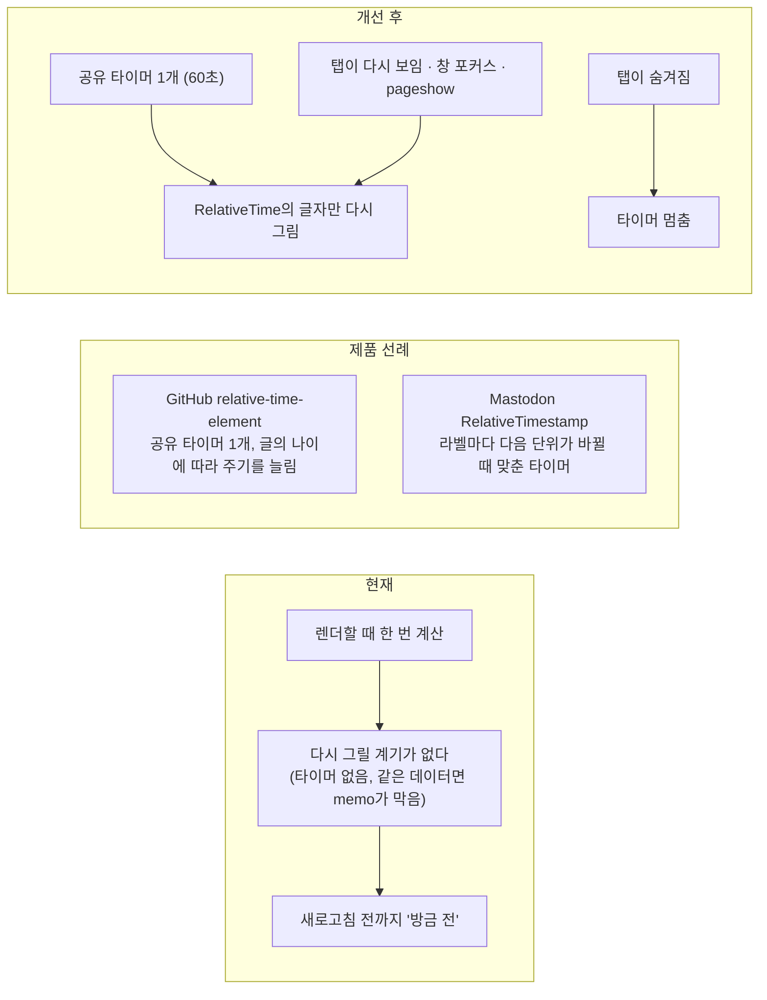

# 열어 둔 탭의 작성 시각 글자가 멈춰 있는 문제 — 1분마다, 그리고 돌아왔을 때 다시 계산

<!-- plan-result:start — 이 블록만 병합 뒤에도 고칠 수 있다(.claude/CLAUDE.md "계획과 PR 본문"). 아래는 승인된 계획 원문 -->

## 구현 결과

> #680 · 2026-11-24 대조 · 이탈 2 · 미구현 0 — 판정 근거(파일:줄)는 PR 본문 "계획 대비 구현"

- 이탈(문서가 이미 어긋나 있었음): 부품 분류표의 개수를 계획의 범용 53·합 58 대신 범용 54·합 59로 적음. #664에서 부품이 하나 늘 때 합계를 고치지 않아 표의 실제 행 수보다 하나 모자랐다. elements 34는 계획과 같다
- 이탈(측정 환경): 실제 Chrome 실측에서 "운영 API에는 조회 요청만 나간다"를 지키지 못했을 수 있음. 측정한 Chrome의 로컬 dev 출처에 로그인 표시가 남아 있어 페이지를 열 때 세션 갱신 요청이 나갔을 것으로 보이고, 요청 기록은 남기지 못했다. 조회 기록 요청이 나가는 상세 화면은 실제 Chrome 대신 모킹한 측정으로 바꿨다
- 계획에 없던 변경: `formatRelativeShort`가 분·시간·일 차이를 시간대 변환 없이 계산하게 바꿈. 댓글 200개 상세에서 틱 한 번이 계획의 기준(16.7ms)을 넘어 낸 보완이다(개발 빌드 Profiler 31.6~38.2ms → 2.4~3.1ms). 글자는 그대로이고 경계값 테스트 15개로 고정했다
- 계획에 없던 변경: 틱 비용을 운영 빌드에서도 쟀다(타이머가 돈 순간부터 글자가 바뀔 때까지). 댓글 200개가 모두 1시간 안에 쓰인 상세를 CPU 4배 감속으로 보면 보완 뒤에도 6번 중 5번이 16.7ms를 넘는다(5.9~26.2ms). 댓글이 며칠 전인 조건은 3.5~11.5ms다. 지금 운영에서 댓글이 가장 많은 글은 45개여서, 병합 전 보고에서 사용자가 코드를 더 바꾸지 않고 진행하기로 정했다(비교한 안: 화면에 보이는 글자만 갱신, `startTransition`)
- 계획에 없던 변경: `RelativeTime`의 `date`는 타입을 정하지 않고 받은 그대로 `format`에 넘긴다(글의 작성 시각이 비어 있을 수 있다). `formatRelativeShort`의 새 인자 이름은 `now` 대신 `baseTime`이다. 린트 규칙은 JSX 자식 자리뿐 아니라 속성 값과 `&&`·삼항·템플릿 문자열 한 겹까지 잡는다
- 한계: 실제 Chrome 실측의 마지막 구간(탭을 건드리지 않은 7분 32초 뒤 복귀)은 가시성 이벤트와 글자가 바뀐 순간의 DOM 기록이 없다. 기다리는 동안 측정 스펙 파일을 고친 것이 dev 서버의 페이지 새로고침을 일으켰다. 복귀 4ms 뒤 다시 계산한 것은 그 앞 구간에서 기록으로 확인했다
- 문서 동기화: 부품 분류표 문서의 계약 테스트 개수와 부품 수 재측정 줄, README의 분류표 개수(55 → 59)를 함께 맞춤

<!-- plan-result:end -->

> 글 카드·댓글·내 댓글 카드의 "방금 전 / 3분 전" 글자를 공용 부품 `RelativeTime` 하나로 옮긴다. 이 부품은 앱 전체에 타이머를 하나만 두고, 1분마다 그리고 탭으로 돌아왔을 때 **글자만** 다시 그린다.

## Context

**사용자 보고(2026-11-24)**: 방금 올린 글의 상세를 열어 둔 탭에 몇 시간 뒤 돌아왔는데 카드가 여전히 "방금 전"이었고, 새로고침해야 "18시간 전"이 됐다. 돌아왔을 때 맞는 시각이 보여야 한다.

**정해진 방향(사용자 선택, 질문 답)**: 타이머 하나로 1분마다 다시 계산하고, 탭이 숨겨진 동안은 멈추고, 다시 보이면 바로 다시 계산한다. 대상은 글 카드·댓글·내 댓글 카드다.

선례 출처: [github/relative-time-element](https://github.com/github/relative-time-element), [mastodon/mastodon](https://github.com/mastodon/mastodon)의 `RelativeTimestamp` 컴포넌트 — 둘 다 이 세션에서 소스를 직접 읽었다.

### 가설

라벨은 렌더하는 순간의 시계로 한 번 계산되고, 그 뒤로 다시 그리게 하는 계기가 앱에 없다.

### 재현 절차

- 자동: `MyCommentCard.test.tsx`에 실패하는 테스트를 먼저 쓴다(가짜 타이머). ① 작성 직후 "방금 전" → 5분 경과 → "5분 전"을 기대 ② 탭을 숨긴 채 18시간 경과 → 다시 보임 → "18시간 전"을 기대. 고치기 전의 실패 출력을 PR에 남긴다.
- 브라우저: 로컬 dev 서버의 피드에서 라벨을 읽고, 새로고침 없이 시간이 지난 뒤 같은 라벨을 다시 읽는다(검증 방법 참고).

### 근본 원인 (코드 추적으로 확인했다. 재현은 위 테스트로 남긴다)

| 사실 | 근거 |
| --- | --- |
| 라벨 세 곳이 모두 렌더 안에서 `DateUtil.formatRelativeShort(...)`를 부른다. 다른 사용처는 없다 | `PostCard.tsx:123`, `CommentItem.tsx:133`, `MyCommentCard.tsx:60` (전체 grep) |
| 그 함수는 부른 순간의 시계를 읽는다 | `src/shared/utils/date.util.ts:224-262` (`dayjs().tz()`는 230줄) |
| 앱에 "지금"을 알려 주는 타이머·구독이 없다 | `src/shared/hooks`, `src/shared/store` 목록 |
| 글 카드는 `memo`라 같은 `post` 객체면 다시 그리지 않는다 | `PostCard.tsx:54` |
| 탭 복귀 재조회가 와도 내용이 같으면 같은 객체를 돌려준다 | 설치본 `@tanstack/query-core` 5.107.1 `build/modern/utils.js:242-251` |

사용자가 겪은 그 순간에 재조회가 실제로 나갔는지는 확인하지 못했다. 나갔든 아니든 위 두 줄 때문에 라벨은 그대로였을 것이다(추적에 근거한 판단).

## 판단이 필요했던 항목

| 항목 | 결정 | 근거·기각한 대안 |
| --- | --- | --- |
| 갱신 방식 | 공유 타이머 1개(60초) + 돌아왔을 때 즉시 | 사용자 선택. 기각: 돌아왔을 때만(보고 있는 동안은 안 바뀐다), 라벨마다 타이머(Mastodon 방식 — 타이머가 라벨 수만큼 생긴다), 1초 주기(GitHub 방식의 1분 미만 구간 — 이 앱의 가장 작은 단위가 분이다) |
| 숨겨진 동안 | 타이머를 멈춘다 | 제 판단(두 선례의 소스에는 없는 부분). 안 보이는 글자를 다시 그릴 이유가 없고, 다시 보일 때 바로 계산하므로 결과가 같다 |
| 즉시 갱신 신호 | `visibilitychange`(보임) + 창 `focus` + `pageshow` | 제 판단. 절전에서 깨어났을 때처럼 `visibilitychange` 없이 시계만 건너뛰는 경우를 줄이려는 것이다(브라우저별 동작은 재지 않았다). 같은 세 이벤트를 듣는 선례: `src/shared/hooks/useAppVersionCheck.ts:94-96` |
| 다시 그리는 범위 | 글자만 그리는 작은 부품으로 분리 | 카드 전체에서 구독하면 1분마다 카드가 통째로 다시 그려진다. 부모가 다시 그려지지 않는 것을 테스트로 고정한다 |
| 부품의 자리와 분류 | `src/shared/ui/elements/RelativeTime.tsx`, 범용 | 세 위젯이 같은 레이어라 서로 import할 수 없다. 서비스 기능·앱 문구·라우터를 모르므로 범용이다(`docs/DESIGN-SYSTEM-PRINCIPLES.md` §3 두 질문). 한글 문구를 만드는 `DateUtil`은 경계 린트 허용 목록 밖이라 부품이 import하지 않고, 쓰는 쪽이 `format` 함수로 넘긴다(같은 문서 "글자를 밖에서 넣는다") |
| 구독 방식 | `useState` + `useEffect` | 설치본 react-dom 18.3.1은 외부 스토어 훅(`useSyncExternalStore`)의 변경을 동기 우선순위로 다시 그린다(`cjs/react-dom.development.js:16154-16160`, 직접 읽음). 목록이 전환 중일 때 스켈레톤이 번쩍이는 것을 같은 이유로 피한 선례가 있다(`usePostList.ts:169-173`). react.dev도 시각을 state에 두고 Effect의 `setInterval`로 갱신하는 예를 든다([Components and Hooks must be pure](https://react.dev/reference/rules/components-and-hooks-must-be-pure) — 조회 에이전트가 가져온 내용이고 원문을 직접 열지는 못했다) |
| "지금"을 넘기는 방식 | 부품이 "지금"을 state로 들고 `format(date, now)`로 넘긴다. `DateUtil.formatRelativeShort`에 선택 인자 `now`를 더한다 | 사용자 답(2026-11-24). 렌더가 시계를 직접 읽지 않게 된다(위 react.dev 문서의 규칙). 기존 호출은 그대로 동작한다. 기각: 틱을 "다시 그려라" 신호로만 쓰고 함수가 지금처럼 시계를 읽는다(시그니처는 그대로지만 렌더가 시계를 읽는 상태가 남는다) |
| 재발 방지 | JSX 안에서 `DateUtil.formatRelative*`를 직접 부르면 ESLint 오류 | 사용자 답(2026-11-24). 네 번째 사용처가 같은 버그를 다시 만들지 않게 한다. 변수에 담아 쓰는 우회는 못 잡는다. 기각: 린트 없이 부품과 문서만 |
| PR 구성 | 문서 실측(`docs/CACHE-STRATEGY.md` §11, 미커밋)은 따로 먼저 올리고, 이 수정은 새 워크트리 `fix-relative-time-refresh`의 새 PR | 사용자 답(2026-11-24). 실측 기록과 동작 수정은 서로 다른 단위다. 기각: 한 PR로 합친다(병합 승인 1번, squash 제목 하나에 묻힌다), 문서는 나중에(미커밋 수정이 워크트리에 남는다) |
| 요소 | 지금과 같은 ``, 화면 읽기 프로그램에 변경을 알리지 않는다 | 1분마다 바뀌는 글자를 매번 읽어 주면 방해다(`CharacterCount.tsx`가 같은 이유로 role을 주지 않는다). `<time>`으로 바꾸는 것은 요청 밖이라 하지 않는다 |

## 세부 계획

진행 순서는 둘이다. 병합은 두 PR 모두 사용자 승인을 따로 받는다.

1. **문서 PR(이 계획 밖의 작은 변경)** — 지금 워크트리 `docs-cache-strategy-focus-refetch`에서 `docs/CACHE-STRATEGY.md` 수정만 커밋해 PR을 연다. 본문은 `## 의도 대비 결과` 형식이고 `pnpm check:pr-body`를 돌린다. PR을 연 뒤 `ExitWorktree(keep)`으로 나온다.
2. **이 계획의 PR** — `git log origin/main..main`으로 미푸시 커밋을 확인하고 새 워크트리 `fix-relative-time-refresh`를 만들어(`test -s .env`, `pnpm install`) 아래 표를 구현한다.

| 위치 | 변경 내용 |
| --- | --- |
| `src/widgets/comment/my-comment-list/ui/MyCommentCard.test.tsx` | 실패하는 테스트 2개를 먼저 더한다(재현 절차 ①②). 기존 단언은 건드리지 않는다 |
| `src/shared/ui/elements/RelativeTime.tsx` (신규) | 속성 `date`, `format(date, now)`, `className`. 파일 안(내보내지 않음)에 공유 틱: 구독자 `Set`, `setInterval` 60초 1개, 첫 구독에 이벤트 리스너 등록, 구독자가 0이면 타이머·리스너 해제, 숨김이면 타이머 정지, 보임·`focus`·`pageshow`에 즉시 알림 후 재개. 지금 시각은 `dayjs().valueOf()`(선례 `useAppVersionCheck.ts:44`). 본뜬 파일: `CharacterCount.tsx` |
| `src/shared/ui/elements/RelativeTime.test.tsx` (신규) | 1분마다 다시 계산 / 숨겨진 동안 타이머 0개 / 다시 보이면 즉시 + 타이머 재개 / 라벨이 여럿이어도 타이머 1개 / 모두 언마운트되면 타이머·리스너 해제 / 틱이 와도 부모는 다시 그려지지 않는다 |
| `src/shared/ui/elements/RelativeTime.stories.tsx` (신규) | 본뜬 파일: `CharacterCount.stories.tsx` |
| `src/shared/ui/ApiContract.test.tsx` | 계약 표에 `RelativeTime` 한 줄(`CLASS_NAME_ONLY`) |
| `src/shared/utils/date.util.ts:224`, `date.util.test.ts` | `formatRelativeShort(date, now?)` — `now`가 없으면 지금처럼 현재 시각. `now`를 준 경우의 테스트를 더하고 기존 단언은 그대로 둔다 |
| `PostCard.tsx:123`, `CommentItem.tsx:132-134`, `MyCommentCard.tsx:60` | ``을 `<RelativeTime date={…} format={…} className="…" />`로 바꾼다. 클래스는 그대로 옮긴다 |
| `eslint.config.js` (날짜 금지 규칙 블록, 128줄 근처) | JSX 자식 자리에서 `DateUtil.formatRelative*`를 직접 부르면 `RelativeTime`을 쓰라는 오류 |
| `docs/DESIGN-SYSTEM-PRINCIPLES.md` §5 | elements 표에 한 줄, 개수(범용 52→53, elements 33→34, 합 57→58) |
| `CHANGELOG.md` `[Unreleased]` → `### Fixed` | 한 줄 요약 + 배경·구현 블록(`changelog-release` skill) |
| `docs/plans/2026-11-24-relative-time-refresh.md` (신규) | 이 계획 원문. `pnpm docs:index`로 색인을 다시 만든다 |

## 영향 범위

- **화면**: 글 카드(피드·상세), 댓글, 내 댓글 카드의 작성 시각 글자가 새로고침 없이 바뀐다. 문구와 모양은 그대로다. 주기가 60초라 최대 1분 늦을 수 있다.
- **깨질 수 있는 것**
  - 끝나지 않는 `setInterval`이 생긴다. `runAllTimers`로 타이머를 끝까지 돌리는 테스트와 만나면 멈추는데, `src`·`e2e`에 그런 호출이 없음을 grep으로 확인했다.
  - `formatRelativeShort`를 쓰는 곳은 세 위젯뿐이라 인자 추가의 영향이 거기서 끝난다.
  - 상대 시간 문구를 단언하는 컴포넌트 테스트·e2e는 지금 없다(grep).
- **바꾸면 안 되는 것**: 라벨 문구·클래스, `formatRelativeShort`의 기존 결과, React Query 재조회 동작, 데이터 계약.
- **배포**: FE만 바뀐다. 순서 제약 없음.

## 검증 방법

완료 조건은 아래가 모두 증거로 확인된 상태다.

| 끝 상태 | 증명 |
| --- | --- |
| 고치기 전에는 실패, 고친 뒤 통과 | `MyCommentCard.test.tsx` 새 테스트 2개의 고치기 전 실패 출력과 고친 뒤 통과 출력 |
| 타이머 1개, 숨김 중 0개, 해제, 부모 미렌더 | `RelativeTime.test.tsx`. 새 테스트는 구현을 일부러 깨서(보임 때 알림 제거) 실패하는지 한 번 확인한다 |
| 머지 게이트 | `pnpm check`, `pnpm test`, `pnpm check:docs`, `pnpm test:e2e`(`caffeinate -dims`), PR CI |
| 보는 동안 바뀐다 | Playwright 녹화(`browser-verification` skill): 시계를 설치하고(`page.clock`) 피드·상세에서 라벨을 읽은 뒤 시계를 앞으로 돌려, 새로고침 없이 라벨이 바뀌는 화면 |
| 돌아왔을 때 바로 바뀐다 | 실제 Chrome(Claude in Chrome), 로컬 dev 서버: 배경 탭으로 두었다가 돌아와 `visibilitychange` 시각과 라벨이 바뀐 시각을 잰다. 분 단위 라벨인 글이 없으면 페이지 시계를 앞으로 밀어 같은 절차를 돌고, 실제로 기다린 것이 아님을 보고에 적는다 |
| 1분마다의 비용 | 임시로 `<Profiler>`를 감싸 틱 한 번의 커밋 시간(`actualDuration`)을 피드와 댓글 많은 상세에서 재고 되돌린다(커밋하지 않는다). 판정 기준은 제가 정한 값이다: 60Hz 한 프레임(16.7ms) 이하. 넘으면 병합 전에 보고하고 보완안을 낸다 |
| 린트 규칙이 실제로 막는다 | 추적 파일을 잠깐 고쳐 lint-staged와 같은 명령으로 오류를 확인하고 되돌린다 |

- 내 댓글 카드는 로그인 화면이라 브라우저 확인에서 빼고 테스트로 확인한다.
- dev 서버는 다른 워크트리에서 떠 있지 않은지 먼저 확인한다. 운영 API에는 조회 요청만 나간다.
- PR을 열기 전에 `plan-verifier`로 계획과 diff를 대조한다.

## 남은 것

- 사람이 손으로 탭·창을 바꾸는 경우와 모바일 기기의 가시성 이벤트는 이번에도 재지 못한다(`docs/CACHE-STRATEGY.md` §11과 같은 한계).
- 절전에서 깨어난 뒤 세 이벤트가 하나도 오지 않으면 다음 틱(최대 60초)까지 옛 글자가 남는다.
- `DateUtil.formatRelative`·`formatBoard`는 지금 쓰는 곳이 없어 대상이 아니다.
