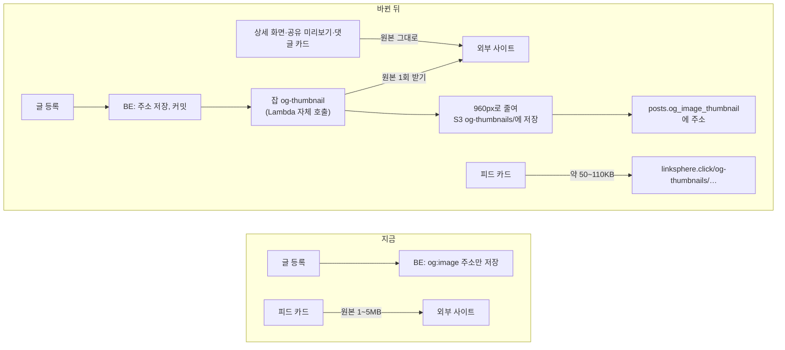
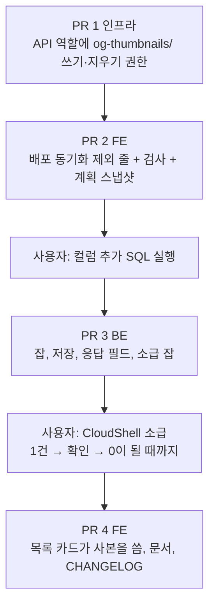

# 피드 외부 썸네일 줄이기: 글을 쓸 때 서버가 작은 사본을 만들어 둔다

<!-- plan-result:start — 이 블록만 병합 뒤에도 고칠 수 있다(.claude/CLAUDE.md "계획과 PR 본문"). 아래는 승인된 계획 원문 -->

## 구현 결과

> #689 · 2026-11-25 대조 · 이탈 0 · 미구현 0 — 판정 근거(파일:줄)는 PR 본문 "계획 대비 구현"

- 대조 범위: PR 2(FE 배포 동기화 제외 줄, 그 검사, DEPLOY.md 문장, 계획 스냅샷). PR 3(BE)·PR 4(FE)의 결과는 그 PR에서 이 블록에 덧붙인다
- PR 1(인프라 저장소 infra #47, 2026-11-25 병합·배포): API 역할에 `og-thumbnails/*` 쓰기·지우기 인라인 정책 하나. CI "운영과의 차이"에 교체가 없었고, 배포 뒤 운영 API 역할에 정책이 붙은 것을 조회로 확인했다(대조 에이전트 범위 밖)
- 계획에 없던 변경: `docs/FCM-PUSH-NOTIFICATION.md`의 배포 발췌 주석이 같은 동기화의 제외 목록을 나열해, 거기에도 `og-thumbnails`를 더했다
- 뒤 PR로 넘긴 약속
  - PR 4: `docs/DEPLOY.md`의 "제외만 먼저 넣었다"는 문장을 지금 구조로 고친다(계획 PR 4 표에 DEPLOY.md가 없다)
  - PR 3·4: `docs/CACHE-STRATEGY.md`의 캐시 헤더 표에 BE가 정하는 `og-thumbnails/` 헤더를 더한다
  - 소급: 첫 1건의 결과(사본 파일)를 사용자에게 보여 드린 뒤 이어 간다(2026-11-25 대화에서 말함. 계획에는 "제가 결과 확인"까지만 있다)
  - PR 4: `/post` Performance가 95에서 85로 내려간 원인을 그 PR의 Lighthouse로 다시 본다(2026-11-25 대화에서 말함). #688 측정 5회 모두 LCP 요소는 토스 PNG가 아니라 YouTube 썸네일이었고, 점수 85인 3회만 시뮬레이션 LCP가 약 1.2초 길었다(원인 미확정)

> #690 · 2026-11-26 대조 · 이탈 2 · 미구현 0 — PR 4(FE)와 그 앞의 기존 글 소급. 판정 근거(파일:줄)는 PR 본문 "계획 대비 구현"

- 범위: 목록 카드가 사본을 쓰는 FE 변경, 그 문서와 CHANGELOG, PR 3 배포 뒤 사용자가 실행한 기존 글 소급. PR 3(BE #230)의 대조 결과는 BE 저장소의 같은 계획 파일 결과 블록에 있다(소급 전에 썼다)
- 이탈(구현 중 판단): 상세가 원본을 고르는 새 선택 속성을 더하지 않고 기존 `isDetail`로 골랐다. 이 속성은 상세 화면만 넘기고 있어 새 속성이 필요 없었다. 그래서 `PostDetailPage.tsx`는 바꾸지 않았다
- 이탈(절차): 계획은 소급의 매 호출 뒤 읽기 전용 계정으로 진행 수를 확인하기로 했다. 실제로는 첫 1건의 사본을 보여 드린 뒤, 50건씩 최대 15번 부르는 반복 명령 하나를 드리고 끝난 뒤에 한 번 셌다. 한 번에 끝내려고 한 것이고, 명령을 드릴 때 가정으로 알렸다
- 소급과 배포 뒤 새 글의 결과는 `PERFORMANCE.md` "피드 썸네일 사본"에 있다. 314개 중 293개에 사본이 생겼고, 못 만든 21개(이유·사이트별 수는 그 절의 표)는 원본을 계속 받는다. 배포 뒤 새 글 3개에도 사본이 생겼고, 사람 글 1건의 등록에 더해진 발행은 약 51ms였다
- 계획에 없던 변경(문서): 앞 블록과 BE 블록이 이 PR로 넘긴 문서를 고쳤다. `DEPLOY.md`의 "제외만 먼저 넣었다" 문장을 지금 구조로, `CACHE-STRATEGY.md`에 `og-thumbnails/` 수명과 BE가 다는 캐시 헤더, `SYSTEM-ARCHITECTURE.md`에 Lambda → S3 간선, `SERVICE-GLOSSARY.md`에 잡 두 개와 S3·self-invoke 설명, `ONBOARDING.md` 기능 지도에 한 줄을 더했다. `PERFORMANCE.md`의 CI 흔들림 설명도, 사본은 같은 출처라 `Set-Cookie`가 없다는 내용으로 고쳤다
- 계획에 없던 변경: CHANGELOG `Notes`에 BE 의존과 배포 순서 줄을 더했다
- 대조 뒤 보완함: 이 PR의 Lighthouse CI에서 `/post` 이미지 합계가 1,730,230에서 약 595,700바이트로 줄어 기준 안에 들었다. 두 측정 사이에 첫 화면 글 3개가 바뀌어, 같은 화면을 원본과 사본으로 받았을 때도 따로 셌다(#690 화면은 원본이면 약 1,196,900, 사본이면 595,730). `PERFORMANCE.md`에 전·후 값을 적었다. 앞 블록의 Performance 85는 5회 중 첫 실행에서 한 번 나왔는데, LCP가 아니라 TBT·Speed Index가 깎은 것이라 #688과 모양이 달랐다(원인 미확인)
- 계획에 없던 발견: 원본이 이미 작으면 사본이 더 클 수 있다. 첫 화면 썸네일 10장 중 5장(YouTube 480×360 4장 약 +45%, 위시켓 PNG 1장)이 그랬다. 계획의 크기 규칙은 픽셀만 보고 바이트는 보지 않았다
- 남은 것
  - 사본이 원본보다 클 때 어떻게 할지 정한다(사용자 결정 전). BE 사본 만들기를 고치는 일이라 이 PR 밖이다 → 보완함(2026-11-26 사용자 결정, BE #231·FE #691): BE는 줄인 결과가 원본보다 작을 때만 사본을 두고, 원본보다 작지 않던 사본 149개는 사용자가 비운 뒤 소급을 다시 돌렸다. 정리 뒤 사본이 원본보다 큰 글은 0개, 같은 305개 글의 피드 카드 이미지 합계는 9.5% 줄었다(`PERFORMANCE.md` "원본보다 큰 사본 정리"). 계획은 BE `docs/plans/2026-11-26-og-thumbnail-not-smaller.md`
  - 병합 배포 뒤 운영 피드가 사본을, 상세가 원본을 그리는지 본다. 사본이 생긴 뒤 첫 FE 배포라 그 배포 뒤에도 사본이 200인지 본다 → 확인함(2026-11-26, 배포 run 45758122272 뒤): 피드 첫 화면 7장 모두 `/og-thumbnails/` 사본, 배포된 `PostCard` 청크의 상세는 원본 분기, 사본 GET 200(`x-cache: Miss`)

<!-- plan-result:end -->

> 피드 카드의 미리보기 이미지를 원본 사이트에서 그대로 받던 것을, 글을 등록할 때 서버가 한 번 받아 가로 960px로 줄인 사본(우리 S3, 사이트와 같은 주소)으로 바꾼다. 상세 화면과 원본 주소는 그대로다. 인프라·FE·BE 세 저장소에 PR 4개, 사용자가 실행하는 운영 작업 2개(컬럼 추가 SQL, 기존 글 소급)다.

## Context

### 계기와 이전 기록

- **계기**: #688(Lighthouse 보고 수정)로 PR 댓글의 점수 표가 다시 나오면서, `/post`의 이미지 합계(1,652,851~1,730,067바이트)가 경고 기준 1,000,000(`lighthouserc.cjs:72`)을 넘는 것이 보였다. 87%가 피드 첫 화면 글의 외부 PNG 한 장(`static.toss.im`, 1,443,890바이트)이다.
- **2026-09-26 보류**(`docs/plans/2026-09-25-lighthouse-perf.md:164-181`): "필요성부터 재검토". 다시 볼 때 확인할 것 네 가지를 남겼다. 이번에 답한 결과는 아래 "09-26 확인 항목".
- **2026-10-27 보류**(`docs/plans/2026-10-27-first-load-js.md:11`, `:198`): 사용자 조건은 무료 플랜 유지, 외부 서비스 지양, 저장 용량 한계다.
- **2026-11-25 사용자 결정**: 이번 계획의 방식·저장 위치·크기·운영 작업을 질문으로 정했다(아래 결정 표).

### 지금 구조

| 지점 | 사실 | 근거 | 확인 수준 |
| --- | --- | --- | --- |
| 이미지 주소 | BE는 og:image 주소 문자열만 `posts.og_image`에 저장한다. 줄이거나 옮기는 곳이 없다 | BE `TablePost.kt:33`, `PostService.kt:132` | 직접 읽음 |
| 그리는 곳 | `LinkThumbnail`이 그 주소를 ``로 바로 받는다. 16:9 자리, `object-cover`, 첫 행만 우선 로딩 | `packages/ui/src/atoms/link-thumbnail.tsx:61`, `:69-85` | 직접 읽음 |
| 원본 주소를 쓰는 곳 | 피드·상세 응답, 공유 링크 미리보기(봇용 og 태그), 댓글의 글 링크 카드, 링크 미리보기 | BE `PostResponseAssembler.kt:106`, `PostOgService.kt:50`, `CommentService.kt:519`, `PostService.kt:413` | grep 후 직접 읽음 |
| 카드 크기 | 목록 카드는 최소 292px·최대 3열, 상세는 최대 896px(`max-w-4xl`) | `post-card-grid.const.ts:27-28`, `PostDetailPage.tsx:20` | 직접 읽음 |
| 뒷일 처리 | 커밋 뒤 리스너가 `JobPublisher.publish`로 잡을 맡기고, 운영은 Lambda 자체 호출이다 | BE `PostAIService.kt:27-30`, `JobPublisher.kt`, `JobHandler.kt` | 직접 읽음 |
| 외부 연결 방어 | 리다이렉트마다 `SafeUrlValidator`로 재검증한다. 본문 상한 4MB이고 넘으면 조용히 잘린다 | BE `UrlMetadataExtractor.kt` `safeConnect` | 직접 읽음 |
| 스키마 변경 | `ddl-auto: none`. SQL 파일을 BE 배포 전에 사용자가 실행한다 | BE `application.yml:38`, `docs/DEPLOY.md:539`, `:715` | 직접 읽음 |
| FE 배포 | 버킷 루트를 `aws s3 sync --delete`로 맞추고 몇 경로만 제외한다. 옛 파일 정리 스크립트는 `assets/`·`fonts/`만 지운다 | `.github/workflows/deploy.yml:160-166`, `scripts/lib/prune-assets.js:13` | 직접 읽음 |
| CloudFront 경로 | 확장자가 있는 경로는 SPA 대체 함수가 손대지 않고 S3로 보낸다 | `infra/cloudfront-functions/spa-fallback.js`의 `hasExtension` 분기 | 직접 읽음 |
| CSP | `img-src 'self' data: blob: https:` | `scripts/inject-csp.js:50` | 직접 읽음 |
| API 역할 권한 | 인프라 CDK가 인라인 정책으로 관리한다. 병합하면 자동 배포(130~190초) | 인프라 `lib/baseline-stack.ts:223-247`, `README.md` "설정 바꾸기" | 직접 읽음 |
| 로컬 AWS 키 | 조회 전용. 쓰기와 Lambda 호출은 CloudShell이나 CI | 인프라 `README.md` "쓰기가 필요하면" 표 | 직접 읽음 |
| Lambda 동시 실행 | 계정 한도 10(API와 공유) | `aws lambda get-account-settings`(2026-11-25) | 직접 조회 |
| JDK 이미지 쓰기 형식 | bmp, gif, jpeg, png, tiff, wbmp. WebP 없음 | 로컬 JDK 21에서 `ImageIO.getWriterFormatNames()` 실행. 운영은 java17이고 17에서 직접 돌리지는 않았다 | 직접 실행 |

### 운영 실측 (2026-11-25)

측정: 읽기 전용 계정으로 공개 글의 `og_image`를 뽑고, YouTube를 뺀 주소마다 GET을 1회 보내 바이트·형식·픽셀을 쟀다(동시 4개).

| 항목 | 값 |
| --- | --- |
| 글 / 이미지 있는 글 / 공개 글 | 426 / 314 / 398 |
| 공개 글 이미지 | 290개, 그중 YouTube 144개 |
| YouTube 밖 137개(받기 성공) | 중앙값 100KB, 상위 25% 342KB, 상위 10% 856KB, 최대 4,818KB |
| 500KB·1MB 초과 | 23개·13개. 500KB 초과는 사이트 10곳(위시켓 11개, 토스 3개 등) |
| 형식 | PNG 108, JPEG 26, WebP 3. 가로 1,200px 이상 90개 |
| 받기 실패 13개 | 404 4개, 415 3개, GitHub 429 5개(측정 요청이 제한에 걸린 것으로 보임), 403 1개 |

500KB를 넘는 22개를 macOS `sips`로 줄였을 때(JPEG 품질 80):

| | 합계 | 원본 대비 | 한 장 평균 |
| --- | --- | --- | --- |
| 원본 | 31.8MB | 100% | 약 1.4MB |
| 가로 960px | 2.36MB | 7.4% | 약 107KB |
| 가로 720px | 1.52MB | 4.8% | 70KB |

### 09-26 확인 항목에 대한 답

| 항목 | 답 |
| --- | --- |
| `fetchpriority`만으로 충분한가 | 우선순위는 #421에서 넣었다. 남은 것은 우선순위가 아니라 바이트다(한 장 1.4MB) |
| 특정 원본에 국한되는가 | 아니다. 500KB 초과 23개가 사이트 10곳에서 나온다. 도메인 예외로는 못 막는다 |
| Supabase 비용(원본 이미지 수 기준 과금) | 그 과금은 Supabase 이미지 변환(Pro 전용)이다. 이 계획은 변환을 쓰지 않고 우리가 줄인다 |
| BE 작업 규모 | 잡 하나(받기·줄이기·저장), 컬럼 하나, 소급 잡 하나. 아래 세부 계획 |

### 업계 선례

| 방식 | 사례 | 근거(직접 읽음) |
| --- | --- | --- |
| 쓸 때 받아 줄여 저장 | Mastodon 미리보기 카드 | [`preview_card.rb`](https://github.com/mastodon/mastodon/blob/main/app/models/preview_card.rb): `LIMIT = 8.megabytes`, `pixels: 230_400, # 640x360px`, `has_attached_file :image`(내려받아 저장) |
| 볼 때 프록시 | GitHub camo | [camo README](https://github.com/atmos/camo): 기본 상한 5,242,880바이트, 줄이지 않음, _"proxy URLs are authenticated with hmac"_ |

## 판단이 필요했던 항목

### 결정 표

| 항목 | 결정 | 근거·기각한 대안 |
| --- | --- | --- |
| 방식 | **결정(사용자, 2026-11-25)**: 글을 쓸 때 사본을 만들어 저장 | Mastodon 방식. 기각 1: 볼 때 줄이고 CDN에 캐시(camo 방식). Lambda 동시 실행 10칸을 API와 나눠 써서 피드 한 화면의 캐시 미스가 다른 요청을 막을 수 있다. 방문이 적어 캐시가 자주 빈다(_"If a file in an edge location isn't frequently requested, CloudFront might evict the file"_, [CloudFront 문서](https://docs.aws.amazon.com/AmazonCloudFront/latest/DeveloperGuide/Expiration.html)). 공개 프록시를 막을 서명이 필요하고, CloudFront를 콘솔에서 손으로 바꿔야 한다. 기각 2: 다시 보류(큰 이미지 글이 위에 있는 동안 모바일에서 1MB대를 받는다) |
| 저장 위치 | **결정(사용자, 2026-11-25)**: 우리 S3(FE 버킷의 `og-thumbnails/`)에 두고 CloudFront로 사이트와 같은 주소에서 낸다 | 새 연결이 없다. [CloudFront 무료 요금제](https://aws.amazon.com/cloudfront/pricing/)는 _"No overage charges"_ 이고, 월 100GB·요청 100만 건·S3 저장 5GB 크레딧을 포함한다. 기각: Supabase 저장소(BE에 삭제·고아 정리가 이미 있지만 다른 주소이고, [무료 전송량](https://supabase.com/docs/guides/platform/manage-your-usage/egress) 5GB+5GB를 DB와 같은 프로젝트에서 나눠 쓴다) |
| 크기 | **결정(사용자, 2026-11-25)**: 가로 960px | 배율 3배 휴대폰의 카드가 실제 1,062px이고, 960px이면 90%를 채운다. 실제 크기 비교 화면을 보고 골랐다. 기각: 720px(원본의 4.8%로 더 작지만 작은 글씨가 조금 흐리다) |
| 운영 작업 | **결정(사용자, 2026-11-25)**: 컬럼 추가 SQL과 기존 글 소급을 모두 한다. 실행은 사용자가 한다 | 소급하지 않으면 기존 글은 원본을 계속 받는다. 기각: SQL만 하고 새 글부터 |
| 원본 컬럼 | **제 판단**: `og_image`는 그대로 두고 새 컬럼 `og_image_thumbnail`(null 허용)을 더한다 | 공유 미리보기·댓글 카드·링크 미리보기가 원본 주소를 쓴다(위 표). null이면 FE가 원본을 쓴다 |
| 쓰는 곳 | **제 판단**: 목록 카드(피드·북마크 등 `PostCard`의 목록 쓰임)만 사본을 쓴다. 상세 화면·댓글 카드·글쓰기 미리보기는 원본 그대로 | 상세는 최대 896px로 그려져 960px 사본은 배율 2배 화면에서 흐려진다. 화면이 바뀌지 않는 쪽을 기본으로 둔다 |
| 크기 규칙 | **제 판단**: 960×540을 덮는 최소 크기로 줄이고(`max(960/가로, 540/세로)` 배율), 원본이 작으면 키우지 않는다 | 카드가 16:9 가운데를 잘라 그리므로 보이는 영역은 960×540 이상이 남는다. Mastodon도 픽셀 수로 제한한다 |
| 형식 | **제 판단**: JPEG 품질 80. 실제로 투명한 픽셀이 있으면 PNG로 줄인다 | JDK 기본 쓰기 형식에 WebP가 없다. 투명 PNG를 JPEG로 바꾸면 배경색이 생겨 다크 모드 화면이 바뀐다(500KB 초과 23개 중 4개가 투명 채널을 가졌다) |
| 받기 상한 | **제 판단**: 원본 8MB, 픽셀 수 5,000만. 넘거나 못 읽는 형식(WebP·일부 CMYK JPEG)이면 사본을 만들지 않는다 | 8MB는 Mastodon `LIMIT`과 같고 실측 최대 4.8MB를 덮는다. 픽셀 상한은 압축 폭탄(작은 파일이 거대한 그림으로 풀리는 것)을 막는다. 5,000만 픽셀이면 메모리 약 200MB로, Lambda 2,048MB 안이다 |
| 받는 방법 | **제 판단**: `safeConnect`의 리다이렉트별 재검증을 그대로 쓰고, 이미지용 상한과 `Content-Type: image/*` 검사만 따로 둔다 | `safeConnect`의 4MB 상한은 넘으면 조용히 잘려(같은 함수 주석) 이미지가 깨진다 |
| 저장 이름·캐시 | **제 판단**: `og-thumbnails/<글 id>-<원본 주소 해시 앞 12자>.<jpg 또는 png>`, `Cache-Control: public, max-age=31536000, immutable`. 컬럼에는 절대 주소를 넣는다 | 주소가 바뀌면 이름도 바뀌어 옛 캐시를 볼 일이 없다. 절대 주소라야 로컬 dev(같은 주소에 S3가 없다)에서도 보인다 |
| 언제 만드나 | **제 판단**: 글 등록, 글 주소 변경, 빈 og:image를 채운 수정 뒤 커밋되면 잡 `og-thumbnail`을 발행한다. 저장 직전에 글의 `og_image`가 그새 바뀌었으면 버린다 | AI 분석과 같은 커밋 뒤 발행 경로다(`PostAIService.kt:27-30`). AI 잡은 본문이 있을 때만 발행돼 이 잡은 따로 둔다 |
| 지우기 | **제 판단**: 글 삭제와 주소 변경 때 커밋 뒤 옛 사본을 지우고, 실패하면 로그만 남긴다 | `SupabaseStorageService.deleteObjectsByPublicUrls`의 "본 삭제를 막지 않는다" 선례 |
| 소급 실행 | **제 판단**: Lambda 잡 `og-thumbnail-backfill`이 한 번 호출에 글을 하나씩 차례로, 90초 마감까지 처리하고 남은 수를 돌려준다. 사용자가 CloudShell에서 0이 될 때까지 다시 부른다. 첫 호출은 1건만 | 로컬 키는 S3에 못 쓴다. 차례로 처리하면 동시 실행 10칸 중 1칸만 쓴다. 90초 마감은 `BatchJobLimits.DEADLINE_MILLIS` 선례 |
| 개발 환경 | **제 판단**: 저장 구현을 설정으로 고른다(운영은 S3, 로컬·테스트는 저장하지 않음) | `app.job.publisher`가 발행 구현을 고르는 선례(`JobPublisher.kt` 주석) |
| 배포 제외 검사 | **제 판단**: FE 배포의 `--delete` 동기화가 `og-thumbnails/*`를 빼는지 FE 테스트로 고정한다 | 빠지면 FE 배포 때마다 사본이 전부 지워진다. 재발 방지는 문서보다 검사로(공통 지침 "범위") |
| Lighthouse 예산 | **제 판단**: 1,000,000 그대로 | 줄인 사본으로 기준 안에 들어와야 하는 값이다 |
| CHANGELOG | **제 판단**: FE PR 4에 `perf` 항목, BE PR에 BE 규칙대로 | 사용자가 느끼는 로딩이 바뀐다 |

### 뒤집힌 전제

| 발견 | 그래서 바뀐 것 |
| --- | --- |
| 09-26에는 "특정 원본에 국한되면 도메인 예외로 충분할 수 있다"고 봤다 | 사이트 10곳이라 예외 목록으로는 못 막는다. 일반적인 줄이기로 간다 |
| `docs/PERFORMANCE.md:4`가 `DECISIONS.md`의 "og 이미지 파이프라인 검토" 항목을 가리키지만, 그런 항목이 없다 | FE PR 4에서 이번 결정 항목을 새로 쓰고 그 문장이 가리키게 고친다 |
| Lambda 동시 실행 한도가 계정 전체 10이다 | 소급을 병렬 호출이 아니라 한 호출 안의 순차 처리로 한다 |
| FE 배포가 버킷 루트를 `--delete`로 맞춘다 | 제외 줄과 검사를 BE보다 먼저 병합한다(PR 순서) |
| 업계 선례 가운데 Bluesky·Lemmy는 원문을 읽지 못했다(404 또는 해당 설정 없음) | 근거에서 뺐다 |

### 위험 관리

| 위험 | 막는 방법 |
| --- | --- |
| FE 배포가 사본을 지운다 | 제외 줄 + FE 테스트를 BE보다 먼저 병합. 병합 뒤 FE 배포 1회가 지난 다음 사본 하나에 GET 200 확인 |
| 외부 사이트가 도쿄 Lambda IP를 막는다(BE `docs/AI-ASYNC-PROCESSING.md` §5.10의 크롤링 차단 사례) | 사본 없이 원본을 쓴다(지금과 같음). 소급 뒤 사이트별 실패 수를 보고한다 |
| 외부 주소로 내부망을 찌르는 요청(SSRF) | 리다이렉트마다 `SafeUrlValidator` 재검증, 이미지 형식 검사, 바이트·픽셀 상한, 시간 제한 |
| Lambda에서 Java 이미지 처리(AWT)가 안 돈다 | 운영 소급 첫 호출을 1건으로 해 결과 파일을 직접 받아 본다. 안 되면 거기서 멈추고 보고한다 |
| 글 등록 응답이 느려진다(발행 호출이 하나 늘어난다) | 운영 로그의 등록 구간값을 배포 전후로 비교한다 |
| 공개 버킷에 비공개 글의 사본이 생긴다 | 원본 주소도 이미 공개 주소다. 이름에 글 id와 해시가 들어가 추측할 수 없다. 새로 드러나는 정보는 없다고 본다 |
| 받은 파일을 그대로 내보내 스크립트가 섞인다 | 항상 다시 인코딩한 JPEG·PNG만 올리고 `Content-Type`을 직접 정한다 |

## 세부 계획

모든 PR은 병합 전에 따로 승인을 받는다(squash). 데이터 계약은 BE가 먼저다. 새 응답 필드는 null 허용이라, PR 3 배포와 PR 4 사이에는 FE가 필드를 모른 채 원본을 쓴다.

### PR 1: 인프라 — API 역할 권한

| 위치 | 변경 내용 |
| --- | --- |
| 인프라 `lib/baseline-stack.ts`(API 역할 `policies`) | 인라인 정책을 더한다: `s3:PutObject`·`s3:DeleteObject`, 리소스 `${feBucketArn}/og-thumbnails/*`(같은 파일 `:107`의 변수) |
| 인프라 테스트(`test/guards.test.ts` 등) | 고정한 값이 있으면 함께 고친다. CI "운영과의 차이"에 교체(`requires replacement`)가 없는지 본다 |

### PR 2: FE — 배포가 사본을 지우지 않게

| 위치 | 변경 내용 |
| --- | --- |
| `.github/workflows/deploy.yml:160-166` | 루트 `sync --delete`에 `--exclude "og-thumbnails/*"`를 더한다 |
| `src/test/scripts/`(신규 테스트) | `deploy.yml`의 `--delete`가 붙은 모든 `s3 sync`가 `og-thumbnails/*`를 빼는지 확인한다. 제외 줄을 지우면 실패하는지 한 번 확인한다 |
| `docs/DEPLOY.md` | 버킷의 `og-thumbnails/`는 BE가 쓰는 곳이라 배포가 건드리지 않는다는 문장 |
| `docs/plans/2026-11-25-og-thumbnail.md`(신규), `docs/PLANS-INDEX.md` | 이 계획의 스냅샷, `pnpm docs:index` |

### PR 3: BE — 사본 만들기

| 위치 | 변경 내용 |
| --- | --- |
| `src/main/resources/sql/`(신규 SQL 파일) | `alter table posts add column og_image_thumbnail text` |
| `TablePost.kt` | `ogImageThumbnail` 필드 |
| `domain/post/`(신규 썸네일 서비스) | 이미지 받기(안전 연결, 상한), 읽기(헤더로 픽셀 수 먼저 확인), 줄이기, 인코딩(투명이면 PNG), 저장, 컬럼 갱신(원본 주소가 그대로일 때만) |
| `infra/aws/`(신규 S3 저장 구현) + 저장 인터페이스 | `PutObject`(형식, 캐시 헤더)·`DeleteObject`. 설정으로 S3/건너뛰기를 고른다. `build.gradle.kts`에 `software.amazon.awssdk:s3`(기존 `lambda`·`ses`와 같은 제외 설정) |
| `application.yml` | 버킷 이름, 접두사, 공개 기준 주소(`https://linksphere.click/og-thumbnails/`), 저장 구현 선택. 비밀값 없음 |
| `PostService.kt:108-160`, `:318-346`, `:391-398` + 새 커밋 뒤 리스너 | 등록·주소 변경·빈 og:image 채움 뒤 잡 발행, 주소 변경·삭제 때 옛 사본 지우기와 컬럼 비우기 |
| 잡 처리기 2개(신규) | `og-thumbnail`(글 하나), `og-thumbnail-backfill`(사본 없는 글을 차례로, 건수 상한·90초 마감, 남은 수 반환) |
| `PostResponseAssembler.kt:106` 근처, 응답 DTO | `ogImageThumbnail`(null 허용) |
| 테스트 | 아래 "검증 방법"의 BE 항목. 실패하는 테스트를 먼저 쓴다 |
| BE 문서(`docs/BE-ARCHITECTURE.md` §1 잡 목록, `docs/AI-ASYNC-PROCESSING.md` 또는 새 기능 문서, `docs/DEPLOY.md`) | 잡 이름, 흐름, SQL 순서와 소급 명령. 위치는 구현 때 BE 문서 규칙을 읽고 정한다 |

### 사용자 운영 작업 (PR 3 전후)

| 시점 | 할 일 | 제가 준비하는 것 |
| --- | --- | --- |
| PR 3 병합 전 | 컬럼 추가 SQL 실행 | SQL 파일과 실행 명령, 실행 뒤 제가 읽기 전용 계정으로 컬럼을 확인 |
| PR 3 배포 뒤 | CloudShell에서 `og-thumbnail-backfill` 호출. 첫 호출은 1건 → 제가 결과 확인 → 남은 수가 0이 될 때까지 반복 | 붙여 넣을 `aws lambda invoke` 명령, 매 호출 뒤 읽기 전용 계정으로 진행 수 확인 |

### PR 4: FE — 목록 카드가 사본을 쓴다

| 위치 | 변경 내용 |
| --- | --- |
| `src/shared/api/generated/openapi.json`, `openapi.gen.ts` | `pnpm codegen:fetch` → `pnpm codegen` |
| `src/widgets/post/post-card/ui/PostCard.tsx:284-288` | 목록 쓰임이면 `ogImageThumbnail ?? ogImage`, 상세 쓰임이면 `ogImage`. 상세가 원본을 고르게 하는 선택 속성을 더한다(기존 속성은 그대로) |
| `src/pages/post/PostDetailPage.tsx` | 그 속성으로 원본을 고른다 |
| `PostCard` 테스트, MSW 픽스처·e2e 목 | 사본이 있으면 사본, 없으면 원본, 상세는 원본. 고치기 전에 실패하는 테스트를 먼저 쓴다 |
| `docs/PERFORMANCE.md` | og 썸네일 절과 `:907` 원인 설명을 지금 구조로, `:4`의 결정 기록 링크 |
| `docs/DECISIONS.md` | 이번 결정 항목: 비교한 세 방식, 두 저장 위치, 크기, 기각 이유, 2026-11-25 사용자 결정 |
| `CHANGELOG.md` | `[Unreleased]` `perf` 항목 |
| 계획 결과 블록, `docs/PLANS-INDEX.md` | plan-verifier 대조 초안, `pnpm docs:index` |

## 영향 범위

- **화면**: 목록 카드의 썸네일이 960px 사본으로 바뀐다(실제 크기 비교로 사용자가 골랐다). 상세 화면, 공유 미리보기, 댓글 카드, 글쓰기 미리보기는 그대로다.
- **데이터 계약**: 응답에 `ogImageThumbnail`(null 허용)이 더해진다. 순서는 SQL → BE → FE다. SQL과 BE 사이에는 옛 코드가 새 컬럼을 무시하고, BE와 FE 사이에는 옛 FE가 새 필드를 무시한다.
- **데이터 생성·수정·삭제**
  - 생성: 등록 때 잡 1개.
  - 수정: 주소 변경 때 옛 사본 지우기 + 새 잡.
  - 삭제: 글 삭제 때 사본 지우기.
  - 누락: 받기 실패면 null이고 원본을 쓴다.
  - 중복: 같은 글의 잡이 두 번 돌아도 이름이 같아 덮어쓴다.
  - 동시 요청: 저장 직전에 원본 주소를 비교해 늦게 온 옛 잡을 버린다.
- **공유 코드**: `LinkThumbnail`(패키지)은 바꾸지 않는다. `PostCard`의 사용처는 구현 때 `pnpm graph:focus`로 다시 뽑는다.
- **비용**: 모두 무료 범위 안이다. S3 저장은 수십 MB로 5GB 크레딧 안, CloudFront 요청·전송은 기존 한도 안, Lambda 잡은 글당 1회다.
- **이전 동작을 단정하는 것**: `PostCard`가 `ogImage`를 그린다고 단정하는 테스트가 있으면 요구가 바뀐 경우라 PR 본문에 적는다. `docs/PERFORMANCE.md`의 "외부 이미지를 바로 불러온다" 설명을 고친다.

## 검증 방법

- **환경(PR마다)**: `git log origin/main..main` 확인 → 새 워크트리(BE는 FE 세션에서 `git -C` 경로로) → `.env`·비밀 파일 확인, 의존성 설치.
- **BE(PR 3)**
  - 실패 테스트를 먼저 쓴다.
    - 3200×2160 PNG가 960×648 JPEG로 줄어든다.
    - 투명 픽셀이 있으면 PNG로 나온다.
    - 8MB 초과, 픽셀 상한 초과, `image/*`가 아닌 응답, 사설 IP로 가는 리다이렉트는 사본을 만들지 않는다.
    - 잡이 도는 사이 원본 주소가 바뀌면 저장하지 않는다.
    - 삭제·주소 변경 때 옛 사본을 지운다.
    - 소급 잡이 건수 상한과 마감을 지키고 남은 수를 돌려준다.
  - 새 테스트마다 구현을 한 번 깨 실패를 확인한다.
  - 내려받아 둔 500KB 초과 22개(스크래치패드)를 새 코드로 줄여 바이트를 `sips` 값과 비교하고, 한 장을 눈으로 본다.
  - BE 머지 게이트 묶음과 `serving-path` 필수 체크를 통과한다.
- **FE(PR 2, PR 4)**
  - `pnpm check` → `pnpm test` → `pnpm check:docs` → `pnpm build` → Storybook·e2e(CI와 같은 묶음).
  - PR 2의 새 테스트는 제외 줄을 지웠을 때 실패하는지 확인한다.
  - PR 4는 모킹 녹화로 피드 카드가 사본 주소를, 상세가 원본 주소를 그리는 것을 보여 드린다(`browser-verification` skill).
- **인프라(PR 1)**: CI "운영과의 차이"에 정책 추가만 있는지 확인하고, 병합 뒤 Deploy 성공을 확인한다.
- **운영(병합·소급 뒤)**
  - 읽기 전용 계정으로 이미지 있는 글 가운데 사본이 생긴 수와, 못 만든 글의 사이트별 수를 보고한다.
  - 사본 하나에 GET 1회: 200, `Content-Type`, `Cache-Control`, 바이트.
  - PR 2 이후 FE 배포가 한 번 지난 뒤에도 같은 사본이 200인지 본다.
  - 첫 소급 1건은 결과 파일을 받아 직접 본다.
  - 글 등록 구간 로그를 배포 전후로 비교한다.
  - 배포가 끝난 뒤 다음 새 글이 올라오면 그 글의 사본이 생겼는지 확인한다.
- **완료 조건**
  - 운영 피드의 목록 카드가 `linksphere.click/og-thumbnails/`의 사본을 그린다. 사본이 없는 글은 원본을 그린다.
  - PR 4의 Lighthouse CI에서 `/post` 이미지 합계가 1,000,000바이트 미만이다(그때 운영 피드 기준).
  - 상세 화면은 원본 그대로다.
  - FE 배포 뒤에도 사본이 남아 있다.
  - 소급 결과(성공 수, 실패 사이트별 수)가 보고돼 있다.
- **바꾸면 안 되는 것**: `og_image` 값과 그것을 쓰는 곳(공유 미리보기, 댓글 카드, 링크 미리보기), 상세 화면 이미지, `LinkThumbnail`의 공개 속성, Lighthouse 예산 값, 앱 배포 경로(`assets/`, `fonts/` 등). 유료 기능과 새 외부 서비스는 들이지 않는다.

## 남은 것

- **사용자 운영 작업 2개**: 컬럼 추가 SQL, CloudShell 소급(2026-11-25 질문에서 동의). 명령은 그 단계에서 드린다.
- **범위 밖(언급만)**
  - 댓글의 외부 링크 카드와 글쓰기 미리보기도 원본을 받는다.
  - 상세 화면도 큰 원본을 받는다. 더 큰 사본(예: 1,600px)을 하나 더 둘지는 이번에 정하지 않는다.
  - WebP 원본(실측 3개)은 JDK가 읽지 못해 사본이 생기지 않는다.
- **디자인 시스템 2단계**: 이 작업과 별개로 게이트 2가 다음 차례다.
