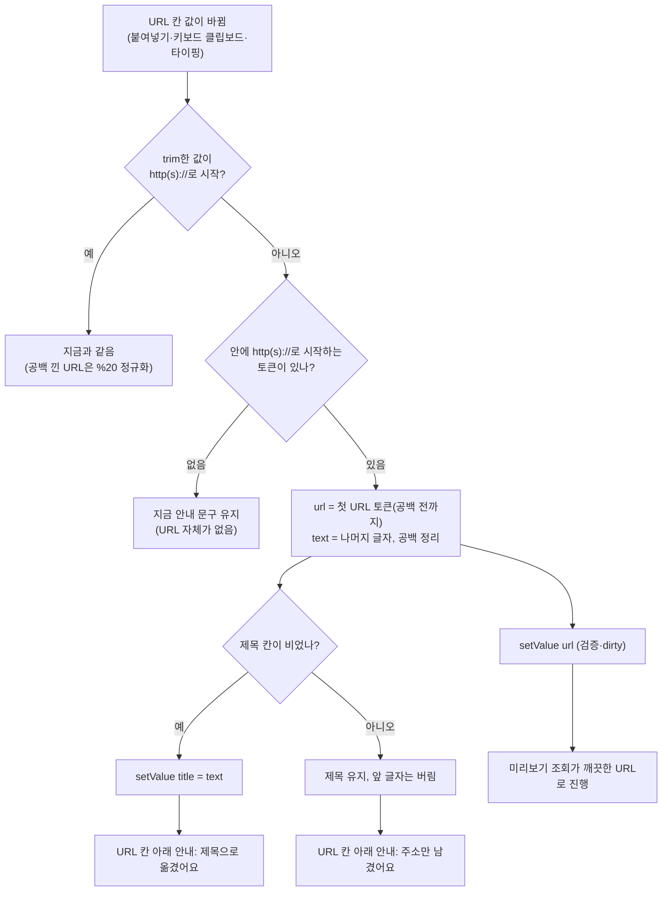

# 링크 등록: 앞에 글자가 붙은 공유 문구에서 URL과 제목 나누기

<!-- plan-result:start — 이 블록만 병합 뒤에도 고칠 수 있다(.claude/CLAUDE.md "계획과 PR 본문"). 아래는 승인된 계획 원문 -->

## 구현 결과

> #697 · 2026-11-27 대조 · 이탈 4 · 미구현 0 — 판정 근거(파일:줄)는 PR 본문 "계획 대비 구현"

- 이탈(사용자 결정): 수정 폼은 "제목이 늘 차 있어 주소만 남긴다"는 전제가 틀렸다. URL을 처음 바꾸면 기존 규칙이 제목을 비운다. 구현 중에 물어 등록 폼과 같게 정했다. 비워진 제목에 앞 글자를 넣고, URL 칸 아래에는 "다시 가져와요" 대신 옮겼다는 안내를 띄운다. 이를 위해 공용 훅이 "곧 비워질 제목"을 알려 주는 함수를 받고, 제목은 구독 안에서 바로 넣지 않고 제목 칸이 빈 뒤에 채운다
- 이탈(구현 판단): URL을 찾는 정규식에서 대소문자 무시를 뺐다. URL 칸 검증 규칙과 같게 소문자 http(s)만 본다. 그래서 `HTTPS://`가 든 공유 문구는 나뉘지 않고 지금의 형식 오류 문구가 뜬다
- 이탈(테스트 위치): 등록 훅 테스트에 두기로 한 나누기·안내·오류 없음·안내 사라짐 확인을, 실제 폼에 붙여 넣는 등록 폼 컴포넌트 테스트로 옮겼다. 훅에서 값을 직접 넣으면 입력 검증 경로를 지나지 않아, 오류 문구가 안 뜨는지 증명할 수 없어서다. 등록 훅 테스트에는 요청 본문 확인만 더했다
- 이탈(사용자 결정·테스트 위치): 수정 훅 테스트(URL만 남고 기존 제목 유지)는 쓰지 않았다. 위 결정으로 기대값이 "앞 글자가 제목"으로 바뀌었고, 수정 폼 컴포넌트 테스트에서 확인한다. 기존 제목 유지는 URL을 바꾼 뒤 직접 쓴 제목이 있는 경우로 확인한다
- 계획에 없던 변경(사용자 요청): 등록·수정 요청 본문에 나눈 `url`·`title`이 빠짐없이 실리는지 보는 테스트. 그 밖에 두 번째 공유 문구 붙여넣기, 주소가 없는 글이면 오류 문구를 유지하는지 보는 테스트
- 계획에 없던 변경: `docs/POST.md` "수정" 절에 수정 폼 동작을, 시행착오 절에 구현을 깨도 통과하던 테스트 두 가지와 고친 방법을 적었다
- 문서 동기화: `docs/POST.md` 마지막 검토 날짜
- 병합 뒤 확인: 폰 키보드의 클립보드 제안으로 넣는 경로는 실기기 확인 이슈로 연다

<!-- plan-result:end -->

## Context

네이버 지도 등 앱의 "링크 복사"는 `알배기 독막로3길 35 2층 https://naver.me/...`처럼 장소명·주소 뒤에 URL을 붙여 준다.
지금은 URL 칸 값 전체를 URL로 검증해(`src/entities/post/model/post.schema.ts:9-16`, `mode: 'onChange'`) 붙여넣는 순간
"http:// 또는 https://로 시작하는 웹 주소만 등록할 수 있어요."가 뜨고 등록 버튼·미리보기가 막힌다(2026-11-27 사용자 폰
스크린샷). 다른 앱도 비슷한 문구를 줄 수 있으니, URL 칸 값이 http로 시작하지 않는데 `http(s)://`가 들어 있으면
URL만 남기고 나머지 글자를 제목으로 옮긴다.

**어디서 나누나 — 클라이언트(FE).** 등록 전에 제목 칸·미리보기 카드로 결과를 보고 고칠 수 있고, API 계약
(BE `url`은 엄격한 `SafeUrlValidator`)과 배포 순서를 바꾸지 않는다. 서버에서 나누려 해도 FE 검증이 먼저 막아
FE 변경이 어차피 필요하다.

## 사용자 결정(2026-11-27, 질문 카드)

| 질문 | 답 |
| --- | --- |
| 나눈 뒤 알릴지 | URL 칸 아래 안내 한 줄 |
| 제목 칸이 이미 차 있을 때 | 기존 제목 유지(앞 글자 버림) |
| 적용 범위 | 등록 + 수정 폼 |
| URL이 아예 없는 입력의 문구 | 지금 문구(`TEXTS.validation.urlFormat`) 유지 |
| 나누는 위치 | 클라이언트(사용자 제안, 위 근거로 동의) |

안내 **문구·모양**은 아직 안 정했다 — 구현 중 실제 `FormInput` 스타일(`description`, `descriptionVariant` default/success)로
만든 미리보기 두세 안을 나란히 보여 주고 고른 뒤 반영한다(공통 지침 "사용자가 정할 것").

## 변경

1. **나누는 순수 함수** — `src/shared/utils/url.util.ts`의 `UrlUtil`에 static `splitSharedText(input): { url: string; text: string } | null`
   추가(`*.util.ts` 클래스 규칙, FE-ARCHITECTURE §23).
   - trim한 값이 `https?://`로 시작하면 `null`(지금 동작 유지 — 공백 낀 URL을 `%20`으로 바꾸는 `normalizeUrl` 경로를 건드리지 않음)
   - 첫 `/https?:\/\/\S+/i` 매치를 URL로, 나머지(앞+뒤)를 공백 한 칸으로 합쳐 trim한 것을 text로
   - 매치가 없으면 `null`
   - 앱별 머리말(예: `[네이버지도]`)은 지우지 않는다 — 실제 형식을 확인 못 했고 사용자가 제목 칸에서 고칠 수 있다
2. **공용 훅** — `src/entities/post/hooks/useSharedUrlTextSplit.ts`(이름은 구현 때 확정, 같은 폴더 `useLinkPreview.ts`가 선례).
   등록·수정 두 feature가 쓰는데 features끼리는 import할 수 없어 entities에 둔다. `url`·`title` 필드를 가진 폼을 받아:
   - `form.subscribe`(기존 `clearSubmitErrorsOnEdit`와 같은 방식, `watch()` 금지 이유도 같음)로 `url` 값이 바뀔 때
     `splitSharedText`를 돌려 나뉘면 `setValue('url', url, { shouldValidate: true, shouldDirty: true })`, 제목 칸이 비었으면
     `setValue('title', text, { shouldDirty: true })`
   - 반환: URL 칸 아래 안내 문구(`'movedToTitle' | 'urlOnly' | null`에 대응하는 TEXTS 문구). 사용자가 URL 칸을 다시 고치면 지운다
   - `FormInput`은 `{...props}` 뒤에 `{...registration}`을 펼쳐 `onChange`를 가로챌 수 없어(`FormInput.tsx`) 값 구독으로 한다.
     값 구독은 붙여넣기 이벤트가 없는 키보드 클립보드 입력도 잡는다.
3. **폼 연결** — `useCreatePost.ts`·`useUpdatePost.ts`에서 훅을 부르고, `CreatePostForm.tsx`·`UpdatePostForm.tsx`의 URL `FormInput`에
   `description`으로 안내를 넘긴다(에러가 있으면 기존 `FormField`가 에러를 보여 준다 — 구현 때 확인). 수정 폼은 제목이 늘 차 있어 "주소만 남겼어요" 쪽이 된다.
4. **문구** — `src/shared/config/texts.ts`에 안내 키 2개 추가(해요체, `texts-conventions` skill). 문구는 미리보기로 고른 것
5. **문서** — `docs/POST.md` "작성" 절에 항목 추가, `CHANGELOG.md` `[Unreleased]` Added, 계획 스냅샷 `docs/plans/2026-11-27-shared-text-url-split.md`,
   `pnpm docs:index`로 색인 재생성

## 구현 중 확인할 것(지금은 추적 안 함)

- **문구 깜빡임** — 섞인 값의 검증(에러)과 바꾼 값의 검증(통과)이 겹칠 때 에러가 한 번 그려지는지. 설치본
  `node_modules/react-hook-form`의 `onChange` 처리(값이 바뀐 뒤 끝난 옛 검증을 버리는지)를 읽고 버전·파일:줄을 남긴다.
  깜빡이면 `onPaste`에서 먼저 나누는 처리를 더한다.
- **줄바꿈** — 공유 문구가 여러 줄일 때 한 줄 입력칸이 줄바꿈을 공백으로 바꾸는지 지우는지(지우면 `알배기https://…`,
  `서울 마포구…`가 붙음). Playwright로 `\n`이 든 클립보드를 붙여 넣어 확인하고, 지우면 `onPaste`의 원문(`clipboardData`)으로 나눈다.

## 테스트(실패 먼저)

- `url.util.test.ts`: 네이버 지도 형식 / 줄바꿈이 지워져 붙은 형식(`알배기https://naver.me/x`) / URL 뒤에 글자 /
  URL 둘(첫 것) / http로 시작(공백 낀 URL 포함) → null / URL 없음 → null
- `useCreatePost.test.tsx`: 섞인 값을 입력하면 url·title이 나뉘고 등록 가능(`isValid`), URL 칸 에러 없음, 안내 "제목으로 옮겼어요" /
  제목이 이미 있으면 덮지 않고 안내 "주소만 남겼어요" / URL을 다시 고치면 안내 사라짐 / 등록 요청 본문의 `url`·`title`
- `useUpdatePost.test.tsx`: 섞인 값을 넣으면 URL만 남고 기존 제목 유지
- `UpdatePostForm.test.tsx`·등록 폼: 안내가 URL 칸 아래에 보임
- 새 테스트는 구현을 일부러 깨서 실패하는지 한 번 확인

## 완료 조건

- 끝 상태: `/post/submit` URL 칸에 `알배기 독막로3길 35 2층 https://naver.me/abc`를 붙여 넣으면 URL 칸에 `https://naver.me/abc`, 제목
  칸에 `알배기 독막로3길 35 2층`, 형식 오류 문구 없음, URL 칸 아래 안내 한 줄, 미리보기 조회 진행, 등록 버튼 활성. 수정 폼은 URL만 남고 제목 유지
- 증명: `pnpm type-check`·`pnpm test`·`pnpm lint`·`pnpm check:deps`·`pnpm check:docs` 통과 출력, `browser-verification` skill로
  모킹 응답 Playwright 녹화(데스크톱·모바일 폭)
- 바꾸면 안 되는 것: http로 시작하는 입력의 동작(공백 `%20` 정규화 포함), BE API 계약, 기존 테스트 단언
