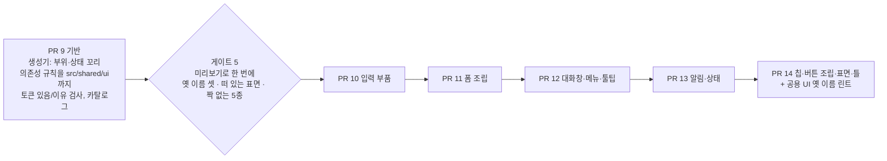

# 디자인 시스템 2단계 Phase 5b: 나머지 공용 UI 부품에 부품 토큰과 새 색 이름

<!-- plan-result:start — 이 블록만 병합 뒤에도 고칠 수 있다(.claude/CLAUDE.md "계획과 PR 본문"). 아래는 승인된 계획 원문 -->

## 구현 결과

> #706 · 2026-11-28 대조 · 이탈 4 · 미구현 0 — PR 9(기반). 판정 근거(파일:줄)는 PR 본문 "계획 대비 구현"

- 이탈(범위): PR 9 생성기 행의 "라이브러리 변수 객체 출력"을 PR 13(sonner)으로 미뤘다. 이 출력을 쓰는 부품이 sonner 하나뿐이라, 쓰는 PR에서 같이 만들고 시험한다
- 이탈(범위): 원칙 문서 §5 분류표에 "부품 토큰 있음/이유" 열을 더하지 않았다. 계약 테스트의 이유 표가 정본이라 두 곳에 적으면 한쪽만 고쳐질 수 있어, 분류표 머리에 그 표를 가리키는 한 줄을 뒀다
- 이탈(절차): 계획은 고치기 전에 기준 빌드(앱·Storybook·예제 앱)를 보관하는 것이었지만, 고치고 커밋한 뒤 origin/main 사본 워크트리에서 기준을 빌드했다. 기준이 origin/main이라 비교 결과는 같다
- 이탈(절차): 임시 브라우저 스펙을 만들지 않으면서 "전환 클래스와 JS를 바꾸지 않는다"를 e2e 전에 밝히지 않았다. 바뀐 것은 생성 스크립트·의존성 규칙·계약 테스트·카탈로그 스토리뿐이고 부품 파일은 그대로다
- 미구현 → 보완함: DESIGN-SYSTEM.md §9 PR 9 실측, §5 상태 꼬리 규칙(꼬리는 처음 쓰는 부품 PR에서 표에 더하고, 표에 없으면 생성이 멈춘다)
- 계획에 없던 변경: 생성기가 등록하지 않은 부품 토큰 파일(다크 포함)이나 파일 이름과 다른 맨 위 그룹을 만나면 멈춘다. 계약 테스트는 부품 파일 이름이 겹치는지, 레시피를 읽게 된 부품이 이유 표에 남았는지도 본다. 카탈로그 표에 견본 칸을 더했다
- 계획에 없던 발견: 앱 Tailwind가 스토리 파일도 훑어 새 카탈로그 표의 클래스 규칙 둘이 앱 CSS에 더해졌다(화면 영향 없음)
- 뒤 PR로 넘긴 확인(PR 10): src/shared/ui 부품이 자기 레시피를 읽는 경우 의존성 규칙과 이유 표 검사가 통과하는지는 그런 레시피가 처음 생기는 PR 10에서 본다
- 문서 동기화: 토큰 표 문서의 부품 절 제목(그룹 이름을 따라 "button"), DESIGN-SYSTEM.md §5 링크, 원칙 문서 검토 날짜, 계획 색인

<!-- plan-result:end -->

> 2단계 계획(`docs/plans/2026-11-24-design-tokens-stage2.md`)의 마지막 Phase다. Button(#705)에서 정한 방식(당근식: 부품 토큰 원본 → 빌드 때 Tailwind 클래스로 굳힌 레시피)을 나머지 58개 공용 UI 부품에 넓히고, 파일마다 옛 shadcn 색 이름 213곳을 새 이름으로 한 번에 바꾼다. 끝나면 공용 UI에도 옛 이름 린트를 건다. 화면은 게이트 5에서 정한 것 말고는 바뀌지 않는다. PR 6개(PR 9~14)이고 게이트가 한 번 있다.

## Context

- **왜**: 2단계 계획은 "모든 부품 토큰까지 2단계에"(2026-11-24 사용자 결정)이고, 2단계는 이 후속 계획까지 끝나야 끝난다(2단계 계획 "남은 것"). 지금 앱 층은 새 색 이름(#704), 공용 UI는 옛 이름(별칭으로 동작)이라 두 이름이 섞여 있다.
- **Button에서 정한 것**(#705, 게이트 4): 부품만의 결정(변형·크기마다의 색·높이·여백)은 `packages/ui/tokens/components/<부품>.tokens.json`에 적고, `packages/ui/scripts/build-tokens.js`가 `packages/ui/src/recipes/<부품>.recipe.gen.ts`로 굳힌다. 부품의 cva가 레시피를 읽는다. 부품별 CSS 변수는 없다. 배치만 하는 부품은 토큰 파일 없이 이유를 적는다. 구조는 `docs/DESIGN-SYSTEM.md` §5 "부품 토큰".
- **사전 조사**(2026-11-28, 코드는 읽기 전용 탐색 에이전트, 당근·토스는 웹 조회 에이전트. 아래 수치는 에이전트 보고이고 구현 때 다시 센다)
  - 공용 UI 부품 59개(atoms 23, elements 34, layouts 2. Button 포함)이고 남은 것은 58개다. 앱 전용 5개(AppErrorFallback, AsyncBoundary, MarkdownContent, RouteAlertDialogs, GlobalImageViewer, `eslint.config.js:1776-1782`).
  - 옛 이름 213곳(옛 이름 린트와 같은 정규식으로 셈). 그 밖에 `sonner.tsx:20-26`이 옛 변수(`var(--background)` 등과 상태색 4개)를 읽어 sonner 전용 변수 12개를 만든다. 부품 파일 밖에는 `packages/ui/src/styles/tokens.css:30`(`@apply`)과 `src/shared/lib/toast/NoticeToast.tsx`(1곳)가 있다.
  - 값이 의미 색과 다른 옛 이름 셋: accent-foreground 7곳(badge, dropdown-menu, select), secondary-foreground 1곳(badge), input 10곳(입력칸·선택·체크박스·스위치·여러 줄 입력의 테두리·배경). Button에도 셋이 남아 있다.
  - 종류가 어긋난 짝 가운데 맞는 새 이름이 없는 것: 배경에 쓴 input(6), 링 간격에 쓴 background(2), 글자에 쓴 background(1, kbd), 테두리에 쓴 scrim(1), 배경에 쓴 border(5, 구분선).
  - 떠 있는 표면: 대화창·확인 창·시트·토스트는 바닥 배경(다크 gray.950), 메뉴·선택 목록은 떠 있는 배경(다크 gray.900).
  - 클래스 문자열을 단언하는 테스트: `src/shared/ui/atoms/dialog.test.tsx:238`·`:244`, `src/shared/ui/elements/dialog/SheetDialogContent.test.tsx:35-38`·`:52-53`, `src/shared/ui/elements/CharacterCount.test.tsx:15`·`:19`, `src/shared/ui/elements/form/FormInputPassword.test.tsx:115`. 스토리 play 하나가 옛 변수로 계산값을 비교한다(`GlobalAlertDialogs.stories.tsx:92-98`).
  - 생성 스크립트는 Button만 안다: 부품 목록 `COMPONENTS = ['button']`(`build-tokens.js:52`), 상태 꼬리 `hover`·`with-icon`(`:699`), 부위(slot) 단계 없음. 의존성 규칙 두 개는 `packages/ui/src`의 부품만 본다(`src/shared/ui`는 대상 밖).
- **당근은** 부품 명세 99개를 두고 색 하나뿐인 divider·skeleton에도 명세가 있다. 명세는 부위(slot)별로 속성을 적고 상태(`enabled`·`focused`·`invalid`·`disabled`)와 변형·크기를 키로 나눈다. 값은 의미 색을 가리킨다(예: dialog `content.color: $color.bg.layer-floating`). tooltip·card·toast 명세는 없다(가까운 것은 help-bubble, snackbar). Box·Flex·Stack 명세도 없다([rootage/components](https://github.com/daangn/seed-design/tree/dev/packages/rootage/components), [dialog.yaml](https://github.com/daangn/seed-design/blob/dev/packages/rootage/components/dialog.yaml), [text-input.yaml](https://github.com/daangn/seed-design/blob/dev/packages/rootage/components/text-input.yaml), 2026-11-28 웹 조회 에이전트로 읽음). **토스는** 공개 문서에서 부품별 변수를 Button에만 연다([TDS Button](https://tossmini-docs.toss.im/tds-mobile/components/button/)). Checkbox·TextField 문서는 속성만 적는다.

## 판단이 필요했던 항목

| 항목 | 결정 | 근거·기각한 대안 |
| --- | --- | --- |
| 토큰 파일을 만들 부품 | 다른 공용 부품을 감싸지 않고 색·크기·여백을 스스로 정하는 부품(약 31개)만 만든다. 다른 공용 부품을 감싸 덧칠만 하는 조립 부품, 배치만 하는 부품, 페이지 틀, 앱 전용 부품은 색 이름만 바꾸고 계약 표에 이유를 적는다(2026-11-28 사용자 결정, 추천안) | 당근의 "부품마다 명세 하나"에 가깝고, 감싼 부품의 결정이 토큰 두 곳에 겹치지 않는다. 기각: 색 하나라도 정하면 모두(약 45개, 같은 결정이 두 파일에 적힌다). 페이지 틀(AuthLayout·ErrorLayout)을 이유 쪽에 넣은 것은 제 판단이다(당근에 페이지 틀 명세가 없다). 앱 전용 부품은 패키지로 옮기지 않아 패키지 토큰 대상이 아니다(제 판단) |
| 화면이 바뀔 수 있는 질문의 시점 | 첫 부품 PR 전에 게이트 5 하나에서 실제 스타일 미리보기로 모두 묻는다(2026-11-28 사용자 결정, 추천안) | 옛 이름 셋이 묶음을 넘나든다(input은 입력 부품, accent-foreground는 메뉴와 badge). 기각: 묶음마다(앞서 옮긴 부품을 다시 고친다) |
| 카탈로그 | 생성 토큰 목록의 부품 묶음을 모두 읽어 표로 그리는 스토리 하나를 더한다(2026-11-28 사용자 결정, 추천안) | 2단계 끝 조건 "토큰 표와 카탈로그가 원본에서 만들어지고". 기각: 토큰 표 문서에만 |
| 여러 부위를 가진 부품의 원본 꼴 | **제 판단**: 당근처럼 부위를 둔다. `<부품>.<부위>.(base \| variant.<변형> \| size.<크기>).<속성>`이고 레시피도 부위별 묶음(`DIALOG_RECIPE.overlay`, `.content`)이다. 부위가 하나뿐인 부품은 Button 꼴(`<부품>.base…`) 그대로다 | 대화창(덮개·본문·제목·설명), 메뉴(목록·항목·구분선)처럼 한 파일에 부위가 여럿이다. Button 레시피는 바꾸지 않는다 |
| 상태 꼬리 | **제 판단**: 표에 꼬리를 더한다. 예: `-focus`(focus-visible), `-checked`(`data-[state=checked]`), `-open`(`data-[state=open]`), `-highlighted`(`data-[highlighted]`), `-invalid`(`aria-invalid`), `-placeholder`, `-disabled`, `-selection`. 실제로 쓰는 꼬리만 그 부품 PR에서 더한다 | 당근도 상태를 키로 나눈다. 표에 없는 꼬리·속성이면 생성이 멈추는 지금 규칙을 그대로 둔다 |
| 레시피 파일 이름 | **제 판단**: 부품 파일 이름과 같게 둔다(`checkbox.recipe.gen.ts`, `FormField.recipe.gen.ts`). 토큰 묶음 이름은 kebab(`form-field`)이고 원본 파일의 `$extensions.baechan.ui.file`로 부품 파일을 적는다 | 의존성 규칙이 파일 이름으로 짝을 짓는다(#705의 규칙). 정규식으로 PascalCase ↔ kebab을 바꿀 수 없다 |
| 라이브러리가 읽는 변수(sonner) | **제 판단**: sonner가 자기 CSS에서 읽는 상태색 변수 12개와 `--toast-offset-bottom`은 그대로 CSS 변수로 둔다. 값을 만드는 곳만 옛 변수 이름에서 새 의미 색 변수(`--bui-color-…`)로 바꾸고, 그 값 목록을 sonner 토큰 원본에 적어 레시피의 변수 객체로 낸다 | 게이트 4의 "부품별 CSS 변수 없음"은 우리 클래스가 읽는 변수 이야기다. 이 변수들은 이미 있고 sonner가 이름을 정한다. 값은 같다 |
| 토큰 있음/이유 검사 | **제 판단**: 계약 테스트(`src/shared/ui/ApiContract.test.tsx`)에 "부품 파일마다 레시피를 import하거나, 이유 표(`COMPONENT_TOKENS_OUTSIDE`)에 이유가 있다"를 더한다. 처음에는 58개가 이유 표에 "Phase 5b에서 옮김"으로 있고 묶음마다 빠진다 | 게이트 4 ②가 후속 계획에 넘긴 검사다. 레시피 import는 의존성 규칙이, 이유 표는 이 테스트가 본다 |
| 묶음과 PR 수 | **제 판단**: 기반 PR 1개 + 부품 PR 5개. 탐색 에이전트가 낸 7묶음 가운데 대화창+메뉴, 칩·버튼 조립+표면·틀을 합쳤다 | 묶음마다 같은 측정(아래 검증)을 돌린다. 합친 묶음은 옛 이름 57곳·36곳이라 Button PR(29곳)의 두 배 안쪽이다 |
| 공용 UI 옛 이름 린트 | 마지막 부품 PR에서 `custom-tailwind/no-legacy-color`를 `src/shared`·`packages/ui/src`까지 넓힌다(게이트 3 ④, 2026-11-27 사용자 결정). 스토리·테스트는 앱 층과 같이 뺀다 | 카탈로그 스토리는 옛 이름(별칭)을 보여 주는 것이 목적이다 |
| 옛 이름 별칭 자체 | 이 계획에서는 지우지 않는다 | 패키지를 쓰는 다른 프로젝트가 옛 이름을 쓸 수 있어 3단계(패키지화)에서 정한다 |

### 뒤집힌 전제

| 발견 | 그래서 바뀐 것 |
| --- | --- |
| 2단계 계획의 "공용 UI 238곳"은 지금 다시 세면 213곳이다(Button 29곳을 더하면 242곳. 238을 센 방법은 기록에 없다) | 개수가 아니라 마지막 PR에서 옛 이름 린트가 공용 UI에서 0곳을 내는 것을 근거로 삼는다 |
| #704 블록의 "accent-foreground를 쓰는 공용 UI 11곳"은 7곳이다(Button의 2곳을 더해도 9곳) | 게이트 5의 미리보기는 지금 센 7곳 + Button으로 그린다 |
| 의존성 규칙이 `src/shared/ui`의 부품을 보지 않는다(`.dependency-cruiser.cjs`의 두 규칙 경로가 `packages/ui/src`뿐) | 기반 PR에서 두 규칙 경로에 `src/shared/ui`를 더한다 |

### 위험 관리

| 위험 | 대응 |
| --- | --- |
| 부위·상태가 늘어 레시피 클래스 순서가 지금 손으로 쓴 순서와 달라져 덮어쓰기 결과가 바뀐다 | 묶음마다 쓰는 쪽 `className` 병합 비교(#705의 방식)를 그 부품을 쓰는 앱의 모든 곳에 돌린다 |
| 다크 변형 클래스와 상태 클래스의 CSS 순서가 바뀌어 이기는 규칙이 달라진다(#705 토스식에서 실제로 났다) | Storybook 계산값을 보통·호버·포커스·열림 상태, 라이트·다크로 전후 비교한다 |
| 예제 앱이 고치기 전 패키지를 빌드한다 | 예제 앱 빌드·비교 전에 `pnpm install --frozen-lockfile`로 복사본을 다시 만든다(`docs/DESIGN-SYSTEM.md` §10) |
| 문서·토큰 설명의 클래스 이름이 쓰지 않는 규칙을 만든다 | 설명에 클래스 이름을 글자 그대로 적지 않고, 묶음마다 앱·예제 앱 CSS 규칙을 비교한다 |

## 세부 계획

### PR 9: 기반 (부품은 바꾸지 않는다)

| 위치 | 변경 내용 |
| --- | --- |
| `packages/ui/scripts/build-tokens.js` | 부품 목록을 `tokens/components/`의 파일에서 읽는다. 부위 단계, 상태 꼬리 표(쓰는 것만), 레시피 파일 이름을 `$extensions.baechan.ui.file`에서 읽기, 라이브러리 변수 객체 출력. Button 레시피는 바이트까지 같아야 한다 |
| `.dependency-cruiser.cjs` | 레시피 두 규칙의 부품 경로에 `src/shared/ui/(atoms\|elements)`를 더한다 |
| `src/shared/ui/ApiContract.test.tsx` | `COMPONENT_TOKENS_OUTSIDE` 표와 "레시피 import 또는 이유" 검사. 처음에는 58개가 "Phase 5b에서 옮김" |
| `src/shared/ui/tokens/DesignTokens.stories.tsx` | `ComponentTokens` 스토리: 생성 목록의 부품 묶음을 표로(이름·라이트·다크·설명) |
| `scripts/generate-token-docs.js` | 부품 묶음마다 절을 자동으로 만든다(지금은 Button 한 줄로 적혀 있다) |
| `docs/DESIGN-SYSTEM.md` §5 "부품 토큰", 원칙 문서 §1.4 | 부위 꼴, 상태 꼬리, 파일 이름 규칙, 이유 표 |

### 게이트 5: 화면이 바뀔 수 있는 결정 (PR 9 병합 뒤, PR 10 전)

실제 토큰 CSS로 그린 전후 미리보기를 라이트·다크로 나란히 보이고, 항목마다 "당근은 / 토스는 / 우리는 / 이유"와 추천을 적어 묻는다. 당근 쪽은 그때 해당 명세 원문(divider·text-input·checkbox·switch·menu·dialog·snackbar)을 직접 읽어 적는다.

| 질문 | 바뀌는 값 | 쓰는 곳 |
| --- | --- | --- |
| ① 보조 글자 둘(accent-foreground·secondary-foreground)을 본문 글자로 합칠지 | 라이트 gray.900 → gray.950 | 메뉴·선택 목록 항목의 고른 줄, badge, Button outline·ghost 호버·secondary |
| ② 입력칸 선(input)을 선 이름으로 합칠지 | 다크 흰색 15% → 10%(테두리), 배경에 쓴 곳은 ③과 함께 | 입력칸·여러 줄 입력·선택·체크박스·스위치, Button outline 다크 |
| ③ 맞는 새 이름이 없는 짝 5종 | 새 의미 색을 같은 값으로 더하면 화면 그대로, 가까운 이름으로 옮기면 바뀐다 | 배경의 input(6), 링 간격의 background(2), 글자의 background(1), 테두리의 scrim(1), 배경의 border(5) |
| ④ 대화창·확인 창·시트·토스트 배경을 떠 있는 층으로 | 다크 gray.950 → gray.900 | 대화창 4종, 토스트 |

답을 받기 전에는 PR 10을 시작하지 않는다. 답은 이 계획 결과 블록과 DESIGN-SYSTEM.md §5에 적는다. 화면이 바뀌는 답이 나오면 그 묶음 PR에 CHANGELOG 항목과 미리보기를 넣는다.

### PR 10~14: 부품 묶음

T = 토큰 파일과 레시피, R = 색 이름만 바꾸고 이유 표에 이유, L = 배치만(이유 표). 분류는 제 판단이고, 파일을 읽어 기준과 다르면 그 PR 본문에 적는다.

| PR | 부품 | 옛 이름(에이전트 집계) |
| --- | --- | --- |
| 10 입력 부품 | T: input, textarea, select, checkbox, switch, label | 54 |
| 11 폼 조립 | T: FormField, CharacterCount, RequiredMark / R: FormInput, FormInputPassword, PasswordInput, SearchInput, FormCheckbox / L: FormCheckboxGroup | 18 |
| 12 대화창·메뉴·툴팁 | T: dialog, alert-dialog, dropdown-menu, tooltip, kbd / R: SheetDialogContent, GlobalAlertDialogs, ImageViewer / L: KebabMenu, TooltipWrapper, RouteAlertDialogs(앱), GlobalImageViewer(앱) | 57 |
| 13 알림·상태 | T: sonner, badge, featured-icon, FormAlert, skeleton, spinner, EmptyState, ErrorState / R: LoadMoreError / L: CenteredSpinner, DelayedFallback | 48 |
| 14 칩·버튼 조립·표면·틀 | T: ActionChip, FilterChip, DropTargetOverlay, card, avatar, divider, labeled-divider, link-thumbnail, ImageAttachmentPreviews / R: EditButton, BackToTopButton, ImageAttachmentButton, AuthLayout, ErrorLayout, MarkdownContent(앱) / L: ActionButton, ToggleButton, RelativeTime, AppErrorFallback(앱), AsyncBoundary(앱) | 36 |

각 묶음 PR에서 함께 하는 것:

- 부품마다 원본 `packages/ui/tokens/components/<묶음 이름>.tokens.json`(다크 값은 `.dark.tokens.json`, 모드 파일 `tokens.resolver.json`에 등록) → `pnpm tokens` → 부품 cva·클래스가 레시피를 읽게 한다. 배치·포커스·오류처럼 부품끼리 같이 쓰는 것은 #705처럼 부품에 남긴다.
- R 부품은 대응표(게이트 3)와 게이트 5 답으로 이름만 바꾼다.
- 이유 표에서 그 묶음의 줄을 "레시피" 또는 이유로 바꾼다.
- 클래스 문자열을 단언하는 테스트는 새 이름으로 바꾸고 PR 본문에 목록을 적는다(요구가 바뀐 경우).
- 스토리는 시각 변경이 있으면 갱신한다(Critical Rules). 화면이 그대로면 고치지 않는다.
- PR 12: tooltip의 대괄호 변수 문법(`tooltip.tsx:21`, 2단계 계획 "남은 것")을 레시피로 옮길 때 괄호 문법으로 맞춘다.
- PR 13: sonner 상태색 변수의 값을 새 의미 색 변수에서 만들고, `GlobalAlertDialogs.stories.tsx`의 계산값 비교를 새 변수로 바꾼다.
- PR 14: `packages/ui/src/styles/tokens.css:30`의 `@apply`, `src/shared/lib/toast/NoticeToast.tsx`를 새 이름으로. 옛 이름 린트를 공용 UI까지 넓히고(`eslint.config.js`), `.claude/CLAUDE.md` 색 규칙 문장·`design-tokens` skill의 "공용 UI는 옛 이름" 안내를 고친다.

### 문서 (PR마다, 마지막 PR에서 정리)

| 위치 | 변경 내용 |
| --- | --- |
| `docs/DESIGN-SYSTEM.md` §5·§9·§11 | 부품 토큰 현황, 묶음마다 실측, 남은 것 |
| `docs/DESIGN-SYSTEM-PRINCIPLES.md` §5 분류표 | 부품마다 "부품 토큰 있음/이유" 열 |
| `docs/DESIGN-SYSTEM-ROADMAP.md` | 2단계 행: PR 14 병합 때 "완료"로 |
| `docs/DECISIONS.md` | 게이트 5에서 화면이 바뀌는 결정이 나오면 새 항목 |
| 계획 결과 블록 | 이 계획: PR마다. 2단계 계획: PR 14에서 "Phase 5b 끝(이 계획 링크)" 한 줄 |
| `docs/DECISIONS-INDEX.md`·`docs/PLANS-INDEX.md` | `pnpm docs:index`(결정 주제 표에 새 결정을 먼저 넣는다) |

## 영향 범위

- **화면**: 게이트 5의 답 말고는 바뀌지 않는다. 바뀌는 답이 나오면 그 묶음 PR에 CHANGELOG와 미리보기.
- **공용 부품 사용처**: 입력·대화창·메뉴·토스트는 앱 대부분이 쓴다. PR마다 `pnpm graph:focus "<부품 경로>" --text`로 사용처를 뽑아 병합 비교 대상에 넣고, PR 본문에 한두 줄로 요약한다.
- **공개 속성**: 바꾸지 않는다(`variant`·`size` 키, 내보내는 이름).
- **테스트**: 클래스 문자열 단언 7곳과 스토리 play 1곳이 새 이름으로 바뀐다(요구 변경). 그 밖의 단언은 바꾸지 않는다.
- **패키지**: 레시피 파일이 늘고(약 31개), 앱·예제 앱 CSS에는 새 이름 규칙이 더해지고 옛 이름 규칙이 빠진다. 마지막 PR 뒤 별칭 규칙은 카탈로그 스토리만 쓴다.
- **배포 순서**: 제약 없음(데이터 계약·API 변경 없음).

## 검증 방법

PR마다(Node 24, 워크트리, `caffeinate -dims`로 묶고 e2e 중에는 파일을 고치지 않는다):

1. **기준 먼저**: 고치기 전에 Storybook 정적 빌드·앱 빌드·예제 앱 빌드(복사본을 다시 만든 뒤)를 스크래치패드에 보관한다.
2. **Storybook 계산값 전후 비교**: 그 묶음 부품의 스토리마다 보통·호버·키보드 포커스와 열림·선택·체크 상태, 라이트·다크에서 색·테두리·그림자·크기·여백·글자 속성을 읽는다(#705의 측정 스크립트를 부품 목록만 바꿔 쓴다). 통과 기준: 게이트 5에서 정한 값 말고 차이 0.
3. **빌드 CSS 규칙 비교**(앱·예제 앱): 선언이 바뀐 규칙이 게이트 5 답으로 설명되고, 빠진 규칙은 그 묶음만 쓰던 옛 이름, 더해진 규칙은 새 이름뿐이다.
4. **쓰는 쪽 병합 비교**: 그 묶음 부품을 쓰는 앱의 모든 곳에서 바꾸기 전 정의와 지금 레시피를 같은 `cn()`에 넣어, 쓰는 쪽 클래스가 살아남는지가 같은지 본다.
5. **검사가 실제로 막는지**(고쳤다가 되돌림): 새 상태 꼬리·부위 처리, 이유 표 검사(이유 줄을 지우면 실패), 의존성 규칙(`src/shared/ui` 부품이 남의 레시피를 import하면 막힘), PR 14의 옛 이름 린트(공용 UI 파일 하나를 옛 이름으로 되돌리면 막힘).
6. **검사 묶음**: 생성물 최신성(`pnpm tokens`를 두 번 돌려 변경 없음), `pnpm check`, `pnpm test`, `pnpm check:docs`, `pnpm build`, `pnpm build-storybook`, `pnpm test:storybook`, 예제 앱 빌드, `pnpm test:e2e`. 규칙 비교가 못 보는 것(동작 줄이기, 폰 크기 토스트 위치, 열림·닫힘 시간, JS 타이머)은 PR 12(대화창)·PR 13(토스트)에서 임시 브라우저 스펙으로 본다. 다른 PR은 전환 클래스와 JS를 바꾸지 않으면 그렇다고 미리 밝힌다.
7. **대조와 PR**: plan-verifier → 결과 블록 → `pnpm docs:index` → `pnpm check:pr-body` → PR → CI → 사용자 병합 승인 → 배포 확인(앱·Storybook) → 운영에서 그 묶음 부품 하나의 계산값 확인 → 워크트리 정리 → 메모 갱신.

**끝 조건**: PR 14 병합 뒤 (a) 공용 UI의 옛 이름 린트가 0곳, (b) 58개 부품이 모두 레시피를 읽거나 이유 표에 이유가 있음(계약 테스트 통과), (c) 토큰 표와 카탈로그에 부품 토큰이 원본에서 만들어짐, (d) 묶음마다 계산값 차이가 게이트 5 답으로 설명됨. 바꾸면 안 되는 것: 공개 속성, 앱 전용 토큰(`globals.css`), Button 레시피(게이트 5 답 말고), 옛 이름 별칭의 값.

## 남은 것

- **게이트 5의 답**: 답을 받기 전에는 PR 10을 시작하지 않는다.
- **이 계획 밖에서 따로 여쭐 것**(조사에서 본 것)
  - 앱이 `--kbd-in-primary-*` 변수로 kbd의 "브랜드 배경 위" 모양을 따로 만든다(`src/app/globals.css:66-67`, 쓰는 곳 댓글 입력 2곳). kbd 변형으로 옮길지.
  - 메뉴 항목의 `variant` 속성이 다섯 값을 받지만 위험(destructive)만 모양이 있다(`dropdown-menu.tsx:318`).
  - BackToTopButton·EditButton 등이 Button의 결정을 `className`으로 덮는다. Button 변형으로 올릴지.
  - `cn()`에 겹침 순서 토큰이 등록돼 있지 않다(2단계 계획 "남은 것"에서 넘어옴).
- **3단계로 넘기는 것**: 옛 shadcn 이름 별칭을 지울지(패키지를 쓰는 쪽 호환).
- **메모 갱신**: PR마다 디자인 시스템 진행 메모.
- **다음 디자인 시스템 계획**(별도 계획·승인): 3단계(패키지화).
